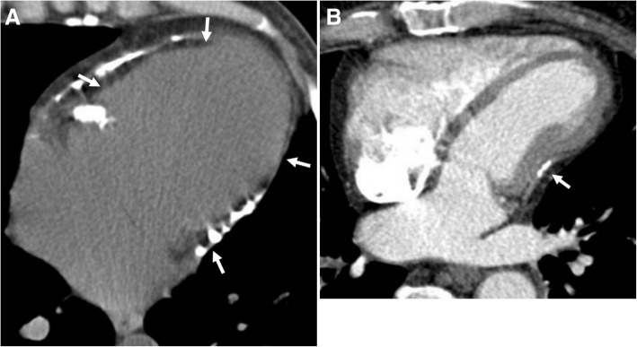
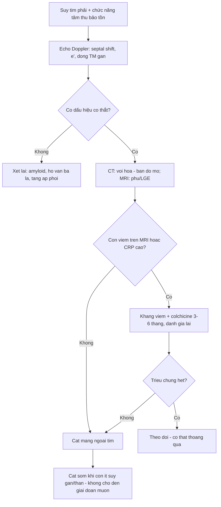
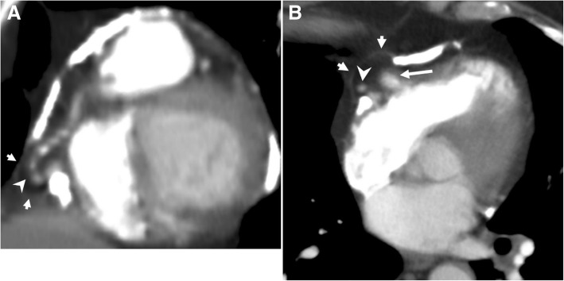
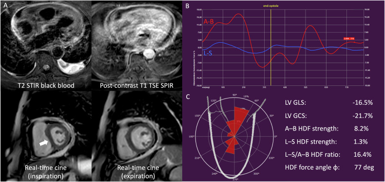

# 1885 — Viêm màng ngoài tim co thắt: vôi hóa "áo giáp", septal bounce và ngưỡng cắt màng ngoài tim / Constrictive pericarditis

**Tags:** `pattern:vien-mang-ngoai-tim` `pattern:voi-hoa-mang-tim` `pattern:day-mang-ngoai-tim` `pattern:hao-hut-tam-truong` `vung:mang-tim` `vung:tim` `protocol:MRI-tim` `protocol:CT-tim` `protocol:sieutham-Doppler` `score:Mayo-echo`
**Mức chắc chắn (certainty):** tổng hợp y văn (literature synthesis) — ghép **1 tổng quan hình ảnh các bệnh màng ngoài tim** (*Insights into Imaging* 2019, PMC6441059, CC BY 4.0), **1 nghiên cứu CMR 103 bệnh nhân viêm màng ngoài tim** (*Insights into Imaging* 2026, PMC13264637, CC BY 4.0), **1 tổng quan huyết động học/Mayo criteria** (*Methodist DeBakey Cardiovasc J* 2026, PMC12985938) và **1 tổng quan phẫu thuật** (*Methodist DeBakey Cardiovasc J* 2026, PMC12985804). Không có thử nghiệm ngẫu nhiên về ngưỡng cắt màng ngoài tim.

> **Câu chốt:** co thắt màng ngoài tim **không phải bệnh của "dày màng ngoài tim"** mà là bệnh của **vỏ không giãn nở** → hai thất **giành máu của nhau theo nhịp thở** (ventricular interdependence). Vì vậy chẩn đoán dựa trên **dấu hiệu động** (septal bounce, **medial e' ≥ 9 cm/s**, **biến thiên dòng vào van hai lá ≥ 25%**, **đảo dòng tâm trương thì thở ra ở tĩnh mạch gan**), còn **dày ≥ 3 mm** chỉ có ở **khoảng 1/3 ca mổ** và **vôi hóa cũng gặp ở người già không co thắt** — hình thái **một mình không đủ**.

## 1. Tổng quan bệnh học – cơ chế hình ảnh

### 1.1 Vỏ cứng → hai thất giành máu của nhau

- **Bình thường:** thì hít vào, áp lực trong lồng ngực **giảm 5–10 mmHg** → máu về **thất phải** nhiều hơn; màng ngoài tim **giãn ra** nên thất phải nở mà **không chèn thất trái** (PMC12985938).
- **Khi màng ngoài tim xơ–vôi:** vỏ **không giãn** → thất phải nở về phía **vách liên thất**, **vách đẩy vào thất trái** → **thất trái đổ đầy ít đi khi hít vào** → huyết áp tâm thu giảm (mạch nghịch thường), và **thì thở ra thì ngược lại**. Đây là **interventricular dependence** — cơ chế của mọi dấu hiệu chẩn đoán.
- **Vì sao áp lực cuối tâm trương hai thất bằng nhau ("equalization"):** cả hai thất cùng bị ép trong một vỏ cứng, nên **áp lực tâm trương cân bằng** — trừ khi co thắt **khu trú** hoặc có **bệnh cơ tim phối hợp** (khi đó áp lực **lệch nhau**) (PMC12985938).
- **Vì sao nhĩ to và tĩnh mạch cửa giãn:** áp lực nhĩ phải cao kéo dài → **tĩnh mạch chủ dưới căng (plethora)**, **gan to**, **cổ trướng**, **phù** — bệnh cảnh **giả xơ gan** rất dễ chẩn đoán nhầm (bài 127).

### 1.2 Ba cơ chất hình ảnh và TẠI SAO chúng khác nhau

1. **Xơ – vôi hóa (thể mạn):** mô xơ co + canxi lắng đọng. **CT là vua:** canxi hấp thụ tia X rất mạnh nên **đậm độ rất cao (hàng trăm HU; ngưỡng quy ước nhận canxi là 130 HU)**, thấy rõ **dải vôi hóa hình vỏ trứng (eggshell)** và **tim bị "giam" (entrapped heart)**. MRI: **tín hiệu thấp ở mọi chuỗi xung** vì cả xơ và canxi đều **rất ít proton tự do**.
2. **Viêm (thể bán cấp, có thể hồi phục):** phù + tăng sinh mạch. **MRI là vua:** **T2 STIR tăng tín hiệu** (phù) và **LGE màng ngoài tim tăng** (xơ–viêm giữ gadolinium) → thể này **có thể đáp ứng kháng viêm** thay vì mổ (PMC12985804; PMC13264637).
3. **Dày đơn thuần không vôi hóa:** gặp nhiều hơn vôi hóa, nhưng **kém đặc hiệu** — dày màng ngoài tim cũng có trong suy tim, sau mổ, xơ hóa không co thắt.

### 1.3 Ngưỡng định lượng nằm lòng

| Đại lượng | Số liệu | Nguồn |
|---|---|---|
| Tỉ lệ co thắt sau một đợt viêm màng ngoài tim | **1,8%** chung; **0,48%** do vô căn/virus; **8,3%** do nguyên nhân không vô căn (ung thư, sau tổn thương màng ngoài tim, do vi khuẩn) | PMC12985804 |
| Vôi hóa màng ngoài tim ở ca mổ | **≈ 1/3** ca được mổ xác nhận; **dày màng ngoài tim phổ biến hơn vôi hóa** | PMC12985804 |
| Áp lực lồng ngực thay đổi theo nhịp thở | **5–10 mmHg** mỗi thì hít vào | PMC12985938 |
| Medial mitral annulus e' (Mayo criteria) | **≥ 9 cm/s** | PMC12985938 |
| Biến thiên vận tốc dòng vào van hai lá (E) | **≥ 25%** theo nhịp thở | PMC12985938 |
| Biến thiên dòng vào van ba lá khi hít vào | **> 40%** (không dùng để chẩn đoán vì bình thường cũng có) | PMC12985938 |
| Tỉ lệ áp lực nhĩ phải / áp lực mao mạch phổi bít | **≥ 0,77** → phù hợp co thắt, **sống tốt hơn sau cắt**; **< 0,77** → nghĩ **thành phần cơ tim** (hạn chế) phối hợp | PMC12985938 |
| CMR ở viêm màng ngoài tim (103 ca) | **42/103 (41%)** có sinh lý co thắt; **A–B HDF 15,3 ± 6,2% vs 21,4 ± 7,3%** (p < 0,001) | PMC13264637 |
| Hiệu lực CMR | **GLS AUC 0,76** · **A–B HDF AUC 0,78** · **kết hợp AUC 0,82** | PMC13264637 |
| Định nghĩa sinh lý co thắt | **septal bounce tâm trương và/hoặc septal shift theo nhịp thở** (theo khuyến cáo ESC) | PMC13264637 |

## 2. Mẫu hình + chẩn đoán phân biệt theo cơ chế & vị trí (Gamut)

**Mẫu hình chung:** tim **không giãn**, **hai nhĩ to**, **dày ± vôi hóa màng ngoài tim**, **tĩnh mạch chủ dưới căng**, **gan to**, có thể **tràn dịch màng phổi hai bên**; bệnh nhân **khó thở khi gắng sức + phù + mệt** nhưng **chức năng tâm thu bảo tồn**.

- **Theo cơ chất:** **xơ–vôi mạn** (vôi hóa vỏ trứng, cắt màng ngoài tim là điều trị triệt để) · **viêm bán cấp** (phù/LGE, có thể hồi phục bằng kháng viêm) · **co thắt – tràn dịch (effusive-constrictive)** (còn co thắt **sau khi chọc hút dịch**) (PMC12823680).
- **Theo vị trí:** **lan tỏa** (cả hai thất) · **khu trú** (chỉ vành nhĩ–thất, chỉ thất phải, hoặc chỉ quanh thất trái) — thể khu trú **có thể không "equalization" áp lực** và **dễ bỏ sót** (PMC12985938).
- **Theo nguyên nhân (quyết định tiên lượng phẫu thuật):** vô căn/virus · **sau mổ tim** · **sau xạ trị** · **lao** · **urê máu** · **bệnh mô liên kết** · **ung thư**. Nguyên nhân **không vô căn** có tỉ lệ co thắt **cao gấp ~17 lần** (8,3% vs 0,48%) (PMC12985804).
- **Gamut "tim không giãn + nhĩ to + phù":** co thắt màng ngoài tim · **bệnh cơ tim hạn chế (amyloid)** · **chèn ép tim cấp** · **hở van ba lá nặng** · **tăng áp phổi nặng** · **xơ gan** (bài 127, 149).

## 3. Bảng so sánh phân biệt (ma trận đối chiếu)

| Thực thể (entity) | Hình ảnh điển hình | Chốt vào (rule-in) | Chốt loại (rule-out) | Gợi ý xác nhận |
|---|---|---|---|---|
| **Viêm màng ngoài tim co thắt** | **Dày màng ngoài tim ± vôi hóa vỏ trứng**, **tim "bị giam"**, nhĩ to, IVC căng; **septal bounce**; LGE màng ngoài tim nếu viêm | **Vách liên thất đảo theo nhịp thở + medial e' ≥ 9 cm/s + đảo dòng TM gan thì thở ra** | **Thành tim dày đều + LGE dưới nội tâm mạc + không có septal shift** → amyloid | Echo Doppler + CT (canxi) + MRI (LGE, strain); catheter đo **SAI** và **RA/PCW** |
| **Bệnh cơ tim hạn chế (amyloid)** | **Thành thất dày đối xứng**, **nhĩ to**, **LGE dưới nội tâm mạc toàn chu vi**, **"apical sparing"** trên strain; **không vôi hóa** | **Dày thành thất + LGE dưới nội tâm mạc + e' thấp CẢ HAI bên vòng van** | **Septal shift + e' vòng trong CAO (annulus paradoxus)** → co thắt | Siêu âm strain; MRI; xạ hình PYP/DPD |
| **Chèn ép tim cấp (tamponade)** | **Dịch nhiều**, **xẹp nhĩ phải cuối tâm trương**, **xẹp thất phải/động mạch phổi**, tim "lắc lư" | **Hạ huyết áp + xẹp buồng + IVC căng, biến thiên lớn dòng van ba lá/lá** | **Không xẹp buồng, màng ngoài tim dày/vôi, không có dịch nhiều** → co thắt | Echo cấp cứu; chọc hút dịch |
| **Co thắt – tràn dịch (effusive-constrictive)** | Dịch màng ngoài tim **+ dày màng ngoài tim**; **sau chọc hút vẫn còn dấu hiệu co thắt** | **Áp lực nhĩ phải vẫn cao SAU khi hút dịch** | **Áp lực trở về bình thường sau hút** → chỉ là tràn dịch | Đo áp lực trước/sau chọc hút; MRI |
| **Hở van ba lá nặng / tăng áp phổi** | Thất phải to, **vòng van giãn**, dòng ngược tĩnh mạch gan **thì tâm thu** | **Dòng ngược TM gan thì TÂM THU + thất phải giãn** | **Dòng ngược thì TÂM TRƯƠNG–thở ra + thất phải không giãn** | Doppler; RVSP; MRI |

*Bệnh nhân 35 tuổi, giảm cung lượng tim: (A) **vôi hóa màng ngoài tim lan tỏa** (mũi tên) ép tim thành hình **"entrapped heart"** — hình thái kinh điển của co thắt mạn; (B) sau cắt màng ngoài tim, hiệu ứng ép lên thất phải giảm. Nguồn: Insights into Imaging 2019, PMC6441059, CC BY 4.0, nguyên bản.*

### Dấu hiệu hình thái đọc đúng thứ tự

- **CT không cản quang là bước đầu để thấy canxi** (vôi hóa sáng nhất, không cần thuốc); **CT có cản quang** để thấy dày màng ngoài tim, **hình thái buồng thất bị ép**, và **tương quan với động mạch vành/động mạch ngực trong** trước khi mổ (PMC12985804).
- **MRI** trả lời hai câu hỏi mà CT không trả lời được: **(1) còn viêm không (T2 STIR + LGE)? (2) có bằng chứng động của co thắt không (cine thở tự do, septal shift)?**
- **Vôi hóa "vỏ trứng" không đồng nghĩa đang co thắt:** phải có **dấu hiệu huyết động**.

## 4. Protocol chụp + hệ tiêu chuẩn chẩn đoán

### 4.1 CT tim

- **Không cản quang trước, ECG-gating, lát 1–3 mm:** đo **độ dày màng ngoài tim tại chỗ dày nhất**, ghi **vị trí và mức lan của canxi** (quanh nhĩ–thất, trên thất trái, trên thất phải) — đây là **bản đồ cho phẫu thuật**.
- **Có cản quang:** tìm **dày màng ngoài tim**, **thay đổi hình thái buồng thất** ("tubular"/"entrapped"), **nhĩ to**, **IVC căng**, **tràn dịch**, và **các mốc mạch vành/động mạch ngực trong** để tránh tai biến khi cắt.
- **Ngưỡng hình thái:** dày **≥ 3–4 mm** được coi là bất thường, nhưng **chỉ ~1/3 ca mổ có vôi hóa** và dày cũng gặp ở người không co thắt → **không dùng một mình**.

### 4.2 MRI tim — protocol cho co thắt

- **Cine thở tự do (real-time)**: **vách liên thất đảo hướng theo nhịp thở** và **diastolic septal bounce** — định nghĩa sinh lý co thắt (PMC13264637; PMC12985938).
- **T2 STIR**: **phù màng ngoài tim** (thể viêm).
- **T1 sau tiêm + PSIR LGE**: **ngấm màng ngoài tim** = xơ–viêm còn hoạt tính, **có thể hồi phục** (PMC12985804).
- **Phase-contrast thở tự do**: biến thiên **dòng vào van hai lá ≥ 25%**.
- **Strain/HDF (nếu có)**: GLS **AUC 0,76**, **A–B HDF AUC 0,78**, kết hợp **0,82** — hữu ích khi hình thái không rõ (PMC13264637).

### 4.3 Siêu âm tim — "Mayo Clinic criteria"

Bốn trục, **chẩn đoán khi có ≥ 1 dấu hiệu vững chắc + bối cảnh** (PMC12985938):

1. **Phụ thuộc hô hấp của vách liên thất** (M-mode ≥ 10 nhịp, có respirometer).
2. **Medial mitral annulus e' ≥ 9 cm/s** — hệ quả của **"annulus paradoxus"** (áp lực đổ đầy càng cao, e' càng cao vì tim tăng chuyển động dọc) và **"annulus reversus"** (e' vòng trong **>** e' thành bên do thành bên bị dính).
3. **Đảo dòng tĩnh mạch gan thì tâm trương – thở ra** (dấu **đặc hiệu** nhất).
4. **Biến thiên dòng vào van hai lá ≥ 25%** theo nhịp thở.

> **Cạm bẫy trong chính tiêu chuẩn:** **septal bounce** và **annulus reversus** hữu ích nhưng **không nằm trong bộ Mayo criteria** vì **độ đặc hiệu thấp**; dùng chúng như **dấu hiệu hỗ trợ**, không phải tiêu chuẩn (PMC12985938).

### 4.4 Thông tim — khi hình ảnh không kết luận

- **Đo đồng thời hai thất:** **discordance** áp lực tâm thu khi thở, **systolic area index (SAI)**; **equalization** áp lực cuối tâm trương (lưu ý **thể khu trú có thể không equalization**).
- **RA/PCW ≥ 0,77** → co thắt; **< 0,77** → nghĩ **thành phần cơ tim** phối hợp, **tiên lượng cắt kém hơn** (PMC12985938).

### 4.5 Quyết định điều trị

- **Thể viêm/bán cấp:** **thử kháng viêm (NSAID/colchicine, corticoid, ức chế IL-1)** trước — nhiều ca **hồi phục** (PMC12985804; PMC12823680).
- **Thể xơ–vôi mạn có triệu chứng:** **cắt màng ngoài tim** là điều trị triệt để; **không chờ đến khi suy gan–thận nặng** vì **suy cơ quan là yếu tố tiên lượng xấu** (PMC12985804).
- **Co thắt khu trú sau mổ tim** thường **thoáng qua** → tránh mổ lại sớm.

## 5. Biến thể bình thường và cạm bẫy

- **Không dày màng ngoài tim KHÔNG loại trừ co thắt:** dày chỉ khoảng **1/3** ca mổ, và **vôi hóa cũng có ở người già không co thắt** (PMC12985804). Chẩn đoán nằm ở **huyết động**, không ở mm.
- **"Dày màng ngoài tim" trên CT hay bị đo sai** ở chỗ **dày cơ thất** hoặc **mỡ ngoài màng tim**: đo **lớp màng ngoài tim** (đường mảnh, không có mỡ), trên **cửa sổ trung thất**, tại chỗ **dày nhất**, và luôn đo cả **vách gian nhĩ** (thường mỏng hơn nhiều so với thất).
- **Nhầm với amyloid:** amyloid có **dày thành thất**, **LGE dưới nội tâm mạc toàn chu vi**, **e' thấp cả hai bên vòng van**, **không septal shift** — điều trị **hoàn toàn khác** (không cắt màng ngoài tim).
- **Nhầm với xơ gan:** phù + cổ trướng + gan to + albumin thấp khiến bệnh nhân được điều trị "xơ gan" nhiều năm; **luôn đo IVC và tìm dấu hiệu thở** ở bệnh nhân "xơ gan" không rõ nguyên nhân (bài 127).
- **Rung nhĩ làm mất dấu hiệu:** **mất x-descent** và **mất biến thiên theo nhịp thở** → **giảm độ nhạy của Doppler**; phải dựa thêm CT/MRI và thông tim (PMC12985938).
- **Septal bounce đơn độc không đủ:** nó cũng gặp trong **block nhánh trái, sau mổ tim, tăng áp phổi** — cần **bối cảnh + dấu hiệu thứ hai**.
- **Sau chọc hút dịch mà bệnh nhân không đỡ:** nghĩ **effusive-constrictive**, không phải "chọc chưa hết dịch" (PMC12823680).

## 6. Tự lượng giá — Blind Quiz

**Ca 1 — Nam 35 tuổi, giảm cung lượng tim, khó thở tăng dần, phù hai chân.**

- Hỏi: (1) mô tả tổn thương và đặt tên hình thái; (2) ba chẩn đoán phân biệt; (3) vì sao hình B khác hình A?

<b>Bấm để hiện đáp án (findings + chẩn đoán)</b>

- **Dấu hiệu:** **dải vôi hóa màng ngoài tim lan tỏa** (mũi tên) bao quanh tim; **tim nhỏ, không giãn**, bị ép — hình **"entrapped heart"**.
- **Chẩn đoán:** **viêm màng ngoài tim co thắt mạn, thể vôi hóa**.
- **Phân biệt:** bệnh cơ tim hạn chế/amyloid (không vôi hóa, LGE dưới nội tâm mạc); chèn ép tim (dịch nhiều, xẹp buồng); hở van ba lá nặng (thất phải giãn).
- **B:** sau **cắt màng ngoài tim**, hiệu ứng ép lên thất phải giảm — chứng minh vỏ cứng là nguyên nhân.
- Nguồn ảnh: Insights into Imaging 2019, PMC6441059, CC BY 4.0.

**Ca 2 — Nữ 62 tuổi, siêu âm gợi ý "hạn chế cơ tim hoặc co thắt". CT bụng–ngực có đường vôi hóa dài bờ tim.**

- Hỏi: dấu hiệu nào trên CT giúp phân biệt **co thắt** với **hạn chế cơ tim**? Có cần MRI nữa không?

<b>Bấm để hiện đáp án (findings + chẩn đoán)</b>

- **Dấu hiệu:** **vôi hóa dạng đường lan rộng** theo màng ngoài tim (coronal + axial); kèm **túi thừa màng ngoài tim chứa mỡ thượng tâm mạc** và **mạch vành** — biến thể giải phẫu, không phải khối.
- **Phân biệt:** **vôi hóa màng ngoài tim** nghiêng về **co thắt**; **hạn chế cơ tim** thì **không vôi hóa** và có **dày thành thất + LGE dưới nội tâm mạc**.
- **Vẫn cần MRI/echo Doppler** để chứng minh **sinh lý co thắt**; CT chỉ cho **cơ chất** (canxi) và **bản đồ mổ**.
- Nguồn ảnh: Insights into Imaging 2019, PMC6441059, CC BY 4.0.

**Ca 3 — Nữ 70 tuổi, suy tim phải, viêm màng ngoài tim đang hoạt động.**

- Hỏi: (1) ba chuỗi xung trong A nói gì? (2) mũi tên trắng trong cine chỉ dấu hiệu gì? (3) thể này nên mổ ngay hay thử nội khoa?

<b>Bấm để hiện đáp án (findings + chẩn đoán)</b>

- **A:** **T2 STIR** — **dày màng ngoài tim phù (tăng tín hiệu) chu vi**; **T1 sau tiêm SPIR** — **ngấm gadolinium màng ngoài tim chu vi** → **còn viêm**.
- **Cine thở tự do:** **vách liên thất đảo hướng** giữa thì hít vào và thở ra (mũi tên) = **septal shift** — định nghĩa sinh lý co thắt.
- **B–C:** **A–B HDF strength 8,2%**, GLS −16,5%, GCS −21,7% — bất thường theo kiểu co thắt.
- **Xử trí:** thể **viêm/bán cấp** → **thử kháng viêm trước**, đánh giá lại; chỉ mổ khi **xơ hóa cố định hoặc không đáp ứng**.
- Nguồn ảnh: Insights into Imaging 2026, PMC13264637, CC BY 4.0.

## Bài liên quan chéo
- [075 – Tràn dịch màng tim](../075-tran-dich-mang-tim/lesson.md) (dịch màng ngoài tim, chèn ép tim)
- [127 – Gan tim & tăng áp cửa do tắc nghẽn dòng ra](../127-gan-tim-suy-tim-phai/lesson.md) (bệnh cảnh "giả xơ gan")
- [149 – Tăng áp cửa không do xơ gan](../149-tang-ap-cua-khong-xo-gan/lesson.md)
- [820 – MRI tim: LGE & mapping](../820-cardiac-mri-lge-mapping/lesson.md) (kỹ thuật LGE/PSIR)
- [810 – CTA mạch vành & CAD-RADS](../810-coronary-cta-cadrads/lesson.md) (CT tim có ECG-gating)
- [1842 – Takotsubo sau mổ/ICU](../1842-takotsubo-hau-phau-icu/lesson.md) (suy tim cấp sau mổ tim)

> Không dùng để chẩn đoán độc lập khi chưa có người hướng dẫn.
