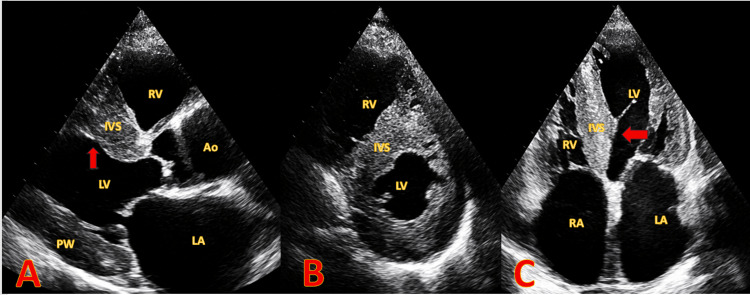
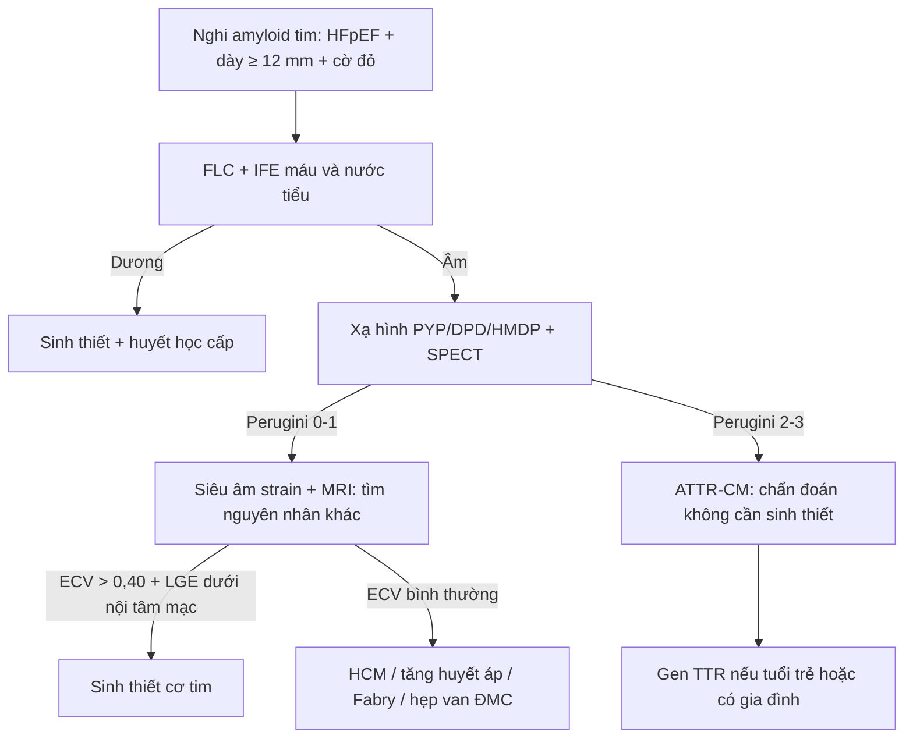
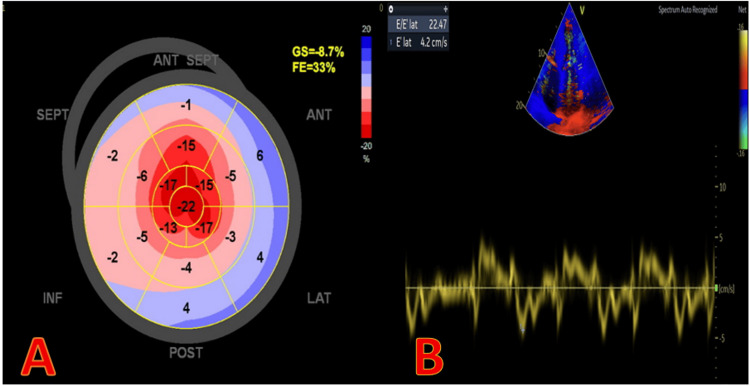
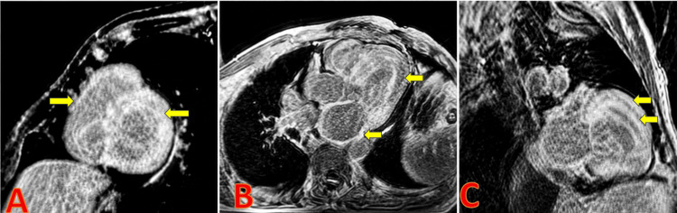
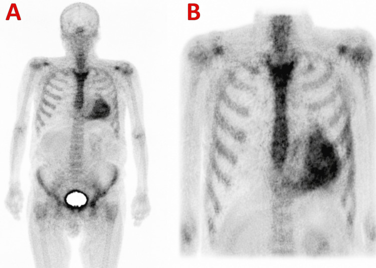

# 1886 — Bệnh cơ tim do amyloid: dày thất "giả", apical sparing và xạ hình xương / Cardiac amyloidosis

**Tags:** `pattern:day-co-tim` `pattern:LGE-duoi-noi-tam-mac` `pattern:apical-sparing` `pattern:hap-thu-xuong` `vung:cotim` `vung:tim` `protocol:MRI-tim` `protocol:sieutham-Doppler` `protocol:xa-hinh-xuong` `score:Perugini`
**Mức chắc chắn (certainty):** tổng hợp y văn (literature synthesis) — ghép **1 tổng quan hình ảnh đa phương thức** (*J Clin Med* 2025;15:163, PMC12786694, CC BY), **1 tổng quan lâm sàng–chẩn đoán–điều trị** (*Aust Prescr* 2026, PMC13696863, CC BY-NC-ND), **1 phân tích tổng hợp về relative apical sparing** (*J Clin Med* 2026, PMC12986376, CC BY) và **1 ca bệnh đa phương thức có đủ 4 ảnh** (*Cureus* 2026, PMC13477558, CC BY). Không có thử nghiệm ngẫu nhiên nào về ngưỡng hình ảnh.

> **Câu chốt:** amyloid tim **không phải bệnh "cơ tim dày"** mà là bệnh **chất nền ngoại bào bị lấp** → thành **dày nhưng điện thế thấp**, **hạn chế đổ đầy**, và trên hình ảnh **ngấm thuốc dưới nội tâm mạc lan tỏa** + **ECV > 0,40**. Chẩn đoán xác định **không cần sinh thiết** khi **xạ hình xương Perugini 2–3** + **không có protein đơn dòng**; và **chẩn đoán phân biệt dễ sai nhất là viêm màng ngoài tim co thắt** (bài 1885) — hai bệnh **cùng "tim không giãn, nhĩ to, phù"** nhưng **e' và septal shift ngược nhau**.

## 1. Tổng quan bệnh học – cơ chế hình ảnh (TẠI SAO)

### 1.1 Chất nền ngoại bào bị lấp, không phải cơ tim phì đại

- **Bệnh học:** protein gấp sai (transthyretin — **ATTR**; hoặc chuỗi nhẹ immunoglobulin — **AL**) tạo **sợi amyloid dạng tấm β (cross-β sheet)**, lắng **ngoài tế bào cơ tim**. Tế bào cơ **không to lên**; khoảng kẽ **nở ra** → thành dày **giả phì đại** (pseudohypertrophy).
- **98% amyloid tim là ATTR hoặc AL** (PMC13696863). ATTR hiện là thể **phổ biến nhất**; AL hiếm (**≈ 10 ca/triệu dân/năm**) nhưng **tiến triển nhanh nhất** — **sống trung bình < 6 tháng** nếu chưa điều trị và đã có triệu chứng suy tim (PMC12786694).
- **TẠI SAO điện thế thấp dù thành dày:** tín hiệu điện do **tế bào cơ** phát ra, nhưng **chất nền dẫn điện kém** (amyloid) **làm tản và hấp thụ** điện thế → **biên độ QRS thấp, không tương xứng với khối cơ**. Đây là **nghịch lý "dày trên siêu âm – thấp trên ECG"**, gặp rõ hơn ở **AL**; **không có** nghĩa là loại trừ được ATTR (nhiều ca ATTR có QRS bình thường).
- **13,3%** bệnh nhân **≥ 60 tuổi nhập viện vì HFpEF + dày thất trái** được phát hiện **ATTR thể hoang dã** khi sàng lọc tiền cứu (PMC13477558 dẫn nghiên cứu sàng lọc) — nghĩa là bệnh **không hiếm**, chỉ **không được nghĩ tới**.

### 1.2 Bốn cơ chế hình ảnh và TẠI SAO

1. **Siêu âm — dày + "lấm tấm" (granular sparkling):** amyloid và xơ làm **mặt phân cách âm học** dày lên trong cơ tim → nhiều phản xạ nhỏ, lốm đốm. **Tần số đầu dò và gain thay đổi hình này** → **độ đặc hiệu thấp**, **không dùng một mình** để chẩn đoán. Giá trị thật của siêu âm là **dày ≥ 12 mm + hạn chế đổ đầy + nhĩ to + van dày**, và **strain**.
2. **Siêu âm — apical sparing:** sợi amyloid/xơ **tập trung nhiều ở vùng đáy và giữa** hơn **mỏm**, nên **biến dạng dọc (longitudinal strain) mất ở đáy–giữa nhưng còn ở mỏm**. Đo bằng **GLS theo 17 vùng**: **RASP = strain trung bình mỏm ÷ trung bình (đáy + giữa)**, **> 1** là bất thường; **Se 93%, Sp 82%** để phân biệt amyloid với các nguyên nhân dày thất khác (PMC12786694). **Nhưng** phân tích tổng hợp 2026 cho thấy **mức khác biệt nhỏ hơn nhiều trên CMR-FT (SMD 0,59) so với 2D-STE (SMD 2,15)** — tức **apical sparing là dấu hiệu siêu âm mạnh, không phải "chân lý tuyệt đối"**, và **gặp cả ở hẹp van động mạch chủ nặng, HCM, tăng huyết áp** (PMC12986376).
3. **MRI — LGE dưới nội tâm mạc + ECV cao:** gadolinium **chỉ ra ngoài mạch ở khoảng kẽ**; khi khoảng kẽ **bị amyloid lấp rộng**, **thể tích phân bố gadolinium tăng** → **ngấm muộn dưới nội tâm mạc lan tỏa**, và **ECV (thể tích ngoại bào) tăng > 0,40** (bình thường ≈ 0,25). Vì **rửa gadolinium chậm**, **cơ tim "tối" (null) TRƯỚC khi máu trong buồng tim tối** — **đảo ngược động học nulling**, dấu hiệu đặc trưng trên ảnh TI scout/PSIR. Ba kiểu LGE — **không có / dưới nội tâm mạc / xuyên thành** — **tiên lượng xấu dần** theo thứ tự này (PMC12786694).
4. **Xạ hình xương — vì sao bắt được ATTR:** các tracer **99mTc-PYP / DPD / HMDP** gắn vào **vi tinh thể calci** trong sợi amyloid; **ATTR đọng nhiều và đậm đặc hơn AL** nên **nhạy hơn hẳn**. Đọc **định tính theo Perugini**: **0** không ngấm, **1** nhẹ (ít hơn xương sườn), **2** bằng xương sườn, **3** đậm hơn xương sườn; **chỉ 2–3 mới có giá trị chẩn đoán ATTR**. Định lượng phụ: **tỷ lệ tim/phổi đối diện (H/CL) > 1,5 ở 1 giờ** hỗ trợ — ca trong bài có **H/CL = 2,2**.

### 1.3 Ngưỡng định lượng nằm lòng

| Đại lượng | Ngưỡng / số liệu | Nguồn |
|---|---|---|
| Dày thành thất trái trên siêu âm | **> 12 mm** (đo cuối tâm trương, vách + thành sau) | PMC12786694 |
| Relative apical sparing (RASP) | **strain mỏm ÷ (đáy + giữa) > 1**; **Se 93% / Sp 82%** | PMC12786694 |
| RASP — mức khác biệt gộp | **2D-STE SMD 2,152** (95% CI 1,354–2,950) vs **CMR-FT SMD 0,594** (0,405–0,782) | PMC12986376 |
| ECV trên CMR | **> 0,40**; bình thường ≈ 0,25 | PMC12786694 |
| Động học gadolinium | **cơ tim null TRƯỚC buồng tim** (đảo ngược) | PMC12786694 |
| Xạ hình xương | **Perugini 2–3** + **không protein đơn dòng** → chẩn đoán ATTR **không sinh thiết** | PMC12786694; PMC13696863 |
| H/CL thì 1 giờ | **> 1,5** hỗ trợ (ca minh họa: **2,2**) | PMC13477558 |
| Bệnh nhân ATTR có **kèm** protein đơn dòng | **tới 30%** → **bắt buộc sinh thiết** trước khi kết luận | PMC13696863 |
| Tỉ lệ amyloid tim do ATTR/AL | **98%** | PMC13696863 |
| AL có suy tim, chưa điều trị | **sống trung bình < 6 tháng** | PMC12786694 |
| ATTR thể hoang dã ở HFpEF + dày thất, ≥ 60 tuổi | **13,3%** | PMC13477558 (dẫn nghiên cứu sàng lọc) |
| Độ chắc chắn loại AL khi 3 xét nghiệm đơn dòng âm | **98%** | PMC13696863 |

## 2. Mẫu hình + chẩn đoán phân biệt theo vị trí (Gamut)

**Mẫu hình chung:** **dày thất trái (và thường cả thất phải) ≥ 12 mm**, **buồng thất nhỏ**, **hai nhĩ to**, **van dày**, **tràn dịch màng ngoài tim nhỏ**, **tĩnh mạch chủ dưới căng**; bệnh nhân **khó thở khi gắng sức + phù + mệt**, **EF có thể bảo tồn (HFpEF)** hoặc **giảm muộn** (ca minh họa **EF 33%**); **rung nhĩ/flutter nhĩ** và **bệnh dẫn truyền** rất thường gặp (ca minh họa khởi phát bằng **block nhĩ–thất hoàn toàn**).

- **Theo cơ chất:** **ATTR** (dày nhiều, xạ hình dương, tiến triển chậm, tuổi cao hoặc có **bệnh cảnh "ống cổ tay"** hai bên, **hẹp ống sống thắt lưng**, **rách gân nhị đầu**) · **AL** (tiến triển nhanh, **lưỡi to**, **ban xuất huyết quanh hốc mắt**, **đa dây thần kinh**, **protein niệu**, điện thế rất thấp) · **thể phối hợp** (hiếm).
- **Theo vị trí ngấm thuốc:** **dưới nội tâm mạc toàn chu vi** (điển hình) · **từng vùng chắp vá** (thể AL không điển hình — có ca **không có apical sparing** và **giãn thất**, dễ bị gọi là DCM — PMC13699083) · **xuyên thành** (muộn, tiên lượng xấu).
- **Gamut "dày thất trái không giải thích được ở người ≥ 60 tuổi":** amyloid (ATTR/AL) · **tăng huyết áp** · **hẹp van động mạch chủ** · **HCM** · **bệnh Fabry** · **bệnh tim do thận mạn/lọc máu (β2-microglobulin)** · **sarcoid tim** · **bệnh cơ tim do thuốc (hydroxychloroquine, anthracycline)**.
- **Gamut "tim không giãn + nhĩ to + phù, EF bảo tồn":** **amyloid tim** · **viêm màng ngoài tim co thắt (bài 1885)** · **hở van ba lá nặng** · **tăng áp phổi nặng** · **xơ gan** — **đây là nhóm sai lầm hay gặp nhất**, vì cả hai bệnh **đều có thể có dày màng ngoài tim và tràn dịch ít**.

## 3. Bảng so sánh phân biệt (ma trận đối chiếu)

| Thực thể (entity) | Hình ảnh điển hình | Chốt vào (rule-in) | Chốt loại (rule-out) | Gợi ý xác nhận |
|---|---|---|---|---|
| **Amyloid ATTR** | Dày **≥ 12 mm** cả 2 thất, nhĩ to, van dày; **LGE dưới nội tâm mạc lan tỏa**; **ECV > 0,40**; **xạ hình Perugini 2–3**; **apical sparing** | **Xạ hình 2–3 + protein đơn dòng ÂM** → chẩn đoán **không cần sinh thiết** | **Protein đơn dòng DƯƠNG** (không loại được AL) · **xạ hình grade 0–1** · **ECV < 0,30** | Xạ hình + SPECT/CT; **FLC + IFE máu/nước tiểu**; gen *TTR* nếu tuổi trẻ/gia đình |
| **Amyloid AL** | Dày thất, **điện thế rất thấp**, **LGE dưới nội tâm mạc hoặc chắp vá**, **phù cơ tim (T2 cao)**; tổn thương ngoài tim | **Protein đơn dòng + FLC bất thường + LGE/ECV cao** | **Xạ hình grade 2–3 mà AL không loại trừ được → vẫn phải sinh thiết** | Sinh thiết **mô mỡ ổ bụng** hoặc **cơ tim**; Congo red + phân type |
| **HCM** | Dày **bất đối xứng vách**, **hẹp đường ra**, **sóng Q bệnh lý**, **LGE chỗ nối thất phải–vách** (patchy, không toàn chu vi) | **Dày bất đối xứng + hẹp đường ra + di truyền** | **ECV > 0,40 + LGE dưới nội tâm mạc toàn chu vi** → amyloid | Siêu âm gắng sức; CMR; gen sarcomere |
| **Tăng huyết áp / hẹp van ĐMC** | Dày **đồng tâm**, **ECV bình thường hoặc tăng nhẹ (0,28–0,32)**, **không ngấm dưới nội tâm mạc toàn chu vi** | **Tăng huyết áp lâu năm + không có LGE điển hình** | **ECV > 0,40 + xạ hình 2–3** → amyloid | Đo huyết áp; siêu âm van; loại trừ bằng ECV |
| **Bệnh Fabry** | Dày đồng tâm, **LGE dưới nội tâm mạc thành dưới–bên (inferolateral)**, **T1 native THẤP** | **LGE dưới–bên + T1 thấp + giảm đau tay/chân, phát ban** | **T1 cao + ECV > 0,40 + LGE toàn chu vi** → amyloid | Men α-galactosidase A; gen *GLA* |
| **Viêm màng ngoài tim co thắt (1885)** | **Dày ± vôi hóa màng ngoài tim**, **septal bounce/shift**, **medial e' ≥ 9 cm/s**, **biến thiên dòng vào van hai lá ≥ 25%** | **Dấu hiệu động phụ thuộc nhịp thở + vôi hóa** | **ECV > 0,40 + LGE dưới nội tâm mạc + e' thấp** → amyloid | Siêu âm Doppler + CT (canxi) + MRI |
| **Bệnh cơ tim giãn (DCM) có LGE** | Giãn thất, thành **mỏng hoặc bình thường**, LGE **giữa thành** | **Giãn + EF thấp + LGE giữa thành** | **Dày ≥ 12 mm + ECV cao** → amyloid (thể AL giãn thất là ngoại lệ — PMC13699083) | CMR; loại trừ nguyên nhân |

*Nữ 70 tuổi, ngất khi gắng sức, block nhĩ–thất hoàn toàn. **(A)** Trục dài cạnh ức: vách liên thất (IVS) và thành sau (PW) dày, buồng thất nhỏ, nhĩ trái to. **(B)** Trục ngắn: dày đồng tâm. **(C)** Bốn buồng từ mỏm: **dày cả thất phải**, hai nhĩ to (mũi tên đỏ). Nguồn: *Cureus* 2026 (PMC13477558), Fig. 2, CC BY 4.0.*

## 4. Protocol chụp + hệ phân độ điểm chuẩn hóa

### 4.1 Trình tự bắt buộc: **loại AL trước, rồi mới xạ hình**

1. **Xét nghiệm đơn dòng TRƯỚC mọi thứ khác:** **điện di + immunofixation máu và nước tiểu**, **free light chain huyết thanh**. Ba xét nghiệm **âm** → loại AL **với độ chắc chắn 98%** (PMC13696863). **Tuyệt đối không** làm xạ hình trước rồi mới tìm đơn dòng.
2. **Siêu âm tim** (2D + Doppler + **strain 2D**): đo **vách, thành sau, thành tự do thất phải ở cuối tâm trương**, thể tích nhĩ trái, **EF**, **GLS và RASP**, độ hạn chế đổ đầy, van, màng ngoài tim, **tĩnh mạch chủ dưới**.
3. **Xạ hình xương** (99mTc-PYP/DPD/HMDP): chụp **phẳng 1 giờ** (để tính H/CL) và **2–3 giờ + SPECT/CT**; đọc **Perugini** và xác nhận ngấm **trong cơ tim** (không phải máu trong buồng).
4. **MRI tim** khi cần **định lượng/tiên lượng** hoặc chẩn đoán chưa rõ: cine SSFP, **T1 mapping (native + sau tiêm) → ECV**, **LGE PSIR**; chú ý **eGFR < 30** khi dùng gadolinium.
5. **Sinh thiết** (mô mỡ ổ bụng hoặc cơ tim) khi: **protein đơn dòng dương**, **xạ hình 0–1 mà vẫn nghi**, hoặc cần **phân type** trước điều trị đặc hiệu.

### 4.2 Sơ đồ quyết định

### 4.3 Điều trị — vì sao hình ảnh phải sớm

- **ATTR:** **tafamidis** (ổn định tetramer, giảm tử vong và nhập viện tim mạch — lợi ích **lớn hơn khi bắt đầu sớm**), **vutrisiran** (tiêm dưới da mỗi 3 tháng, cần bổ sung vitamin A); **SGLT2 inhibitor** và lợi tiểu cho suy tim; **kháng đông cho MỌI rung nhĩ/flutter nhĩ**, **không phụ thuộc điểm CHA₂DS₂-VA** (PMC13696863); **máy tạo nhịp** khi block tiến triển.
- **AL:** hóa trị hướng tế bào plasma (phác đồ có **daratumumab**), ghép tế bào gốc ở ca chọn lọc — **cấp cứu huyết học**, không chờ hình ảnh hoàn tất.
- **Vì sao "chẩn đoán sớm" là can thiệp hình ảnh:** bệnh nhân thường đã có **nhiều năm "dày thất không rõ nguyên nhân"**, **hội chứng ống cổ tay** hoặc **hẹp ống sống** trước khi có suy tim — mỗi lần chụp vì lý do khác là **cơ hội phát hiện**, và thuốc chỉ **làm chậm** chứ **không đảo ngược** được chất nền đã lấp.

## 5. Biến thể bình thường và cạm bẫy

- **Cạm bẫy 1 — "lấm tấm" (granular sparkling) không đặc hiệu:** phụ thuộc **gain, tần số, cửa sổ**, gặp ở **tăng huyết áp, HCM, thận mạn**. Không chẩn đoán chỉ vì hình này.
- **Cạm bẫy 2 — xạ hình grade 1 bị đọc thành dương:** **chỉ 2–3** mới đủ; **grade 1** gặp ở người già, sau nhồi máu, bệnh cơ tim khác. Luôn **so với xương sườn** cùng thì và xem **SPECT** để loại **hoạt độ trong buồng tim**.
- **Cạm bẫy 3 — "xạ hình dương là xong":** **tới 30%** bệnh nhân ATTR **có kèm MGUS**; xạ hình dương + đơn dòng dương **không loại được AL** → **bắt buộc sinh thiết** (PMC13696863).
- **Cạm bẫy 4 — apical sparing bị dùng như tiêu chuẩn vàng:** gặp cả ở **hẹp van ĐMC nặng, HCM, tăng huyết áp**; trên **CMR-FT** mức khác biệt **nhỏ** (SMD 0,59) (PMC12986376). Thiếu **ECV/LGE** thì **không đủ**.
- **Cạm bẫy 5 — thể AL "giãn thất" không điển hình:** có ca **thành chỉ 12 mm, EF giảm, KHÔNG có apical sparing, LGE chắp vá** → dễ bị gọi là **DCM** (PMC13699083). **Đừng loại amyloid chỉ vì thất giãn hoặc không có apical sparing.**
- **Cạm bẫy 6 — nhầm với viêm màng ngoài tim co thắt:** cùng "tim không giãn + nhĩ to + phù"; **amyloid có e' THẤP, không septal shift, ECV cao, LGE dưới nội tâm mạc**; **co thắt có e' ≥ 9 cm/s, septal shift, vôi hóa** (bài 1885). Nhầm → **cắt màng ngoài tim vô ích**.
- **Cạm bẫy 7 — bỏ sót thất phải:** dày thành tự do thất phải **≥ 5–6 mm** kèm dày vách là dấu hiệu mạnh của bệnh hệ thống; nhiều báo cáo chỉ đo thất trái rồi kết luận "HCM".
- **Biến thể bình thường cần biết:** **dày nhẹ đồng tâm ở người tập luyện/tăng huyết áp** (ECV bình thường); **tràn dịch màng ngoài tim lượng ít**; **nhĩ trái dãn nhẹ theo tuổi**; **"bright" cơ tim ở người già** do collagen — **tất cả đều KHÔNG ngấm gadolinium kiểu dưới nội tâm mạc toàn chu vi**.

## 6. Tự lượng giá — Blind Quiz (ảnh ngoài, đáp án trong khối chi tiết)

**Ca 1 — nữ 70 tuổi, ngất khi gắng sức**

- Gợi ý lâm sàng: **ngất khi gắng sức**, ECG có **block nhĩ–thất hoàn toàn**, không đau ngực.
- Câu hỏi: Mô tả bất thường chính? Ba chẩn đoán phân biệt? Dấu hiệu nào trên siêu âm khiến phải nghĩ tới bệnh hệ thống chứ không phải HCM?

<b>Bấm để hiện đáp án (findings + chẩn đoán)</b>

- Dấu hiệu (findings): **dày đồng tâm vách và thành sau**, **buồng thất nhỏ**, **hai nhĩ to**, **dày cả thành tự do thất phải**, cơ tim **"lấm tấm"**; kèm **hạn chế đổ đầy**.
- Chẩn đoán (diagnosis): **bệnh cơ tim do amyloid** — **dày hai thất + nhĩ to + hạn chế đổ đầy** là bộ ba của bệnh **lấp khoảng kẽ**, không phải phì đại cơ (HCM thường **bất đối xứng**, thất phải ít dày).
- Vì sao: amyloid **ngoại bào** → thành dày mà **tế bào cơ không to** → **điện thế thấp** dù khối cơ lớn.
- Nguồn ảnh: *Cureus* 2026 (PMC13477558), Fig. 2, CC BY 4.0.

**Ca 2 — cùng bệnh nhân, đánh giá biến dạng cơ tim**

- Gợi ý lâm sàng: EF **33%**, không có bệnh mạch vành tắc nghẽn.
- Câu hỏi: Đọc **GLS** và **mô hình phân bố**? Tính **RASP** theo công thức mỏm ÷ (đáy + giữa)? Vì sao mô hình này lại xuất hiện?

<b>Bấm để hiện đáp án (findings + chẩn đoán)</b>

- Dấu hiệu (findings): **GLS = −8,7%** (giảm nặng); bản đồ 17 vùng cho thấy **đáy và giữa giảm nhiều (−1 đến −6%), mỏm giữ nguyên (−15 đến −22%)** → **apical sparing**; **RASP ≈ 15–20 ÷ 3–4 > 1**.
- Chẩn đoán (diagnosis): **apical sparing** trong bệnh amyloid tim — **Se 93% / Sp 82%** khi so với nguyên nhân dày thất khác (PMC12786694).
- Vì sao: amyloid/xơ **tập trung ở đáy–giữa** nhiều hơn mỏm → **mất biến dạng dọc vùng đáy–giữa, còn mỏm**; **không phải dấu hiệu bệnh mạch vành** (vành theo lãnh thổ, không theo trục dọc).
- Nguồn ảnh: *Cureus* 2026 (PMC13477558), Fig. 3, CC BY 4.0.

**Ca 3 — cùng bệnh nhân, cắt lớp và xạ hình**

- Gợi ý lâm sàng: **FLC và immunofixation âm**; chưa sinh thiết.
- Câu hỏi: Mô tả **kiểu ngấm thuốc** trên CMR và **vì sao** ECV tăng? Hình xạ hình (xem ảnh thứ hai) cho **Perugini mấy**? Có cần sinh thiết không?

<b>Bấm để hiện đáp án (findings + chẩn đoán)</b>

- Dấu hiệu (findings): CMR — **ngấm thuốc dưới nội tâm mạc toàn chu vi** ở trục ngắn và bốn buồng, **nulling cơ tim trước buồng tim**; xạ hình — **ngấm đậm trong cơ tim, đậm hơn xương sườn** → **Perugini 3**.
- Chẩn đoán (diagnosis): **ATTR-CM** — **Perugini 2–3 + protein đơn dòng âm** đủ để chẩn đoán **không cần sinh thiết** (PMC12786694; PMC13696863).
- Vì sao: gadolinium **phân bố vào khoảng kẽ đã bị amyloid lấp** → **ECV > 0,40** và **rửa thuốc chậm**; tracer xương gắn **vi tinh thể calci** của sợi ATTR, **đậm hơn AL**.
- Nguồn ảnh: *Cureus* 2026 (PMC13477558), Fig. 4 và Fig. 5, CC BY 4.0.

## Bài liên quan chéo
- [1885 – Viêm màng ngoài tim co thắt](../1885-viem-mang-ngoai-tim-co-that/lesson.md) — bệnh bắt chước số 1, dấu hiệu **ngược chiều**.
- [820 – MRI tim: LGE xuyên thành vs giữa/dưới thượng tâm mạc](../820-cardiac-mri-lge-mapping/lesson.md) — nền tảng vật lý LGE/mapping.
- [127 – Gan tim, suy tim phải](../127-gan-tim-suy-tim-phai/lesson.md) — hệ quả huyết động của tim hạn chế.
- [810 – CTA động mạch vành / CAD-RADS](../810-coronary-cta-cadrads/lesson.md) — loại trừ bệnh mạch vành trước khi quy "dày thất".

## Ảnh
- Bốn ảnh từ **một ca** (*Cureus* 2026, PMC13477558, **CC BY 4.0**): echo (Fig. 2), strain (Fig. 3), CMR LGE (Fig. 4), xạ hình HMDP (Fig. 5). **Không tạo ảnh ghép** vì mỗi hình vốn là bảng nhiều panel của **cùng một bệnh nhân**.
- Chi tiết nguồn + giấy phép từng file: `images/CREDITS.md`.

> Không dùng để chẩn đoán độc lập khi chưa có người hướng dẫn.
