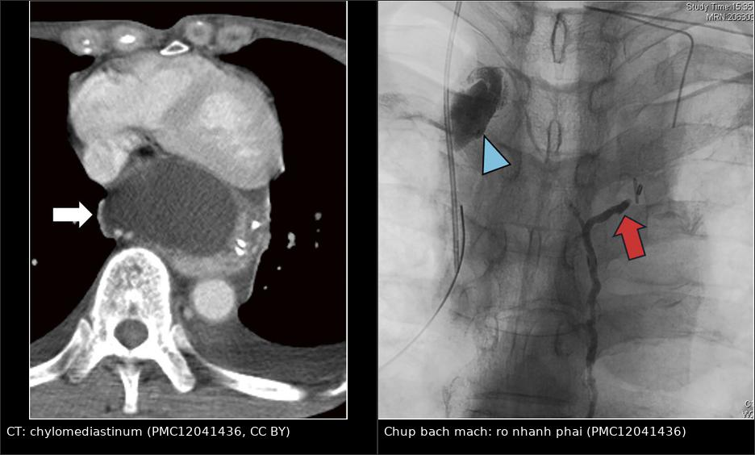
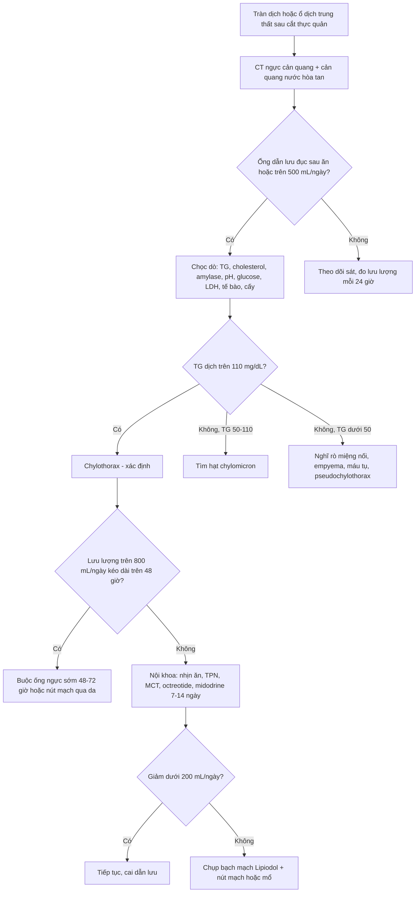
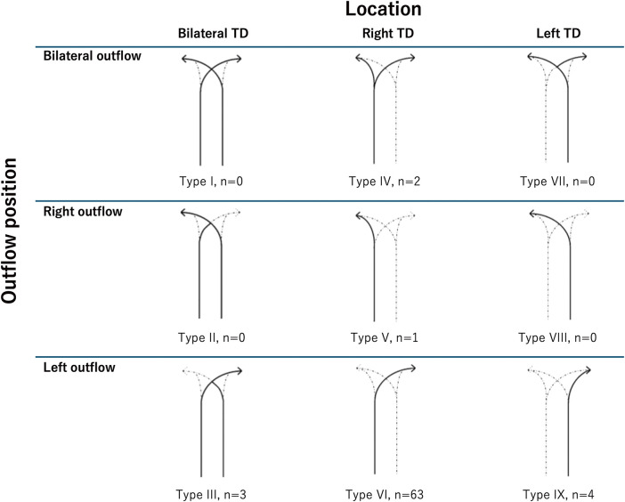
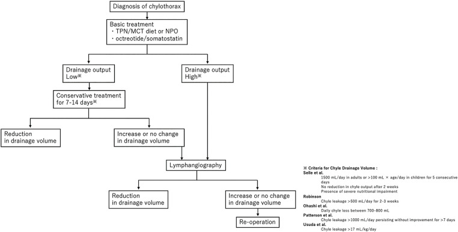
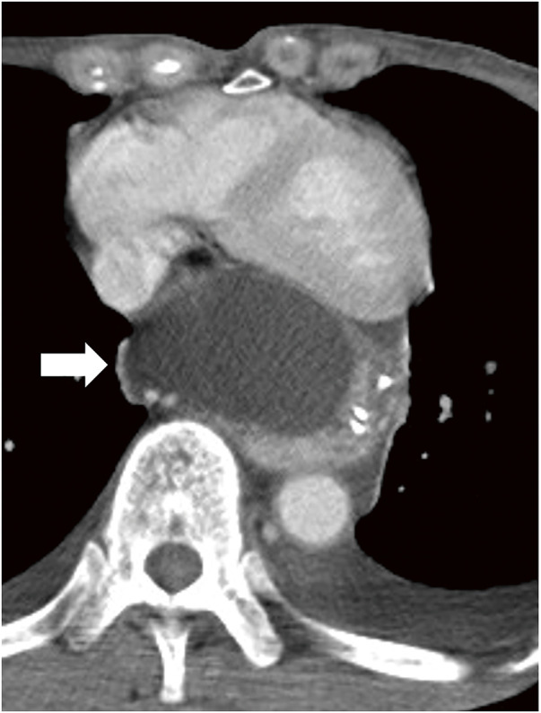
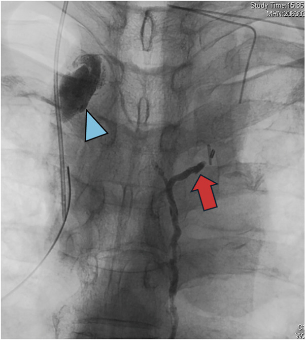
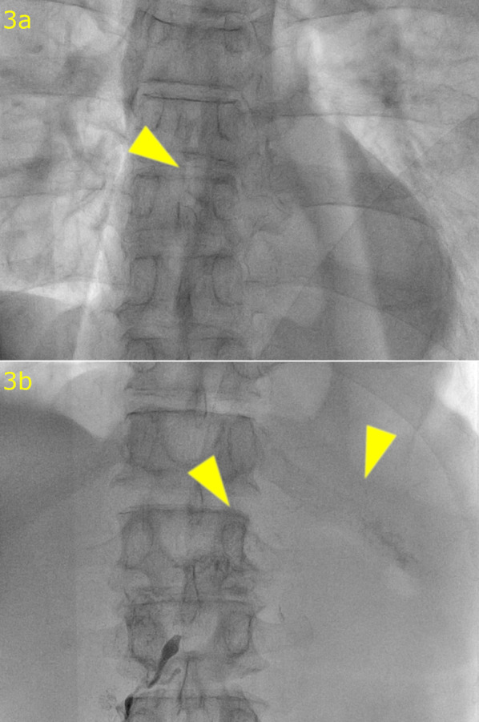

# 1887 — Rò dưỡng trấp sau cắt thực quản: vì sao dịch "trắng sữa" xuất hiện muộn và khi nào phải buộc ống ngực / Post-esophagectomy chylothorax

**Tags:** `pattern:chylothorax` `pattern:tran-dich-mang-phoi` `pattern:ro-bach-huyet` `pattern:chylomediastinum` `vung:trung-that` `vung:mong-phoi` `vung:ong-nguc` `protocol:CT-nguc` `protocol:lymphangiography` `protocol:DCMRL` `score:TG-dich` `score:luu-luong`

**Mức chắc chắn (certainty):** tổng hợp y văn (literature synthesis) — biên từ **500 ca cắt thực quản một trung tâm** (*Cureus* 2026, **PMC12979614**, CC BY 4.0), **đoàn hệ 17 ca thực quản + 51 ca phổi** (*J Cardiothorac Surg* 2026, **PMC13231676**, CC BY-NC-ND), **ca chylomediastinum chèn ép tim** (*Surg Case Rep* 2025, **PMC12041436**, CC BY 4.0), **ca rò dưỡng trấp dai dẳng do lỗ hoành không đóng** (*Surg Case Rep* 2024, **PMC11387574**, CC BY 4.0), **tổng quan biến chứng hiếm sau cắt thực quản** (*Ther Adv Gastroenterol* 2025, **PMC12365439**, CC BY-NC 4.0) và **ca chylothorax – pseudochylothorax** (*Case Reports Immunol* 2026, **PMC13681740**, CC BY 4.0). Đây là **bài riêng cho cắt thực quản**; nhánh sau cắt/ghép gan nằm ở [1839](../1839-chylothorax-sau-cat-gan/lesson.md), nhánh sau mổ tim ở trẻ ở [6161](../6161-chylothorax-sau-mo-tim-o-tre/lesson.md).

> **Câu chốt:** sau cắt thực quản, **rò dưỡng trấp không xuất hiện ngay mà trung bình ngày 7** (2–7 ngày), vì dưỡng trấp **ứ ở trung thất sau** rồi mới **vỡ qua màng phổi thành**; và **gần như luôn ở bên PHẢI** (17/17 ca), vì ống ngực đi bên phải ĐMC xuống tới **ngang T5** mới bắt chéo sang trái. Ống thông ra **dịch trắng sữa** hoặc **> 500 mL/ngày** là lúc phải **chọc đo triglyceride**, không chờ: **TG dịch > 110 mg/dL** xác định chẩn đoán, **50–110 mg/dL** là vùng xám phải tìm **hạt chylomicron**. Lưu lượng **> 1.000 mL/ngày kéo dài 7 ngày**, **> 1.500 mL/ngày × 5 ngày** hoặc **> 17 mL/kg/ngày** là các ngưỡng mổ kinh điển; thể **lưu lượng cao ≥ 800 mL/ngày** nên **buộc ống ngực sớm trong 48–72 giờ** thay vì "chờ nội khoa 2 tuần" — trong loạt 6 ca rò, ca duy nhất điều trị nội khoa đã **tử vong ngày 18**, 5 ca mổ sớm khỏi **100%**, ra viện **13–14 ngày so với 18 ngày** (**PMC12979614**).

## 1. Tổng quan bệnh học – cơ chế hình ảnh (TẠI SAO)

### 1.1 Ống ngực: một dòng chảy 2,5 lít mỗi ngày nằm sát đường mổ

- **Lưu lượng và thành phần:** ống ngực dẫn **~2.500 mL/ngày** (có thể 1,5–2,5 L), **tăng sau bữa ăn có mỡ** và **đạt đỉnh ~3 giờ sau ăn**. Dịch dưỡng trấp giàu **triglyceride dạng chylomicron**, **lympho bào (thường > 70–80%)**, **protein, immunoglobulin, điện giải** (**PMC13231676**). Vì vậy rò dưỡng trấp không phải "mất ít nước" mà là **mất miễn dịch và dinh dưỡng**: giảm lympho bào, giảm albumin, suy dinh dưỡng, nhiễm trùng, phù.
- **Giải phẫu quyết định bên tràn dịch:** ống ngực dài **36–45 cm, đường kính 2–3 mm**, vào lồng ngực qua **lỗ ĐMC của cơ hoành**, đi **giữa tĩnh mạch azygos và ĐMC ngực ở nửa ngực PHẢI**, rồi **bắt chéo sang trái ở ngang T5** trước khi đổ vào **góc tĩnh mạch trái**. Hệ quả thực hành: tổn thương **dưới T5 → tràn dưỡng trấp bên PHẢI**; tổn thương **trên T5 → bên TRÁI**. Trong loạt 17 ca cắt thực quản, **100% rò ở bên phải**, trung bình **ngày 7 sau mổ** (**PMC13231676**).
- **Biến thể giải phẫu là quy tắc, không phải ngoại lệ:** **hơn 40%** người có biến thể ống ngực, thường gặp **ống đôi/hai nhánh**. Bảng phân loại **Adachi–Kihara** (9 kiểu, n = 73 ca chụp bạch mạch) cho thấy **kiểu VI chiếm 86% (63/73)**, còn **kiểu IV — ống ngực hai nhánh tách ở trung thất trên — chỉ 2,7% (2/73)** (**PMC12041436**). Đây chính là lý do **buộc "một ống ngực" có thể thất bại vì còn nhánh thứ hai**.
- **TẠI SAO cắt thực quản là mổ nguy cơ cao nhất trong các mổ ngực:** phẫu tích thực quản đi **dọc toàn bộ trung thất sau**, nạo hạch **hai hoặc ba vùng**, và ống ngực **dính sát thực quản trung thất giữa** — nơi u **T3 trở lên** đã phá vỡ lớp mô và gây viêm. Yếu tố nguy cơ được nêu: **xạ trị trước mổ, ung thư biểu mô vảy, diện cơ thể lớn, cân bằng dịch trong mổ kém** (**PMC12365439**).

### 1.2 Vì sao chylothorax xuất hiện MUỘN và vì sao có thể là chylomediastinum

- **Cơ chế hai thì:** dưỡng trấp thoát ra **trung thất sau**, tích thành **ổ dịch trung thất (chylomediastinum)**; chỉ khi **màng phổi thành bị rách/ thấm** hoặc **ống dẫn lưu trung thất không đủ** thì dịch mới vào khoang màng phổi. Vì vậy **dấu hiệu lâm sàng thường xuất hiện 2–7 ngày sau mổ**, khi dịch đã đủ lớn (**PMC13231676**).
- **Hệ quả 1 —"tràn dịch sau mổ" có thể là ổ dưỡng trấp khu trú:** CT thấy **ổ dịch trung thất đậm độ dịch**, có thể **chèn ép nhĩ trái/thất trái** gây **chèn ép tim cấp**. Ca minh họa: bệnh nhân **72 tuổi**, **ngày 8** sốt, **ngày 12** nhịp nhanh – tụt huyết áp, CT cho thấy **ổ dịch trung thất lớn**; mở ngực cấp cứu thấy **dịch trong**, đặt dẫn lưu trung thất và màng phổi phải (**PMC12041436**).
- **Hệ quả 2 —"dịch trắng sữa" không phải điều kiện chẩn đoán:** bệnh nhân **nhịn ăn/ nuôi tĩnh mạch hoàn toàn** có thể ra **dịch vàng trong** vì **không có chylomicron** để tán xạ ánh sáng; ngược lại **mủ (empyema)** và **pseudochylothorax** cũng đục. Vì thế **màu sắc có độ nhạy thấp**, phải **đo triglyceride**.
- **TẠI SAO CT một mình không gọi được tên:** dưỡng trấp có **đậm độ gần nước (khoảng 0–20 HU)**, **không ngấm thuốc**, trùng với **dịch thanh mạc, seroma sau mổ, dịch tụ sau nạo hạch, nước tiểu, mật loãng**. Trên CT, chylothorax chỉ là **"dịch đậm độ dịch"**; cái phân biệt là **chọc dò + sinh hóa**. Ngược lại, **máu tụ 35–70 HU** và **mỡ −40 đến −120 HU** mới tách được bằng đậm độ.
- **TẠI SAO chụp bạch mạch lại "nhìn thấy" chỗ rò:** **Lipiodol (dầu iod hóa)** tiêm vào **hạch bẹn dưới siêu âm (intranodal lymphangiography)** đi theo **bạch huyết chậu → bể dưỡng trấp → ống ngực**, làm **hiện hình toàn bộ đường đi** và **điểm thoát thuốc**. Dầu iod còn **gây viêm xơ tại chỗ rò** — tác dụng **vừa chẩn đoán vừa điều trị**; **liều tối đa 20 mL** được coi là an toàn (**PMC13231676**).

### 1.3 Số phải nhớ (dịch tễ, lưu lượng, kết cục)

- **Tần suất rò dưỡng trấp sau cắt thực quản:** **0,9–9,0%** (**PMC11387574**), **1,1–3,8%** (**PMC12041436**), **1–4%** trong các loạt lớn (**PMC12979614**), **tới 2%** được coi là "rò đáng kể" (**PMC13231676**). Loạt 500 ca: **1,2% (6/500)** (**PMC12979614**).
- **Thể kháng trị:** **< 2%** trong y văn, **0,3%** tại một trung tâm lớn — nghĩa là **đa số đáp ứng, nhưng nhóm kháng trị chính là nhóm tử vong** (**PMC12365439**).
- **Lưu lượng và thời gian nằm viện:** nhóm cắt thực quản có **> 2–3 L/ngày**, ống dẫn lưu lưu **trung bình 3 tuần**, nằm viện **24 ngày**; nhóm cắt phổi chỉ **1.179 mL/ngày**, ống **11,2 ngày**, nằm viện **12,1 ngày** (**PMC13231676**). Trong loạt 24 ca có chụp bạch mạch, **nằm viện trung vị 35,5 ngày** nhưng **rút ống chỉ sau 9 ngày** kể từ lúc chụp (**PMC12041436**).
- **Tử vong:** **tới 47%** nếu rò kéo dài (**PMC13231676**); trong loạt 6 ca, **16,7%** — và **ca tử vong duy nhất là ca không mổ** (**PMC12979614**). Ở nhóm mổ sớm: khỏi **5/5**, ra viện **13–14 ngày** so với **18 ngày** của ca nội khoa.
- **Định nghĩa "lưu lượng cao" và mốc mổ (chưa thống nhất — ghi rõ mâu thuẫn nguồn):** **Selle**: **> 1.500 mL/ngày** ở người lớn (hoặc **100 mL × tuổi/ngày** ở trẻ) **× 5 ngày**, hoặc **> 2 tuần**, hoặc **suy dinh dưỡng nặng**; **Patterson**: **> 1.000 mL/ngày > 7 ngày**; **Robinson**: **> 500 mL/ngày trong 2–3 tuần**; **Ohashi**: **700–800 mL/ngày**; **Usuda**: **> 17 mL/kg/ngày** (**PMC12041436**). Loạt 500 ca dùng ngưỡng **≥ 800 mL/ngày kéo dài > 48 giờ** để chỉ định **buộc ống ngực sớm 48–72 giờ** (**PMC12979614**).
- **Điều trị nội khoa:** **TPN đơn thuần** chỉ khỏi **3/17 (17%)** ca thực quản; **octreotide 20–40 µg/kg/ngày dưới da 3–4 ngày**; **midodrine 10–20 mg uống 3–4 lần/ngày** (**PMC13231676**). Với lưu lượng thấp, thời gian nội khoa hợp lý là **7–14 ngày** (**PMC12041436**).
- **Can thiệp nội mạch:** chụp bạch mạch điều trị đạt **83% thành công lâm sàng** sau **1–2 lần** (**PMC12365439**); nút ống ngực qua da (TDE) đạt **49/50 (96%)** trong một loạt, và **đường vào trong hạch (intranodal) tốt hơn đường bàn chân (pedal)** (**PMC13231676**).

## 2. Mẫu hình + chẩn đoán phân biệt theo vị trí và bối cảnh (Gamut)

- **A — Tràn dịch màng phổi PHẢI, ngày 2–10 sau cắt thực quản:** gamut hẹp và **bắt buộc nghĩ dưỡng trấp trước tiên**; sau đó là **rò miệng nối/empyema**, **tràn dịch phản ứng**, **máu tụ**, **xẹp phổi – tràn dịch do giảm thông khí**. Bốn câu hỏi: **dịch đục hay trong? lưu lượng bao nhiêu? có sốt/nhiễm trùng? amylase dịch bao nhiêu?**
- **B — Ổ dịch TRUNG THẤT khu trú (chylomediastinum):** gamut: **dưỡng trấp khu trú**, **rò miệng nối dẫn tới áp-xe trung thất**, **tụ máu**, **seroma quanh ống dẫn lưu**, **hoại tử mỏm đại tràng/ dạ dày**. Chylomediastinum **rất hiếm — chỉ 7 ca trong y văn thế giới** tính tới 2025 (**PMC12365439**), nên dễ bị gọi nhầm là **rò miệng nối + nhiễm trùng** và điều trị sai hướng.
- **C — Tràn dịch dưỡng trấp KHÔNG do mổ (bối cảnh khác):** **lymphoma** (nguyên nhân không do chấn thương hay gặp nhất), **u trung thất**, **bệnh bạch huyết bẩm sinh**, **xơ gan (hepatic chylothorax)**, **giun chỉ**. Khác biệt: **không có ổ rò khu trú dễ thấy trên chụp bạch mạch**, điều trị **bệnh nền** là chính.
- **D — "Kháng trị" mà không thấy rò ống ngực:** phải nghĩ **dưỡng trấp từ ổ bụng tràn lên qua LỖ HOÀNH KHÔNG ĐÓNG** sau khi phẫu tích/ cắt ống ngực và tái tạo sau trung thất. Ca điển hình: **66 tuổi**, **ngày 15** rò dưỡng trấp qua lỗ ống nuôi ăn, kèm **chylothorax**; chụp bạch mạch **không thấy rò ở trung thất** mà **chỉ thấy rò ở ổ bụng trên** — dưỡng trấp **chảy ngược lên lồng ngực vì áp lực ổ bụng > áp lực lồng ngực** (**PMC11387574**). Đây là lý do **buộc ống ngực lần nữa sẽ thất bại**; phải **đóng lỗ hoành + chụp bạch mạch lặp lại**.
- **E — Tràn dịch dưỡng trấp một bên TRÁI:** tổn thương **trên ngang T5** (trung thất trên, góc tĩnh mạch trái) hoặc **biến thể ống ngực đi bên trái**. Đừng loại trừ chỉ vì "bên trái".
- **F — Dịch đục mà KHÔNG phải dưỡng trấp:** **empyema** (mủ, pH thấp, LDH cao), **pseudochylothorax** (tinh thể cholesterol, TG thấp, bệnh màng phổi mạn do lao/viêm khớp dạng thấp), **dịch giàu protein** (huyết thanh đục).

## 3. Bảng so sánh phân biệt (ma trận đối chiếu)

| Thực thể (entity) | Hình ảnh điển hình (CT/ X-quang/ chụp bạch mạch) | Chốt vào (rule-in) | Chốt loại (rule-out) | Gợi ý xác nhận |
|---|---|---|---|---|
| **Rò dưỡng trấp màng phổi** (chylothorax) | Tràn dịch phải, tự do hoặc khu trú; **0–20 HU**, không ngấm thuốc; có thể kèm ổ dịch trung thất | **TG dịch > 110 mg/dL**, **hạt chylomicron**, **lympho > 70–80%**; lưu lượng **> 500 mL/ngày**, đục sau khi ăn | Màu trong khi nhịn ăn **không loại trừ**; TG **< 50 mg/dL** gần như loại | Chọc dò sinh hóa; chụp bạch mạch tìm điểm rò |
| **Chylomediastinum** (dưỡng trấp khu trú trung thất) | **Ổ dịch trung thất sau**, đậm độ dịch, bờ nhẵn, **chèn ép nhĩ/thất trái**, có thể **tràn dịch màng tim** | Dịch trung thất + **TG cao** trên chọc hút; **không thấy rò miệng nối** trên cản quang | **Khí trong ổ dịch**, bờ viêm, **amylase cao** → rò miệng nối/áp-xe | CT cản quang + chọc hút dưới CT; chụp bạch mạch |
| **Rò miệng nối / empyema** | Ổ dịch **có khí**, bờ dày ngấm thuốc, quanh miệng nối; màng phổi **split pleura**, dày màng phổi | **Khí + dịch**, **amylase dịch rất cao**, pH **< 7,2**, glucose thấp, cấy dương | Dịch trong, TG cao, **không khí, không sốt** → nghĩ dưỡng trấp | Cản quang nước hòa tan qua miệng nối; nội soi |
| **Máu tụ màng phổi/ trung thất** | **35–70 HU**, tăng đậm độ, có thể mức lắng; Hct dịch ≈ máu | **Hct dịch > 5–10%** Hct máu; đậm độ cao trên CT không cản quang | Dịch **0–20 HU**, không lắng → không phải máu | Đo Hct dịch; so CT trước/sau |
| **Pseudochylothorax** | Tràn dịch **mạn, khu trú, dày/ vôi hóa màng phổi**; không có ổ rò bạch mạch | **Tinh thể cholesterol** (độ nhạy ~90%), **cholesterol dịch > 200 mg/dL**, TG thấp | **TG > 110 mg/dL + chylomicron** → loại pseudochylothorax | Soi tinh thể dưới ánh sáng phân cực; bệnh nền lao/viêm khớp |
| **Dưỡng trấp từ ổ bụng qua lỗ hoành** | Tràn dịch phải **tái phát** dù ống ngực đã buộc; **cổ trướng dưỡng trấp**; chụp bạch mạch **chỉ rò ở bụng** | **Rò ổ bụng trên** trên chụp bạch mạch + **dịch màng phổi TG cao**; xạ hình thấy **dồn cả ổ bụng và màng phổi** | Có **điểm rò trung thất rõ** → là rò ống ngực thật | Chụp bạch mạch lặp lại; đóng lỗ hoành |

*Trái: **ổ dịch trung thất sau đậm độ dịch** (mũi tên trắng), chèn ép nhĩ trái — nguyên nhân chèn ép tim ngày 12 sau mổ. Phải: chụp bạch mạch — **nhánh trái đã buộc** (mũi tên xanh) nhưng **dưỡng trấp vẫn rò từ nhánh phải** (mũi tên đỏ) do ống ngực hai nhánh (kiểu IV). Nguồn: *Surg Case Rep* 2025, **PMC12041436**, CC BY 4.0; ảnh ghép letterbox, không cắt.*

### Đọc chính xác ba dấu hiệu hay bị lẫn

- **"Dịch đậm độ dịch" ≠ dưỡng trấp.** Trên CT, **0–20 HU** chỉ nói "không phải máu, không phải mỡ"; nó **không phân biệt** dưỡng trấp với seroma, dịch thấm, nước tiểu hay mật loãng. Chỉ **sinh hóa dịch** mới trả lời.
- **Vị trí rò trên chụp bạch mạch phải đọc theo giải phẫu, không theo "chỗ có thuốc".** Thuốc có thể **tràn ra ổ bụng** rồi **đi ngược lên ngực**; khi đó hình ảnh "rò màng phổi" là **hệ quả**, không phải nguồn. So **hai thì** (trung thất và ổ bụng) trước khi kết luận (**PMC11387574**).
- **Buộc ống ngực một lần không đủ khi có biến thể.** Kiểu IV (2,7%) có **hai nhánh tách ở trung thất trên**; buộc nhánh trái vẫn còn **nhánh phải rò** (**PMC12041436**). Vì thế sau buộc mà lưu lượng **không giảm trong 24–48 giờ**, phải **chụp bạch mạch lại** chứ không "chờ thêm".

## 4. Protocol chụp + hệ phân độ/ ngưỡng xử lý

### 4.1 Trình tự chẩn đoán (làm đúng thứ tự để không mổ oan)

### 4.2 Protocol hình ảnh

- **CT ngực – bụng có cản quang tĩnh mạch**, lát **≤ 1–2 mm**: đánh giá **cả hai khoang màng phổi**, **trung thất sau**, **miệng nối**, **mỏm đại tràng/ dạ dày**, **lỗ hoành**; đo **HU của dịch** ở 3 điểm và so với dịch trong ổ bụng. Cản quang **nước hòa tan qua đường miệng** để loại **rò miệng nối** trước khi kết luận "dưỡng trấp".
- **Siêu âm đầu giường:** xác định **vị trí ổ dịch**, hướng dẫn **chọc hút** và **đặt ống dẫn lưu**; đánh giá **chèn ép tim** khi có ổ dịch trung thất (dịch màng tim, đảo ngược vách liên thất).
- **Chụp bạch mạch bằng Lipiodol (intranodal lymphangiography):** chọc **hạch bẹn dưới siêu âm**, tiêm **Lipiodol**, chụp **thì sớm và thì muộn** để thấy **bể dưỡng trấp – ống ngực – điểm rò**. **Liều tối đa 20 mL**; có thể **lặp lại** (ca kháng trị được chụp **3 lần**) (**PMC11387574**).
- **Nút ống ngực qua da (thoracic duct embolization – TDE):** chọc bể dưỡng trấp qua da, đặt **coil hoặc keo cyanoacrylate**; **thành công kỹ thuật cao**, **83% thành công lâm sàng sau 1–2 lần** (**PMC12365439**); một loạt 50 ca đạt **96%** (**PMC13231676**). Bệnh nhân cần **nhịn ăn ≥ 48 giờ + octreotide/ midodrine** trước thủ thuật để **giảm dòng chảy**, giúp tiếp cận bể dưỡng trấp.
- **MRI bạch huyết (MR lymphangiography/ DCMRL):** **T2 không cản quang** cho thấy **ống bạch huyết giãn, mạng bạch huyết trung thất/ sau phúc mạc**; hữu ích **lập kế hoạch trước mổ** và ở bệnh nhân **đã mổ bụng lớn**; hạn chế là **khó định vị chính xác điểm rò** và **không phải trung tâm nào cũng có** (**PMC13231676**).
- **Xạ hình bạch huyết (lymphoscintigraphy):** thấy **dồn thuốc vào cả dịch ổ bụng và dịch màng phổi** — dấu hiệu gợi ý **dưỡng trấp từ bụng lên ngực**; độ phân giải thấp, chỉ dùng định hướng (**PMC11387574**).

### 4.3 Ngưỡng xử lý (bảng tra nhanh)

| Thông số | Ngưỡng | Ý nghĩa thực hành |
|---|---|---|
| Triglyceride dịch màng phổi | **> 110 mg/dL (1,24 mmol/L)** | Xác định chylothorax; **50–110** phải tìm chylomicron; **< 50** gần như loại |
| Tỷ lệ TG dịch/ huyết thanh | **> 1** | Hỗ trợ xác định; tỷ lệ cholesterol dịch/ huyết thanh **< 1** |
| Tế bào dịch | **> 1.000/µL, lympho > 70–80%** | Phù hợp dưỡng trấp; mủ thì lympho thấp, neutrophil cao |
| Cholesterol dịch | **> 200 mg/dL + tinh thể** | Nghĩ **pseudochylothorax** (lao/ viêm khớp mạn) |
| Amylase dịch | **Rất cao** | Rò miệng nối/ rò tụy; loại chylothorax đơn thuần |
| Lưu lượng | **> 500 mL/ngày** | Bắt đầu đo TG, theo dõi sát |
| Lưu lượng cao | **≥ 800 mL/ngày > 48 giờ** | Cân nhắc **buộc ống ngực sớm 48–72 giờ** |
| Ngưỡng mổ kinh điển | **> 1.000 mL/ngày × 7 ngày**; **> 1.500 mL/ngày × 5 ngày**; **> 17 mL/kg/ngày**; **> 500 mL/ngày × 2–3 tuần** | Chọn theo bệnh nhân; không có ngưỡng duy nhất |
| Thời gian nội khoa | **7–14 ngày** (lưu lượng thấp) | Quá mốc này mà không giảm → chụp bạch mạch/ mổ |
| Khỏi | **< 200 mL/ngày dịch không đục** | Tiêu chuẩn rút ống trong loạt 500 ca |

*Phân loại 9 kiểu ống ngực theo vị trí và nơi đổ (n = 73 ca chụp bạch mạch): **kiểu VI 86%**, **kiểu IV 2,7%** (hai nhánh tách ở trung thất trên). Nguồn: *Surg Case Rep* 2025, **PMC12041436**, CC BY 4.0.*

*Lưu đồ của nhóm tác giả: lưu lượng thấp → nội khoa **7–14 ngày**; lưu lượng cao/không giảm → **chụp bạch mạch**, không giảm nữa → **mổ lại**. Khung phải là các ngưỡng lưu lượng của Selle, Robinson, Ohashi, Patterson, Usuda. Nguồn: *Surg Case Rep* 2025, **PMC12041436**, CC BY 4.0.*

## 5. Biến thể bình thường và cạm bẫy

- **Dịch trong ≠ không rò.** Bệnh nhân **nhịn ăn/ TPN** ra dịch **vàng trong** vì thiếu chylomicron; nếu chỉ dựa vào màu, sẽ **bỏ sót** và chờ tới khi suy dinh dưỡng. Quy tắc: **lưu lượng > 500 mL/ngày hoặc dịch đổi màu sau khi ăn → đo TG**.
- **Chylomediastinum bị gọi nhầm là rò miệng nối + nhiễm trùng.** Ca được mô tả đã bị **chẩn đoán nhầm ở tuyến trước là rò miệng nối cổ + nhiễm trùng trung thất**, trong khi thực chất là **ổ dưỡng trấp trung thất** và **khỏi sau chụp bạch mạch** (**PMC12365439**). Dấu hiệu phân biệt: **không khí trong ổ dịch, bờ viêm, amylase cao** thuộc rò miệng nối; **dịch thuần, TG cao, không khí** thuộc dưỡng trấp.
- **Chèn ép tim là biến chứng bị bỏ qua của ổ dịch trung thất.** Bệnh nhân **ngày 8 sốt, ngày 12 nhịp nhanh – tụt huyết áp**; CT thấy **ổ dịch lớn sau tim**. Trong bối cảnh này, **sốt không loại trừ dưỡng trấp** (dưỡng trấp gây viêm màng phổi/ trung thất nhẹ nhưng vẫn có thể sốt do xẹp phổi, xẹp thùy).
- **Hút áp lực âm mạnh làm rò lâu lành.** Với **chylomediastinum**, nhóm tác giả khuyến cáo **dẫn lưu ngắt quãng** để giải chèn ép, **tránh hút âm liên tục** vì làm **tăng mất dịch và chậm lành** (**PMC12365439**). Với **chylothorax màng phổi**, ngược lại, cần **dẫn lưu kín liên tục** để phổi nở áp vào chỗ rò — **đừng áp dụng lời khuyên của ổ trung thất cho khoang màng phổi**.
- **Buộc ống ngực "thất bại" vì lý do giải phẫu, không phải vì tay nghề.** Kiểu IV (hai nhánh) và **lỗ hoành không đóng** là hai nguyên nhân cơ học; **không giảm lưu lượng sau 24–48 giờ = chụp bạch mạch lại**, không chờ thêm 2 tuần.
- **"Pseudochylothorax" trong bệnh nhân ung thư.** Tràn dịch **mạn, khu trú, dày màng phổi**, **TG thấp (ví dụ 19 mg/dL)**, **cholesterol 125 mg/dL**, **tinh thể cholesterol dưới ánh sáng phân cực** — không phải dưỡng trấp, không cần buộc ống ngực (**PMC13681740**).
- **Bẫy mặt cắt:** ổ dịch **sau trung thất** trên CT ngang có thể bị đọc là **tràn dịch màng phổi khu trú** hoặc **nang/ hoại tử mỏm dạ dày**; cần **hai bình diện + thì cản quang** và đối chiếu **vị trí so với màng phổi, ĐMC, nhĩ trái**. Dịch **dưới cơ hoành** phải phân biệt với **cổ trướng** (dấu crus lệch, bare area) — liên quan trực tiếp tới cơ chế **dưỡng trấp bụng lên ngực**.

## 6. Tự lượng giá — Blind Quiz

**Ca 1 — Nam 72 tuổi, cắt thực quản bán phần + tái tạo dạ dày, ngày 8 sốt, ngày 12 nhịp nhanh và tụt huyết áp. CT ngực có cản quang:**

- Câu hỏi: mô tả ổ dịch; dấu hiệu nào giải thích **tụt huyết áp**? Ba chẩn đoán phân biệt và bước tiếp theo?

<b>Bấm để hiện đáp án (findings + chẩn đoán)</b>

- **Dấu hiệu:** **ổ dịch lớn, đậm độ dịch, bờ nhẵn ở trung thất sau**, **chèn ép nhĩ trái** (mũi tên trắng); không thấy khí trong ổ dịch. Đây là **chylomediastinum** gây **chèn ép tim** — giải thích nhịp nhanh, tụt huyết áp.
- **Chẩn đoán:** rò dưỡng trấp khu trú trong trung thất sau cắt thực quản; **chọc hút dịch** cho **TG cao**, cấy âm tính.
- **Phân biệt:** rò miệng nối/ áp-xe trung thất (có **khí**, bờ viêm, **amylase cao**), tụ máu (**35–70 HU**), seroma (không triệu chứng, TG thấp).
- **Xử trí:** dẫn lưu trung thất **giải chèn ép**; **chụp bạch mạch Lipiodol** để tìm điểm rò; nếu vẫn rò → **buộc ống ngực** hoặc **nút mạch**. Ở ca gốc: chụp bạch mạch **ngày 14**, buộc nhánh phải **ngày 41**, ra viện **ngày 118**.
- Nguồn: *Surg Case Rep* 2025, **PMC12041436**, CC BY 4.0.

**Ca 2 — Cùng bệnh nhân, chụp bạch mạch qua đường hạch bẹn, phim trung thất trên:**

- Câu hỏi: mũi tên xanh và mũi tên đỏ chỉ gì? Vì sao lần mổ đầu "đã buộc ống ngực" mà vẫn rò? Chọn đường mổ nào tiếp theo?

<b>Bấm để hiện đáp án (findings + chẩn đoán)</b>

- **Mũi tên xanh:** **nhánh trái của ống ngực đã được buộc** trong mổ đầu — không thấy thuốc đi qua. **Mũi tên đỏ:** **dưỡng trấp rò từ nhánh phải** — nhánh còn lại của **ống ngực hai nhánh tách ở trung thất trên (kiểu IV, 2,7%)**.
- **Vì sao thất bại:** buộc **một nhánh** không cắt được dòng chảy của nhánh kia; **không giảm lưu lượng 24–48 giờ sau buộc** là dấu hiệu phải chụp lại.
- **Chọn đường:** nhánh rò nằm **ngang mức xương đòn bên phải** → **buộc qua đường cổ bên phải** là hợp lý; đường **xuyên hoành** phù hợp hơn khi cần buộc **ngay trên cơ hoành** ở bệnh nhân đã nạo hạch rộng/ biến thể.
- Nguồn: *Surg Case Rep* 2025, **PMC12041436**, CC BY 4.0.

**Ca 3 — Nam 66 tuổi, cắt thực quản bán phần nội soi robot, tái tạo dạ dày sau xương ức; ngày 15 rò dưỡng trấp qua lỗ ống nuôi ăn, kèm tràn dịch màng phổi. Chụp bạch mạch Lipiodol:**

- Câu hỏi: (a) ổ trên không thấy rò trung thất, ổ dưới thấy thuốc ở đâu? (b) Vì sao tràn dưỡng trấp màng phổi lại xuất hiện dù ống ngực đã cắt? (c) Hai việc phải làm cùng lúc?

<b>Bấm để hiện đáp án (findings + chẩn đoán)</b>

- **(a)** Ảnh trên (3a): **không có rò ở trung thất** (mũi tên vàng chỉ ống ngực lành). Ảnh dưới (3b): **thuốc thoát ra ổ bụng trên** (mũi tên vàng) — nguồn rò là **bạch mạch ổ bụng**, không phải ống ngực.
- **(b)** Sau khi **cắt ống ngực + tái tạo sau trung thất**, **lỗ hoành không được đóng kín**; **áp lực ổ bụng > áp lực lồng ngực** nên **dưỡng trấp bụng chảy lên khoang màng phổi** — "chylothorax" nhưng bản chất là **cổ trướng dưỡng trấp tràn lên**.
- **(c)** **Đóng lỗ hoành** (tăng áp lực ổ bụng, chặn đường tràn) **+ chụp bạch mạch Lipiodol lặp lại** (gây viêm xơ bít điểm rò); ca gốc chụp **3 lần** và khỏi.
- Nguồn: *Surg Case Rep* 2024, **PMC11387574**, CC BY 4.0.

## Bài liên quan chéo

- [001 – Tổng quan hệ Ngực](../001-tong-quan-he-nguc/lesson.md)
- [1839 – Chylothorax sau cắt/ ghép gan](../1839-chylothorax-sau-cat-gan/lesson.md) — ngưỡng TG và đường đi qua cơ hoành
- [6161 – Tràn dưỡng trấp sau mổ tim ở trẻ](../6161-chylothorax-sau-mo-tim-o-tre/lesson.md) — cơ chế áp lực tĩnh mạch
- [1844 – Rò và hoại tử thực quản do xạ](../1844-ro-hoai-tu-thuc-quan-do-xa/lesson.md) — phân biệt rò miệng nối
- [1820 – Rò mật – màng phổi](../1820-ro-mat-mang-phoi/lesson.md) — cùng bối cảnh "dịch sau mổ bụng trên"
- [090 – Bỏng hít đường thở ở trẻ](../090-bong-hit-duong-tho-o-tre/lesson.md)

> Không dùng để chẩn đoán độc lập khi chưa có người hướng dẫn.
