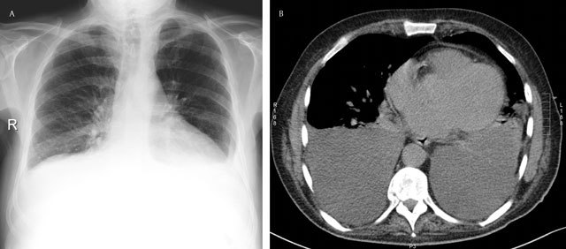
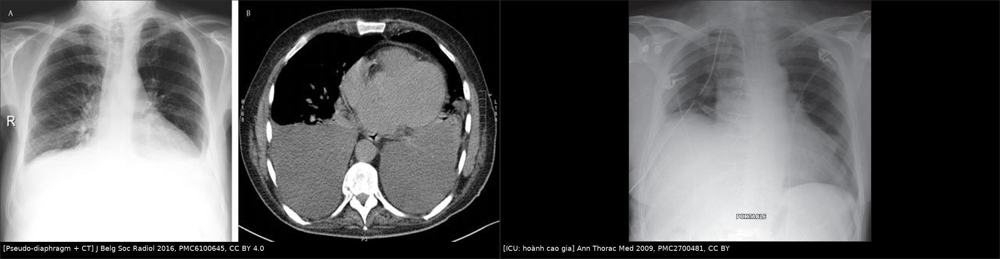
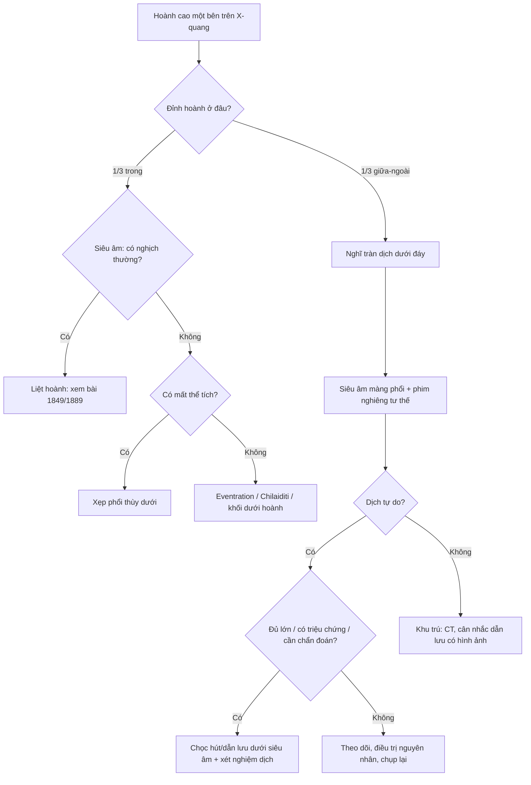
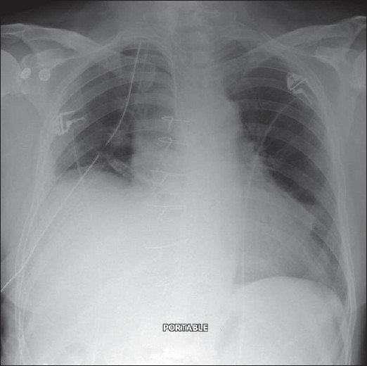
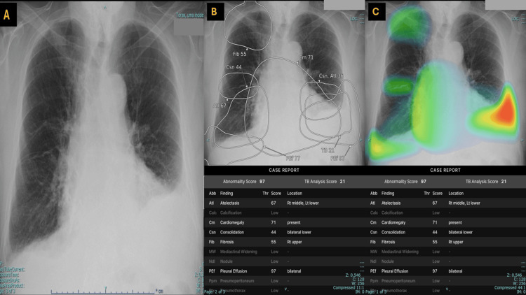

# 1888 — Tràn dịch dưới đáy phổi giả nâng cao cơ hoành / Subpulmonic effusion

**Tags:** `pattern:nang-cao-nua-hoanh` `pattern:mo-day-phoi` `pattern:mat-lien-tuc-co-hoanh` `pattern:thay-doi-theo-tu-the` `vung:mang-phoi` `vung:co-hoanh` `vung:phoi` `protocol:Xquang-nghieng` `protocol:SA-mang-phoi` `protocol:phim-nghieng-tu-the`

**Mức chắc chắn (certainty):** tổng hợp y văn (literature synthesis) — số liệu từ **tổng quan hình ảnh màng phổi có đối chiếu CT** (PMC6100645), **bài giảng X-quang bệnh nhân nặng** (PMC2700481), **ca lâm sàng 2026 có siêu âm xác nhận** (PMC12970633), **chương X-quang ngực kinh điển** (PMC8139021, PMC7122111) và **bài so sánh 4 dấu CT dịch màng phổi–cổ trướng** (PMC9623851).

> **Câu chốt:** Ở tư thế đứng, **dịch màng phổi tích tụ ĐẦU TIÊN giữa đáy phổi và cơ hoành**, không phải ở góc sườn hoành. Vì dịch **cùng tỉ trọng với gan/lách/cơ hoành**, **dấu bóng (silhouette sign)** làm nó **biến mất** — trên phim chỉ còn **"một nửa hoành cao"**. Đây là **kẻ bắt chước số 1 của liệt hoành** và là lý do hay nhất khiến **dịch màng phổi bị bỏ sót** trên X-quang. Chốt chẩn đoán không phải "hoành cao bao nhiêu" mà là: **đỉnh hoành lệch ra ngoài**, **khoảng cách hoành–bóng vị > 1 cm**, **không có nghịch thường**, và **thay đổi theo tư thế** — xác nhận bằng **siêu âm** hoặc **phim nghiêng tư thế**.

## 1. Tổng quan bệnh học – cơ chế hình ảnh

### 1.1 Vì sao dịch lại nằm "dưới đáy phổi"

- **Giải phẫu:** **góc sườn hoành sau (posterior costophrenic sulcus)** là phần **sâu nhất** của khoang màng phổi — sâu hơn góc sườn hoành bên trên phim thẳng. Vì vậy ở tư thế đứng, dịch chảy xuống **khoang dưới đáy phổi**, nằm **giữa mặt dưới phổi và mặt trên cơ hoành**.
- **Hệ quả hình ảnh:** màng phổi tạng + lá phổi đè lên túi dịch → **mặt phân cách dịch–phổi** có hình vòm, **trông như cơ hoành** → gọi là **"hoành giả" (pseudo-diaphragm)**. Cơ hoành thật nằm **dưới** lớp dịch, bị che khuất.
- **TẠI SAO không thấy đường mức dịch (meniscus):** mức dịch chỉ thành hình khi dịch **dâng lên theo thành ngực bên**. Trong thể dưới đáy, dịch **lan ra sau–dưới** trước, còn **góc sườn hoành bên có thể còn nguyên** → **không có meniscus**, càng dễ đọc nhầm thành hoành cao.

### 1.2 Ngưỡng thể tích: vì sao X-quang "nuốt" mất dịch

- **≥ 200 mL** dịch mới **làm tù góc sườn hoành bên** trên phim thẳng đứng; **tới 500 mL** vẫn có thể **không tù** nếu dịch phân bố dưới đáy (PMC6100645).
- **Phim nghiêng nhạy hơn phim thẳng** vì thấy **góc sườn hoành sau** — phần sâu nhất; **phim nghiêng tư thế (lateral decubitus)** còn nhạy hơn, và là cách **phân biệt dịch tự do với dịch khu trú**.
- **Vì sao dịch dưới đáy "giả" hoành cao:** dịch **đẩy đáy phổi lên** và **đè cơ hoành xuống** → **khoảng cách giữa bóng hơi dạ dày và "hoành" tăng**. Bình thường khoảng cách này **≤ ~1 cm**; **> 1 cm** gợi ý **tràn dịch dưới đáy hoặc khối** (PMC7122111).
- **Vì sao đỉnh hoành lệch ra ngoài:** cột dịch dày nhất ở **phía sau–ngoài**, nên điểm cao nhất của "hoành giả" **bị đẩy từ 1/3 trong ra 1/3 giữa–ngoài** của lồng ngực (PMC6100645).

### 1.3 Tư thế nằm ngửa: mặt cắt "mù" nhất

- Khi nằm ngửa, dịch **chảy ra sau** thành một lớp mỏng → **không còn hoành giả**, chỉ còn **mờ đều nửa dưới phổi**: **mất bờ cơ hoành**, **mất thấy mạch máu thùy dưới**, **dày khe rãnh**, **mờ đỉnh phổi (apical cap sign)**, **lách tăng đậm độ** ở bên trái (PMC6100645).
- **TẠI SAO dễ bỏ sót:** cùng đậm độ nước, không có đường bờ → **không có "vật thể" để nhìn**; phim ngửa tại giường còn bị **phổi ít hít vào** làm mờ thêm. Vì vậy **siêu âm tại giường** là bước bù trừ bắt buộc ở bệnh nhân nặng.

## 2. Mẫu hình + chẩn đoán phân biệt theo vị trí (gamut)

- **Mẫu hình chung:** **nửa hoành "cao"** + **đỉnh lệch ra ngoài** + **góc sườn hoành bên còn/không tù** + **không nghịch thường** + **thay đổi khi đổi tư thế**.
- **Gamut theo vị trí phân bố dịch:**
  1. **Dưới đáy phổi (subpulmonic):** thể hay nhầm nhất; hoành giả, đỉnh lệch ngoài.
  2. **Thành ngực bên (free lateral):** meniscus kinh điển, tù góc sườn hoành.
  3. **Đỉnh phổi khi nằm ngửa (apical cap):** dấu sớm, dễ bỏ sót.
  4. **Trong khe rãnh (fissural/phantom tumor):** khối giả hình thấu kính, đổi hình khi đổi tư thế.
  5. **Khu trú (loculated):** bờ rõ, không chảy theo tư thế; gặp sau mủ/ máu màng phổi, sau mổ.
- **Gamut "hoành cao" (7 nhóm):** **dịch dưới đáy** · **liệt hoành** (bài 1849, 1889) · **xẹp phổi thùy dưới** · **giãn cơ hoành (eventration)** · **Chilaiditi** (đại tràng giữa gan–hoành) · **áp-xe/khối dưới hoành** · **gan/lách to**.

## 3. Bảng so sánh phân biệt (ma trận đối chiếu)

| Thực thể (entity) | Hình ảnh điển hình (X-quang/SA/CT) | Chốt vào (rule-in) | Chốt loại (rule-out) | Gợi ý xác nhận |
|---|---|---|---|---|
| **Tràn dịch dưới đáy phổi** | **Hoành giả**, **đỉnh lệch 1/3 giữa–ngoài**, **> 1 cm tới bóng vị**, **không meniscus**, **không nghịch thường** | **Đỉnh lệch bên + thay đổi theo tư thế + siêu âm thấy dịch** | Nghịch thường thật + hoành cao đều, đỉnh ở 1/3 trong → liệt | Siêu âm màng phổi; phim nghiêng tư thế; CT |
| **Liệt cơ hoành** | Hoành cao **đều**, đỉnh **vẫn ở 1/3 trong**, **M-mode đi lên khi hít vào** | **Nghịch thường khi sniff/hít vào** | **Đỉnh lệch ngoài, không nghịch thường** → không phải liệt | Siêu âm M-mode + sniff (bài 1849) |
| **Xẹp phổi thùy dưới** | Hoành cao + **dấu mất thể tích**: khe/trung thất kéo về, **phế quản hơi** trong vùng mờ | **Mất thể tích + phế quản hơi** | Không mất thể tích, không phế quản hơi → dịch | CT ngực |
| **Giãn cơ hoành (eventration)** | Hoành cao **nhẵn, liên tục**, **đỉnh ở vị trí bình thường**, không mờ đáy | **Bẩm sinh, không tiến triển, không dịch** | Siêu âm có dịch + đổi theo tư thế → tràn dịch | So phim cũ; CT/SA |
| **Chilaiditi** | **Bóng hơi có vân (haustra)** giữa gan và hoành; **bờ hoành liên tục** | **Thấy rõ vân đại tràng dưới hoành** | Bóng hơi **không vân**, dưới hoành giả → dạ dày/dịch | CT; đổi tư thế |
| **Áp-xe dưới hoành** | **Mức khí–dịch dưới hoành**, hoành cao, **sốt**, đau bụng | **Mức khí–dịch + hội chứng nhiễm trùng** | Không mức khí–dịch, không sốt → ít nghĩ | CT bụng có cản quang |
| **Khối/u đáy phổi hoặc trung thất** | Khối **bờ rõ**, có thể **xẹp phổi do chèn ép**; không đổi theo tư thế | **Khối thấy trên CT, không phải dịch** | Siêu âm: khối đặc, không thay đổi theo nhịp thở | CT ngực có cản quang |

*(A) Phim thẳng: **hai nửa hoành "cao"** — nhưng đây là **mặt trên của dịch** (hoành giả); **mạch máu trong phổi bị xóa** ở đáy, **góc sườn hoành bị tù**; bóng hơi dạ dày **không thấy**. (B) CT ngang cùng bệnh nhân: **dịch hai bên** (đậm độ nước) nằm **sau và dưới đáy phổi** — chứng minh "hoành cao" trên phim là **dịch**. Nguồn: **J Belg Soc Radiol 2016, PMC6100645**, CC BY 4.0.*

*Trái: **đỉnh hoành phải lệch ra ngoài** (1/3 giữa–ngoài) — dấu **peak sign** của dịch dưới đáy. Phải: phim **tại giường ở bệnh nhân hồi sức**, "hoành phải cao" thực chất là **dịch dưới đáy** — kèm **dẫn lưu màng phổi đặt sai vị trí** (biến chứng của việc đọc nhầm). Nguồn: J Belg Soc Radiol 2016 (PMC6100645) và Ann Thorac Med 2009 (PMC2700481), cả hai **CC BY**. Ảnh ghép letterbox, không crop/kéo giãn.*

## 4. Protocol chụp + ngưỡng + thuật toán

### 4.1 Trình tự (rẻ → đắt, X-quang → siêu âm → CT)

1. **X-quang ngực thẳng, đứng, hít vào tối đa:** đo **khoảng cách đỉnh "hoành" – bóng hơi dạ dày**; xác định **vị trí đỉnh** (1/3 trong = bình thường; **1/3 giữa–ngoài = nghi dịch**); tìm **góc sườn hoành bên** và **mờ đáy**.
2. **Phim nghiêng** (nếu chụp được): xem **góc sườn hoành sau** — nơi dịch đọng sớm nhất.
3. **Phim nghiêng tư thế (lateral decubitus)** khi nghi dịch mà phim thẳng không rõ: dịch tự do sẽ **chảy thành lớp**; **không chảy = khu trú**.
4. **Siêu âm màng phổi tại giường (ưu tiên ở bệnh nhân nặng):** tìm **khoảng trống âm (anechoic)** trên cơ hoành, **dấu tứ giác (quad sign)**, **dấu hình sin (sinusoid sign)** khi thở; đánh giá **vách/tổ chức** (máu cục, mủ) và **hướng dẫn chọc hút**.
5. **CT ngực** khi: cần phân biệt **dịch – khối – xẹp**, nghi **khu trú/empyema**, hoặc **dịch đục/tổ chức hóa**; CT cũng là nơi xác nhận **dịch dưới đáy** rõ nhất.

### 4.2 Ngưỡng định lượng

| Chỉ số | Bình thường | Bất thường / ý nghĩa |
|---|---|---|
| **Thể tích dịch để tù góc sườn hoành bên (phim thẳng đứng)** | — | **≥ 200 mL**; có thể **tới 500 mL** mà **không tù** (PMC6100645) |
| **Khoảng cách "hoành"–bóng hơi dạ dày** | **≤ ~1 cm** | **> 1 cm** = nghi **tràn dịch dưới đáy** hoặc khối (PMC7122111) |
| **Vị trí đỉnh hoành** | 1/3 **trong** | **1/3 giữa–ngoài** = nghi dịch dưới đáy (PMC6100645) |
| **Đậm độ dịch trên CT** | — | **0–20 HU** (dịch trong); **30–60 HU** (máu); **cổ trướng cùng 0–20 HU** → **không phân biệt bằng HU** |
| **Tiêu chuẩn Light (dịch/máu ngoại vi)** | — | **Protein dịch/máu > 0,5** hoặc **LDH dịch/máu > 0,6** hoặc **LDH dịch > 2/3 ULN** = **dịch tiết** (bài 040) |
| **Dấu CT dịch màng phổi vs cổ trướng** | — | **Interface sign, bare area sign, displaced crus sign, diaphragm sign** (PMC9623851) |

### 4.3 Thuật toán "hoành cao trên phim"

### 4.4 Khi nào chọc dịch — và khi nào không

- **Chọc chẩn đoán** mọi tràn dịch **mới, chưa rõ nguyên nhân**, nhất là **một bên**, **sốt**, **đau ngực**, **sụt cân**, hoặc **dịch không đáp ứng điều trị**.
- **Chọc điều trị** khi **dịch nhiều gây khó thở**, **dịch dưới đáy lớn gây xẹp đáy phổi**, hoặc cần **dẫn lưu mủ**.
- **Không chọc mù** khi: **dịch khu trú nhỏ**, **rối loạn đông nặng**, **nhiễm trùng thành ngực**, hoặc **nghi phình động mạch** — dùng **siêu âm/CT hướng dẫn**.
- **Sau khi chọc:** **không để dẫn lưu hút mạnh** ở tràn dịch nhỏ; **không đặt dẫn lưu chỉ dựa trên phim ngửa** — ca trong PMC2700481 cho thấy **dẫn lưu đặt sai** vì tưởng "hoành cao".

## 5. Biến thể bình thường và cạm bẫy

- **"Hoành cao" có thể là "dịch thấp":** nếu **đỉnh lệch ra ngoài** và **bóng vị cách xa "hoành" > 1 cm**, mặc định là **dịch** cho tới khi chứng minh ngược lại.
- **Hai bên đối xứng dễ bị bỏ qua:** khi cả hai nửa hoành "cao" đều, mắt người đọc **không có bên lành để so** → **satisfaction of search**; luôn so **khoảng cách tới bóng vị** hai bên và tìm **mờ đáy**.
- **Góc sườn hoành còn nguyên không loại trừ dịch:** tới **500 mL** vẫn có thể không tù (PMC6100645).
- **Phim ngửa tại giường là phim dễ bỏ sót nhất:** dấu hiệu chỉ còn **mờ nửa dưới + mất bờ hoành + dày khe**; nghi ngờ thì **siêu âm ngay**.
- **Đừng gọi liệt hoành khi chưa xem động học:** **hoành cao do dịch không nghịch thường**; gắn nhãn liệt dẫn tới **tạo hình hoành oan** (bài 1849).
- **Chilaiditi không phải dịch, không phải tràn khí:** bóng hơi **có vân haustra**, **bờ hoành liên tục**; chọc/dẫn lưu là sai lầm.
- **"Hoành giả" có thể che một khối thật:** nếu sau khi hút dịch mà đáy phổi vẫn mờ/hoành vẫn cao, **CT lại** — đừng kết luận "hết dịch là hết bệnh".
- **Khu trú sau mủ/máu:** dịch **không chảy theo tư thế**, bờ rõ; **một dẫn lưu có thể không đủ** — cần CT và có thể nhiều dẫn lưu.

*Phim ngực thẳng tại giường: **mờ đáy phổi phải**, bờ "hoành" mất liên tục, **dây thép xương ức**; hình ảnh được báo là **tràn dịch dưới đáy phổi giả nâng cao hoành**, kèm **dẫn lưu màng phổi đặt sai vị trí**. Bài học: **hoành cao trên phim ngửa không đủ để đặt dẫn lưu** — phải xác nhận bằng siêu âm. Nguồn: **Ann Thorac Med 2009, PMC2700481**, CC BY.*

*Phim thẳng + đầu ra của hệ AI: **tràn dịch hai bên**, nhưng bên **phải** bị AI **đánh giá thấp** vì dịch phân bố **dưới đáy**, giả làm **hoành cao** và **góc sườn hoành còn một phần**. Siêu âm xác nhận **tràn dịch dưới đáy phải**. Bài học: **AI học "meniscus" điển hình** nên **thể dưới đáy là điểm mù** — không được dựa vào AI để loại trừ. Nguồn: **Cureus 2026, PMC12970633**, CC BY 4.0.*

## 6. Tự lượng giá — Blind Quiz

**Ca 1 — Bệnh nhân khó thở, phim thẳng thấy "hai nửa hoành cao". Nhìn phim và CT, mô tả trước.**

- Hỏi: đâu là **cơ hoành thật**? Dấu hiệu nào trên phim nói đó là **dịch**? Vì sao **không thấy meniscus**?

<b>Bấm để hiện đáp án (findings + chẩn đoán)</b>

- **Findings:** phim thẳng: **"hoành" hai bên cao**, **mạch máu thùy dưới bị xóa**, **góc sườn hoành tù**, **không thấy bóng hơi dạ dày**; CT: **dịch hai bên** (đậm độ nước) nằm **sau–dưới đáy phổi**.
- **Chẩn đoán:** **tràn dịch màng phổi hai bên, thể dưới đáy** — "hoành cao" là **hoành giả** (mặt trên túi dịch).
- **Vì sao không meniscus:** dịch đọng ở **góc sườn hoành sau** (sâu nhất) trước, chưa dâng lên thành ngực bên.
- **Nguồn ảnh:** J Belg Soc Radiol 2016, PMC6100645, CC BY 4.0.

**Ca 2 — Bệnh nhân hồi sức, phim ngửa tại giường: "hoành phải cao". Bạn có đặt dẫn lưu ngay?**

- Hỏi: 3 chẩn đoán phân biệt? Bước nào **phải làm trước** khi can thiệp? Ca này dạy gì về biến chứng?

<b>Bấm để hiện đáp án</b>

- **Findings:** mờ đáy phổi phải, **bờ hoành mất liên tục**, dây thép xương ức, bệnh nhân nằm ngửa.
- **Phân biệt:** **tràn dịch dưới đáy**, **xẹp phổi thùy dưới**, **liệt hoành** (kém hơn vì không có bối cảnh), **giãn cơ hoành**.
- **Bước bắt buộc:** **siêu âm màng phổi tại giường** (dịch/không dịch, khu trú/tự do) **trước** khi đặt dẫn lưu.
- **Biến chứng trong ca:** dẫn lưu **đặt sai vị trí** vì chẩn đoán dựa trên "hoành cao" — bài học: **hình ảnh tĩnh trên phim ngửa không đủ định vị**.
- **Nguồn ảnh:** Ann Thorac Med 2009, PMC2700481, CC BY.

**Ca 3 — Hệ AI báo "tràn dịch hai bên" nhưng bên phải "khả năng thấp". Nhìn ảnh, giải thích vì sao.**

- Hỏi: đặc điểm nào của thể dưới đáy làm **AI và người đọc** đều dễ đánh giá thấp? Xác nhận bằng gì?

<b>Bấm để hiện đáp án</b>

- **Findings:** **dịch dưới đáy phải** làm "hoành" cao và **giữ lại một phần góc sườn hoành**; AI **bám mẫu meniscus điển hình** nên cho **xác suất thấp**.
- **Chẩn đoán:** **tràn dịch dưới đáy hai bên**, bên phải bị **đánh giá thấp**; siêu âm xác nhận.
- **Bài học:** khi phim gợi **"hoành cao" + góc sườn hoành còn một phần**, **chủ động nghĩ thể dưới đáy** và **xác nhận bằng siêu âm** — không loại trừ bằng AI.
- **Nguồn ảnh:** Cureus 2026, PMC12970633, CC BY 4.0.

## Bài liên quan chéo
- [040 – Tràn dịch màng phổi](../040-tran-dich-mang-phoi/lesson.md) (nguyên nhân, Light, dẫn lưu)
- [045 – Thành ngực & hoành](../045-thanh-nguc-hoanh/lesson.md)
- [1849 – Liệt cơ hoành một bên sau mổ tim/ngực](../1849-liet-co-hoanh-mot-ben-sau-mo-tim-nguc/lesson.md) (đối thủ chính)
- [1889 – Parsonage–Turner có tổn thương thần kinh hoành](../1889-parsonage-turner-than-kinh-hoanh/lesson.md) (hoành cao do thần kinh)
- [098 – Barotrauma & tràn khí màng phổi áp lực](../098-barotrauma-tran-khi-ap-luc-tho-may/lesson.md) (khí dưới đáy — deep sulcus)
- [001 – Tổng quan hệ Ngực](../001-tong-quan-he-nguc/lesson.md)

> Không dùng để chẩn đoán độc lập khi chưa có người hướng dẫn.
