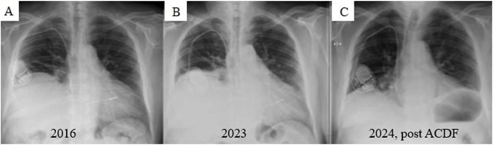
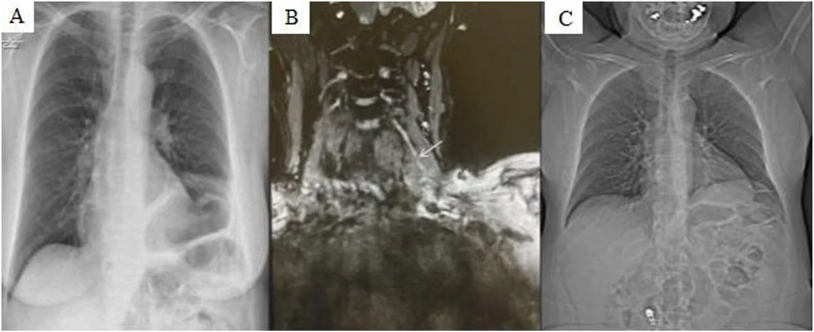
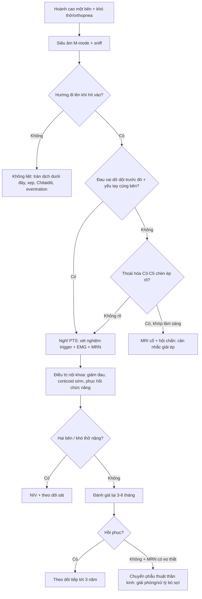
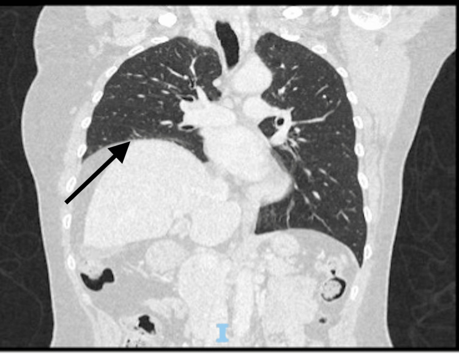
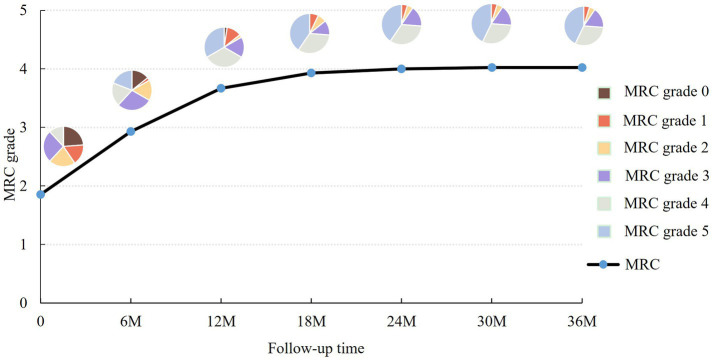

# 1889 — Hội chứng Parsonage–Turner có tổn thương thần kinh hoành / Parsonage–Turner syndrome with phrenic nerve involvement

**Tags:** `pattern:nang-cao-nua-hoanh` `pattern:van-dong-nghich-thuong` `pattern:teo-co` `pattern:day-thoi-gian` `vung:than-kinh-ngoai-bien` `vung:co-hoanh` `vung:phoi` `protocol:MRN` `protocol:EMG-than-kinh-hoanh` `protocol:SA-co-hoanh` `protocol:sniff-test`

**Mức chắc chắn (certainty):** tổng hợp y văn (literature synthesis) — số liệu từ **loạt 8 ca liệt thần kinh hoành** có đối chiếu y văn (PMC13677414), **đoàn hệ 248 ca PTS** dẫn qua bài đó, **đoàn hệ bảo hiểm ~26 triệu người** (PMC12690013), **loạt 42 ca theo dõi 55 tháng** (PMC13095506), **tổng quan 2026** (PMC12982878) và **các ca lâm sàng có ảnh** (PMC13354110, PMC13571711). Phần **thời điểm mổ** là **suy luận thực hành** — không có thử nghiệm ngẫu nhiên.

> **Câu chốt:** Parsonage–Turner (neuralgic amyotrophy, PTS) là bệnh **tự miễn–viêm của dây thần kinh ngoại biên**, không phải bệnh đám rối đơn thuần: **7,6%** bệnh nhân PTS có tổn thương **thần kinh hoành** (248 ca), nhưng **chẩn đoán muộn trung vị 20 tuần** vì không ai nghĩ tới. Trên phim, nó chỉ là **một nửa hoành cao** — giống hệt liệt sau mổ tim, tràn dịch dưới đáy phổi, Chilaiditi. Khác biệt nằm ở **tiền sử**: **đau vai dữ dội vài ngày rồi yếu**, thường sau **nhiễm virus**. Đa số **hồi phục trong 6 tháng–3 năm** nhưng **20% còn di chứng**, nên câu hỏi lâm sàng là **"có bằng chứng tổn thương dây thần kinh và có hồi phục không"**, không phải "có mổ cổ hay không".

## 1. Tổng quan bệnh học – cơ chế hình ảnh

### 1.1 Vì sao một bệnh "vai" lại gây khó thở

- **Cơ chế hiện hành:** **khuynh hướng di truyền + yếu tố khởi phát miễn dịch + vi chấn thương cơ học** → tăng tính thấm **hàng rào máu–thần kinh**, tế bào/dịch miễn dịch vào **nội mô dây thần kinh (endoneurium)** → viêm tự miễn, **phù nội dây**, dây cứng lại và **gập/kinking** khi khớp bên cạnh vận động → sau nhiều lần gập, các **bó sợi (fascicle) xoay và thắt lại thành "eo đồng hồ cát" (hourglass constriction)** (PMC13677414).
- **Thần kinh hoành** đi từ **C3–C5** xuống **cơ bậc thang trước**, vào ngực trước rốn phổi, ôm màng tim tới cơ hoành. Vì là **dây dài, ít nhánh, nằm sát khớp/động mạch** nên dễ bị kéo–gập; tổn thương **một bên** là điển hình, **hai bên** gây **khó thở khi nằm ngửa (orthopnea)** và suy hô hấp — kiểu bệnh cảnh rất dễ bị gán cho **tim/phổi**.
- **Vì sao biểu hiện muộn:** đau vai xuất hiện **trước** liệt hoành vài ngày–vài tuần, rồi **tự giảm**; khi bệnh nhân đến vì khó thở thì **không còn đau** → mất dấu hiệu chỉ điểm. Trong loạt 8 ca, **6/8** chỉ được nhận ra PTS khi hỏi lại tiền sử (PMC13677414).

### 1.2 Cơ chế hình ảnh: tại sao MRN sáng, tại sao siêu âm thấy nghịch thường

- **MR neurography (MRN) T2/STIR tăng tín hiệu:** phù nội dây làm tăng **nước tự do** → T2 dài; hình ảnh là **đoạn dây dày, sáng, có chỗ thắt** — không phải khối u. Đây là **dấu hiệu viêm hoạt tính**, xuất hiện **trong vòng 1 tháng** ở **90%** bệnh nhân, **eo đồng hồ cát ở 74%** (Ripellino 2022, dẫn qua PMC13677414); loạt 117 ca khác: dày/giảm âm **24%**, thắt/xoắn **66%**.
- **TẠI SAO siêu âm cơ hoành là chốt chức năng:** M-mode ghi **vị trí vòm hoành theo thời gian**. Liệt → khi hít vào, áp lực âm lồng ngực **hút tạng bụng lên**, nửa hoành **đi lên (nghịch thường)** thay vì đi xuống. **Hướng đi** là dấu chốt; **độ dày Tdi có thể bình thường** vì cơ chưa teo (bài 1849).
- **TẠI SAO EMG giúp phân biệt tổn thương trục vs myelin:** mất sợi trục → **biên độ CMAP giảm**; tổn thương myelin/block dẫn truyền → **thời tiềm kéo dài** với biên độ còn. PTS gây **tổn thương sợi trục** nên CMAP hoành **giảm** — đúng như loạt ca (PMC13677414).

### 1.3 Số liệu nền (bắt buộc thuộc)

| Chỉ số | Số | Nguồn |
|---|---|---|
| Tần suất PTS ở chăm sóc ban đầu | **1/1.000/năm** | van Alfen 2006, dẫn qua PMC13677414 |
| Tần suất theo dữ liệu bảo hiểm (~26 triệu người) | **7,7–12,8/100.000** (lưu ý: **thấp hơn ~90%** so với đoàn hệ tiền cứu) | PMC12690013 |
| Tần suất ước tính tiền cứu | **~100/100.000** | PMC12690013 |
| Tần suất tại một trung tâm phẫu thuật bàn tay | **47/100.000/năm** | PMC13095506 |
| **Tổn thương thần kinh hoành trong PTS** | **7,6%** (248 ca), **chẩn đoán muộn trung vị 20 tuần** | van Alfen 2015, dẫn qua PMC13677414 |
| Liệt hoành được mã hóa *cùng* PTS (dữ liệu thanh toán) | **0,45%** — tức **phần lớn bị bỏ sót** | PMC12690013 |
| Liệt nửa hoành trong 99 ca PTS kinh điển | **6 ca** + **1 ca hai bên** | Tsairis 1972, dẫn qua PMC13677414 |
| "Liệt hoành vô căn" hóa ra có đặc điểm PTS | **17/33** | Tsao 2006, dẫn qua PMC13677414 |
| Hồi phục | **65% ở 10 tháng**; đa số trong **6 tháng–3 năm**, **20% còn di chứng** | PMC12982878 · PMC13677414 |
| Tái phát | **26%** thể thường, **75%** thể gia đình | PMC12982878 |

## 2. Mẫu hình + chẩn đoán phân biệt theo cơ chế (gamut)

- **Mẫu hình kinh điển:** **đau vai/cổ dữ dội một bên (vài giờ–vài ngày) → yếu cơ vai/cánh tay**, cùng bên với **nửa hoành cao**; thường sau **nhiễm virus** (HEV, EBV, CMV, HBV, HIV, parvovirus B19, SARS-CoV-2), **tiêm vaccine**, **phẫu thuật**, **gắng sức vai**.
- **Thể "hoành đơn độc" (phrenic-predominant):** **chỉ khó thở/orthopnea**, không yếu tay — đây là thể **dễ bỏ sót nhất** và xuất hiện ở nhiều ca trong loạt 8 ca (6/8 được chẩn đoán PTS, PMC13677414).
- **Gamut theo cơ chế (5 nhóm):**
  1. **Thần kinh tự phát/viêm:** **PTS** (phổ biến nhất trong loạt), **bệnh thần kinh do nhiễm (HEV)**, **hội chứng Guillain–Barré**, **bệnh thần kinh đái tháo đường**, **di truyền (SEPTIN9)**.
  2. **Chèn ép cơ học:** **hẹp lỗ ghép C3–C5** do thoái hóa cột sống cổ (đối thủ chính của PTS), **u đỉnh phổi (Pancoast)**, **hạch trung thất**, **bướu giáp lớn**.
  3. **Sau can thiệp:** **mổ tim/ngực** (bài 1849), **mổ cổ/đám rối**, **đặt catheter tĩnh mạch cảnh**, **xạ trị**.
  4. **Chấn thương:** **kéo giãn vai/cổ**, **chấn thương ngực**, **nắn chỉnh cổ**.
  5. **Cơ/tạng dưới hoành:** **giãn cơ hoành (eventration)**, **tràn dịch dưới đáy phổi (bài 1888)**, **xẹp đáy phổi**, **áp-xe dưới hoành**, **gan/lách to**, **Chilaiditi**.
- **Gợi nhớ "PHRENIC":** **P**TS/viêm · **H**ệ cột sống cổ (C3–C5) · **R**ổ/u đỉnh phổi · **E**ventration · **N**hiễm (HEV/EBV) · **I**atrogenic (mổ) · **C**hấn thương.

## 3. Bảng so sánh phân biệt (ma trận đối chiếu)

| Thực thể (entity) | Hình ảnh điển hình (X-quang/SA/MRN) | Chốt vào (rule-in) | Chốt loại (rule-out) | Gợi ý xác nhận |
|---|---|---|---|---|
| **PTS có tổn thương hoành** | Nửa hoành cao **một bên** ± **xẹp đáy**; M-mode **nghịch thường**; MRN **dây sáng, eo đồng hồ cát** | **Đau vai dữ dội trước đó rồi yếu tay cùng bên + nghịch thường** | Đau–yếu **xuất hiện cùng lúc**, tăng khi xoay cổ, **Spurling (+)** → nghĩ chèn ép rễ | MRN thần kinh hoành/đám rối; EMG; siêu âm + sniff |
| **Hẹp lỗ ghép C3–C5** | **Thoái hóa/gai xương chèn lỗ ghép** cùng bên; hoành cao **từ từ**, không đau vai kiểu PTS | **Hình ảnh chèn ép rõ C3–C5 khớp lâm sàng + không có giai đoạn đau–yếu tách rời** | Thoái hóa nhẹ **không chèn ép** + khởi phát **cấp sau nhiễm** → PTS | MRI cột sống cổ; EMG; hội chẩn đa chuyên khoa |
| **Liệt hoành sau mổ tim/ngực** | Hoành cao **trái** thường gặp, **dây thép xương ức**, đáy phổi xẹp | **Mổ tim/ngực trong vài tuần** + nghịch thường | Không có mốc mổ, khởi phát sau đau vai → PTS | Siêu âm (bài 1849) |
| **Tràn dịch dưới đáy phổi** | **Đỉnh hoành lệch ra ngoài**, **khoảng cách hoành–bóng vị > 1 cm**, **không nghịch thường**; đổi theo tư thế | **Đỉnh lệch bên + thay đổi khi nằm/đứng + siêu âm thấy dịch** | Nghịch thường thật + hoành cao đều → liệt | Siêu âm màng phổi, CT, chọc dịch (bài 1888) |
| **Giãn cơ hoành (eventration)** | Hoành cao **nhẵn, liên tục**, **không xẹp đáy**, không mốc mổ; thường **không nghịch thường rõ** | **Bẩm sinh, phát hiện tình cờ, không tiến triển** | Khởi phát cấp + nghịch thường + đau vai → PTS | So phim cũ; CT; siêu âm |
| **U đỉnh phổi/hạch trung thất** | Khối **đỉnh phổi** hoặc **trung thất** cùng bên; có thể **hội chứng Pancoast** | **Khối thấy được trên CT + hoành cao cùng bên** | CT ngực sạch + MRN có eo thắt → PTS | CT ngực có cản quang, PET nếu nghi |
| **Bệnh thần kinh–cơ hệ thống** | Hoành cao **hai bên**, yếu cơ gốc chi, **không đau kiểu PTS** | **Yếu đối xứng + phản xạ giảm + tổn thương nhiều dây** | Một bên, đau khu trú → PTS | EMG toàn thân, xét nghiệm tự miễn |

*X-quang ngực thẳng của cùng một bệnh nhân: **(A)** 2016 — **nửa hoành phải nâng cao** nặng; **(B)** 2023 — không thay đổi đáng kể; **(C)** 2024 sau **mổ giải ép C3–C4/C4–C5** — hoành hạ xuống. Bài học: **hoành cao mạn tính** có thể do **nguyên nhân chèn ép** hoặc **PTS đã hồi phục chậm**; hình ảnh một thời điểm không phân biệt được — phải có **diễn tiến**. Nguồn: **Brain & Spine 2026, PMC13677414**, CC BY-NC-ND 4.0 (nguyên bản, không cắt/ghép).*

*Cùng bệnh nhân thứ 3: **(A)** X-quang 2024 — **nửa hoành trái nâng cao** nặng; **(B)** **MR neurography** đường đi cổ của **thần kinh hoành**: nhiều đoạn **tăng tín hiệu, không đều, thắt lại** (mũi tên) — dấu hiệu của **phù nội dây + xoắn bó sợi**, không phải khối; **(C)** X-quang 2025 — hoành **hạ xuống** sau điều trị nội khoa. Đây là bằng chứng **tổn thương thần kinh thực thể**, giúp loại "hoành cao không rõ nguyên nhân". Nguồn: **Brain & Spine 2026, PMC13677414**, CC BY-NC-ND 4.0.*

## 4. Protocol chẩn đoán + ngưỡng + thuật toán

### 4.1 Trình tự (không nhảy cóc)

1. **X-quang ngực thẳng, phim hít vào:** xác định **bên nào cao**, tìm **xẹp đáy**, **loại trừ tràn dịch** (bài 1888) và **thoát vị**.
2. **Siêu âm cơ hoành tại giường + sniff:** đo **DE** hai bên, **hướng vận động**, **TF**; đây là bước **chứng minh chức năng** (ngưỡng ở mục 4.2).
3. **Hỏi lại tiền sử có cấu trúc** — 3 câu quyết định: **(a)** có **đau vai/cổ dữ dội** trước đó không? **(b)** có **yếu tay cùng bên** không? **(c)** có **nhiễm virus/sốt/tiêm vaccine** trong 4 tuần trước không?
4. **Xét nghiệm trigger:** **HEV IgM/IgG, EBV, CMV, HBV, HIV, parvovirus B19, Borrelia, SARS-CoV-2** — tìm được trigger củng cố PTS, nhất là thể **đa dây/một bên** (PMC13677414).
5. **EMG/ENMG thần kinh hoành:** **biên độ CMAP giảm** (mất sợi trục), **thời tiềm**; so hai bên và với cơ hoành.
6. **MRN thần kinh hoành/đám rối cánh tay** khi nghi PTS hoặc cần phân biệt với chèn ép: tìm **dày, tăng T2, eo đồng hồ cát**.
7. **MRI/CT cột sống cổ** khi: **khởi phát từ từ**, **không có giai đoạn đau–yếu tách rời**, **Spurling (+)**, hoặc **hình ảnh gai xương C3–C5 rõ** — nhưng **đừng suy diễn** thoái hóa nhẹ thành nguyên nhân.
8. **CT ngực** để loại **u đỉnh phổi/hạch trung thất** — đặc biệt khi **hút thuốc**, **sụt cân**, **đau vai kiểu Pancoast**.

### 4.2 Ngưỡng định lượng

| Chỉ số | Bình thường | Bất thường |
|---|---|---|
| **DE thở yên lặng** | 10–20 mm | **< 10 mm (nam), < 9 mm (nữ)** = rối loạn (bài 1849, PMC9747253) |
| **DE khi sniff** | > 18 mm (nam), > 16 mm (nữ) | **< 18/16 mm** = rối loạn |
| **TF = (Tdi hít vào − Tdi thở ra)/Tdi thở ra** | 20–40% | **< 20%** = paresis/paralysis |
| **VC tư thế** | giảm < 10% khi nằm ngửa | **giảm ≥ 10–20%** gợi ý liệt có ý nghĩa (bài 1849) |
| **MRN dây thần kinh** | tín hiệu đều, không thắt | **tăng T2 + dày + eo đồng hồ cát** = viêm/xoắn (PMC13677414) |
| **Thời gian chờ trước khi xét mổ** | — | **≥ 3 tháng điều trị nội khoa** trước khi cân nhắc giải ép/giải phóng (PMC13677414) |

### 4.3 Thuật toán "hoành cao + đau vai"

### 4.4 Điều trị — bằng chứng và giới hạn

- **Giảm đau sớm** là ưu tiên (đau thần kinh, thường dữ dội): gabapentinoid/opioid ngắn hạn theo cân nặng; **corticoid uống sớm (< 4 tuần sau khởi phát)** được khuyến cáo trong tổng quan, nhưng **không có thử nghiệm ngẫu nhiên** (PMC13677414).
- **Phục hồi chức năng** và **tránh teo cơ**; theo dõi **sức cơ MRC** theo thời gian. Loạt 42 ca: **18 hồi phục hoàn toàn + 13 hồi phục một phần (MRC 4)** trong ~2 năm, nhưng **21 ca còn đau mạn** và **7 ca phải mổ** vì không hồi phục sau ≥ 3 tháng (PMC13095506).
- **Hai bên/tổn thương nặng:** **NIV** (đặc biệt khi orthopnea, giảm VC tư thế) — không chờ hồi phục tự nhiên (PMC13677414).
- **Phẫu thuật thần kinh:** chỉ khi **không hồi phục sau ≥ 3 tháng** **và** hình ảnh có **eo thắt/xoắn**; kỹ thuật là **giải phóng nội bó (intrafascicular neurolysis)** hoặc **cắt–nối lại bó sợi**; chưa có RCT, chọn lọc rất chặt (PMC13677414).
- **Không mổ cổ chỉ vì "có gai xương":** một ca trong loạt mổ C3–C4/C4–C5 nhưng **không cải thiện**, và hoành chỉ hồi phục sau **20 tháng** — diễn tiến phù hợp PTS tự khỏi hơn là do mổ (PMC13677414). Đây là cạm bẫy **can thiệp oan**.

## 5. Biến thể bình thường và cạm bẫy

- **Thoái hóa cột sống cổ là "bình thường theo tuổi":** gai xương C5–C7 rất thường gặp; **thấy gai xương không có nghĩa là nguyên nhân**. Chỉ quy cho chèn ép khi **hình ảnh chèn ép lỗ ghép rõ + lâm sàng khớp** (mất lực theo rễ, Spurling) và **không có giai đoạn đau–yếu tách rời**.
- **Đau–yếu tách rời là chìa khóa lâm sàng:** **PTS** = đau trước, yếu sau, **không phụ thuộc tư thế cổ**; **bệnh rễ** = đau và yếu **cùng lúc**, tăng khi **xoay/ngửa cổ** (Spurling) (Silverman 2022, dẫn qua PMC13677414).
- **"Liệt hoành vô căn" thường là PTS:** **17/33** ca "vô căn" có đặc điểm PTS — đừng dừng ở nhãn "vô căn" khi chưa hỏi tiền sử và chưa làm MRN/EMG.
- **Thể hoành đơn độc dễ bị gán cho COPD/tim:** bệnh nhân **orthopnea** với **siêu âm tim bình thường** phải nghĩ tới **liệt hoành**; một ca bị điều trị "COPD nặng lên" nhiều tháng trước khi chụp lại phim (PMC13354110).
- **Hai bên dễ bỏ sót:** khó thở khi nằm ngửa + **VC giảm khi nằm** + không cai được máy → **đo cả hai bên**, đừng chỉ nhìn bên "cao".
- **Siêu âm một lần không đủ:** **Tdi bình thường** trong liệt một bên; phải đo **hướng** và **sniff**, và **đo lại** khi hết đau/guarding (bài 1849).
- **Đừng nhầm MRN với khối u:** tổn thương PTS là **dây dày, dài, có eo**, không phải **nốt** — sinh thiết mù rất nguy hiểm.

*CT ngực coronal ở bệnh nhân **56 tuổi, COPD, khó thở khi nằm ngửa nhiều tháng**: **nửa hoành phải nâng cao** (mũi tên), đáy phổi phải xẹp. CT **chứng minh hình thái**, không chứng minh liệt — nhưng khi đã loại u/chèn ép, bước tiếp theo là **siêu âm động học**. Nguồn: **Cureus 2026, PMC13354110**, CC BY 4.0.*

## 6. Tự lượng giá — Blind Quiz

**Ca 1 — Nữ 56 tuổi, COPD, khó thở tăng dần + **khó thở khi nằm ngửa** nhiều tháng; siêu âm tim bình thường. Nhìn CT, mô tả trước.**

- Hỏi: dấu hiệu chính? 3 chẩn đoán phân biệt? Bạn hỏi thêm **một câu tiền sử** nào có thể đổi chẩn đoán?

<b>Bấm để hiện đáp án (findings + chẩn đoán)</b>

- **Findings:** **nửa hoành phải nâng cao** rõ, đáy phổi phải xẹp; không thấy khối trung thất/đỉnh phổi trên CT.
- **Phân biệt:** **liệt thần kinh hoành (PTS)**, **giãn cơ hoành (eventration)**, **tràn dịch dưới đáy phổi**, **xẹp phổi**, **chèn ép rễ C3–C5**.
- **Câu hỏi tiền sử quyết định:** **"Trước khi khó thở, bà có bị đau vai/tay dữ dội và yếu tay cùng bên không?"** — ca thật trả lời **có**: đau tay phải + yếu ngón cái sau **cúm**, tức **PTS thể hoành đơn độc**; siêu âm cho **liệt hoàn toàn hoành phải**, và **dung tích phổi giảm rõ khi nằm**.
- **Nguồn ảnh:** Cureus 2026, PMC13354110, CC BY 4.0.

**Ca 2 — Nữ 64 tuổi, đau vai rồi yếu tay, sau đó khó thở. Ảnh (A) là phim 2024; (B) là MRN; (C) là phim 2025.**

- Hỏi: (A) mô tả gì? (B) mũi tên chỉ dấu hiệu gì và **vì sao** nó tăng tín hiệu? (C) nói lên điều gì về tiên lượng?

<b>Bấm để hiện đáp án</b>

- **Findings:** **(A)** **nửa hoành trái nâng cao** nặng; **(B)** **thần kinh hoành** đoạn cổ **dày, tăng tín hiệu, không đều, có chỗ thắt** — **eo đồng hồ cát**, do **phù nội dây + xoắn bó sợi** (tăng nước tự do → T2 sáng); **(C)** hoành **hạ xuống** sau điều trị nội khoa.
- **Chẩn đoán:** **PTS có tổn thương thần kinh hoành**, **một bên**; bằng chứng **thực thể** trên MRN, không cần sinh thiết.
- **Tiên lượng:** **hồi phục được** nhưng **chậm** (6 tháng–3 năm); **20% còn di chứng**; **không mổ** khi chưa thử ≥ 3 tháng nội khoa.
- **Nguồn ảnh:** Brain & Spine 2026, PMC13677414, CC BY-NC-ND 4.0.

**Ca 3 — Bệnh nhân PTS được theo dõi 36 tháng. Đồ thị dưới đây nói gì về quá trình hồi phục?**

- Hỏi: trục tung là gì? Vì sao đường cong **không đơn điệu**? Điều này thay đổi cách bạn tư vấn bệnh nhân ra sao?

<b>Bấm để hiện đáp án</b>

- **Findings:** trục tung là **sức cơ trung bình theo thang MRC** (0–5) của 42 bệnh nhân PTS; đường cong **dao động** trong 36 tháng, tăng dần nhưng có đoạn **chững/giảm**.
- **Ý nghĩa:** hồi phục **không tuyến tính**; một lần đo yếu hơn **không có nghĩa thất bại**. Trong loạt: **18 hồi phục hoàn toàn**, **13 hồi phục một phần** sau ~2 năm, **21 còn đau mạn**.
- **Tư vấn:** giải thích **mốc 6 tháng–3 năm**, đặt kỳ vọng thực tế, theo dõi **chức năng** chứ không chỉ một lần EMG; **không vội mổ** khi còn trong cửa sổ hồi phục.
- **Nguồn ảnh:** Front Neurol 2026, PMC13095506, CC BY 4.0.

## Bài liên quan chéo
- [1849 – Liệt cơ hoành một bên sau mổ tim/ngực](../1849-liet-co-hoanh-mot-ben-sau-mo-tim-nguc/lesson.md) (cùng hình ảnh, khác cơ chế)
- [1888 – Tràn dịch dưới đáy phổi giả nâng cao cơ hoành](../1888-tran-dich-duoi-day-phoi/lesson.md) (bắt chước hoành cao)
- [1776 – Bệnh cơ hoành do thở máy (VIDD)](../1776-benh-co-hoanh-do-tho-may/lesson.md)
- [045 – Thành ngực & hoành](../045-thanh-nguc-hoanh/lesson.md)
- [1617 – Bệnh đám rối cánh tay do xạ](../1617-benh-dam-roi-can-tay-do-xa/lesson.md)
- [1850 – Siêu âm cơ hoành dự báo cai máy ở trẻ](../1850-sieu-am-co-hoanh-cai-may-tre-so-sinh/lesson.md)

> Không dùng để chẩn đoán độc lập khi chưa có người hướng dẫn.
