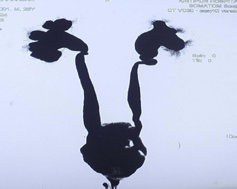
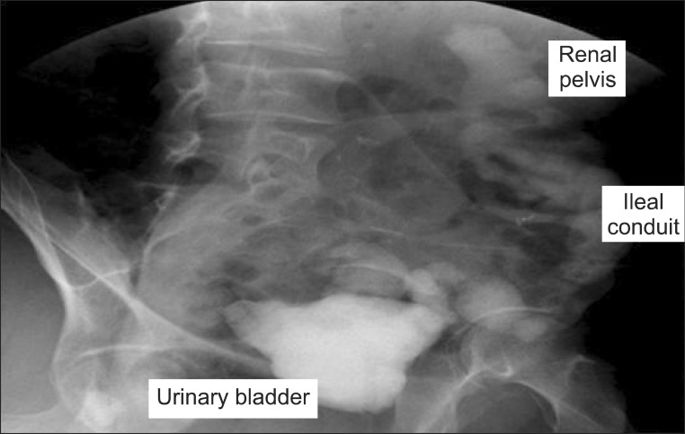
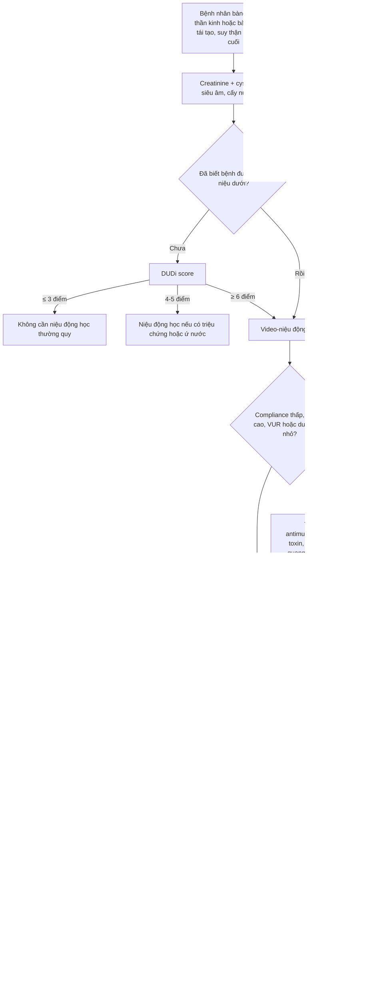
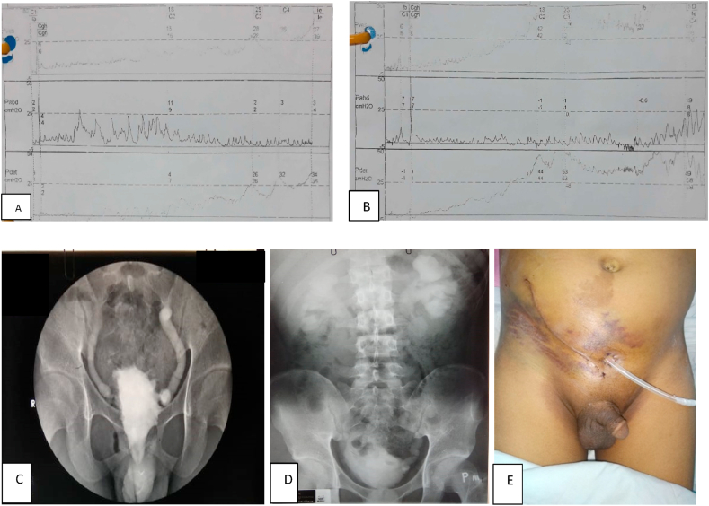

# 189 — Đánh giá tiết niệu trước ghép thận ở bàng quang thần kinh & bàng quang tái tạo / Pre-transplant urological assessment in neurogenic and reconstructed bladder

**Tags:** `pattern:danh-gia-truoc-ghep` `pattern:bang-quang-ap-luc-cao` `vung:tiet-nieu` `vung:than-ghep` `protocol:video-nieu-dong` `score:DUDi` `anatomy:bang-quang-than-kinh`
**Mức chắc chắn (certainty):** tổng hợp y văn (literature synthesis) — cohort quốc gia/đa trung tâm + nghiên cứu niệu động học + review CAKUT; mọi con số gắn PMCID, ảnh CC có giấy phép từng file.

## 1. Tổng quan bệnh học – cơ chế hình ảnh

- **Vì sao đường tiết niệu dưới là “cửa sinh tử” của thận ghép:** thận ghép không có van chống trào hiệu quả tuyệt đối và chỉ chịu được **áp lực bể thận thấp**. Một bàng quang **kém chun giãn (low-compliance)**, **áp lực cao**, **trào ngược (VUR)** hoặc **tắc nghẽn** sẽ truyền áp lực ngược lên mảnh ghép → **ứ nước, viêm thận–bể thận tái phát, sẹo và mất thận ghép**. Đây là lý do bệnh nhân bàng quang thần kinh (neurogenic bladder — NB) phải được **đánh giá và tối ưu hóa đường tiết niệu TRƯỚC khi vào danh sách ghép**, không phải sau.
- **Quy mô vấn đề:** tại Mỹ, **6%** ca ghép thận có chỉ định là bệnh thận giai đoạn cuối do bất thường đường tiết niệu dưới; **0,7–2,3%** ca ghép được làm trên bệnh nhân có **ống dẫn niệu kiểu ileal conduit** (Halskov ACL và cs, *Investig Clin Urol* 2026;67:392-401, PMC13351179).
- **Kết cục không tệ như định kiến cũ:** cohort quốc gia Đan Mạch 2000–2021 gồm **25 bệnh nhân/26 thận ghép** (ileal conduit hoặc continent cutaneous 9; Mitrofanoff + tăng cường bàng quang 8; Mitrofanoff không tăng cường 6; chỉ tăng cường bàng quang 2): **sống còn bệnh nhân 10 năm 91,7%**, **sống còn mảnh ghép 10 năm 85,5%**. Biến chứng sớm: nhiễm trùng tiểu (UTI) 10, tụ dịch quanh mảnh ghép 7, chảy máu 6, nhiễm khuẩn huyết 4, tắc niệu quản 4. Biến chứng muộn: UTI tái phát 18, **áp-xe/nhiễm trùng liên quan mảnh ghép 11**, ứ nước 6 (PMC13351179).
- **Nhóm phức tạp nhất:** 37 bệnh nhân từ 8 trung tâm (Đức): nguyên nhân suy thận gồm **trào ngược 24%, spina bifida 22%**, viêm cầu thận 12%; **32% phải sửa đường tiết niệu ngay trong mổ ghép**; sống còn mảnh ghép 5 năm **79%**, sống còn bệnh nhân 5 năm **89%**; biến chứng sau mổ 19% (Flegar L và cs, *World J Urol* 2024;42:239, PMC11023965).
- **Sau ghép, biến chứng tiết niệu có “lịch” riêng:** 178 trẻ ghép thận, **15,7%** có biến chứng tiết niệu; **61%** có bệnh niệu trước đó; **13,4%** cần can thiệp nội soi/mổ. Giai đoạn **7–30 ngày**: tắc nối niệu quản–bàng quang và tụ dịch quanh thận; **1–3 tháng**: hẹp niệu quản, VUR có triệu chứng, **lymphocele gây tắc**; **> 3 tháng**: VUR, hẹp niệu quản (có ca đứt niệu quản). Sửa VUR nội soi thành công **75%** (Sangermano M và cs, *Medicina* 2024;60:1754, PMC11597008).
- **TẠI SAO hình ảnh thay đổi — vật lý & mô học:**
  - **Bàng quang áp lực cao** → cơ detrusor phì đại, **dày thành, trabeculation, túi thừa (diverticula)**; trên CT/MRI thành bàng quang dày không đều, bè cơ nổi rõ; trên siêu âm thành dày > 3 mm gợi ý.
  - **Trào ngược** làm **niệu quản giãn, lượn khúc (hydroureter)**; khi nhiễm trùng lặp lại, nhu mô thận mỏng và sẹo → **DMSA** là chìa khóa chức năng, không phải CT.
  - **Bàng quang tái tạo bằng ruột** tiết **chất nhầy (mucus)** — trên siêu âm/CT giả “cặn/dị vật”, dễ đọc nhầm sỏi; đoạn ruột cũng **hấp thu Cl⁻/NH₄⁺** gây **toan chuyển hóa tăng Cl⁻** và mất xương, nên theo dõi khí máu/B12 là một phần của “hình ảnh chức năng”.
  - **Sau ghép:** **lymphocele** là tụ dịch **không ngấm thuốc, thành mỏng, ở dưới/ngoài mảnh ghép**; **urinoma** là tụ dịch **có creatinine cao gấp nhiều lần huyết thanh** — siêu âm không phân biệt được, phải chọc hút hoặc CT có cản quang thì muộn.
- **Creatinine “bình thường” không có nghĩa là chức năng thận bình thường ở NB:** bệnh nhân teo cơ chi dưới có **khối cơ thấp** → creatinine thấp giả → **eGFR theo creatinine cao giả**. Trong 47 trẻ NB (59,6% có myelomeningocele), dùng phương trình **CKiD-CysC** làm **68% bệnh nhân chuyển sang giai đoạn CKD nặng hơn**; ở nhóm không đi độc lập, eGFR theo creatinine cao hơn có ý nghĩa (Menezes C và cs, *Cureus* 2023;15:e42337, PMC10444205).

## 2. Mẫu hình + chẩn đoán phân biệt theo vị trí (gamut)

- **Bàng quang gốc (native bladder) — NB:** pattern “bể chứa áp lực cao”: dung tích nhỏ, compliance thấp, **detrusor overactivity (DO)** hoặc **underactivity (DU)**, **detrusor–sphincter dyssynergia**, tồn lưu. Hình ảnh: thành dày, trabeculation, túi thừa, **ứ nước hai bên**; trực tiếp đánh giá bằng **video-niệu động học (videourodynamics)**.
- **Bàng quang tăng cường bằng ruột (augmentation cystoplasty):** pattern “bể chứa + đoạn ruột”: sỏi 10–52%, thủng tự phát 1,9–4,5%, ung thư tại đoạn ruột 1,2–4,5% sau > 10 năm (bài 672). Trước ghép cần loại **sỏi, túi thừa lớn, hẹp cổ bàng quang, VUR**.
- **Ống dẫn niệu (ileal conduit / continent cutaneous):** pattern “đường thoát ra da”: hẹp **miệng nối niệu quản–ruột** (thường ở 1/3 dưới niệu quản trái), **thoát vị cạnh lỗ thông (parastomal hernia)** gây gập ống, sỏi trong quai ruột, hẹp lỗ thông.
- **Bàng quang thay thế (neobladder) / Mitrofanoff:** pattern “bể chứa không sinh lý”: **hẹp lỗ thông Mitrofanoff** (bài 3001 dự kiến), sỏi bể chứa, trào ngược lên mảnh ghép, rò.
- **Mảnh ghép (graft):** **ứ nước** do (1) VUR, (2) hẹp nối niệu quản, (3) chèn ép (lymphocele, hematoma, urinoma), (4) sỏi/sản phẩm đông; **tụ dịch quanh thận** (lymphocele vs urinoma vs áp-xe); **sỏi thận ghép**; **áp-xe quanh mảnh ghép**.
- **Đường tiết niệu trên:** ứ nước–niệu quản, sẹo nhu mô, sỏi, **bàng quang thần kinh “hình quả thông” (pine-cone bladder)** khi tăng áp lực mạn.

*CT urogram (MIP) ở bệnh nhân bàng quang thần kinh do **bất sản xương cùng**: hai niệu quản giãn–lượn khúc, bể thận ứ nước, bàng quang hình “quả thông” co nhỏ — đúng bệnh cảnh phải tối ưu trước khi ghép. Nguồn: Khanal S và cs, *JNMA* 2025;63(292):914-917 (PMC12906750), Fig. 1, CC BY 4.0 — ảnh nguyên bản.*

## 3. Bảng so sánh phân biệt (ma trận đối chiếu)

| Thực thể (entity) | Hình ảnh/lâm sàng điển hình | Chốt vào (rule-in) | Chốt loại (rule-out) | Gợi ý xác nhận |
|---|---|---|---|---|
| Bàng quang kém chun giãn (LCB) | Dung tích nhỏ, áp lực đổ đầy tăng nhanh; thành dày, trabeculation; són/ứ nước | **Compliance < 12,5 mL/cmH₂O** + áp lực đổ đầy cuối cao | Dung tích bình thường + compliance > 20 mL/cmH₂O + không ứ nước → không phải LCB | Niệu động học (cystometry) chuẩn hóa tốc độ làm đầy |
| Bàng quang tăng áp lực có VUR | Ứ nước–niệu quản, bể thận giãn; VUR khi bơm cản quang | **VUR thấy trên VCUG/video-niệu động** + ứ nước cùng bên | Niệu quản không giãn + không trào ngược khi làm đầy đủ → loại VUR đáng kể | VCUG thì đi tiểu / video-niệu động |
| Bàng quang tăng cường có sỏi | Cặn lắng, bóng cản quang; đau, UTI tái phát | **Sỏi cản quang trong bể chứa** + chất nhầy | Chỉ chất nhầy di động, không cản quang, không ứ nước → không mổ | CT không cản quang lát mỏng; siêu âm |
| Hẹp miệng nối niệu quản–ruột (conduit) | Ứ nước mảnh ghép/thận còn lại, conduit xẹp | **Hẹp khu trú + giãn trên chỗ hẹp** trên CT/MRU | Giãn lan tỏa do gập ống/thoát vị → xử trí khác | CT urogram/MRU + soi ống dẫn niệu |
| Thoát vị cạnh lỗ thông | Khối cạnh stoma, quai ruột chứa ống dẫn niệu bị gập | **Túi thoát vị chứa quai dẫn niệu** + ứ nước khi nằm/đứng | Không có khối, ống thẳng → loại | CT bụng–chậu có đánh dấu stoma |
| Ứ nước mảnh ghép do VUR | Ứ nước khi bàng quang căng, giảm khi làm rỗng | **Ứ nước tăng khi bàng quang đầy**, giảm sau CIC | Ứ nước cố định không đổi → nghĩ hẹp/chèn ép | Siêu âm trước–sau làm rỗng + VCUG |
| Lymphocele quanh mảnh ghép | Tụ dịch hình thấu kính, thành mỏng, dưới/ngoài thận ghép | **Dịch đồng dạng, không ngấm, không vôi hóa**; chèn ép gây ứ nước | Dịch có creatinine cao = urinoma; dịch có khí/ngấm = áp-xe | Siêu âm + CT cản quang; chọc hút sinh hóa |
| Áp-xe quanh mảnh ghép | Sốt, đau, tụ dịch thành dày | **Thành dày ngấm thuốc + khí trong dịch** | Tụ dịch đơn thuần không ngấm → lymphocele | CT cản quang; chọc hút cấy |
| Sẹo thận do trào ngược | Nhu mô mỏng, đài thận biến dạng, thận nhỏ | **Sẹo vỏ thận khu trú** + tiền sử UTI/VUR | Thận đều, không sẹo → loại | DMSA (chức năng), không phải CT |

### Ảnh chốt: bàng quang tái tạo + thận ghép trên phim cản quang

*Cystogram sau mổ: cản quang ở **bể thận của thận ghép** (renal pelvis) → **đoạn hồi tràng** (ileal conduit) → **bàng quang đã tăng cường** (urinary bladder); không rò. Dung tích bàng quang tăng từ **50 mL lên 300 mL** sau tăng cường — minh họa đích của “tối ưu bể chứa trước ghép”. Nguồn: Chin C và cs, *Korean J Urol* 2013;54(2):143-146 (PMC3580306), Fig. 4, CC BY-NC 3.0 — giữ nguyên bản.*

## 4. Protocol chụp + hệ phân độ/điểm chuẩn hóa

### 4.1 Trước ghép — thứ tự bắt buộc
- **Xét nghiệm:** creatinine **và cystatin C** (eGFR theo cystatin C ở NB teo cơ), điện giải, khí máu (nếu có đoạn ruột), nước tiểu + cấy trước mọi can thiệp.
- **Siêu âm thận–bàng quang:** ứ nước, độ dày thành, sỏi, tồn lưu; đo **dung tích** và **thành bàng quang**.
- **Video-niệu động học (videourodynamics):** đo **dung tích cystometric**, **compliance**, **áp lực detrusor**, **DLPP (detrusor leak point pressure)**, **VUR khi bơm**, khả năng **CIC (clean intermittent catheterization)**.
- **VCUG** nếu nghi VUR; **DMSA** đánh giá sẹo; **MAG3** khi cần phân biệt tắc nghẽn–chức năng; **CT urogram/MRU** khi cần giải phẫu (niệu quản, conduit, túi thừa).
- **Hội chẩn niệu–ghép–phục hồi chức năng:** quyết định **CIC, antimuscarinic, botulinum toxin, tăng cường bàng quang, vesicostomy** trước hay cùng lúc với ghép.

### 4.2 Ngưỡng định lượng phải nhớ
- **Compliance thấp (LCB) định nghĩa < 12,5 mL/cmH₂O**; tỷ lệ LCB ở bệnh nhân bệnh thận giai đoạn cuối **30–50%** (Tangpaitoon T, Swatesutipun V, *Int Urol Nephrol* 2023;55:75-84, PMC9616423).
- **DUDi score** (Duration of RRT – Urine volume/day – Diabetes) dự báo LCB: **AUC 0,87 (95% CI 0,81–0,92)**; **≤ 3 điểm → xác suất LCB ~10%** (không cần niệu động học), **4–5 điểm → cá thể hóa**, **≥ 6 điểm → làm niệu động học**. Lưu ý: mô hình xây trên bệnh nhân **chưa biết bệnh đường tiết niệu dưới**, không dùng thay cho đánh giá ở NB đã biết (PMC9616423).
- **DLPP > 40 cmH₂O** là ngưỡng “nguy hiểm” kinh điển (McGuire); nhưng ở trẻ NB, **DLPP > 20 cmH₂O** nhạy hơn cho ứ nước đường tiết niệu trên, và **ΔPdet > 25 cmH₂O ở cuối thì đổ đầy** có **độ nhạy 85%, độ đặc hiệu 77%**; **compliance < 8 mL/cmH₂O ở giữa/cuối thì đổ đầy** đặc hiệu hơn ngưỡng < 9 mL/cmH₂O (Lyu L và cs, *Int Neurourol J* 2022;26:52-59, PMC8984689).
- **Phản biện (Argon cửa 3):** compliance đo bằng ΔV/ΔP **bỏ qua cơn co detrusor và độ cong của đường áp lực–thể tích**; tốc độ làm đầy nhanh làm áp lực cao giả. ICI-RS 2025 đề xuất thêm **diện tích dưới đường cong (AUC)** và đo ở tốc độ sinh lý (Rovner E và cs, *Neurourol Urodyn* 2026;45:861-868, PMC13238306). Vì vậy một con số compliance không đủ để quyết định mổ.
- **Tối ưu hóa có bằng chứng:** 13 trẻ CKD giai đoạn III–IV do NB, dung tích **74% so với mong đợi**, compliance trung vị **5 mL/cmH₂O**, sau ileocystoplasty: eGFR **24 → 52 → 61 mL/min/1,73 m²** (1 năm sau mổ), ổn định đến **7 năm**, sạch són, giảm UTI sốt (Sinha S, Shah M, *Asian J Urol* 2022;9:313-317, PMC9399548).

### 4.3 Sau ghép — lịch theo dõi
- **7–30 ngày:** siêu âm + creatinine; tìm **tắc nối niệu quản** và **tụ dịch quanh thận**.
- **1–3 tháng:** siêu âm; nghi ngờ thì **CT urogram/MRU**; tìm **hẹp niệu quản, VUR, lymphocele gây tắc**.
- **> 3 tháng và hằng năm:** siêu âm, cấy nước tiểu, eGFR; **VCUG** khi UTI sốt tái phát; **CT/MRI** khi ứ nước mới hoặc chức năng xấu đi.
- **Phân độ biến chứng:** **Clavien–Dindo** (≥ 3 = cần can thiệp/mổ) — cohort Đan Mạch dùng đúng hệ này (PMC13351179).

## 5. Biến thể bình thường và cạm bẫy

- **Creatinine bình thường ở người teo cơ:** đừng loại CKD bằng creatinine; dùng **cystatin C** (68% đổi giai đoạn CKD khi dùng CKiD-CysC — PMC10444205).
- **Ứ nước mạn ổn định ≠ tắc nghẽn mới:** so phim cũ; ứ nước “quen” có thể đã tồn tại nhiều năm. Chỉ can thiệp khi **thay đổi so nền** hoặc chức năng xấu đi.
- **VUR có thể chỉ xuất hiện khi bàng quang đầy/có cơn co:** một VCUG âm không loại trừ; làm đủ thì và đúng tư thế.
- **Chất nhầy trong bàng quang tăng cường** giả sỏi/u trên siêu âm và CT; đối chiếu cản quang và triệu chứng trước khi can thiệp.
- **Thủng bàng quang tăng cường sau ghép** có thể biểu hiện “đau bụng + sốt + tụ dịch” không điển hình; **CT cystogram** là chốt.
- **DUDi score không dùng cho NB đã biết** — đây là công cụ sàng lọc ở người **chưa có bệnh niệu**; áp dụng sai sẽ bỏ sót bàng quang nguy hiểm.
- **Niệu động học phụ thuộc tốc độ làm đầy:** làm đầy nhanh tạo áp lực cao giả → có thể mổ oan; ghi rõ tốc độ và dùng thêm AUC khi nghi ngờ (PMC13238306).
- **Sau ghép, “ứ nước nhẹ” có thể do bàng quang đầy** ở người CIC kém tuân thủ — cho làm rỗng rồi siêu âm lại trước khi kết luận hẹp.
- **Tụ dịch quanh thận ghép:** lymphocele (không ngấm), urinoma (creatinine dịch cao), áp-xe (khí/thành dày) — **không chọc mù** khi chưa loại trừ urinoma/áp-xe.

## 6. Tự lượng giá — Blind Quiz

**Ca 1 — Nam 24 tuổi, bàng quang thần kinh do bất sản xương cùng, suy thận giai đoạn cuối, đang chạy thận nhân tạo. Xem CT urogram.**

- Hỏi: mô tả bất thường chính? Hai hậu quả trên thận ghép tương lai? Cần đo gì trước ghép?

<b>Bấm để hiện đáp án (findings + chẩn đoán)</b>

- **Findings:** hai niệu quản giãn–lượn khúc, bể thận ứ nước hai bên; bàng quang **co nhỏ, thành dày, bờ tua** (“pine-cone”) — hình ảnh bàng quang áp lực cao mạn.
- **Chẩn đoán:** **bàng quang thần kinh tăng áp lực** trên nền bất sản xương cùng, biến chứng ứ nước–niệu quản hai bên.
- **Hai hậu quả trên thận ghép:** (1) **truyền áp lực ngược** gây ứ nước/sẹo; (2) **UTI tái phát và VUR** gây viêm thận–bể thận, mất mảnh ghép.
- **Cần đo trước ghép:** dung tích cystometric, **compliance**, **DLPP**, VUR khi bơm; **cystatin C**; DMSA nếu nghi sẹo.
- **Nguồn ảnh:** Khanal S và cs, *JNMA* 2025;63(292):914-917 (PMC12906750), Fig. 1, CC BY 4.0.

**Ca 2 — Bệnh nhân ghép thận sau tăng cường bàng quang bằng hồi tràng; chụp cystogram kiểm tra.**

- Hỏi: ba cấu trúc được đánh dấu là gì? Vì sao dung tích bàng quang là mục tiêu điều trị?

<b>Bấm để hiện đáp án (findings + chẩn đoán)</b>

- **Findings:** cản quang trong **bể thận thận ghép** → **đoạn hồi tràng** (ileal conduit) → **bàng quang tăng cường**; không thấy rò.
- **Chẩn đoán:** trạng thái sau **ileo-pelvic anastomosis + augmentation cystoplasty** ở thận ghép.
- **Vì sao dung tích quan trọng:** dung tích tăng từ **50 → 300 mL** làm giảm áp lực đổ đầy và số lần CIC, từ đó giảm trào ngược/UTI — đích của “tối ưu bể chứa trước ghép”.
- **Nguồn ảnh:** Chin C và cs, *Korean J Urol* 2013;54(2):143-146 (PMC3580306), Fig. 4, CC BY-NC 3.0.

**Ca 3 — Nữ 30 tuổi, bàng quang thần kinh dung tích nhỏ, tiểu không kiểm soát; làm video-niệu động học trước khi xét ghép.**

- Hỏi: (A)–(B) thể hiện gì? (C)–(D) cho thấy hậu quả nào? (E) là gì?

<b>Bấm để hiện đáp án (findings + chẩn đoán)</b>

- **Findings:** (A)–(B) **đường cong niệu động học** với áp lực detrusor tăng và dung tích nhỏ, phù hợp **bàng quang kém chun giãn/co thắt**; (C)–(D) **ứ nước–niệu quản hai bên** trên hình cản quang và phim bụng; (E) bụng sau **ghép thận + vesicostomy** (ống dẫn lưu ra da).
- **Chẩn đoán:** **bàng quang thần kinh dung tích nhỏ, áp lực cao** → được **ghép thận kèm vesicostomy** để bảo vệ mảnh ghép.
- **Bài học:** khi bàng quang không thể tối ưu bằng thuốc/CIC, **vesicostomy** là lựa chọn chuyển hướng áp lực — ca này ghép thận thành công với bàng quang nhỏ.
- **Nguồn ảnh:** Hakim RL và cs, *Urol Case Rep* 2021;34:101464 (PMC7588693), Fig. 2, CC BY-NC-ND 4.0 — giữ nguyên bản.

## Bài liên quan chéo

- [100 – Tổng quan hệ Bụng](../100-tong-quan-he-bung/lesson.md)
- [672 – Biến chứng muộn sau tái tạo bàng quang bằng ruột](../672-bien-chung-muon-sau-tai-tao-bang-quang/lesson.md)
- [671 – Nhiễm trùng tiểu & viêm thận–bể thận ở trẻ có bàng quang thần kinh](../671-nhiem-trung-tieu-bang-quang-than-kinh-o-tre/lesson.md)
- [673 – Chuyển tiếp sang người lớn ở spina bifida & bàng quang thần kinh](../673-chuyen-tiep-nguoi-lon-spina-bifida-bang-quang-than-kinh/lesson.md)
- [668 – Theo dõi dài hạn sau tháo căng tủy & bàng quang thần kinh](../668-theo-doi-sau-thao-cang-tuy-bang-quang-than-kinh/lesson.md)
- [635 – Dị tật tiết niệu nhi: SFU, VUR, van niệu đạo sau](../635-di-tat-tiet-nieu-nhi-SFU-VUR-PUV/lesson.md)

## Ảnh

- `images/189_CT-nieu-PMC12906750-F1.jpg` — CT urogram, CC BY 4.0.
- `images/189_bang-quang-tang-cuong_XR-PMC3580306-F4.jpg` — cystogram sau ghép, CC BY-NC 3.0.
- `images/189_video-nieu-dong_PMC7588693-F2.jpg` — video-niệu động học + vesicostomy, CC BY-NC-ND 4.0.

Nguồn và giấy phép từng ảnh: [`images/CREDITS.md`](images/CREDITS.md).

> Không dùng để chẩn đoán độc lập khi chưa có người hướng dẫn.
