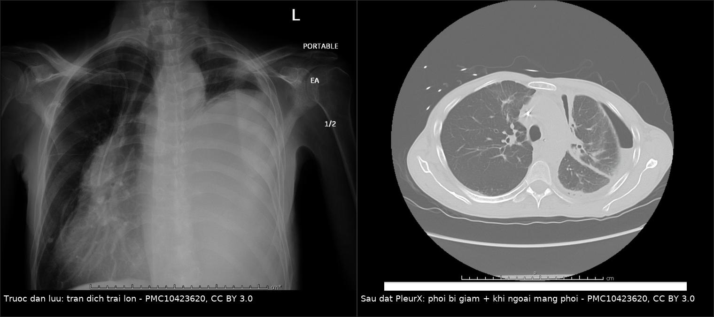
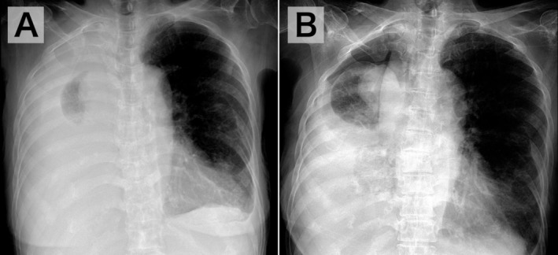
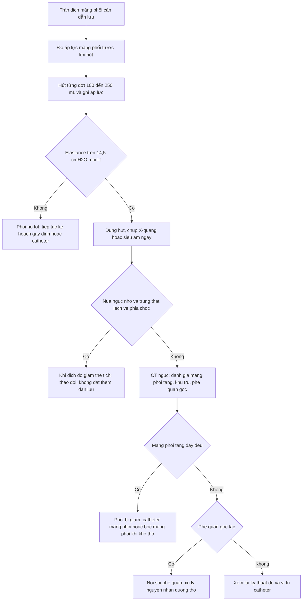
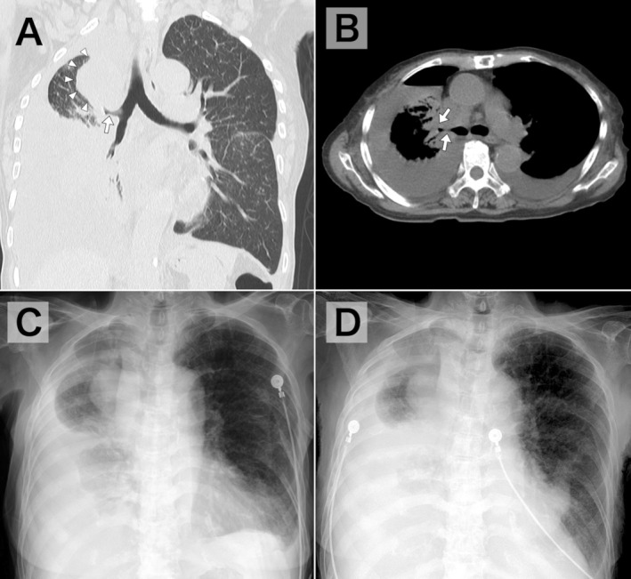

# 1890 — Đo áp lực màng phổi & phổi bị giam / Pleural manometry and trapped lung

**Tags:** `pattern:phoi-khong-no` `pattern:tran-dich-mang-phoi` `vung:mang-phoi` `vung:phoi` `protocol:do-ap-luc-mang-phoi` `protocol:ong-dan-luu-mang-phoi` `score:elastance` `anatomy:mang-phoi`

**Mức chắc chắn (certainty):** tổng hợp y văn (literature synthesis) — ngưỡng lấy từ **loạt 247 ca đo áp lực màng phổi, trong đó 11 ca phổi bị giam có elastance 19–149 cmH₂O/L** (Chest 2007, PMID 17218577), **nghiên cứu 61 bệnh nhân đo elastance cuối** (BMJ Open 2022, PMC9277390), **nghiên cứu tiên lượng thành công gây dính màng phổi** (PMC7801813) và **các bài tổng quan kỹ thuật đo** (Respir Med 2018, PMID 29501243 và 29402510; PMC7330282). Ca minh họa: **một ca PleurX ở bệnh nhân ung thư** (Cureus 2023, PMC10423620) và **một ca khí–dịch màng phổi sau chọc hút do u phế quản gốc** (J Gen Fam Med 2026, PMC13239953).

> **Câu chốt:** **"Phổi không nở" không phải một chẩn đoán mà là một phép đo.** Bơm/hút dịch rồi nhìn X-quang là cách sai: nghiên cứu 61 bệnh nhân cho thấy **X-quang thấy phổi nở có độ nhạy chỉ 44% và giá trị tiên đoán dương 24%** cho elastance cuối bình thường — **71% số ca "nở trên phim" vẫn có bất thường cơ học** (PMC9277390). Ngược lại, **elastance > 14,5 cmH₂O/L dự báo gây dính màng phổi thất bại với độ nhạy 93% và độ đặc hiệu 100%** (PMC7801813). Vì vậy câu hỏi đúng sau khi đặt dẫn lưu là: **"áp lực màng phổi thay đổi bao nhiêu mỗi lít dịch hút ra?"** — không phải "còn mờ bao nhiêu trên phim".

## 1. Tổng quan bệnh học – cơ chế hình ảnh (TẠI SAO)

### 1.1 Sinh lý áp lực màng phổi: con số nền

- Ở **dung tích cặn chức năng (FRC)**, áp lực màng phổi **−3 đến −5 cmH₂O** (PMID 29501243) — âm này là thứ giữ phổi nở và duy trì hồi lưu tĩnh mạch trong lồng ngực.
- Trong **tràn dịch**, áp lực màng phổi có **gradient thuỷ tĩnh ~1 cmH₂O mỗi cm chiều cao** (PMID 29501243) → đo ở **cùng một mốc** (đường nách giữa) mới so sánh được giữa các lần.
- **Elastance (độ đàn hồi) của khoang màng phổi:**

  **E = ΔPpl / ΔV** (cmH₂O/L dịch hút ra)

  Bình thường **0,5–14,5 cmH₂O/L** (PMC7330282). Khi hút 1 L dịch ở người **phổi nở tốt**, phổi giãn ra lấp khoang → áp lực **giảm từ từ**; khi phổi **không nở được**, mỗi mL dịch hút ra làm **thể tích khoang màng phổi sụt tương ứng** (vì phổi không chiếm chỗ) → áp lực **tụt dốc**, và **elastance tăng vọt** (19–149 cmH₂O/L trong loạt 11 ca — PMID 17218577).

### 1.2 Hai cơ chế "không nở": giam phổi (trapped) vs bị giữ (entrapment)

| | **Phổi bị giam (trapped lung)** | **Phổi bị giữ (lung entrapment)** |
|---|---|---|
| Bản chất | **Màng xơ trưởng thành** phủ màng phổi tạng, không còn bệnh hoạt động | **Bệnh màng phổi đang hoạt động**: ung thư, nhiễm khuẩn, viêm màng phổi fibrin |
| Thời gian | **Mạn, ổn định**, thường sau một biến cố cũ (mổ CABG, xạ, ure huyết, mủ màng phổi, chọc hút lặp) | **Cấp–bán cấp**, tiến triển |
| Dịch | **Ít tế bào, đơn nhân**, pH **7,30**, LDH **124 IU/L**, protein **2,9 g/dL** (Chest 2007) | Có thể mủ, tế bào ác tính, pH thấp, LDH rất cao |
| Có điều trị khỏi nguyên nhân? | Không — chỉ **bóc màng phổi (decortication)** khi có triệu chứng | **Có** — điều trị ung thư/nhiễm → màng phổi có thể mềm lại |
| Hệ quả | Thường **không triệu chứng**; đừng can thiệp chỉ vì "còn dịch" | Cần điều trị sớm, tránh để **xơ hoá cố định** |

- Hai thể là **hai điểm trên cùng một đường**; điều trị muộn của entrapment sẽ thành trapped. Vì vậy **thời điểm đo** thay đổi kết luận — đây là lý do phải ghi **ngày, lượng dịch hút, áp lực** trong hồ sơ.

### 1.3 Vì sao hình ảnh một mình không trả lời được

- **X-quang ngực** chỉ cho biết **còn mờ hay không**, không cho biết **phổi có nở hay không**: mờ đáy có thể là **dịch còn lại, dày màng phổi, xẹp phổi, hoặc vòm hoành nâng cao**.
- Nghiên cứu 61 ca đo elastance cuối (200 mL cuối) cho thấy **"visceral pleural recoil" bất thường ở 71% ca nở trên X-quang và 77% ca nở trên siêu âm**; **độ nhạy 44%, PPV 24%** của X-quang cho elastance bình thường (PMC9277390). Nói cách khác: **phim đẹp không chứng minh màng phổi mềm**.
- **CT** trả lời câu hỏi khác: **dày màng phổi tạng, khu trú, u phế quản gốc, xẹp phổi do tắc** — ba nguyên nhân "không nở" mà **manometry không phân biệt được**.
- **Siêu âm** có ích để **đánh giá động** (phổi trượt, mức dịch, khu trú) và chọn vị trí chọc, nhưng **không thay thế** phép đo áp lực.

### 1.4 Ba con số quyết định xử trí

1. **Elastance 0,5 L > 14,5 cmH₂O/L** → **gây dính màng phổi sẽ thất bại** (Se 93%, Sp 100%) — đừng gây dính, chọn **catheter màng phổi** hoặc **bóc màng phổi**.
2. **Elastance > 19 cmH₂O/L** → **phổi bị giam**, tỷ lệ **thành công gây dính giảm** (PMC7330282 tổng hợp Heidecker).
3. **11 ca trapped lung: elastance 19–149 cmH₂O/L** — dải rộng, nên **một con số tuyệt đối không thay cho bối cảnh** (Chest 2007).

## 2. Mẫu hình + chẩn đoán phân biệt theo vị trí (gamut)

### 2.1 Bốn mẫu hình trên bàn chọc hút

- **Mẫu A — hút êm, phổi nở dần:** áp lực giảm chậm (**elastance < 10–14,5**), hút được **> 1 L** mà không đau → **dịch tự do, phổi nở tốt**; có thể gây dính/đặt catheter theo kế hoạch.
- **Mẫu B — hút được 400–800 mL rồi đau ngực, ho:** áp lực tụt nhanh, **elastance > 14,5** → **phổi không nở**; **dừng hút**, không cố lấy thêm.
- **Mẫu C — sau hút, phim có mức khí–dịch, phổi nhỏ hơn, trung thất lệch VỀ phía chọc:** **khí–dịch màng phổi do giảm thể tích (pneumothorax ex vacuo)** — **không phải** tràn khí do chọc; xử trí **theo dõi**, không đặt thêm dẫn lưu.
- **Mẫu D — dịch mạn ổn định nhiều tháng, bệnh nhân chỉ khó thở nhẹ:** **phổi bị giam** — **không can thiệp** nếu không triệu chứng; theo dõi và giải thích.

### 2.2 Gamut theo nguyên nhân

- **Màng phổi ác tính:** ung thư phổi, vú, **mesothelioma** (dày màng phổi tạng nặng), di căn — **entrapment** hoặc trapped sau nhiều lần chọc.
- **Nhiễm khuẩn:** **mủ màng phổi/tràn dịch cạnh phổi phức tạp**, **lao màng phổi** — màng fibrin dày, dễ thành trapped nếu dẫn lưu muộn.
- **Sau mổ:** **CABG** (màng phổi tạng bị "nung" do tiếp xúc máu), **mở màng tim**, **mổ ngực**.
- **Sau xạ:** xơ màng phổi tạng (liên quan bài 1870/1737).
- **Khác:** **ure huyết**, **máu tụ màng phổi mạn**, **dưỡng trấp mạn**, chọc hút lặp nhiều lần.
- **Không do màng phổi:** **tắc phế quản gốc** (u, nút nhầy, dị vật), **hẹp phế quản**, **xẹp phổi do giảm thông khí**, **liệt hoành** — "phổi không nở" nhưng **điều trị ở đường thở**, không phải màng phổi.

### 2.3 Mẫu hình hình ảnh quyết định

- **Dày màng phổi tạng > 2–3 mm, đều, có vôi hoá** → trapped lung (CT).
- **Dày màng phổi dạng nốt, không đều, kèm khối** → mesothelioma/di căn (entrapment do ung thư).
- **Phổi xẹp + phế quản gốc bị tắc + trung thất lệch về bên xẹp, mức khí–dịch nhỏ** → **tắc phế quản**, không phải trapped.
- **Mức khí–dịch + thể tích nửa ngực giảm + khí quản lệch về bên chọc** → **ex vacuo**.

## 3. Bảng so sánh phân biệt (ma trận đối chiếu)

| Thực thể (entity) | Hình ảnh / phép đo điển hình | Chốt vào (rule-in) | Chốt loại (rule-out) | Gợi ý xác nhận |
|---|---|---|---|---|
| **Phổi bị giam (trapped lung)** | Dày **màng phổi tạng đều > 2–3 mm**, có thể vôi hoá; dịch **ít tế bào, pH 7,30, LDH 124, protein 2,9**; **elastance 19–149** | **Elastance > 14,5 (điển hình > 19) + dịch đơn nhân ít tế bào + không bệnh hoạt động** | Dịch mủ/pH thấp/tế bào ác tính → entrapment; có tắc phế quản → nguyên nhân khác | Đo áp lực + CT ngực có cản quang; **air-contrast CT** |
| **Entrapment do bệnh hoạt động** | Dày màng phổi **không đều/nốt**, khối u, dịch mủ hoặc tế bào ác tính; elastance cao **nhưng còn thay đổi theo điều trị** | **Bệnh màng phổi đang hoạt động** (ung thư, mủ, lao) + elastance cao | Màng phổi tạng mỏng, dịch vô khuẩn ít tế bào → trapped | Tế bào học, cấy, sinh thiết màng phổi |
| **Dẫn lưu sai vị trí/tắc** | Không ra dịch hoặc ra rất ít, **không đau**, áp lực **không đổi** khi rút; X-quang/CT thấy đầu catheter ngoài khoang hoặc trong nhu mô | **Elastance "phẳng" + không có dịch ra + đầu catheter sai** | Đầu catheter đúng khoang, dịch ra đều → không phải | Siêu âm/CT kiểm tra catheter; rửa/thay |
| **Tắc phế quản gốc** | **Xẹp phổi + phế quản gốc bị tắc**, trung thất lệch **về bên xẹp**, mức khí–dịch nhỏ; **không có dày màng phổi tạng** | **Thấy tắc phế quản trên CT/nội soi** + xẹp phổi | Phế quản thông, phổi xẹp do màng phổi → trapped | Nội soi phế quản; CT lát mỏng |
| **Dịch khu trú (loculated)** | Vách trong khoang màng phổi; dịch không di chuyển khi đổi tư thế; siêu âm thấy vách | **Hình khu trú trên US/CT** + hút một ổ không hết | Dịch tự do, di chuyển → không khu trú | Siêu âm; CT; có thể tiêm chất cản quang vào khoang |
| **Khí–dịch do giảm thể tích (ex vacuo)** | Sau hút: **thể tích nửa ngực giảm**, **khí quản/trung thất lệch về bên chọc**, phổi nhỏ, **không rò khí**; bệnh nhân **không xấu đi** | **Giảm thể tích cùng bên + lệch trung thất về bên chọc** sau hút | Trung thất lệch ra xa, phổi bị đẩy → tràn khí áp lực/thật | So phim trước–sau; theo dõi, không đặt thêm dẫn lưu |

*Trái: **X-quang trước dẫn lưu** — tràn dịch trái lượng lớn, mờ toàn bộ nửa ngực trái, đẩy trung thất sang phải. Phải: **CT sau đặt catheter PleurX** — khoang màng phổi trái còn **khí + dịch**, phổi trái **không nở hết** (dày màng phổi tạng, phổi bị giam), không có khối chèn ép đường thở trung tâm. Đây là mẫu "hút ra dịch nhưng phổi không nở": nguyên nhân **màng phổi**, không phải đường thở. Nguồn: Cureus 2023, PMC10423620 Fig. 2 và Fig. 4 — **CC BY 3.0**; ghép bằng `tools/make_composite.py` (letterbox, không crop/kéo giãn).*

*Hai phim thẳng của **cùng một bệnh nhân**: (A) trước chọc hút — tràn dịch phải; (B) sau chọc hút — **giảm thể tích nửa ngực phải**, **khí quản/phế quản lệch VỀ phía chọc**, phổi phải nhỏ lại, có mức khí–dịch. Đây là **pneumothorax ex vacuo** (khí–dịch do giảm thể tích), **không phải** tràn khí do chọc — xử trí là **theo dõi**, không đặt thêm dẫn lưu. Nguồn: J Gen Fam Med 2026, PMC13239953 Fig. 1 — **CC BY 4.0**.*

## 4. Protocol chụp + hệ phân độ/điểm chuẩn hóa

### 4.1 Kỹ thuật đo áp lực màng phổi (manometry) — 8 bước

1. **Chuẩn bị:** catheter màng phổi hoặc kim chọc hút nối với **cột nước** (water manometer) hoặc **cảm biến điện tử**; **zero hoá ở đường nách giữa** (mốc giải phẫu của khoang màng phổi).
2. **Đo áp lực cơ bản** trước khi hút (ghi cmH₂O; bình thường khoảng **−3 đến −5** ở FRC).
3. **Hút từng đợt 100–250 mL**, ghi áp lực **ngay sau mỗi đợt** (đọc **cuối thì thở ra**, không đọc đỉnh do ho/Valsalva).
4. **Tính elastance** giữa hai mốc: E = ΔPpl/ΔV; ghi rõ **E toàn phần** và **E 200 mL cuối** (terminal elastance / "visceral pleural recoil").
5. **Dừng khi:** **E > 14,5 cmH₂O/L**, **Ppl < −20 cmH₂O**, hoặc bệnh nhân **đau ngực/ho nhiều** — ba dấu hiệu này tương ứng **phổi không nở** và nguy cơ **phù phổi tái nở**.
6. **Không dùng hút áp lực âm mạnh** để "cố" làm phổi nở — nguy cơ **phù phổi tái nở** và **rò khí**.
7. **Sau thủ thuật:** X-quang ngực **thẳng tại giường** (hoặc siêu âm) trong **1–4 giờ**; so **thể tích nửa ngực và vị trí trung thất** với phim trước.
8. **Ghi hồ sơ:** lượng dịch, áp lực đầu–cuối, elastance, triệu chứng, chẩn đoán màng phổi.

### 4.2 Hình ảnh sau đo: ba câu hỏi

- **Nửa ngực có nhỏ lại và trung thất lệch VỀ phía chọc?** → **ex vacuo**; theo dõi.
- **Màng phổi tạng có dày, đều, vôi hoá?** → **trapped lung**; cân nhắc **catheter màng phổi** hoặc **bóc màng phổi** nếu khó thở.
- **Phế quản gốc có tắc, phổi xẹp, không dày màng phổi?** → **nguyên nhân đường thở**; **nội soi phế quản**, không can thiệp màng phổi.

- **Air-contrast CT** (bơm 200–500 mL không khí qua catheter rồi chụp) là kỹ thuật cũ nhưng hữu ích khi siêu âm/CT thường không phân biệt được **màng phổi tạng dày** với **phổi xẹp**: khí tách hai lá màng phổi, làm lộ **bề dày màng phổi tạng** (Chest 2007).
- **Siêu âm:** đánh giá **phổi trượt, mức dịch, vách khu trú, độ dày màng phổi**; hữu ích trước chọc và theo dõi tại giường, nhưng **không thay thế manometry**.

### 4.3 Luồng xử trí

### 4.4 Phân độ / cách ghi để so sánh giữa các lượt

| Biến số | Cách ghi | Ngưỡng hành động |
|---|---|---|
| **Elastance toàn phần** | ΔPpl/ΔV (cmH₂O/L) | **> 14,5** = không nên gây dính |
| **Elastance 200 mL cuối** | "visceral pleural recoil" | Bất thường dù phim "nở" (PPV của phim chỉ 24%) |
| **Ppl tuyệt đối** | cmH₂O, cuối thì thở ra | **< −20** = dừng |
| **Triệu chứng khi hút** | đau ngực, ho, khó thở | Xuất hiện = dừng, bất kể thể tích |
| **Bề dày màng phổi tạng** | mm trên CT | **> 2–3 mm đều** = gợi ý trapped |

## 5. Biến thể bình thường và cạm bẫy

- **Mốc zero sai** (đặt ở ngực giữa thay vì đường nách giữa) làm lệch toàn bộ đường cong; **catheter gập** cho "elastance phẳng" giả — kiểm tra trước khi kết luận.
- **Đọc đỉnh áp lực do ho** thay vì **cuối thì thở ra** → elastance cao giả.
- **"Phổi nở trên X-quang" không đồng nghĩa màng phổi mềm**: độ nhạy 44%, PPV 24% (PMC9277390) — đừng dùng phim để quyết định gây dính.
- **Ex vacuo bị chẩn đoán là tràn khí do chọc** → đặt thêm dẫn lưu → **nhiễm trùng khoang màng phổi, rò phế quản–màng phổi**. Dấu chốt: **thể tích nửa ngực GIẢM + trung thất lệch VỀ phía chọc**, bệnh nhân không xấu đi.
- **Tắc phế quản gốc** là nguyên nhân "không nở" **hay bị bỏ nhất**: phổi xẹp, trung thất lệch về bên xẹp, **màng phổi tạng mỏng** — điều trị là **nội soi phế quản**, không phải bóc màng phổi.
- **Bóc màng phổi cho trapped lung không triệu chứng** = điều trị quá mức: phẫu thuật có biến chứng (rò khí kéo dài, nhiễm trùng, đau mạn) trong khi tự nhiên thường **ổn định nhiều năm**.
- **Hút áp lực âm để "thử"** → **phù phổi tái nở** (hiếm nhưng chết người); phải dừng theo **áp lực và triệu chứng**, không theo lượng dịch.
- **Dịch khu trú** cho elastance cao giả và "không nở" giả: siêu âm/CT thấy vách; xử lý bằng **dẫn lưu định hướng/hút vách**, không kết luận trapped.
- **Theo dõi trapped lung như "ung thư tiến triển"**: dịch mạn ổn định, ít tế bào, không có khối mới — đừng đổi phác đồ ung thư chỉ vì "còn dịch".

## 6. Tự lượng giá — Blind Quiz (bấm để hiện đáp án)

**Ca 1 — bệnh nhân 64 tuổi, tràn dịch trái lượng lớn sau mổ CABG, khó thở**

- Gợi ý lâm sàng: hút được **700 mL** thì bệnh nhân **đau ngực**; áp lực từ **−4** xuống **−18 cmH₂O** sau 700 mL; X-quang sau hút còn mờ đáy trái, phổi không nở hết; đầu catheter nằm đúng khoang trên CT.
- Câu hỏi: (1) Tính elastance và kết luận? (2) Phân biệt **trapped lung** với **entrapment** ở ca này dựa vào đâu? (3) Nên làm gì tiếp — và điều gì **không** nên làm?

<b>Bấm để hiện đáp án (findings + chẩn đoán)</b>

- **Elastance:** ΔPpl 14 cmH₂O / 0,7 L = **20 cmH₂O/L** → **> 14,5**, nằm trong dải **19–149** của trapped lung (Chest 2007); **dừng hút** là đúng.
- **Trapped hay entrapment:** sau **CABG**, dịch **ít tế bào, đơn nhân**, không sốt, không khối màng phổi → **trapped lung** (màng xơ trưởng thành). Nếu dịch mủ/pH thấp/tế bào ác tính → **entrapment** và phải điều trị nguyên nhân.
- **Nên:** **catheter màng phổi (PleurX)** để kiểm soát triệu chứng tại nhà; **không gây dính** vì elastance cao dự báo thất bại (Se 93%, Sp 100%); **bóc màng phổi** chỉ khi khó thở nặng dù đã dẫn lưu.
- **Không nên:** hút thêm/áp lực âm để "cố nở" (nguy cơ phù phổi tái nở), và **không** đặt thêm dẫn lưu nếu phim cho thấy **ex vacuo**.
- **Nguồn ảnh:** PMC10423620 Fig. 2 + Fig. 4 — CC BY 3.0.

**Ca 2 — bệnh nhân 58 tuổi, ung thư phổi, chọc hút 1,2 L vì khó thở; sau chọc hút khó thở không giảm, phim cho thấy khí–dịch màng phổi phải**

*CT ngực sau chọc hút: (A) khối rốn phổi phải (đầu mũi tên trắng) **bít phế quản gốc phải** (mũi tên trắng); (B) cửa sổ trung thất xác nhận tắc phế quản; (C, D) phim ngày 2 và ngày 5 — dịch tái lập, **hình dạng phổi không đổi**. Nguồn: J Gen Fam Med 2026, PMC13239953 Fig. 2 — CC BY 4.0.*

- Gợi ý lâm sàng: không rò khí qua catheter, bệnh nhân không sốt, không đau tăng; CT sau đó thấy **khối rốn phổi phải chèn ép/bít phế quản gốc**.
- Câu hỏi: (1) Đây có phải **tràn khí do chọc** không, vì sao? (2) Vì sao phổi **không nở** ở ca này? (3) Xử trí tiếp theo?

<b>Bấm để hiện đáp án (findings + chẩn đoán)</b>

- **Không phải tràn khí do chọc:** sau chọc hút, **thể tích nửa ngực phải GIẢM**, **khí quản/phế quản lệch VỀ phía chọc**, phổi nhỏ lại, không rò khí — đây là **pneumothorax ex vacuo** (khí–dịch do giảm thể tích). Tràn khí thật/áp lực sẽ **đẩy trung thất ra xa**.
- **Vì sao không nở:** **khối rốn phổi bít phế quản gốc** → phổi xẹp **không liên quan màng phổi**; đây là nguyên nhân "không nở" ngoài màng phổi, và là lý do **không được bóc màng phổi**.
- **Xử trí:** **theo dõi** khoang màng phổi (ex vacuo tự ổn định), **nội soi phế quản** đánh giá tắc và can thiệp (nong/stent/đốt u) theo bệnh cảnh; **không đặt thêm dẫn lưu** chỉ vì "còn khí".
- **Nguồn ảnh:** J Gen Fam Med 2026, PMC13239953 Fig. 1 — CC BY 4.0.

## Bài liên quan chéo
- [040 – Tràn dịch màng phổi](../040-tran-dich-mang-phoi/lesson.md)
- [041 – Tràn khí màng phổi](../041-tran-khi-mang-phoi/lesson.md)
- [1888 – Tràn dịch dưới đáy phổi giả nâng cao cơ hoành](../1888-tran-dich-duoi-day-phoi/lesson.md)
- [609 – Ống dẫn lưu màng phổi ở trẻ](../609-ong-dan-luu-mang-phoi-o-tre/lesson.md)
- [601 – Tràn khí màng phổi tự phát ở trẻ lớn & VATS](../601-tran-khi-mang-phoi-tu-phat-tre-lon-vats/lesson.md)
- [1870 – Rò thực quản–màng phổi mạn sau Boerhaave](../1870-ro-thuc-quan-mang-phoi-man/lesson.md)

## Ảnh
- `images/composite_1890_phoi-bi-giam.jpg` — ghép X-quang trước dẫn lưu + CT sau PleurX, **CC BY 3.0**, tạo bằng `tools/make_composite.py`.
- `images/1890_tran-dich-mang-phoi_CXR_PMC10423620-Fig2.jpg` — X-quang tràn dịch trái lớn, **CC BY 3.0**.
- `images/1890_phoi-bi-giam_CT_PMC10423620-Fig4.jpg` — CT phổi bị giam + khí ngoài màng phổi, **CC BY 3.0**.
- `images/1890_khi-ngoai-mang-phoi_CXR_PMC13239953-Fig1.jpg` — X-quang trước/sau chọc hút (ex vacuo), **CC BY 4.0**.
- `images/1890_tac-phe-quan_CT_PMC13239953-Fig2.jpg` — CT khối rốn phổi bít phế quản, **CC BY 4.0**.
- Nguồn + giấy phép từng ảnh: `images/CREDITS.md`.

> Không dùng để chẩn đoán độc lập khi chưa có người hướng dẫn.
