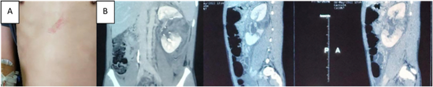
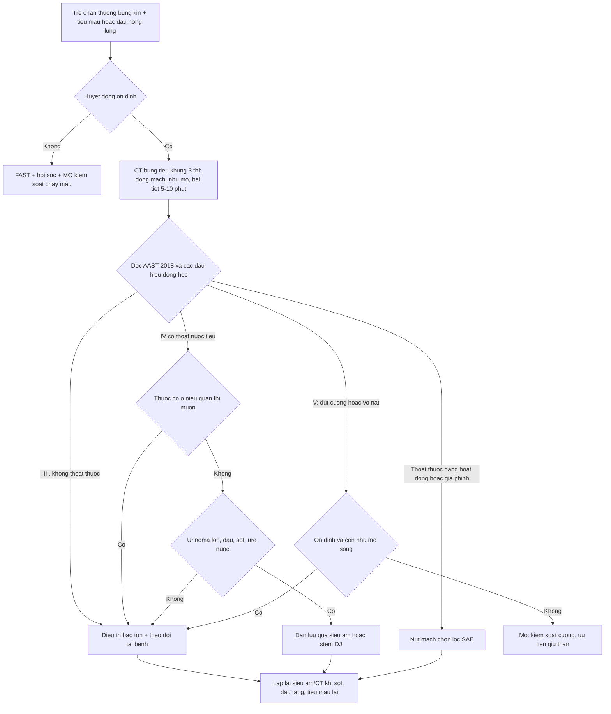
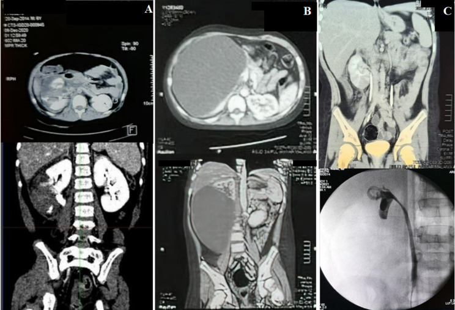
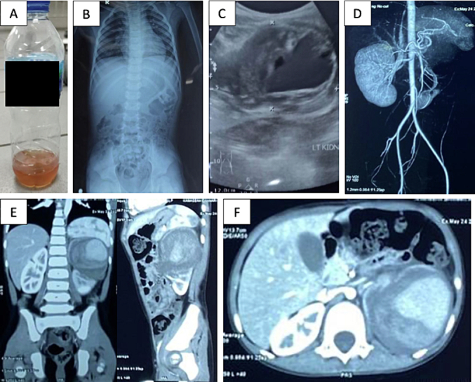

# 1891 — Chấn thương thận kín ở trẻ em / Paediatric blunt renal trauma

**Tags:** `pattern:chan-thuong-than` `pattern:rach-nhu-mo` `pattern:thoat-cang-quang` `pattern:tu-mau-sau-phuc-mac` `pattern:gia-phinh-dong-mach` `vung:than` `vung:sau-phuc-mac` `protocol:CT-nieu` `score:AAST`

**Mức chắc chắn (certainty):** tổng hợp y văn (literature synthesis) — ghép: đoàn hệ **17 năm / 4.230 trẻ** của một trung tâm chấn thương (*Ringen AH et al.*, Trauma Surg Acute Care Open 2023, PMC10649896); **75 trẻ độ IV–V** với CT thì muộn (*Lui H et al.*, Int J Urol 2025, PMC12022744); **19 trẻ độ IV có thoát nước tiểu** (*Zhu X et al.*, Transl Pediatr 2025, PMC11921300); **13 trẻ độ ≥ III** (PMC6699441); **4 ca nguyên văn có ảnh** (*Wirjopranoto S et al.*, Int J Surg Case Rep 2024, PMC11063531; *Duarsa GWDP et al.*, Pan Afr Med J 2023, PMC10162895); bảng phân độ AAST 2018 dẫn lại nguyên văn trong bài tổng quan nhi (*Bašković M et al.*, Diagnostics 2024, PMC11506325). Nguồn không đưa số thì ghi "chưa rõ".

> **Bài này trả lời 4 câu hỏi của ca "trẻ ngã xe đạp, đau hông lưng, tiểu máu":**
> (1) **Có bắt buộc chụp CT không**, và **khi nào cần thì muộn (delayed phase)**?
> (2) **Độ AAST 2018 nói gì** — và **vì sao độ cao KHÔNG đồng nghĩa phải mổ**?
> (3) Dấu hiệu nào trên CT dự báo **phải can thiệp** (và dấu hiệu nào dự báo **không cần**)?
> (4) **Thoát nước tiểu, giả phình, tụ máu** — theo dõi hay can thiệp, ngưỡng nào?

## 1. Tổng quan bệnh học – cơ chế hình ảnh

### 1.1 Vì sao thận trẻ dễ bị chấn thương

- **Thận là tạng niệu hay bị chấn thương nhất ở trẻ**; chấn thương thận gặp ở **5–20%** trẻ chấn thương bụng kín, và bệnh nhi **< 19 tuổi chiếm ~25%** toàn bộ chấn thương thận trong National Trauma Data Bank (PMC11063531 dẫn lại).
- **4 lý do giải phẫu:** (1) **ít mỡ quanh thận** → thận "trôi" và ít được đệm; (2) **thành bụng và cơ ít phát triển**; (3) **thận nằm thấp hơn** nên **khung sườn che chắn kém**; (4) **cột sống mềm dẻo hơn** → lực kéo giãn lên niệu quản (PMC11063531).
- **Cơ chế hay gặp:** ngã (cả ngã từ độ cao thấp), **tai nạn xe đạp/xe máy**, **tay lái đâm vào hông lưng**, đánh vào mạn sườn; **90% là chấn thương kín**, **~80% ở độ I–III**.
- **Ngưỡng chỉ định chụp:** **tiểu máu đại thể**, hoặc **tiểu máu vi thể ≥ 3–5 hồng cầu/HPF**, hoặc **cơ chế giảm tốc mạnh / bầm tím hông lưng / đau hông lưng**; **không có tiểu máu KHÔNG loại trừ** tổn thương thận (PMC11506325).

### 1.2 TẠI SAO CT từng thì lại "nhìn thấy" tổn thương (vật lý + mô bệnh)

- **Phù và rách nhu mô:** mô thận bình thường ngấm thuốc **mạnh và đồng nhất** ở thì vỏ – tủy; vùng **đụng dập** mất tưới máu → **giảm ngấm**, còn **rách** là **đường giảm đậm độ xuyên nhu mô**, thường **không ngấm** ở mọi thì.
- **Tụ máu:** máu đông **45–70 HU** trên CT không cản quang; **không ngấm thuốc** (khác nhu mô) → dễ thấy trong **bao thận** hoặc **khoang cạnh thận**; máu "đang chảy" có **"blush" tăng đậm độ** hoặc **thoát cản quang** ở thì động mạch.
- **Nhồi máu phân thùy:** nhánh động mạch bị tắc/huyết khối → **nêm giảm ngấm hình tam giác**, bờ thẳng, **không có viền tăng đậm độ**; **vỏ thận có thể vẫn ngấm** nhờ tuần hoàn bao (cortical rim sign) — đừng nhầm là "còn tưới máu toàn bộ".
- **Thoát nước tiểu:** chỉ thấy khi **thuốc đã được lọc qua thận** → phải chụp **thì bài tiết (excretory/delayed), 5–10 phút sau tiêm**; ứ nước tiểu quanh thận tạo **ổ dịch tăng đậm độ muộn** hoặc **"vệt thuốc" ra ngoài hệ đài bể thận**. **Siêu âm cản quang (CEUS) không thấy được** tổn thương hệ đài bể thận vì thuốc không được bài tiết (PMC11506325).
- **Phân độ AAST 2018 (dẫn nguyên văn, PMC11506325)** — đây là ngôn ngữ chung để quyết định:

| Độ | Mô tả (AAST 2018, thận) |
|---|---|
| **I** | Máu tụ dưới bao và/hoặc đụng dập nhu mô, **không rách** |
| **II** | Máu tụ quanh thận **trong bao Gerota**; **rách nhu mô ≤ 1 cm**, **không thoát nước tiểu** |
| **III** | **Rách nhu mô > 1 cm**, **không vỡ hệ đài bể thận**, không thoát nước tiểu; **hoặc** có tổn thương mạch/đang chảy máu **trong bao Gerota** |
| **IV** | **Rách xuyên tới hệ đài bể thận có thoát nước tiểu**; **hoặc** rách bể thận/đứt nối bể–niệu quản; **hoặc** tổn thương **mạch phân thùy**; **hoặc** máu chảy **ra ngoài bao Gerota** vào sau phúc mạc/ổ bụng; **hoặc** **nhồi máu phân thùy/toàn bộ do huyết khối** không chảy máu |
| **V** | **Rách/đứt động mạch – tĩnh mạch thận chính hoặc đứt cuống thận**; thận **mất tưới máu có chảy máu**; **thận vỡ nát** mất giải phẫu nhu mô |

### 1.3 Số liệu định lượng cần nhớ

- **Kết cục ở trung tâm chấn thương (PMC10649896):** 4.230 trẻ chấn thương → **115 (2,7%)** có tổn thương thận; **cắt thận 4 (3,5%)**, **nút mạch 5 (4,3%)**, **đặt stent niệu quản 6 (5,2%)** vì thoát nước tiểu; **điều trị bảo tồn > 90%**; tử vong thô **6,1%** nhưng **không ca nào do tổn thương thận**, và giảm còn **1,2%** ở giai đoạn sau.
- **Trong 75 trẻ độ IV–V (PMC12022744):** **33% (25/75)** can thiệp trong **24 giờ đầu**; trong **47 trẻ được theo dõi**, **30% (14/47)** can thiệp muộn; **thuốc có ở niệu quản trên thì muộn 87% (41/47)** và **giảm mạnh nguy cơ can thiệp: OR 0,06 (KTC 95% 0–0,73), p = 0,03** — còn **độ AAST không dự báo** can thiệp ở nhóm được theo dõi.
- **19 trẻ độ IV có thoát nước tiểu (PMC11921300):** can thiệp tối thiểu đủ trong đa số — **dẫn lưu ổ nước tiểu qua siêu âm 2**, **stent DJ 7**, **mở thận ra da 2**, **tạo hình bể–niệu quản 6**, **nối đài–niệu quản 2**; theo dõi **trung bình 15,9 tháng (2–61)**; **9 ca dẫn lưu/stent hồi phục hoàn toàn**.
- **13 trẻ độ ≥ III (PMC6699441):** **8 độ IV, 1 độ V, 4 độ III**; **3 trẻ cần truyền máu**; nằm viện **11,7 ngày (3–28)**; **cả 13 trẻ khỏi, không ca nào cần mổ hở** — chỉ **1 chọc hút 2 lần** và **2 đặt pigtail**.
- **Tỉ lệ can thiệp theo độ (dẫn lại trong PMC11063531):** **~20%** độ IV và **~50%** độ V phải mổ hở trong các loạt cũ; can thiệp tối thiểu **~5%** toàn bộ, **10–15%** ở độ IV–V; **cắt thận ~5%** số nhập viện.

## 2. Mẫu hình + chẩn đoán phân biệt theo vị trí (Gamut)

- **Theo hình thái trên CT:**
  - **Máu tụ dưới bao** (subcapsular hematoma): liềm dịch **ép nhu mô**, bờ ngoài theo bao → độ I–II; **không** gây thoát nước tiểu.
  - **Rách nhu mô đơn thuần** (≤ 1 cm = II; > 1 cm = III): đường giảm đậm độ, **không tới hệ đài bể thận**.
  - **Rách + thoát nước tiểu** (IV): thuốc ra ngoài hệ đài bể thận ở thì muộn, tụ dịch quanh thận.
  - **Nhồi máu phân thùy/toàn bộ** (III–IV): nêm giảm ngấm, bờ thẳng; **toàn bộ** = thận không ngấm.
  - **Đứt cuống thận / thận vỡ nát** (V): **không thấy mạch thận**, nhu mô **không ngấm**, máu tụ lớn; đôi khi **giả "thận lạc chỗ"** (PMC13276778).
  - **Giả phình / rò động – tĩnh mạch** (di chứng): ổ đối quang **giữ thuốc thì muộn** hoặc **rửa song hành**, xuất hiện **ngay** hoặc **sau nhiều tháng**.
- **Theo vùng (khi "máu quanh thận" là dấu hiệu dẫn đường):**
  - **Thận** – rách, đụng dập, nhồi máu, đứt cuống (bài này).
  - **Tuyến thượng thận** – máu tụ thượng thận, thường kèm chấn thương nặng; **không** gây thoát nước tiểu.
  - **Lách / gan** – chấn thương tạng đặc cùng bên, **hay phối hợp** (đụng dập hạ sườn trái = lách + thận trái).
  - **Bể thận – niệu quản** – **đứt nối bể–niệu quản** (grade IV đặc biệt, cần **tạo hình**, không chỉ theo dõi).
  - **Bàng quang – niệu đạo** – vỡ bàng quang trong chấn thương khung chậu (khác đường: **máu trong bàng quang**, không phải máu quanh thận).
- **Gamut "ổ dịch quanh thận sau chấn thương":** máu tụ · nước tiểu tụ (urinoma) · **ứ nước do hẹp/UPJ bẩm sinh bị phát hiện tình cờ** · nang thận vỡ · dịch sau phúc mạc do tụy · áp-xe muộn.

## 3. Bảng so sánh phân biệt (ma trận đối chiếu)

| Thực thể (entity) | Hình ảnh điển hình (CT đa thì) | Chốt vào (rule-in) | Chốt loại (rule-out) | Gợi ý xác nhận |
|---|---|---|---|---|
| **Rách nhu mô độ III** | Đường rách **> 1 cm**, **không** có thuốc ra ngoài hệ đài bể thận | **Rách > 1 cm + hệ đài bể thận nguyên vẹn + thì muộn không thoát thuốc** | **Thoát thuốc thì muộn** → đã là độ IV | CT thì muộn 5–10 phút |
| **Rách + thoát nước tiểu độ IV** | **Thuốc/vệt đậm độ ra ngoài hệ đài bể thận**, **ổ dịch quanh thận tăng đậm độ muộn** | **Thoát thuốc ở thì bài tiết + tụ dịch quanh thận** | **Thuốc có ở niệu quản thì muộn** → nguy cơ can thiệp **giảm (OR 0,06)** | CT thì muộn; theo dõi 48–72 giờ |
| **Đứt cuống thận / thận vỡ nát độ V** | **Mạch thận không thấy**, nhu mô **không ngấm**, máu tụ lớn; có thể **giả thận lạc chỗ** | **Không ngấm nhu mô + mất mạch thận chính + máu tụ lớn** | **Còn ngấm một phần + mạch còn** → không phải V | CTA/CT thì động mạch; **huyết động học quan trọng hơn độ** |
| **Nhồi máu phân thùy** | **Nêm giảm ngấm, bờ thẳng**, có thể **viền vỏ ngấm** (cortical rim) | **Nêm + bờ thẳng + không có thoát thuốc** | **Thoát thuốc/giả phình** → tổn thương mạch đang hoạt động | CTA; theo dõi huyết áp |
| **Giả phình / rò ĐTM sau chấn thương** | **Ổ đối quang giữ thuốc thì muộn**, **rửa song hành** với động mạch; có thể xuất hiện **sau 4 tháng** | **Ổ đối quang + giữ thuốc + nhu mô quanh bình thường** | Không có ổ đối quang, chỉ có nêm nhồi máu → không phải giả phình | CTA; DSA + nút mạch chọn lọc |
| **Nước tiểu tụ (urinoma)** | Ổ dịch **giảm đậm độ**, **vỏ mỏng**, **tăng đậm độ ở thì muộn** nếu còn thông với hệ niệu | **Ổ dịch quanh thận + thông với hệ đài bể thận + tăng đậm độ muộn** | Ổ dịch **không tăng đậm độ**, có vỏ dày → máu tụ/áp-xe | Siêu âm theo dõi; chọc dịch: creatinin dịch cao = nước tiểu |
| **Ứ nước do hẹp/UPJ bẩm sinh (phát hiện tình cờ)** | **Đài bể thận giãn**, **nhu mô mỏng**, **không có đường rách**, không máu tụ | **Giãn hệ đài bể thận + không máu tụ + không đường rách** | Có đường rách/thoát thuốc mới → tổn thương do chấn thương | So phim cũ; CT thì muộn; renogram nếu cần |

*Bệnh nhi 13 tuổi ngã 3 m: (A) bầm tím vùng thượng vị; (B) CT — **thận trái vỡ toàn bộ, đứt cuống thận, cực trong mất tưới máu** (AAST độ V) — và ca này **điều trị bảo tồn thành công**. Nguồn: Int J Surg Case Rep 2024, PMC11063531, Fig. 1, **CC BY 4.0**.*

## 4. Protocol chụp + phân độ + ngưỡng can thiệp

### 4.1 Ai chụp, chụp thế nào

1. **Chỉ định:** tiểu máu đại thể; tiểu máu vi thể **≥ 3–5 HC/HPF**; cơ chế giảm tốc mạnh; bầm tím/đau hông lưng; đa chấn thương có máu trong ổ bụng.
2. **CT bụng – tiểu khung có cản quang tĩnh mạch**, **3 thì**: **động mạch** (mạch thận, giả phình, "blush"), **tĩnh mạch cửa/nhu mô** (rách, nhồi máu), **bài tiết muộn 5–10 phút** (thoát nước tiểu, niệu quản) — không có thì muộn là **nguyên nhân bỏ sót độ IV**.
3. **Bệnh nhân không ổn định:** **không đưa vào máy CT** để "chụp cho đủ"; **FAST tại giường + mổ** khi huyết động không đáp ứng hồi sức.
4. **Siêu âm:** đầu tay để phát hiện dịch tự do; **CEUS theo dõi** được tụ máu/nước tiểu nhưng **không đánh giá được hệ đài bể thận** (thuốc không bài tiết).
5. **ALARA:** trẻ nhạy bức xạ hơn — dùng **lát mỏng nhưng giới hạn phạm vi**, tránh chụp lặp lại không cần thiết; cân nhắc **siêu âm/MRI** cho lần theo dõi (xem [937](../937-lieu-ct-tre-ssde-drl/lesson.md)).

### 4.2 Ngưỡng quyết định (huyết động là trục, không phải độ AAST)

- **Mấu chốt:** **huyết động học quyết định**, không phải con số độ; **độ cao không đồng nghĩa phải mổ** — 13 trẻ độ ≥ III (gồm **1 độ V**) đều **khỏi mà không mổ hở** (PMC6699441), và **ca 13 tuổi độ V đứt cuống thận** được **bảo tồn** với nghỉ ngơi 14 ngày (PMC11063531).
- **Chỉ định can thiệp/mổ:** **không ổn định huyết động do chảy máu** dù đã hồi sức; **máu tụ lan nhanh**; **thoát thuốc đang hoạt động** không kiểm soát được bằng nút mạch; **đứt nối bể–niệu quản** (cần **tạo hình**, không tự lành).
- **Nút mạch chọn lọc (SAE)** là lựa chọn **ưu tiên hơn mổ hở** khi có **thoát cản quang/giả phình/rò ĐTM** và bệnh nhân **còn ổn định** (PMC11506325); trong đoàn hệ 17 năm, **4,3%** trẻ cần nút mạch, **3,5%** phải cắt thận.
- **Thoát nước tiểu độ IV:** **theo dõi 48–72 giờ** là hợp lý ở trẻ **ổn định**; can thiệp tối thiểu khi **ứ nước tiểu tăng, đau, sốt, hoặc thận ứ mức độ nặng**: **dẫn lưu qua siêu âm**, **stent DJ**, **mở thận ra da**; **hẹp/đứt nối bể–niệu quản** cần **tạo hình** (PMC11921300).
- **Nước tiểu tụ:** **nhỏ, vô khuẩn → tự tiêu**; **lớn/có triệu chứng** → **dẫn lưu qua da hoặc stent niệu quản** (PMC11506325).
- **Mô thận không còn sống KHÔNG phải chỉ định mổ**; **thận vỡ nát + chảy máu không kiểm soát** mới cần cắt thận (PMC11506325).

### 4.3 Phân độ dùng trong thực hành

- **AAST 2018** là chuẩn mô tả và nghiên cứu (bảng ở mục 1.2) — nhưng **không dùng đơn độc để quyết định mổ**.
- Trong nhóm **độ IV–V được theo dõi**, **độ AAST không liên quan can thiệp**; **dấu hiệu "thuốc có ở niệu quản thì muộn"** mới là yếu tố dự báo **không cần can thiệp** (OR 0,06) (PMC12022744).

## 5. Biến thể bình thường và cạm bẫy

- **Biến thể bình thường / dương tính giả:** **thùy thận thai nhi (fetal lobulation)** tạo đường gợn giảm đậm độ nông — **bờ ngoài lượn sóng, không máu tụ, không thoát thuốc**; **cột Bertin** phì đại giả khối; **thận lạc chỗ/xoay bất thường** làm trục mạch khó đọc; **ứ nước nhẹ sau truyền dịch** không phải tổn thương.
- **Cạm bẫy 1 — "độ V thì phải cắt thận":** ca **13 tuổi độ V đứt cuống thận** điều trị **bảo tồn** thành công; quyết định theo **huyết động**, không theo độ (PMC11063531).
- **Cạm bẫy 2 — độ V "huyết động ổn định" đánh lừa:** ca người lớn **đứt cuống thận hoàn toàn** vẫn **ổn định huyết động**, CT **giả thận lạc chỗ**, suýt chẩn đoán sai (PMC13276778). **Không thấy mạch thận + nhu mô không ngấm = phải loại đứt cuống**, dù bệnh nhân "trông ổn".
- **Cạm bẫy 3 — bỏ sót độ IV vì không chụp thì muộn:** thoát nước tiểu **chỉ hiện ở thì bài tiết**; đọc CT 2 thì rồi kết luận "độ III" là bỏ sót **thoát nước tiểu** và **đứt nối bể–niệu quản**.
- **Cạm bẫy 4 — coi tiểu máu là thước đo mức nặng:** tiểu máu **có thể vắng** và **mức độ không tương quan** với độ tổn thương (PMC11506325) — đừng yên tâm vì "chỉ tiểu máu vi thể".
- **Cạm bẫy 5 — ứ nước "có từ trước":** ca 13 tuổi được đánh vào mạn sườn, CT cho thấy **ứ nước nặng + sỏi bể thận/niệu quản** (sỏi **1.182 HU**) — chấn thương **làm lộ** bệnh nền, không phải nguyên nhân (PMC11063531). Đọc **nhu mô mỏng + đài giãn** để phân biệt.
- **Cạm bẫy 6 — giả phình xuất hiện MUỘN:** bé **4 tuổi** bị đập vào bàn, **4 tháng sau** mới **tiểu máu tái diễn**, CT thấy **giả phình nhánh động mạch thận** → **nút mạch chọn lọc** (PMC11063531). Tiểu máu tái diễn sau chấn thương cũ = **phải chụp CTA**.
- **Cạm bẫy 7 — chụp lại quá nhiều:** theo dõi bằng **siêu âm** trước; CT lặp lại chỉ khi **thay đổi lâm sàng** (sốt, đau tăng, tiểu máu lại, Hb giảm) — vì trẻ **nhạy cảm bức xạ**.

## 6. Tự lượng giá — Blind Quiz

**Ca 1 — Bé trai 13 tuổi ngã 3 m từ cây, đau hông lưng trái, tiểu máu; Hb 8,4 g/dL. Nhìn CT.**

- Gợi ý lâm sàng: huyết động ổn sau truyền 2 đơn vị hồng cầu (Hb lên 10,6 g/dL); FAST có dịch ở túi Morrison.
- Câu hỏi: (1) Tổn thương là gì, **độ mấy**? (2) Có bắt buộc cắt thận không? (3) Theo dõi gồm những gì?

<b>Bấm để hiện đáp án (findings + chẩn đoán)</b>

- **Findings:** (A) bầm tím thượng vị; (B) CT — **thận trái vỡ toàn bộ, đứt cuống thận, cực trong mất tưới máu**.
- **Chẩn đoán:** **chấn thương thận kín AAST độ V** (đứt cuống).
- **Không bắt buộc cắt thận:** bệnh nhi **ổn định huyết động** sau hồi sức → **điều trị bảo tồn**, nghỉ ngơi **14 ngày**, theo dõi ngoại trú hằng tháng; ca gốc **không có biến chứng** tại thời điểm báo cáo.
- **Bài học:** **huyết động quyết định**, không phải độ; nhưng phải theo dõi sát vì **nguy cơ chảy máu lại/giả phình**.
- **Nguồn:** Int J Surg Case Rep 2024, PMC11063531, CC BY 4.0.

**Ca 2 — Bé trai 6 tuổi chấn thương bụng kín; CT ban đầu và CT sau 1 tuần. Nhìn 6 hình.**

- Gợi ý lâm sàng: đau hông lưng phải, tiểu máu; huyết động ổn định.
- Câu hỏi: (1) Dấu hiệu ở hàng trên là gì? (2) Vì sao 1 tuần sau có ổ dịch lớn? (3) Xử trí tối thiểu gồm gì?

<b>Bấm để hiện đáp án (findings + chẩn đoán)</b>

- **Findings:** (A) CT ban đầu — **rách thận phải xuyên tới hệ đài bể thận**, **thoát nước tiểu quanh thận**, tổn thương **động mạch phân thùy**; (B) CT 1 tuần — **urinoma lớn** vùng hông lưng phải; (C) **stent JJ** đặt qua nội soi.
- **Vì sao ổ dịch lớn:** nước tiểu tiếp tục rò từ hệ đài bể thận **chưa lành** → tích tụ thành **urinoma**; đây là diễn tiến **điển hình của độ IV**.
- **Xử trí:** **dẫn lưu urinoma qua da + stent DJ**; không cần mổ hở — bệnh nhi hồi phục **không biến chứng**.
- **Bài học:** độ IV **không** tự động mổ; nhưng **phải theo dõi** để phát hiện urinoma và can thiệp tối thiểu kịp thời.
- **Nguồn:** Pan Afr Med J 2023, PMC10162895, CC BY 4.0.

**Ca 3 — Bé trai 4 tuổi, 4 tháng trước đập hông lưng vào cạnh bàn; nay tiểu máu tái diễn nhiều đợt. Nhìn CTA.**

- Gợi ý lâm sàng: đã 2 lần lấy máu cục trong bàng quang; siêu âm thấy "phình" ở thận trái.
- Câu hỏi: (1) Tổn thương là gì? (2) Vì sao xuất hiện **muộn 4 tháng**? (3) Điều trị?

<b>Bấm để hiện đáp án (findings + chẩn đoán)</b>

- **Findings:** (D, E, F) CTA — **khối máu tụ cực trên thận trái** + **giả phình (pseudoaneurysm)** thông với **nhánh động mạch thận trái**; (C) siêu âm thấy túi phình.
- **Vì sao muộn:** tổn thương mạch **khu trú** ban đầu có thể **không chảy máu ồ ạt**; tổ chức quanh mạch xơ hóa tạo **túi giả phình**, vỡ từng đợt → **tiểu máu tái diễn** sau nhiều tháng.
- **Điều trị:** **nút mạch chọn lọc (angioembolization)** — bảo tồn nhu mô; ca gốc hồi phục.
- **Bài học:** **tiểu máu tái diễn sau chấn thương thận cũ** = chỉ định **CTA** tìm giả phình/rò ĐTM, kể cả khi chấn thương đã **nhiều tháng**.
- **Nguồn:** Int J Surg Case Rep 2024, PMC11063531, CC BY 4.0.

## Bài liên quan chéo
- [1860 – Chấn thương lách ở trẻ em](../1860-chan-thuong-lach-tre-em/lesson.md) (tạng đặc cùng cơ chế, cùng bên trong đụng dập hạ sườn trái)
- [1848 – Nút mạch lách trong chấn thương](../1848-nut-mach-lach-trong-chan-thuong/lesson.md) (nguyên lý can thiệp mạch tạng)
- [3153 – Huyết khối động mạch thận ghép cấp](../3153-huyet-khoi-dong-mach-than-ghep-cap/lesson.md) (mạch thận cấp cứu, hình ảnh mất phổ)
- [1721 – Nhiễm khuẩn stent niệu quản](../1721-nhiem-khuan-stent-nieu-quan/lesson.md) (biến chứng của stent DJ)
- [150 – Nang thận Bosniak](../150-nang-than-Bosniak/lesson.md) (ổ dịch thận không do chấn thương)
- [937 – Liều CT ở trẻ (SSDE/DRL)](../937-lieu-ct-tre-ssde-drl/lesson.md) (ALARA khi chụp lặp lại)

## Ảnh
- `images/1891_chan-thuong-than_CT-dut-cuong-than_PMC11063531-f1.jpg` — CT: thận trái vỡ toàn bộ, đứt cuống thận, độ V — *Int J Surg Case Rep* 2024, PMC11063531, **CC BY 4.0**.
- `images/1891_chan-thuong-than_CT-vo-than-thoat-nuoc_PMC10162895-f2.jpg` — CT ban đầu + CT 1 tuần + stent JJ: rách độ IV có thoát nước tiểu và urinoma — *Pan Afr Med J* 2023, PMC10162895, **CC BY 4.0**.
- `images/1891_chan-thuong-than_CTA-gia-phinh_PMC11063531-f4.jpg` — CTA: giả phình nhánh động mạch thận sau chấn thương 4 tháng — *Int J Surg Case Rep* 2024, PMC11063531, **CC BY 4.0**.
- Chi tiết nguồn + giấy phép: `images/CREDITS.md`.

> Không dùng để chẩn đoán độc lập khi chưa có người hướng dẫn.
