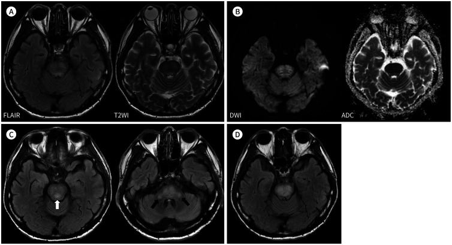
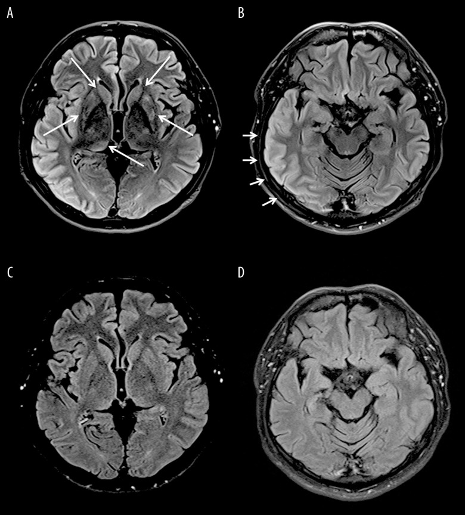
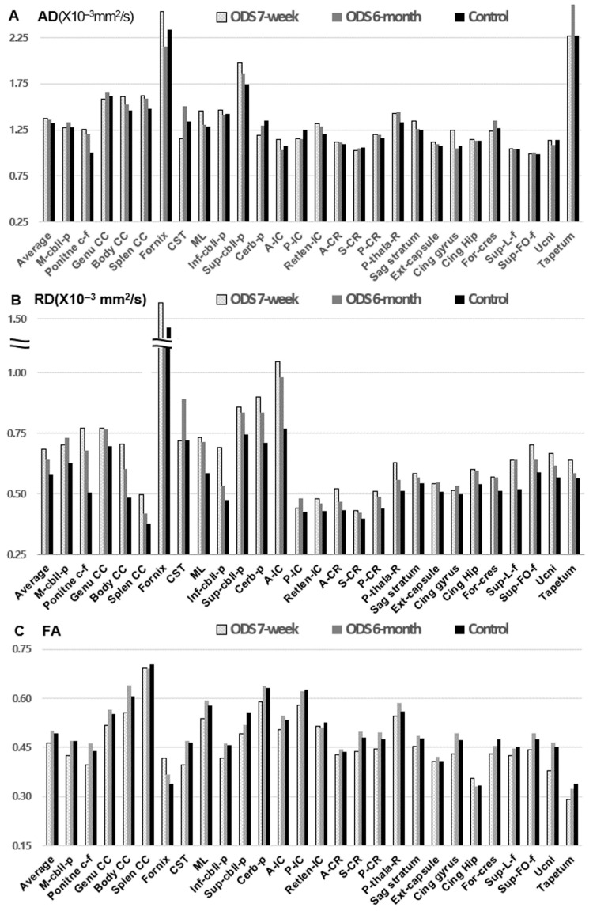
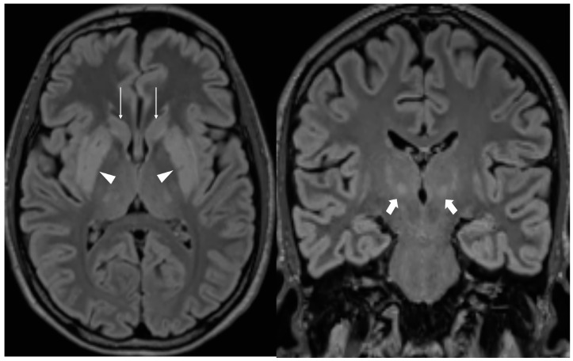
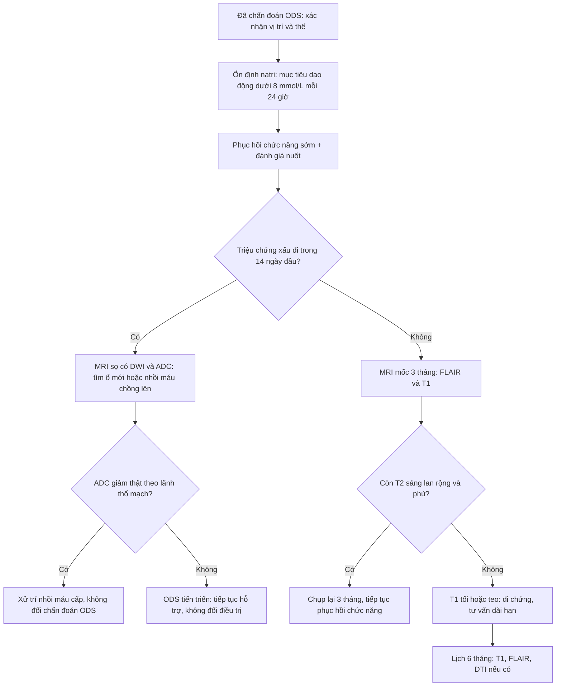

# 1892 — Theo dõi sau hội chứng hủy myelin thẩm thấu (ODS): MRI lúc nào, đọc thế nào, tiên lượng phục hồi / Follow-up of osmotic demyelination syndrome

**Tags:** `pattern:huy-myelin` `pattern:doi-xung` `pattern:teo-nao` `vung:nao` `vung:than-neu` `vung:cau-nao` `vung:hach-nen` `protocol:MRI` `protocol:DWI` `protocol:DTI`
**Mức chắc chắn (certainty):** tổng hợp y văn (literature synthesis) — số liệu từ **ca có ảnh chụp nối tiếp** (PMC9432104, PMC7370574, PMC13214892), **nghiên cứu DTI dọc** (PMC12985121), **tổng quan hệ thống nhi khoa** (PMC12221483), **phân tích gộp desmopressin** (PMC13491862) và các tổng quan điều trị 2026 (PMC13627832, PMC13620182). Câu nào là suy luận được ghi **[suy luận]**.

> **Vì sao bài này quan trọng:** [1866](../1866-hoi-chung-huy-myelin-tham-thau-ods/lesson.md) đã chốt **chẩn đoán cấp** (trident, DWI sớm, ngưỡng sửa natri). Nhưng câu hỏi thực tế xuất hiện **vài ngày sau đó**, khi bệnh nhân đã qua cơn nguy kịch: **"MRI xấu đi nghĩa là bệnh nặng lên hay là diễn tiến bình thường? Chụp lại khi nào? Tổn thương còn trên phim thì có còn triệu chứng? Có tái phát không?"** Ba câu trả lời định hình bài này: **(1)** trong **10 ngày–1 tháng đầu**, tổn thương **có thể lan rộng trên MRI trong khi triệu chứng đã cải thiện** (ca PMC9432104); **(2)** đến **2 tháng** tổn thương có thể gần như **biến mất** (PMC7370574) và lúc **6 tháng** vi cấu trúc myelin hồi phục đo được bằng DTI (PMC12985121); **(3)** hình ảnh **không** dùng để quyết định ngừng điều trị — trong một loạt 16 ca u lympho, **56,3%** ca có tổn thương cầu não **hoàn toàn không triệu chứng** (PMC12797817).

## 1. Tổng quan bệnh học – cơ chế hình ảnh (TẠI SAO hình ảnh đi sau lâm sàng)

### 1.1 Chuỗi mô bệnh học quyết định "lịch" của hình ảnh

- **Giờ đầu – 48 giờ:** tế bào hình sao (astrocyte) mất nước do ưu trương ngoại bào, **phù độc tế bào** → **nước chuyển vào nội bào**, khuếch tán giảm → **DWI tăng, ADC giảm**. Đây là **dấu sớm nhất**, có trước T2/FLAIR **1–2 tuần** (xem [1866](../1866-hoi-chung-huy-myelin-tham-thau-ods/lesson.md) §1).
- **Ngày 3 – 14:** myelin tách lớp, **đại thực bào** dọn mảnh myelin, phù gian bào tăng → **nước tự do tăng** → **T2/FLAIR sáng**, T1 tối dần. Đỉnh tín hiệu T2 **không** trùng đỉnh triệu chứng: tín hiệu còn **lan rộng thêm** khi hàng rào máu–não hồi phục và phản ứng viêm–thực bào đạt đỉnh.
- **Tuần 2 – 8:** tín hiệu T2 **có thể tiếp tục nặng lên** (ca PMC9432104: ngày 10 có **ổ mới** ở trung não sau và **cuống tiểu não hai bên**; 1 tháng sau tổn thương **liền thành đám đậm hơn**) — trong khi **triệu chứng đã cải thiện**. Đây là **"ly giải hình ảnh – lâm sàng" (clinical–radiological dissociation)**, không phải thất bại điều trị.
- **Tháng 2 – 6:** tái tạo myelin + giảm phù → T2 **giảm dần**, có ca **gần như hết** sau **2 tháng** (PMC7370574); ca khác hết tổn thương trên MRI lúc **5 tháng** (PMC7798224).
- **Sau 6 tháng:** tổn thương **mất myelin thật** → **T1 tối, teo cầu não/thùy**, giãn khoang dịch quanh mạch; đây là **di chứng**, không phải bệnh đang hoạt động.

### 1.2 Số liệu định lượng phải nhớ khi tư vấn tiên lượng

| Chỉ số | Con số | Nguồn |
|---|---|---|
| Tần suất ODS ở bệnh nhân hạ natri nằm viện | **0,23%**; sửa nhanh **0,73%** vs **0,10%** | PMC11833618 (qua 1866) |
| Tử vong / phụ thuộc suốt đời | tử vong **tới 31%**; thêm **31%** cần hỗ trợ suốt đời | PMC7798224 |
| Phân bố thể (trẻ em) | **46%** CPM đơn thuần, **28%** EPM đơn độc, **25%** phối hợp | PMC12221483 |
| Phân bố thể (người lớn, tổng hợp) | CPM + EPM phối hợp **25,4–44,6%**; EPM đơn độc **4,8–28,3%** | PMC12985121 (dẫn y văn) |
| Ngưỡng sửa natri gây ODS | **> 12 mmol/L/24 giờ** là ngưỡng được nhắc nhiều nhất ở trẻ | PMC12221483 |
| Ca không triệu chứng dù có tổn thương cầu não | **9/16 (56,3%)** | PMC12797817 |
| Hồi phục vi cấu trúc (DTI) từ 7 tuần → 6 tháng | RD **−4,73%**, FA **+7,94%**, AD **−0,40%** (χ² = 24,07; p = 5,92 × 10⁻⁶) | PMC12985121 |
| Proactive desmopressin giảm sửa natri quá nhanh | **OR 0,29** (95% CI 0,19–0,45); 6 nghiên cứu / 1.881 bệnh nhân | PMC13491862 |

- **TẠI SAO DTI hữu ích hơn T2 khi theo dõi:** T2 chỉ nói "còn nước/mất myelin", còn DTI tách được **tổn thương sợi trục (AD giảm)** với **mất myelin (RD tăng)**. Trong ca PMC12985121, ở **7 tuần** có **10/27 bó (37,0%)** bất thường theo RD — **9/21 bó ngoài thân não** — nghĩa là tổn thương vi mô **lan rộng hơn** vẻ ngoài trên FLAIR; đến **6 tháng** RD giảm và FA tăng, khớp với hồi phục lâm sàng gần hoàn toàn. **[suy luận]** Vì vậy một FLAIR "sạch" ở tháng thứ 2 **không** đồng nghĩa myelin đã bình thường.

## 2. Mẫu hình + chẩn đoán phân biệt theo thời gian và vị trí (Gamut)

**Câu hỏi trung tâm của lần chụp theo dõi không phải "có ODS không" (đã biết) mà là: "tổn thương này đang tiến triển, đang thoái triển, hay đã thành di chứng — và có gì mới chồng lên?"**

### 2.1 Theo mốc thời gian (quyết định chọn chuỗi xung)

- **0–48 giờ:** **DWI + ADC** là chìa khóa; FLAIR có thể còn bình thường → **MRI âm không loại trừ**.
- **3–14 ngày:** **FLAIR/T2** rõ nhất; đây là lúc dễ **bỏ sót tổn thương ngoài cầu** nếu chỉ chụp vài lát qua cầu não.
- **2–4 tuần:** giai đoạn **"xấu lên trên phim"** — phải so với lần trước, đo kích thước, tìm ổ mới; **không** đổi chẩn đoán chỉ vì hình nặng hơn.
- **2–6 tháng:** giai đoạn **thoái triển**; đánh giá **T1** và **teo** để tiên lượng di chứng.
- **> 6 tháng:** coi là **di chứng**; chỉ chụp khi có triệu chứng mới.

### 2.2 Theo vị trí (và ý nghĩa tiên lượng)

- **CPM đơn thuần (trung tâm cầu):** hình **trident/piglet**, giữ vành ngoài; tiên lượng chung tốt hơn thể phối hợp, nhưng **locked-in** vẫn xảy ra.
- **EPM (ngoài cầu):** **hạch nền, đồi thị, cuống tiểu não giữa, hải mã, thể chai, vỏ–dưới vỏ**. EPM đơn độc chiếm **4,8–28,3%** → **dễ bỏ sót** vì không có "trident". Bệnh cảnh hay gặp: **parkinsonism, dystonia, rối loạn hành vi, catatonia** xuất hiện **1–3 tuần** sau sửa natri.
- **Thể phối hợp:** **25,4–44,6%**; tổn thương nhiều tầng → thời gian hồi phục dài hơn, nguy cơ di chứng vận động–hành vi cao hơn. **[suy luận]** Đây là lý do mọi lần chụp theo dõi phải gồm **toàn bộ não**, không chỉ lát cầu não.

### 2.3 Gamut "tổn thương mới xuất hiện trong giai đoạn theo dõi"

- **ODS tiến triển (lan rộng theo trình tự giải phẫu):** ổ mới **sát ổ cũ**, đối xứng, **không theo lãnh thổ mạch**, không có hiệu ứng khối, bệnh nhân **không xấu tương ứng**.
- **Nhồi máu cầu não/não:** **theo lãnh thổ**, bờ rõ, **ADC giảm mạnh**, khởi phát **đột ngột** một chiều.
- **MS/NMOSD:** ổ **quanh não thất, dây thị, tủy**, bờ rõ, ngấm thuốc từng đợt; **không đối xứng kiểu trung tâm cầu**.
- **Wernicke:** **đồi thị giữa, quanh cống, thể vú**; bối cảnh rượu/suy dinh dưỡng; đáp ứng thiamine.
- **CLOCC (tổn thương thể chai độc–chuyển hóa):** ổ **thể chai nhỏ, hình bầu dục**, có thể **đi trước** ODS khi tăng natri/đường huyết rất cao (PMC12230272).
- **Bệnh não gan:** **T1 tăng hạch nền** đối xứng; không phải T2 sáng trung tâm cầu.
- **Ngộ độc thuốc (tacrolimus, metronidazole, hóa trị):** tổn thương cầu não **đối xứng kiểu ODS** nhưng **không có bối cảnh dao động thẩm thấu**; ngừng thuốc là điều trị.

## 3. Bảng so sánh phân biệt (ma trận đối chiếu)

| Thực thể (entity) | Hình ảnh điển hình | Chốt vào (rule-in) | Chốt loại (rule-out) | Gợi ý xác nhận |
|---|---|---|---|---|
| **ODS đang tiến triển (2–4 tuần)** | Ổ **mới sát ổ cũ**, đối xứng, **không hiệu ứng khối**, T2/FLAIR đậm và liền hơn lần trước | **So phim cũ: ổ mới nhưng cùng quy luật đối xứng + lâm sàng không xấu tương ứng** | Ổ mới **một bên, theo lãnh thổ, ADC giảm mạnh** → nhồi máu | MRI lặp lại 7–14 ngày; đo kích thước 2 chiều |
| **ODS tàn dư (≥ 6 tháng)** | **T1 tối, teo cầu não**, T2 còn sáng nhẹ, giãn khoang quanh mạch | **Teo + T1 tối + lâm sàng ổn định nhiều tháng** | T2 sáng **mới** + phù + hiệu ứng khối → tổn thương hoạt động/u | So phim ≥ 3 tháng; không cần cản quang |
| **Nhồi máu cầu não** | Vùng **lãnh thổ mạch**, bờ rõ, có thể xuất huyết; **ADC giảm** | **Đột ngột + yếu tố mạch máu + phân bố mạch** | Đối xứng trung tâm + bối cảnh sửa natri → ODS | MRA/CTA, siêu âm tim |
| **MS / NMOSD** | Ổ **bờ rõ quanh não thất**, dây thị, tủy; ngấm thuốc từng đợt | **Đa ổ theo thời gian + tủy/thị** | Một ổ trung tâm cầu đơn độc, không ổ khác | MRI sọ + tủy; IgG oligoclonal, NMO-IgG |
| **Wernicke** | **Đồi thị giữa, quanh cống, thể vú** tăng T2/FLAIR | **Rượu/suy dinh dưỡng + tam chứng + đáp ứng thiamine** | Không tổn thương thể vú, có dao động natri → ODS | Thiamine thử; MRI lặp lại |
| **CLOCC** | Ổ **thể chai bầu dục**, giảm khuếch tán, **thường thoái triển trong 2–4 tuần** | **Bối cảnh tăng natri/đường huyết rất cao + ổ thể chai đơn độc** | Tổn thương lan cầu não + hạch nền đối xứng → ODS | MRI 1–2 tuần; điện giải/đường huyết |
| **Ngộ độc thuốc (tacrolimus…)** | Cầu não **đối xứng kiểu ODS** | **Thuốc khởi đầu 1–4 tuần trước + nồng độ thuốc cao** | Có sửa natri nhanh, không dùng thuốc → ODS | Nồng độ thuốc; ngừng thuốc và chụp lại |

*(A) FLAIR + T2WI: tăng tín hiệu đối xứng trung tâm cầu, giữ vành ngoài. (B) DWI/ADC: không có "signal dropout" thật trên ADC — tức **T2 shine-through**, không phải hạn chế khuếch tán thật. (C) Ngày 10: **ổ MỚI** ở trung não sau (mũi tên trắng) và **cuống tiểu não hai bên** (mũi tên đen). (D) 1 tháng: không ổ mới nhưng tổn thương cũ **đậm và liền hơn** — trong khi triệu chứng đã cải thiện. Nguồn: Kim JH et al., J Korean Soc Radiol 2020 (PMC9432104), CC BY-NC 4.0.*

### 3.1 Đọc chuẩn xác: ba câu hỏi bắt buộc ở mỗi lần chụp theo dõi

1. **"Ổ mới hay chỉ là ổ cũ đậm hơn?"** → phải **đo 2 chiều** và so **cùng chuỗi xung, cùng lát**; ghi mm. Ca PMC9432104 cho thấy cả hai đều xảy ra: ngày 10 **có ổ mới**, 1 tháng **không ổ mới** nhưng **tín hiệu liền thành đám**.
2. **"Hạn chế khuếch tán thật hay T2 shine-through?"** → chỉ trả lời bằng **ADC map**. Trong ca trên, ADC **không giảm** dù DWI sáng.
3. **"Có teo/T1 tối chưa?"** → dấu hiệu **di chứng**; quyết định tư vấn phục hồi chức năng dài hạn, không phải tăng liều điều trị.

*(A, B) Ngày sau cơn co giật: FLAIR tăng tín hiệu ở **nhân đuôi, putamen, đồi thị phải, pulvinar và cuống tiểu não giữa hai bên** — thể EPM, **không hạn chế khuếch tán**. (C, D) Sau **2 tháng**: tổn thương **gần như hết**. Nguồn: Chong A et al., Am J Case Rep 2020 (PMC7370574), CC BY-NC-ND 4.0 — dùng nguyên bản, không ghép.*

### 3.2 Tiên lượng đo được: DTI thay cho cảm giác "chắc sẽ hồi phục"

*27 bó chất trắng: ở **7 tuần**, **RD tăng** (mất myelin) ở **10/27 bó (37,0%)** — **9/21 bó ngoài thân não**; từ **7 tuần → 6 tháng**, RD **−4,73%** và FA **+7,94%** (p = 5,92 × 10⁻⁶), AD gần như không đổi (−0,40%). Nguồn: Park SH et al., Diagnostics 2026 (PMC12985121), CC BY 4.0.*

*FLAIR trục và vành: tăng tín hiệu đối xứng ở **putamen (đầu mũi tên), đầu nhân đuôi (mũi tên mảnh), đồi thị (mũi tên đậm)** — thể ngoài cầu sau khi natri được sửa **> 10 mmol/L/24 giờ**. Nguồn: Kopanos S et al., Reports 2026 (PMC13214892), CC BY 4.0.*

## 4. Protocol theo dõi + ngưỡng điều trị giai đoạn hồi phục

### 4.1 Lịch chụp (không chụp dày, không bỏ mốc)

| Mốc | Mục đích | Chuỗi xung tối thiểu |
|---|---|---|
| Lúc chẩn đoán | Xác nhận, đo tổn thương nền | DWI + ADC, T2/FLAIR, T1 (không cản quang) |
| **7–14 ngày** (nếu triệu chứng xấu đi hoặc chẩn đoán chưa chắc) | Bắt tổn thương xuất hiện muộn, phân biệt tiến triển với nhồi máu | FLAIR + DWI/ADC |
| **3 tháng** | Đánh giá thoái triển và teo sớm | FLAIR, T1 |
| **6 tháng** (nếu còn di chứng) | T1 tối/teo = di chứng; DTI nếu có | T1, FLAIR, DTI (tùy chọn) |
| Bất kỳ lúc nào có triệu chứng **mới, khu trú** | Loại trừ nhồi máu/xuất huyết chồng lên | DWI/ADC + FLAIR/SWI |

- **Không** chụp lại mỗi tuần chỉ vì "muốn thấy tiến triển": trong 1 tháng đầu, **nặng lên trên phim là diễn tiến được mô tả** (PMC9432104).
- **Cản quang không cần** cho chẩn đoán/theo dõi thường quy: tổn thương ODS **không ngấm thuốc**, không hiệu ứng khối.

### 4.2 Ngưỡng natri trong giai đoạn hồi phục (nơi hay gây tái phát)

- **Mục tiêu:** giữ natri **ổn định**, tránh **dao động hai chiều > 8–10 mmol/L/24 giờ**. Nguy cơ cao (rượu, suy dinh dưỡng, hạ kali, bệnh gan, ghép tạng): giữ **≤ 4–6 mmol/L/24 giờ**. **[suy luận]** Bệnh nhân **đã có ODS** được xếp vào nhóm nguy cơ cao nhất khi sửa natri lần sau.
- **Nếu lỡ sửa quá nhanh:** hạ natri lại bằng **D5W 3 mL/kg/giờ** hoặc **10 mL/kg trong 1 giờ**, phối hợp **desmopressin** khi nước tiểu loãng nhiều; theo dõi natri **mỗi 2–4 giờ** (PMC13620182). Ca thực tế trong bài đó: natri **132 → 127 mmol/L trong 10 giờ** nhờ desmopressin.
- **Phòng ngừa chủ động:** **proactive desmopressin** (dùng trước khi nước tiểu loãng) giảm sửa quá nhanh với **OR 0,29** (95% CI 0,19–0,45) trên **1.881 bệnh nhân** (PMC13491862).
- **Theo dõi thực hành:** natri mao mạch/tĩnh mạch **mỗi 4–6 giờ** trong 48 giờ đầu sau khi đạt mức an toàn; ghi **lượng nước tiểu** (nước tiểu loãng là dấu hiệu sắp sửa quá nhanh).
- **Phục hồi chức năng:** bắt đầu **ngay khi qua giai đoạn cấp**, không chờ "hết tổn thương trên MRI"; ca nặng cần **mở khí quản + mở dạ dày** rồi phục hồi **5 tháng** mới đi lại được (PMC13461134). Nuốt: đánh giá **trước khi cho ăn đường miệng** để tránh hít sặc.

### 4.3 Sơ đồ quyết định sau khi đã chẩn đoán ODS

## 5. Biến thể bình thường và cạm bẫy

- **T2 còn sáng sau khi hết triệu chứng** là **bình thường** trong nhiều tháng; đừng tăng điều trị. Ngược lại, **teo + T1 tối** ở tháng thứ 6 là **di chứng**, không hồi phục thêm nhiều.
- **"Xấu lên trên phim" ở tuần 2–4**: gặp trong ca nguyên văn (PMC9432104) **dù lâm sàng tốt lên**. Cạm bẫy: đổi sang chẩn đoán khác (viêm não, u) hoặc tăng corticoid vô ích.
- **EPM đơn độc** (28% ở trẻ, tới 28,3% người lớn): bệnh nhân **parkinsonism/dystonia** sau sửa natri mà **cầu não sạch** → vẫn là ODS; phải chụp **hạch nền, đồi thị, cuống tiểu não**.
- **T2 shine-through**: DWI sáng + ADC **không giảm** — không phải thiếu máu cấp; đừng dùng DWI một mình để gọi nhồi máu.
- **Tái hạ natri quá tay**: điều trị "sửa lại" cũng là một ngưỡng — hạ xuống **127 mmol/L** trong 10 giờ (PMC13620182) có thể gây **hạ natri nặng thứ phát**; luôn có mục tiêu số và kiểm tra lại.
- **Bệnh nhân tỉnh, hình ảnh nặng**: **56,3%** ca CPM trong loạt u lympho **không triệu chứng** (PMC12797817); ngược lại, **hình ảnh nhẹ không loại trừ di chứng hành vi** (catatonia, thay đổi nhân cách) ở EPM.
- **Dao động natri do nguyên nhân nội tiết**: sau ODS, **suy tuyến yên** có thể xuất hiện (u tuyến yên/apoplexy — PMC13214892); hạ natri tái diễn sau đó **không** được quy hết cho "di chứng ODS" mà phải kiểm trục tuyến yên–giáp–thượng thận.

## 6. Tự lượng giá — Blind Quiz

**Ca 1 — Nam 61 tuổi, đái tháo đường, yếu–nói khó–nuốt khó. MRI lúc chẩn đoán (A, B) và 2 lần chụp lại (C, D). Nhìn phim trước, mô tả trước.**

- Hỏi: (1) Ở C có gì mới? (2) D có nghĩa là thất bại điều trị? (3) Trên B, DWI sáng có phải nhồi máu cấp?

<b>Bấm để hiện đáp án</b>

- (1) **Ổ MỚI** ở trung não sau và **cuống tiểu não hai bên** — ODS **lan rộng theo trình tự giải phẫu**, đối xứng.
- (2) **Không.** Ở D (1 tháng), không có ổ mới nhưng tổn thương cũ **đậm và liền hơn**, trong khi **triệu chứng đã cải thiện** → "ly giải hình ảnh–lâm sàng" của ODS; tiếp tục hỗ trợ + phục hồi chức năng.
- (3) **Không.** **ADC không giảm** (không "signal dropout") → **T2 shine-through**, không phải hạn chế khuếch tán thật.
- Nguồn: Kim JH et al., J Korean Soc Radiol 2020 (PMC9432104), CC BY-NC 4.0.

**Ca 2 — Nữ trẻ, co giật do hạ natri, sau đó parkinsonism. Hai phim cách nhau 2 tháng.**

- Hỏi: vị trí tổn thương? Vì sao gọi là EPM? Sau 2 tháng kết luận gì?

<b>Bấm để hiện đáp án</b>

- Tổn thương **nhân đuôi, putamen, đồi thị phải, pulvinar, cuống tiểu não giữa hai bên** — **ngoài cầu**, đối xứng, không hạn chế khuếch tán → **EPM**.
- Sau 2 tháng tổn thương **gần như hết** → **thoái triển**, khớp với hồi phục lâm sàng; đây là mốc để tư vấn tiên lượng.
- Nguồn: Chong A et al., Am J Case Rep 2020 (PMC7370574), CC BY-NC-ND 4.0.

**Ca 3 — Bệnh nhân 1 tháng sau sửa natri > 10 mmol/L/24 giờ, run–chậm chạp, FLAIR vành và trục:**

- Hỏi: 3 vị trí tổn thương? Chẩn đoán? Cần chụp gì tiếp và khi nào?

<b>Bấm để hiện đáp án</b>

- **Putamen, đầu nhân đuôi, đồi thị** hai bên — tổn thương **ngoài cầu đối xứng** → **EPM** trong ODS.
- Chụp lại **3 tháng** (FLAIR + T1) để đánh giá teo/T1 tối; kiểm tra **trục tuyến yên** nếu hạ natri tái diễn (ca gốc có apoplexy tuyến yên — PMC13214892).
- Nguồn: Kopanos S et al., Reports 2026 (PMC13214892), CC BY 4.0.

## Bài liên quan chéo
- [1866 – Hội chứng hủy myelin thẩm thấu (chẩn đoán cấp)](../1866-hoi-chung-huy-myelin-tham-thau-ods/lesson.md)
- [1722 – Hạ natri muộn sau mổ tuyến yên](../1722-ha-natri-muon-sau-mo-tuyen-yen/lesson.md)
- [211 – Đột quỵ não](../211-dot-quy-nao/lesson.md) (phân biệt nhồi máu cầu não)
- [210 – Giải phẫu sọ não trên cắt lớp](../210-giai-phau-so-nao/lesson.md)
- [200 – Tổng quan hệ Thần kinh](../200-tong-quan-he-than-kinh/lesson.md)

> Không dùng để chẩn đoán độc lập khi chưa có người hướng dẫn.
