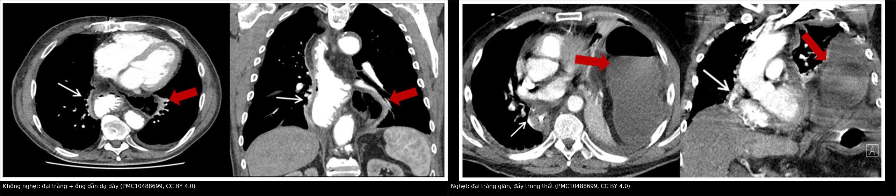
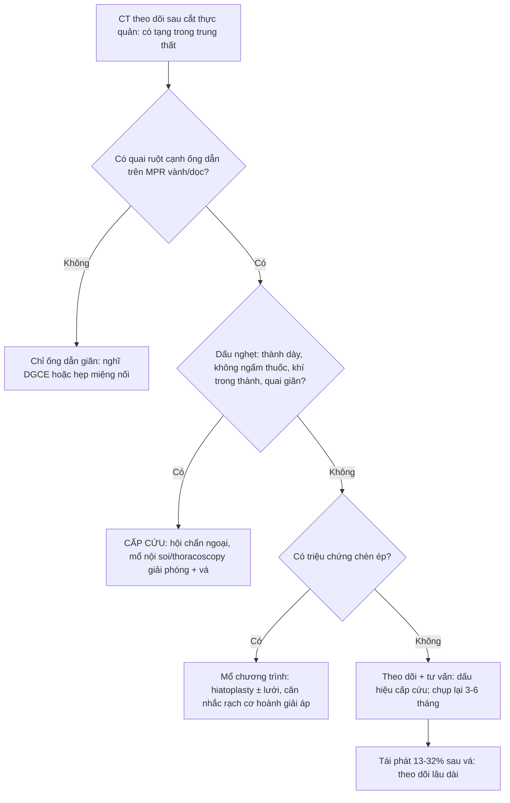
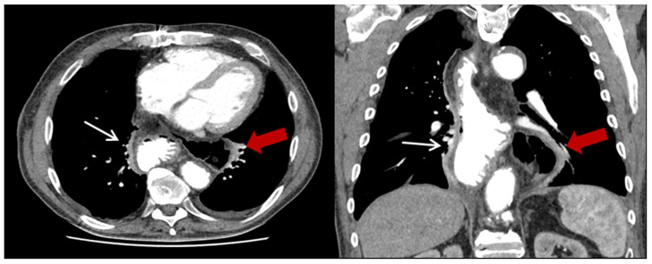
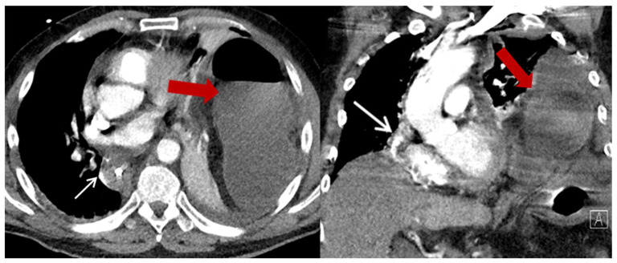
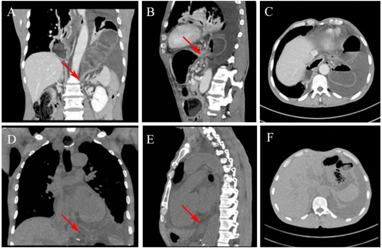

# 1893 — Thoát vị hoành sau cắt thực quản / Post-esophagectomy hiatal hernia (PEHH, paraconduit hernia)

**Tags:** `pattern:thoat-vi` `pattern:quai-ruot-trong-nguc` `vung:co-hoanh` `vung:trung-that` `vung:nguc` `protocol:CT-nguc`

**Mức chắc chắn (certainty):** tổng hợp y văn (literature synthesis) — biên từ **phân tích gộp 34 nghiên cứu / 837 ca PEHH** (*Esophagus* 2026, **PMID 41449286**), **đoàn hệ 306 ca Ivor Lewis** (*J Clin Med* 2023, **PMC10488699**, CC BY 4.0), **đoàn hệ 371 ca MIE** (*Surg Endosc* 2025, **PMID 40045058**) và **ca lâm sàng có ảnh** (*Front Surg* 2025, **PMC12018370**, CC BY 4.0). Nhóm **không có bệnh nhân của mình**.

> **Câu chốt:** sau cắt thực quản, lỗ hoành bị **mở rộng có chủ ý** và **không còn cơ thắt dưới thực quản**; ống dẫn dạ dày (gastric conduit) nằm lấp lỗ hoành nhưng **đại tràng ngang** nằm ngay dưới, chỉ chờ **chênh áp lồng ngực–ổ bụng** để **chui lên cạnh ống dẫn** — gọi là **thoát vị cạnh ống dẫn (paraconduit hernia)**. Tần suất gộp **4,1%** (34 nghiên cứu, 837 ca), **mổ nội soi tăng nguy cơ OR 5,70**; **57–60% KHÔNG có triệu chứng**, nhưng **17–48% ca được mổ là cấp cứu** vì **nghẹt/xoắn** — tử vong chung **2,1%**, biến chứng **31,7%**. Chốt hình ảnh nằm ở **mặt phẳng vành–dọc (coronal–sagittal MPR)**, không phải lát cắt ngang.

## 1. Tổng quan bệnh học – cơ chế hình ảnh (TẠI SAO)

### 1.1 Định nghĩa — đừng gọi "thoát vị hoành" chung chung

- **PEHH (post-esophagectomy hiatal hernia) = paraconduit hernia:** **tạng ổ bụng KHÁC ống dẫn dạ dày** (đại tràng, ruột non, mạc nối, đôi khi lách/túi mật) **thoát qua lỗ hoành vào trung thất**, nằm **cạnh** ống dẫn. Định nghĩa của đoàn hệ 306 ca loại trừ chính ống dẫn dạ dày khỏi "tạng thoát vị" (**PMC10488699**).
- Hệ quả thuật ngữ: **"dạ dày ống dẫn nằm trong lồng ngực"** là **thiết kế của phẫu thuật** — **không phải** PEHH. Chỉ khi có **tạng thứ hai** cạnh ống dẫn mới đúng là biến chứng cần xử trí. Đây là **bẫy đọc phim số một** ở bệnh nhân theo dõi sau mổ.

### 1.2 Vì sao đúng bệnh nhân này — 4 yếu tố cơ học

1. **Lỗ hoành bị mở rộng có chủ ý:** trong mổ nội soi, phẫu thuật viên **cắt cơ hoành phải (hiatotomy)** để lấy rộng thực quản/ống dẫn → lỗ hoành **rộng hơn sinh lý**, mép cơ **mỏng và xơ** sau mổ (**PMC10488699**, Hình 5).
2. **Mất "nút chặn" sinh lý:** cắt thực quản lấy đi **cơ thắt dưới thực quản** và **dây chằng hoành–thực quản**; ống dẫn dạ dày **không có cơ thắt**, **không co bóp**, nên lỗ hoành chỉ còn **dính xơ lỏng lẻo** quanh ống.
3. **Đại tràng ngang là "hàng xóm" trực tiếp:** nó nằm **sát ngay dưới lỗ hoành**, mạc treo ngang **dài và di động** → khi **áp lực ổ bụng > áp lực lồng ngực** (ho, thở máy, chướng hơi, nôn), **đại tràng bị hút lên trước tiên**. Số liệu: **đại tràng có mặt trong 100% ca**, ruột non thêm **13%**; **78,3% thoát vị sang ngực TRÁI**, **13% khu trú giữa trung thất thấp** (**PMC10488699**).
4. **Xạ trị tân bổ trợ (nCRT)** làm mô xơ–dính, giảm khả năng lành của mép cơ hoành: **nCRT làm tăng nguy cơ OR 3,53** (**PMID 41449286**). Ngược lại, **béo (BMI > 25) làm GIẢM nguy cơ (OR 0,84)** — mỡ mạc treo dày, lỗ hoành bị "bít" chặt hơn; đoàn hệ MIE cũng thấy **BMI < 25 là yếu tố nguy cơ độc lập (OR 2,96; KTC 1,22–7,20)** (**PMID 40045058**).

### 1.3 Vật lý hình ảnh — vì sao CT là chìa khóa và vì sao **lát ngang dễ bỏ sót**

- **Đại tràng chứa hơi** có đậm độ **−800 đến −1.000 HU**, tương phản cực mạnh với trung thất **30–50 HU** → nhìn thấy ngay **cả trên cửa sổ trung thất** (không cần cửa sổ phổi). Nhưng **đại tràng chứa đầy dịch** chỉ **0–20 HU**, **trùng đậm độ với nang trung thất, tụ dịch, hoại tử u** → dễ bị đọc là **"nang/khoang dịch trung thất"**.
- **Lỗ hoành là mặt phẳng NGHIÊNG**, không song song với lát cắt ngang: một **lát axial 5 mm** cắt **xiên** qua "cổ túi thoát vị", nên **chỉ thấy một vòng ruột đơn độc** trong trung thất — **không thấy chỗ nối với ổ bụng** → không phân biệt được **thoát vị vs nang**. Trong ca *Front Surg* 2025, **lần đọc đầu tiên trên axial kết luận "không có thoát vị"**, phải **đọc lại trên MPR vành/dọc** mới thấy đại tràng ngang chui qua lỗ hoành (**PMC12018370**, Hình 2C so với 2A–B).
- **Hệ quả thực hành:** mọi CT theo dõi sau cắt thực quản phải **dựng lại MPR vành + dọc** và **lần theo ống dẫn từ trung thất xuống ổ bụng** — đây là **cửa sổ duy nhất** chứng minh "cổ túi thoát vị" và **phân biệt tạng thoát vị với ống dẫn**.

### 1.4 Số phải nhớ

- **Tần suất gộp:** **4,1%** (34 nghiên cứu, **837 ca**) (**PMID 41449286**); một trung tâm 306 ca: **8%** toàn bộ, **13,8% sau hybrid MIE vs 1,3% sau mổ mở** (p < 0,001) (**PMC10488699**); 371 ca MIE: **6,7%** (**PMID 40045058**).
- **Thời điểm:** trung vị **24 tháng** sau mổ (khoảng **2–99 tháng**) (**PMID 40045058**, **PMID 42989883**) — nghĩa là **năm thứ 2–8**, không phải "biến chứng sớm".
- **Triệu chứng:** **56,5–60% không triệu chứng**, phát hiện tình cờ trên CT theo dõi; **43,5% đau bụng/khó chịu**; **17,4% vào cấp cứu** (1 tắc ruột, 3 nghẹt ruột) (**PMC10488699**); ở nhóm được mổ của đoàn hệ MIE, **48% mổ cấp cứu** (**PMID 40045058**); series 8 ca của *Hernia* 2024: **8/8 vào vì tắc ruột**, **50% phải chuyển mổ mở**, **1 ca hoại tử + thủng ruột** (**PMID 39066882**).
- **Kết cục:** biến chứng sau mổ **31,7%**, tử vong **2,1%** (**PMID 41449286**); **50,4%** ca PEHH được mổ nội soi.
- **Tái phát sau vá:** **31,6%** (6/19) (**PMC10488699**); các series khác **13,3–29%**; kỹ thuật **rạch cơ hoành giải áp (diaphragmatic relaxing incision)** + lưới: **15 ca**, lỗ thoát vị trung vị **70 mm** (65–100 mm), tái phát **6,7%**, biến chứng **13,3%** (nuốt khó thoáng qua) (**PMID 42989883**).

## 2. Mẫu hình + chẩn đoán phân biệt theo vị trí (Gamut)

- **A — Tình cờ trên CT theo dõi, bệnh nhân hoàn toàn khỏe:** hình **quai đại tràng có hơi (± mức dịch)** trong **trung thất sau/ngực trái**, **cạnh ống dẫn dạ dày** đang đổ đầy dịch; **cổ túi** tại lỗ hoành. Chiếm **~57%** (**PMC10488699**) → DDx: **thoát vị hoành sau mổ**, **thoát vị hoành trước mổ (type III/IV)**, **hạch/khối trung thất**, **quai ruột non trong trung thất do thoát vị qua màng phổi**.
- **B — Nuốt khó, nôn, đầy bụng sau ăn, sụt cân:** ống dẫn **giãn** nhưng **không có tạng thứ hai** → nghĩ **làm rỗng ống dẫn chậm (delayed gastric conduit emptying, DGCE)**; nếu **có** quai đại tràng chèn cạnh ống dẫn → **PEHH gây chèn ép cơ học**. Hai bệnh cảnh **trùng triệu chứng**, khác hoàn toàn điều trị.
- **C — Đau ngực/đau bụng dữ dội + nôn + không trung tiện:** **quai ruột giãn rõ**, **mức dịch–hơi**, **xoắn quanh trục mạc treo (volvulus)**, **thành ruột dày, không ngấm thuốc**, **khí trong thành (pneumatosis)** → **nghẹt/hoại tử** — cấp cứu ngoại khoa. Ca điển hình: **xoắn đại tràng ngang trong ngực = thoát vị hoành type IV** (**PMC10097545**).
- **D — Khó thở + mờ đáy phổi một bên:** hình **khối mềm lớn chiếm nửa ngực trái**, **đẩy trung thất sang phải**, kèm **tràn dịch màng phổi** → DDx **thoát vị giãn căng (tension viscus)**, **tràn dưỡng trấp (bài 1887/1857)**, **tràn dịch ác tính (bài 040)**, **xẹp phổi do ống dẫn giãn**.
- **E — Sốt, đau ngực, dịch trung thất:** **rò miệng nối thực quản–ống dẫn** hoặc **hoại tử ruột thoát vị đã thủng** → khí + dịch trung thất; **đừng chỉ nghĩ rò miệng nối**.

## 3. Bảng so sánh phân biệt (ma trận đối chiếu)

| Thực thể (entity) | Hình ảnh điển hình | Chốt vào (rule-in) | Chốt loại (rule-out) | Gợi ý xác nhận |
|---|---|---|---|---|
| **PEHH không nghẹt** | Quai đại tràng **có hơi** trong trung thất, **cạnh ống dẫn**, cổ túi ở lỗ hoành | **Thấy liên tục quai ruột từ ổ bụng qua lỗ hoành trên MPR vành/dọc** | Chỉ thấy "khoang dịch" trên axial, không thấy cổ túi → chưa loại trừ, phải dựng MPR | CT ngực–bụng có cản quang, MPR vành + dọc |
| **PEHH nghẹt/xoắn** | **Quai giãn, mức dịch–hơi, xoắn mạc treo**, thành dày, **không ngấm thuốc** | **Mất liên tục thành + khí trong thành + dịch tự do** = hoại tử | Thành mỏng, ngấm thuốc đều, quai xẹp → chưa nghẹt | CTA bụng–ngực, mổ cấp cứu |
| **Làm rỗng ống dẫn chậm (DGCE)** | Ống dẫn **giãn to**, **đầy dịch/khí**, **không có tạng thứ hai** trong trung thất | **Ống dẫn giãn to + chậm xả thuốc khi chụp cản quang đường uống** | Có quai ruột **cạnh** ống dẫn → PEHH, không phải DGCE đơn thuần | X-quang/CT cản quang đường uống, nội soi |
| **Tái phát u / hạch trung thất** | Khối **đặc**, ngấm thuốc, **không có hơi**, bờ không đều | **Ngấm thuốc + PET dương + không thay đổi theo tư thế** | Có hơi/dịch trong quai, thay đổi hình khi đổi tư thế → tạng | PET-CT, sinh thiết |
| **Rò miệng nối** | Khí + dịch **quanh miệng nối**, **thành ống dẫn khiếm khuyết** | **Thuốc cản quang thoát ra ngoài lòng** trên phim cản quang | Không thấy đường rò, khí khu trú trong quai ruột | Cản quang tan trong nước, nội soi |
| **Thoát vị hoành do chấn thương (bài 3082)** | Vỡ cơ hoành, **tạng "tựa lưng"**, dấu **"cổ áo"** | **Tiền sử chấn thương + mất liên tục cơ hoành rộng** | Cơ hoành liên tục, lỗ hoành giãn đều sau mổ | CT có MPR, so phim trước mổ |
| **Tràn dưỡng trấp màng phổi (bài 1887/1857)** | Dịch màng phổi **một bên**, không có quai ruột | **Triglyceride dịch > 110 mg/dL + chylomicron** | Có quai ruột trong ngực → PEHH là nguyên nhân chính | Chọc dò sinh hóa dịch |

*Trái: quai đại tràng (mũi tên đỏ) cạnh ống dẫn dạ dày (mũi tên trắng), thành mỏng, không giãn. Phải: quai giãn lớn, mức dịch–hơi, đẩy trung thất — nghẹt. Nguồn: J Clin Med 2023 (PMC10488699), CC BY 4.0. Ảnh ghép letterbox.*

## 4. Protocol chụp + hệ phân độ + lưu đồ xử trí

- **Chỉ định:** mọi CT ngực theo dõi sau cắt thực quản (3–6 tháng/lần trong 2 năm đầu, sau đó 6–12 tháng) — **không chờ triệu chứng**, vì 57% không triệu chứng.
- **Kỹ thuật:** CT **ngực + bụng trên** (đến đỉnh khung chậu để thấy đại tràng ngang), **lát ≤ 1–1,5 mm**, **có cản quang tĩnh mạch**, **dựng MPR vành + dọc**; **cửa sổ trung thất + cửa sổ phổi**; nếu nghi DGCE/rò: **cản quang đường uống tan trong nước**.
- **Đo và ghi (không có score chuẩn hóa cho PEHH — ghi đủ để so sánh lượt sau):**
  - **đường kính lỗ hoành (mm)** tại cổ túi, **vị trí** (trái/phải/giữa trung thất thấp);
  - **tạng thoát vị** (đại tràng / ruột non / mạc nối / lách);
  - **dấu nghẹt:** giãn quai rõ, mức dịch–hơi, **thành dày**, **không ngấm thuốc**, **khí trong thành**, **dịch tự do**, **đẩy trung thất** — *chưa có ngưỡng mm được thẩm định riêng cho PEHH, nên ghi mô tả + so sánh với lượt trước*;
  - **vị trí + độ giãn ống dẫn** (để phân biệt DGCE).
- **Hệ phân độ dùng trong y văn:** **thoát vị hoành type IV** (tạng khác dạ dày) là mô tả giải phẫu áp cho PEHH; **không có phân độ riêng cho PEHH** — nhiều tác giả phân theo **có/không triệu chứng** và **cấp cứu/không cấp cứu**.

## 5. Biến thể bình thường và cạm bẫy

- **Ống dẫn dạ dày nằm trong trung thất là BÌNH THƯỜNG** — đừng gọi PEHH. Đây là lý do phải **lần theo ống dẫn** trước khi kết luận.
- **Axial-only là bẫy chết người:** ca *Front Surg* 2025 có **hai lần đọc CT đều "không có thoát vị"** trên axial, chỉ khi **dựng lại vành/dọc** mới thấy đại tràng ngang chui lên (**PMC12018370**). Quy tắc: **không kết luận "không thoát vị" nếu chưa xem MPR vành/dọc**.
- **Quai ruột đầy dịch = "nang trung thất":** đậm độ 0–20 HU, bờ trơn, không hơi → dễ đọc là nang phế quản/lymphocele/tụ dịch. Dấu phân biệt: **thành ruột có lớp**, **mạch máu mạc treo đi vào**, **liên tục với ổ bụng qua lỗ hoành**.
- **Hơi trong quai bị đọc là tràn khí trung thất/áp-xe:** hơi trong **lòng quai có thành bao quanh và có mức dịch**; khí trung thất thật là **những "bọt" rời trong mô mỡ**, không có thành.
- **Satisfaction of search:** sau khi thấy ống dẫn giãn/tràn dịch màng phổi, người đọc **dừng lại** — luôn **quét toàn bộ trung thất và lỗ hoành** ở mọi lát.
- **Thoát vị "trượt" theo tư thế:** quai đại tràng có thể **lên khi nằm, xuống khi đứng** → chụp **ngửa là chuẩn**; nếu CT ngửa âm tính mà lâm sàng mạnh, chụp **cản quang đường uống** hoặc **CT tư thế khác**.
- **Biến thể bình thường:** **túi mù/đại tràng sigma dài** trong ổ bụng, **thoát vị đùi/bẹn nhỏ**, **thoát vị quanh thực quản type I trước mổ** — không liên quan đường mổ, đừng quy cho PEHH.

## 6. Tự lượng giá — Blind Quiz

**Ca 1 — Nam 64 tuổi, 14 tháng sau Ivor Lewis vì ung thư biểu mô vảy thực quản, khám định kỳ, hoàn toàn không triệu chứng. CT ngực có cản quang.**

- Gợi ý lâm sàng: không đau, không nôn, ăn uống bình thường; chỉ chụp theo lịch.
- Câu hỏi: cấu trúc nào nằm trong ngực trái? Có phải ống dẫn dạ dày không? Dấu hiệu nào chứng minh đây là **tạng thứ hai**? Có cần mổ ngay không?

<b>Bấm để hiện đáp án</b>

- **Findings:** trong ngực trái, **cạnh ống dẫn dạ dày (mũi tên trắng)** có **quai đại tràng chứa hơi (mũi tên đỏ)**; lỗ hoành giãn, cổ túi thấy rõ trên **MPR vành**. Thành quai mỏng, **không có mức dịch–hơi lớn**, **không đẩy trung thất** → **PEHH không nghẹt**.
- **Chẩn đoán:** **thoát vị hoành cạnh ống dẫn sau cắt thực quản (PEHH)** — đại tràng ngang thoát vị qua lỗ hoành đã được mở rộng trong mổ.
- **Xử trí:** đây là nhóm **57% không triệu chứng**. Y văn **không thống nhất**: một số tác giả khuyến cáo **mổ chương trình sớm** vì nguy cơ nghẹt không dự báo được (**PMC10488699**), phân tích gộp 2026 lại khuyến cáo **cá thể hóa** dựa trên tiên lượng ung thư (**PMID 41449286**). Thực hành an toàn: **tư vấn dấu hiệu cấp cứu + chụp lại 3–6 tháng**.
- **Nguồn ảnh:** *J Clin Med* 2023, Hình 2, **PMC10488699**, CC BY 4.0.

**Ca 2 — Nữ 58 tuổi, 20 tháng sau MIE, vào cấp cứu: đau bụng dữ dội, nôn ra dịch, bụng chướng, không trung tiện.**

- Câu hỏi: dấu hiệu nào cho biết đã **nghẹt**? Hai biến chứng phải loại trừ ngay trên CT? Thái độ điều trị?

<b>Bấm để hiện đáp án</b>

- **Findings:** **quai đại tràng giãn rất lớn** trong ngực trái, **mức dịch–hơi**, **đẩy trung thất sang phải rõ rệt**; ống dẫn dạ dày (mũi tên trắng) bị chèn. Đây là **thoát vị giãn căng + nghẹt**.
- **Phải loại trừ:** (1) **hoại tử ruột** — thành dày/không ngấm thuốc, **khí trong thành**, dịch tự do; (2) **thủng** — khí ngoài lòng, dịch trung thất. Cả hai = **mổ cấp cứu**, không nong/nội soi.
- **Xử trí:** hồi sức + **mổ cấp cứu** (nội soi ngực/bụng hoặc mở): giải phóng quai, **đánh giá sống còn của ruột**, cắt nếu hoại tử, **vá lỗ hoành** (khâu thì đầu ± lưới; lỗ rộng > 7 cm cân nhắc **rạch cơ hoành giải áp**).
- **Con số:** nhóm mổ cấp cứu có **biến chứng 31,7%**, **tử vong 2,1%** trong phân tích gộp; series *Hernia* 2024 **8/8 vào vì tắc ruột**, **1 ca hoại tử/thủng** (**PMID 39066882**).
- **Nguồn ảnh:** *J Clin Med* 2023, Hình 4, **PMC10488699**, CC BY 4.0.

**Ca 3 — Bệnh nhân 62 tuổi, 8 tháng sau McKeown, đau bụng + nôn; CT lần 1 kết luận "không thoát vị". Đọc lại thì sao?**

- Câu hỏi: vì sao **lượt đọc đầu** bỏ sót? Mặt phẳng nào chứng minh chẩn đoán? Nêu 2 dấu hiệu trên ảnh C/F (axial).

<b>Bấm để hiện đáp án</b>

- **Vì sao bỏ sót:** lỗ hoành **nghiêng** so với mặt phẳng axial → lát ngang chỉ cắt **một đoạn quai**, không thấy **cổ túi nối với ổ bụng**; trên ảnh **C** (axial) thoát vị **mờ nhạt**, còn **A/B (vành/dọc)** thấy rõ đại tràng ngang chui qua lỗ hoành. Ảnh **D/E** là **lượt đọc lại** trên MPR — chẩn đoán hiện ra rõ.
- **Chốt:** **MPR vành + dọc** (và lần theo ống dẫn) là **bắt buộc**; axial một mình **không đủ để loại trừ**.
- **Bài học:** khi bệnh nhân sau cắt thực quản có **triệu chứng tắc ruột mà CT axial âm tính**, **đọc lại MPR** trước khi kết luận, và **xem phim cũ** so sánh.
- **Nguồn ảnh:** *Front Surg* 2025, Hình 2, **PMC12018370**, CC BY 4.0.

## Bài liên quan chéo
- [001 – Tổng quan hệ Ngực](../001-tong-quan-he-nguc/lesson.md)
- [1887 – Rò dưỡng trấp sau cắt thực quản](../1887-ro-duong-trap-sau-cat-thuc-quan/lesson.md) (cùng bệnh nhân, biến chứng sớm)
- [3082 – Vỡ cơ hoành sau chấn thương](../3082-vo-co-hoanh-sau-chan-thuong/lesson.md) (dấu "cổ áo", tạng "tựa lưng")
- [1872 – Thoát vị Littre](../1872-thoat-vi-littre-tui-thua-meckel-trong-tui-thoat-vi/lesson.md) (tạng trong túi thoát vị)
- [1844 – Rò và hoại tử thực quản do xạ](../1844-ro-hoai-tu-thuc-quan-do-xa/lesson.md)
- [040 – Tràn dịch màng phổi](../040-tran-dich-mang-phoi/lesson.md) (dịch kèm khối mờ đáy phổi)
- [1857 – Tràn dưỡng trấp màng phổi sau mổ cột sống](../1857-tran-duong-trap-mang-phoi-sau-mo-cot-song/lesson.md)

## Ảnh
- Tên file: `1893_thoat-vi-hoanh-sau-cat-thuc-quan_CT-*.jpg`; nguồn + giấy phép từng ảnh trong `images/CREDITS.md`.

> Không dùng để chẩn đoán độc lập khi chưa có người hướng dẫn.
