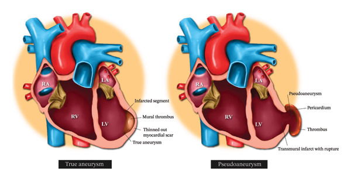
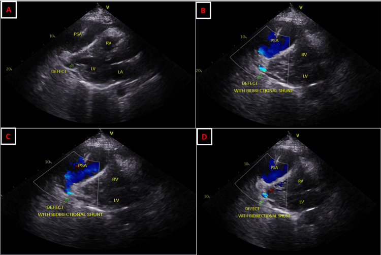
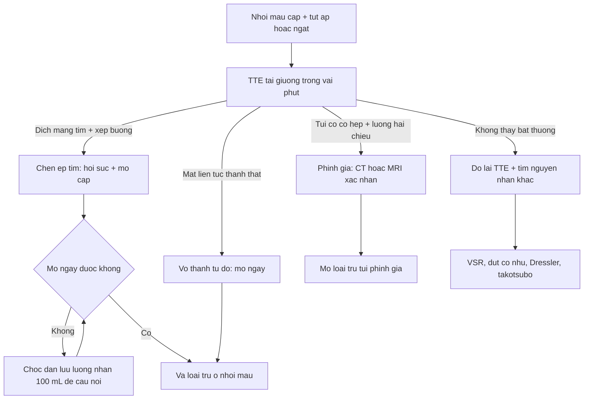
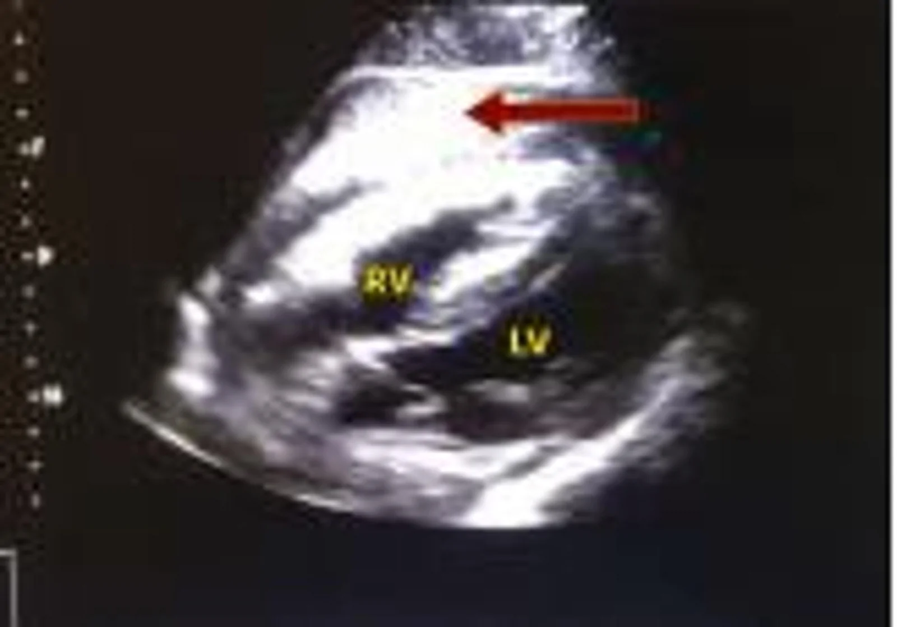

# 1894 — Vỡ thành tự do thất trái sau nhồi máu cơ tim & phình giả thất / Post-infarction left ventricular free-wall rupture and pseudoaneurysm

**Tags:** `pattern:vo-thanh-tu-do` `pattern:gia-phinh-that` `pattern:tran-dich-mang-tim` `pattern:chen-ep-tim` `vung:tim` `vung:cotim` `protocol:sieutham-khan` `protocol:CTA-tim` `protocol:MRI-tim` `score:Becker` `score:Killip`

**Mức chắc chắn (certainty):** tổng hợp y văn (literature synthesis) — ghép 4 chuỗi dữ liệu: (a) **504 ca phình giả thất trái (LVPA)** sau nhồi máu, meta-phân tích gộp dữ liệu từng ca (**Afshar EJ et al., *Cardiol Res Pract* 2026, PMC13479120, CC BY 4.0**); (b) **71 ca vỡ tim** (39 vỡ thành tự do), nghiên cứu bệnh–chứng (**Zhang D et al., *Front Cardiovasc Med* 2026, PMC13290571, CC BY 4.0**); (c) ca vỡ thành tự do được chọc dẫn lưu màng tim cầm cứu (**Norouzzadeh M et al., *BMC Cardiovasc Disord* 2026, PMC13651237, CC BY-NC-ND 4.0**); (d) ca phình giả "im lặng" có siêu âm + CT (**Hsain A et al., *Cureus* 2026, PMC13252991, CC BY 4.0**). Số nào nguồn không đưa thì ghi "chưa rõ".

> **Bài này trả lời 4 câu hỏi của ca "tụt áp sau nhồi máu, không có thổi":**
> (1) **Vỡ thành tự do khác thủng vách ở điểm nào trên siêu âm — và vì sao "không có thổi" lại là dấu hiệu nặng hơn?** (2) **Dịch màng tim bao nhiêu thì gọi là chèn ép, và có được chọc dẫn lưu không?** (3) **Phình giả và phình thật khác nhau ở cổ túi — ngưỡng nào thì phải mổ?** (4) **Siêu âm bỏ sót 18,6% phình giả, vậy bước tiếp theo là CT hay MRI?**
> Đây là mặt **vỡ thành tự do** của biến chứng cơ học sau nhồi máu; mặt **vách** ở [1884 – Thủng vách liên thất](../1884-thung-vach-lien-that-sau-nhoi-mau-co-tim/lesson.md), mặt **màng ngoài tim** ở [075 – Tràn dịch màng tim](../075-tran-dich-mang-tim/lesson.md).

## 1. Tổng quan bệnh học – cơ chế hình ảnh

### 1.1 Vì sao thành tự do rách, và vì sao đúng ngày 3–7

- Nhồi máu **xuyên thành** → hoại tử đông (coagulative necrosis) → **bạch cầu trung tính** đổ vào ngày 1–3, tiêu hủy collagen → **mô nhũn nhất ngày 3–7**; áp lực trong thất trái **100–140 mmHg** tiếp tục đè lên vùng mất khả năng chịu lực. Vỡ thành tự do (free-wall rupture, **FWR**) là kiểu vỡ **không có lỗ thông trong tim** — máu đi thẳng vào **khoang màng tim**.
- **Tần suất:** khoảng **4%** nhồi máu cấp (số liệu cũ, trước can thiệp) và **0,2%** hội chứng vành cấp hiện đại — PMC13651237. Tỉ lệ thật **bị đánh giá thấp** vì nhiều ca tử vong trước khi kịp chẩn đoán.
- **Cửa sổ thời gian (71 ca, PMC13290571):** trung vị từ khởi phát nhồi máu đến vỡ **4,0 ngày (IQR 2,5–7,0)**; **39,4%** vỡ sớm **≤ 3 ngày**, **60,6%** vỡ muộn **> 3 ngày**. Vỡ sớm đi với **hoạt hóa viêm mạnh + troponin vào viện cao**; vỡ muộn đi với **albumin thấp + đến viện rất muộn** — hai kiểu sinh lý khác nhau, cùng một biến cố.
- **Yếu tố nguy cơ độc lập (OR, PMC13290571):** **không can thiệp mạch vành cấp cứu OR 8,23** (KTC 95% 3,45–19,66); **Killip III–IV OR 6,82**; **nữ OR 3,41**; **albumin giảm OR 0,84 mỗi g/L**. Tuổi trung bình nhóm vỡ **69,6 ± 8,5** so với **59,5 ± 11,7** ở nhóm chứng.
- **Tiên lượng:** trong 39 ca FWR, **tử vong nội viện 97,4%** so với **57,1%** ở thủng vách (p < 0,001); thời gian nằm viện trung vị **3 ngày** so với **7 ngày** — nghĩa là bệnh diễn tiến **nhanh hơn nhiều** thủng vách. Phẫu thuật là yếu tố duy nhất gắn với sống còn trong mô hình đa biến (**OR 0,06**, KTC 95% 0,01–0,36).

### 1.2 Hai hình thái — và TẠI SAO chúng khác nhau trên hình ảnh

| Hình thái | Cơ chế | Hình ảnh | Diễn tiến |
|---|---|---|---|
| **Vỡ tự do cấp ("blow-out", Becker I)** | Rách toàn thành, máu ồ ạt vào màng tim | **Dịch màng tim tăng nhanh + chèn ép**, thành thất **mất liên tục** thấy được nếu may mắn bắt đúng mặt cắt | Tử vong trong **phút–giờ** nếu không mổ |
| **Rỉ máu / vỡ kín (Becker II)** | Rách nhỏ, máu rỉ, dính màng tim bịt lại | **Dịch màng tim lượng vừa + cục máu**, không thấy lỗ rõ | Có thể sống vài ngày — **cửa sổ để mổ** |
| **Phình giả (Becker III / contained rupture)** | Màng tim + huyết khối **giữ** lỗ rách, tạo túi | **Túi thông với thất qua CỔ HẸP**, thành túi **không có cơ tim** | Nguy cơ vỡ túi muộn, loạn nhịp, chèn ép |

- **TẠI SAO phình giả có "cổ" còn phình thật thì không:** phình thật (true aneurysm) là **thành thất đã xơ mỏng nhưng còn đủ 3 lớp**, miệng rộng gần bằng túi → dòng chảy **không tăng tốc**; phình giả là **lỗ rách được màng tim bịt**, miệng hẹp → dòng qua cổ **tăng tốc**, tạo **luồng hai chiều** (vào thì tâm thu, ra thì tâm trương) trên Doppler màu. Đây là lý do **Doppler màu nhạy hơn 2D** trong ca phình giả.
- **TẠI SAO MRI thấy rõ "không có cơ tim":** cơ tim hoại tử/xơ bắt thuốc gadolinium (LGE), còn **thành túi phình giả chỉ là màng tim + huyết khối** → **LGE màng tim** thay vì LGE cơ tim. Trong 504 ca, **LGE màng tim gặp 84% (21/25)** ca phình giả và **0/5** ca phình thật — PMC13479120.
- **TẠI SAO CT thấy máu màng tim:** máu cấp đông **35–70 HU** trên CT không cản quang, cao hơn dịch trong (0–20 HU); cục máu "sentinel clot" cạnh chỗ rách là dấu định vị.

## 2. Mẫu hình + chẩn đoán phân biệt theo vị trí và thời điểm (Gamut)

- **Theo vị trí túi/vị trí rách:** **thành sau – dưới – bên** là nơi hay gặp nhất của phình giả (siêu âm: **sau 34,5%**, **dưới 21,2%**; MRI: **dưới 50,6%**) — vì vậy **nhồi máu dưới/thành sau (RCA, LCx)** là bối cảnh điển hình, khác phình thật thường ở **đỉnh – trước (LAD)**. Vỡ thành tự do cấp thường ở **thành bên/dưới**; vỡ vách (bài 1884) thường ở **vách đỉnh** sau nhồi máu trước.
- **Theo thời điểm:** **cấp < 7 ngày** (đa số, 54,5% phình giả được chẩn đoán trong giai đoạn cấp/bán cấp); **bán cấp 1–8 tuần**; **mạn > 8 tuần** — khoảng cách từ nhồi máu đến chẩn đoán phình giả trong y văn **1 ngày đến 20 năm** (PMC13479120).
- **Gamut "dịch màng tim + tụt áp sau nhồi máu"** — gợi nhớ **TAMPON**:
  - **T**ear of free wall (vỡ thành tự do) — **không thổi**, cổ trướng tĩnh mạch, tim đập yếu.
  - **A**cute MR (đứt cơ nhú) — **thổi phụt tâm thu** ra nách, phù phổi.
  - **M**yocardial rupture of septum (VSR, bài 1884) — **thổi tâm thu thô** + rung miu.
  - **P**ericarditis/Dressler — sốt, đau màng tim, dịch ít, **không tụt áp**.
  - **O**ther: nhồi máu thất phải, takotsubo, sốc nhiễm khuẩn.
  - **N**eed to look again — siêu âm lần 2 nếu lâm sàng xấu mà lần 1 "bình thường" (độ nhạy chỉ 81,4%).
- **Gamut "túi cạnh thất trên CT/MRI":** phình giả sau nhồi máu · phình thật · **túi giả sau phẫu thuật van/miếng vá** · **áp-xe vành tim** · nang màng tim · **u cơ tim** (hiếm). Bối cảnh nhồi máu + cổ hẹp quyết định.

## 3. Bảng so sánh phân biệt (ma trận đối chiếu)

| Thực thể (entity) | Hình ảnh điển hình | Chốt vào (rule-in) | Chốt loại (rule-out) | Gợi ý xác nhận |
|---|---|---|---|---|
| **Vỡ thành tự do cấp** | **Dịch màng tim tăng nhanh**, cục máu, **mất liên tục thành thất**, thất phải xẹp thì tâm trương | **Dịch + chèn ép + mất liên tục thành ở ≥ 2 mặt cắt** | Thành liên tục mọi mặt cắt + không dịch → không phải vỡ | TTE dưới sườn ngay; không trì hoãn vì CT |
| **Phình giả thất trái** | **Túi thông với thất qua cổ hẹp**, cổ/túi **< 0,4–0,5**, Doppler **hai chiều qua cổ**, thành túi không cơ tim | **Cổ hẹp + luồng hai chiều + LGE màng tim** | Cổ rộng gần bằng túi + thành còn cơ/xơ → phình thật | TTE + Doppler màu; CT/MRI xác nhận; MRI đo LGE |
| **Phình thật thất trái** | Miệng rộng, thành mỏng **còn 3 lớp**, **không tăng tốc dòng**, thường **đỉnh–trước** | **Cổ rộng + không luồng hai chiều + không LGE màng tim** | Cổ hẹp + luồng hai chiều → phình giả | MRI LGE (phân biệt bằng mô) |
| **Đứt cơ nhú / hở hai lá cấp** | Dây/lá van lật vào nhĩ trái, **jet hở hai lá ra nách** | **Jet hở hai lá mới + cấu trúc van đứt** | Jet xuyên thành thất → không phải MR đơn thuần | TTE + TEE |
| **Thủng vách liên thất** (bài 1884) | **Jet LV→RV xuyên vách**, Qp/Qs ≥ 1,5 | **Jet xuyên vách có hướng** | Vách liên tục + không jet → loại | TTE màu; TEE nếu vách nền |
| **Viêm màng ngoài tim sau nhồi máu (Dressler)** | Dịch màng tim **ít–vừa**, dày màng tim, **không mất liên tục thành** | **Dịch + dày màng tim đối xứng + sốt/CRP** | Có mất liên tục thành hoặc chèn ép nặng → loại Dressler đơn thuần | TTE; CRP; đáp ứng NSAID/colchicine |
| **Nhồi máu thất phải / takotsubo** | RV giãn hoặc bóng đỉnh **vượt lãnh thổ vành**, **không dịch đáng kể** | **Rối loạn vận động không có lỗ/luồng bất thường** | Có lỗ thành + dịch → loại | TTE; ECG V4R; MRI nếu còn nghi |

*Sơ đồ: **trái** — phình thật, thành xơ mỏng nhưng còn đủ lớp, miệng rộng; **phải** — phình giả, lỗ rách xuyên thành được **màng tim** bịt lại, túi chứa huyết khối, **cổ hẹp**. Nguồn: Cardiol Res Pract 2026, PMC13479120, CC BY 4.0.*

*(A) 2D — khuyết thành thất thông với túi (PSA); (B–D) Doppler màu — **luồng hai chiều qua cổ hẹp**, xác nhận phình giả chứ không phải phình thật. Nguồn: Cureus 2026, PMC13252991, CC BY 4.0.*

## 4. Protocol chụp + phân độ + ngưỡng can thiệp

### 4.1 Trình tự tại giường

1. **TTE trong vài phút** khi tụt áp, ngất, tim đập yếu sau nhồi máu: mặt cắt **dưới sườn** (dịch + xẹp buồng), **4 buồng từ mỏm**, **cạnh ức trục dài** quét toàn bộ thành tự do. Ghi: **độ dày dịch (mm)**, có/không **xẹp buồng**, có/không **đảo vận động vách**, vị trí mất liên tục.
2. **Doppler màu** Nyquist **50–70 cm/s** phủ thành — tìm **luồng hai chiều qua cổ** hoặc jet bất thường. **CW** đo vận tốc nếu có luồng.
3. **CT tim có cản quang, đồng bộ điện tim** khi siêu âm không kết luận hoặc trước can thiệp: tìm **mất liên tục thành**, **túi + cổ**, **máu màng tim 35–70 HU**, **tràn máu màng phổi kèm**. Không để CT làm chậm mổ ở bệnh nhân chèn ép.
4. **MRI tim** khi bệnh nhân ổn định và cần phân biệt **phình giả / phình thật / u**: SSFP + **LGE** (LGE màng tim = phình giả; LGE cơ tim xuyên thành = vùng nhồi máu).
5. **Killip** + lactat + creatinin: các biến tiên lượng của biến chứng cơ học; **không chờ xét nghiệm để chọc dẫn lưu khi đã chèn ép**.

### 4.2 Ngưỡng hành động (ghi vào phiếu)

- **Dịch màng tim + tụt áp + xẹp buồng** = chèn ép → **mổ cấp cứu**; **chọc dẫn lưu chỉ để cầm cứu**, lấy **lượng hạn chế** (ca thật: **100 mL** đủ hồi phục huyết áp — PMC13651237) vì tháo quá nhiều làm **mất hiệu ứng bịt** của khoang màng tim và **tăng chảy máu**.
- **Vỡ thành tự do xác định** → **mổ ngay** (vá loại trừ ổ nhồi máu bằng miếng vá / keo sinh học), không có "theo dõi nội khoa" cho thể cấp.
- **Phình giả:** chỉ định mổ gần như tuyệt đối vì nguy cơ vỡ túi — **95%** ca phình giả trong 504 ca được mổ, so với **73%** ca phình thật (PMC13479120). Với túi **nhỏ, cổ rất hẹp, bệnh nhân không mổ được**: theo dõi sát bằng hình ảnh, nhưng phải nói rõ đây là **quyết định cá thể hóa**, chưa có thử nghiệm.
- **Phình thật** không có chỉ định mổ chỉ vì "có túi"; mổ khi **đau ngực do túi, huyết khối, suy tim, loạn nhịp** hoặc kèm bệnh mạch vành cần tái thông.

### 4.3 Phân độ kinh điển (Becker) — dùng để mô tả, không để thay quyết định

- **Becker I — blow-out:** rách to, máu ồ ạt, chèn ép tức thì.
- **Becker II — rỉ máu:** lỗ nhỏ, máu rỉ, dính màng tim.
- **Becker III — kín (contained)/phình giả:** màng tim + huyết khối bịt lỗ, tạo túi.
- Phân độ này **không thay đổi chỉ định mổ** (cả ba đều là chỉ định ở bệnh nhân mổ được) nhưng giúp **dự báo tốc độ**: I tử vong trong giờ, III có thể sống nhiều tuần.

## 5. Biến thể bình thường và cạm bẫy

- **Biến thể bình thường dễ nhầm:** **dịch màng tim sinh lý ≤ 50 mL** (lớp echo-free < 5 mm sau thất trái) — không chèn ép; **mỡ màng tim** (echo dày, không di động theo tư thế) — không phải máu; **drop-out đỉnh thất** trên mặt cắt 4 buồng — bờ nhẵn, không dịch, không luồng.
- **Cạm bẫy 1 — "không có thổi thì loại vỡ tim":** vỡ thành tự do **không tạo thổi** (không có dòng chảy qua lỗ vào buồng khác). Trong khi đó thủng vách và đứt cơ nhú **có thổi**. Vắng thổi ở bệnh nhân tụt áp sau nhồi máu là **dấu hiệu nặng hơn**, không phải dấu hiệu loại trừ.
- **Cạm bẫy 2 — tin một lần siêu âm:** độ nhạy của siêu âm cho phình giả chỉ **81,4%** (so với **97,5%** cho phình thật) — PMC13479120. Lâm sàng xấu + siêu âm âm → **chụp lại / CT**.
- **Cạm bẫy 3 — phình giả "im lặng":** ca PMC13252991 phát hiện **tình cờ** khi theo dõi, bệnh nhân **không đau, không suy tim**; túi vẫn có thể vỡ. Không được để triệu chứng quyết định.
- **Cạm bẫy 4 — đọc "phình" mà bỏ sót cổ:** đo **đường kính cổ/đường kính túi** ở mặt cắt có cổ rõ nhất; cổ càng hẹp nguy cơ vỡ càng cao. Nếu không thấy cổ trên một mặt cắt → **đổi mặt cắt trước khi kết luận phình thật**.
- **Cạm bẫy 5 — chọc dẫn lưu "cho nhẹ":** khoang màng tim đang bịt lỗ rách; tháo ồ ạt làm **bùng phát chảy máu**. Chỉ lấy lượng nhỏ, trong lúc chờ mổ.
- **Cạm bẫy 6 — bỏ sót tổn thương thứ hai:** vỡ thành và thủng vách **có thể cùng tồn tại** (ca "dual rupture", Radiol Case Rep 2026, PMC13400359: thủng vách + vỡ thành thất phải). Luôn khảo sát **toàn bộ vách và toàn bộ thành tự do** trước khi kết thúc siêu âm.
- **Cạm bẫy 7 — quy kết dịch màng tim cho Dressler:** Dressler xuất hiện **1–8 tuần**, dịch ít–vừa, **không mất liên tục thành**, đáp ứng kháng viêm; bệnh nhân tụt áp **trong tuần đầu** với dịch tăng nhanh phải nghĩ **vỡ**.

## 6. Tự lượng giá — Blind Quiz

**Ca 1 — Nam 62 tuổi, nhồi máu trước đã PCI; ngày thứ 2 tụt áp, tim đập yếu, không thổi. Nhìn siêu âm dưới sườn.**

- Gợi ý lâm sàng: huyết áp tụt dần, tĩnh mạch cổ nổi, không có thổi mới.
- Câu hỏi: (1) Mô tả khoang màng tim và hệ quả huyết động? (2) Vì sao **không** được chọc tháo hết dịch? (3) Bước tiếp theo trong 30 phút tới?

<b>Bấm để hiện đáp án (findings + chẩn đoán)</b>

- **Findings:** khoang màng tim **echo dày, lượng lớn** (máu đông) — mũi tên đỏ; hình ảnh **chèn ép tim** trên lâm sàng (tụt áp, tĩnh mạch cổ nổi).
- **Chẩn đoán:** **vỡ thành tự do thất trái** sau nhồi máu, biến chứng chèn ép tim. Mổ xác nhận **lỗ rách 6 mm** ở thành tự do.
- **Vì sao không tháo hết:** khoang màng tim đang **tamponade sinh lý (bịt lỗ)**; tháo ồ ạt làm mất áp lực đè → **chảy máu bùng phát**. Ca gốc chỉ lấy **100 mL** và huyết áp hồi phục, đủ để chuyển mổ.
- **30 phút tới:** hồi sức + **mổ cấp cứu** (vá loại trừ ổ nhồi máu); nếu chưa mổ được → chọc dẫn lưu **lượng hạn chế** làm cầu nối.
- **Nguồn:** BMC Cardiovasc Disord 2026, PMC13651237, CC BY-NC-ND 4.0 (ảnh nguyên bản, không chỉnh sửa).

**Ca 2 — Nam 65 tuổi, nhồi máu dưới 3 tuần trước, hiện không đau; siêu âm thấy túi cạnh thất trái. Nhìn 2D rồi bật màu.**

- Gợi ý lâm sàng: "im lặng", phát hiện khi theo dõi; không sốt.
- Câu hỏi: (1) Dấu hiệu nào phân biệt túi này với phình thật? (2) Vì sao phải mổ dù bệnh nhân không triệu chứng? (3) Nếu siêu âm không thấy cổ rõ, bước tiếp theo?

<b>Bấm để hiện đáp án (findings + chẩn đoán)</b>

- **Findings:** khuyết thành thất thông với túi; Doppler màu **luồng hai chiều qua cổ hẹp** — dấu hiệu của **phình giả**.
- **Chẩn đoán:** **phình giả thất trái sau nhồi máu** (thể kín của vỡ thành tự do). Thành túi **không có cơ tim** → nguy cơ vỡ túi; **95%** ca phình giả trong 504 ca được mổ.
- **Vì sao mổ khi không triệu chứng:** nguy cơ **vỡ túi, chèn ép, loạn nhịp** không phụ thuộc triệu chứng; ca gốc được mổ và hồi phục tốt.
- **Nếu không thấy cổ:** **CT tim đồng bộ điện tim** hoặc **MRI tim LGE** — LGE **màng tim** (84% ca phình giả) chốt chẩn đoán.
- **Nguồn:** Cureus 2026, PMC13252991, CC BY 4.0.

**Ca 3 — Câu hỏi hình ảnh thuần: nhìn sơ đồ, chọn bên nào là phình giả và nêu 2 tiêu chí.**

- Câu hỏi: (1) Bên nào là phình giả? (2) Hai tiêu chí hình ảnh chốt? (3) Tiêu chí nào trên MRI khẳng định?

<b>Bấm để hiện đáp án (findings + chẩn đoán)</b>

- **Bên phải** là **phình giả**: lỗ rách **xuyên thành**, thành túi là **màng tim**, trong túi có **huyết khối**, **cổ hẹp**.
- **Hai tiêu chí:** (1) **cổ hẹp** (cổ/túi thường **< 0,4–0,5**; ngưỡng quy ước hình ảnh, chưa có thử nghiệm tiền cứu); (2) **thành túi không có cơ tim**.
- **MRI:** **LGE màng tim** (84% ca phình giả, 0% ca phình thật) — vì màng tim xơ bắt thuốc, còn cơ tim lành không bắt.
- **Nguồn:** Cardiol Res Pract 2026, PMC13479120, CC BY 4.0.

## Bài liên quan chéo
- [800 – Tổng quan Tim mạch](../800-cardiovascular-overview/lesson.md)
- [075 – Tràn dịch màng tim và chèn ép tim](../075-tran-dich-mang-tim/lesson.md)
- [1884 – Thủng vách liên thất sau nhồi máu cấp](../1884-thung-vach-lien-that-sau-nhoi-mau-co-tim/lesson.md) (mặt vách của cùng biến chứng cơ học)
- [1885 – Viêm màng ngoài tim co thắt](../1885-viem-mang-ngoai-tim-co-that/lesson.md)
- [1886 – Bệnh cơ tim hạn chế do amyloid](../1886-benh-co-tim-han-che-amyloid-tim/lesson.md)
- [820 – MRI tim LGE và mapping](../820-cardiac-mri-lge-mapping/lesson.md) (phân biệt cơ tim – màng tim bằng LGE)

## Ảnh
- `images/1894_phinh-gia_Sodo_PMC13479120.jpg` — sơ đồ phình thật vs phình giả — *Cardiol Res Pract* 2026, PMC13479120, **CC BY 4.0**.
- `images/1894_phinh-gia_TTE-PLAX_PMC13252991.jpg` — TTE cạnh ức trục dài, 2D + Doppler màu — *Cureus* 2026, PMC13252991, **CC BY 4.0**.
- `images/1894_phinh-gia_CT_PMC13252991.jpg` — CT tim có cản quang, phình giả thành sau–bên — *Cureus* 2026, PMC13252991, **CC BY 4.0**.
- `images/1894_vo-thanh-tu-do_TTE_PMC13651237.jpg` — TTE, dịch màng tim chèn ép — *BMC Cardiovasc Disord* 2026, PMC13651237, **CC BY-NC-ND 4.0** (nguyên bản).
- Chi tiết nguồn + giấy phép: `images/CREDITS.md`.

> Không dùng để chẩn đoán độc lập khi chưa có người hướng dẫn.
