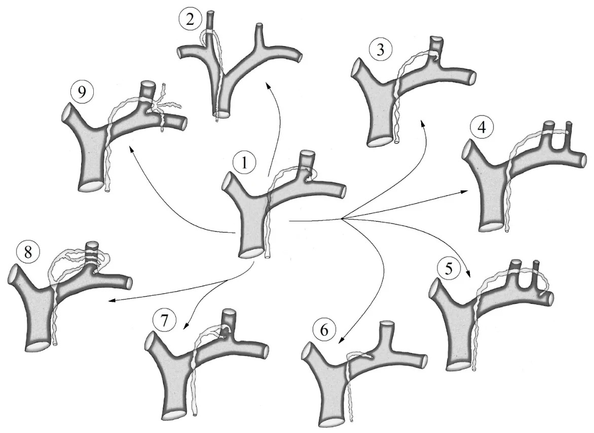
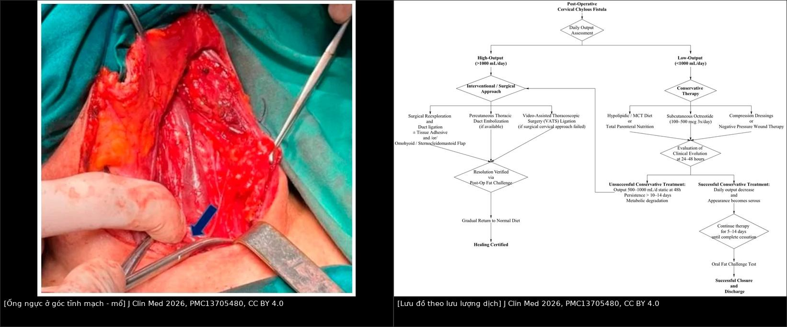
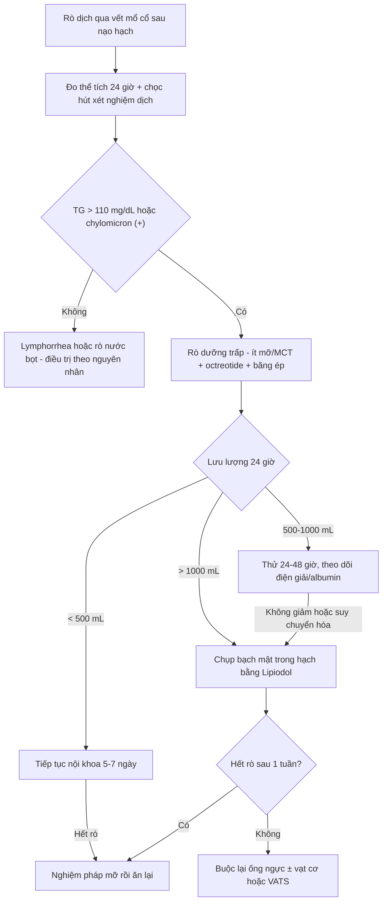
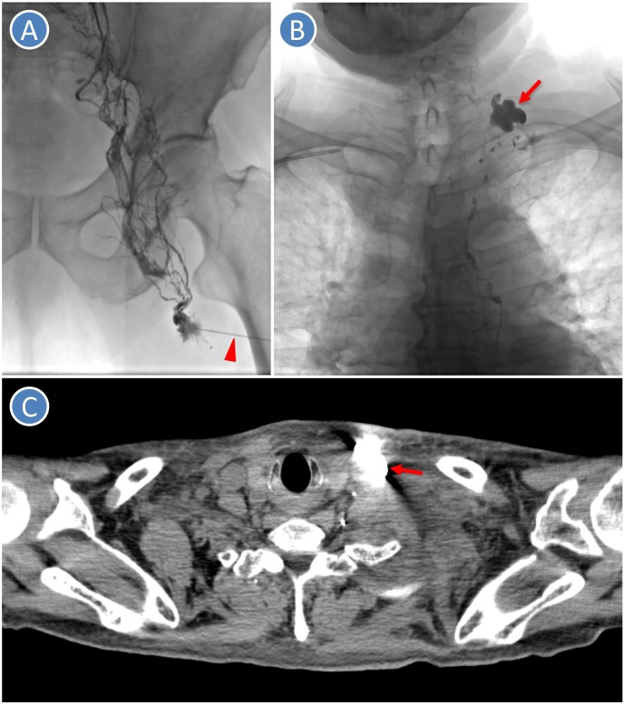

# 1896 — Rò dưỡng trấp CỔ sau nạo hạch cổ / Cervical chylous fistula

**Tags:** `pattern:ro-duong-trap` `pattern:ro-bach-huyet` `pattern:dich-co-tu` `vung:co-canh` `vung:hach-co` `protocol:CT-co` `protocol:chup-bach-huyet` `score:TG-dich`

**Mức chắc chắn (certainty):** tổng hợp y văn (literature synthesis) — biên từ **tổng quan có hệ thống hóa về rò dưỡng trấp cổ sau nạo hạch vì ung thư tuyến giáp** (*J Clin Med* 2026, **PMC13705480**, CC BY 4.0) và **ca rò dưỡng trấp cổ sau nạo hạch điều trị bằng chụp bạch mật Lipiodol trong hạch** (*J Dent Sci* 2024, **PMC11010700**, CC BY-NC-ND). Nhóm **không có bệnh nhân của mình**.

> **Câu chốt:** rò dưỡng trấp cổ gần như **chỉ xảy ra ở hạch nhóm IV dưới bên TRÁI** (góc tĩnh mạch cảnh trong – dưới đòn), nơi **ống ngực tận** vòng qua **3–4 cm trên xương đòn**; **phần lớn ca là lưu lượng thấp và đáp ứng nội khoa** (ít mỡ/MCT đơn thuần **~50–70%**, phối hợp **octreotide > 80%**), nhưng **ngưỡng quyết định là mL/ngày**: **< 500 → nội khoa**, **500–1.000 → thử 24–48 giờ**, **> 1.000 mL/ngày kéo dài 3 ngày → can thiệp** (buộc lại, nút mạch, hoặc VATS). Chốt bản chất dịch **không phải màu sữa** mà là **triglyceride dịch > 100–110 mg/dL + có chylomicron**.

## 1. Tổng quan bệnh học – cơ chế hình ảnh (TẠI SAO)

### 1.1 Giải phẫu: vì sao nhóm IV trái là "vùng nguy hiểm số một"

- **Ống ngực (thoracic duct)** đi lên bên phải cột sống, **bắt chéo sang trái ở ngực giữa**, đi sau **thực quản và động mạch cảnh trái**, rồi **vòng qua (arch) 3–4 cm trên xương đòn** và đổ vào **góc hợp lưu tĩnh mạch cảnh trong – tĩnh mạch dưới đòn trái**. Đoạn tận có **van một lá và hai lá** chống trào ngược (**PMC13705480**).
- **Nhóm hạch IV** (từ **xương móng đến bờ trên cán mũi ức**) nằm **đúng trên đoạn vòng này**; mỡ nhóm IV dính vào bao cảnh và **không có mô đệm** che ống ngực → phẫu tích bằng **dao điện/máy hàn** dễ **cắt hoặc đốt thủng** ống ngực mà **không thấy chảy máu**.
- **Bên phải cũng có thể rò** nhưng qua **ống bạch huyết phải (right lymphatic duct)** — ống nhỏ, **ít gặp hơn nhiều**. Số liệu: **nạo hạch bên 0,5–8%**, **nạo hạch trung tâm < 0,5%**, **nhóm IV dưới bên trái 2–8%**, **bên phải 0,5–2%** (**PMC13705480**).
- **Biến thể đoạn tận là quy luật:** ngoài kiểu điển hình (đổ vào góc cảnh–dưới đòn trái), ống ngực có thể đổ vào **TM cảnh trong**, **TM cảnh ngoài**, **TM dưới đòn**, **thân cánh tay đầu phải**, hoặc **chia 2–3 nhánh đổ riêng**; còn có **ba thân bạch huyết tận** (thân cảnh, thân dưới đòn, thân trung thất–phế quản). Vì vậy **buộc "một ống" có thể bỏ sót nhánh thứ hai** (**PMC13705480**, Fig. 4).

### 1.2 Phân biệt bằng tên gọi — sai tên là sai điều trị

- **Rò dưỡng trấp (chylous fistula / chyle leak):** dịch **giàu lipid, trắng sữa hoặc óng ánh**, từ tổn thương **ống ngực, ống bạch huyết phải hoặc nhánh tận lớn**.
- **Rò bạch huyết thường (lymphatic fistula / lymphorrhea):** dịch **trong, ít lipid**, từ **vi mạch bạch huyết nhỏ** bị cắt; nếu ứ lại thành ổ gọi là **lymphocele**.
- Hệ quả: **lymphorrhea thường tự hết và không cần octreotide liều cao**, còn **chyle leak thật** mới gây **mất lympho bào, giảm albumin, hạ natri–clo–calci** và **hoại tử vạt da cổ** do phản ứng viêm của dưỡng trấp (**PMC13705480**).

### 1.3 Vật lý – sinh hóa: TẠI SAO màu sữa không đủ và TẠI SAO cần triglyceride

- **Màu sữa** do **tán xạ ánh sáng của hạt chylomicron** (đường kính µm) — chỉ có khi bệnh nhân **đang ăn mỡ**. Bệnh nhân **nhịn ăn, nuôi tĩnh mạch, hoặc ăn ít mỡ** → **dịch trong, vàng** dù vẫn rò ống ngực. Vì thế **màu sắc có độ nhạy thấp**, không dùng để loại trừ.
- **Ngưỡng:** **triglyceride dịch > 100–110 mg/dL** (hoặc **cao hơn TG huyết thanh**) → rò dưỡng trấp; **< 50 mg/dL** và dịch trong → **lymphorrhea**; **tiêu chuẩn vàng** là **điện di lipoprotein thấy chylomicron** (dương tính = chốt) (**PMC13705480**).
- **Nghiệm pháp mỡ (oral fat test):** cho bệnh nhân **kem/sữa béo/dầu** → rò dưỡng trấp thật **tăng mạnh thể tích và độ đục trong vài giờ**, còn lymphorrhea **không đổi**. Đây cũng là **nghiệm pháp xác nhận đã lành** trước khi cho ăn lại bình thường.
- **Trên hình ảnh:** dịch dưỡng trấp có **đậm độ gần nước (0–20 HU)**, **không ngấm thuốc**, **trùng** với seroma/lymphocele/máu tụ cũ → **CT và siêu âm chỉ trả lời "có ổ dịch ở đâu, có chèn ép mạch/khí quản không", không trả lời "dịch gì"**. Chỉ **chụp bạch mật (Lipiodol)** mới thấy **đường đi và điểm thoát**, vì **iod trong Lipiodol hấp thụ tia X mạnh** (cản quang cao) và **dầu giữ lại tại chỗ rò**.
- **Vì sao Lipiodol có thể chữa:** dầu ứ tại điểm rò gây **phản ứng viêm xơ tại chỗ** + **độ nhớt cao** → **bịt lỗ rò**; hiệu quả thấy sau **~1 tuần** (**PMC11010700**).

### 1.4 Số phải nhớ

- **Tần suất:** **0,5–8%** sau nạo hạch cổ bên trong mổ tuyến giáp; **2–8%** ở nhóm IV dưới trái; **< 0,5%** nạo hạch trung tâm (**PMC13705480**).
- **Phân độ theo lưu lượng:** **thấp < 500 mL/ngày**, **cao 500–1.000 mL/ngày**, **rất cao > 1.000 mL/ngày** (theo Delaney); cách chia khác: **< 300 / 300–600 / > 600 mL/ngày** (Leović) (**PMC13705480**).
- **Hiệu quả điều trị:** **ít mỡ/MCT đơn thuần ~50–70%**; **octreotide phối hợp > 80%**, tác dụng **giảm lưu lượng trong 24–48 giờ**, liều **100–500 µg dưới da × 3 lần/ngày** (**PMC13705480**).
- **Tiêu chuẩn thất bại nội khoa:** lưu lượng **> 1.000 mL/ngày kéo dài > 3 ngày** dù đã nhịn ăn/điều trị tối ưu; hoặc **không có xu hướng giảm / còn rò > 10–14 ngày**; hoặc **500–1.000 mL/ngày kèm suy chuyển hóa** → **can thiệp** (**PMC13705480**).
- **Ca minh họa (nam 73 tuổi, nạo hạch cổ trái):** **ngày 3** ra dịch **trong, amylase cao** → tưởng **rò tuyến mang tai**, mổ lại sau 2 tuần; **1 tuần sau mổ lại** dịch ra nhiều, **TG cao** → đúng là **rò dưỡng trấp**; TPN + băng ép + octreotide **thất bại**; **chụp bạch mật Lipiodol trong hạch bẹn** → thấy **điểm rò vùng cổ trên trái**, **hết rò sau 1 tuần** (**PMC11010700**).

## 2. Mẫu hình + chẩn đoán phân biệt theo vị trí (Gamut)

- **A — Dịch trắng sữa/óng ánh ra từ dẫn lưu hoặc vết mổ cổ bên TRÁI, ngày 1–3:** gamut hẹp, **nghĩ rò dưỡng trấp trước tiên**; sau đó **lymphorrhea**, **rò tuyến dưới hàm/tuyến mang tai (amylase cao)**, **seroma**, **tụ máu**, **áp-xe sớm**, **rò dịch não tủy (nếu mổ có vào ống sống — hiếm ở cổ)**.
- **B — Dịch trong, lượng nhiều, "không mùi", amylase cao:** đừng vội kết luận rò nước bọt — **dưỡng trấp cũng chứa amylase và điện giải**; trong ca minh họa, chẩn đoán **trễ 3 tuần** vì lý do này (**PMC11010700**).
- **C — Ổ dịch khu trú vùng cổ bên (không rò ra ngoài):** lymphocele, tụ máu, áp-xe, **di trú dưỡng trấp dưới cân**; CT thấy **ổ dịch đậm độ dịch**, có thể **đè tĩnh mạch cảnh trong** gây **phù mặt–cổ** hoặc **chèn khí quản**.
- **D — Rò lượng lớn kèm khó thở:** nghĩ **tràn dưỡng trấp màng phổi (chylothorax)** do tổn thương **vòm màng phổi**, hoặc **chèn ép khí quản do ổ dịch cổ** — bắt buộc **X-quang/CT ngực** và đánh giá đường thở.

## 3. Bảng so sánh phân biệt (ma trận đối chiếu)

| Thực thể (entity) | Hình ảnh / dịch điển hình | Chốt vào (rule-in) | Chốt loại (rule-out) | Gợi ý xác nhận |
|---|---|---|---|---|
| **Rò dưỡng trấp cổ (chyle leak)** | Dịch **trắng sữa/óng ánh**, **0–20 HU** trên CT; ổ dịch ở **nhóm IV trái**; đầy nhanh sau bữa ăn | **TG dịch > 100–110 mg/dL** hoặc **> TG huyết thanh**, **chylomicron (+)** trên điện di; **tăng mạnh khi cho ăn mỡ** | TG < 50 mg/dL, dịch trong, không đổi khi ăn mỡ → **lymphorrhea**; amylase rất cao đơn thuần → rò nước bọt | TG + cholesterol + protein + điện giải + tế bào + **điện di lipoprotein**; nghiệm pháp mỡ |
| **Rò bạch huyết thường (lymphorrhea)** | Dịch **trong, vàng nhạt**, lượng **< 100–150 mL/ngày**, giảm dần | **TG thấp (< 50 mg/dL)**, không có chylomicron, **giảm dần trong vài ngày** | Tăng khi ăn mỡ, TG > 110 → dưỡng trấp | TG + nghiệm pháp mỡ; theo dõi thể tích |
| **Rò tuyến nước bọt (tuyến mang tai/dưới hàm)** | Dịch **trong, dính**, chảy nhiều **khi ăn/nghĩ đến thức ăn** | **Amylase dịch rất cao** (hàng nghìn U/L), **TG thấp** | TG > 110 mg/dL + chylomicron → dưỡng trấp | Amylase + TG dịch; không đáp ứng băng ép thì chụp tuyến |
| **Lymphocele / seroma** | Ổ dịch **khu trú**, không rò ra ngoài, **0–20 HU**, vỏ mỏng | Dịch **trong**, TG thấp, **không tăng khi ăn mỡ**, tự giảm | Tăng thể tích nhanh + đục + TG cao → rò dưỡng trấp | Siêu âm + chọc hút; theo dõi 1–2 tuần |
| **Tụ máu / máu tụ cổ** | **35–70 HU**, tăng đậm độ, có thể **đè khí quản** | Hct dịch ≈ Hct máu, đông cục, Hb tụt | Dịch loãng, không đông → không phải máu | Hct dịch; CT không cản quang |
| **Áp-xe cổ** | Ổ dịch **vách dày, ngấm thuốc viền**, **khí trong ổ** | Sốt, **cấy (+)**, bạch cầu tăng, dịch đục mủ | Dịch sữa vô khuẩn, cấy (−) → dưỡng trấp | CT có cản quang + cấy; chọc dưới siêu âm |

Ảnh ghép đối chiếu (trái: ống ngực tận ở **góc tĩnh mạch** trong mổ; phải: **lưu đồ xử lý theo lưu lượng dịch**):

## 4. Protocol chụp + phân độ theo lưu lượng và thuật toán xử trí

### 4.1 Trình tự chẩn đoán – hình ảnh

1. **Đo và ghi thể tích dẫn lưu 24 giờ** mỗi ngày (cộng cả hai bên nếu đặt hai dẫn lưu) — đây là **biến số trung tâm** của mọi quyết định.
2. **Siêu âm cổ tại giường:** xác định **ổ dịch**, **vách**, quan hệ với **tĩnh mạch cảnh trong**, **khí quản**; hướng dẫn chọc hút **lần đầu**.
3. **CT cổ có cản quang, lát ≤ 1 mm:** khi ổ dịch lớn, nghi **chèn ép đường thở/mạch**, hoặc cần phân biệt **áp-xe/tụ máu/lymphocele**; đánh giá **diện tích ổ dịch** theo dõi.
4. **X-quang/CT ngực:** bắt buộc khi **khó thở**, nghi **chylothorax** (tổn thương vòm màng phổi).
5. **Chụp bạch mật trong hạch (intranodal lymphangiography) bằng Lipiodol dưới siêu âm + huỳnh quang:** chỉ định khi **lưu lượng cao** hoặc **nội khoa thất bại**; **vừa định vị vừa điều trị**. Đường vào: **hạch bẹn hai bên, kim 22 G**, bơm chậm; có thể **nút mạch bổ sung (coil/keo NBCA)** hoặc **buộc ống ngực qua nội soi lồng ngực (VATS)** nếu cần.
6. **Không chọc hút lặp nhiều lần ổ dịch sát mạch cảnh** khi chưa loại trừ **giả phình/tổn thương mạch** — kiểm tra mạch máu trên siêu âm Doppler/CTA trước.

### 4.2 Bộ xét nghiệm dịch tối thiểu (lần chọc đầu)

**Triglyceride, cholesterol, protein, albumin, amylase, điện giải (Na, Cl, Ca), đếm tế bào (lympho %), cấy** + **điện di lipoprotein tìm chylomicron**. So sánh **TG dịch với TG huyết thanh cùng lúc**.

### 4.3 Phân độ và ngưỡng xử trí

| Mức | Lưu lượng 24 giờ | Xử trí |
|---|---|---|
| Thấp | **< 500 mL/ngày** | **Ít mỡ/MCT** ± TPN; **octreotide 100 µg ×3/ngày** (tới 500 µg ×3); băng ép/áp lực âm; theo dõi 5–7 ngày |
| Cao | **500–1.000 mL/ngày** | Thử nội khoa **có thời hạn 24–48 giờ**; nếu **suy chuyển hóa** hoặc không giảm → **can thiệp** |
| Rất cao | **> 1.000 mL/ngày** hoặc **> 3 ngày không giảm**, hoặc **rò > 10–14 ngày** | **Buộc lại ống ngực ± keo sinh học ± vạt cơ (omohyoid/ức–đòn–chũm)**, **nút mạch qua da**, hoặc **VATS buộc ống ngực** |

## 5. Biến thể bình thường và cạm bẫy

- **"Dịch trong thì không phải dưỡng trấp":** sai — bệnh nhân **nhịn ăn/nuôi tĩnh mạch** không có chylomicron để tán xạ ánh sáng; **luôn đo TG** trước khi kết luận.
- **"Amylase cao là rò nước bọt":** đây là **bẫy đã làm trễ chẩn đoán 3 tuần** trong ca minh họa, dẫn tới **một cuộc mổ lại không cần thiết**; dưỡng trấp có amylase, nên **phải đo TG song song** (**PMC11010700**).
- **Cạm bẫy "băng ép thật mạnh + hút áp lực cao":** hút mạnh làm **tăng lưu lượng và kéo dài rò** (giảm áp lực mô quanh lỗ rò, ngăn dính); **áp lực âm liên tục chỉ dùng có kiểm soát**, không thay thế chế độ ăn và octreotide.
- **Tưởng nhầm ổ dịch là "hạch còn sót/tái phát"** trên siêu âm theo dõi: ổ dịch **đậm độ dịch, bờ đều, không có hilum** khác hạch; đừng chọc hút sinh thiết mù khi chưa loại trừ **lymphocele** (nguy cơ **rò kéo dài**).
- **Biến thể ống ngực** là lý do **buộc một lần vẫn rò**: kiểm tra lại bằng **chụp bạch mật**, tìm **nhánh thứ hai** hoặc **ba thân tận**; đừng mổ lại "mò" mà không có bản đồ.
- **Biến chứng toàn thân dễ bị bỏ qua:** hạ natri, hạ clo, hạ calci, giảm albumin, **lympho bào giảm** → tăng nhiễm trùng vết mổ và **hoại tử vạt da cổ**; theo dõi điện giải **hằng ngày** ở ca lưu lượng cao.

## 6. Tự lượng giá — Blind Quiz ngay trên trang tĩnh

**Ca 1 — nam 73 tuổi, nạo hạch cổ trái vì di căn lưỡi**

- Gợi ý lâm sàng: **ngày 3** ra dịch **trong, amylase cao** → mổ lại sau 2 tuần; **1 tuần sau mổ lại** rò nhiều, **TG cao**; TPN + băng ép + octreotide **không hiệu quả**.
- Câu hỏi: (1) Ảnh A/B/C cho thấy gì và tại sao chụp từ **hạch bẹn**? (2) Vì sao Lipiodol có thể **chữa** rò? (3) Khi nào nên làm **trước** khi mổ lại?

<b>Bấm để hiện đáp án (findings + chẩn đoán)</b>

- Dấu hiệu: **A** — bơm Lipiodol từ **hạch bẹn trái**, thấy **chuỗi bạch huyết đi lên** và **dừng/ứ** ở vùng cổ dưới trái (mũi tên đỏ nhỏ); **B** — **ứ Lipiodol thành đám** ở **cổ trên trái** = điểm rò; **C** — CT ngang: **khối cản quang cao** ở khoang cổ bên trái (mũi tên đỏ) tương ứng vị trí rò.
- Chẩn đoán: **rò dưỡng trấp cổ sau nạo hạch** (nhóm IV trái, đoạn tận ống ngực) — chẩn đoán **muộn** vì giai đoạn đầu dịch trong + amylase cao bị đọc là **rò tuyến mang tai**.
- Cơ chế chữa: Lipiodol **ứ tại lỗ rò** → **viêm xơ tại chỗ + độ nhớt cao** → bịt rò; trong ca này **hết rò sau 1 tuần**, tránh được mổ lại.
- Nguồn ảnh: *J Dent Sci* 2024, Fig. 1, **PMC11010700**, CC BY-NC-ND 4.0 (nguyên bản).

**Ca 2 — nữ 48 tuổi, ngày 3 sau nạo hạch cổ trái, dẫn lưu 1.200 mL/ngày**

- Gợi ý lâm sàng (ca minh họa dựng theo ngưỡng của nguồn 1 — **không phải ca nguyên văn**): dịch **trắng sữa**, TG dịch **640 mg/dL**, natri **130 mmol/L**, albumin **27 g/L**, không khó thở.
- Câu hỏi: (1) Xếp mức lưu lượng? (2) Vì sao **không** "chờ 2 tuần nội khoa"? (3) Ba lựa chọn can thiệp và tiêu chí chọn?

<b>Bấm để hiện đáp án (findings + chẩn đoán)</b>

- Dấu hiệu: ảnh trái — **ống ngực tận ở góc tĩnh mạch cảnh trong–dưới đòn** (mũi tên xanh) đúng nơi phẫu tích nhóm IV; ảnh phải — lưu đồ: **> 1.000 mL/ngày → can thiệp**, nhánh nội khoa chỉ dành cho **< 1.000 mL/ngày** với **đánh giá lại sau 24–48 giờ**.
- Chẩn đoán: **rò dưỡng trấp lưu lượng rất cao (> 1.000 mL/ngày)** kèm **hạ natri + giảm albumin** = tiêu chuẩn **thất bại nội khoa sớm**; chờ lâu sẽ **mất dịch – điện giải – lympho bào** và **hoại tử vạt da**.
- Can thiệp: (1) **chụp bạch mật trong hạch ± nút mạch** (ít xâm lấn, làm trước); (2) **mổ lại buộc ống ngực ± keo sinh học ± vạt omohyoid/ức–đòn–chũm**; (3) **VATS buộc ống ngực** khi mổ cổ thất bại. Xác nhận lành bằng **nghiệm pháp mỡ** trước khi ăn lại.
- Nguồn ảnh: *J Clin Med* 2026, Fig. 5–6, **PMC13705480**, CC BY 4.0 (ghép bằng `tools/make_composite.py`).

**Ca 3 — bệnh nhân rò lại sau khi đã buộc ống ngực một lần**

- Gợi ý lâm sàng: đã buộc "thân ống ngực" ở cổ, dịch **giảm 2 ngày rồi tăng lại**; TG dịch vẫn **> 300 mg/dL**.
- Câu hỏi: (1) Vì sao buộc một lần thất bại? (2) Hình 1–9 mô tả gì? (3) Bước tiếp theo?

<b>Bấm để hiện đáp án (findings + chẩn đoán)</b>

- Dấu hiệu: sơ đồ **9 kiểu đoạn tận ống ngực** — kiểu 1 điển hình (đổ vào **góc cảnh–dưới đòn trái**); kiểu 2–6 đổ vào **TM cảnh trong/cảnh ngoài/dưới đòn/thân cánh tay đầu phải**; kiểu 7–8 **chia 2–3 nhánh**; kiểu 9 có **3 thân tận** (thân cảnh, dưới đòn, trung thất–phế quản).
- Chẩn đoán: **rò từ nhánh tận thứ hai** chưa được buộc — buộc "một ống" không đủ khi có **biến thể nhiều nhánh**.
- Bước tiếp: **chụp bạch mật trong hạch** để **lập bản đồ đoạn tận** trước khi mổ lại; nếu không nút được → **mổ lại buộc toàn bộ vùng góc tĩnh mạch + vạt cơ** hoặc **VATS**.
- Nguồn ảnh: *J Clin Med* 2026, Fig. 4, **PMC13705480**, CC BY 4.0.

## Bài liên quan chéo
- [1887 – Rò dưỡng trấp sau cắt thực quản](../1887-ro-duong-trap-sau-cat-thuc-quan/lesson.md)
- [1857 – Tràn dưỡng trấp màng phổi sau mổ cột sống](../1857-tran-duong-trap-mang-phoi-sau-mo-cot-song/lesson.md)
- [1767 – Phù bạch mạch đầu cổ sau xạ](../1767-phu-bach-mach-dau-co-sau-xa/lesson.md)
- [750 – Hạch cổ theo phân khu & TI-RADS hạch](../750-cervical-lymph-nodes-nirads/lesson.md)
- [1855 – LVA chuyển hướng ống ngực](../1855-lva-chuyen-huong-dong-ong-nguc/lesson.md)
- [1874 – Hạ calci máu sau cắt tuyến giáp](../1874-ha-calci-mau-sau-cat-tuyen-giap/lesson.md)

## Ảnh
- `1896_ro-duong-trap-co-sau-nao-hach_SODO-PMC13705480.jpg`, `..._MO-PMC13705480.jpg`, `..._SODO2-PMC13705480.jpg` — *J Clin Med* 2026, Fig. 4–6, **PMC13705480**, **CC BY 4.0**.
- `1896_ro-duong-trap-co-sau-nao-hach_LYMPHANGIO-PMC11010700.jpg` — *J Dent Sci* 2024, Fig. 1, **PMC11010700**, **CC BY-NC-ND 4.0**.
- `composite_on-goc-tinh-mach-va-luu-do.jpg` — ghép từ **2 ảnh CC BY 4.0** của **PMC13705480** (letterbox, không crop/kéo giãn).
- Nguồn + giấy phép từng file: `images/CREDITS.md`.

> Không dùng để chẩn đoán độc lập khi chưa có người hướng dẫn.
