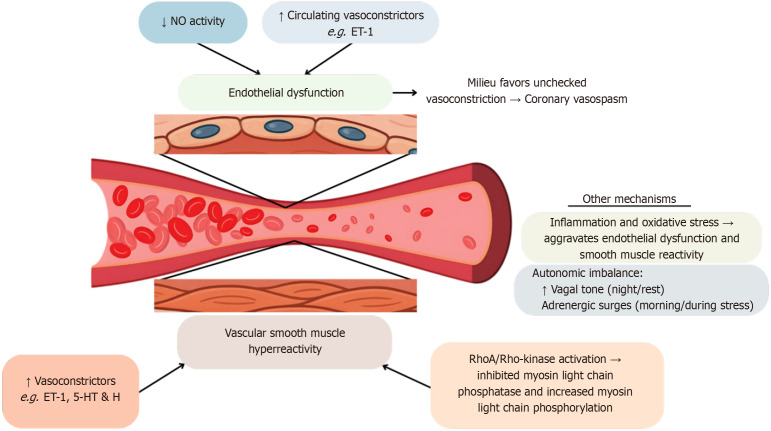
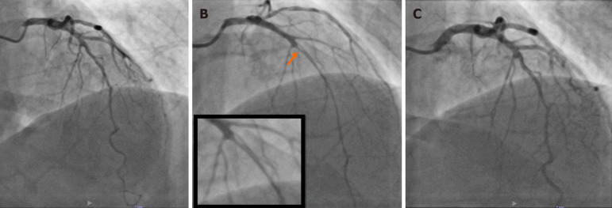
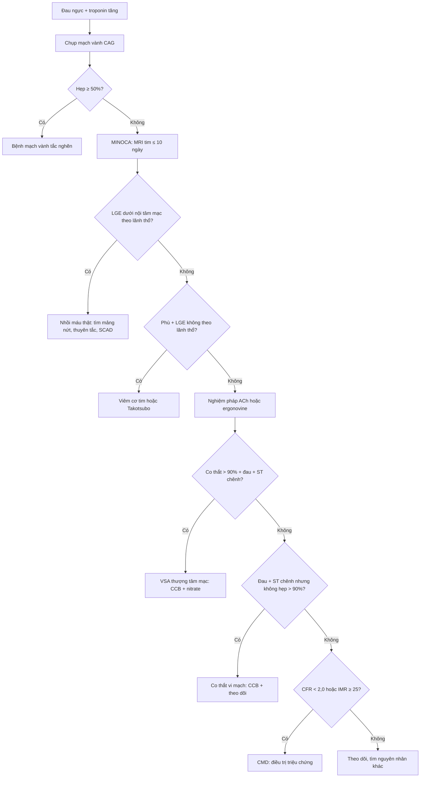
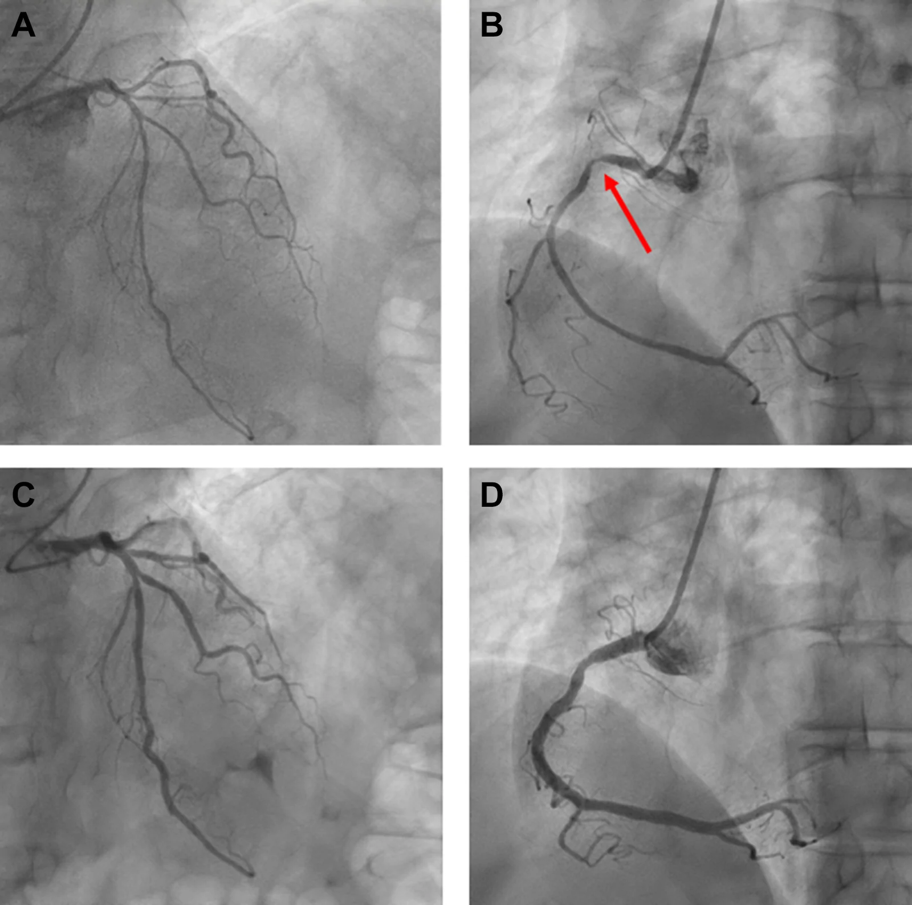
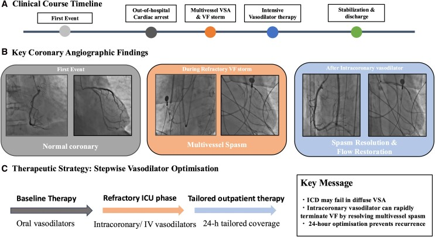

# 1897 — Co thắt mạch vành & MINOCA: khi mạch vành "sạch" mà vẫn nhồi máu / Vasospastic angina & MINOCA

**Tags:** `pattern:co-that-mach` `pattern:hep-dai-nhan` `pattern:tac-mach-vanh` `vung:vanh` `protocol:chup-mach-vanh` `protocol:OCT-IVUS` `score:COVADIS` `incidentaloma:khong`

**Mức chắc chắn (certainty):** tổng hợp y văn (literature synthesis) — số liệu từ **ba bài tổng quan có định lượng** (PMC12576579, PMC12128388, PMC13413844) và **ba ca nguyên văn có ảnh mạch vành** (PMC13554914, PMC13387067, PMC13655449). Chỗ suy luận được ghi rõ; ngưỡng điều trị lấy từ đồng thuận COVADIS 2017 và guideline, không có thử nghiệm ngẫu nhiên riêng cho co thắt.

> **Câu chốt:** Co thắt mạch vành là **co thắt thoáng qua > 90% lòng mạch**, gây **đau ngực + thay đổi ST + troponin tăng**, nhưng **mạch vành có thể hoàn toàn bình thường sau 5 phút**. Ba con số quyết định: **(1)** MINOCA chiếm **5–15%** mọi nhồi máu cơ tim; **(2)** trong ANOCA, co thắt gặp **28% ở nữ / 25% ở nam**, còn **CMD 41%** — và **hơn nửa** ca co thắt có kèm rối loạn vi mạch; **(3)** **không dùng chẹn beta đơn thuần** — thuốc này có thể làm co thắt nặng hơn; **CCB là nền tảng**, còn **thuốc tan sợi huyết là chống chỉ định** khi nghi co thắt/SCAD.

## 1. Tổng quan bệnh học – cơ chế hình ảnh (TẠI SAO)

### 1.1 TẠI SAO một động mạch "không hẹp" vẫn gây nhồi máu

- **Co thắt mạch vành (coronary vasospasm)** là **co cơ trơn thành mạch** làm hẹp lòng mạch **thoáng qua**, điển hình **> 90% đường kính** — ngưỡng này chính là định nghĩa dương tính trên chụp mạch, không phải "hẹp nhẹ".
- Cơ chế gồm **ba trục chồng lấp** (PMC12576579):
  1. **Rối loạn chức năng nội mô (endothelial dysfunction)**: giảm hoạt tính **NO** → mất đối trọng giãn mạch; vì thế **acetylcholine (ACh)** — bình thường gây giãn — lại **gây co thắt nghịch lý** ở đoạn dễ co thắt. Đa hình **eNOS T-786C** liên quan tới tăng nhạy cảm.
  2. **Tăng phản ứng cơ trơn (vascular smooth muscle hyperreactivity)**: tăng hoạt **RhoA/Rho-kinase** → ức chế myosin light chain phosphatase → **tăng nhạy cảm calci** và co cơ mạnh dù nồng độ calci không tăng. Đây là lý do **fasudil (ức chế Rho-kinase)** cắt cơn co thắt tức thì.
  3. **Mất cân bằng thần kinh tự chủ**: **tăng trương lực phó giao cảm ban đêm** + **đợt adrenergic buổi sáng** → cơn xuất hiện **về đêm – sáng sớm** và **dao động theo giờ**.
- **TẠI SAO hình ảnh "âm tính"**: co thắt là **hiện tượng chức năng**, không để lại mảng xơ vữa. Khi cơn qua, **lòng mạch trở lại bình thường** → CTA/CT và cả chụp mạch **sau khi tiêm giãn mạch** đều có thể bình thường. Vì vậy **"mạch vành sạch" không loại trừ bệnh**, và **chụp mạch bình thường trong cơn đã được xử lý giãn mạch là một bẫy chẩn đoán** (ca PMC13554914 dưới đây).
- **TẠI SAO vẫn có troponin tăng và ST chênh**: thiếu máu **dưới nội tâm mạc** trong cơn → **ST chênh ≥ 0,1 mV** ở **≥ 2 chuyển đạo liên tiếp**, troponin tăng theo mức độ thiếu máu; khi co thắt **bít hoàn toàn** → **STEMI thoáng qua**, có thể dẫn tới **VF/ngừng tim**. Đau ngực – ECG – troponin **giống hệt** nhồi máu do huyết khối, chỉ khác **thời gian** và **cơ chế**.

### 1.2 Dịch tễ và các con số định lượng

- **MINOCA** (nhồi máu cơ tim không tắc nghẽn, **hẹp < 50%** trên chụp mạch): **5–15%** mọi nhồi máu cơ tim (PMC13413844); một tổng quan khác ghi **2–10%** (PMC12128388) — chênh do tiêu chuẩn và dân số, nên ghi **khoảng 5–15%** khi trích dẫn guideline mới.
- **ANOCA** (đau ngực, mạch vành không tắc nghẽn): phân loại **159 ca** trong một nghiên cứu Anh cho **VSA 53 (33,3%)**, **CMD 24 (15,1%)**, **CMD + VSA 17 (10,7%)**, **rối loạn chức năng nội mô + VSA 4**, **ba rối loạn 3**, **không phát hiện bất thường 58 (36,5%)** (PMC12931529). Nghĩa là **gần 2/3** ca ANOCA có bất thường chức năng đo được — "không hẹp" **không** đồng nghĩa "không bệnh".
- **Meta-analysis > 14.000 bệnh nhân** không hẹp: **CMD 41%** (nữ nhiều hơn, **RR 1,45**); **co thắt chung 28% nữ / 25% nam** (p = 0,654); **co thắt vi mạch** lại **nữ 64% vs nam 36%**, **co thắt thượng tâm mạc** **nam 61% vs nữ 39%** (PMC12576579).
- **ACh dương tính 68%** trong **187** bệnh nhân đau ngực không hẹp, và **hơn một nửa** trong số đó có kèm bất thường vi mạch (PMC12576579).
- **Yếu tố khởi phát:** **hút thuốc lá là yếu tố nguy cơ mạnh nhất**; rượu (đặc biệt uống nhiều/ cai rượu), **lạnh** (nghiệm pháp nước lạnh tái hiện co thắt ở **tới 2/3** người nhạy cảm), căng thẳng, tăng thông khí; **mùa đông–xuân** nhiều cơn hơn.
- **Biến chứng khi làm nghiệm pháp:** biến cố **< 1%** trong thực hành hiện đại; một registry Nhật ghi **6,8%** rối loạn nhịp trong lúc làm test — **tương đương** tần suất xảy ra khi cơn tự phát và **không** dự báo kết cục xấu dài hạn (PMC12576579).

*Sơ đồ cơ chế: giảm NO + tăng chất co mạch (ET-1) → rối loạn nội mô; tăng hoạt RhoA/Rho-kinase và tăng nhạy cảm calci → cơ trơn tăng phản ứng; mất cân bằng tự chủ (đêm/sáng) tạo "môi trường" cho co thắt. Nguồn: Ralota KK, Layland J — World J Cardiol 2025 (PMC12576579), CC BY-NC 4.0.*

## 2. Mẫu hình + chẩn đoán phân biệt theo cơ chế (Gamut)

- **Cùng một bệnh cảnh "đau ngực + troponin + mạch vành không hẹp"** có 6 cơ chế, chia theo **vị trí tổn thương**:
  - **Thượng tâm mạc, co thắt**: VSA **khu trú (focal)** — thường tại **mảng xơ vữa nhẹ/không tắc nghẽn**, dễ tái phát cùng chỗ; và **lan tỏa (diffuse)** — nhiều đoạn, nhiều nhánh, nguy cơ **rối loạn nhịp ác tính** cao hơn.
  - **Thượng tâm mạc, không co thắt**: **mảng xơ vữa nứt/bào mòn** (plaque rupture/erosion) — chiếm phần lớn MINOCA do xơ vữa, **không thấy trên chụp mạch**, chỉ thấy trên **OCT/IVUS**; **SCAD** (xem 1900); **thuyên tắc vành** (rung nhĩ, van nhân tạo, ASD bít dù, u nhầy).
  - **Vi mạch**: **CMD** (IMR ≥ 25, CFR < 2,0 không có co thắt thượng tâm mạc) và **co thắt vi mạch** (ACh gây đau + ST chênh nhưng **không hẹp > 90%** thượng tâm mạc).
  - **Không do mạch vành**: **Takotsubo**, **viêm cơ tim** — là **kẻ bắt chước**, phải loại bằng **MRI tim** trước khi gọi MINOCA.
- **Mnemonic "SPASM"** cho MINOCA: **S**CAD, **P**laque disruption (rupture/erosion), **A**rtery embolism, **S**pasm (epicardial/microvascular), **M**icrovascular dysfunction; cộng thêm **T**akotsubo/myocarditis là nhóm **giả MINOCA**.
- **TẠI SAO phân biệt quan trọng:** **co thắt dùng CCB**, **SCAD tránh can thiệp và tránh chẹn beta đơn thuần?** (thực tế SCAD **dùng chẹn beta** để giảm shear stress — xem 1900), **mảng nứt dùng kháng kết tập + statin**, **thuyên tắc dùng kháng đông**, **viêm cơ tim dùng ức chế miễn dịch**. Cùng một hình ảnh "mạch vành sạch", **bốn hướng điều trị khác nhau**.

## 3. Bảng so sánh phân biệt (ma trận đối chiếu)

| Thực thể (entity) | Hình ảnh điển hình | Chốt vào (rule-in) | Chốt loại (rule-out) | Gợi ý xác nhận |
|---|---|---|---|---|
| **VSA thượng tâm mạc** | CAG: **co thắt > 90%** khu trú/lan tỏa, **hồi phục sau nitrate 200 µg**; CTA: mạch vành bình thường hoặc **mảng < 50%** | **Đau ngực về đêm–sáng + ST chênh ≥ 0,1 mV ≥ 2 chuyển đạo + > 90% co thắt khi ACh/ergonovine + hết sau nitrate** (COVADIS 2017) | Co thắt **tại đầu catheter** không kèm đau/ST → **co thắt do catheter**, không phải VSA; hẹp **cố định** không đổi sau nitrate → xơ vữa | Holter/ECG trong cơn; nghiệm pháp ACh/ergonovine; CMR loại trừ viêm/Takotsubo |
| **Co thắt vi mạch** | CAG: **không** có co thắt > 90% thượng tâm mạc; ACh gây **đau + ST chênh**; **IMR ≥ 25 / CFR < 2,0** | **Đau + ST chênh khi ACh nhưng lòng mạch thượng tâm mạc không hẹp > 90%**, kèm **IMR/CFR bất thường** | Co thắt thượng tâm mạc (có > 90%) → VSA; CMD thuần (không đau/ST khi ACh) → CMD | Đo **IMR/CFR** thì đầu; ACh liều tăng dần |
| **CMD** | Không tổn thương thượng tâm mạc; **CFR < 2,0**, **IMR ≥ 25**, **không** co thắt khi ACh | **CFR < 2,0 + IMR ≥ 25** + đau ngực/khó thở khi gắng sức, **không** hẹp | CFR ≥ 2,0 và IMR < 25 → không CMD; hẹp ≥ 50% → bệnh mạch vành tắc nghẽn | Adenosine/adenosine-free test; siêu âm tim gắng sức |
| **SCAD** | **Hẹp dài nhẵn > 20 mm**, **hai lòng mạch/IMH**, không canxi; OCT thấy **vạt nội mạc** | **Hẹp dài nhẵn không xơ vữa ở nữ trẻ**, OCT/IVUS có **IMH/false lumen** | Hẹp **khu trú có canxi/bờ gồ ghề** → xơ vữa; co thắt **hồi phục sau nitrate** → VSA | OCT/IVUS; CMR; **không** tiêu sợi huyết |
| **Mảng nứt/bào mòn** | CAG: hẹp **< 50%** hoặc không thấy; **OCT**: vạt mảng, huyết khối trắng, **bào mòn không vỡ** | **OCT/IVUS có mảng nứt/bào mòn + huyết khối** ở vùng động mạch thủ phạm | OCT **không** thấy mảng/huyết khối + không co thắt → tìm nguyên nhân khác | OCT (ưu thế), IVUS; CMR tìm LGE dưới nội tâm mạc |
| **Takotsubo / viêm cơ tim** | Rối loạn vận động **vượt quá 1 lãnh thổ vành**; **phù cơ tim**; **LGE giữa thành/dưới thượng tâm mạc** (viêm) hoặc **không LGE** (Takotsubo) | **MRI: phù + LGE không theo lãnh thổ**; Takotsubo: **ballooning + không LGE** | **LGE dưới nội tâm mạc theo lãnh thổ** → nhồi máu thật; **co thắt > 90%** → VSA | MRI tim ≤ 10 ngày; troponin/ECG; chụp mạch thì đầu |

*Chụp mạch vành trái: (A) thì đầu bình thường; (B) **co thắt > 90% đoạn giữa LAD** (mũi tên cam, khung phóng đại) sau **ACh nội mạch**; (C) **hồi phục hoàn toàn sau nitroglycerin 200 µg**. Đây là mẫu hình "chốt vào" của VSA: **co thắt + đau + ST chênh + đảo ngược bằng nitrate**. Nguồn: Ralota KK, Layland J — World J Cardiol 2025 (PMC12576579), CC BY-NC 4.0.*

### Đọc nghiệm pháp co thắt đúng cách
- **Dương tính thật** cần **đủ 3 thành phần**: (1) **tái hiện đau ngực quen thuộc**, (2) **thay đổi ST ≥ 0,1 mV ở ≥ 2 chuyển đạo liên tiếp** (hoặc **sóng U âm mới**), (3) **co thắt > 90%** trên chụp mạch. Thiếu một thành phần = **không kết luận** (equivocal).
- **Liều thường dùng:** **ACh 20 → 50 → 100 µg** bơm nội mạch vành trái trong **20 giây** mỗi liều (**20–50 µg** cho vành phải); **ergonovine 16 → 32 → 64 µg**. Sau mỗi liều **chụp lại**; **ngừng ngay** khi dương tính và **bơm nitrate 200 µg**.
- **Chống chỉ định tương đối:** hẹp **thân chung trái** hoặc **hẹp ba nhánh nặng**, **EF thấp**, suy thận nặng, cơn hen cấp; **không làm trong pha cấp** khi huyết động chưa ổn định (ca PMC13387067 đã **hoãn** nghiệm pháp vì đang có VF storm).

## 4. Protocol chụp + phân độ COVADIS + sơ đồ quyết định

### 4.1 Trình tự chẩn đoán (không phải RADS, nhưng có "phân độ" COVADIS)

- **COVADIS 2017** chia **VSA chắc chắn (definite)** và **VSA nghi ngờ (suspected)**:
  - **Definite VSA** = **đau ngực đáp ứng nitrate** + **bằng chứng co thắt** (co thắt > 90% khi nghiệm pháp **hoặc** co thắt tự phát trên chụp mạch **hoặc** ST chênh thoáng qua trong cơn kèm đau).
  - **Suspected VSA** = đủ lâm sàng điển hình nhưng **thiếu bằng chứng khách quan**.
- **Trước khi chụp xâm lấn:** **ECG trong cơn** (Class I), **Holter/giám sát ST** khi cơn nhiều (IIa), **nghiệm pháp gắng sức buổi sáng** (cơn thường xuất hiện/ nặng hơn buổi sáng), **CTA vành** để loại mảng xơ vữa, **MRI tim ≤ 10 ngày** để loại viêm cơ tim/Takotsubo (CMR đặt được **chẩn đoán xác định 63%** và **tái phân loại tới 2/3** ca MINOCA — PMC13413844).
- **Khi chụp mạch:** **không tiêm giãn mạch nội mạch trước** nếu đang tìm co thắt tự phát; nếu mạch vành bình thường mà lâm sàng mạnh → **làm nghiệm pháp ACh/ergonovine**; nếu **không làm được** (huyết động không ổn định) → **điều trị theo COVADIS lâm sàng** và theo dõi.
- **Sau chẩn đoán:** siêu âm tim (EF, vận động vùng), **theo dõi Holter** nếu có ngất/loạn nhịp, **đánh giá nguy cơ đột tử** (VSA + VF/ngất → cân nhắc **ICD**), và **điều trị nền CCB liều tối ưu**.

### 4.2 Điều trị (ngưỡng và liều có bằng chứng)

- **CCB là nền tảng**, cả **non-DHP (diltiazem, verapamil)** và **DHP (amlodipine, benidipine, nifedipine)**; ca nặng có thể **phối hợp hai nhóm**. Nghiên cứu Hàn Quốc **1.586 bệnh nhân** cho kết cục dài hạn tương đương, **CCB thế hệ 2 ít ACS hơn** (PMC12576579).
- **Nitrate tác dụng dài** thêm khi CCB chưa đủ; **giữ khoảng không nitrate** để tránh dung nạp (JCS).
- **Tránh chẹn beta đơn thuần**: có thể làm co thắt nặng hơn do mất đối trọng α; chỉ dùng khi có chỉ định khác (SCAD, loạn nhịp) và **luôn kèm CCB**.
- **Refractory:** **nicorandil** (JCS IIa), **cilostazol 100 mg × 2/ngày** (STELLA: giảm cơn **66,5% vs 17,6%**, p = 0,009; không triệu chứng **76% vs 33%**), **fasudil** (Nhật), **magie** hỗ trợ; **statin** hợp lý vì nội mô và mảng xơ vữa cận lâm sàng.
- **Ngừng tim do VSA:** hồi sinh + **CCB liều cao/ phối hợp**, cân nhắc **ICD**; ca VF storm kháng trị có thể cần **giãn mạch nội mạch cấp** để cắt vòng xoắn (PMC13387067).

## 5. Biến thể bình thường và cạm bẫy

- **Co thắt do catheter (catheter-induced spasm)**: thường **khu trú ngay đầu catheter**, **không kèm đau/ST chênh**, **hết khi rút/ bơm nitrate** — **không** đủ tiêu chuẩn VSA. Đây là "dương tính giả" hay gặp nhất.
- **Giãn mạch trước khi chụp làm mất dấu**: tiêm **nitrate/nicardipine nội mạch** để "cho đẹp hình" có thể **xóa co thắt tự phát** → chụp lần đầu bình thường, chẩn đoán bị bỏ. Ca PMC13554914 chính là bài học này: **lần 1 có giãn mạch → bình thường; lần 2 không giãn mạch → co thắt lan tỏa + blốc nhĩ thất**.
- **Co thắt trên mảng xơ vữa**: vị trí co thắt **thường trùng mảng < 50%**; gọi là "mạch vành sạch" rồi bỏ qua **statin/kháng kết tập** là sai. Ngược lại, co thắt **không** loại trừ bệnh mạch vành.
- **"MINOCA lành tính"**: sai. MINOCA do CMR xác định có **MACE OR 2,40** so với viêm cơ tim (1,09) và Takotsubo (1,16); **OCT xác định MINOCA do xơ vữa** có **MACE 15,3% vs 4,5%** (p = 0,015) và **tái thông tổn thương đích 6,1% vs 0%** (p = 0,030) (PMC13413844).
- **Nghiệm pháp dương tính là yếu tố tiên lượng**: **ACh dương tính** dự báo MACE **HR 2,83 (1,16–6,93; p = 0,022)** — không phải "test để biết cho vui" (PMC13413844).
- **Bẫy thời điểm MRI**: CMR làm **quá sớm** (< 24 giờ) có thể **âm tính** vì phù chưa rõ; làm **quá muộn** (> 10 ngày) giảm khả năng phát hiện phù. Khung hợp lý: **2–10 ngày**.
- **Bẫy điều trị**: dùng **thuốc tan sợi huyết** ở MINOCA/co thắt (**không có huyết khối**) → **chảy máu, làm lan SCAD**; dùng **chẹn beta đơn thuần** → **co thắt nặng hơn**.

## 6. Tự lượng giá — Blind Quiz

**Ca 1 — Nam 64 tuổi, đau ngực về đêm, ngất. Chụp mạch lần đầu "bình thường". Nhìn hình dưới, mô tả trước khi đọc đáp án.**

- Hỏi: (1) A/B và C/D khác nhau ở đâu? (2) Vì sao lần chụp đầu bình thường? (3) Cơ chế gây blốc nhĩ thất?

<b>Bấm để hiện đáp án</b>

- (A) thân chung trái và LAD/LCx **co thắt lan tỏa**; (B) **RCA co thắt gần tắc (mũi tên đỏ) đúng tại vị trí mảng nhỏ** đã thấy lần đầu. (C, D) **hồi phục hoàn toàn sau nitrate nội mạch** → **co thắt tự phát, không phải huyết khối**.
- Lần chụp đầu **bình thường vì đã tiêm giãn mạch nội mạch** — co thắt bị xóa; đây là **bẫy** hay gặp ở phòng chụp mạch.
- Blốc nhĩ thất: **RCA co thắt → thiếu máu nút nhĩ thất (nhánh nút AV)** → **Mobitz I tiến triển 2:1**, gây ngất; điện tâm đồ Holter trong cơn có **ST chênh lên thoáng qua + blốc**. Điều trị **verapamil 120 mg/ngày** hết cơn và hết blốc.
- Nguồn: Trimaille A, Faucher L, Koenig B, Schatz A, Jesel L, Marzak H — JACC Case Rep 2026 (PMC13554914), CC BY-NC-ND 4.0.

**Ca 2 — Nam 67 tuổi, STEMI thành dưới–bên trong đợt COVID-19, đã cấy S-ICD; 1 năm sau ngừng tim do VF storm. Nhìn hình, trả lời 3 câu.**

- Hỏi: (1) Trong cơn VF, mạch vành có hẹp cố định không? (2) Vì sao VF kháng trị sốc điện? (3) Xử trí cấp cứu nào cắt được vòng xoắn?

<b>Bấm để hiện đáp án</b>

- Ảnh giữa: **co thắt lan tỏa nhiều nhánh (RCA và LAD/LCx)** khi đang VF storm; ảnh trái là mạch vành **không hẹp** lúc nhập viện; ảnh phải là **hồi phục sau giãn mạch nội mạch**.
- VF kháng trị vì **co thắt đang hoạt động** liên tục gây thiếu máu; sốc điện lặp lại **không cắt được ổ loạn nhịp** khi cơ chế khởi phát còn đó.
- Xử trí: **giãn mạch nội mạch cấp** (nitrate/nicardipine/ nicorandil) + tối ưu **CCB kép + nitrate tác dụng dài** (trong ca: **diltiazem 100 mg + benidipine 4 mg + isosorbide mononitrate 40 mg/ngày**), sau đó **theo dõi sát**; ICD **không đủ** nếu co thắt không được kiểm soát.
- **Phản biện:** ca này VF storm xảy ra **sau 1 năm ổn định**, cho thấy **tuân thủ thuốc tốt vẫn có thể tái phát** khi co thắt nhiều nhánh; nghiệm pháp co thắt **không làm** trong pha cấp vì nguy cơ loạn nhịp.
- Nguồn: Ishigaki A, Koga M, Sato Y, Tanabe Y, Akashi YJ — Eur Heart J Case Rep 2026 (PMC13387067), CC BY 4.0.

**Ca 3 — Nữ 45 tuổi, đau ngực khi nghỉ 3 giờ sáng, troponin tăng nhẹ, chụp mạch không hẹp. Bác sĩ định cho chẹn beta đơn thuần vì "nhịp nhanh". Trả lời không cần ảnh.**

- Hỏi: đúng/sai và vì sao; cần làm gì tiếp theo?

<b>Bấm để hiện đáp án</b>

- **Sai**: ở co thắt mạch vành, **chẹn beta đơn thuần** có thể làm mất đối trọng α → **co thắt nặng hơn**; đây là thuốc **không được dùng đơn trị**.
- Cần: **ECG trong cơn/Holter** (ST chênh ≥ 0,1 mV), **MRI tim** loại viêm/Takotsubo, **nghiệm pháp ACh/ergonovine** nếu vẫn nghi; điều trị **CCB (diltiazem/verapamil hoặc DHP)** + **nitrate**, tư vấn **bỏ thuốc lá, tránh rượu/ lạnh**.
- Nếu có **ngất/VF**: đánh giá **ICD** và điều trị **CCB liều cao/ phối hợp**.
- **Suy luận** (không có ca nguyên văn): các ngưỡng điều trị lấy từ đồng thuận, không từ thử nghiệm ngẫu nhiên.

## Bài liên quan chéo
- [800 – Tổng quan Tim mạch](../800-cardiovascular-overview/lesson.md)
- [810 – Vành & CAD-RADS](../810-coronary-cta-cadrads/lesson.md) (mảng xơ vữa, CTA)
- [820 – MRI tim LGE](../820-cardiac-mri-lge-mapping/lesson.md) (LGE dưới nội tâm mạc vs giữa thành)
- [1842 – Takotsubo ở ICU](../1842-takotsubo-hau-phau-icu/lesson.md) (kẻ bắt chước)
- [1900 – Bóc tách động mạch vành tự phát (SCAD)](../1900-boc-tach-dong-mach-vanh-tu-phat/lesson.md) (hẹp dài nhẵn, khác cơ chế)
- [1693 – Thrombophlebitis migrans (Trousseau)](../1693-thrombophlebitis-migrans-trousseau/lesson.md) — ví dụ về "hội chứng mạch máu do ung thư ẩn", cùng nhóm bệnh lý mạch không do xơ vữa.

> Không dùng để chẩn đoán độc lập khi chưa có người hướng dẫn.
