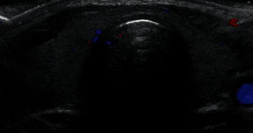
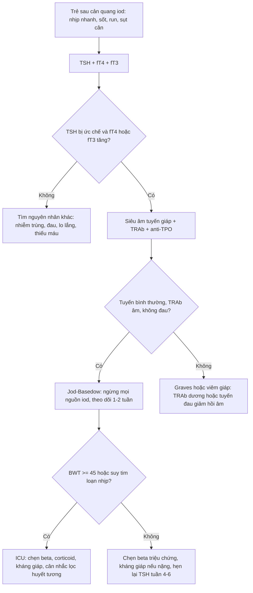
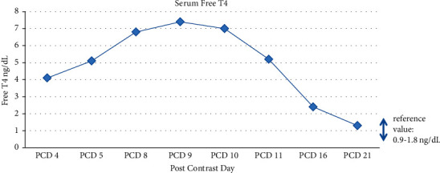

# 1898 — Nhiễm độc giáp do iod sau cản quang ở trẻ (Jod–Basedow) / Iodine-induced thyrotoxicosis

**Tags:** `pattern:cuong-giap` `pattern:qua-tai-iod` `pattern:tsh-bi-uc-che` `vung:tuyen-giap` `score:Burch-Wartofsky` `protocol:CT-can-quang` `protocol:sieu-am-tuyen-giap` `protocol:xet-nghiem-chuc-nang-giap`
**Mức chắc chắn (certainty):** tổng hợp y văn (literature synthesis) — ghép **2 ca nguyên văn ở trẻ** (*Case Rep Endocrinol* 2021, PMC8632428, CC BY 4.0: 17 tuổi sau CT bụng; *SAGE Open Med Case Rep* 2024, PMC11624525, CC BY-NC 4.0: 15 tuổi sau CTA vành) với **1 ca người lớn nặng** (*Cureus* 2022, PMC9170361, CC BY 3.0: bướu giáp 9 cm, phải thay huyết tương) và **1 tổng quan liều iod**. Số nào nguồn không đưa thì ghi "chưa rõ".

> **Câu chốt:** một lần chụp CT có cản quang đưa vào cơ thể **13.500 µg iod tự do + 15–60 g iod gắn kết** — ca dưới đây nhận **78 mL Omnipaque 300 ≈ 23 g iod hữu cơ**, tức **~21.000 lần** mức chịu đựng **1.100 µg/ngày**. Hệ quả nghịch lý: **TSH < 0,0008 µIU/mL, fT4 đỉnh 7,4 ng/dL** (tham chiếu 0,9–1,8) nhưng **siêu âm tuyến giáp hoàn toàn bình thường** — nên "giáp bình thường trên hình ảnh" **không loại trừ** Jod–Basedow, và **xạ hình sau cản quang là âm giả** vì chính liều iod đã ức chế bắt xạ.

## 1. Tổng quan bệnh học – cơ chế hình ảnh

### 1.1 Cơ chế: hai mặt của cùng một van an toàn

- **Hiệu ứng Wolff–Chaikoff:** iod thừa ức chế **thyroid peroxidase (TPO)** → giảm tổng hợp T3/T4. Bình thường tuyến **"thoát" ức chế trong ~48 giờ** nhờ giảm biểu hiện **NIS (Na/I symporter)**, đưa lượng iod vào nội bào về mức cũ (PMC8632428).
- **Jod–Basedow (Jod-Basedow phenomenon, JBP)** là mặt ngược lại: ở mô giáp **tự trị** (nhân độc, bướu đa nhân, vùng thiếu iod trước đó), tế bào không giảm bắt iod → **bể iod nội bào mở rộng** → tổng hợp hormone tăng liên tục → **nhiễm độc giáp**, không có pha thoát.
- Vì vậy **cùng một liều cản quang** cho hai kết cục trái ngược: trẻ non tháng/thiếu enzym → **suy giáp** (xem [1815](../1815-suy-giap-do-qua-tai-iod-so-sinh/lesson.md)); người có mô giáp tự trị → **cường giáp**.
- **Trẻ em không phải ngoại lệ:** ca 17 tuổi **không có tiền sử bệnh giáp**, kháng thể **TSI/anti-Tg/anti-TPO đều âm**, chức năng giáp **2 năm trước bình thường (TSH 1,165)** — vẫn mắc JBP sau cản quang. Tác giả nghi **nhiễm virus (rhinovirus/enterovirus, EBV) là yếu tố khởi phát** trên nền nhạy cảm (PMC8632428).

### 1.2 TẠI SAO hình ảnh lại quan trọng trong một bệnh "nội tiết" (vật lý + logic)

- **Cản quang iod nhìn thấy được vì Z = 53, K-edge 33,2 keV** — đúng dải năng lượng tia X chẩn đoán, nên hấp thụ quang điện tăng vọt: iod **đậm hơn xương** trên cửa sổ mô mềm. Hệ quả: **chính phim CT gây bệnh cũng là phim phát hiện yếu tố nguy cơ** — ca người lớn có **bướu giáp 9 cm đẩy lệch khí quản** chỉ được nhận ra khi đọc lại CTA đầu–cổ (PMC9170361).
- **Siêu âm phản ánh giải phẫu, không phản ánh chức năng.** Trong JBP tuyến có thể **bình thường về kích thước, hồi âm, tưới máu** (ca 17 tuổi: isthmus **0,2 cm**, thùy phải **2,3 × 4,3 × 0,9 cm**, thùy trái **1,3 × 4,3 × 1,1 cm**, không tăng sinh mạch) — vì hormone đang tràn ra từ mô giáp **không viêm, không tăng sinh**. Đây là điểm khác biệt cốt lõi với Graves (tuyến to, giảm hồi âm, tăng mạch "địa ngục") và viêm giáp (đau, giảm hồi âm, giảm mạch).
- **Xạ hình 99mTc/RAIU bị chính liều iod làm mù.** Bể iod mở rộng cạnh tranh với iod phóng xạ và TSH đã bị ức chế → **bắt xạ thấp giả tạo**, không phân biệt được với viêm giáp. Ca 17 tuổi **hoãn xạ hình** vì lý do này (PMC8632428) — bỏ qua chi tiết đó là nguyên nhân hay gặp nhất của "chẩn đoán sai hướng".

### 1.3 Ngưỡng định lượng nằm lòng

| Đại lượng | Con số | Nguồn |
|---|---|---|
| Iod trong một liều cản quang TM chuẩn | **13.500 µg iod tự do + 15–60 g iod gắn kết** | PMC8632428, PMC9170361 |
| Ca 17 tuổi: 78 mL Omnipaque 300 | **≈ 23 g iod hữu cơ** (~21.000 × mức chịu đựng/ngày) | PMC8632428 |
| Mức chịu đựng iod/ngày (người lớn, ICCIDD) | **1.100 µg** | PMC8632428 |
| Nhu cầu iod/ngày (người lớn) | **~150 µg** | PMC8632428 |
| Thời gian thoát Wolff–Chaikoff | **~48 giờ** | PMC8632428 |
| Thời gian tiềm tàng của JBP | **vài ngày → vài tuần**; đã ghi nhận **sớm nhất ngày 1 sau cản quang** | PMC8632428 |
| Ca 17 tuổi: fT4 đỉnh (PCD 9) | **7,4 ng/dL** (0,9–1,8) | PMC8632428 |
| Ca 17 tuổi: TSH | **< 0,0008 µIU/mL** (0,6–4,8) | PMC8632428 |
| Ca 17 tuổi: thyroglobulin | **274 ng/mL** (0,8–29,4) | PMC8632428 |
| Ca 17 tuổi: iod huyết thanh | **181 µg/L** (PCD 10) → **79 µg/L** (PCD 22) | PMC8632428 |
| Burch–Wartofsky lúc có triệu chứng | **15 điểm** (nguy cơ bão giáp thấp) | PMC8632428 |
| Ca 15 tuổi: TSH / fT4 / FT3 | **0,05 µIU/mL** / **29,9 pmol/L** (11,5–22,5) / **21,14 pmol/L** (3,5–6,5) | PMC11624525 |
| Ca 15 tuổi: EF lúc vào → ngày 3 | **46% → 55%** | PMC11624525 |
| Ca người lớn: fT4 trước → sau cản quang 8 ngày | **0,46 → 4,07 ng/dL**; TSH **< 0,015 mIU/L** | PMC9170361 |

*Siêu âm Doppler màu tuyến giáp ở ca 17 tuổi (PCD 7): isthmus 0,2 cm; thùy phải 2,3 × 4,3 × 0,9 cm; thùy trái 1,3 × 4,3 × 1,1 cm; hồi âm trong giới hạn bình thường, không tăng sinh mạch — tức **hình ảnh bình thường** dù fT4 đang 6,8 ng/dL. Nguồn: Apsan J et al., Case Rep Endocrinol 2021 (PMC8632428), Fig. 2, CC BY 4.0.*

## 2. Mẫu hình + chẩn đoán phân biệt theo vị trí (gamut)

### 2.1 Mẫu hình cần nhận ra: "cường giáp khởi phát cấp sau một can thiệp"

Ba câu hỏi theo thứ tự:

1. **Có phơi nhiễm iod không?** Cản quang TM/uống, amiodarone, povidone-iodine trên da niêm, thực phẩm/nước biển, thuốc ho long đờm chứa iod. Ghi **mốc thời gian** so với khởi phát — JBP điển hình **ngày 1 đến vài tuần**.
2. **Tuyến giáp có "bệnh nền" không?** Bướu giáp/nhân trên siêu âm, tiền sử bệnh giáp, vùng thiếu iod, suy thận (giảm thải iod).
3. **Có dấu hiệu viêm/ tự miễn không?** Đau tuyến, TRAb dương, kháng thể anti-TPO/anti-Tg, tuyến to lan tỏa → nghĩ Graves/viêm giáp hơn là JBP.

### 2.2 Gamut theo bối cảnh (không theo vị trí giải phẫu — bệnh là bệnh toàn thân)

- **Sau cản quang iod:** Jod–Basedow (nhân độc/bướu đa nhân/vùng thiếu iod); **bão giáp** trên nền Graves chưa chẩn đoán; **viêm giáp bán cấp** trùng dịp (không liên quan cản quang); **cường giáp giả** do thuốc (levothyroxine, biotin gây nhiễu xét nghiệm).
- **Sau amiodarone:** type 1 (tăng tổng hợp, Doppler tăng mạch) vs type 2 (viêm hủy, Doppler giảm mạch) — xem [940](../940-dot-nhiet-nhan-giap-doc-aftn-rfa-vs-i131/lesson.md) về nhân độc; AIT chưa có bài riêng trong thư viện.
- **Trẻ có bướu giáp:** nhân độc tự trị (AFTN), bướu đa nhân, hội chứng McCune–Albright (nốt nóng), Graves, viêm giáp Hashitoxicosis.
- **Trẻ không bướu giáp, tuyến bình thường trên siêu âm:** JBP là chẩn đoán **loại trừ** — phải âm TRAb, không đau, có mốc phơi nhiễm iod, và tự khỏi khi iod được thải.

### 2.3 Mnemonic IODINE (dùng khi bàn giao ca)

**I**atrogenic contrast/amiodarone · **O**ngoing autonomous nodule · **D**eficient-iodine region · **I**nflammation (viêm giáp) · **N**odular goiter · **E**scalating iodine dose.

## 3. Bảng so sánh phân biệt (ma trận đối chiếu)

| Thực thể (entity) | Hình ảnh điển hình | Chốt vào (rule-in) | Chốt loại (rule-out) | Gợi ý xác nhận |
|---|---|---|---|---|
| **Jod–Basedow (JBP)** | Siêu âm: tuyến **bình thường hoặc bướu/nhân**, không tăng mạch; xạ hình **bắt xạ thấp** (nhưng âm giả ngay sau cản quang) | **Mốc phơi nhiễm iod rõ + TSH bị ức chế + fT4/fT3 tăng + TRAb âm + tuyến không đau** | TRAb dương, tuyến to lan tỏa giảm hồi âm, tăng mạch → Graves; đau tuyến → viêm giáp | TSH/fT4 ngày 3–7; iod huyết thanh; theo dõi tự khỏi 2–8 tuần |
| **Graves** | Tuyến **to lan tỏa, giảm hồi âm, tăng sinh mạch** ("thyroid inferno"); xạ hình bắt xạ **lan tỏa tăng** | **TRAb dương + tuyến to lan tỏa + bắt xạ tăng** | TRAb âm, tuyến bình thường, bắt xạ thấp → JBP/viêm giáp | TRAb, siêu âm Doppler, xạ hình |
| **Viêm giáp bán cấp** | Tuyến **đau, giảm hồi âm khu trú**, giảm mạch; xạ hình bắt xạ **thấp** | **Đau tuyến khi ấn + ESR/CRP tăng + cường giáp thoáng qua rồi suy giáp** | Không đau, không viêm → JBP; TRAb dương → Graves | ESR/CRP, siêu âm, theo dõi 3 pha |
| **Hashitoxicosis** | Tuyến **giảm hồi âm không đều, giảm thể tích**, có thể teo | **anti-TPO rất cao + bướu Hashimoto + cường giáp nhẹ thoáng qua** | anti-TPO âm → không phải Hashimoto | anti-TPO/anti-Tg, siêu âm |
| **Nhân độc tự trị (AFTN)** | Nhân **đặc, giàu mạch**, phần còn lại của tuyến **bị ức chế**; xạ hình **nhân nóng đơn độc** | **Nhân nóng + phần giáp còn lại bắt xạ thấp** | Bướu đa nhân, tuyến bình thường → JBP | Xạ hình sau khi hết tải iod; siêu âm |
| **Cường giáp do amiodarone type 2** | Tuyến **bình thường, giảm mạch**; khởi phát sau nhiều tháng dùng thuốc | **Tiền sử amiodarone + Doppler giảm mạch + kháng giáp kém đáp ứng** | Tăng mạch, bắt xạ tăng → type 1 | Doppler, RAIU (sau đủ thời gian), thử corticoid |

> **Cạm bẫy ma trận:** không có cột "xạ hình" nào dùng được trong **4–8 tuần đầu** sau cản quang. Ghi rõ "hoãn xạ hình" thay vì đọc một kết quả thấp giả tạo.

## 4. Protocol chụp + hệ phân độ/điểm chuẩn hóa

### 4.1 Trước khi tiêm cản quang iod ở trẻ

- **Hỏi 3 câu:** bướu giáp/nhân đã biết? tiền sử cường giáp/Graves? đang dùng amiodarone hay thuốc chứa iod?
- **Xét nghiệm nền khi có bất kỳ câu "có":** TSH + fT4. Nếu **TSH bị ức chế**, hoãn cản quang **không cấp cứu** và chọn thay thế: **siêu âm, MRI không cản từ, X-quang**.
- **Không hoãn** khi chỉ định là cấp cứu (tắc mạch, chấn thương, nghi ung thư) — nhưng phải **ghi nhận phơi nhiễm** và **hẹn xét nghiệm giáp ngày 3–7**.

### 4.2 Sau cản quang: lịch theo dõi có ngưỡng

- **Ngày 3–7:** TSH, fT4, fT3 nếu có triệu chứng (sốt, nhịp nhanh, vã mồ hôi, run, sụt cân, đau bụng không rõ nguyên nhân).
- **Tuần 4–6:** lặp TSH/fT4 để xác nhận tự khỏi (ca 17 tuổi bình thường ở **PCD 21**; ca 15 tuổi bình thường ở **6 tháng**).
- **Siêu âm tuyến giáp:** đầu dò linear **12–15 MHz**, đo 3 chiều mỗi thùy + isthmus, thể tích = **0,479 × D1 × D2 × D3**; ghi nhân, hồi âm, tưới máu. Siêu âm **bình thường không loại trừ** JBP.
- **Xạ hình 99mTc/RAIU:** **hoãn** cho tới khi bể iod về bình thường (y văn nhi **chưa có ngưỡng thống nhất** — thực hành thường chờ vài tuần); chỉ dùng khi cần phân biệt nhân độc.
- **CT ngực/đầu cổ có cản quang:** đọc lại **khí quản, tuyến giáp, trung thất** — bướu giáp chèn ép là yếu tố nguy cơ và là nguyên nhân không thể rút ống (ca người lớn **9 cm**, đẩy lệch khí quản).

### 4.3 Thang điểm Burch–Wartofsky (BWT) — dùng để quyết định nơi điều trị

| Điểm | Ngưỡng xử trí |
|---|---|
| **< 25** | Cường giáp chưa biến chứng: điều trị ngoại trú/ theo dõi |
| **25–44** | "Bão giáp đe dọa": nhập viện, chẹn beta, kháng giáp, tìm yếu tố khởi phát |
| **≥ 45** | **Bão giáp**: ICU, thay huyết tương nếu cần (ca người lớn cần **3 lần** lọc huyết tương) |

- Ca 17 tuổi: **BWT 15** → điều trị nội khoa thường quy (methimazole + hydrocortisone 100 mg mỗi 8 giờ + propranolol 40 mg mỗi 8 giờ).
- **Điểm BWT không thay thế đánh giá tim:** ca 15 tuổi **EF 46%**, men tim và troponin tăng, ST chênh lên — cường giáp làm nặng thêm viêm cơ tim, dù không có triệu chứng "nhiễm độc giáp" kinh điển.

## 5. Biến thể bình thường và cạm bẫy

- **"Tuyến giáp bình thường" trên siêu âm là bình thường thật** — không phải bằng chứng chống cường giáp. JBP không viêm, không tăng sinh mạch; đừng vì thế mà bỏ qua TSH đã bị ức chế.
- **TSH nền bình thường trước đó không loại trừ:** ca 17 tuổi có TSH **1,165** hai năm trước và **không có tiền sử bệnh giáp**.
- **Sốt + nhịp nhanh sau mổ bị gán cho nhiễm trùng:** ca 17 tuổi được điều trị kháng sinh **4 ngày** trước khi đo giáp lần đầu — mẫu hình "sốt sau can thiệp" phải gồm cả tuyến giáp trong chẩn đoán phân biệt.
- **Xạ hình/RAIU ngay sau cản quang = âm giả** (bể iod mở rộng + TSH bị ức chế). Ghi "hoãn" trong phiếu, không ghi "bắt xạ thấp".
- **Bỏ sót bướu giáp chèn khí quản** khi chỉ đọc mạch máu trên CTA: ca người lớn **9 cm** gây khó rút ống, phải cắt thùy giáp; giải phẫu này nằm trong **cửa sổ mô mềm**, không phải cửa sổ mạch.
- **Nhiễu xét nghiệm do biotin** (vitamin B7 liều cao) làm TSH giả thấp, fT4 giả cao — hỏi thuốc bổ trước khi kết luận cường giáp.
- **Trẻ có bệnh tim nền:** cường giáp nhẹ cũng có thể gây loạn nhịp/suy tim; EF giảm **46%** trong ca 15 tuổi là lý do phải nhập viện theo dõi, không chỉ "theo dõi ngoại trú".

## 6. Tự lượng giá — Blind Quiz

**Ca 1 — Nam 17 tuổi, khỏe mạnh trước đó, đau bụng phải, được chụp CT bụng có cản quang rồi mổ viêm ruột thừa. Ngày hậu phẫu 2–4: sốt, đỏ bừng, mệt, nhịp tim 100–110/phút.**

- Hỏi: (1) Mô tả tuyến giáp trên siêu âm. (2) Ba chẩn đoán phân biệt cho cường giáp cấp ở trẻ. (3) Xét nghiệm nào chốt hướng Jod–Basedow, và vì sao **không** làm xạ hình lúc này?

<b>Bấm để hiện đáp án (findings + chẩn đoán)</b>

- **Findings:** tuyến giáp **không to**, hồi âm đồng nhất bình thường, **không tăng sinh mạch**; isthmus 0,2 cm, thùy phải 2,3 × 4,3 × 0,9 cm, thùy trái 1,3 × 4,3 × 1,1 cm.
- **Chẩn đoán:** **Jod–Basedow sau 78 mL Omnipaque 300 (≈ 23 g iod)** — fT4 đỉnh **7,4 ng/dL**, TSH **< 0,0008 µIU/mL**, thyroglobulin **274 ng/mL**, iod huyết thanh **181 µg/L** (PCD 10); TRAb/anti-TPO/anti-Tg **âm**; BWT **15**.
- **Vì sao không xạ hình:** chính liều iod đã mở rộng bể iod và ức chế TSH → bắt xạ **thấp giả tạo**, không phân biệt được JBP với viêm giáp; ca này đã **hoãn xạ hình**.
- **Diễn biến:** bình thường hoá ở **PCD 21** (fT4 1,3 ng/dL, TSH 0,822 µIU/mL).
- Nguồn: Apsan J et al., *Case Rep Endocrinol* 2021 (PMC8632428), Fig. 2, CC BY 4.0.

**Ca 2 — Nam 15 tuổi, đau ngực sau nhiễm virus hô hấp; men tim và troponin tăng, ST chênh lên; CTA vành bình thường.**

- Hỏi: (1) Đường cong fT4 này nói gì về **thời điểm** đỉnh và thời gian tự khỏi? (2) Nếu bệnh nhân này có EF 46%, quyết định điều trị khác gì ca 1? (3) Vì sao không dùng kháng giáp trong ca này?

<b>Bấm để hiện đáp án (findings + chẩn đoán)</b>

- **Findings:** fT4 tăng dần từ **4,1 ng/dL** (PCD 4) lên đỉnh **7,4 ng/dL** (PCD 9) rồi giảm về **1,3 ng/dL** (PCD 21) — đỉnh ở **tuần thứ nhất**, tự khỏi trong **~3 tuần**.
- **Ca 15 tuổi (ảnh minh hoạ đường cong từ ca 17 tuổi):** TSH **0,05 µIU/mL**, fT4 **29,9 pmol/L**, FT3 **21,14 pmol/L**, EF **46% → 55%** ngày 3; điều trị **chế độ ít iod + metoprolol**, **không** kháng giáp, chức năng giáp bình thường ở **6 tháng**.
- **Vì sao không kháng giáp:** JBP thường **tự giới hạn** khi iod được thải; kháng giáp chỉ dùng khi nặng/kéo dài, và ở ca 17 tuổi methimazole gây **tăng transaminase + phát ban da bong** buộc phải ngừng.
- Nguồn ảnh: Apsan J et al., *Case Rep Endocrinol* 2021 (PMC8632428), Fig. 1, CC BY 4.0. Số liệu ca 2: Lai TF et al., *SAGE Open Med Case Rep* 2024 (PMC11624525), CC BY-NC 4.0.

**Câu 3 — Tự luận ngắn:** Một trẻ 12 tuổi có bướu giáp, cần CT bụng cấp. TSH 0,02 µIU/mL. Bạn làm gì trước khi tiêm cản quang, và ghi gì vào phiếu?

<b>Bấm để hiện đáp án</b>

- **Trước tiêm:** xác nhận chỉ định cấp cứu; nếu không cấp cứu → chọn **siêu âm/MRI không cản từ**; nếu phải tiêm → **chẹn beta** nếu nhịp nhanh, hỏi kỹ amiodarone/iod nguồn khác, và **hẹn TSH/fT4 ngày 3–7**.
- **Ghi phiếu:** "Phơi nhiễm iod do cản quang ngày…; TSH 0,02 trước tiêm; **hoãn xạ hình tuyến giáp**; theo dõi Jod–Basedow".
- **Vì sao:** bướu giáp + TSH bị ức chế = mô giáp tự trị, nguy cơ JBP cao nhất; ngưỡng BWT ≥ 45 đổi nơi điều trị.

## Bài liên quan chéo
- [1815 – Suy giáp do quá tải iod ở sơ sinh](../1815-suy-giap-do-qua-tai-iod-so-sinh/lesson.md) (mặt ngược lại của cùng cơ chế Wolff–Chaikoff)
- [940 – Đốt nhiệt nhân giáp độc: RFA vs I-131](../940-dot-nhiet-nhan-giap-doc-aftn-rfa-vs-i131/lesson.md) (nhân độc tự trị — nền của JBP)
- [230 – Tuyến giáp & hạch cổ](../230-tuyen-giap-hach-co/lesson.md) (siêu âm giáp, phân tầng hạch)
- [933 – An toàn thuốc cản quang](../933-an-toan-thuoc-can-quang/lesson.md) (chỉ định, liều, biến cố sau tiêm)

> Không dùng để chẩn đoán độc lập khi chưa có người hướng dẫn.
