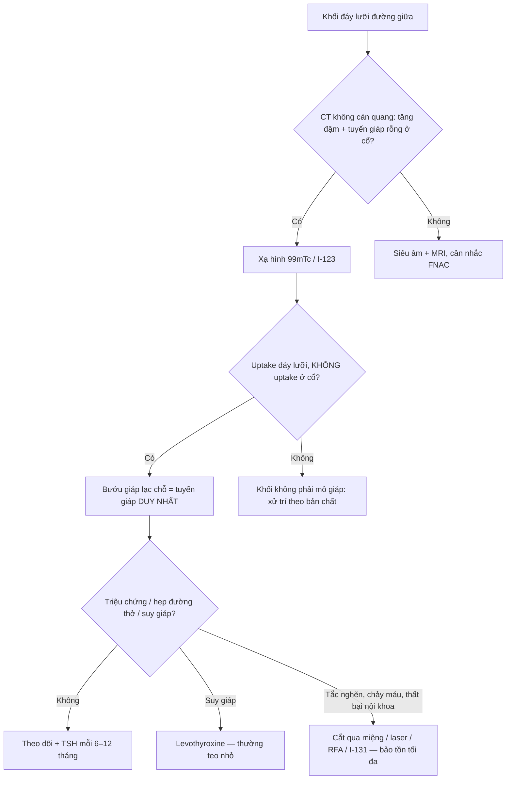
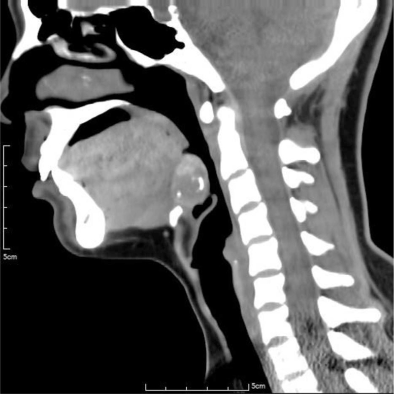
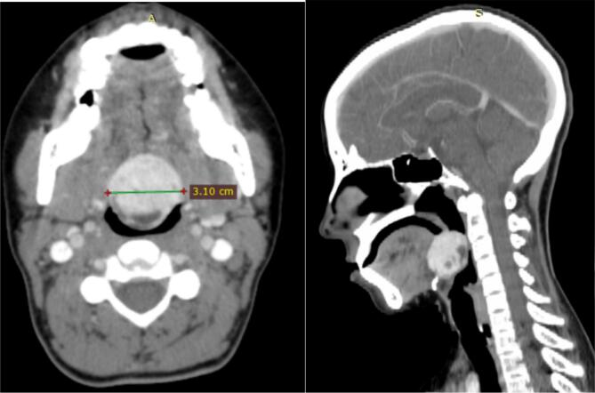
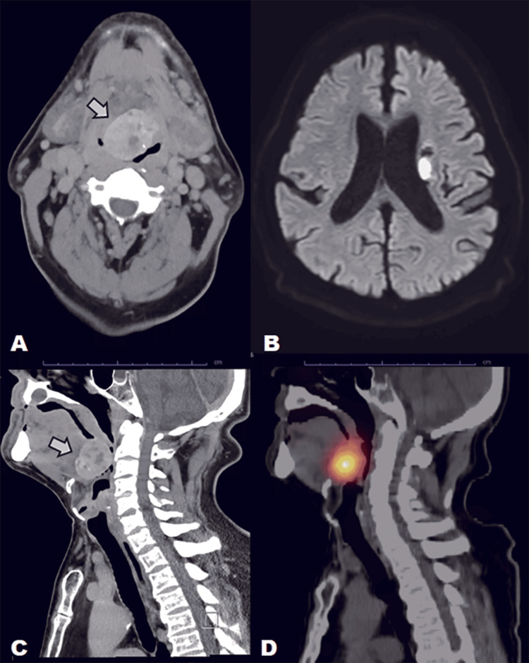

# 1899 — Bướu giáp lạc chỗ ở đáy lưỡi (lingual thyroid): khối tăng đậm đường giữa, "tuyến giáp rỗng" ở cổ — và vì sao phải xạ hình TRƯỚC khi sinh thiết hay cắt

**Tags:** `pattern:khoi-day-luoi` `pattern:tang-dam` `pattern:voi-hoa` `pattern:khong-dong-nhat` `vung:loi` `vung:tuyen-giap` `vung:hau-mieng` `vung:co` `protocol:CT-co-can-quang` `protocol:MRI` `protocol:xa-hinh` `protocol:SA-Doppler` `protocol:noi-soi`

**Mức chắc chắn (certainty):** tổng hợp y văn (literature synthesis) — ghép 3 bài open-access đã đọc toàn văn: **Huang H, Lin YH, *Medicine (Baltimore)* 2021 (PMC8556010, CC BY 4.0)** — ca bướu giáp lạc chỗ 26 × 24 × 19 mm có vôi hóa viền, suy giáp nặng; **Alebie HK et al., *Int J Surg Case Rep* 2024 (PMC11277313, CC BY 4.0)** — ca 3,10 × 3 cm kèm thuật toán xử trí; **Yoneoka Y et al., *Cureus* 2025 (PMC12796546, CC BY 4.0)** — ca 4,0 × 3,5 × 3,0 cm vôi hóa thô gây hẹp đường thở, phát hiện tình cờ trên CT sọ não. Số nào nguồn không đưa thì ghi "chưa rõ".

> **Bài này trả lời 4 câu hỏi của một khối đáy lưỡi đường giữa trên CT:**
> (1) **Đây là bướu giáp lạc chỗ hay u thật?** (2) **Vì sao nó "trắng" trên CT không cản quang — có phải máu hay vôi hóa ác tính?** (3) **Có được sinh thiết/cắt ngay không?** (4) **Khi nào chỉ theo dõi – khi nào cắt – khi nào đốt bằng iod phóng xạ?**
> Điểm tựa duy nhất của bài: **bướu giáp lạc chỗ có thể LÀ toàn bộ tuyến giáp của người bệnh** (> 70% không có mô giáp ở cổ). Cắt nó mà chưa chứng minh bằng xạ hình = **suy giáp vĩnh viễn do phẫu thuật**.

## 1. Tổng quan bệnh học – cơ chế hình ảnh

### 1.1 Phôi thai: vì sao tuyến giáp "dừng chân" ở đáy lưỡi

- Tuyến giáp phôi thai bắt đầu như một **nụ nội bì ở sàn hầu, ngay sau củ lưỡi (foramen caecum)**. Trong tuần 7, nụ này **di chuyển xuống dọc ống giáp–lưỡi (thyroglossal duct)** rồi dừng trước khí quản. Bất kỳ điểm dừng nào trên đường đi đều tạo **mô giáp lạc chỗ (ectopic thyroid tissue)**; dừng ở đáy lưỡi = **bướu giáp lạc chỗ (lingual thyroid)**.
- **Dịch tễ (đã đối chiếu 3 nguồn):** mô giáp lạc chỗ gặp **1/100.000 – 1/300.000** người; bướu giáp lạc chỗ chiếm **~90%** các ca lạc chỗ; **nữ 70–80%** (một số nguồn ghi tỉ lệ nữ:nam **3:1**). Trong 200 ca tử thiết, **10%** có mô giáp lạc chỗ đường kính tới 1 cm — nghĩa là **phần lớn tồn tại im lặng**, chỉ lộ ra khi tuyến phì đại.
- **Vì sao phì đại ở tuổi dậy thì, thai kỳ, suy giáp:** mô lạc chỗ chịu cùng trục **TSH**; khi nhu cầu tăng (dậy thì, có thai, thiếu iod, dùng lithium) tuyến phì đại và gây **nuốt vướng, khàn tiếng, chảy máu, khó thở**. Vì thế bệnh hay được phát hiện ở **thập kỷ 2–4**, dù bẩm sinh.

### 1.2 TẠI SAO khối này tăng đậm trên CT không cản quang

- Mô giáp **tổng hợp và dự trữ iod** trong thyroglobulin. Iod có **Z = 53**, nên ở năng lượng tia X chẩn đoán hiệu ứng **quang điện (photoelectric)** chiếm ưu thế → **đậm độ cao hơn cơ lưỡi rõ rệt**. Trên CT không cản quang, nhu mô giáp bình thường đã **60–100 HU** (cơ ~40–50 HU); bướu giáp lạc chỗ thường **tăng đậm đồng nhất hoặc hỗn hợp**, có ca đo được **65–120 HU** tùy hàm lượng iod và vôi hóa.
- **Vôi hóa gặp được và KHÔNG đồng nghĩa ác tính:** ca PMC8556010 có **vôi hóa viền (ring calcification)** trên khối **26 × 24 × 19 mm**; ca PMC11277313 có khối **3,10 × 3 cm**; ca PMC12796546 có **vôi hóa thô** trong khối **4,0 × 3,5 × 3,0 cm**. Đây là vôi hóa thoái hóa/nang trong mô giáp, không phải "vôi hóa kiểu sụn" của ung thư.
- **TẠI SAO ngấm thuốc mạnh:** tuyến giáp có mạng mao mạch dày; trên CT có cản quang khối **ngấm thuốc đồng nhất, mạnh hơn cơ**, giữ thuốc ở thì muộn — khác u thần kinh hay lymphoma (ngấm ít, không đồng nhất).
- **TẠI SAO T1/T2 đặc trưng:** thyroglobulin (protein) và colloid làm **T1 hơi tăng so với cơ**, **T2 tăng**; không có dấu hiệu "tối đen" như nang đơn thuần, cũng không có giới hạn khuếch tán mạnh như lymphom/ung thư tế bào vảy.

### 1.3 Con số quyết định thái độ: "tuyến giáp rỗng" và suy giáp

- **> 70%** bệnh nhân bướu giáp lạc chỗ **không có mô giáp ở vị trí bình thường**. Đây là lý do phải **xạ hình trước mọi can thiệp**: nếu khối là nguồn giáp duy nhất, cắt bỏ = **suy giáp vĩnh viễn**, phải thay hormone suốt đời.
- **Suy giáp gặp tới 70%** bệnh nhân (thường dưới lâm sàng, TSH tăng bù). Ca PMC12796546 có **TSH 11,4 µIU/mL** — tăng nhẹ nhưng đủ giải thích phì đại.
- **Ung thư trong bướu giáp lạc chỗ < 1%**, chủ yếu **ung thư nhú (papillary)**, thường chỉ phát hiện sau khi cắt. Vì vậy **không được "cắt để loại trừ ung thư"** ở một khối lành tính, không triệu chứng.

## 2. Mẫu hình + chẩn đoán phân biệt theo vị trí (gamut)

### 2.1 Bốn mẫu hình cần nhận ra

- **Mẫu A — khối đặc đường giữa đáy lưỡi, tăng đậm trên CT không cản quang, đồng nhất, bờ rõ, ± vôi hóa:** bướu giáp lạc chỗ điển hình. Kèm **"ổ giáp rỗng" ở cổ** (không thấy tuyến giáp trước khí quản).
- **Mẫu B — khối đáy lưỡi + hẹp đường thở:** bướu giáp lạc chỗ phì đại lớn (ca 4,0 cm làm hẹp nặng hầu họng); phải đánh giá **đường thở trước khi gây mê/sinh thiết**.
- **Mẫu C — khối đáy lưỡi có nang/hỗn hợp, vôi hóa, ngấm thuốc không đều:** bướu giáp lạc chỗ thoái hóa nang — vẫn lành tính; **không** suy ra ác tính chỉ vì không đồng nhất.
- **Mẫu D — khối lệch bên đáy lưỡi/amidan lưỡi:** **không** phải bướu giáp lạc chỗ (vốn ở đường giữa) → nghĩ **phì đại amidan lưỡi, u tuyến nước bọt phụ, hemangioma/lymphangioma, ung thư tế bào vảy, lymphoma**.

### 2.2 Gamut theo vị trí

- **Đường giữa, ngay sau foramen caecum (đáy lưỡi):** bướu giáp lạc chỗ, **nang ống giáp–lưỡi (thyroglossal duct cyst)** (thường thấp hơn, dạng nang, di động khi nuốt/lè lưỡi), **dermoid/teratoma**, **u hạt tế bào (granular cell tumor)**.
- **Đường giữa nhưng thấp (dưới xương móng – trước giáp trạng):** nang ống giáp–lưỡi, **tuyến giáp lạc chỗ dưới lưỡi**, hạch giáp móng.
- **Lệch bên đáy lưỡi/amidan lưỡi:** phì đại amidan lưỡi (rất hay gặp, đối xứng), u tuyến nước bọt phụ, hemangioma, lymphoma, ung thư tế bào vảy.
- **Trong xoang lưỡi–giáp (vallecula):** nang biểu bì, u nhú, di căn.

### 2.3 Sơ đồ quyết định (kèm mục 4)

## 3. Bảng so sánh phân biệt (ma trận đối chiếu)

| Thực thể (entity) | Hình ảnh điển hình | Chốt vào (rule-in) | Chốt loại (rule-out) | Gợi ý xác nhận |
|---|---|---|---|---|
| **Bướu giáp lạc chỗ (lingual thyroid)** | Khối đặc **đường giữa đáy lưỡi**, **tăng đậm trên CT không cản quang** (60–120 HU), ngấm thuốc mạnh, ± vôi hóa; **không thấy tuyến giáp ở cổ** | **Uptake 99mTc/I-123 tại đáy lưỡi + KHÔNG uptake vùng cổ**; T1 hơi tăng, T2 tăng | **Có tuyến giáp bình thường ở cổ với uptake bình thường** → khối đáy lưỡi không phải mô giáp duy nhất (vẫn có thể là mô lạc chỗ phụ) | Xạ hình là **tiêu chuẩn vàng**; CT/MRI để đo và đánh giá đường thở |
| **Nang ống giáp–lưỡi** | Khối **dạng nang**, dịch **0–20 HU**, vỏ mỏng, thường **dưới xương móng**, di động khi lè lưỡi | Vị trí thấp, **thành nang + cuống lên xương móng**, không đặc | **Đặc, tăng đậm như mô giáp** → không phải nang đơn thuần | Siêu âm + CT; xạ hình âm tính trong nang |
| **Phì đại amidan lưỡi** | Khối **lệch bên**, đối xứng hai bên, cùng đậm độ cơ, không vôi hóa, không ngấm mạnh | Đối xứng, bờ múi, không có "tuyến giáp rỗng" | **Đường giữa, tăng đậm, có uptake** → bướu giáp lạc chỗ | So sánh hai bên; xạ hình âm tính |
| **Hemangioma / lymphangioma** | Khối **ngấm thuốc kiểu mao mạch/tĩnh mạch**, có thể tăng đậm muộn; lymphangioma dạng nang nhiều thùy | Ngấm thuốc theo thì mạch, ± dòng chảy Doppler | **Không uptake phóng xạ**, không tăng đậm trên CT không cản quang | MRI T2 rất cao (lymphangioma); xạ hình âm |
| **U tuyến nước bọt phụ** | Khối lệch bên, ngấm thuốc vừa, có thể vôi hóa nhỏ | Vị trí lệch bên, typ mô tuyến nước bọt | **Đường giữa + tăng đậm + uptake** → loại | MRI + FNAC |
| **Ung thư tế bào vảy / lymphoma** | Khối **xâm lấn**, bờ không rõ, hạch cổ, **ngấm thuốc không đều**, có thể hoại tử | Loét, xâm lấn cơ, hạch hoại tử | **Bờ rõ, tăng đậm đồng nhất, không hạch** → ít khả năng | Sinh thiết **sau** khi loại trừ mô giáp |
| **Dermoid / teratoma** | Khối **chứa mỡ** (−50 đến −100 HU) và/hoặc vôi hóa, có thể có răng | **Mỡ trong khối** trên CT/MRI fat-sat | **Không có mỡ, tăng đậm như mô giáp** → loại | CT/MRI; xạ hình âm |
| **U hạt tế bào (granular cell)** | Khối nhỏ, đặc, đáy lưỡi, ngấm thuốc vừa | Niêm mạc phủ nguyên vẹn, không vôi hóa | Không uptake, không tăng đậm mạnh | Sinh thiết |

- **Ảnh ghép đối chiếu (cùng một ca):** `` — CT dọc trước cản quang cho thấy khối đáy lưỡi **tăng đậm, vôi hóa viền**, và SPECT/CT 99mTc cho thấy **uptake khu trú tại đáy lưỡi, KHÔNG uptake ở vùng cổ** — hai mảnh bằng chứng của cùng một chẩn đoán.

## 4. Protocol chụp + hệ phân độ/ngưỡng xử trí

### 4.1 Trình tự chẩn đoán (không đảo thứ tự)

1. **Lâm sàng + soi gương/nội soi ống mềm:** đánh giá kích thước, chảy máu, **mức hẹp đường thở**; hỏi nuốt vướng, khàn tiếng, khó thở khi nằm.
2. **Xét nghiệm:** TSH, FT4, anti-TPO. **TSH tăng** gặp ở phần lớn; suy giáp có thể nặng dù khối nhỏ.
3. **Siêu âm cổ (và đáy lưỡi qua đường dưới cằm):** xác nhận **có/không có tuyến giáp ở vị trí bình thường**, đo khối, Doppler.
4. **CT cổ không cản quang ± có cản quang, lát ≤ 1–2 mm:** đo khối theo 3 chiều, đánh giá **đường thở** và vôi hóa. **Đây là nơi hay phát hiện tình cờ** (ca PMC12796546 phát hiện trên CT sọ não vì đột quỵ).
5. **MRI (T1, T2, T1 fat-sat sau tiêm):** khi cần đánh giá xâm lấn đáy lưỡi/đường thở hoặc phân biệt với u.
6. **Xạ hình 99mTc-pertechnetate hoặc I-123 — BẮT BUỘC trước can thiệp:** chứng minh mô giáp và **vị trí duy nhất**; đây là bước quyết định "cắt được hay không".
7. **FNAC:** chỉ khi khối **không phải mô giáp** hoặc có dấu hiệu nghi ác tính; **không** làm thường quy vì nguy cơ **chảy máu** và **nhiễm độc giáp thoáng qua**; kim qua khối giáp mạch máu giàu có thể gây chảy máu đường thở.

### 4.2 Ngưỡng xử trí (theo triệu chứng, không theo mm đơn thuần)

| Tình huống | Thái độ |
|---|---|
| Không triệu chứng, đường thở rộng, TSH bình thường | **Theo dõi** + TSH mỗi **6–12 tháng**; không sinh thiết |
| Suy giáp (TSH tăng) | **Levothyroxine** — giảm TSH làm khối **teo nhỏ**; theo dõi 3–6 tháng |
| Nuốt vướng/khàn nhiều, khối to, thất bại nội khoa | **Cắt qua miệng (transoral) / laser / RFA** — bảo tồn mô giáp tối đa |
| Hẹp đường thở nặng, chảy máu tái diễn | Can thiệp sớm, **bảo vệ đường thở trước**; cân nhắc **nút mạch trước mổ** để giảm chảy máu |
| Không mổ được / khối lớn / bệnh nhân chọn | **I-131** (phải xác nhận là tuyến giáp duy nhất; hiệu quả teo chậm) |
| Nghi ác tính (loét, xâm lấn, hạch) | Sinh thiết có kiểm soát + xử trí theo mô học |

### 4.3 Cạm bẫy protocol

- **Cản quang iod làm "khoá" xạ hình:** iod trong thuốc cản quang ức chế bắt giữ iod (hiệu ứng Wolff–Chaikoff); kinh điển phải **hoãn 4–6 tuần** sau cản quang iod trước I-123/I-131 (99mTc-pertechnetate ít bị ảnh hưởng hơn nhưng vẫn nên tránh ngay sau tiêm). Số "4–6 tuần" là **ngưỡng kinh điển, chưa có thử nghiệm ngẫu nhiên**.
- **Chụp CT có cản quang trước xạ hình** là sai thứ tự hay gặp ở khoa cấp cứu (bệnh nhân vào vì khó thở, được chụp CTA trước).
- **Trẻ em:** ưu tiên **siêu âm + MRI không bức xạ**; chỉ CT khi cần đánh giá đường thở/xương. Liều thấp theo ALARA.

## 5. Biến thể bình thường và cạm bẫy

- **Biến thể bình thường:** **mô giáp lạc chỗ nhỏ, không triệu chứng** gặp ở **10% ca tử thiết** (đường kính tới 1 cm) — đừng gọi là "khối u" hay chỉ định cắt. **Amidan lưỡi phì đại** hai bên, đối xứng, cùng đậm độ cơ là biến thể hay bị đọc nhầm thành khối.
- **Cạm bẫy 1 — tăng đậm = máu?** Trên CT không cản quang, khối giáp **tăng đậm đồng nhất** có thể bị đọc là "máu tụ/khối xuất huyết". Phân biệt: máu tụ **không có uptake xạ hình**, đậm độ giảm dần theo thời gian, hình dạng theo khoang; mô giáp **giữ đậm độ và bắt xạ**.
- **Cạm bẫy 2 — vôi hóa = ác tính?** **Không.** Vôi hóa viền/thô trong mô giáp là thoái hóa; ung thư trong bướu giáp lạc chỗ **< 1%** và không chẩn đoán được bằng vôi hóa.
- **Cạm bẫy 3 — sinh thiết trước xạ hình:** nếu khối là **tuyến giáp duy nhất**, sinh thiết/cắt có thể gây **chảy máu đường thở** và **mất toàn bộ mô giáp**. Luôn xạ hình trước.
- **Cạm bẫy 4 — bỏ sót "tuyến giáp rỗng":** người đọc chỉ mô tả khối mà **không ghi có/không có tuyến giáp ở cổ** — đây là dữ kiện làm thay đổi hoàn toàn thái độ.
- **Cạm bẫy 5 — hội chứng "thoả mãn tìm kiếm":** thấy khối đáy lưỡi rồi dừng, bỏ qua **hạch cổ**, **nang ống giáp–lưỡi đồng thời**, hoặc **ung thư thứ hai**.
- **Cạm bẫy 6 — trẻ nhỏ khó thở:** khối đáy lưỡi ở trẻ có thể là **nguyên nhân khó thở khi nằm** bị quy cho hen/viêm thanh quản; CT/MRI đường thở là chìa khóa.

## 6. Tự lượng giá — Blind Quiz ngay trên trang tĩnh

**Ca 1 — nữ 29 tuổi, mệt mỏi 3 tháng, không khối cổ**

- Gợi ý lâm sàng: mệt mỏi, chậm chạp, không sờ thấy tuyến giáp ở cổ.
- Câu hỏi: Khối ở đâu, đậm độ so với cơ? Dấu hiệu nào trên CT gợi ý bản chất mô giáp? Ba chẩn đoán phân biệt? Bước tiếp theo **trước** khi sinh thiết?

<b>Bấm để hiện đáp án (findings + chẩn đoán)</b>

- Dấu hiệu: khối **26 × 24 × 19 mm** ở **đáy lưỡi đường giữa**, **tăng đậm hỗn hợp** so với cơ, có **vôi hóa viền**; **không thấy tuyến giáp ở vị trí trước khí quản**.
- Chẩn đoán: **bướu giáp lạc chỗ (lingual thyroid)** kèm suy giáp — mô giáp dự trữ iod nên tăng đậm trên CT không cản quang; vôi hóa là thoái hóa, không phải ác tính.
- Bước tiếp theo: **xạ hình 99mTc/I-123** để chứng minh đây là tuyến giáp duy nhất (trong ca gốc: uptake đáy lưỡi, không uptake ở cổ) → điều trị **levothyroxine**, không cắt.
- Nguồn ảnh: Huang H, Lin YH, *Medicine (Baltimore)* 2021, PMC8556010 Fig. 2, CC BY 4.0.

**Ca 2 — nữ 23 tuổi, nuốt vướng tăng dần**

- Gợi ý lâm sàng: nuốt vướng, khàn nhẹ, không khó thở khi nghỉ.
- Câu hỏi: Đo kích thước khối và mô tả vị trí? Có dấu hiệu xâm lấn không? Chẩn đoán khác biệt chính là gì?

<b>Bấm để hiện đáp án (findings + chẩn đoán)</b>

- Dấu hiệu: khối **3,10 × 3 cm** ở **đáy lưỡi**, **đồng nhất, ngấm thuốc**, bờ rõ, **không xâm lấn cơ lưỡi**; không thấy tuyến giáp ở cổ trên siêu âm/CT.
- Chẩn đoán: **bướu giáp lạc chỗ** — bờ rõ và ngấm thuốc đều là dấu hiệu lành tính; phân biệt chính với **phì đại amidan lưỡi** (lệch bên, cùng đậm độ cơ) và **u tuyến nước bọt phụ** (lệch bên).
- Xử trí trong ca gốc: **levothyroxine** làm giảm kích thước, sau đó **cắt chọn lọc** vì còn nuốt vướng.
- Nguồn ảnh: Alebie HK et al., *Int J Surg Case Rep* 2024, PMC11277313 Fig. 3, CC BY 4.0.

**Ca 3 — nam, đột quỵ, CT sọ não tình cờ thấy khối đáy lưỡi**

- Gợi ý lâm sàng: nhập viện vì đột quỵ; khó nuốt và khó bảo vệ đường thở sau đột quỵ.
- Câu hỏi: Khối có đặc điểm gì bất thường về kích thước? Vì sao đường thở là vấn đề cấp cứu ở ca này? Xạ hình cho thấy gì?

<b>Bấm để hiện đáp án (findings + chẩn đoán)</b>

- Dấu hiệu: khối **4,0 × 3,5 × 3,0 cm**, **vôi hóa thô**, **hẹp nặng hầu họng** trên CT; DWI cho thấy **nhồi máu bao trong trái** (bệnh nền); **xạ hình I-123: uptake mạnh ở đáy lưỡi, không thấy tuyến giáp ở cổ**.
- Chẩn đoán: **bướu giáp lạc chỗ lớn** — đột quỵ làm mất phản xạ bảo vệ đường thở, biến khối lành tính thành **cấp cứu đường thở**.
- Bài học: kích thước **4 cm** + vôi hóa thô vẫn có thể lành tính; quyết định can thiệp dựa trên **triệu chứng và đường thở**, không dựa trên vẻ "ác tính" của vôi hóa.
- Nguồn ảnh: Yoneoka Y et al., *Cureus* 2025, PMC12796546 Fig. 1, CC BY 4.0.

## Bài liên quan chéo

- [230 – Tuyến giáp ACR TI-RADS & hạch cổ](../230-tuyen-giap-hach-co/lesson.md) — đọc nhân giáp tại chỗ.
- [1815 – Suy giáp do quá tải iod ở sơ sinh](../1815-suy-giap-do-qua-tai-iod-so-sinh/lesson.md) — hiệu ứng Wolff–Chaikoff và cản quang iod.
- [1622 – Đốt cồn nang giáp lành tính](../1622-dot-con-nang-giap-pei/lesson.md) — can thiệp tối thiểu xâm lấn tuyến giáp.
- [3066 – U nhú đảo ngược mũi xoang](../3066-u-nhu-dao-nguoc-mui-xoang/lesson.md) — tiếp cận khối đường giữa vùng mũi xoang (khác vùng, cùng nguyên lý "chân bám").

## Ảnh

- `images/1899_lingual-thyroid_CT_PMC8556010-f2.jpg` — CT dọc cổ không cản quang, khối 26 × 24 × 19 mm có vôi hóa viền. Huang H, Lin YH, *Medicine (Baltimore)* 2021, PMC8556010 Fig. 2, **CC BY 4.0**.
- `images/1899_lingual-thyroid_Xa-Scan_PMC8556010-f1.jpg` — SPECT/CT 99mTc: uptake đáy lưỡi, không uptake vùng cổ. Cùng bài, Fig. 1, **CC BY 4.0**.
- `images/1899_lingual-thyroid_CT_PMC11277313-f3.jpg` — CT cổ có cản quang (ngang + dọc), khối 3,10 cm. Alebie HK et al., *Int J Surg Case Rep* 2024, PMC11277313 Fig. 3, **CC BY 4.0**.
- `images/1899_lingual-thyroid_CT-Scan_PMC12796546-f1.jpg` — CT không cản quang + DWI + xạ hình I-123. Yoneoka Y et al., *Cureus* 2025, PMC12796546 Fig. 1, **CC BY 4.0**.
- `images/composite_lingual-thyroid_CT-SPECT.jpg` — ảnh ghép CT + SPECT/CT cùng ca, tạo bằng `tools/make_composite.py`.

> Không dùng để chẩn đoán độc lập khi chưa có người hướng dẫn.
