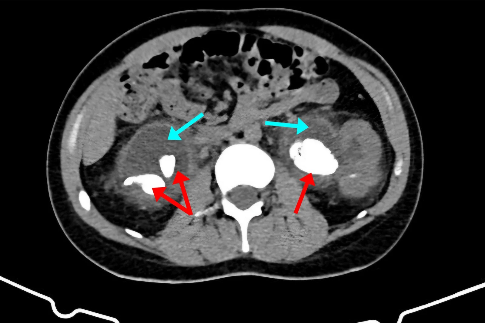
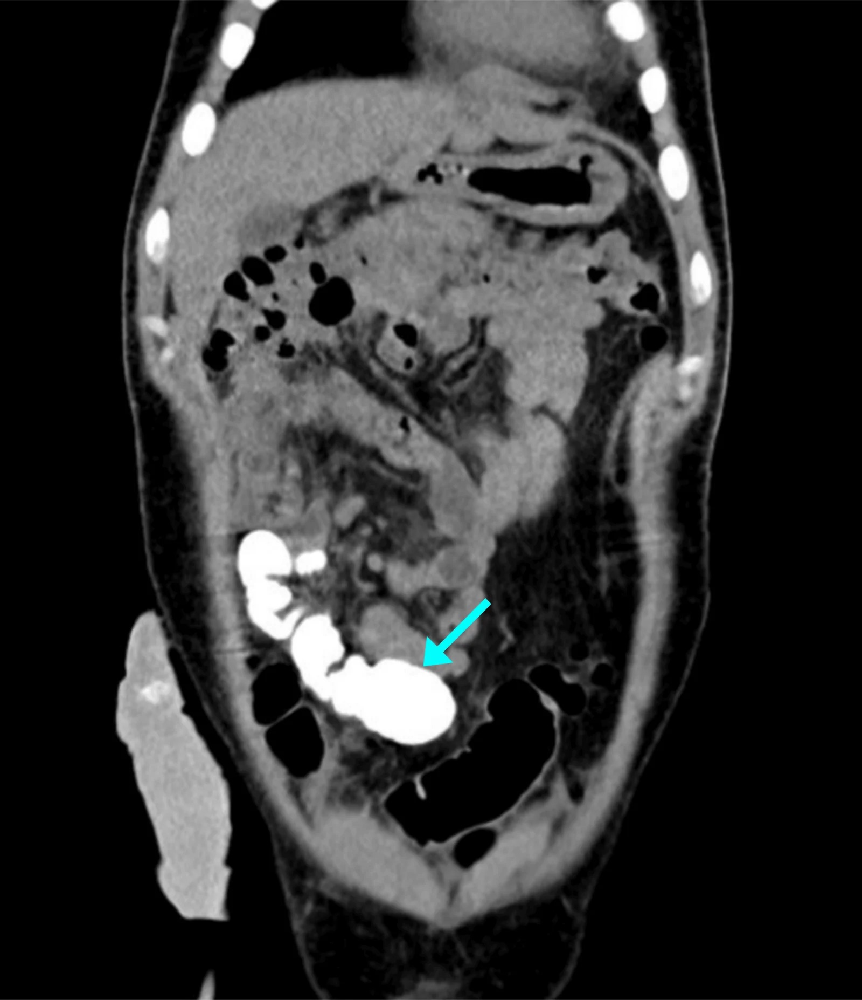
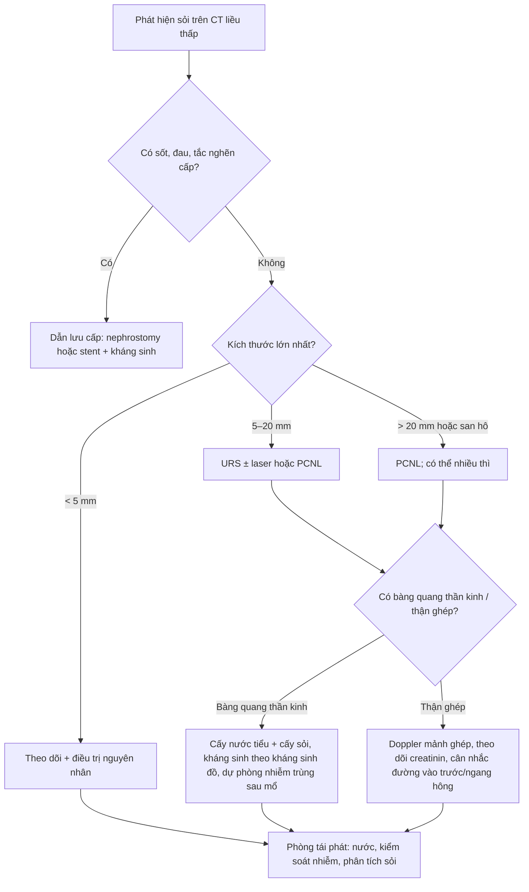
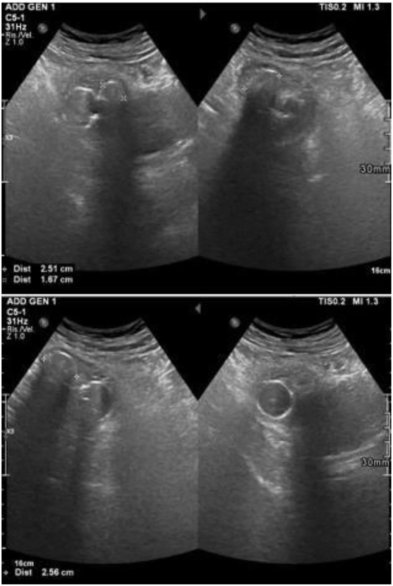
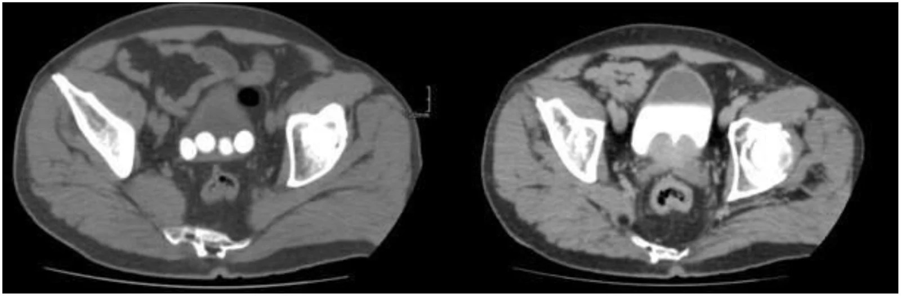
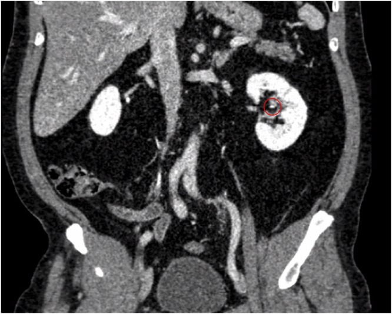

# 190 — Sỏi đường niệu trên & sỏi thận ghép ở bệnh nhân bàng quang thần kinh / Upper-tract and allograft stones in the neurogenic bladder

**Tags:** `pattern:soi-nieu` `pattern:tac-nghen` `pattern:nhiem-trung` `vung:he-nieu` `vung:than` `vung:bang-quang` `vung:than-ghep` `protocol:CT-lieu-thap` `protocol:PCNL` `protocol:URS` `score:Clavien-Dindo`
**Mức chắc chắn (certainty):** tổng hợp y văn (literature synthesis) — nghiên cứu so sánh sau nội soi niệu quản (Breu B et al., *J Clin Med* 2025, PMC12610729), loạt PCNL ở bàng quang thần kinh (Heijkoop B et al., *BJUI Compass* 2023, PMC10560620), tổng quan sỏi thận ghép (Solano C et al., *J Clin Med* 2024, PMC11278228), loạt 8.835 bệnh nhân ghép thận (Sandberg M et al., *BJUI Compass* 2024, PMC11479801), cộng ca nguyên văn sỏi san hô ở bể thận chuyển lưu (Ahmadi M et al., *Cureus* 2026, PMC13685014). Số nào nguồn không nêu ghi **"chưa rõ"**.

> Bài này bàn **sỏi đường niệu trên** (thận/niệu quản) và **sỏi thận ghép** ở người có **bàng quang thần kinh (neurogenic bladder)** hoặc **bể thận chuyển lưu (urinary diversion)**. Sỏi **bàng quang** và sỏi quanh catheter ở trẻ ở [691](../691-soi-bang-quang-va-soi-quanh-catheter-o-tre/lesson.md); đánh giá bàng quang trước ghép thận ở [189](../189-danh-gia-truoc-ghep-than-bang-quang-than-kinh/lesson.md); nguyên tắc chung sỏi–ứ nước–nhiễm trùng ở [152](../152-soi-nieu/lesson.md).

## 1. Tổng quan bệnh học – cơ chế hình ảnh

- **Vì sao nhóm bàng quang thần kinh tạo sỏi nhiều:** ứ nước do **bàng quang co bóp không hiệu quả + áp lực bàng quang cao + trào ngược bàng quang–niệu quản**; **nhiễm khuẩn niệu mạn và màng sinh học trên catheter**; **bất động → hủy xương → tăng canxi niệu**; và **dịch vụn/mảnh sỏi sót** sau can thiệp. Ước tính bệnh nhân **tổn thương tủy sống (spinal cord injury — SCI) có nguy cơ sỏi 7–20% trong 10 năm**, nguy cơ **suốt đời cao gấp tới 6 lần** dân số chung (Heijkoop B et al. 2023, PMC10560620).
- **TẠI SAO sỏi ở nhóm này thường là sỏi nhiễm trùng:** vi khuẩn **phân giải urê (urease-splitting)** — *Proteus*, *Klebsiella*, *Pseudomonas* — phân hủy urê thành amoniac, **kiềm hóa nước tiểu (pH > 7,2)** và kết tủa **magie–amoni–phosphat (struvite) + apatit carbonat**, tạo **sỏi san hô (staghorn)** đúc khuôn đài bể thận. Hệ quả hình ảnh: sỏi **rất cản quang, đúc theo hình đài bể thận**, thường **kèm ứ nước và thành bàng quang dày**.
- **Số liệu thành phần sỏi xác nhận cơ chế:** sau nội soi niệu quản, nhóm bàng quang thần kinh có **tỷ lệ sỏi struvite và calci phosphat hỗn hợp cao hơn rõ**, trong khi nhóm chứng **75% là calci oxalat** (Breu B et al., *J Clin Med* 2025, PMC12610729). Đây là lý do **phải cấy sỏi/sinh thiết sỏi** chứ không chỉ nhìn đậm độ.
- **TẠI SAO thận ghép "im lặng":** thận ghép **mất chi phối thần kinh** (denervation) nên **không có cơn đau quặn thận điển hình**; biểu hiện thường là **tiểu máu, tăng creatinin, nhiễm trùng niệu**, dễ bị nhầm với **thải ghép cấp hoặc hoại tử ống thận cấp**. Trong một tổng quan, **hơn 40% sỏi thận ghép được phát hiện tình cờ**; **tiểu máu + suy thận cấp gặp 23,5%**, nhiễm trùng niệu **5,9%** (Solano C et al. 2024, PMC11278228).
- **Dịch tễ sỏi thận ghép:** **0,1–6,3%** (tổng quan); trong loạt 8.835 người ghép, **128 người (1,4%)** tạo sỏi trong thận ghép, **thời gian trung bình 6,2 năm**, **đường kính lớn nhất trung bình 5,7 mm**, trung bình **1,7 viên** (Sandberg M et al., *BJUI Compass* 2024, PMC11479801). Sỏi thận ghép **không làm tăng tỷ lệ mất ghép** trong loạt này (p = 0,524) nhưng **thời gian tới mất ghép dài hơn** ở nhóm có sỏi (p = 0,008) — đọc đúng: đây là **kết quả của theo dõi sát và can thiệp sớm**, không phải "sỏi vô hại".
- **TẠI SAO vị trí giải phẫu quyết định hình ảnh:** thận ghép nằm **hố chậu, trên mạch chậu**, niệu quản **ngắn, cắm vào bàng quang hoặc bể chuyển lưu**; vì vậy sỏi hay gặp ở **niệu quản đoạn xa (49,01%)**, **đài dưới (17,6%)**, **bể thận (7,8%)** (Solano C et al. 2024). **Kiểu miệng nối** cũng quyết định nguy cơ: **bể chuyển lưu/neobladder có tỷ lệ sỏi tới 18%**, trong khi **Lich–Gregoir** thấp nhất (Solano C et al. 2024).
- **Ngưỡng đậm độ trên CT:** sỏi canxi điển hình **rất cản quang** — ca minh họa **1.613 HU** (Purwanto HPA et al., *Int J Surg Case Rep* 2026, PMC13340684). Không có một ngưỡng HU duy nhất để "chốt" thành phần: trên CT một mức năng lượng, **maxHU phân biệt sỏi acid uric với sỏi không acid uric** đạt **độ nhạy 92%, độ đặc hiệu 94%, độ chính xác 94%**; phương pháp định lượng dùng phân bố đậm độ nội bộ đạt **100%/97%/98%** (Jendeberg J et al., *Eur Radiol* 2021, PMC8270827). Sỏi acid uric chiếm **7–11%** sỏi niệu nói chung.
- **TẠI SAO phải hạ liều tia ở nhóm này:** bệnh nhân sỏi thường **chụp CT nhiều lần**; **tới 20% bệnh nhân sỏi mới chẩn đoán có liều tích lũy vượt nền gấp ~17 lần** (Baralo B et al., *Asian J Urol* 2020, PMC6962710). CT đầu tiên nên là **CT không cản quang liều thấp**; với CT đếm photon, hạ mức chất lượng ảnh từ IQL70 xuống IQL50 giảm **SSDE từ 4,57 xuống 3,53 mGy (−22,8%)** mà **tỷ lệ phát hiện sỏi vẫn 91,3–100%** (Niehoff JH et al., *Diagnostics* 2023, PMC9914353).

## 2. Mẫu hình + chẩn đoán phân biệt theo vị trí (gamut)

**Câu hỏi thực hành:** sỏi **ở đâu**, **kích thước bao nhiêu**, và **có nhiễm trùng/tắc nghẽn cấp không**? Ba câu này quyết định theo dõi hay can thiệp, và can thiệp bằng đường nào.

**Trục A — theo vị trí**

1. **Thận (đài/bể):** sỏi san hô (đúc khuôn), sỏi đài dưới, sỏi bể thận; ở thận ghép: **hố chậu**, dễ nhầm với canxi hóa mạch chậu.
2. **Niệu quản:** sỏi niệu quản **ngắn ở thận ghép**, sỏi tại **miệng nối niệu quản–bàng quang/bể chuyển lưu**, hẹp miệng nối kèm sỏi.
3. **Bàng quang/bể chuyển lưu:** sỏi bàng quang nhiều viên ở người đặt catheter mạn; **sỏi trong quai ruột chuyển lưu** (mucus + ứ + nhiễm khuẩn phân giải urê).
4. **Quanh stent/catheter:** **đóng vôi stent (stent encrustation)** — cặn khoáng bám quanh stent, trở thành **nidus** cho sỏi lớn.

**Trục B — theo cơ chế/thành phần**

- **Sỏi nhiễm trùng (struvite/apatit):** nước tiểu kiềm, *Proteus*, sỏi san hô, hay tái phát nếu không kiểm soát ổ nhiễm và ứ trệ.
- **Sỏi calci (oxalat/phosphat):** đậm độ cao, đau điển hình ở thận tự nhiên, **im lặng ở thận ghép**.
- **Sỏi acid uric:** đậm độ thấp hơn, **không thấy rõ trên X-quang**, hòa tan bằng kiềm hóa nước tiểu (vai trò điều trị, không chỉ chẩn đoán).
- **Sỏi cystine:** hiếm, cản quang nhẹ, tái phát nhiều.
- **Canxi hóa không phải sỏi:** canxi hóa mạch chậu, hạch chậu, **bóng Foley**, mảnh xương — đây là nhóm "bẫy" hay gặp nhất trên CT hố chậu.

## 3. Bảng so sánh phân biệt (ma trận đối chiếu)

| Thực thể (entity) | Hình ảnh điển hình | Chốt vào (rule-in) | Chốt loại (rule-out) | Gợi ý xác nhận |
|---|---|---|---|---|
| **Sỏi nhiễm trùng / san hô ở bàng quang thần kinh** | Khối **cản quang rất cao** đúc theo **đài–bể thận**, có nhánh; **ứ nước**, thành bàng quang dày; bể chuyển lưu có sỏi | **Hình đúc khuôn đài bể thận + nước tiểu kiềm + vi khuẩn phân giải urê** | Khối cản quang rời, không đúc khuôn → sỏi đơn thuần/canxi hóa khác | CT không cản quang; **cấy nước tiểu + cấy sỏi**; pH nước tiểu |
| **Sỏi calci (oxalat/phosphat)** | Sỏi **đậm độ cao**, bờ rõ, thường đài dưới/bể thận; X-quang bụng thấy được | **Đậm độ > 500 HU trên CT không cản quang + bờ đá rõ** | Đậm độ thấp, bờ mờ, đổi hình khi đổi tư thế → không phải sỏi | Phân tích thành phần sỏi sau lấy |
| **Sỏi acid uric** | **Cản quang kém**, có thể **không thấy trên X-quang**; thường bể thận/đài | **maxHU thấp + không thấy trên phim + pH nước tiểu thấp** | maxHU cao, bờ đá → sỏi calci | CT một mức năng lượng (Se 92%/Sp 94%) hoặc CT hai mức năng lượng; thử hòa tan |
| **Đóng vôi stent/catheter** | Vỏ **cản quang bám dọc theo stent**, dày không đều; stent **không còn thấy rõ lòng** | **Cản quang bao quanh toàn chu vi stent, có "vỏ"** | Cản quang rời rạc cạnh stent → mảnh sỏi, không phải đóng vôi | So phim sau đặt stent; **luôn thay stent** khi đóng vôi |
| **Sỏi bàng quang nhiều viên** | Nhiều viên **lắng đọng ở đáy bàng quang**, thay đổi vị trí theo tư thế; siêu âm **bóng cản âm phía sau** | **Nhiều khối cản quang tụ đáy bàng quang + siêu âm có shadowing** | Khối **không di chuyển**, có cuống → u/bóng Foley; không có shadowing → cục máu/nấm | Siêu âm + CT; soi bàng quang |
| **Sỏi thận ghép** | Sỏi trong **thận hố chậu**, thường **niệu quản đoạn xa/đài**; **không đau**, có thể chỉ tăng creatinin | **Sỏi trong nhu mô/đài của thận ghép + ứ nước nhẹ + creatinin tăng** | Canxi hóa **mạch chậu** (theo thành mạch), hạch canxi hóa (rời nhu mô) | CT không cản quang; siêu âm Doppler; **so creatinin** trước–sau |
| **Canxi hóa mạch chậu/hạch chậu** | Đường cản quang **theo thành mạch**, có thể thành **ổ/chấm**; không nằm trong đài bể thận | **Theo giải phẫu mạch/hạch, không thay đổi theo tư thế** | Nằm trong lòng đài bể thận, có ứ nước phía trên → sỏi | Phim nghiêng/CT đa bình diện; đối chiếu mạch |

*Nam 30 tuổi, hội chứng Down, bàng quang thần kinh, suy thận mạn, mất theo dõi lâu: CT bụng không cản quang — **mũi tên đỏ** chỉ **sỏi san hô lớn hai bên** đúc khuôn đài bể thận; **mũi tên xanh** chỉ **ứ nước–niệu quản hai bên nặng**. Nguồn: Ahmadi M et al., Cureus 2026, PMC13685014 Fig. 1, CC BY 4.0.*

## 4. Protocol chụp + hệ phân độ/điểm chuẩn hóa

- **Bước 1 — CT không cản quang liều thấp (low-dose CT KUB) là chuẩn đầu tay:** phát hiện gần như toàn bộ sỏi niệu, đo **kích thước, đậm độ, khoảng cách da–sỏi** (yếu tố quyết định đường vào PCNL). Với CT đếm photon: **SSDE 3,53 mGy ở mức liều thấp nhất**, vẫn phát hiện **91,3–100%** sỏi (Niehoff JH et al. 2023). **Không dùng CT có cản quang làm đầu tay** vì thuốc có thể che sỏi nhỏ và làm tăng liều.
- **Bước 2 — siêu âm:** dùng **theo dõi, thai kỳ, trẻ em, và khi CT không sẵn**; trong thận ghép, **siêu âm là công cụ phát hiện chính ở 80,3% ca tình cờ**, CT chỉ **15%** (Solano C et al. 2024) — nhưng **siêu âm bỏ sót sỏi niệu quản**, nhất là sau bể chuyển lưu.
- **Bước 3 — CT niệu đồ (CT urogram) khi cần giải phẫu:** đánh giá **miệng nối niệu quản–bàng quang/bể chuyển lưu**, hẹp miệng nối, và **đường thoát thuốc vào quai chuyển lưu**. Hình dưới cho thấy thuốc cản quang xuống tới **bể chuyển lưu**, xác nhận niệu quản thông:

*Cùng bệnh nhân: CT niệu đồ có cản quang, mặt phẳng tràng — **mũi tên xanh** chỉ **thuốc cản quang đã xuống tới quai bể chuyển lưu**, chứng minh niệu quản hai bên còn thông dù sỏi san hô lớn. Đây là câu hỏi khác với "có sỏi không": **có tắc hoàn toàn hay không**. Nguồn: Ahmadi M et al., Cureus 2026, PMC13685014 Fig. 4, CC BY 4.0.*
- **Bước 4 — trước can thiệp:** **cấy nước tiểu + cấy sỏi**, **công thức máu, creatinin, điện giải**, và với thận ghép: **siêu âm Doppler** đánh giá tưới máu mảnh ghép. Nhóm bàng quang thần kinh có **biến chứng nhiễm trùng sau nội soi niệu quản 33,3% so với 4,0% ở nhóm chứng** (p < 0,001) (Breu B et al. 2025) — nên **kháng sinh theo kháng sinh đồ, không theo kinh nghiệm**.
- **Bước 5 — chọn đường can thiệp theo kích thước/vị trí (ngưỡng thực hành từ nguồn):**
  - **< 5 mm, không triệu chứng (đặc biệt thận ghép):** **theo dõi** — chiến lược được nêu trong tổng quan sỏi thận ghép (Solano C et al. 2024).
  - **> 2 cm hoặc sỏi san hô:** **PCNL (percutaneous nephrolithotomy)** — chỉ định kinh điển; với thận ghép, **PCNL cho SFR 76,9–100%** nhưng **thấp nhất trong các phương thức ở một loạt** (60%) (Solano C et al. 2024; Sandberg M et al. 2024).
  - **1–2 cm, sỏi đài/niệu quản:** **nội soi niệu quản (ureteroscopy — URS) ± laser**; ở thận ghép, **fURS đạt thành công 60–67%**, tiếp cận **ngược dòng** khó hơn vì lỗ niệu quản ghép **không có lớp đệm mô** → nguy cơ **thủng niệu quản** (Solano C et al. 2024).
  - **Sỏi ở thận hiến trước ghép:** **Amsterdam forum** chấp nhận **sỏi < 15 mm hoặc lấy được trong lúc mổ**; có thể **lấy sỏi ngoài cơ thể (ex vivo)** bằng ultra-mini PCNL qua niệu quản, thời gian thiếu máu lạnh **54/45/51 phút** ở 3 ca (Purwanto HPA et al. 2026).
- **Bước 6 — phòng tái phát (không phải "hết sỏi là xong"):** lấy **sạch sỏi** (mảnh sót = nidus), **kiểm soát nhiễm khuẩn** và **chế độ dẫn lưu bàng quang** (CIC sạch, áp lực thấp, tránh đặt catheter niệu đạo lâu), **uống đủ nước**, và **phân tích sỏi + nước tiểu 24 giờ** khi tái phát. Ở bể chuyển lưu, **rửa/mucus** và theo dõi hẹp miệng nối là phần của phòng ngừa.

**Sơ đồ quyết định (theo nguồn đã đọc, không thay thế hội chẩn)**

**Phân độ biến chứng:** dùng **Clavien–Dindo** cho can thiệp. Loạt PCNL ở bàng quang thần kinh: **nhiễm trùng niệu đơn thuần 13,6%**, **nhiễm khuẩn huyết cần ICU/thủ thuật 15,9% (nhóm SCI 20%)**, **truyền máu 6,8%**, **giả phình cần nút mạch 2,3%**, **rối loạn phản xạ tự chủ 5,17%**, **bỏ cuộc trước khi lấy sỏi 15%** (Heijkoop B et al. 2023). Đây là **bộ số để tư vấn trước mổ**, không phải để dọa.

## 5. Biến thể bình thường và cạm bẫy

- **Thận ghép không đau:** **không có cơn đau quặn thận** vì mất chi phối thần kinh — **đừng chờ đau** mới chụp; tăng creatinin + tiểu máu + nhiễm trùng niệu là tín hiệu.
- **Sỏi nhỏ trên CT liều thấp:** sỏi **< 3 mm** có thể bị bỏ sót hoặc nhầm với mạch máu; **đọc trên cửa sổ xương**, đối chiếu đa bình diện, và so với **canxi hóa mạch chậu** (theo thành mạch, không trong đài bể thận).
- **Bóng Foley giả sỏi:** siêu âm thấy **cấu trúc tròn, bờ đôi, không có bóng cản âm phía sau**; trên CT là **quả bóng dịch trong bàng quang**, không cản quang như sỏi. Đổi tư thế/ bơm rút bóng để xác nhận.
- **Sỏi bàng quang "di chuyển" theo tư thế**, u thì không — đây là khác biệt cơ học đơn giản nhưng hay bị bỏ qua khi chỉ có một mặt phẳng.
- **Đóng vôi stent không phải "stent bẩn":** cặn khoáng tạo **vỏ cứng** quanh stent, **không thể rút stent mà không làm sỏi**, và là **nidus** cho sỏi san hô; phải **lấy sỏi + thay stent**, không chỉ kéo stent.
- **Nhiễm khuẩn niệu không triệu chứng ở người CIC** không đồng nghĩa phải điều trị bằng kháng sinh dài ngày — **cấy dương tính đơn thuần không phải chỉ định mổ**, nhưng **trước can thiệp** thì phải điều trị theo kháng sinh đồ (nhóm này có **33,3% biến chứng nhiễm trùng sau URS**).
- **Sỏi ở bể chuyển lưu dễ bị bỏ qua trên siêu âm** vì quai ruột chứa khí; **CT là phương thức chốt**.
- **Thuốc cản quang có thể che sỏi nhỏ** — luôn có **chuỗi không cản quang** trước, và **đo kích thước trên ảnh không cản quang**.

## 6. Tự lượng giá — Blind Quiz

**Ca 1 — Nam 78 tuổi, đặt catheter niệu đạo mạn, tiểu máu và nhiễm trùng niệu tái diễn.**

- Gợi ý lâm sàng: catheter lâu ngày, nhiều đợt nhiễm trùng niệu.
- Câu hỏi: Cấu trúc tăng âm ở đáy bàng quang là gì? Dấu hiệu nào chứng minh đó là sỏi (không phải bóng Foley)? Hai chẩn đoán phân biệt?

<b>Bấm để hiện đáp án (findings + chẩn đoán)</b>

- Dấu hiệu: **nhiều ổ tăng âm (hyperechoic) ở phần thấp bàng quang**, mỗi ổ có **bóng cản âm phía sau (posterior acoustic shadowing)** — dấu hiệu của **sỏi bàng quang nhiều viên (bladder multilithiasis)**.
- Chẩn đoán: **sỏi bàng quang** trên nền **đặt catheter mạn** — cơ chế ứ trệ + nhiễm khuẩn + màng sinh học.
- Phân biệt: **bóng Foley** (cấu trúc tròn, không shadowing, đổi hình khi bơm/rút), **cục máu/nấm** (không shadowing), **u bàng quang** (không di chuyển, có cuống mạch).
- Nguồn: Montatore M et al., Radiol Case Rep 2026, PMC13488056 Fig. 1, CC BY-NC-ND 4.0 (dùng nguyên bản).

**Ca 2 — Cùng bệnh cảnh, CT bụng–chậu không cản quang.**

- Gợi ý lâm sàng: cần đếm số viên, đo kích thước, đánh giá ứ nước.
- Câu hỏi: Vì sao CT tốt hơn siêu âm ở đây? Cần đo gì trước khi quyết định can thiệp? Khi nào chụp thêm CT niệu đồ?

<b>Bấm để hiện đáp án</b>

- Dấu hiệu: **nhiều sỏi cản quang lắng ở đáy bàng quang**, thấy rõ **số lượng, kích thước, phân bố**; CT cho phép đánh giá **thành bàng quang, ứ nước hai bên, sỏi niệu quản kèm theo**.
- Chẩn đoán: **sỏi bàng quang nhiều viên**; cần loại trừ **sỏi niệu quản/thận** và **hẹp miệng nối** nếu có bể chuyển lưu.
- Trước can thiệp: đo **đường kính lớn nhất của viên lớn nhất**, đếm số viên, đánh giá **bàng quang thần kinh/áp lực**, cấy nước tiểu. Chụp **CT niệu đồ** khi cần xác định **miệng nối và đường thoát** (xem Hình ở mục 4).
- Nguồn: Montatore M et al., Radiol Case Rep 2026, PMC13488056 Fig. 5, CC BY-NC-ND 4.0.

**Ca 3 — Bệnh nhân ghép thận, creatinin tăng nhẹ, không đau; CT hố chậu không cản quang.**

- Gợi ý lâm sàng: thận ghép, xét nghiệm xấu đi nhưng **không đau**.
- Câu hỏi: Tổn thương nằm ở đâu? Vì sao bệnh nhân không đau? Cần phân biệt với cấu trúc nào và bước tiếp theo?

<b>Bấm để hiện đáp án</b>

- Dấu hiệu: **sỏi 3 mm ở đài giữa của thận ghép**, bờ rõ, không ứ nước đáng kể.
- Chẩn đoán: **sỏi thận ghép (allograft nephrolithiasis)** — thận ghép **mất chi phối thần kinh** nên **không đau**; biểu hiện có thể chỉ là **tăng creatinin/tiểu máu/nhiễm trùng niệu**.
- Phân biệt: **canxi hóa mạch chậu** (theo thành mạch), **hạch chậu canxi hóa** (ngoài nhu mô), **mảnh stent cũ**. Bước tiếp theo: **siêu âm Doppler mảnh ghép**, đối chiếu creatinin, và **theo dõi** nếu sỏi < 5 mm không tắc; can thiệp khi tắc/nhiễm/tăng creatinin.
- Nguồn: Purwanto HPA et al., Int J Surg Case Rep 2026, PMC13340684 Fig. 4, CC BY-NC-ND 4.0.

## Bài liên quan chéo
- [189 – Đánh giá trước ghép thận ở bệnh nhân bàng quang thần kinh](../189-danh-gia-truoc-ghep-than-bang-quang-than-kinh/lesson.md)
- [691 – Sỏi bàng quang và sỏi quanh catheter ở trẻ](../691-soi-bang-quang-va-soi-quanh-catheter-o-tre/lesson.md)
- [152 – Sỏi niệu, ứ nước và nhiễm trùng niệu trên](../152-soi-nieu/lesson.md)
- [164 – Nang thận ADPKD: biến chứng](../164-nang-than-adpkd-bien-chung/lesson.md)
- [100 – Tổng quan hệ Bụng](../100-tong-quan-he-bung/lesson.md)

## Ảnh
- Ảnh lấy từ bài **mở** qua PMC ngày 2026-10-27; giấy phép từng file trong `images/CREDITS.md`.
- Không có `composite_*.jpg`: các ảnh có giấy phép khác nhau (CC BY và CC BY-NC-ND); ảnh **ND dùng nguyên bản**, không ghép/crop.
- AuntMinnie/Elsevier: **chỉ dẫn link**, không tải.

> Không dùng để chẩn đoán độc lập khi chưa có người hướng dẫn.
