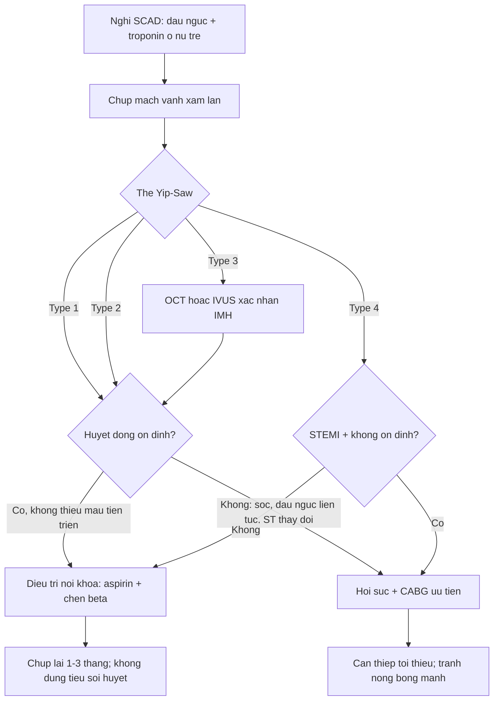
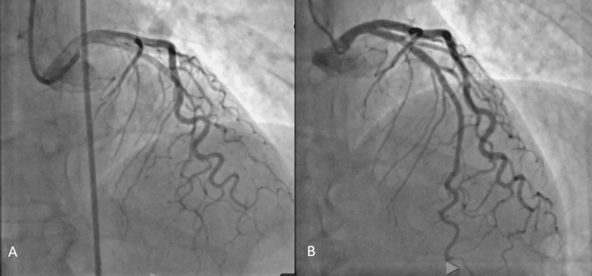
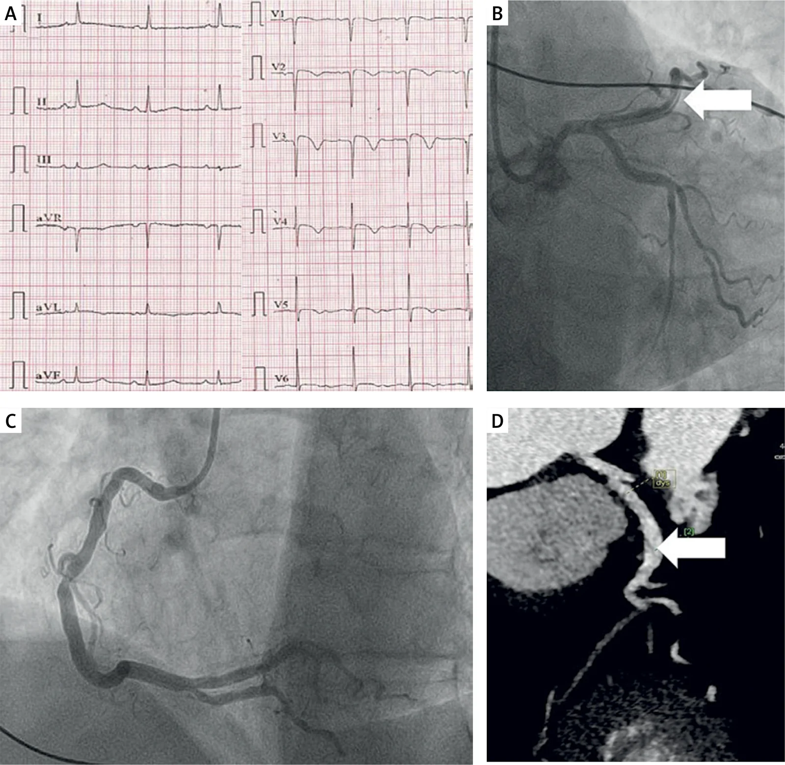
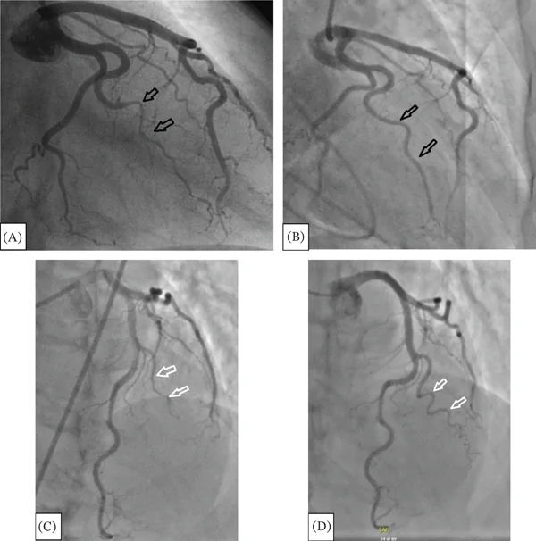

# 1900 — Bóc tách động mạch vành tự phát / Spontaneous coronary artery dissection (SCAD)

**Tags:** `pattern:hep-dai-nhan` `pattern:hai-long-mach` `pattern:tac-mach-vanh` `vung:vanh` `protocol:chup-mach-vanh` `protocol:OCT-IVUS` `score:Yip-Saw` `incidentaloma:khong`

**Mức chắc chắn (certainty):** tổng hợp y văn (literature synthesis) — số liệu từ **một bài tổng quan có định lượng** (PMC12387091), **một tổng quan về SCAD ở nữ** (PMC12780999), **một phân tích cơ chế** (PMC13381620), cùng **ba ca nguyên văn có ảnh mạch vành** (PMC13688006; PMC13721048; PMC13724152). Không có thử nghiệm ngẫu nhiên lớn; các ngưỡng điều trị là đồng thuận chuyên gia, chỗ suy luận được ghi rõ.

> **Câu chốt:** SCAD là **hội chứng mạch vành cấp KHÔNG do xơ vữa** ở **nữ trẻ – trung niên**. Ba con số quyết định: **(1)** SCAD chiếm **1–5% ACS** nhưng tới **22–43% nhồi máu cơ tim ở nữ < 50 tuổi**; **(2)** **86,4%** ổn định điều trị nội khoa, chỉ **2,3%** trong số đó phải tái thông khẩn, và **70–95% tổn thương tự lành trên mạch máu trong 1–3 tháng**; **(3)** **không dùng tiêu sợi huyết** — thuốc làm lan tách và tăng chảy máu trong thành; **chẩn đoán bằng chụp mạch xâm lấn**, không phải CTA (PMC12387091).

## 1. Tổng quan bệnh học – cơ chế hình ảnh (TẠI SAO)

### 1.1 Bệnh học: máu trong thành ép lòng thật

- **SCAD** là **tách không do xơ vữa, không do can thiệp, không do chấn thương** của thành động mạch vành, tạo **khối máu trong thành (intramural hematoma, IMH)** đè ép **lòng thật (true lumen)**. Khác **nứt mảng xơ vữa**: không có **mảng vữa/điểm canxi**, không có **nắp mảng** điển hình.
- Hai mô hình sinh bệnh:
  - **Inside-out:** rách **nội mạc (intimal tear)** → máu từ lòng mạch vào thành.
  - **Outside-in:** **vasa vasorum** chảy máu trong thành → IMH hình thành trước, nội mạc còn nguyên. Mô hình thứ hai giải thích vì sao **nhiều ca không thấy vết rách nội mạc** trên OCT và vì sao **can thiệp (bóng/dây dẫn) dễ làm lan tách**.
- Nền tảng: **loạn sản cơ xơ (fibromuscular dysplasia, FMD)** — tổn thương mạch **không do xơ vữa, không do viêm**, với **chuỗi hạt (string of beads)** ở động mạch thận/cảnh; **yếu tố nội tiết – thai kỳ**, **yếu tố cơ học (ho, gắng sức, căng thẳng)** và **bệnh mô liên kết** làm **ngưỡng chịu lực của thành mạch giảm** (PMC13381620).
- **TẠI SAO hẹp dài và nhẵn:** IMH lan **dọc** giữa các lớp → lòng thật bị ép **theo đoạn dài**, bờ **nhẵn**, không có **bờ nham nhở/gồ ghề** như mảng xơ vữa. Vì **không có mảng**, **không có canxi**, **không có tắc nghẽn mạn** → **thành mạch có thể trở lại bình thường hoàn toàn** khi máu trong thành tiêu đi.
- **TẠI SAO đau ngực + troponin:** thiếu máu **dưới nội tâm mạc** do giảm dòng chảy; men tim tăng **nhẹ – vừa** hơn STEMI do tắc mạch hoàn toàn, nhưng **vẫn có thể STEMI** khi IMH **bít hoàn toàn** (type 4).

### 1.2 Dịch tễ và bối cảnh (số liệu định lượng)

- **Tần suất:** **1–5%** tổng số ACS trong các loạt hiện đại; trước đây ước tính **0,1–0,4%** (PMC12387091).
- **Nữ < 50 tuổi:** **22–43%** các ca **nhồi máu cơ tim**, và **25–35%** các ca **ACS** ở nữ dưới 50 tuổi (PMC12387091); một tổng quan khác ghi **~25%** AMI ở nữ trẻ (PMC12780999).
- **Tuổi/giới:** tuổi trung bình **~40–50**, **80–95% là nữ** (PMC12387091).
- **SCAD liên quan thai kỳ (P-SCAD):** chiếm **5–30%** các ca SCAD; là nguyên nhân của **tới 40%** nhồi máu cơ tim liên quan thai kỳ (PMC12387091) — thường **3 tháng cuối thai kỳ đến ≤ 3 tháng sau sinh**.
- **FMD:** hiện diện **≈ 25% đến > 70%** tùy phương pháp sàng lọc; **> 70%** ca SCAD không do xơ vữa có FMD khi sàng lọc kỹ (PMC12387091).
- **Tái phát:** **10–15% trong 3–5 năm**; **MACE tới 20%** trong cùng khoảng; **chẹn beta giảm tái phát khoảng 50%** (PMC12387091).

### 1.3 Phân loại chụp mạch Yip–Saw (dùng để đọc và quyết định)

| Thể | Hình ảnh chụp mạch | Vì sao |
|---|---|---|
| **Type 1** | **Nhiều lòng sáng (radiolucent lumens)** / hình **hai lòng** với thuốc cản quang vào lòng giả | Có **vết rách nội mạc** rõ, thuốc vào khoang tách |
| **Type 2** (thường gặp nhất) | **Hẹp dài, nhẵn, lan tỏa** (thường **> 20 mm**), không có mảng xơ vữa; **2A** đoạn xa bình thường, **2B** hẹp tới tận đầu mạch | IMH **lan dọc** ép lòng thật; không có mảng |
| **Type 3** | **Hẹp khu trú ngắn (< 20 mm)**, giống mảng xơ vữa; **< 5–10%** ca | IMH **khu trú**; **bắt buộc OCT/IVUS** để phân biệt với mảng |
| **Type 4** | **Tắc hoàn toàn**, đầu cụt; thường **STEMI** | IMH **bít hoàn toàn** lòng mạch |

- **Bẫy đọc:** type 3 **không phân biệt được với mảng xơ vữa** trên chụp mạch thường; **OCT/IVUS** là chốt. Type 2 dễ bị gọi là **co thắt mạch** hoặc **"mạch bình thường"** nếu không nhìn kỹ đoạn dài.

## 2. Mẫu hình + chẩn đoán phân biệt theo vị trí (gamut)

- **Hẹp dài nhẵn ở LAD giữa – xa (type 2):** SCAD; phân biệt **co thắt mạch (vasospasm)**, **cầu cơ (myocardial bridge)**, **bóc tách do catheter (iatrogenic)**, **tắc mạch do huyết khối**.
- **Hẹp khu trú ngắn (type 3):** SCAD thể khu trú; phân biệt **mảng xơ vữa**, **co thắt khu trú**, **tắc mạch nhỏ**, **viêm mạch**.
- **Tắc hoàn toàn (type 4):** SCAD; phân biệt **huyết khối do xơ vữa**, **thuyên tắc**, **co thắt nặng**, **bóc tách lan từ ĐMC**.
- **Đau ngực + ST chênh + mạch vành "sạch":** SCAD, **Takotsubo**, **viêm cơ tim**, **MINOCA** khác; **không được kết luận "không bệnh mạch vành"** khi chưa loại SCAD type 2/3.
- **Bối cảnh sau sinh/thai kỳ:** SCAD là nguyên nhân **hàng đầu** của nhồi máu cơ tim; phân biệt **bệnh cơ tim chu sản**, **tiền sản giật/HELLP** và **thuyên tắc ối** (ba bệnh cảnh sản khoa có đau ngực/khó thở và men tim tăng).

## 3. Bảng so sánh phân biệt (ma trận đối chiếu)

| Thực thể (entity) | Hình ảnh điển hình (chụp mạch/OCT/CTA) | Chốt vào (rule-in) | Chốt loại (rule-out) | Gợi ý xác nhận |
|---|---|---|---|---|
| **SCAD type 1** | **Hai lòng** / nhiều lòng sáng, thuốc vào lòng giả | **Hình hai lòng + vết rách nội mạc** | Không có lòng giả, chỉ hẹp trơn → type 2/3 | Chụp mạch nhiều góc; OCT nếu cần |
| **SCAD type 2** | **Hẹp dài nhẵn > 20 mm**, không canxi, không mảng | **Hẹp dài + bờ nhẵn + không vữa + bối cảnh nữ trẻ** | **Canxi/mảng lệch tâm**, hẹp ngắn → xơ vữa | Chụp mạch; OCT xác nhận IMH |
| **SCAD type 3** | **Hẹp khu trú < 20 mm**, giống mảng | **OCT/IVUS: IMH/hai lòng, không mảng** | **Mảng xơ vữa có nắp/vữa** → không phải SCAD | **Bắt buộc OCT hoặc IVUS** |
| **Mảng xơ vữa (plaque rupture)** | Hẹp **lệch tâm**, **canxi**, **nắp mảng**, huyết khối | **Canxi + mảng + tuổi/tăng huyết áp/ĐTĐ/hút thuốc** | **Hẹp dài nhẵn không canxi** → SCAD | OCT; CTA thấy canxi |
| **Co thắt mạch (vasospasm)** | Hẹp **thay đổi**, hết sau **nitroglycerin** | **Hồi phục sau nitrate/CCB**, không IMH | **Hẹp cố định + IMH trên OCT** → SCAD | Nitrate trong chụp mạch; OCT |
| **Bóc tách do can thiệp (iatrogenic)** | **Tổn thương từ đầu catheter/dây dẫn**, hình **xoắn ốc** | **Tiền sử can thiệp ngay trước**, vị trí **đầu dụng cụ** | **Tổn thương xa đầu dụng cụ, lan dài** → SCAD | Xem lại màn chiếu; OCT |
| **Thuyên tắc mạch vành** | **Cắt cụt đột ngột**, **huyết khối**, không IMH | **Nguồn thuyên tắc** (van, rung nhĩ, cơ tim) | **IMH/hai lòng** → SCAD | Siêu âm tim, OCT |
| **Bóc tách ĐMC lan vào vành** | **Lóc ĐMC + tổn thương gốc vành**, đau ngực–lưng | **Lóc ĐMC trên CTA** | **ĐMC bình thường** → SCAD | CTA toàn thân cấp cứu |
| **Takotsubo** | **Rối loạn vận động vùng kiểu bóng đỉnh**, mạch vành không tắc | **Bóng đỉnh + hồi phục**, mạch vành sạch | **Hẹp dài/thrombus** → SCAD | Siêu âm/MRI tim; có thể **đồng thời** |

## 4. Protocol chụp + hệ phân loại & xử trí

### 4.1 Protocol

- **Chụp mạch vành xâm lấn (invasive coronary angiography)** là **chuẩn vàng**: tối thiểu **4–6 góc** cho mỗi hệ, phóng đại đoạn nghi; bơm **nitroglycerin nội mạch** để loại co thắt (thận trọng nếu huyết động kém).
- **Tránh thao tác gây lan tách:** **không đẩy dây dẫn qua đoạn tách** nếu không cần; **không nong bóng mù**; nếu bắt buộc can thiệp, dùng **bóng nhỏ/áp lực thấp**, cân nhắc **cutting balloon**, và **không dùng stent phủ dài không cần thiết**.
- **OCT/IVUS** khi: **type 3** (phân biệt mảng), **nghi ngờ**, hoặc cần xác nhận **IMH** trước quyết định. **OCT** cho hình **nội mạc/vết rách** rõ hơn; **IVUS** xuyên được đoạn hẹp nặng hơn nhưng **dễ làm lan tách** — chỉ dùng khi có chỉ định rõ.
- **CTA vành:** **KHÔNG dùng để chẩn đoán chính hoặc loại trừ SCAD cấp** — độ phân giải không đủ cho **nhánh xa/nhỏ**, và **artifact chuyển động** gây âm tính giả (PMC12387091). CTA hữu ích để **theo dõi tổn thương tồn tại** (ảnh Ca 3) và **sàng lọc mạch ngoài vành** (đầu–cổ–thận–chậu) tìm **FMD/phình**.
- **Siêu âm tim:** đánh giá **rối loạn vận động vùng**, **EF**, **biến chứng cơ học**, **tràn dịch màng tim**; lặp lại sau 24–48 giờ nếu sốc.
- **Xét nghiệm:** **troponin** (đỉnh), **ECG**, **creatinin**, **Hb**, **thai** (β-hCG) ở nữ tuổi sinh sản; tầm soát **bệnh mô liên kết** khi có gợi ý.

### 4.2 Phân loại + flowchart xử trí

- **Điều trị nội khoa (ưu tiên):** **aspirin** dài hạn; **chẹn beta** giảm tái phát **~50%**; **ức chế P2Y12** ngắn hạn nếu có can thiệp; **không kháng đông** thường quy; **statin** không có chỉ định mặc định (dữ liệu mâu thuẫn, có nghi vấn tăng tái phát — PMC12387091).
- **Tái thông:** chỉ khi **thiếu máu tiến triển**, **sốc**, **đau ngực liên tục/ST thay đổi**, hoặc **tổn thương thân chung/LAD gần**. **CABG** được ưu tiên hơn PCI ở **thân chung/nhiều mạch** vì PCI **dễ làm lan tách**; PCI chỉ khi giải phẫu thuận lợi và **không thể tránh**.
- **TUYỆT ĐỐI KHÔNG tiêu sợi huyết** (thrombolysis): làm **lan khối máu trong thành**, tăng chảy máu và tử vong — khác hoàn toàn STEMI do xơ vữa.
- **Thai kỳ:** **tránh ergometrine** (co mạch mạnh) sau sinh; **oxytocin** an toàn hơn; lập kế hoạch sinh tại **trung tâm có can thiệp mạch vành và phẫu thuật tim**; hội chẩn **sản – tim – gây mê**.
- **Theo dõi:** chụp mạch lại **1–3 tháng** (hoặc khi có triệu chứng) để xác nhận lành; **70–95% lành trong 1–3 tháng** (PMC12387091).

## 5. Biến thể bình thường và cạm bẫy

- **Hẹp dài nhẵn không phải "co thắt" mặc định:** nếu **không hết sau nitrate** và có **bối cảnh nữ trẻ/ sau sinh**, nghĩ **SCAD type 2**; **đừng xuất viện với chẩn đoán "mạch vành bình thường"**.
- **Type 3 giả mảng xơ vữa:** hẹp ngắn ở **nữ trẻ không yếu tố nguy cơ** → **OCT/IVUS trước khi đặt stent**; đặt stent vào **lòng giả** làm **bít nhánh bên** và lan tách.
- **CTA âm tính không loại trừ SCAD** (nhánh xa/nhỏ, artifact) — quyết định dựa trên **chụp mạch xâm lấn** khi lâm sàng nghi.
- **Tiêu sợi huyết là sai lầm chết người:** nếu chẩn đoán STEMI trước khi chụp mạch, **hỏi yếu tố nguy cơ SCAD** (nữ trẻ, sau sinh, FMD) trước khi dùng.
- **Đau ngực tái diễn sau SCAD không đồng nghĩa tái phát:** có thể do **co thắt, rối loạn chức năng vi mạch, lo âu**; chỉ chụp lại khi có **thay đổi ECG/troponin**.
- **Bỏ sót mạch ngoài vành:** **25–>70%** có FMD → **sàng lọc CTA/MRA từ đầu đến chậu** một lần, tìm **phình/tách động mạch thận – cảnh – chậu**; FMD **không phải bệnh lành tính bỏ qua**.
- **Satisfaction of search:** thấy hẹp LAD **không được bỏ qua** đoạn **RCA/LCx** — SCAD có thể **nhiều mạch** (ca nguyên văn báo **đa mạch**).

## 6. Tự lượng giá — Blind Quiz

**Ca 1 — Nữ 42 tuổi, đau ngực điển hình, troponin tăng, không yếu tố nguy cơ xơ vữa.**

- Câu hỏi: Mô tả tổn thương ở panel A? Đây là thể nào? Panel B nói lên điều gì về tiên lượng?

<b>Bấm để hiện đáp án (findings + chẩn đoán)</b>

- **Findings:** (A) **hẹp dài, nhẵn, lan tỏa** ở **LAD giữa–xa**, không canxi, không mảng lệch tâm; (B) sau điều trị nội khoa, **lòng mạch trở lại gần bình thường**.
- **Chẩn đoán:** **SCAD type 2** (Yip–Saw) — IMH lan dọc ép lòng thật.
- **Tiên lượng:** lành tự nhiên **70–95% trong 1–3 tháng**; điều trị **aspirin + chẹn beta**, **không can thiệp** nếu ổn định.
- Nguồn: Cureus 2026, **PMC13688006**, Fig. 1, CC BY 4.0.

**Ca 2 — Nữ đã mãn kinh, đau ngực, ST chênh lên; chụp mạch và CTA theo dõi.**

- Câu hỏi: Panel B cho thấy gì? Vì sao Panel D (**CTA**) không dùng để chẩn đoán cấp? Tại sao **không tiêu sợi huyết**?

<b>Bấm để hiện đáp án</b>

- **Findings:** (A) ECG **ST chênh/T đảo**; (B) **chụp mạch LAD**: hình **hẹp/tách** với **vết rách** (mũi tên); (C) RCA; (D) **CTA vành sau 11 tháng**: **tổn thương tách còn tồn tại**, xác nhận **theo dõi** chứ không phải chẩn đoán cấp.
- **Chẩn đoán:** **SCAD** ở nữ đã mãn kinh (không có yếu tố nguy cơ xơ vữa điển hình) — SCAD **không chỉ gặp ở người trẻ**.
- **Vì sao CTA không phải chuẩn chẩn đoán:** độ phân giải **không đủ cho nhánh xa/nhỏ**, artifact chuyển động → **âm tính giả**; **chụp mạch xâm lấn** mới là chuẩn.
- **Vì sao không tiêu sợi huyết:** thuốc **làm lan IMH**, tăng nguy cơ vỡ/tắc hoàn toàn — **chống chỉ định** khi nghi SCAD.
- Nguồn: Adv Interv Cardiol 2026, **PMC13721048**, Fig. 1, CC BY-NC-SA 4.0 (dùng nguyên bản).

**Ca 3 — Bệnh nhân SCAD tái phát: so sánh 2015 và 2025.**

- Câu hỏi: Panel A/B khác C/D ở đâu? Điều này nói gì về **theo dõi dài hạn** và **nguy cơ tái phát**?

<b>Bấm để hiện đáp án</b>

- **Findings:** (A/B) **nhánh OM** có **hình tách/hẹp** (mũi tên đen); (C/D) **cùng nhánh** sau nhiều năm: **lành/tái thông**, không còn hẹp rõ (mũi tên trắng).
- **Chẩn đoán:** **SCAD nhánh OM** đã **lành tự nhiên**; đây là ca **tái phát** ở **mạch khác**, nhấn mạnh **SCAD là bệnh mạch hệ thống**, không phải biến cố đơn lẻ.
- **Theo dõi:** **tái phát 10–15% trong 3–5 năm**, **MACE tới 20%**; **chẹn beta giảm ~50%** tái phát; sàng lọc **FMD/mạch ngoài vành**.
- Nguồn: Case Rep Cardiol 2026, **PMC13724152**, Fig. 2, CC BY 4.0.

## Bài liên quan chéo
- [810 – CT động mạch vành & CAD-RADS](../810-coronary-cta-cadrads/lesson.md)
- [820 – MRI tim: LGE & mapping](../820-cardiac-mri-lge-mapping/lesson.md)
- [850 – Loạn sản cơ xơ (FMD) toàn thân](../850-loan-san-co-xo-fibromuscular-dysplasia-toan-than-o-tre/lesson.md)
- [1842 – Takotsubo sau phẫu thuật/ICU (bệnh cảnh bắt chước)](../1842-takotsubo-hau-phau-icu/lesson.md)
- [070 – Thuyên tắc phổi & ĐMC cấp (đau ngực cấp)](../070-thuyen-tac-phoi-dmc-cap/lesson.md)

## Ảnh
- Tên file: `1900_SCAD_ChupMach_{PMCID}.webp`. Nguồn + giấy phép từng ảnh: `images/CREDITS.md`.
- Không có ảnh ghép; ảnh **CC BY-NC-SA** dùng **nguyên bản**, không crop.

> Không dùng để chẩn đoán độc lập khi chưa có người hướng dẫn.
