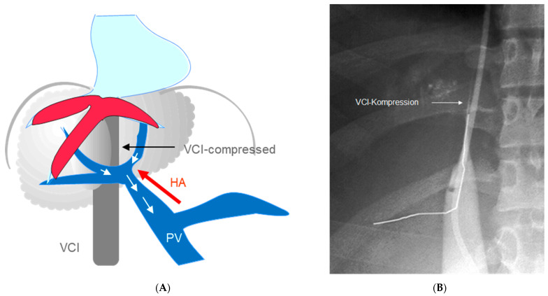
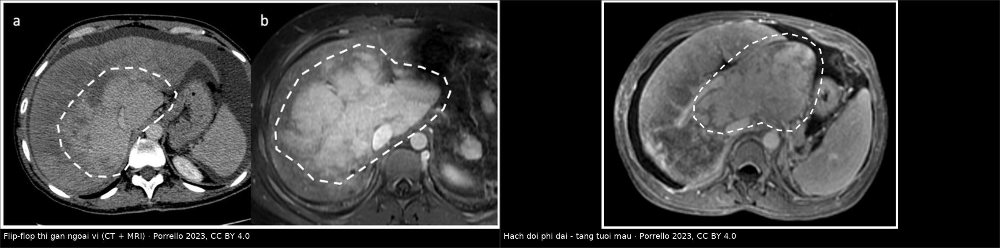
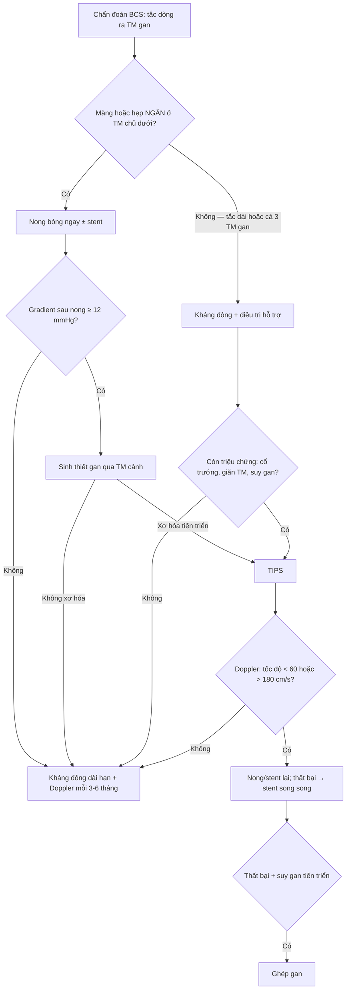
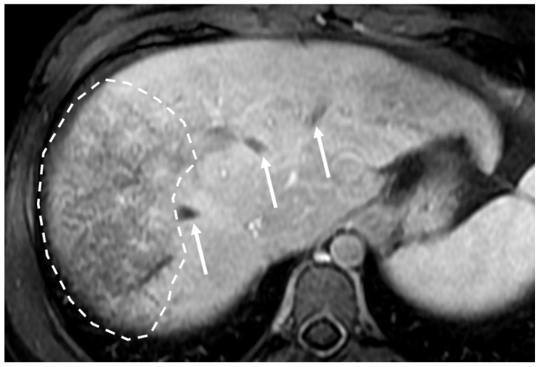
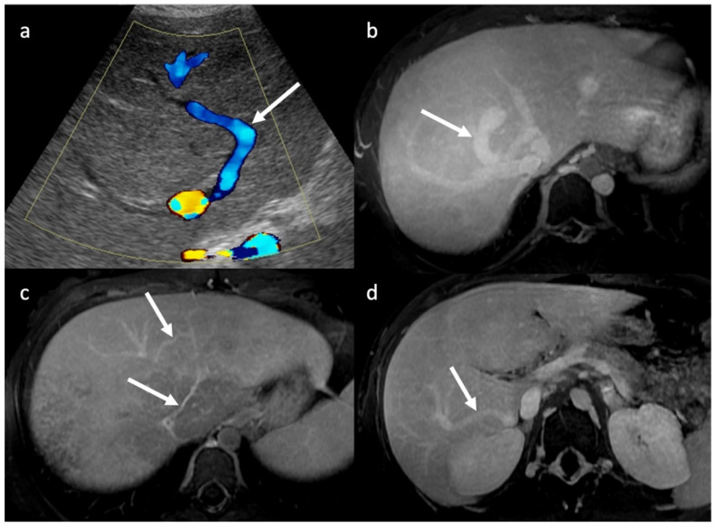
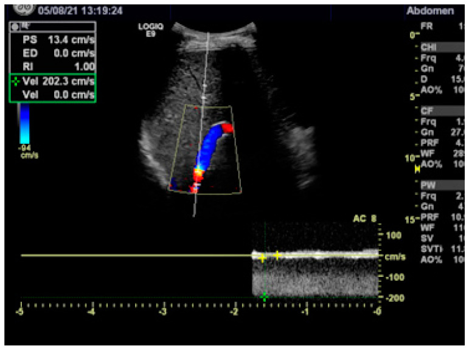

# 1901 — Hội chứng Budd–Chiari: "flip-flop", mạng nhện tĩnh mạch & khi nào nong bóng/TIPS / Budd–Chiari syndrome

**Tags:** `pattern:flip-flop` `pattern:gan-ung-huyet` `pattern:huyet-khoi` `pattern:shunt-trong-gan` `vung:gan` `vung:tm-gan` `vung:tm-chu-duoi` `score:Rotterdam` `score:Clichy` `score:BCS-PI-TIPS` `protocol:CT-3-thi` `protocol:MRI-gan` `protocol:Doppler`
**Mức chắc chắn (certainty):** tổng hợp y văn (literature synthesis) — số liệu lấy từ hai bài tổng quan open-access có ảnh gốc: Porrello et al., *Diagnostics* 2023 (PMC10341099, CC BY 4.0) và Rössle, *Diagnostics* 2023 (PMC10137827, CC BY 4.0), cùng bài tổng quan quản lý (Mancuso et al., *Diagnostics* 2022, PMC9689902, CC BY 4.0). Bài **không** có ca nguyên văn riêng của nhóm.

> **Câu hỏi gốc của bài:** bệnh nhân trẻ, bụng to, cổ trướng, đau hạ sườn phải; siêu âm **không thấy tĩnh mạch gan phải**; CT thì cửa thấy **gan ngoại vi tối, gan trung tâm và hạch đuôi sáng** — "flip-flop". Vậy: **cơ chế nào tạo ra hình ảnh đó? tắc ở đâu? khi nào chỉ cần kháng đông, khi nào nong bóng, khi nào TIPS, khi nào ghép gan? và điều gì trên phim quyết định thứ tự can thiệp?**
> **Điểm tựa:** Budd–Chiari là **bệnh của dòng ra** (outflow), không phải bệnh của nhu mô. Vì vậy **hạch đuôi được tha** (có nhánh tĩnh mạch ngắn đổ trực tiếp vào TM chủ dưới) → phì đại và tăng tưới máu; phần gan còn lại ứ huyết → giảm tưới máu ngoại vi. Điều trị là **giải phóng dòng ra theo bậc**, và **hình ảnh mạch máu — không phải men gan — chọn bậc đó**.

## 1. Tổng quan — vì sao "flip-flop" và vì sao hạch đuôi to ra

**A. Bệnh học (pathology) và cơ chế:**
- **Định nghĩa:** hẹp/tắc dòng ra tĩnh mạch gan từ **tiểu tĩnh mạch gan đến chỗ đổ vào tĩnh mạch chủ dưới (IVC) – nhĩ phải**. Ít nhất **một tĩnh mạch gan** bị tắc; IVC có thể bị chèn hoặc huyết khối kèm theo.
- **Nguyên phát (primary):** trạng thái tăng đông (bệnh tăng sinh tủy, yếu tố V Leiden, thiếu protein C/S, hội chứng kháng phospholipid…) → huyết khối. Một thể đặc biệt là **màng/xơ dạng vách (membranous web)** ở IVC, **gặp nhiều hơn ở châu Á**, có thể liên quan yếu tố di truyền.
- **Thứ phát (secondary):** **< 1%** — u hoặc nang chèn ép/xâm lấn tĩnh mạch gan, IVC. Đây là lý do **luôn phải tìm khối u** trước khi gọi "nguyên phát".
- **Mức độ nặng phụ thuộc số tĩnh mạch gan bị tắc:** tắc một nhánh thường **không triệu chứng hoặc rất nhẹ**; tắc cả ba nhánh → tăng áp lực xoang gan, ứ huyết, cổ trướng, suy gan.
- **Vì sao hạch đuôi (caudate lobe) được tha:** hạch đuôi có **các tĩnh mạch ngắn đổ trực tiếp vào IVC**, không đi qua ba tĩnh mạch gan chính. Khi ba tĩnh mạch gan tắc, **xoang gan của hạch đuôi không bị ứ** → nhu mô không teo, còn **phì đại bù** và **tăng tưới máu động mạch**. Phì đại hạch đuôi gặp ở **khoảng 50%** bệnh nhân, và có thể **chèn ép IVC** gây hẹp dòng chảy TM chủ dưới.
- **Cơ chế "flip-flop" (zonal enhancement):** tắc dòng ra → áp lực xoang gan tăng → **tưới máu cửa giảm ở ngoại vi** (phần gan bị ứ huyết), trong khi **động mạch gan tăng bù ở trung tâm và hạch đuôi**. Trên CT/MRI thì cửa: **ngoại vi giảm ngấm, trung tâm tăng ngấm** — đảo ngược kiểu tưới máu bình thường ("flip-flop").

*(A) Sơ đồ BCS hoàn toàn: tĩnh mạch cửa trở thành đường dẫn lưu; **hạch đuôi phì đại chèn hẹp tĩnh mạch chủ dưới**. (B) Cavogram: **tắc IVC do gan to** (mũi tên "VCI-Kompression"). Đây là lý do phải chụp/đo IVC trước khi chọn đường can thiệp. Nguồn: Rössle, Diagnostics 2023, PMC10137827 Fig. 1, CC BY 4.0.*
- **Vì sao mạn tính thành "mosaic":** ứ huyết kéo dài → xơ hóa, xoang gan giãn không đều, hồi lưu tĩnh mạch trong gan → mạng lưới ngấm thuốc **dạng lưới (reticular/mosaic)**. Kèm theo: teo các phân thùy bị ứ, phì đại phần được tha, **nốt tái tạo lành tính** và **nguy cơ HCC** (tăng dần khi sống lâu, đặc biệt thể màng IVC).

**B. Ngưỡng định lượng bắt buộc (cửa 1 Argon):**

| Đại lượng | Con số đã kiểm chứng | Ý nghĩa thực hành |
|---|---|---|
| Tần suất phì đại hạch đuôi | **~50%** bệnh nhân BCS (PMC10341099) | Không đặc hiệu (cũng gặp ở xơ gan) nhưng là mảnh ghép quan trọng của "flip-flop" |
| Đường kính tĩnh mạch hạch đuôi | **> 3 mm** là dấu hiệu đáng chú ý | Giãn vì dẫn lưu bù; thấy rõ trên US/CT |
| Siêu âm: dấu trực tiếp + phì đại hạch đuôi | **Độ đặc hiệu 100%** cho BCS | Càng phải tìm "dấu trực tiếp" (không thấy TM gan/huyết khối/màng) |
| Cộng hưởng mạch (MRA) | **Se gộp 97,6%, Sp 70,7%** (phân tích gộp) | Rất nhạy, **không đủ loại trừ** một mình — Sp thấp |
| Cổ trướng / tuần hoàn bàng hệ ngoài gan | **56% / 44%** | Dấu hiệu gián tiếp của tăng áp cửa |
| Hiệu quả điều trị nội khoa đơn thuần | **80–90% không đáp ứng rõ và bền** (PMC10137827); **~2/3 không sống dài hạn** nếu chỉ nội khoa (PMC9689902) | Kháng đông là nền, **không phải điều trị triệt để** |
| Nong bóng + stent so với nong đơn thuần | Tái hẹp **2% vs 40%**; sống không tái hẹp 3 năm **96% vs 60,4%** | Hẹp ngắn/màng → **đặt stent ngay** |
| Áp lực cửa trước / sau TIPS | **40,4 ± 10,1 → 10,8 ± 4,9 mmHg**; tốc độ TM cửa **12,7 ± 10,0 → 48,6 ± 16,9 cm/s** | TIPS mở dòng ra hiệu quả, đo được bằng Doppler |
| Ngưỡng Doppler nghi shunt mất chức năng | **< 60 cm/s hoặc > 180 cm/s** bất kỳ điểm nào trong stent | 200 cm/s tương ứng **gradient 16 mmHg** (phương trình Bernoulli) |
| Sống còn sau TIPS | 1 năm **80–100%**, 5 năm **74–78%** (160 nghiên cứu); 1/5/10 năm **88/78/70%** ở 124 bệnh nhân châu Âu; **95/90/80%** ở 59 bệnh nhân của Rössle | Tiên lượng tốt nếu can thiệp đúng lúc |
| Bệnh não gan sau TIPS | **10%** có HE trước TIPS (đều thể tối cấp); **0–20%** HE nhẹ, hồi phục sau TIPS | Không phải chống chỉ định tuyệt đối, nhưng phải theo dõi |

**C. TẠI SAO ảnh trông như vậy (vật lý hình ảnh):**
- **CT:** tín hiệu phụ thuộc **nồng độ iod** trong xoang gan. Ngoại vi ứ huyết → **giảm thể tích tưới máu cửa** → ngấm thuốc kém; trung tâm/hạch đuôi → **tăng lưu lượng động mạch** → ngấm mạnh. Vì vậy "flip-flop" chỉ thấy rõ ở **thì cửa và thì muộn**, không thấy ở thì không cản quang.
- **MRI T1:** ứ huyết làm **tăng nước mô** → kéo dài T1 → **giảm tín hiệu ngoại vi**; hạch đuôi được tha nên **giữ tín hiệu cao hơn**. **T2:** phù/ứ huyết kéo dài T2 → **tăng tín hiệu ngoại vi không đồng nhất**, hạch đuôi **bình thường hoặc giảm tín hiệu**.
- **Gadolinium thì muộn 3 phút:** vùng ứ huyết giữ thuốc lâu hơn → **mosaic dạng lưới**; đây là dấu hiệu của **giãn xoang gan**, không phải u.
- **SSFP/MR venography:** màng IVC là **dải tín hiệu thấp** cắt ngang lòng mạch; cần lát mỏng, đúng mặt phẳng coronal. Huyết khối cấp có thể tăng tín hiệu trên T1 (methemoglobin) tùy thời gian.
- **Nốt tái tạo trên MRI đặc hiệu mô gan (hepatobiliary phase):** ngấm **đồng nhất, tăng tín hiệu so với gan** ở thì gan đặc hiệu → gợi ý **FNH-like/regenerative nodule**, khác HCC (thường giảm tín hiệu thì gan đặc hiệu).

## 2. Mẫu hình + chẩn đoán phân biệt theo vị trí và cơ chế (Gamut)

- **Mẫu A — tắc cả ba tĩnh mạch gan (complete BCS):** không thấy TM gan, hạch đuôi phì đại chèn IVC, "flip-flop" rõ, cổ trướng. Đây là thể hay phải can thiệp.
- **Mẫu B — màng/xơ ngắn ở IVC (web-like):** thường ở châu Á; hẹp **đoạn ngắn**, **nong bóng ± stent** là điều trị đầu tay; trên SSFP thấy dải tín hiệu thấp.
- **Mẫu C — huyết khối một nhánh TM gan:** thường **nghèo triệu chứng**; chẩn đoán dễ bỏ sót, phải tìm dấu gián tiếp (hạch đuôi, tuần hoàn bàng hệ, cổ trướng nhẹ).
- **Mẫu D — mạn tính:** gan teo–phì đại không đều, **mosaic**, nốt tái tạo, tăng áp cửa; **không còn "flip-flop" điển hình**.
- **Gamut "giả flip-flop/mosaic" (theo vị trí và bệnh nền):**

| Nhóm | Vì sao giống BCS | Khác biệt chốt |
|---|---|---|
| Xơ gan | Hạch đuôi to, mosaic, tăng áp cửa | **TM gan vẫn thấy và thông**, không có tắc dòng ra; bờ gan gồ ghề, nốt |
| Suy tim phải / gan tim | Gan to, ứ huyết, ngấm thuốc không đều | **IVC và TM gan GIÃN**, có reflux, không tắc; bệnh tim rõ |
| Tắc xoang gan (SOS/VOD) | Gan to, cổ trướng, mosaic | **Không có huyết khối/màng ở TM gan lớn**; bối cảnh hóa trị/ghép tủy |
| Huyết khối TM cửa | Tăng áp cửa, bàng hệ | **Hạch đuôi không to kiểu BCS**, không flip-flop; tắc ở TM cửa |
| BCS thứ phát do u | Tắc dòng ra | **Khối u xâm lấn/chèn ép** thấy được; sinh thiết u, không chỉ kháng đông |
| Viêm gan ứ mật/viêm gan cấp | Gan to, phù | Không tắc mạch, men gan/vi rút dương tính, hình ảnh mạch bình thường |

- **Gợi nhớ CHIARI:** **C**ardiac (suy tim phải) · **H**epatic vein thrombosis (BCS nguyên phát) · **I**VC web/membrane · **A**rterialization + caudate sparing (flip-flop) · **R**egenerative nodules/HCC · **I**nfiltrative tumor (BCS thứ phát).

## 3. Bảng so sánh phân biệt (ma trận đối chiếu)

| Thực thể (entity) | Hình ảnh điển hình (US/CT/MRI theo thì) | Chốt vào (rule-in) | Chốt loại (rule-out) | Gợi ý xác nhận |
|---|---|---|---|---|
| **BCS cấp/án cấp (3 TM gan)** | Gan to, ngoại vi giảm ngấm thì cửa, trung tâm tăng ngấm; không thấy TM gan; cổ trướng | **"Flip-flop" + không thấy TM gan + hạch đuôi to** | Thấy đủ 3 TM gan thông, IVC giãn có reflux → nghĩ gan tim | Doppler + CT 3 thì; MR venography |
| **BCS thể màng IVC** | Dải tín hiệu thấp ngang IVC, hẹp ngắn, hạch đuôi to | **Màng/hẹp ngắn trên SSFP + gradient qua chỗ hẹp** | Hẹp dài lan tỏa → không phải "web" đơn thuần | SSFP coronal + cavogram đo áp lực |
| **BCS mạn** | Gan teo–to không đều, mosaic dạng lưới, nốt tái tạo, lách to | **Mosaic + nốt tăng tín hiệu thì gan đặc hiệu** | Nốt giảm tín hiệu thì gan đặc hiệu + washout → nghĩ HCC | MRI có chất đặc hiệu mô gan |
| **Xơ gan** | Bờ gan gồ ghề, nốt, hạch đuôi to, tuần hoàn bàng hệ | **TM gan thông + xơ hóa/nốt lan tỏa** | Không thấy TM gan, flip-flop rõ → BCS | Doppler; đàn hồi gan; bối cảnh |
| **Gan tim** | IVC + TM gan giãn, ngấm thuốc chậm không đều, gan to | **IVC giãn, không xẹp theo nhịp thở + reflux + bệnh tim** | IVC bị chèn/hẹp do hạch đuôi → BCS | Siêu âm tim, đo IVC |
| **SOS/VOD** | Gan to, phù, mosaic, cổ trướng | **Bối cảnh hóa trị/ghép tủy + không tắc TM gan lớn** | Có huyết khối/màng TM gan → BCS | Doppler (TM gan thông, phổ giảm biên độ) |
| **BCS thứ phát do u** | Khối u gan/thận/TC chèn IVC hoặc TM gan | **Khối u xâm lấn thấy rõ** | Không có khối, chỉ huyết khối → nguyên phát | CT 3 thì/MRI; sinh thiết |

*Trái: hai ca BCS cấp/án cấp — CT (a) và MRI (b) thì cửa: ngoại vi gan giảm ngấm (vòng đứt nét), trung tâm tăng ngấm ("flip-flop"/zonal). Phải: MRI thì cửa — hạch đuôi phình to và tăng tưới máu (vòng đứt nét). Nguồn: Porrello et al., Diagnostics 2023, PMC10341099 Fig. 4 + Fig. 5, CC BY 4.0; ảnh ghép letterbox, **đã thay đổi** (ghép + dải chú thích).*

### Ba dấu hiệu mạch máu phải chủ động tìm
- **Không thấy tĩnh mạch gan ("absent hepatic veins"):** dấu trực tiếp mạnh nhất trên siêu âm; kết hợp phì đại hạch đuôi cho **độ đặc hiệu 100%** trong nghiên cứu được dẫn.
- **Mạng nhện/tuần hoàn bàng hệ trong gan ("spider web"):** các nhánh tĩnh mạch nhỏ ngoằn ngoèo dưới bao gan nối vào IVC hoặc TM gan còn thông; trên Doppler thấy **dòng chảy ngược chiều** trong nhánh cửa trong gan.
- **Tĩnh mạch hạch đuôi giãn (> 3 mm):** dấu hiệu ít được để ý nhưng rất gợi ý, đặc biệt khi ba TM gan không thấy rõ.

## 4. Protocol chụp + phân độ/chỉ số tiên lượng + sơ đồ điều trị

**A. Thứ tự chụp (không bỏ bước):**
1. **Siêu âm bụng + Doppler màu có đo tốc độ:** bước đầu tiên, tại giường, không xạ. Ghi rõ: TM gan nào thấy/không thấy, có huyết khối/màng, hướng dòng TM cửa (đảo chiều?), hạch đuôi, tĩnh mạch hạch đuôi, cổ trướng, lách.
2. **CT bụng 3 thì (không cản quang – động mạch – cửa) + thì muộn 3 phút:** xác nhận flip-flop/mosaic, đánh giá IVC bị chèn, tìm u (loại BCS thứ phát), tìm HCC. Lát ≤ 1 mm, tái tạo MPR theo trục mạch.
3. **MRI gan + MR venography (SSFP coronal):** khi CT không kết luận, khi cần tìm màng IVC, hoặc cần phân biệt nốt tái tạo với HCC. Bắt buộc **thì gan đặc hiệu (hepatobiliary phase)** nếu có nốt.
4. **Chụp mạch (DSA) + đo áp lực:** chỉ đặt khi **đã quyết định can thiệp** — đo gradient qua chỗ hẹp, đo áp lực cửa, làm nong bóng/stent/TIPS trong cùng buổi.

**B. Ngưỡng quyết định can thiệp:**
- **Hẹp ngắn/màng:** nong bóng **ngay**, đo lại gradient; nếu còn hẹp → **stent** (tái hẹp 2% vs 40%).
- **Sau nong, HVPG > 12 mmHg:** sinh thiết gan qua tĩnh mạch cảnh; nếu xơ hóa tiến triển → **TIPS**.
- **Tắc dài/ba TM gan + triệu chứng (suy gan, cổ trướng, giãn TM thực quản):** **TIPS sớm**, không chờ đáp ứng nội khoa.
- **Kháng đông:** bắt đầu ngay khi chẩn đoán; **tránh heparin không phân đoạn** vì **~30%** bệnh nhân có kháng thể heparin lúc khởi phát → dùng **heparin trọng lượng phân tử thấp**.
- **Theo dõi shunt:** Doppler **trước xuất viện và mỗi 3–6 tháng**; tốc độ **< 60 cm/s hoặc > 180 cm/s** trong stent = nghi hẹp; hẹp đơn thuần → nong/stent lại, thất bại → **stent song song** (thông thứ phát **95%**).
- **Chỉ số tiên lượng:** **Rotterdam** và **Clichy** (Clichy gồm cổ trướng, Na⁺, creatinine, yếu tố V, bilirubin, chảy máu do tăng áp cửa, viêm phúc mạc vi khuẩn, BMI) — đều **cải thiện sau TIPS**, rõ nhất ở thể cấp/tối cấp. **BCS-PI-TIPS** (tuổi, bilirubin, INR) dự báo sống sau TIPS tốt hơn Rotterdam.

## 5. Biến thể bình thường và cạm bẫy

- **Hạch đuôi to đơn thuần ở xơ gan** — không phải BCS. Chốt bằng **TM gan còn thông** và không có flip-flop; đừng chỉ dựa vào kích thước hạch đuôi.
- **"Flip-flop" giả do thì chụp:** nếu chụp quá sớm (thì động mạch) hoặc bơm thuốc chậm, gan ngoại vi có thể trông "tối" giả tạo. Luôn đọc **thì cửa + thì muộn**, và đối chiếu nhu mô gan lành.
- **Mosaic do xơ gan hoặc do giãn xoang gan** — không đồng nghĩa BCS. Phải thấy **tắc dòng ra** mới gọi BCS.
- **Chèn ép IVC do hạch đuôi bị đọc nhầm thành "màng IVC":** màng là **dải tín hiệu thấp mảnh, cố định**, còn chèn ép là **hiệu ứng khối từ nhu mô**. Cavogram + đo gradient phân biệt.
- **Nốt tái tạo giả HCC:** nốt tái tạo trong BCS có thể **tăng ngấm mạnh thì động mạch và thải thuốc** (mimic HCC). Thì **gan đặc hiệu** giúp: nốt lành **tăng tín hiệu**, HCC **giảm tín hiệu**. Đừng đốt/sinh thiết dựa trên 3 thì thường.
- **Huyết khối TM cửa kèm theo:** gặp ở BCS, và **lan tới ngã ba lách–mạc treo** có thể **chống chỉ định ghép gan** + nguy cơ thiếu máu ruột — phải báo rõ trong kết luận.
- **Sau TIPS: đừng đoán shunt tắc bằng triệu chứng.** Dùng ngưỡng Doppler; hẹp trong stent có thể **không gây triệu chứng** nhưng làm mất hiệu quả giải áp.
- **Bệnh não gan sau TIPS** gặp ở **10%** (trước TIPS, thể tối cấp) và **0–20%** mức nhẹ sau TIPS — cần theo dõi tri giác/amoniac, không quy mọi lú lẫn cho "bệnh nặng".

## 6. Tự lượng giá — Blind Quiz

**Ca 1 — Bệnh nhân BCS: MRI thì cửa (ảnh minh họa từ bài tổng quan).**

- Gợi ý: bệnh nhân trẻ, cổ trướng, không bệnh tim; siêu âm không thấy tĩnh mạch gan phải.
- Câu hỏi: mũi tên chỉ gì? Vùng đứt nét thể hiện dấu hiệu nào? Vì sao phần trung tâm lại sáng hơn?

<b>Bấm để hiện đáp án (findings + chẩn đoán)</b>

- **Findings:** các tĩnh mạch gan bị tắc thấy như **đường giảm tín hiệu tuyến tính** (mũi tên) ở thì cửa; nhu mô gan phải có **ngấm thuốc dạng mosaic** (vòng đứt nét).
- **Chẩn đoán:** **Budd–Chiari nguyên phát**. Vì dòng ra bị tắc → ứ huyết ngoại vi (ngấm kém) trong khi trung tâm/hạch đuôi tăng tưới máu động mạch bù.
- **Bước tiếp theo:** Doppler + CT 3 thì; tìm yếu tố tăng đông; **kháng đông bằng LMWH** ngay (tránh heparin không phân đoạn vì ~30% có kháng thể).
- Nguồn ảnh: Porrello et al., *Diagnostics* 2023, PMC10341099 Fig. 1, CC BY 4.0.

**Ca 2 — Bệnh nhân xơ gan có "mosaic" trên CT; siêu âm thấy tĩnh mạch gan thông.**

- Câu hỏi: (a) Doppler màu cho thấy gì? (b–d) các mũi tên chỉ cấu trúc nào? Có đủ để chẩn đoán BCS không?

<b>Bấm để hiện đáp án (findings + chẩn đoán)</b>

- **(a)** Doppler màu: **shunt tĩnh mạch–tĩnh mạch lớn** trong gan (mũi tên) — dòng chảy ngoằn ngoèo, tốc độ cao.
- **(b–d)** MRI thì muộn 3 phút: nhiều **shunt trong gan** (mũi tên), tương ứng "mạng nhện" (spider web).
- **Chẩn đoán:** các shunt này là **hệ quả của tắc tĩnh mạch gan**, nhưng **một mình chúng không đủ** chẩn đoán BCS — phải có bằng chứng tắc dòng ra. Ở bệnh nhân xơ gan, shunt trong gan cũng gặp; khác biệt là **TM gan thông** và không có flip-flop.
- Nguồn ảnh: Porrello et al., *Diagnostics* 2023, PMC10341099 Fig. 3, CC BY 4.0.

**Ca 3 — Bệnh nhân BCS đã đặt TIPS, tái khám định kỳ, chưa có triệu chứng.**

- Câu hỏi: tốc độ đỉnh 200 cm/s trong stent có ý nghĩa gì? Gradient tương ứng bao nhiêu? Xử trí?

<b>Bấm để hiện đáp án (findings + chẩn đoán)</b>

- **Findings:** dòng rối tại **đoạn gần stent**, tốc độ đỉnh **200 cm/s (2 m/s)** — vượt ngưỡng **> 180 cm/s**.
- **Ý nghĩa:** theo **phương trình Bernoulli**, 200 cm/s tương ứng **gradient áp lực 16 mmHg** qua chỗ hẹp → **hẹp trong stent**, dù chưa triệu chứng.
- **Xử trí:** chụp lại/đo gradient, **nong bóng ± stent lại**; nếu không vào được stent → **stent song song** (thông thứ phát 95%).
- Nguồn ảnh: Rössle, *Diagnostics* 2023, PMC10137827 Fig. 4, CC BY 4.0.

## Bài liên quan chéo
- [100 – Tổng quan hệ Bụng](../100-tong-quan-he-bung/lesson.md)
- [149 – Tăng áp cửa không xơ gan](../149-tang-ap-cua-khong-xo-gan/lesson.md)
- [127 – Gan tim / suy tim phải](../127-gan-tim-suy-tim-phai/lesson.md)
- [176 – TIPS/DIPS: chỉ định, kỹ thuật & theo dõi shunt](../176-tips-dips-theo-doi-shunt/lesson.md)
- [183 – Giảm đường kính shunt & HE kháng trị sau TIPS](../183-giam-duong-kinh-shunt-va-HE-khang-tri-sau-tips/lesson.md)
- [188 – Bệnh tủy do gan sau shunt cửa–chủ](../188-benh-tuy-do-gan-sau-shunt-cua-chu/lesson.md)
- [1902 – Bệnh não gan thể ẩn/tối thiểu](../1902-benh-nao-gan-an-tinh/lesson.md)

> Không dùng để chẩn đoán độc lập khi chưa có người hướng dẫn.
