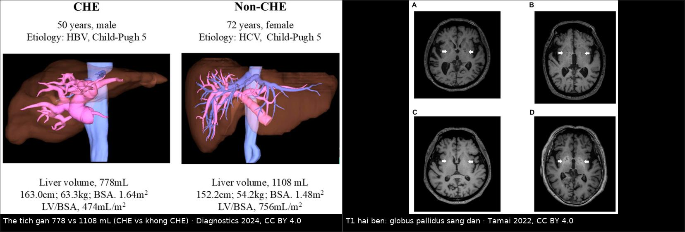
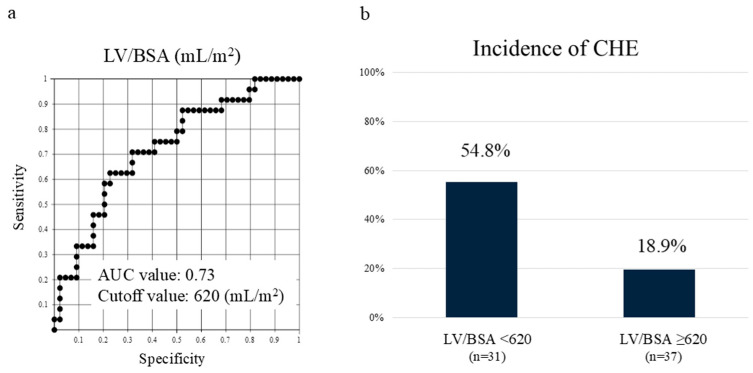
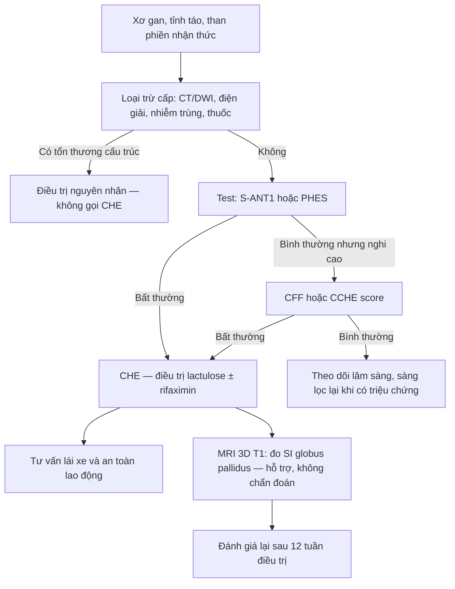
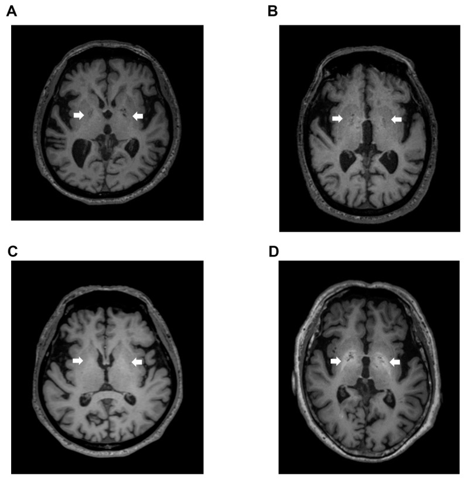
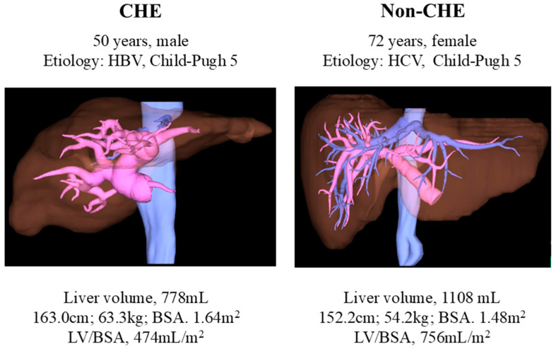
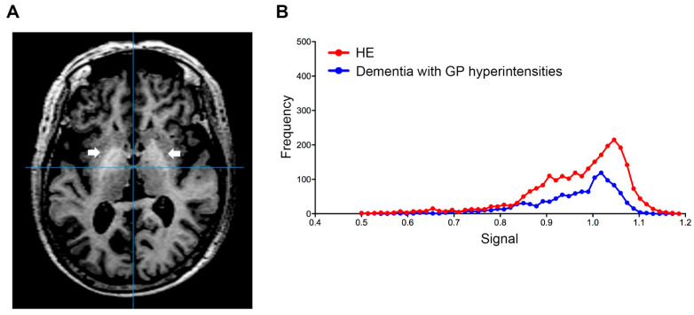

# 1902 — Bệnh não gan thể ẩn/tối thiểu: phim bình thường, T1 hạch nền & ngưỡng test / Covert & minimal hepatic encephalopathy

**Tags:** `pattern:t1-sang-hach-nen` `pattern:roi-loan-nhan-thuc` `pattern:teo-nao` `vung:nao` `vung:gan` `score:PHES` `score:CCHE` `score:West-Haven` `protocol:MRI-nao-3D-T1` `protocol:CT-the-tich-gan`
**Mức chắc chắn (certainty):** tổng hợp y văn (literature synthesis) — số liệu từ nghiên cứu đoàn hệ có ảnh gốc: Tamai et al., *Diagnostics* 2022 (PMC9317893, CC BY 4.0); Fukushima et al., *Diagnostics* 2024 (PMC11719456, CC BY 4.0); *Clin Transl Gastroenterol* 2020 (PMC7339190, CC BY-NC-ND 4.0); *World J Gastroenterol* 2017 (PMC5603499, CC BY-NC 4.0); rifaximin: Nakai et al., *PLOS ONE* 2022 (PMC9249214, CC BY 4.0). Bài **không** có ca nguyên văn riêng.

> **Câu hỏi gốc của bài:** bệnh nhân xơ gan Child–Pugh A, **tỉnh táo hoàn toàn, không asterixis**, nhưng vợ kể "hay quên, chậm, lái xe suýt đâm"; khám thần kinh bình thường; **MRI não bình thường**. Vậy: **có bệnh não gan không? tại sao phim không thấy gì? dấu T1 sáng hạch nền nghĩa là gì, ngưỡng nào? và bác sĩ CĐHA phải báo cáo gì để giúp quyết định điều trị — cho lái xe hay không?**
> **Điểm tựa:** **bệnh não gan thể ẩn (covert HE — CHE)** gồm **HE tối thiểu (minimal HE)** + **HE độ 1 West Haven**: tổn thương **ở mức chức năng, không tạo ổ hoại tử** → **MRI cấu trúc bình thường không loại trừ**. Dấu hiệu hình ảnh duy nhất có giá trị là **tăng tín hiệu T1 đối xứng ở globus pallidus** (mangan) và **teo gan/thể tích gan giảm** — nhưng **chẩn đoán vẫn là test tâm lý – thần kinh**, không phải phim.

## 1. Tổng quan — vì sao "không thấy gì" mà vẫn có bệnh

**A. Bệnh học (pathology) và cơ chế:**
- **Định nghĩa:** HE là hội chứng thần kinh – tâm thần do **suy gan và/hoặc shunt cửa–chủ**. **CHE** = **HE tối thiểu** (không triệu chứng lâm sàng, chỉ bất thường test) + **HE độ 1 West Haven** (lú lẫn nhẹ, rối loạn giấc ngủ, lo âu — người ngoài mới nhận ra). **HE rõ (overt HE — OHE)** = độ 2–4 (asterixis, lơ mơ, hôn mê).
- **Sinh lý bệnh:** amoniac và các sản phẩm nitơ từ ruột **không được gan khử** (suy gan + shunt) → qua hàng rào máu–não → **phù tế bào hình sao (astrocyte swelling)**, thay đổi dẫn truyền GABA/glutamate, stress oxy hóa → **rối loạn chức năng mạng vỏ – hạch nền**. Đây là **rối loạn chức năng**, chưa phải tổn thương cấu trúc.
- **Vì sao MRI cấu trúc bình thường:** không có phù lan tỏa đủ lớn, không hoại tử, không thay thế myelin → **không đổi tín hiệu T1/T2/FLAIR**. Vì vậy **"MRI bình thường" là kỳ vọng, không phải bằng chứng loại trừ**. Giá trị của MRI là **loại trừ nguyên nhân khác** (tụ máu dưới màng cứng, đột quỵ, u, áp-xe, Wernicke) và **tìm dấu hiệu hỗ trợ**.
- **Vì sao T1 sáng ở globus pallidus:** **mangan (Mn)** là kim loại **thuận từ (paramagnetic)** → **rút ngắn thời gian T1** → tăng tín hiệu trên T1, **không** tăng trên T2. Mangan bình thường được thải qua **đường mật**; khi suy gan/shunt cửa–chủ → ứ mangan → lắng đọng ở hạch nền (đặc biệt globus pallidus). Cùng cơ chế gặp ở **nuôi ăn tĩnh mạch kéo dài** và **tiêm gadobutrol nhiều lần** (gadolinium thoát khỏi phức hợp) — **không đặc hiệu cho HE**.
- **Vì sao thể tích gan liên quan:** gan teo = khối lượng chức năng giảm + shunt lớn hơn → nồng độ độc chất lên não cao hơn. Đây là **dấu hiệu hình ảnh hỗ trợ**, không phải tiêu chuẩn chẩn đoán.
- **Hậu quả nếu bỏ sót:** CHE làm **giảm chất lượng sống, giảm khả năng lái xe/an toàn lao động**, tăng **tai nạn giao thông**, tăng **nhập viện và tử vong**, và là **yếu tố dự báo OHE** — trong khi bệnh nhân **trông hoàn toàn bình thường**.

**B. Ngưỡng định lượng bắt buộc (cửa 1 Argon):**

| Đại lượng | Con số đã kiểm chứng | Ý nghĩa thực hành |
|---|---|---|
| Tần suất CHE ở xơ gan | **20–80%** (tổng quan); **35,8% (131/366)** trong đoàn hệ châu Á (PMC5603499); MHE **~30%** (PMC9249214) | Rất thường gặp — "bệnh nhân bình thường" vẫn có thể mắc |
| Tiến triển thành OHE | **17,0% (39/224)** trong 1 năm theo dõi (PMC7339190) | CHE là **giai đoạn tiền OHE**, không phải "biến thể lành" |
| Test tâm lý – thần kinh | **PHES < −4**; **CFF < 39 Hz**; **S-ANT1 < 20 con/phút** | Ngưỡng bất thường đã dùng trong nghiên cứu tiên lượng |
| Giá trị dự báo OHE (Cox, hiệu chỉnh MELD) | **CCHE score HR 6,378** (KTC 2,890–14,076); **PHES HR 3,900**; **S-ANT1 < 20 HR 2,740** | Test càng toàn diện, HR càng cao — không có test "hoàn hảo" |
| Biến chứng / tử vong ở CHE (11,2 tháng) | **28,2% vs 18,3%** nhập viện vì biến chứng; **11,5% vs 4,7%** tử vong | Chênh lệch rõ ngay trong năm đầu |
| T1 globus pallidus | **Ngưỡng SI 0,994** (bách phân vị 60, chuẩn hóa toàn ảnh); **AUC 0,864**; **Se 80,0% / Sp 90,9%** | Đo được, nhưng **không dùng một mình** để chẩn đoán |
| SI hạch nền theo nhóm | Người khỏe **0,952**; xơ gan không HE **0,992**; xơ gan **1,006**; HE **1,024** | Tăng dần theo mức độ bệnh — "bậc thang" chứ không phải bật/tắt |
| Vượt ngưỡng ở nhóm đối chứng | **12,5% (2/16)** xơ gan không HE; **2% (5/250)** bệnh nhân sa sút trí tuệ | **Dương tính giả** có thật → cần bối cảnh |
| Thể tích gan | CHE **778 mL** (LV/BSA **474 mL/m²**) vs không CHE **1108 mL** (**756 mL/m²**); ngưỡng **LV/BSA < 620 mL/m²** → CHE **cao 2,9 lần** | CT thể tích gan là dấu hiệu hỗ trợ khách quan |
| Rifaximin ở CHE (n = 24) | **10/24 (41,7%)** hết CHE sau 12 tuần; liều khởi đầu **1200 mg/ngày** ở 96,1% | Có thể đảo ngược — điều trị được, nên phát hiện |

**C. TẠI SAO ảnh trông như vậy (vật lý hình ảnh):**
- **T1W:** mangan thuận từ làm **T1 ngắn lại** → tín hiệu cao ở globus pallidus. Hiệu ứng **phụ thuộc từ trường** (rõ hơn ở 3T) và **phụ thuộc chuỗi xung** (T1 không xóa mỡ, lớp 3D lát mỏng 0,9 mm cho phép đo thể tích hạch nền chính xác).
- **T2W/FLAIR:** mangan **không** tạo tín hiệu đặc hiệu → tổn thương **không sáng trên T2**; nếu thấy **sáng T2 ở hạch nền**, nghĩ nguyên nhân khác (nhồi máu, viêm, ngộ độc CO, Wilson).
- **Đo SI:** phải **chuẩn hóa theo ảnh** (global intensity normalization) và lấy **bách phân vị 60** của vùng globus pallidus; đo trên **ảnh 3D T1** để tránh sai lệch do chọn ROI tay.
- **CT thể tích gan:** dựng 3D từ thì cửa, chia cho **diện tích da cơ thể (BSA)** — vì gan to/nhỏ phải chuẩn hóa theo kích thước người; đây là lý do dùng **LV/BSA (mL/m²)** chứ không dùng mL tuyệt đối.

## 2. Mẫu hình + chẩn đoán phân biệt (Gamut)

- **Mẫu A — CHE "thuần chức năng":** MRI bình thường, không dấu khu trú; chẩn đoán bằng **PHES/S-ANT1/CFF**; T1 hạch nền có thể tăng nhẹ.
- **Mẫu B — CHE + teo não/teo gan:** teo vỏ lan tỏa, giãn não thất ngoài, **thể tích gan giảm**; gợi ý bệnh gan tiến triển lâu, shunt lớn.
- **Mẫu C — T1 hạch nền sáng rõ:** nghĩ **bệnh não–não mắc phải (acquired hepatocerebral degeneration — AHD)**, **TPN dài hạn**, **gadolinium tích lũy**, **phơi nhiễm mangan nghề nghiệp** — không đồng nghĩa CHE.
- **Mẫu D — "HE giả":** rối loạn nhận thức do **sa sút trí tuệ, rượu, Wernicke, thuốc an thần, hạ Na⁺, nhiễm trùng, tụ máu dưới màng cứng** → phải loại trừ trước khi gọi CHE.

| Nhóm | Hình ảnh / test | Vì sao dễ nhầm CHE |
|---|---|---|
| OHE (độ 2–4) | Asterixis, lơ mơ; test không cần làm | Cùng cơ chế, chỉ khác **mức độ** — CHE là "đầu băng" |
| AHD | **T1 sáng hạch nền rõ**, parkinsonism, múa giật, ataxia | Cùng dấu T1 nhưng **triệu chứng vận động ngoại tháp**, không chỉ nhận thức |
| Sa sút trí tuệ (AD/mạch máu) | Teo vỏ – hải mã, nhồi máu ổ; **SI hạch nền thấp** | Bệnh nhân lớn tuổi xơ gan rất dễ bị gán "dementia" — **2% dementia vượt ngưỡng T1** |
| Wernicke | Tăng tín hiệu **thể vú, đồi thị nội bên, não quanh cống**, bối cảnh rượu/thiếu B1 | Rối loạn ý thức + ataxia; **đáp ứng B1** là chốt |
| Tụ máu dưới màng cứng mạn | Máu hình liềm, đè đẩy; **phải chụp CT** | Ngã do lú lẫn + xơ gan (dễ chảy máu) — bỏ sót = tử vong |
| Nhiễm trùng/hạ Na⁺/thuốc | Không dấu đặc hiệu; xét nghiệm | Nguyên nhân **có thể đảo ngược ngay**, phải loại trừ song song |

- **Gợi nhớ CHE:** **C**ognitive tests (PHES/ANT1/CFF) · **H**epatic shunt/suy gan (amoniac, TIPS, bàng hệ) · **E**xclude mimics (máu tụ, Wernicke, dementia, thuốc).

## 3. Bảng so sánh phân biệt (ma trận đối chiếu)

| Thực thể (entity) | Hình ảnh điển hình | Chốt vào (rule-in) | Chốt loại (rule-out) | Gợi ý xác nhận |
|---|---|---|---|---|
| **CHE** | MRI thường bình thường; T1 globus pallidus **tăng nhẹ** (SI ≥ 0,994); thể tích gan có thể giảm | **Test bất thường (PHES < −4 / S-ANT1 < 20) ở người tỉnh táo, không asterixis** | Có dấu thần kinh khu trú hoặc tổn thương cấu trúc → không gọi CHE | PHES, CFF, S-ANT1, CCHE; loại trừ nguyên nhân khác |
| **OHE** | Có thể phù não nhẹ; không cần chẩn đoán hình ảnh | **Asterixis + lơ mơ/hôn mê (độ 2–4)** | Tỉnh táo hoàn toàn → không phải OHE | Lâm sàng West Haven |
| **AHD** | **T1 sáng globus pallidus rõ, đối xứng**; teo não | **Triệu chứng ngoại tháp tiến triển + T1 sáng** | Chỉ rối loạn nhận thức, không vận động → nghĩ CHE | MRI; đáp ứng kém với điều trị HE |
| **Sa sút trí tuệ** | Teo vỏ/hải mã, nhồi máu; **SI hạch nền giảm** | **Suy giảm nhận thức tiến triển + hình ảnh đặc hiệu** | **T1 hạch nền tăng rõ** → không nghĩ dementia đơn thuần | MRI + trắc nghiệm nhận thức |
| **Wernicke** | Tăng tín hiệu **thể vú/đồi thị/não quanh cống** trên T2/FLAIR | **Bối cảnh rượu/thiếu B1 + ataxia + liệt vận nhãn** | Không tổn thương đặc hiệu → nghĩ HE | MRI + đáp ứng thiamine |
| **Tụ máu dưới màng cứng** | Hình liềm ngoài trục, đè đẩy | **Chấn thương/ngã + đè đẩy trên CT** | Không có khối ngoài trục → loại | CT không cản quang cấp |
| **Rối loạn chuyển hóa/thuốc** | Bình thường hoặc không đặc hiệu | **Điện giải/ammoniac/thuốc bất thường, hồi phục sau xử trí** | Test nhận thức vẫn bất thường sau khi sửa → nghĩ CHE | Xét nghiệm, ngưng thuốc |

*Trái: dựng 3D thể tích gan — CHE **778 mL** (LV/BSA 474 mL/m²) so với không CHE **1108 mL** (756 mL/m²). Phải: T1 axial hai bên — globus pallidus sáng dần theo mức bệnh (người khỏe 0,952 → HE 1,024; ngưỡng 0,994). Nguồn: Fukushima et al., Diagnostics 2024, PMC11719456 Fig. 3; Tamai et al., Diagnostics 2022, PMC9317893 Fig. 2 — CC BY 4.0; ảnh ghép letterbox, **đã thay đổi** (ghép + dải chú thích).*

### Đọc T1 hạch nền cho đúng
- **Đối xứng, chỉ ở globus pallidus**, không lan ra putamen/đồi thị → gợi ý **mangan**.
- **Tăng tín hiệu trên T1 mà KHÔNG tăng trên T2** → mangan (nếu T2 cũng sáng, nghĩ nhồi máu/viêm/CO).
- **Bối cảnh quyết định:** xơ gan/shunt, TPN, gadobutrol nhiều lần, nghề hàn/khoáng sản. Không có bối cảnh → đừng gán HE.

## 4. Protocol chụp + bộ test + sơ đồ sàng lọc

**A. Khi nào chụp (và chụp gì):**
1. **Không chụp não để "chẩn đoán CHE"** — không có tổn thương đặc hiệu. Chẩn đoán bằng test.
2. **Chụp CT không cản quang cấp** khi: HE lần đầu, chấn thương/ngã, dấu thần kinh khu trú, đau đầu mới, sốt, nghi xuất huyết — để loại trừ **tụ máu, đột quỵ, áp-xe**.
3. **MRI não** khi triệu chứng không điển hình, tiến triển không tương xứng, nghi AHD/Wernicke/u; protocol tối thiểu **T1 3D (0,9 mm) + T2/FLAIR + DWI**.
4. **CT/MRI gan có thể tích** khi cần đánh giá bệnh gan nền, shunt lớn, trước TIPS.

**B. Bộ test chẩn đoán (chọn theo điều kiện thực tế):**
- **PHES** (5 test giấy bút: NCT-A/B, digit symbol, serial dotting, line tracing) — **tiêu chuẩn tham chiếu**; **< −4** là bất thường.
- **S-ANT1** (gọi tên động vật trong 1 phút, hiệu chỉnh tuổi/học vấn) — nhanh, miễn phí; **< 20 con** là bất thường.
- **CFF** (tần số nhấp nháy tới hạn) — cần máy; **< 39 Hz** là bất thường.
- **CCHE score** (tiền sử OHE, cổ trướng, albumin, S-ANT1, điểm hoạt động CLDQ) — **HR cao nhất** cho dự báo OHE.
- **Không dùng amoniac máu để chẩn đoán** (tương quan yếu); amoniac chỉ hỗ trợ theo dõi.

**C. Ngưỡng hình ảnh (dùng làm hỗ trợ, không thay test):**
- **T1 globus pallidus SI ≥ 0,994** (bách phân vị 60, chuẩn hóa toàn ảnh, 3D T1) — **Se 80,0%, Sp 90,9%**; nhớ **12,5%** xơ gan không HE cũng vượt ngưỡng.
- **LV/BSA < 620 mL/m²** trên CT thì cửa → CHE **cao 2,9 lần**; kết hợp **kẽm < 70 µg/dL** càng gợi ý.

*(a) Đường ROC của **LV/BSA** ở bệnh nhân Child–Pugh A; (b) đặt ngưỡng **620 mL/m²**, tỷ lệ CHE **cao 2,9 lần** ở nhóm dưới ngưỡng. Nguồn: Fukushima et al., Diagnostics 2024, PMC11719456 Fig. 2, CC BY 4.0.*
- **Teo não lan tỏa/giãn não thất ngoài** ở bệnh gan mạn — dấu hiệu nền, không chẩn đoán.

**D. Điều trị và tư vấn (để biết vì sao phải phát hiện):**
- **Lactulose** là điều trị nền; **rifaximin** thêm vào khi không đủ đáp ứng (liều khởi đầu **1200 mg/ngày**; **41,7%** hết CHE sau 12 tuần trong một đoàn hệ nhỏ).
- **Tư vấn lái xe/an toàn lao động**: CHE làm tăng vi phạm giao thông và tai nạn — đây là lý do thực dụng nhất để sàng lọc.
- **Trước TIPS:** sàng lọc CHE giúp chọn bệnh nhân và tư vấn nguy cơ HE sau shunt.

## 5. Biến thể bình thường và cạm bẫy

- **"MRI bình thường" bị dùng để loại trừ HE** — sai lầm nguy hiểm nhất. CHE **không có tổn thương cấu trúc**; MRI bình thường là **kỳ vọng**.
- **T1 hạch nền sáng không đồng nghĩa HE:** gặp ở **TPN dài hạn**, **gadobutrol nhiều lần**, **thợ hàn/khoáng sản**, **AHD**. Phải đọc cùng bối cảnh.
- **Sa sút trí tuệ làm nhiễu:** ở 250 bệnh nhân dementia, **2% (5/250)** vượt ngưỡng T1; một ca trong số đó **đã cắt gan vì HCC** — tức "dementia" có thể che một HE thật. Ngược lại, **SI hạch nền ở dementia thường giảm**.
- **12,5% xơ gan không HE vượt ngưỡng 0,994** → **không chẩn đoán chỉ bằng một con số**; luôn cần test.
- **Amoniac bình thường không loại trừ CHE**; amoniac cao cũng không chẩn đoán (nhiều bệnh nhân xơ gan amoniac cao mà không HE).
- **HE độ 1 bị bỏ qua vì "bệnh nhân vẫn tỉnh"**: thay đổi tinh tế (chậm chạp, cáu gắt, đảo ngược giấc ngủ) do người nhà phát hiện.
- **Sau TIPS:** HE mới/xấu đi sau đặt shunt phải được coi là **biến chứng của shunt**, không phải "bệnh gan nặng lên" — đánh giá lại đường kính shunt (bài 183).
- **Hạ Na⁺, nhiễm trùng, xuất huyết tiêu hóa, táo bón, thuốc an thần** là yếu tố khởi phát **có thể đảo ngược trong vài giờ** — phải xử lý song song với chẩn đoán.

## 6. Tự lượng giá — Blind Quiz

**Ca 1 — Bệnh nhân xơ gan, "hay quên", không asterixis (ảnh minh họa từ bài gốc).**

- Gợi ý: MRI cấu trúc không có ổ tổn thương; không rượu, không thuốc an thần.
- Câu hỏi: ảnh nào là người khỏe, ảnh nào là HE? Dấu hiệu nằm ở đâu? Có cần chẩn đoán bằng phim không?

<b>Bấm để hiện đáp án (findings + chẩn đoán)</b>

- **(A)** người khỏe 74 tuổi: SI **0,952**; **(B)** xơ gan 79 tuổi: **0,992**; **(C)** xơ gan 63 tuổi: **1,006** (vượt ngưỡng); **(D)** HE 68 tuổi: **1,024**.
- **Findings:** tăng tín hiệu **đối xứng hai bên globus pallidus** trên T1 (mũi tên), tăng dần theo mức bệnh; **không** có tổn thương vỏ/ồ.
- **Chẩn đoán:** **CHE/HE** — nhưng chốt bằng **test (PHES < −4 / S-ANT1 < 20)**, không bằng phim. Ngưỡng SI **0,994** chỉ có giá trị hỗ trợ.
- Nguồn ảnh: Tamai et al., *Diagnostics* 2022, PMC9317893 Fig. 2, CC BY 4.0.

**Ca 2 — Nam 50 tuổi, HBV, Child–Pugh 5, chậm chạp – hay quên; không triệu chứng thần kinh khu trú.**

- Câu hỏi: thể tích gan hai bên khác nhau thế nào? Vì sao phải chia cho BSA? Con số nào gợi ý CHE?

<b>Bấm để hiện đáp án (findings + chẩn đoán)</b>

- **Findings:** bên CHE (trái): **778 mL**, BSA 1,64 m² → **LV/BSA 474 mL/m²**; bên không CHE (phải): **1108 mL**, BSA 1,48 m² → **756 mL/m²**.
- **Vì sao chia BSA:** thể tích gan phụ thuộc kích thước cơ thể; **LV/BSA** so sánh được giữa người.
- **Ngưỡng:** **< 620 mL/m²** → CHE **cao 2,9 lần**; kết hợp kẽm thấp (< 70 µg/dL) càng gợi ý.
- **Chẩn đoán:** **CHE** — hình ảnh chỉ hỗ trợ; phải làm **S-ANT1/PHES** và tư vấn lái xe.
- Nguồn ảnh: Fukushima et al., *Diagnostics* 2024, PMC11719456 Fig. 3, CC BY 4.0.

**Ca 3 — Bệnh nhân 76 tuổi, chẩn đoán "Alzheimer", có tiền sử cắt gan vì HCC; MRI T1 thấy hạch nền sáng.**

- Câu hỏi: histogram đỏ (HE) khác xanh (dementia có T1 sáng) ở đâu? Vì sao "dementia" ở đây có thể là chẩn đoán sai?

<b>Bấm để hiện đáp án (findings + chẩn đoán)</b>

- **(A)** T1 axial: globus pallidus sáng hai bên (mũi tên).
- **(B)** Histogram: nhóm **HE (đỏ)** lệch phải, đỉnh ở bin tín hiệu cao; nhóm **dementia có T1 sáng (xanh)** đỉnh thấp hơn — dù cùng "sáng" trên mắt thường.
- **Ý nghĩa:** ở 250 bệnh nhân dementia, **5 (2%)** vượt ngưỡng 0,994; một người **đã cắt gan vì HCC** với tiểu cầu thấp, men gan tăng nhẹ → có thể là **CHE bị chẩn đoán nhầm thành dementia**.
- **Chẩn đoán:** cần **test nhận thức + đánh giá gan** trước khi chốt dementia ở người có bệnh gan.
- Nguồn ảnh: Tamai et al., *Diagnostics* 2022, PMC9317893 Fig. 4, CC BY 4.0.

## Bài liên quan chéo
- [100 – Tổng quan hệ Bụng](../100-tong-quan-he-bung/lesson.md)
- [149 – Tăng áp cửa không xơ gan](../149-tang-ap-cua-khong-xo-gan/lesson.md)
- [176 – TIPS/DIPS: chỉ định, kỹ thuật & theo dõi shunt](../176-tips-dips-theo-doi-shunt/lesson.md)
- [183 – Giảm đường kính shunt & HE kháng trị sau TIPS](../183-giam-duong-kinh-shunt-va-HE-khang-tri-sau-tips/lesson.md)
- [188 – Bệnh tủy do gan sau shunt cửa–chủ](../188-benh-tuy-do-gan-sau-shunt-cua-chu/lesson.md)
- [1901 – Hội chứng Budd–Chiari](../1901-hoi-chung-budd-chiari/lesson.md)

> Không dùng để chẩn đoán độc lập khi chưa có người hướng dẫn.
