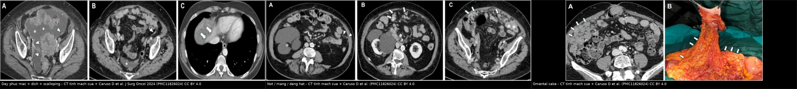
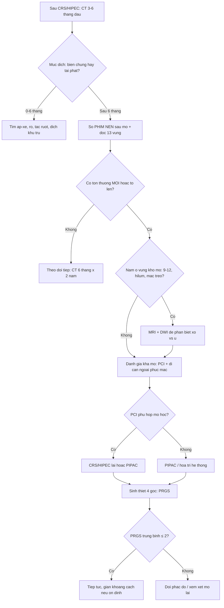
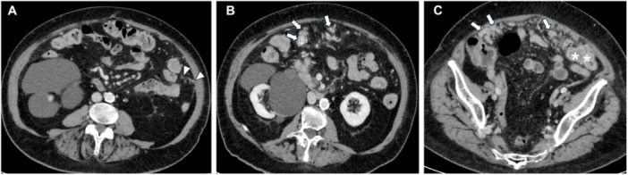
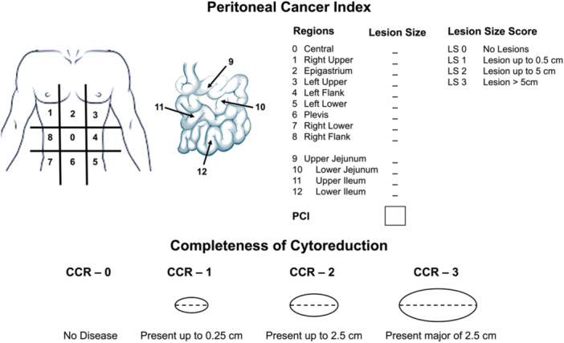
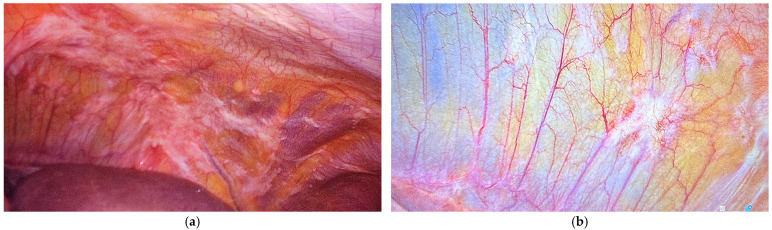

# 1903 — Theo dõi sau CRS/HIPEC & PIPAC ở u phúc mạc: PCI, CCR, PRGS và cạm bẫy hậu phẫu / Follow-up after CRS/HIPEC and PIPAC for peritoneal surface malignancies

**Tags:** `pattern:day-phuc-mac` `pattern:not` `vung:phuc-mac` `vung:o-bung` `score:PCI` `score:CCR` `score:PRGS` `protocol:CT-bung-co-can-quang` `protocol:MRI-bung` `protocol:PIPAC`
**Mức chắc chắn (certainty):** tổng hợp y văn (literature synthesis) — 1 tổng quan hình ảnh u phúc mạc (Caruso D et al., *J Surg Oncol* 2024, PMC11826024), 1 báo cáo thực tế của cơ sở dữ liệu PIPAC quốc tế ISSPP (Jørgensen MS et al., *Pleura Peritoneum* 2025, PMC12458025, 1.126 bệnh nhân / 3.224 lần PIPAC), 1 nghiên cứu về giá trị tiên lượng của PRGS (Baake J et al., *Pleura Peritoneum* 2023, PMC10249756, 97 bệnh nhân), 1 loạt ca PIPAC (Marrelli D et al., *Cancers* 2025, PMC12191417) và 1 tổng quan hệ thống về HIPEC – tái phát phúc mạc (Yap DRY et al., *Front Oncol* 2021, PMC8678115). Số nào nguồn không nêu thì ghi **"chưa rõ"**.

## 1. Tổng quan bệnh học – cơ chế hình ảnh

- **Vì sao u phúc mạc lan theo "bản đồ" chứ không ngẫu nhiên:** tế bào u phóng thích vào ổ bụng trôi theo **dòng dịch phúc mạc** — dịch đi theo trọng lực xuống **cùng đồ – túi cùng Douglas – rãnh đại tràng phải**, rồi được **hút lên dưới cơ hoành** nơi có các **lỗ hấp thu (stomata) trên phúc mạc hoành** và **mạc nối lớn**. Vì vậy ổ di căn hay gặp ở **hoành, mạc nối, tiểu khung, rãnh đại tràng phải, mạc treo ruột non** — đúng 13 vùng mà **PCI (Peritoneal Cancer Index)** chia ra (Caruso D et al. 2024). Hệ quả thực hành: **đọc theo 13 vùng**, không "nhìn tổng thể rồi kết luận".
- **TẠI SAO u phúc mạc khó thấy trên CT:** phúc mạc bình thường là **màng một lớp, dày dưới 1 mm**, CT gần như không thấy. Nhân < 1 cm **không tạo đủ tương phản** với mỡ/dịch quanh nó → **CT chỉ có Se 9,1–50%** cho nhân < 1 cm, và với ngưỡng phát hiện **5 mm** độ nhạy chỉ khoảng **11%** (Caruso D et al. 2024). Đây là lý do "CT sạch" **không** loại trừ carcinosis vi thể.
- **Ngưỡng định lượng của toàn bộ bài (PCI + CCR):** PCI chia ổ bụng **13 vùng**, mỗi vùng chấm **0–3** theo **đường kính lớn nhất của nhân lớn nhất**: **0 = không thấy u**, **1 = < 0,5 cm**, **2 = 0,5–5 cm**, **3 = > 5 cm**; tổng **tối đa 39** (Caruso D et al. 2024). **PCI ≥ 20** thì khả năng đạt **cắt hết (complete cytoreduction) rất thấp**; **vùng hỗng tràng 9–10** xấu hơn **vùng hồi tràng 11–12**.
- **Ngưỡng PCI theo mô học (khác nhau, không dùng chung một số):** **u nhầy phúc mạc giả (PMP)** vẫn có thể mổ khi PCI cao — ngưỡng khả mổ **21** (độ thấp) và **25** (độ cao); **ung thư dạ dày** chỉ nên CRS/HIPEC khi **PCI < 6**; **ung thư buồng trứng** sau hóa tân bổ trợ: **PCI < 17** dự báo cắt hết tốt nhất (Caruso D et al. 2024).
- **CCR (Completeness of Cytoreduction) — thang 4 bậc theo mm:** **CCR-0** = không còn u đại thể; **CCR-1** = còn u **< 2,5 mm**; **CCR-2** = **2,5 mm – 2,5 cm**; **CCR-3** = **> 2,5 cm**. HIPEC thường chỉ định khi **CCR-0/1** (Caruso D et al. 2024). Điểm này giải thích vì sao báo cáo hậu phẫu phải ghi **mm**, không ghi "còn ít".
- **TẠI SAO "u còn 2,5 mm" lại là ngưỡng:** HIPEC chỉ thấm được **vài mm** vào mô — lớp u dày hơn ngưỡng đó không nhận đủ thuốc. Đây là vật lý của **độ thấm giới hạn**, không phải quy ước hành chính.
- **Vì sao PIPAC ra đời:** CRS/HIPEC cần mổ lớn và chỉ làm được khi bệnh còn mổ được. **PIPAC (pressurized intraperitoneal aerosol chemotherapy)** bơm hóa chất dạng **aerosol dưới áp lực** qua 2 trocar, tạo lớp sương mù thuốc phủ phúc mạc — dùng cho bệnh **không mổ được** hoặc **bidirectional** (kết hợp hệ thống). Báo cáo ISSPP lần 3: **1.126 bệnh nhân, 3.224 lần PIPAC**, trung vị **2 lần/bệnh nhân (1–33)**; **PCI trung vị 19** và **không đổi** qua các lần; **không vào được ổ bụng (nonaccess) 3,5% ở lần 1 → 1,4%** các lần sau (Jørgensen MS et al. 2025).
- **TẠI SAO đánh giá đáp ứng PIPAC phải bằng mô học, không bằng CT:** tổn thương phúc mạc nhỏ + xơ hóa sau điều trị → **RECIST 1.1 kém giá trị**. Chuẩn dùng là **PRGS (peritoneal regression grading score)** trên sinh thiết 4 góc ổ bụng, thang **4 bậc**: **PRGS 1** = đáp ứng hoàn toàn (không còn tế bào u, nhiều xơ thoái triển/mucin không tế bào/hoại tử nhồi máu); **PRGS 2** = thoái triển **chiếm ưu thế** so với tế bào u; **PRGS 3** = có thoái triển nhưng **tế bào u chiếm ưu thế**; **PRGS 4** = không có dấu hiệu thoái triển (Baake J et al., *Pleura Peritoneum* 2023, PMC10249756). **PRGS trung bình ≤ 2** = "đáp ứng hoàn toàn/lớn".
- **Số liệu để tư vấn (PIPAC):** đáp ứng **PRGS trung bình ≤ 2** đạt **57% / 72% / 75%** ở PIPAC 1/2/3; **sống thêm trung vị 12,5 tháng** kể từ PIPAC 1; biến chứng nặng **Dindo–Clavien ≥ 3b 0,7%**, **CTCAE ≥ 3 là 5,2%**; thể tích dịch báng **> 500 mL giảm có ý nghĩa** từ PIPAC 4 trở đi (Jørgensen MS et al. 2025, PMC12458025). PRGS có giá trị tiên lượng độc lập: PRGS ban đầu ≤ 2 → sống thêm **12,1** vs **8,0 tháng** (P = 0,02) (Baake J et al. 2023, PMC10249756).
- **Vì sao theo dõi sau CRS/HIPEC khó:** (a) nhân nhỏ dưới ngưỡng CT; (b) **thay đổi hậu phẫu** (xơ, dính, mạc nối cắt bỏ, quai ruột tái bố trí) tạo "giả tổn thương"; (c) **mô học quyết định số phận** — HIPEC cải thiện sống không tái phát ở **5/7 thử nghiệm ung thư dạ dày**, nhưng chỉ **1/3** thử nghiệm buồng trứng và **0/3** thử nghiệm đại tràng (Yap DRY et al. 2021) → **không hứa hẹn "HIPEC chặn tái phát"** với mọi mô học.

## 2. Mẫu hình + chẩn đoán phân biệt theo vị trí (gamut)

**Trục A — theo hình thái (nhìn cái gì trước):**

1. **Dày + ngấm thuốc phúc mạc** (mảng mỏng hoặc nốt): dấu sớm nhất; ở **mặt dưới hoành** gây **lõm nhu mô gan/lách = scalloping**, dễ đọc nhầm di căn gan/lách (Caruso D et al. 2024).
2. **Nhân đặc:** **vi nhân 1–5 mm**, **nhân tới 5 cm**, **khối > 5 cm** do nhiều nhân hợp lại. Kích thước này chính là cái PCI chấm điểm.
3. **Nhân dạng nang:** đặc trưng **PMP** (u nhầy ruột thừa) hoặc u trung biểu mô đa nang lành tính; nang **đậm độ gần dịch**, có thể vôi hóa vỏ.
4. **Omental cake:** mạc nối dày thành **bản mô mềm**, đẩy quai ruột ra sau; khởi đầu là **tăng đậm độ mỡ mạc nối** rồi dạng lưới/nốt.
5. **Mạc treo ruột non "đông cứng" (frozen mesentery):** mỡ mạc treo thâm nhiễm, mất nếp gấp bình thường, mạch mạc treo sung huyết; nặng gây **tắc ruột** — dấu hiệu tiên lượng xấu.
6. **Dịch báng** (tự do hoặc **khu trú** trong PMP/u trung biểu mô).
7. **Vôi hóa:** hay gặp ở **ung thư buồng trứng thanh dịch/ung thư dạ dày**; **vôi hóa sau hóa trị = dấu đáp ứng**, đừng đọc là tiến triển; mảng vôi hóa phúc mạc **không có khối** gợi ý **u trung biểu mô nhú biệt hóa cao (WDPM)** (Caruso D et al. 2024).

**Trục B — theo "cảnh" lâm sàng sau mổ (quyết định cách đọc):**

- **3–6 tháng đầu sau CRS/HIPEC:** ưu tiên **phát hiện biến chứng** (áp-xe, rò, tắc ruột, dịch khu trú) hơn là tái phát — tổn thương "mới" trong giai đoạn này thường là **viêm/xơ**.
- **Sau 6 tháng:** ưu tiên **tái phát** — nhân mới, dày phúc mạc mới, dịch báng mới xuất hiện, **omental cake tái hình thành**.
- **Đang PIPAC:** mục tiêu là **theo dõi dung nạp + đáp ứng mô học**; hình ảnh dùng để **loại trừ tiến triển ngoài phúc mạc/tắc ruột**, không để "chấm điểm đáp ứng".
- **Sau PIPAC chuyển mổ (bidirectional):** CT để **đánh giá khả mổ lại**, không phải để chấm PRGS.

## 3. Bảng so sánh phân biệt (ma trận đối chiếu)

| Thực thể (entity) | Hình ảnh điển hình | Chốt vào (rule-in) | Chốt loại (rule-out) | Gợi ý xác nhận |
|---|---|---|---|---|
| **Tái phát carcinosis** | Nhân **mới** hoặc dày phúc mạc **mới** ở vùng trước đó sạch; omental cake tái hình thành; dịch báng mới | **Tổn thương MỚI so với phim sau mổ nền + tăng kích thước theo thời gian** | Tổn thương **ổn định ≥ 6–12 tháng**, không đổi hình thái → nghĩ xơ | So **phim nền sau mổ** (bắt buộc); CT 3–6 tháng; MRI-DWI |
| **Thay đổi hậu phẫu (xơ/dính)** | Dày mờ, dạng dải, **bờ không lồi**, kéo co mạc treo; không có nhân rời | **Bờ không lồi + không tăng theo thời gian + trùng vùng mổ** | Có **nốt lồi, bờ cong** hoặc tăng dần → tái phát | Đối chiếu phim nền; MRI T2/DWI (xơ tối, không hạn chế khuếch tán) |
| **Xơ hóa sau PIPAC** | Mảng dày **giảm dần**, có thể vôi hóa; bụng "sạch dần" | **Giảm kích thước/số nhân qua các lần** | Tổn thương **to lên** hoặc nhân mới → tiến triển | PRGS trên sinh thiết (chuẩn vàng), không phải CT |
| **PMP/u nhầy** | Nhân **dạng nang**, dịch **khu trú**, **scalloping gan/lách**, vôi hóa vỏ | **Dịch nhầy khu trú + lõm nhu mô gan/lách nhẵn** | Nhân **đặc** bờ tua → carcinosis không nhầy/ung thư thứ phát | MRI T2 (nhầy rất sáng), mô bệnh; PET có vai trò phân độ |
| **U trung biểu mô phúc mạc** | Dày phúc mạc **dạng mảng**, **vôi hóa mảng không khối**, dịch khu trú | **Mảng vôi hóa phúc mạc + dịch khu trú + không ổ nguyên phát** | Có ổ nguyên phát rõ (buồng trứng/đại tràng) → carcinosis | Mô bệnh + BAP1/p16 (bài 143) |
| **Lao phúc mạc** | Dày phúc mạc đều, **nốt nhỏ rải đều**, dịch báng, **hạch hoại tử trung tâm**, dày mạc nối | **Hạch hoại tử + tổn thương phổi lao + dịch tiết dịch** | Không hạch hoại tử, có ổ nguyên phát → carcinosis | PCR lao dịch báng; nội soi ổ bụng |
| **Lymphomatosis phúc mạc** | **"Stellate mesentery"** — mạch mạc treo nổi rõ, mỡ mạc treo thâm nhiễm, hạch lớn | **Mạch mạc treo "hình sao" + hạch lớn đối xứng** | Có nhân đặc phúc mạc rời rạc → carcinosis | Mô bệnh; LDH; PET-CT |

*Ba mẫu hình đọc trên CT tĩnh mạch cửa: **trái** — dày phúc mạc + dịch báng + **scalloping** mặt dưới gan (mũi tên); **giữa** — nhân **vi nhân** (đầu mũi tên), **nhân** (mũi tên) và **mảng** (sao); **phải** — **omental cake** (đầu mũi tên) đối chiếu mạc nối cắt bỏ trong mổ. Nguồn: Caruso D et al., *J Surg Oncol* 2024;130(6):1203–1212, PMC11826024 Fig. 1, 2, 4, CC BY 4.0 — ảnh ghép letterbox, không crop/kéo giãn.*

### Đọc theo 13 vùng — thứ tự không được đổi
1. **Vùng 0 (trung tâm):** mạc nối lớn + mạc treo đại tràng ngang.
2. **Vùng 1–6 (phải trên → tiểu khung):** gan, hoành phải, rãnh đại tràng phải, **túi cùng Douglas**.
3. **Vùng 7–12:** lách, hoành trái, rãnh trái, **hỗng tràng 9–10, hồi tràng 11–12** (vùng 9–12 là vùng khó mổ nhất).
4. **Ghi cả 13 vùng kể cả vùng 0 điểm** — báo cáo "PCI = x/39" mà không liệt kê vùng là **không dùng được để mổ**.

## 4. Protocol chụp + hệ phân độ & quyết định theo dõi

**Chọn modality:**

| Bối cảnh | Chọn | Ngưỡng/ghi chú |
|---|---|---|
| Theo dõi chuẩn sau CRS/HIPEC | **CT bụng–chậu có cản quang, thì tĩnh mạch cửa, lát ≤ 1 mm, tái tạo coronal/sagittal** | Không dùng thì động mạch — phúc mạc ngấm thuốc muộn |
| Nghi tổn thương nhỏ ở **mạc treo/ruột non/hilum gan** (đặc biệt **PMP**) | **MRI bụng + DWI** | Trong PMP: **MRI Se 88% vs CT 67%** cho mạc treo/mặt thanh mạc ruột non, độ đặc hiệu cả hai **100%** (Caruso D et al. 2024) |
| **PMP** — phân độ, tiên lượng | **CT + ¹⁸F-FDG PET/CT** | **SUVmax 2,02** dự báo sống không tiến triển; **2,63** dự báo độ ác (Se 77,8%/Sp 72,3%) (Caruso D et al. 2024) |
| U nhầy/mô học chế nhầy, tế bào hình nhẫn | **Không dựa PET** | PET **âm giả** ở u nhầy, ung thư tế bào hình nhẫn, nhân nhỏ (Caruso D et al. 2024) |
| Đánh giá đáp ứng PIPAC | **Sinh thiết 4 góc + PRGS** | Không dùng RECIST/CT để chấm đáp ứng |

**Ba thang điểm phải phân biệt rõ trong báo cáo:**

| Thang | Đo cái gì | Thang điểm | Ngưỡng hành động |
|---|---|---|---|
| **PCI** | Gánh nặng u trên 13 vùng | 0–39 | **≥ 20**: cắt hết rất khó; **< 6** (dạ dày), **< 17** (buồng trứng sau hóa), **21/25** (PMP thấp/cao độ) |
| **CCR** | U còn lại **sau** mổ | 0 / 1 / 2 / 3 | **CCR-0/1 (< 2,5 mm)** → HIPEC; **CCR-2/3** → không |
| **PRGS** | Đáp ứng **mô học** sau PIPAC | 1–4 theo vùng, lấy **trung bình** | **Trung bình ≤ 2** = đáp ứng lớn/hoàn toàn → sống thêm dài hơn |

- **Lịch theo dõi:** các nguồn đã đọc **không đưa một lịch thống nhất** cho toàn bộ mô học — ghi **"chưa rõ"** thay vì bịa. Nguyên tắc an toàn: **chụp nền sau mổ 3 tháng** (để có mốc so sánh — quan trọng hơn cả tần suất), sau đó **3–6 tháng/lần trong 2 năm đầu**, thưa dần; chụp sớm khi có triệu chứng. **PIPAC lặp mỗi 6 tuần**, giãn thành **3 tháng** khi đáp ứng mô học lớn/hoàn toàn (Baake J et al. 2023, PMC10249756).
- **Cái phải ghi trong báo cáo theo dõi:** (1) **PCI và danh sách 13 vùng**; (2) **vị trí + kích thước (mm)** từng tổn thương mới; (3) **so sánh với phim nền** (có/không có); (4) **biến chứng hậu phẫu**; (5) **gợi ý mô học nếu có** (nhầy → PMP; vôi mảng → WDPM). Báo cáo thiếu mục (1) và (3) là báo cáo **không trả lời được câu hỏi của phẫu thuật viên**.

## 5. Biến thể bình thường và cạm bẫy

- **Biến thể bình thường:** **mạc nối mỡ "lốm đốm"** ở người gầy; **dịch phúc mạc sinh lý lượng rất ít** ở phụ nữ trong chu kỳ; **mạc treo dày nhẹ sau mổ** do phù. Không có **nhân lồi bờ cong** và **không tăng theo thời gian** → không gọi tái phát.
- **Cạm bẫy 1 — không có phim nền:** "có tổn thương" mà không so được với phim sau mổ là **không thể phân biệt xơ với tái phát**. Đây là lỗi hay gặp nhất và cách tránh rẻ nhất: **đặt lịch chụp nền 3 tháng sau mổ**.
- **Cạm bẫy 2 — scalloping gan/lách bị đọc là di căn gan:** lõm **nhẵn, bờ cong đều** ở **mặt dưới** gan/lách do **dịch nhầy/dày phúc mạc hoành** đè vào; di căn gan thật **nằm trong nhu mô**, có viền. So sánh với **mặt trên** và dùng tái tạo sagittal để thấy rõ (Caruso D et al. 2024).
- **Cạm bẫy 3 — chấm PCI trên CT rồi tin tuyệt đối:** **CT-PCI Se 76%/Sp 69%** so với mổ; đặt ngưỡng CT-PCI 20 để loại mổ là **không chính xác** — gần **một nửa** bệnh nhân bị xếp "không mổ được" trên CT vẫn cắt hết được (Caruso D et al. 2024). **CT-PCI là công cụ trao đổi, không phải phán quyết.**
- **Cạm bẫy 4 — vôi hóa sau hóa trị đọc là tiến triển:** vôi hóa trong nhân **sau điều trị = đáp ứng**; chỉ gọi tiến triển khi **kích thước/số nhân tăng** hoặc có tổn thương mới.
- **Cạm bẫy 5 — PET âm giả:** u **nhầy**, **tế bào hình nhẫn**, **nhân < 1 cm** thường **không bắt FDG**; PET âm **không loại trừ** carcinosis (Caruso D et al. 2024).
- **Cạm bẫy 6 — đánh giá đáp ứng PIPAC bằng CT:** xơ hóa sau PIPAC làm tổn thương **nhỏ đi nhưng vẫn còn tế bào sống**, và ngược lại mảng dày có thể chỉ là xơ. Đáp ứng **chỉ** xác định bằng **PRGS**; sinh thiết **4 góc** vì **PRGS cao nhất có thể nằm ở góc không phải "chỗ xấu nhất nhìn thấy"** (nghiên cứu về chọn vị trí sinh thiết PRGS, PMC9467898).
- **Cạm bẫy 7 — bỏ qua biến chứng vì "đang đi tìm tái phát":** trong 6 tháng đầu, **áp-xe/rò/tắc ruột** nguy hiểm hơn tái phát. Satisfaction of search ở đây là **tìm u mà bỏ ổ áp-xe**.

## 6. Tự lượng giá — Blind Quiz

**Ca 1 — Bệnh nhân ung thư dạ dày, 6 tháng sau CRS/HIPEC, đau bụng tăng, chưa có phim nền. Hãy mô tả hình thái tổn thương trước khi mở đáp án.**

- Gợi ý lâm sàng: PCI trước mổ 12; hiện không sốt.
- Câu hỏi: Có mấy **loại hình thái** tổn thương? Chấm PCI cho các vùng nhìn thấy? Cần thêm gì để kết luận tái phát?

<b>Bấm để hiện đáp án (findings + chẩn đoán)</b>

- Dấu hiệu: (A) **vi nhân 1–5 mm** (đầu mũi tên trắng) rải trên phúc mạc; (B,C) **nhân** (mũi tên trắng) và **mảng** (sao trắng) — ba hình thái cùng tồn tại.
- Chấm điểm: vi nhân = **1 điểm/vùng**, nhân 0,5–5 cm = **2 điểm**, mảng > 5 cm hoặc khối = **3 điểm**; chỉ chấm **nhân lớn nhất mỗi vùng**.
- Kết luận: **không thể gọi tái phát nếu không có phim nền** — phải so với CT 3 tháng sau mổ. Nếu tổn thương **mới/tăng** → tái phát; nếu ổn định → xơ/dính.
- Nguồn ảnh: Caruso D et al., *J Surg Oncol* 2024, PMC11826024 Fig. 2, CC BY 4.0.

**Ca 2 — Bảng điểm dùng để họp với phẫu thuật viên. Nhìn sơ đồ, trả lời 3 câu: PCI tối đa bao nhiêu? CCR-1 khác CCR-2 ở ngưỡng nào? HIPEC chỉ định tới CCR mấy?**

- Câu hỏi: 13 vùng gồm những gì? Vì sao ngưỡng lại là **2,5 mm** và **2,5 cm**?

<b>Bấm để hiện đáp án</b>

- **PCI tối đa 39** (13 vùng × 3 điểm). Mỗi vùng chấm theo **đường kính nhân lớn nhất**: < 0,5 cm = 1; 0,5–5 cm = 2; > 5 cm = 3.
- **CCR-1: còn u < 2,5 mm** (0,25 cm); **CCR-2: 2,5 mm – 2,5 cm**; **CCR-3: > 2,5 cm**; **CCR-0: không còn u**.
- **HIPEC chỉ định khi CCR-0/1** — vì thuốc chỉ thấm vài mm vào mô, lớp u dày hơn ngưỡng đó không nhận đủ liều.
- Nguồn ảnh: Caruso D et al., *J Surg Oncol* 2024, PMC11826024 Fig. 9, CC BY 4.0.

**Ca 3 — Bệnh nhân PIPAC lần 2. Ảnh nội soi trước và sau 1 đợt PIPAC (PCI 12). CT không thay đổi đáng kể. Đáp ứng được xác định thế nào?**

- Câu hỏi: Vì sao CT "không đổi" mà vẫn có thể là đáp ứng? Dùng thang nào, lấy mẫu ở đâu?

<b>Bấm để hiện đáp án</b>

- Dấu hiệu: (a) trước PIPAC — tổn thương phúc mạc vùng trên trái rõ; (b) sau PIPAC — vùng đó **phẳng, mất tổn thương đại thể**; sinh thiết **âm tính tế bào u**.
- Vì sao CT không đổi: xơ hóa/dày phúc mạc tồn tại sau khi hết tế bào sống → **CT không phân biệt được xơ với u còn sống**; đáp ứng là **mô học**.
- Thang: **PRGS** (1–4), lấy **trung bình** các vị trí; trung bình **≤ 2** = đáp ứng lớn/hoàn toàn. Lấy **sinh thiết 4 góc**, kể cả vùng trông "sạch" — PRGS cao nhất có thể nằm ngoài chỗ xấu nhất nhìn thấy.
- Số liệu: PRGS trung bình ≤ 2 đạt **57% ở PIPAC 1**, **72% ở PIPAC 2**, **75% ở PIPAC 3** (ISSPP, 3.224 lần PIPAC).
- Nguồn ảnh: Marrelli D et al., *Cancers* 2025;17(12):1938, PMC12191417 Fig. 2, CC BY 4.0.

## Bài liên quan chéo
- [143 – U trung biểu mô phúc mạc ác vs carcinomatosis](../143-u-trung-bieu-mo-phuc-mac-vs-carcinomatosis/lesson.md) (chẩn đoán phân biệt nền tảng + BAP1)
- [141 – Phúc mạc (giải phẫu cắt lớp)](../141-phuc-mac/lesson.md) (13 vùng, rãnh, túi cùng)
- [180 – Biến chứng sau TACE/TARE](../180-viem-tui-mat-thieu-mau-sau-tace/lesson.md) (biến chứng can thiệp ổ bụng)
- [188 – Bệnh tủy do gan & tăng áp cửa](../188-benh-tuy-do-gan-sau-shunt-cua-chu/lesson.md) (dịch báng — phân biệt nguyên nhân)
- [020 – Nốt phổi](../020-not-phoi/lesson.md) (nốt phổi đơn độc khi tầm soát di căn)

## Ảnh
- Tên file theo quy ước `1903_<slug>_<Modality>_<SourceID>.jpg`; nguồn + giấy phép từng ảnh ở `images/CREDITS.md`.
- Cả 5 ảnh đều **CC BY 4.0** → được phép tạo phái sinh; ảnh ghép `composite_tai-phat-phuc-mac.jpg` giữ CC BY 4.0 với attribution trong dải đen.

> Không dùng để chẩn đoán độc lập khi chưa có người hướng dẫn.
