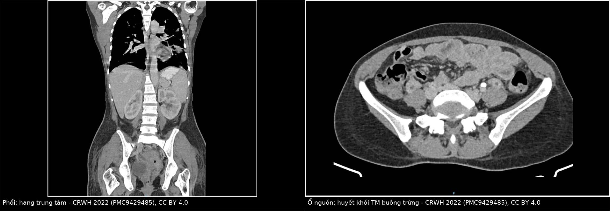
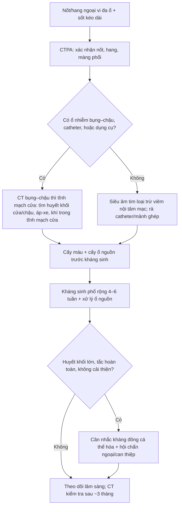
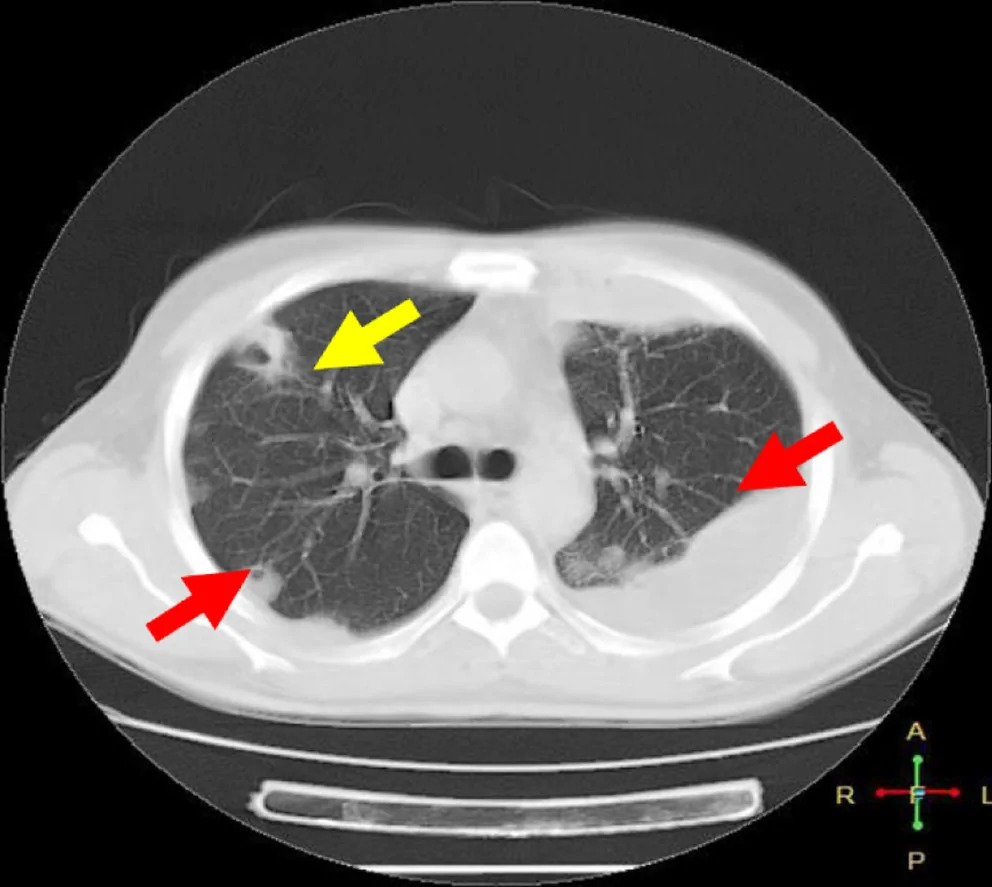
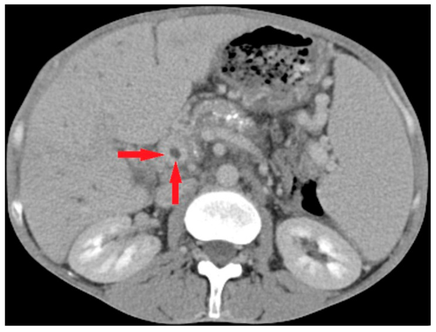

# 1904 — Thuyên tắc phổi nhiễm khuẩn từ ổ nhiễm tĩnh mạch trong bụng–chậu: nốt/hang ngoại vi, tìm ổ nguồn và thời gian kháng sinh

**Tags:** `pattern:not` `pattern:hang` `pattern:thuyen-tac-nhiem-khuan` `vung:phoi` `vung:mang-phoi` `vung:gan` `vung:mach-cua` `vung:chau` `protocol:CTPA` `protocol:CT-bung-co-can-quang` `protocol:sieu-am-bung`
**Mức chắc chắn (certainty):** tổng hợp y văn (literature synthesis) — ghép **ca huyết khối tĩnh mạch buồng trứng sau sinh có thuyên tắc phổi nhiễm khuẩn** (Case Rep Womens Health 2022, PMC9429485), **15 ca pylephlebitis** (Life 2025, PMC12565192), **tổng quan hệ thống 28 ca viêm tắc tĩnh mạch mạc treo do viêm túi thừa** (Korean J Gastroenterol 2026, PMC13407495), **tổng quan điều trị huyết khối tĩnh mạch nhiễm khuẩn** (Infect Dis Rep 2026, PMC13116947), **15 trẻ thuyên tắc phổi nhiễm khuẩn** (Front Pediatr 2026, PMC13212526) và **ca thuyên tắc phổi nhiễm khuẩn có dấu mạch nuôi** (Clin Case Rep 2026, PMC13563167). Không có ca do nhóm tự chụp.

> **Câu hỏi thực hành:** nữ **38 tuổi**, **8 ngày sau sinh**, sốt **39 °C** kéo dài dù đã dùng kháng sinh phổ rộng, ho, khó thở, đau bụng dưới bên phải. CT ngực: **nhiều nốt ngoại vi, một số có hang**. Câu hỏi: **đây là di căn, lao, hay thuyên tắc nhiễm khuẩn?**, **ổ nguồn nằm ở đâu**, **kháng sinh bao lâu và có dùng kháng đông không?**
> Nối [163 – Pylephlebitis & huyết khối tĩnh mạch mạc treo](../163-pylephlebitis-huyet-khoi-tm-mac-treo/lesson.md), [1623 – Huyết khối tĩnh mạch buồng trứng sau sinh](../1623-huyet-khoi-tinh-mach-buong-trung-sau-sinh/lesson.md), [025 – Hang & nấm phổi](../025-ton-thuong-phoi-tao-hang/lesson.md), [070 – Thuyên tắc phổi cấp](../070-thuyen-tac-phoi-dmc-cap/lesson.md).

## 1. Tổng hợp bệnh học – cơ chế hình ảnh: vì sao huyết khối nhiễm khuẩn trong bụng lại tạo hang ở phổi

- **Định nghĩa:** thuyên tắc phổi nhiễm khuẩn (septic pulmonary embolism, SPE) = **mảnh huyết khối chứa vi khuẩn** bong từ một **ổ nhiễm tĩnh mạch** (hệ cửa, tĩnh mạch chậu/ buồng trứng, catheter, tĩnh mạch cảnh trong, mảnh ghép nội mạch) đi vào tuần hoàn phổi, gây **nhồi máu phổi nhiễm khuẩn** và thường **hóa mủ/ tạo hang**.
- **TẠI SAO nốt nằm NGOẠI VI và ở đáy phổi:** động mạch phổi phân chia kiểu **phân nhánh**, tiểu động mạch tận cùng nằm **sát màng phổi** ở ngoại vi; mạch máu ở **thùy dưới** nhiều và dài hơn → **mảnh tắc dừng ở ngoại vi, đáy phổi**. Đây là lý do hình ảnh là **nốt/ đám ngoại vi, hình nêm, đáy hướng về màng phổi**, **không theo phân thùy** như viêm phổi thông thường.
- **TẠI SAO có hang:** vùng phổi bị tắc mạch **nhồi máu → hoại tử vô khuẩn → vi khuẩn từ cục tắc xâm nhập → hóa mủ → hang**. Hang xuất hiện **muộn hơn nốt** (thường sau **1–2 tuần**), nên **CT sớm chỉ thấy nốt đặc** không loại trừ SPE.
- **Dấu mạch nuôi (feeding vessel sign):** trên CT, một **nhánh mạch máu chạy thẳng vào nốt** — tương ứng đường đi của cục tắc. Dấu này **gợi ý mạnh nguồn mạch**, nhưng **không đặc hiệu** (gặp cả ở di căn).
- **Tần suất – con số thực:**
  - **Huyết khối tĩnh mạch buồng trứng (ovarian vein thrombophlebitis, OVT):** gặp ở **0,01–0,02%** sinh đường âm đạo và **0,1%** sinh mổ (PMC9429485) — hiếm nhưng là nguyên nhân **sốt kéo dài sau sinh kháng trị** và có thể gây SPE.
  - **Pylephlebitis:** khoảng **200 ca** trong y văn tiếng Anh; loạt **15 ca**: **sốt 100%**, **áp-xe gan 80% (12/15)**, **cấy máu dương 8/15**, **kháng đông 14/15**, **mổ 4/15**, **2 tử vong** (PMC12565192). **Nhiễm khuẩn huyết làm tử vong tăng ~17 lần** (dẫn trong PMC12565192).
  - **Viêm tắc tĩnh mạch mạc treo do viêm túi thừa:** **28 ca**, **cấy máu dương 53,6%**, **kháng đông 82,1%**, **mổ 53,6%**, **nằm viện trung bình 19 ngày**, **thông tĩnh mạch 28,6%**, **không có tử vong** (PMC13407495).
  - **Hình ảnh SPE:** **nốt ngoại vi, hang, bệnh màng phổi** là bộ ba mô tả trong loạt **15 trẻ** (PMC13212526).
- **TẠI SAO chẩn đoán muộn nguy hiểm:** kháng sinh muộn/ sai ổ nguồn → **lan tràn huyết và mủ**; tử vong trong huyết khối tĩnh mạch nhiễm khuẩn **> 10% ở một số loạt**, và **pylephlebitis không điều trị có thể dẫn tới suy đa tạng/ thiếu máu ruột** (PMC13116947, PMC12565192).
- **Điểm khác biệt với thuyên tắc phổi “thông thường”:** cục tắc vô khuẩn cho **hình nêm, không hang, không sốt cao kéo dài**, và điều trị là **kháng đông**; SPE đòi **kháng sinh là chính**, kháng đông chỉ là **bổ trợ có điều kiện**.

## 2. Mẫu hình + chẩn đoán phân biệt theo cửa vào và hình thái phổi (Gamut)

- **Theo cửa vào (nguồn):**
  - **Hệ tĩnh mạch cửa (pylephlebitis):** sau **viêm ruột thừa, viêm túi thừa, viêm đường mật, áp-xe gan**; sốt + đau bụng + **huyết khối tĩnh mạch cửa có khí/ dịch quanh**; hay có **áp-xe gan** đi kèm.
  - **Tĩnh mạch chậu/ buồng trứng (septic pelvic thrombophlebitis):** **sau sinh, sau mổ phụ khoa**, sốt kháng trị; đau bụng dưới, có thể sờ thấy dây cứng; CT bụng–chậu là chìa khóa.
  - **Catheter/ port/ máy tạo nhịp/ mảnh ghép nội mạch:** nhiễm khuẩn dòng máu liên quan catheter, huyết khối quanh đầu catheter.
  - **Tĩnh mạch cảnh trong (hội chứng Lemierre):** sau viêm họng/ áp-xe quanh amidan, huyết khối cảnh trong + SPE hai bên.
  - **Tim phải (viêm nội tâm mạc):** van ba lá, dụng cụ trong tim — **cùng hình ảnh phổi**, phải loại trừ bằng siêu âm tim.
- **Theo hình thái phổi:**
  - **Nốt ngoại vi đa ổ, đáy phổi** — thể điển hình.
  - **Hang thành mỏng/ dày, có thể có mức khí–dịch** — giai đoạn muộn.
  - **Đám mờ hình nêm (infarct)** — giai đoạn sớm.
  - **Tràn dịch/ mủ màng phổi, tràn khí** — biến chứng (vỡ hang vào màng phổi).
- **Gợi nhớ SEEP:** **S**eptic emboli (thuyên tắc nhiễm khuẩn) · **E**ndocarditis (viêm nội tâm mạc) · **E**xtra-pulmonary focus (ổ ngoài phổi: cửa, chậu, catheter) · **P**eripheral nodules with cavitation (nốt ngoại vi có hang).

## 3. Bảng so sánh phân biệt (ma trận đối chiếu)

| Thực thể (entity) | Hình ảnh điển hình | Chốt vào (rule-in) | Chốt loại (rule-out) | Gợi ý xác nhận |
|---|---|---|---|---|
| **Thuyên tắc phổi nhiễm khuẩn (SPE)** | **Nốt ngoại vi đa ổ, đáy phổi, hình nêm ± hang**, **feeding vessel**, tràn dịch màng phổi; CT bụng có huyết khối tĩnh mạch cửa/ chậu | **Sốt + ổ nhiễm bụng–chậu/ catheter + nốt ngoại vi có hang + cấy máu dương** | **Huyết khối tĩnh mạch cửa/ chậu không có** + không ổ nhiễm → ít khả năng | CTPA + CT bụng–chậu có cản quang; cấy máu trước kháng sinh; siêu âm tim loại trừ viêm nội tâm mạc |
| **Di căn phổi** | Nốt tròn nhiều kích thước, **đáy phổi và ngoại vi**, có thể hang (SCC, sarcoma), không sốt | **Tiền sử ung thư + nốt tăng dần theo thời gian**, không ổ nhiễm | **Sốt cao cấp + ổ nhiễm bụng + nốt mới trong vài ngày** → nghi SPE hơn | So phim cũ, PET/CT, sinh thiết nếu không rõ |
| **Lao phổi** | Hang thùy trên/ đỉnh, **nốt vệ tinh, tree-in-bud**, xơ co kéo | **Tree-in-bud + vị trí đỉnh + AFB/ PCR dương** | **Nốt ngoại vi đáy phổi + sốt cấp + ổ bụng** → ít lao | AFB, PCR lao, CT lát mỏng |
| **Thuyên tắc phổi vô khuẩn** | Đám mờ hình nêm ngoại vi, **không hang**, thường không sốt cao | **D-dimer cao + CTPA có cục tắc + không ổ nhiễm** | **Hang + sốt kéo dài + ổ nhiễm** → không phải thể vô khuẩn đơn thuần | CTPA, siêu âm tim, tìm ổ nhiễm |
| **Viêm nội tâm mạc tim phải** | Nốt ngoại vi ± hang, **hai bên**, thay đổi nhanh; có thể giãn buồng tim phải | **Cấy máu dương nhiều lần + siêu âm tim có sùi van ba lá/ dụng cụ** | **Siêu âm tim âm + không yếu tố nguy cơ** → tìm cửa vào khác | Siêu âm tim qua thực quản, cấy máu |
| **Nấm xâm lấn (Aspergillus)** | Nốt quanh mạch, **liềm khí**, dấu **halo** ở bệnh nhân giảm bạch cầu hạt | **Giảm bạch cầu hạt kéo dài + liềm khí + kháng sinh không đáp ứng** | **Bạch cầu bình thường + ổ nhiễm bụng rõ** → ít nấm | Galactomannan, CT lặp lại, sinh thiết |

*Trái: CT ngực — **hang trung tâm ở phân thùy trên thùy dưới trái**, gợi ý thuyên tắc phổi nhiễm khuẩn; phải: CT chậu — **huyết khối tĩnh mạch buồng trứng** (thành dày, giảm tỷ trọng trung tâm, ngấm thuốc viền) là ổ nguồn. Nguồn: Case Rep Womens Health 2022 (PMC9429485), CC BY 4.0; ảnh ghép letterbox.*

### Dấu hiệu đọc CT ngực (chốt thực hành)
- **Vị trí ngoại vi + đáy phổi:** nghĩ mạch máu, không nghĩ đường thở.
- **Feeding vessel sign:** mạch chạy vào nốt; **không đặc hiệu** nhưng tăng độ tin cậy khi có ổ nhiễm.
- **Hang:** thường xuất hiện muộn; hang **thành mỏng, nhiều ổ, kích thước khác nhau** gợi ý nguồn tĩnh mạch hơn là ung thư (ung thư thường một ổ lớn, thành dày lệch tâm).
- **Tràn dịch/ mủ màng phổi:** dấu nặng, cần dẫn lưu và cấy dịch.

## 4. Protocol chụp + điều trị theo ngưỡng

- **Chẩn đoán hình ảnh:**
  - **CT ngực có cản quang (CTPA)** — đánh giá nốt/ hang, màng phổi, và **loại trừ cục tắc phổi đồng thời**; lát mỏng **≤ 1 mm**, cửa sổ phổi + trung thất.
  - **CT bụng–chậu có cản quang thì tĩnh mạch cửa** — **bắt buộc** khi nghi SPE từ bụng–chậu: tìm **huyết khối tĩnh mạch cửa/ mạc treo/ buồng trứng**, **áp-xe gan**, **khí trong tĩnh mạch cửa**, ổ viêm túi thừa/ ruột thừa. Siêu âm bụng có **độ nhạy 60–100%** cho huyết khối tĩnh mạch cửa, nhưng **CT là tiêu chuẩn** (PMC12565192).
  - **Siêu âm tim (ưu tiên qua thực quản)** — loại trừ viêm nội tâm mạc tim phải, đặc biệt khi có dụng cụ trong tim/ máy tạo nhịp.
- **Vi sinh:** **cấy máu 2–3 bộ trước kháng sinh**; cấy máu **chỉ dương tối đa ~60%**, tỷ lệ nhiễm khuẩn huyết **42–62,1%** (PMC12565192) → **cấy âm không loại trừ**. Cấy dịch/ mủ ổ bụng, dịch màng phổi nếu dẫn lưu.
- **Kháng sinh:** phổ rộng **bao phủ Gram âm đường ruột + kỵ khí** (beta-lactam/ ức chế beta-lactamase hoặc carbapenem ± metronidazole); **thời gian 4–6 tuần**, không có đồng thuận rõ, nhưng đây là mức thường dùng cho huyết khối nhiễm khuẩn (PMC13116947).
- **Kháng đông:** **cá thể hóa**. Trong pylephlebitis, **14/15 ca** được kháng đông (PMC12565192); trong viêm tắc mạc treo do viêm túi thừa, **82,1%**; so sánh 23 ca có/ 5 ca không kháng đông cho **thời gian hết triệu chứng, làm sạch hình ảnh, thời gian nằm viện tương tự**, **thông tĩnh mạch 30,4% vs 20,0%**, **biến cố bất lợi 26,1% vs 0%** (PMC13407495) → **không có RCT**, phải cân nhắc nguy cơ chảy máu, đặc biệt huyết khối lớn/ tắc hoàn toàn.
- **Can thiệp ổ nguồn:** dẫn lưu áp-xe, cắt ruột thừa/ túi thừa khi viêm phức tạp, **lấy catheter nhiễm**; **không chỉ dùng kháng sinh khi còn ổ mủ lớn**.
- **Theo dõi:** CT ngực lặp lại nếu không cải thiện sau **72–96 giờ** hoặc nặng lên; CT bụng kiểm tra **sau ~3 tháng** — làm sạch hình ảnh trung bình **~3 tháng**, thông tĩnh mạch **28,6%** (PMC13407495).

## 5. Biến thể bình thường và cạm bẫy

- **“Nốt ngoại vi = di căn” là bẫy phổ biến:** nốt **mới xuất hiện trong vài ngày**, kèm **sốt cao cấp**, **đau bụng/ sau sinh** → nghĩ SPE trước khi nghĩ ung thư; so phim cũ là bắt buộc.
- **CT sớm chỉ có nốt đặc:** hang xuất hiện **muộn 1–2 tuần**; **không thấy hang không loại trừ** SPE.
- **Feeding vessel không đặc hiệu:** gặp cả di căn; đừng dùng một mình để chốt.
- **Cấy máu âm:** tối đa **~60%** dương; đã dùng kháng sinh trước cấy làm giảm mạnh độ nhạy — **không bỏ chẩn đoán vì cấy âm**.
- **Bỏ sót ổ nguồn = tái phát:** nếu chỉ điều trị phổi mà không tìm/ xử lý huyết khối bụng–chậu, bệnh nhân sốt lại sau khi ngừng kháng sinh; **CT bụng–chậu là một phần của chẩn đoán, không phải “chụp thêm”**.
- **Kháng đông không miễn phí:** nguy cơ chảy máu, đặc biệt sau sinh/ sau mổ; quyết định **cá thể hóa**, không theo phản xạ.
- **Khí trong tĩnh mạch cửa** là dấu hiệu **nặng/ tiên lượng xấu**, không đồng nghĩa “áp-xe” — cần đánh giá thiếu máu ruột.
- **Đừng quên viêm nội tâm mạc tim phải** và **hội chứng Lemierre** — cùng hình ảnh phổi, khác ổ nguồn và kháng sinh.

## 6. Tự lượng giá — Blind Quiz

**Ca 1 — Nữ 38 tuổi, sốt 8 ngày sau sinh, ho và khó thở. Nhìn ảnh trước, mô tả trước.**

- Gợi ý lâm sàng: hậu sản, sốt kháng trị với kháng sinh, đau bụng dưới.
- Câu hỏi: Tổn thương phổi là gì? Ổ nguồn nằm ở đâu? Hai xét nghiệm phải làm trước khi dùng kháng sinh?

<b>Bấm để hiện đáp án (findings + chẩn đoán)</b>

- Dấu hiệu: CT ngực — **hang trung tâm ở phân thùy trên thùy dưới trái**, bờ dày không đều, gợi ý nhồi máu hoại tử; CT chậu — **tĩnh mạch buồng trứng thành dày, giảm tỷ trọng trung tâm, ngấm thuốc viền** = huyết khối.
- Chẩn đoán: **thuyên tắc phổi nhiễm khuẩn từ huyết khối tĩnh mạch buồng trứng sau sinh** (septic pelvic thrombophlebitis).
- Việc phải làm: **cấy máu 2–3 bộ** và **cấy dịch/ ổ nguồn trước kháng sinh**; kháng sinh phổ rộng bao phủ Gram âm + kỵ khí; cân nhắc kháng đông; theo dõi CT.
- Nguồn ảnh: Case Rep Womens Health 2022 (PMC9429485), CC BY 4.0.

**Ca 2 — Bệnh nhân sốt, ho; CT ngực có nốt ngoại vi. Dấu mũi tên vàng chỉ gì?**

- Gợi ý lâm sàng: nhiễm khuẩn huyết từ ổ da/ mô mềm, không đáp ứng kháng sinh.
- Câu hỏi: Mô tả nốt và mũi tên vàng; dấu này gợi ý gì và có đặc hiệu không?

<b>Bấm để hiện đáp án (findings + chẩn đoán)</b>

- Dấu hiệu: **nốt dưới màng phổi có hang** (mũi tên vàng) với **mạch máu chạy thẳng vào nốt**; các mũi tên đỏ chỉ nốt ngoại vi khác; có **tràn dịch màng phổi** bên trái.
- Chẩn đoán: **thuyên tắc phổi nhiễm khuẩn** — dấu **feeding vessel sign** phản ánh đường đi của cục tắc; **không đặc hiệu** (gặp cả ở di căn) nên phải ghép bối cảnh nhiễm khuẩn.
- Phản biện: ca này nguồn từ **viêm mô tế bào chi dưới**, không phải ổ bụng — cùng cơ chế tĩnh mạch, khác cửa vào; bài này tập trung vào cửa bụng–chậu nhưng hình ảnh phổi giống nhau.
- Nguồn ảnh: Clin Case Rep 2026 (PMC13563167), CC BY 4.0.

**Ca 3 — Bệnh nhân sốt, đau bụng; CT bụng có bất thường tĩnh mạch. Đây là gì và vì sao phải chụp phổi?**

- Gợi ý lâm sàng: viêm túi thừa/ viêm ruột thừa, sốt cao, có thể vàng da nhẹ.
- Câu hỏi: Mũi tên đỏ chỉ gì? Chẩn đoán? Vì sao bắt buộc đánh giá phổi?

<b>Bấm để hiện đáp án (findings + chẩn đoán)</b>

- Dấu hiệu: **khuyết thuốc trung tâm trong lòng tĩnh mạch cửa** (mũi tên đỏ) — huyết khối; gan có thể có ổ giảm tỷ trọng (áp-xe).
- Chẩn đoán: **pylephlebitis (huyết khối tĩnh mạch cửa nhiễm khuẩn)**; nguy cơ **thuyên tắc nhiễm khuẩn sang phổi và não**, **áp-xe gan**, **thiếu máu ruột**.
- Vì sao chụp phổi: huyết khối nhiễm khuẩn có thể **lan theo đường máu tới phổi và não**, tạo **áp-xe di căn (metastatic abscess)** (PMC12565192); **SPE có thể là biểu hiện đầu tiên**, nên CT ngực giúp xác định mức lan và theo dõi đáp ứng.
- Nguồn ảnh: Life 2025 (PMC12565192), CC BY 4.0.

## Bài liên quan chéo
- [100 – Tổng quan hệ Bụng](../100-tong-quan-he-bung/lesson.md)
- [163 – Pylephlebitis & huyết khối tĩnh mạch mạc treo](../163-pylephlebitis-huyet-khoi-tm-mac-treo/lesson.md)
- [1623 – Huyết khối tĩnh mạch buồng trứng sau sinh](../1623-huyet-khoi-tinh-mach-buong-trung-sau-sinh/lesson.md)
- [070 – Thuyên tắc phổi cấp](../070-thuyen-tac-phoi-dmc-cap/lesson.md)
- [025 – Hang & nấm phổi](../025-ton-thuong-phoi-tao-hang/lesson.md)
- [020 – Nốt phổi](../020-not-phoi/lesson.md)
- [103 – Áp-xe gan do *Klebsiella*](../103-ap-xe-gan-klebsiella/lesson.md)

## Ảnh
- `1904_septic-pe_CT-hang_PMC9429485-F1.jpg`, `1904_septic-pe_CT-buong-trung_PMC9429485-F2.jpg` — Case Rep Womens Health 2022 (PMC9429485), **CC BY 4.0**.
- `1904_septic-pe_CT-feeding-vessel_PMC13563167-F2.jpg` — Clin Case Rep 2026 (PMC13563167), **CC BY 4.0**.
- `1904_pylephlebitis_CT-tm-cua_PMC12565192-F2.jpg` — Life 2025 (PMC12565192), **CC BY 4.0**.
- `composite_nguc-bung.jpg` — ghép hai ảnh PMC9429485 (cùng bệnh nhân), letterbox, giữ tỷ lệ.
- Nguồn + giấy phép từng ảnh: `images/CREDITS.md`.

> Không dùng để chẩn đoán độc lập khi chưa có người hướng dẫn.
