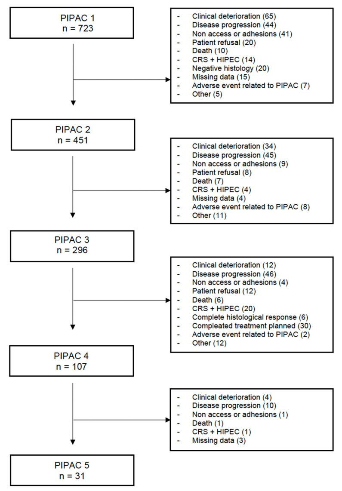
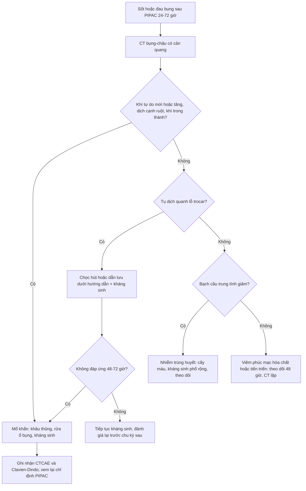
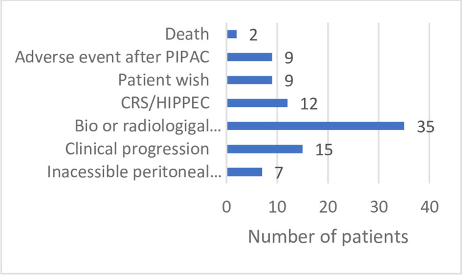
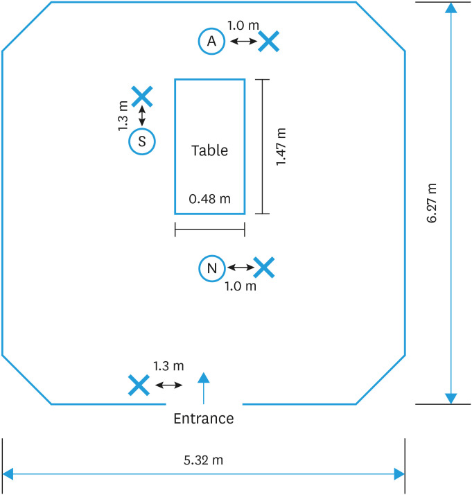

# 1905 — Biến chứng & an toàn thủ thuật PIPAC: không vào được ổ bụng, thủng ruột do trocar, rò thuốc, nhiễm lỗ trocar và phơi nhiễm nghề nghiệp

**Tags:** `pattern:bien-chung` `pattern:thung-ruot` `pattern:ap-xe-sau-mo` `pattern:ro-thuoc` `pattern:viem-phuc-mac` `vung:phuc-mac` `vung:o-bung` `vung:thanh-bung` `protocol:PIPAC` `protocol:CT-bung-co-can-quang` `protocol:CTA` `score:CTCAE` `score:Clavien-Dindo`
**Mức chắc chắn (certainty):** tổng hợp y văn (literature synthesis) — ghép **tổng quan hệ thống 10 năm về PIPAC (53 nghiên cứu)** (Cancers 2023, PMC9954579), **tổng quan hệ thống lý do ngừng PIPAC** (Pleura Peritoneum 2023, PMC10249753), **phân tích 96 bệnh nhân ở 3 trung tâm** (PLoS One 2023, PMC10688840), **báo cáo thứ hai của cơ sở dữ liệu ISSPP với 2.456 lần PIPAC** (Pleura Peritoneum 2023, PMC10739278) và **nghiên cứu đo phơi nhiễm bạch kim trong phòng mổ** (J Gynecol Oncol 2025, PMC11791003). Không có ca do nhóm tự chụp.

> **Câu hỏi thực hành:** bệnh nhân **ung thư buồng trứng tái phát phúc mạc**, đã **CRS/HIPEC 2 lần**, đang PIPAC chu kỳ 3. Ngày 2 sau PIPAC: **sốt 38,6 °C, đau bụng tăng, bụng chướng**. Câu hỏi: **đây là đau do thuốc, nhiễm lỗ trocar, hay thủng ruột? Chụp gì, tìm gì, khi nào mổ — và vì sao kíp mổ cũng là "bệnh nhân" của biến chứng này?**
> Bài chốt **bốn quyết định**: **(1) PIPAC an toàn nhưng không "vô hại": không vào được ổ bụng 3,5–7,3%, biến chứng nặng CTCAE ≥ 3 khoảng 4%, tử vong 30 ngày 1,3–3,4% — phần lớn do thủng ruột không nhận ra; (2) sốt + đau sau PIPAC phải chụp CT có cản quang tìm khí tự do/dịch/áp-xe lỗ trocar, không quy cho "đau do hóa chất"; (3) khí trong ổ bụng ngay sau PIPAC là bình thường — chỉ có giá trị khi tăng dần, kèm dịch/khí trong thành hoặc nhiễm trùng; (4) phơi nhiễm nghề nghiệp chủ yếu qua **bề mặt và găng tay**, không phải không khí — đo được bạch kim trên 100% mẫu bề mặt dù không khí dưới ngưỡng phát hiện.** Nối [1903 – Theo dõi sau CRS/HIPEC & PIPAC](../1903-theo-doi-sau-crs-hipec-va-pipac/lesson.md), [910 – Dẫn lưu áp-xe, PTBD & thận qua da](../910-abscess-biliary-nephrostomy/lesson.md), [162 – Tắc ruột non/già & thiếu máu mạc treo](../162-tac-ruot/lesson.md), [141 – Phúc mạc: cổ trướng, carcinomatosis vs lao](../141-phuc-mac/lesson.md).

## 1. Tổng quan – cơ chế hình ảnh: vì sao "chỉ bơm thuốc" lại gây thủng ruột và nhiễm bề mặt

- **PIPAC (pressurized intraperitoneal aerosol chemotherapy)** là **phẫu thuật nội soi nhỏ** chứ không phải "chọc hút": đặt **2 trocar**, bơm **hỗn dịch thuốc độc tế bào dạng aerosol** vào ổ bụng dưới **áp lực 12 mmHg trong 30 phút**, rồi **hút khí qua hệ kín có lọc** trước khi rút trocar (PMC10688840). Mọi biến chứng đều xoay quanh **ba thời điểm**: lúc **vào ổ bụng**, lúc **giữ áp lực**, và lúc **rút trocar/rò thuốc**.
- **TẠI SAO khó vào ổ bụng:** bệnh nhân PIPAC thường đã **mổ CRS/HIPEC nhiều lần** → **dính phúc mạc dày**, **mạc nối bánh kẹp (omental cake)**, **phúc mạc xơ hóa do chính hóa chất lặp lại**; ruột có thể **dính ngay dưới thành bụng**. Vì vậy **không vào được (non-access) là biến chứng đặc trưng của PIPAC**, không phải "lỗi kỹ thuật hiếm". **70% ca non-access xảy ra ngay lần PIPAC đầu** (PMC9954579).
- **TẠI SAO thủng ruột là biến chứng chết người:** kim **Veress** hoặc **trocar** chọc qua ruột dính thành bụng tạo **lỗ thủng nhỏ**, ban đầu **không có triệu chứng**; sau đó **dịch tiêu hóa + khí + vi khuẩn** vào ổ bụng → **viêm phúc mạc** trong 24–72 giờ. **Thủng ruột là nguyên nhân hàng đầu của tử vong sau PIPAC** (0–2% các thủ thuật), đặc biệt khi **không nhận ra trong mổ** (PMC10688840). Đây là lý do **câu hỏi hình ảnh "có khí tự do/dịch mới sau PIPAC không"** quan trọng hơn "u có nhỏ đi không".
- **TẠI SAO hình ảnh sau PIPAC dễ đọc sai:** sau thủ thuật luôn có **bơm hơi ổ bụng (pneumoperitoneum) tồn dư** vài ngày, **dịch thấm phúc mạc**, **dày phúc mạc do hóa chất** — tất cả **bắt chước** thủng ruột/nhiễm trùng. Ngược lại, **viêm phúc mạc do thủng nhỏ** có thể chỉ biểu hiện bằng **dịch đục, khí "lạc chỗ", dày thành ruột khu trú** mà không có khí tự do lượng lớn.
- **Tần suất – con số để tư vấn (định lượng):**
  - **Không vào được ổ bụng:** gộp **4%** các thủ thuật (0–18,8%) trong **53 nghiên cứu**; **70% ở lần PIPAC đầu** (PMC9954579). Tổng quan lý do ngừng: **6,8%**, có loạt tới **30%** (PMC10249753). Cơ sở dữ liệu ISSPP **2.456 lần PIPAC: 3,5%**, giảm từ **7,8% ở lần đầu xuống 1,5%** các lần sau (p < 0,01) (PMC10739278). Loạt 3 trung tâm: **7,3% lần đầu**, **7,9% lần 2–3**, **11,6%** khi gộp các lần sau (PMC10688840).
  - **Biến chứng nặng CTCAE 3–4:** **4%** (0–38,5%) (PMC9954579); trung vị **3,1%** (0,8–6,2%) (PMC10249753); ISSPP: **134/1.703 biến cố (8%)** ở mức ≥ 3, trong đó **95 biến chứng ngoại khoa, 22% là ≥ 3b Dindo–Clavien** (PMC10739278).
  - **Tử vong 30 ngày:** **1,3% (26/1.936)** trong tổng quan 10 năm, **nguyên nhân hàng đầu là tiến triển bệnh** (PMC9954579); **0,5%** (0–3,9%) trong tổng quan lý do ngừng (PMC10249753); **3,4% (23/669)** trong ISSPP (PMC10739278). **Tử vong do chính thủ thuật 0–2%**, chủ yếu **thủng ruột không nhận ra hoặc tắc ruột** (PMC10688840).
  - **Thủng ruột do kim/trocar: 0–3%** các thủ thuật; đây là **biến chứng trong mổ hay gặp nhất** (PMC10249753 dẫn Alyami: 45 nghiên cứu/1.810 thủ thuật/838 bệnh nhân, **3% biến chứng ngoại khoa**).
  - **Biến cố bất lợi chung:** đau bụng, buồn nôn, nôn, táo bón, bí tiểu chiếm **72%** các biến cố; **8% ở mức ≥ 3** (PMC10739278).
- **TẠI SAO kíp mổ cũng bị phơi nhiễm:** cisplatin là **chất có khả năng gây ung thư ở người (IARC nhóm 2A)**; hạt aerosol có **kích thước 3–15 µm** nên có thể **lơ lửng và đi vào đường thở** nếu rò ở trocar. Nghiên cứu đo bạch kim (chất đại diện cho cisplatin) trong phòng mổ: **không khí dưới ngưỡng phát hiện ở cả 16 mẫu**, nhưng **bạch kim có mặt ở 23/23 mẫu bề mặt (0,02–235,09 ng/cm²)**, cao nhất ở **trocar thứ hai** (trung bình nhân **5,55 ng/cm²**), và **18/21 (86%) mẫu trên phương tiện bảo hộ** (khẩu trang, găng, giày) (PMC11791003). **Kết luận thực hành: nguy cơ chính là bề mặt/găng tay, không phải không khí — nên thay găng, lau bề mặt, không "tin" vào cảm giác an toàn vì không khí sạch.**

## 2. Mẫu hình + chẩn đoán phân biệt theo thời điểm và vị trí (Gamut)

- **Theo thời điểm so với thủ thuật:**
  - **Trong mổ:** không vào được ổ bụng; thủng ruột/mạch máu khi đặt trocar; tràn khí dưới da; rò thuốc tại trocar; loạn nhịp/tụt áp do bơm hơi.
  - **24–72 giờ:** đau bụng do hóa chất (chemical peritonitis), nhiễm lỗ trocar, **thủng ruột biểu hiện muộn**, tắc ruột, chảy máu thành bụng.
  - **1–4 tuần:** áp-xe lỗ trocar, nhiễm trùng vết mổ, huyết khối tĩnh mạch, giảm bạch cầu có sốt (neutropenic sepsis), tiến triển bệnh.
- **Theo vị trí hình ảnh:**
  - **Thành bụng/lỗ trocar:** tụ dịch, khí trong thành, áp-xe, máu tụ — **vị trí hay bị bỏ qua nhất** vì CT thường chỉ đọc ổ bụng.
  - **Khoang phúc mạc:** khí tự do, dịch mật độ cao, dày phúc mạc lan tỏa (hóa chất) vs **dày khu trú + khí trong thành ruột** (thủng).
  - **Sau phúc mạc/ruột:** tắc ruột, viêm tụy cấp do thuốc, thiếu máu ruột (hiếm).
- **Gamut "sốt + đau bụng sau PIPAC" (thứ tự cần loại trừ):** **thủng ruột/viêm phúc mạc**, **áp-xe lỗ trocar**, **nhiễm trùng huyết do giảm bạch cầu**, **tắc ruột do u/dính**, **viêm túi mật/viêm tụy**, **huyết khối tĩnh mạch**, **tiến triển bệnh**.
- **Mnemonic "A.C.T.S.":** **A**ccess failure (non-access), **C**hemical peritonitis (đau do thuốc), **T**rocar complications (nhiễm/rò/máu tụ), **S**epsis/perforation (thủng ruột, nhiễm trùng huyết).

## 3. Bảng so sánh phân biệt (ma trận đối chiếu)

| Thực thể (entity) | Hình ảnh điển hình | Chốt vào (rule-in) | Chốt loại (rule-out) | Gợi ý xác nhận |
|---|---|---|---|---|
| **Thủng ruột do trocar** | **Khí tự do tăng dần**, dịch/tụ dịch cạnh quai ruột, **khí trong thành ruột**, dày thành khu trú, có thể **mảnh thức ăn** | **Sốt + đau tăng sau 24–72 giờ + khí tự do mới/tăng + dịch cạnh ruột** | Khí tự do **ổn định, không dịch, không sốt** ngay sau PIPAC → hơi tồn dư | CT bụng–chậu cản quang; so phim ngay sau thủ thuật; mổ khi lâm sàng xấu |
| **Áp-xe/nhiễm lỗ trocar** | Tụ dịch **quanh trocar ở thành bụng**, viền ngấm thuốc, khí trong ổ | **Sưng/đỏ/đau tại lỗ trocar + sốt + tụ dịch thành bụng** | Tổn thương **trong ổ bụng**, không liên quan lỗ trocar → nghĩ nguyên nhân khác | Siêu âm đầu dò thẳng/CT; chọc hút dưới hướng dẫn |
| **Viêm phúc mạc hóa chất (chemical peritonitis)** | **Dày phúc mạc lan tỏa, đối xứng**, dịch lượng ít–trung bình, **không khí tự do**, không ổ dịch | **Đau bụng sau bơm, không sốt cao, CT không ổ nhiễm, tự giảm 3–7 ngày** | Có ổ dịch/khí tự do/sốt cao → không phải thuần hóa chất | Theo dõi 48–72 giờ; CT lặp nếu xấu |
| **Tắc ruột do u/dính** | Giãn quai ruột, mức dịch–khí, **điểm chuyển tiếp**, không khí tự do | **Nôn, bụng chướng, không trung tiện + hình ảnh tắc** | Không giãn quai, có khí tự do/dịch → nghĩ thủng | CT cản quang; hội chẩn ngoại |
| **Nhiễm trùng huyết do giảm bạch cầu** | CT **không ổ nhiễm rõ**, có thể chỉ dày ruột nhẹ; **không khí tự do** | **Sốt + hạ bạch cầu trung tính trong 7–14 ngày sau hóa chất** | Có ổ dịch/khí tự do rõ → có nguồn ngoại khoa | Công thức máu, cấy máu; CT để loại trừ ổ |
| **Rò thuốc/ô nhiễm tại trocar (không nhiễm trùng)** | Không có tổn thương trong ổ; **dấu bẩn bề mặt trocar/da** | **Thấy dịch thuốc rỉ ra khi bơm/rút trocar, áp lực tụt** | Không rò, áp lực ổn định → không phải | Kiểm tra trực tiếp; đo nồng độ bạch kim bề mặt (nghiên cứu) |
| **Tiến triển bệnh phúc mạc** | **Tổn thương to lên, nốt mới, cổ trướng tăng**, không khí tự do | **Tăng kích thước/số nốt qua các chu kỳ + không ổ nhiễm** | Nhỏ đi/ổn định, không nốt mới → không tiến triển | CT có cản quang; **PRGS trên sinh thiết** (bài 1903) |

*Sơ đồ 723 bệnh nhân bắt đầu PIPAC 1: **không vào được ổ bụng/dính 41 ca (5,7%)**, **biến cố liên quan PIPAC 7 ca (1,0%)**; PIPAC 2 (451 ca): **non-access 9**, **biến cố 8**; PIPAC 3 (296 ca): **non-access 4**, **biến cố 2**; PIPAC 4 (107 ca): **non-access 1**. Điểm cần nhớ: **non-access tập trung ở lần đầu**, còn **biến cố bất lợi rải đều** — không phải "càng nhiều chu kỳ càng nguy hiểm". Nguồn: Cancers 2023 (PMC9954579), **CC BY 4.0**.*

### Dấu hiệu đọc chuẩn xác trên CT sau PIPAC
- **So với phim ngay sau thủ thuật** (nếu có): **khí tự do ổn định/giảm** là tồn dư; **khí tăng + dịch mới** là thủng cho tới khi chứng minh ngược.
- **Đọc thành bụng trước, ổ bụng sau:** mọi **tụ dịch dọc đường trocar** phải được mô tả kích thước, HU, có khí, có viền ngấm thuốc.
- **Khí trong thành ruột (pneumatosis) + khí trong tĩnh mạch cửa** = dấu hiệu **thiếu máu/thủng ruột nặng**, cần mổ khẩn, không chờ cấy.
- **Dày phúc mạc lan tỏa đối xứng không ổ dịch** sau PIPAC thường là **hiệu ứng hóa chất**, đừng gọi "tiến triển" — đối chiếu bài 1903 (đáp ứng chỉ chấm bằng PRGS).

## 4. Protocol thủ thuật – phân độ biến chứng – quy tắc dừng

- **Trước mỗi chu kỳ:** **CT bụng–chậu có cản quang** để tính **PCI**, loại trừ **tiến triển ngoài phúc mạc/tắc ruột** và **xác định đường vào** (tránh vùng dính/mạc nối lớn). **Không dùng CT để chấm đáp ứng** — dùng PRGS (bài 1903).
- **Trong thủ thuật (theo mô tả của loạt 3 trung tâm, PMC10688840):** 2 trocar; **capnoperitoneum 12 mmHg**; bơm thuốc; **giữ 30 phút**; **hút khí qua hệ kín có lọc** trước khi mở ổ bụng; đóng lỗ trocar. **Kiểm tra rò ở trocar bằng mắt và bằng áp lực** — tụt áp không rõ nguyên nhân = nghi rò.
- **Phân độ biến chứng:** dùng **CTCAE** cho biến cố toàn thân (đau, nôn, giảm bạch cầu) và **Clavien–Dindo** cho biến chứng ngoại khoa; **≥ 3b** = cần can thiệp/mổ lại. Đây là hai thang **không thay thế nhau**.
- **Quy tắc chọn bệnh nhân / dừng (đồng thuận từ tổng quan 10 năm, PMC9954579):** **không PIPAC** khi **tiên lượng sống < 3 tháng**, **tắc ruột gần đây**, **không ăn được đường miệng/phải nuôi tĩnh mạch hoàn toàn**, **ECOG > 3**.
- **Xử trí theo tình huống:**

| Tình huống | Việc cần làm ngay | Ngưỡng quyết định |
|---|---|---|
| **Không vào được ổ bụng** | Dừng, không cố chọc mù nhiều lần; ghi nhận **non-access**; cân nhắc **mở mini-laparotomy** hoặc chuyển **PIPAC đường mở** ở lần sau | Tái thử sau **4–6 tuần**; **70% non-access ở lần đầu** → đừng kết luận "không làm được nữa" |
| **Nghi thủng ruột trong mổ** | **Khâu lỗ thủng ngay** nếu thấy; nếu không thấy mà dịch ruột/bẩn → **mở kiểm tra**, không đóng trocar rồi về | **Không tiếp tục bơm thuốc** khi nghi thủng |
| **Sốt/đau sau 24–72 giờ** | **CT bụng–chậu cản quang**; cấy máu; hội chẩn ngoại | **Khí tự do tăng/dịch mới/khí trong thành = mổ**; không có ổ → theo dõi 48 giờ |
| **Rò thuốc tại trocar** | Dừng bơm, kiểm tra hệ kín, thay găng/khăn, lau bề mặt; ghi nhận sự cố | Rò lặp lại → đổi kỹ thuật trocar/nebulizer |
| **Áp-xe lỗ trocar** | Siêu âm/CT; **chọc hút + dẫn lưu** dưới hướng dẫn + kháng sinh | Không đáp ứng 48–72 giờ → mở dẫn lưu |

## 5. Biến thể bình thường và cạm bẫy

- **Bẫy 1 — gọi khí tự do sau PIPAC là thủng:** sau bơm **12 mmHg trong 30 phút**, một lượng khí tồn dư **vài ngày** là bình thường. Chỉ **khí tăng dần, có dịch mới, khí trong thành ruột/tĩnh mạch cửa, hoặc lâm sàng xấu** mới là thủng.
- **Bẫy 2 — bỏ sót thành bụng:** đọc CT chỉ tập trung phúc mạc/gan sẽ **bỏ áp-xe lỗ trocar** — nguyên nhân sốt rất hay gặp. Luôn **cuộn cửa sổ mô mềm dọc đường trocar**.
- **Bẫy 3 — quy "đau bụng" cho hóa chất mà không chụp:** **viêm phúc mạc hóa chất là chẩn đoán loại trừ**; phải loại thủng ruột/áp-xe/giảm bạch cầu trước.
- **Bẫy 4 — tưởng non-access là tiến triển:** không vào được ổ bụng là **thất bại kỹ thuật**, không phải bằng chứng bệnh nặng lên; nhưng **xơ hóa phúc mạc sau nhiều chu kỳ** vừa gây non-access vừa **bắt chước tiến triển trên CT**.
- **Bẫy 5 — tin vào "không khí sạch":** bạch kim **dưới ngưỡng trong không khí** nhưng **có trên 100% mẫu bề mặt** và **86% mẫu bảo hộ** (PMC11791003). An toàn nghề nghiệp nằm ở **quy trình bề mặt/găng/trocar**, không phải ở cảm giác "không mùi".
- **Bẫy 6 — dùng RECIST/CT để đánh giá đáp ứng:** xơ hóa do PIPAC làm tổn thương nhỏ đi mà vẫn còn tế bào sống; đáp ứng chỉ chấm bằng **PRGS** trên sinh thiết 4 góc (bài 1903).
- **Bẫy 7 — không ghi nhận biến cố:** thiếu **CTCAE/Clavien–Dindo** làm mất khả năng so sánh giữa các chu kỳ và giữa các trung tâm; đây là dữ liệu bắt buộc của cơ sở dữ liệu PIPAC.

## 6. Tự lượng giá — Blind Quiz

**Ca 1 — Sơ đồ lý do ngừng PIPAC qua 4 chu kỳ. Nhìn hình, trả lời trước khi mở đáp án.**

- Câu hỏi 1: Ở PIPAC 1, **hai** lý do ngừng phổ biến nhất là gì? Trong đó **non-access** chiếm bao nhiêu ca?
- Câu hỏi 2: Vì sao tỷ lệ non-access **giảm mạnh** ở các lần sau, còn biến cố bất lợi thì không?

<b>Bấm để hiện đáp án (findings + chẩn đoán)</b>

- Dấu hiệu: PIPAC 1 **(n = 723)** — **suy sút lâm sàng 65**, **tiến triển bệnh 44**, **non-access/dính 41 (5,7%)**, từ chối 20, tử vong 10, chuyển CRS/HIPEC 14, mô học âm 20, **biến cố liên quan PIPAC 7 (1,0%)**. PIPAC 2 (451): non-access 9, biến cố 8; PIPAC 3 (296): non-access 4, biến cố 2.
- Chẩn đoán/ý nghĩa: **non-access là biến cố của "lần đầu"** (70% tập trung ở lần đầu), vì dính và đường vào chưa được "lập bản đồ"; các lần sau **đã biết đường vào**. Ngược lại **biến cố hóa chất** phụ thuộc tích lũy liều nên **rải đều**.
- Nguồn ảnh: Cancers 2023 (PMC9954579), CC BY 4.0.

**Ca 2 — 96 bệnh nhân ở 3 trung tâm: lý do ngừng PIPAC.**

- Câu hỏi 3: Lý do ngừng phổ biến nhất là gì, chiếm bao nhiêu ca? **Biến cố sau PIPAC** chiếm bao nhiêu, và vì sao con số này quan trọng hơn "tỷ lệ biến chứng chung"?

<b>Bấm để hiện đáp án</b>

- Dấu hiệu: **tiến triển sinh học/radiologic 35 ca**, **suy sút lâm sàng 15**, **CRS/HIPEC 12**, **biến cố sau PIPAC 9 (10,1%)**, **nguyện vọng bệnh nhân 9**, **không vào được ổ bụng 7 (7,9%)**, **tử vong 2**.
- Ý nghĩa: **10,1%** bệnh nhân **mất cơ hội hoàn tất 3 chu kỳ vì biến cố** — đây là con số tư vấn trực tiếp cho bệnh nhân, khác với "tỷ lệ biến chứng/thủ thuật" (3–4%). Trong phân tích nhóm, **biến cố là lý do ngừng có ý nghĩa thống kê ở nhóm < 3 chu kỳ (16,3% vs 4,3%)**.
- Nguồn ảnh: PLoS One 2023 (PMC10688840), CC BY 4.0.

**Ca 3 — Sơ đồ vị trí lấy mẫu không khí trong phòng mổ PIPAC.**

- Câu hỏi 4: Vì sao phải đo **cả không khí và bề mặt**? Kết quả nào bất ngờ, và điều đó thay đổi quy trình bảo hộ thế nào?

<b>Bấm để hiện đáp án</b>

- Dấu hiệu: sơ đồ bố trí **phẫu thuật viên (S), điều dưỡng (N), bác sĩ gây mê (A)** và các điểm lấy mẫu không khí cách bàn mổ **1,0–1,3 m**.
- Kết quả: **không khí: bạch kim dưới ngưỡng phát hiện ở 16/16 mẫu** (LOD 0,37 ng/mẫu); **bề mặt: 23/23 mẫu dương, 0,02–235,09 ng/cm²**, cao nhất ở **trocar thứ hai** (trung bình nhân 5,55 ng/cm²); **18/21 (86%) mẫu trên khẩu trang/găng/giày dương**.
- Ý nghĩa: **đường phơi nhiễm chính là bề mặt → găng tay** (khi tháo trocar, thay bơm, lau máy), không phải hít không khí. Quy trình: **thay găng sau mỗi lần chạm trocar/dây**, lau bề mặt bằng dung môi phù hợp, huấn luyện tháo đồ bảo hộ.
- Nguồn ảnh: J Gynecol Oncol 2025 (PMC11791003), **CC BY-NC 4.0**, nguyên bản.

## Bài liên quan chéo

- [1903 – Theo dõi sau CRS/HIPEC & PIPAC: PCI, CCR, PRGS](../1903-theo-doi-sau-crs-hipec-va-pipac/lesson.md)
- [910 – Dẫn lưu áp-xe, PTBD & thận qua da](../910-abscess-biliary-nephrostomy/lesson.md)
- [162 – Tắc ruột non/già & thiếu máu mạc treo](../162-tac-ruot/lesson.md)
- [141 – Phúc mạc: cổ trướng, carcinomatosis vs lao](../141-phuc-mac/lesson.md)
- [1635 – Vỡ ối non tháng sau can thiệp bào thai: lỗ trocar & xử trí](../1635-ro-oi-non-thang-sau-can-thiep-bao-thai/lesson.md)

> Không dùng để chẩn đoán độc lập khi chưa có người hướng dẫn.
