# 1906 — Hẹp dòng ra tĩnh mạch gan sau ghép gan: ngấm thuốc "không đồng nhất", mất sóng ba pha & ngưỡng chênh áp 5 mmHg / Hepatic venous outflow obstruction after liver transplantation

**Tags:** `pattern:gan-ung-huyet` `pattern:ngam-khong-dong-nhat` `pattern:hep-mieng-noi` `pattern:huyet-khoi` `pattern:mat-song-ba-pha` `vung:gan` `vung:tm-gan` `vung:tm-chu-duoi` `vung:mieng-noi` `score:gradient-ap-luc` `protocol:Doppler` `protocol:CT-3-thi` `protocol:CTAP` `protocol:venography-do-ap-luc` `protocol:stent`

**Mức chắc chắn (certainty):** tổng hợp y văn (literature synthesis) — số liệu lấy từ 6 bài open-access có ảnh gốc, mỗi bài đã đọc toàn văn: Tomogane et al., *Cureus* 2026 (PMC13124245, CC BY 4.0 — ca nguyên văn, 10 hình); Zhao et al., *World J Gastroenterol* 2025 (PMC11886290, CC BY-NC 4.0 — tổng quan siêu âm); Ko et al., *Korean J Radiol* 2021 (PMC8236365, CC BY-NC 4.0 — tổng quan can thiệp); Zhang et al., *World J Gastroenterol* 2017 (PMC5739929, CC BY-NC 4.0 — 5 trẻ); Giang et al., *CVIR Endovasc* 2025 (PMC12397019, CC BY 4.0 — stent chủ–gan); Le et al., *Ann Hepatobiliary Pancreat Surg* 2025 (PMC12643804, CC BY 4.0 — 52 ca LDLT). Bài **không** có ca nguyên văn riêng của nhóm; ca 1 là ca nguyên văn của nguồn (giữ đúng mô tả gốc, ghi rõ Fig).

> **Câu hỏi gốc của bài:** bệnh nhân **2 năm sau ghép gan** (hoặc 3 ngày sau ghép), tăng **7 kg trong 1 tháng**, cổ trướng nhiều, men gan không tăng nhiều; siêu âm thấy **sóng tĩnh mạch gan mất ba pha**; CT thì cửa thấy **gan ngấm thuốc lổn nhổn từng vùng, có "vòng" giảm ngấm quanh các nhánh cửa**, và **tĩnh mạch gan giãn, sáng hơn tĩnh mạch chủ dưới**. Vậy: **hẹp ở đâu — miệng nối tĩnh mạch gan hay tĩnh mạch chủ dưới? khi nào chỉ theo dõi, khi nào nong bóng, khi nào đặt stent, khi nào mổ lại/ghép lại? và con số nào trên phim quyết định điều đó?**
> **Điểm tựa:** đây là **bệnh của dòng RA, không phải bệnh của nhu mô**. Gan nhận **~75% máu từ tĩnh mạch cửa + ~25% từ động mạch gan** nhưng chỉ có **một cửa ra duy nhất là tĩnh mạch gan**. Khi cửa ra hẹp, áp lực xoang gan tăng → **tưới máu cửa giảm, động mạch tăng bù** → **ngấm thuốc không đồng nhất**; đồng thời **sóng áp lực từ nhĩ phải không truyền ngược được** → **mất sóng ba pha**. Chẩn đoán xác định **không** nằm ở hình thái mà ở **chênh áp qua chỗ hẹp**.

## 1. Tổng quan — vì sao ứ huyết làm gan ngấm thuốc "lổn nhổn" và mất sóng ba pha

**A. Bệnh học (pathology) và cơ chế:**

- **Định nghĩa:** hẹp hoặc tắc dòng ra tĩnh mạch gan — từ **miệng nối tĩnh mạch gan vào tĩnh mạch chủ dưới (IVC)** đến **các nhánh tĩnh mạch gan trong gan** — sau ghép gan. Hậu quả giống hội chứng Budd–Chiari: ứ huyết xoang gan, cổ trướng, suy mảnh ghép.
- **Nguyên nhân theo thời điểm:**
  - **Sớm (ngày–tuần):** **kỹ thuật mổ** — miệng nối hẹp do khâu, **xoắn/gập (torsion/kinking)** cuống tĩnh mạch gan, **mảnh ghép quá to (large-for-size)** chèn ép dòng ra, **mảnh ghép xoay/di lệch** vào khoang dưới hoành, **phù mảnh ghép** làm tăng áp lực mô kèm chèn ép.
  - **Muộn (tháng–năm):** **tăng sinh nội mạc và xơ quanh miệng nối**, mảnh ghép **tái sinh/phì đại** chèn ép, huyết khối.
- **Vì sao ứ huyết gây "ngấm không đồng nhất" — cơ chế theo học thuyết cấp máu kép:** áp lực xoang gan tăng làm **giảm chênh áp tĩnh mạch cửa → xoang**, nên **dòng cửa giảm từng vùng**; đồng thời **đáp ứng đệm động mạch (hepatic arterial buffer response)** tăng lưu lượng động mạch bù. Kết quả: **vùng ứ huyết ngấm cửa kém nhưng ngấm động mạch mạnh hơn** → trên thì cửa/muộn, gan trông **lổn nhổn, ranh giới theo phân thùy/vùng dẫn lưu của nhánh tĩnh mạch bị tắc**, không theo lãnh thổ động mạch. Đây chính là lý do **CT không cản quang bình thường** — tổn thương là **bất thường tưới máu**, không phải tổn thương mô đặc.
- **Vì sao có "vòng giảm ngấm quanh cửa" (periportal collar sign):** ứ huyết → **phù gian bào và ứ bạch mạch dọc khoảng cửa** → dải giảm ngấm **ôm theo nhánh cửa**, **không ngấm thuốc ở mọi thì**, khác u (ngấm theo thì) và khác giãn đường mật (dịch, không phù lan). Đây là dấu hiệu **ứ huyết mô kẽ**, không phải tổn thương chiếm chỗ.
- **Vì sao tĩnh mạch gan "sáng hơn" tĩnh mạch chủ dưới:** máu từ tĩnh mạch gan là máu **đã ngấm cản quang đậm** (từ nhu mô), còn IVC bị **pha loãng bởi máu tĩnh mạch thận và chi dưới chưa ngấm**. Khi dòng ra chậm/ứ, cột cản quang trong tĩnh mạch gan **tồn tại lâu hơn** → **đậm độ HV > IVC** ở thì tĩnh mạch. Đây là dấu hiệu **so sánh trong cùng một ảnh**, không cần đo HU tuyệt đối.
- **Vì sao mất sóng ba pha:** phổ Doppler tĩnh mạch gan là **sóng áp lực truyền từ nhĩ phải** (A = nhĩ co, S = tâm thu, V, D = tâm trương). Hẹp dòng ra "cắt" sóng này → phổ **dẹt, liên tục, một pha (monophasic)** hoặc **mất pha đảo**. Vì vậy **mất ba pha là dấu hiệu của rối loạn huyết động học, không phải của hẹp giải phẫu** — nó cũng gặp trong phù mảnh ghép sớm, chèn ép, suy tim phải.
- **Vì sao tốc độ tăng ở chỗ hẹp:** theo phương trình liên tục, **vận tốc tỉ lệ nghịch với diện tích**; hẹp > 50% đường kính làm vận tốc tăng vọt và **aliasing** khi vượt giới hạn Nyquist của thang đo. Nhưng vận tốc tuyệt đối **không dùng một mình** (góc tới, cung lượng tim, tình trạng mảnh ghép đều ảnh hưởng) → phải dùng **tỉ lệ so với đoạn trước hẹp**.
- **Vì sao chênh áp là tiêu chuẩn vàng:** chênh áp **HV – IVC** đo bằng catheter phản ánh **trực tiếp** áp lực xoang gan; hẹp có ý nghĩa huyết động mới gây ứ huyết. **Bình thường 1–3 mmHg**; **> 3 mmHg bắt đầu bất thường**; **≥ 5 mmHg là ngưỡng chẩn đoán** dùng trong hầu hết tài liệu.

**B. Ngưỡng định lượng bắt buộc (cửa 1 Argon):**

| Đại lượng | Con số đã kiểm chứng | Ý nghĩa thực hành |
|---|---|---|
| Tần suất HVOO sau ghép gan | **2–11%** chung (PMC11886290); **5–11%** ở LDLT (PMC8236365); **2,3–11,9%** sau LDLT (PMC13124245); **4–9%** ở trẻ (PMC5739929) | LDLT/split ghép **cao hơn** ghép toàn bộ do nhiều miệng nối + mảnh ghép nhỏ |
| Hẹp tĩnh mạch gan (HVS) riêng | **0,5–3,2%** (PMC11886290) | Thấp hơn con số "biến chứng tĩnh mạch gan 2–11%" — đọc kỹ định nghĩa |
| Theo loại mảnh ghép | **thùy phải 1,5–4,2%**, **thùy trái tới 8,1%** (PMC12643804) | Thùy trái/trái–giữa nhiều nhánh nhỏ phải khâu → hẹp nhiều hơn |
| Đường kính miệng nối | **≤ 30 mm** → **OR 14,286** (KTC 1,121–183,823; p = 0,011) cho hẹp (PMC12643804) | Miệng nối **càng rộng càng tốt**; đây là lý do kỹ thuật "một lỗ" gộp MHV+RHV |
| Chênh áp HV–IVC bình thường | **trung vị 2 mmHg** (ghép kinh điển) và **3 mmHg** (piggyback); **> 3 mmHg ở 26,7% vs 17,6%** (p = 0,68) — RCT 15 vs 17 ca (PMC4482688) | Hai kỹ thuật mổ **không khác nhau** về huyết động dòng ra trong 28 ngày đầu |
| Chênh áp chẩn đoán HVOO | **≥ 5 mmHg** qua chỗ hẹp (PMC13124245); thực hành chấp nhận **> 3–5 mmHg** (PMC10353110) | Ngưỡng **có thể đo trên bàn can thiệp**, không suy từ hình ảnh |
| Tốc độ tại chỗ hẹp | **tỉ lệ chỗ hẹp / trước hẹp > 4:1** + phổ dẹt đoạn xa (PMC11886290) | Ca minh họa: **202 cm/s tại chỗ hẹp vs 18 cm/s trong tĩnh mạch gan chính** = **11:1** |
| Vận tốc trung bình thấp | **< 10 cm/s** + phổ một pha → nghi HVS (PMC11886290) | Dấu hiệu **ứ huyết**, không đặc hiệu nguyên nhân |
| Giá trị của phổ một pha | **độ chính xác 66,2%** cho HVS sau LDLT; **phổ ba pha liên tục loại trừ HVS** (PMC11886290) | **Ba pha = loại trừ tốt**; **một pha = không chốt được** (dương tính giả) |
| Đường kính chỗ hẹp | **2,47 mm** ở miệng nối (ca trẻ 2 tuổi, PMC11886290) | Đo được nhưng **không đủ để chẩn đoán** một mình |
| Kích thước gan bình thường sau ghép | bờ chéo lớn thùy phải **≤ 140 mm** sau 1 năm (PMC11886290) | Gan to + phù → ứ huyết; gan to đơn thuần → nghĩ nguyên nhân khác |
| Nong bóng đơn thuần (trẻ) | **7 lần nong/5 trẻ: chênh áp 12,0 ± 8,8 → 1,1 ± 1,5 mmHg**, kỹ thuật **7/7**, lâm sàng **5/5**, theo dõi **4–33 tháng** (trung vị 15), **không biến chứng** (PMC5739929) | Nong bóng là **bậc 1 hợp lý ở trẻ**; tái hẹp vẫn nong lại được |
| Tái hẹp sau nong bóng (trẻ) | **33–47%** (PMC8236365) | Con số quyết định: **nong đơn thuần thường phải làm nhiều lần** |
| Độ thông stent tĩnh mạch gan | **5 năm 72%** (108 ca) và **94%** (15 ca) nguyên phát — hai loạt dẫn trong PMC8236365 | **Đường kính stent là yếu tố độc lập** với độ thông |
| Ca nguyên văn (người lớn, LDLT) | chênh áp **14 → 2 mmHg**; nong bóng **6 × 40 mm** ở **6/8/10 atm × 30 giây** chỉ đạt một phần; **2 stent tự bung 10 × 40 + 10 × 60 mm**; **31 tháng** stent thông, cổ trướng hết, **7 kg** về mức cũ (PMC13124245) | Trình tự thực tế: **đo áp → nong → đánh giá → stent nếu recoil/hẹp lại** |

**C. TẠI SAO ảnh trông như vậy (vật lý hình ảnh):**

- **CT thì cửa (portal venous):** tín hiệu ∝ **nồng độ iod trong xoang gan**. Vùng ứ huyết: **dòng cửa giảm** → giảm ngấm; mô lành: **động mạch bù** → ngấm mạnh. Đây là **bất thường tưới máu**, nên **CT không cản quang bình thường** và tổn thương **không có bờ theo hình khối**.
- **CT thì tĩnh mạch:** cột cản quang trong tĩnh mạch gan **ứ lại** → **HV đậm hơn IVC**; thấy rõ **tĩnh mạch gan giãn đoạn gần** chỗ hẹp.
- **CT động mạch cửa (CTAP):** bơm cản quang vào **động mạch mạc treo tràng trên**, chụp 3 thì 40/80/120 giây — chỉ có **dòng cửa** ngấm. Hẹp dòng ra → **chỉ thấy "lỗ kim" cản quang từ tĩnh mạch gan sang IVC** dù nhu mô đã ngấm đủ (ca nguyên văn, PMC13124245). Đây là cách **chứng minh hẹp chức năng** khi CT thường không kết luận.
- **MRI:** phù quanh cửa **tăng T2, giảm T1**, **không hạn chế khuếch tán** (khác áp-xe/u — vì chỉ là nước tự do trong mô kẽ). MR venography/SSFP đánh giá miệng nối khi CT không rõ vì nhiễu kim loại.
- **Siêu âm Doppler:** phổ là **hàm của chênh áp theo thời gian**, không phải hình ảnh giải phẫu → **mất pha là sớm nhất**, xảy ra trước khi thấy hẹp rõ. Aliasing ở chỗ hẹp là **giới hạn kỹ thuật của thang đo**, không phải "dòng chảy xoáy bệnh lý".
- **CEUS:** bơm vi bọt khí — thấy **thuốc không vào được tĩnh mạch gan bị tắc** và **vùng nhu mô dẫn lưu ngấm sớm ở thì động mạch, thải sớm ở thì nhu mô** (do ứ huyết xoang) — cơ chế **giống hệt** CT nhưng **không phụ thuộc góc tới của mạch**.

## 2. Mẫu hình + chẩn đoán phân biệt theo vị trí (Gamut)

Gamut xếp theo **vị trí hẹp/tắc** — vì vị trí quyết định đường can thiệp:

- **Mẫu A — hẹp miệng nối tĩnh mạch gan (anastomotic stricture):** hẹp **ngắn, khu trú, ngay chỗ đổ vào IVC**; tĩnh mạch gan đoạn gần **giãn**; CTAP thấy **lỗ kim**. Sớm = do khâu/xoắn; muộn = xơ/tăng sinh nội mạc. **Điều trị: nong bóng, stent nếu recoil.**
- **Mẫu B — hẹp IVC sau mảnh ghép (piggyback IVC stenosis):** hẹp **thân IVC sau gan**, kèm **hẹp cả các miệng nối tĩnh mạch gan**; thường do **kẹp IVC, mảnh ghép to chèn, xoay**. Can thiệp **khác**: cần **stent chủ–gan (hepatocaval) chữ Y/hai nhánh** vì phải giữ dòng ra của nhiều tĩnh mạch gan khi đã đặt stent IVC.
- **Mẫu C — huyết khối tĩnh mạch gan / tắc tĩnh mạch cầu nối (bridging vein V5/V8):** gặp ở **trẻ, LDLT thùy phải, split ghép**; huyết khối trong lòng, **vùng phân thùy dẫn lưu ứ huyết khu trú** (thường phân thùy 5/8). Điều trị: **tiêu sợi huyết + stent** thay vì chỉ nong.
- **Mẫu D — ứ huyết lan tỏa KHÔNG có hẹp khu trú:** **SOS/VOD**, **mảnh ghép quá to**, **phù mảnh ghép sớm**, **xoắn cả cuống**. Chênh áp **không tăng tại một điểm**; điều trị **nội khoa/chỉnh kỹ thuật**, không stent.

**Gợi nhớ STOP** (bốn mẫu hình): **S**tenosis at anastomosis · **T**hrombosis (bridging vein/HV) · **O**utflow compression by graft (large-for-size) · **P**ost-piggyback IVC stenosis.

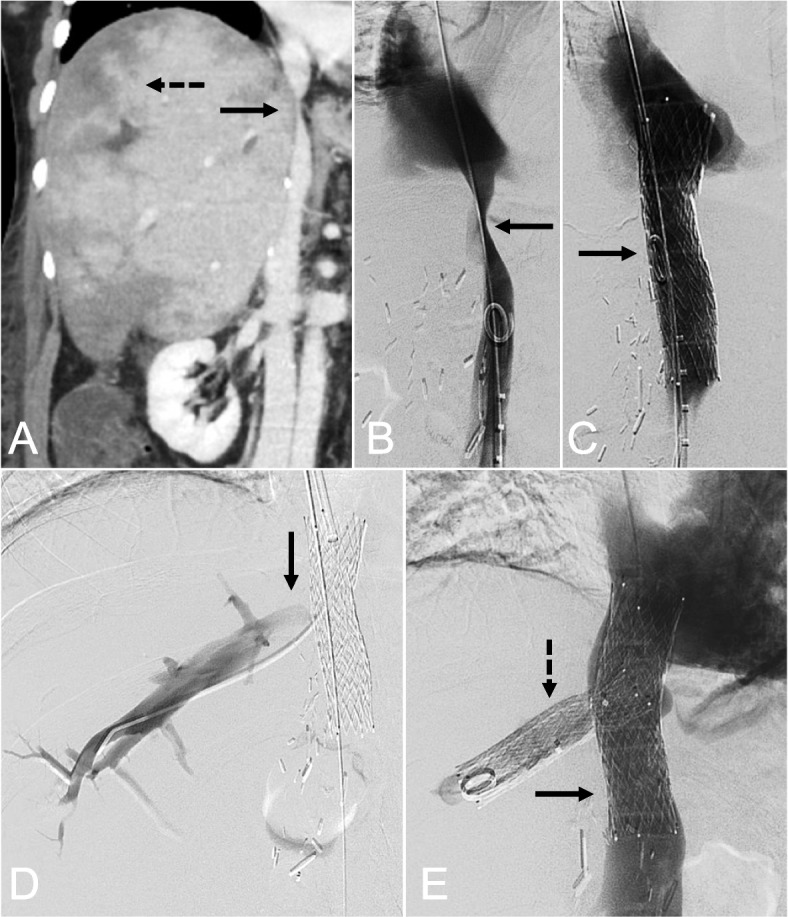
*Mẫu B: (A) CT coronal thì tĩnh mạch — **hẹp thân IVC sau gan** (mũi tên liền) kèm **ngấm nhu mô không đồng nhất** (mũi tên đứt); (B) cavogram: hẹp IVC (mũi tên); (C) stent tự bung đặt qua chỗ hẹp; (D–E) **các nhánh tĩnh mạch gan đổ vào trong lòng stent**, dòng ra được bảo toàn. Chính vì stent IVC có thể **che miệng nối tĩnh mạch gan** nên khi cần bảo vệ hai nhánh, bài gốc dùng **stent chủ–gan hai nhánh (bifurcated hepatocaval stent, Fig. 2)**. Nguồn: Giang et al., CVIR Endovasc 2025, PMC12397019 Fig. 1, CC BY 4.0.*

## 3. Bảng so sánh phân biệt (ma trận đối chiếu)

| Thực thể (entity) | Hình ảnh điển hình | Chốt vào (rule-in) | Chốt loại (rule-out) | Gợi ý xác nhận |
|---|---|---|---|---|
| **Hẹp miệng nối tĩnh mạch gan** | Hẹp **ngắn, khu trú** tại chỗ đổ vào IVC; HV đoạn gần **giãn, đậm hơn IVC**; gan ngấm không đồng nhất; phổ **mất ba pha** | **Chênh áp HV–IVC ≥ 5 mmHg** + hẹp thấy trên venography; **tỉ lệ vận tốc > 4:1** | **Ba pha liên tục** ở mọi tĩnh mạch gan → **loại trừ**; chênh áp **≤ 3 mmHg** → không can thiệp | Venography + đo áp (chuẩn vàng); CTAP; CEUS |
| **Hẹp IVC sau ghép (piggyback)** | Hẹp **thân IVC sau gan** ± hẹp nhiều miệng nối; **phù hai chi dưới**, cổ trướng; giãn tĩnh mạch bàng hệ sau phúc mạc | Hẹp IVC **có chênh áp đo được**; hẹp kèm **huyết khối/tổ chức quanh IVC** | IVC **không hẹp** trên coronal/sagittal → hẹp chỉ ở miệng nối HV | CT tĩnh mạch (coronal), cavography; **không stent IVC nếu không có chênh áp** |
| **Huyết khối tĩnh mạch gan / tĩnh mạch cầu nối** | Khối **giảm âm/giảm ngấm trong lòng mạch**, khuyết thuốc; vùng nhu mô dẫn lưu **ngấm sớm rồi thải sớm** | **Khuyết thuốc trong lòng mạch** + vùng ứ huyết **khu trú theo phân thùy** (V5/V8) | **Mạch thông hoàn toàn** + nhu mô đồng nhất → không phải huyết khối | CEUS (khuyết thuốc), Doppler màu; **tiêu sợi huyết ± stent** |
| **SOS/VOD (tắc xoang gan)** | Gan to, **ngấm thuốc "da báo" toàn gan**, túi mật phù, cổ trướng; **không có hẹp mạch lớn** | Bối cảnh **hóa trị (oxaliplatin), azathioprine, thuốc thảo dược** + hình ảnh toàn gan + **mạch ra thông** | **Hẹp khu trú có chênh áp** → là HVOO, không phải SOS | Loại trừ bằng venography; sinh thiết nếu cần |
| **Mảnh ghép quá to (large-for-size) / xoắn cuống** | Gan **chèn ép dòng ra**, phù, ứ huyết **sớm vài ngày đầu**; có thể thấy **mảnh ghép xoay, IVC bị đè** | **Hồi phục sau khi chỉnh thế mảnh ghép/đặt vật độn**; chênh áp **không khu trú** | **Hẹp cố định tại miệng nối** → can thiệp nội mạch | CT 3 thì + đối chiếu lâm sàng; mổ chỉnh nếu nặng |
| **Hẹp tĩnh mạch cửa (bắt chước)** | Hẹp ở **miệng nối tĩnh mạch cửa**; gan **giảm ngấm toàn bộ** hoặc phân thùy; **không mất sóng ba pha kiểu dòng ra** | Hẹp cửa + **chênh áp qua miệng nối cửa**; giãn tĩnh mạch cửa | Tĩnh mạch gan **ba pha bình thường** → không phải HVOO | Doppler cửa, CT tĩnh mạch; xử trí stent cửa |
| **Tái phát Budd–Chiari trên mảnh ghép** | Huyết khối **nhiều nhánh** tĩnh mạch gan, gan **mosaic**, lách to, ít khi khu trú ở miệng nối | **Huyết khối lan + trạng thái tăng đông** đã biết | **Hẹp đơn độc tại miệng nối**, không huyết khối lan | Xét nghiệm tăng đông; MRI mạch; kháng đông + can thiệp |

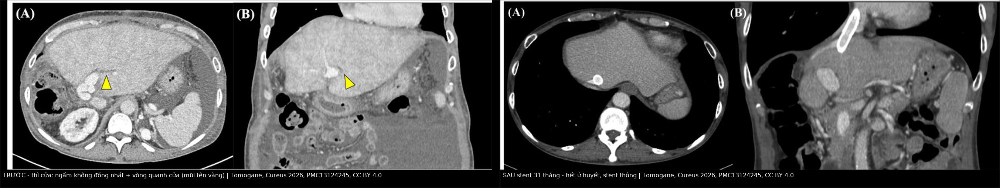
*Trái: thì cửa — gan **ngấm không đồng nhất** + **vòng giảm ngấm quanh cửa** (mũi tên vàng), cổ trướng. Phải: **31 tháng sau đặt stent** — nhu mô ngấm đồng nhất, stent thông. Cùng một bệnh nhân, cùng thì chụp → chứng minh tổn thương là **huyết động**, không phải mô đặc. Nguồn: Tomogane et al., Cureus 2026, PMC13124245 Fig. 1 + Fig. 10, CC BY 4.0. Ảnh ghép letterbox, **đã thay đổi** (ghép + chú thích).*

### Dấu hiệu "tĩnh mạch gan đậm hơn tĩnh mạch chủ dưới" — đọc thế nào cho đúng

- **Cách đọc:** đặt ROI trên **tĩnh mạch gan đoạn gần miệng nối** và trên **IVC ngay dưới chỗ đổ**, **cùng một lát, cùng thì tĩnh mạch**. HV đậm hơn IVC **rõ ràng bằng mắt** đã có giá trị; đừng cố lấy ngưỡng HU tuyệt đối vì phụ thuộc tốc độ tiêm và cung lượng tim.
- **Cơ chế:** IVC bị **pha loãng bởi máu tĩnh mạch thận/chi dưới**; ứ huyết làm cột cản quang trong HV **tồn tại lâu** → chênh đậm độ.
- **Bẫy:** nếu **thì chụp quá sớm**, cả hai đều chưa đầy → không kết luận được; nếu bệnh nhân **suy tim phải**, IVC cũng ứ và có thể **đậm hơn bình thường** — luôn đối chiếu phổ Doppler và bối cảnh.

### Phổ Doppler: ba pha, hai pha, một pha — và vì sao "một pha" là dấu hiệu yếu

- **Bình thường:** phổ **ba pha** gồm **A** (sóng dương do nhĩ co), **S** (âm, tâm thu — vận tốc cao nhất), **V**, **D** (âm, tâm trương). Sóng là **áp lực nhĩ phải truyền ngược**, nên **mất pha = mất truyền áp**, không đồng nghĩa hẹp.

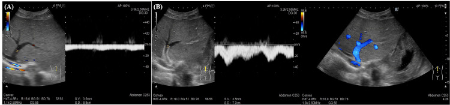
*(A) Trước can thiệp: dòng **ứ đọng, phổ phẳng, mất sóng ba pha**; (B) sau đặt stent: **sóng phục hồi**, dòng tĩnh mạch gan trở lại có pha. Cùng một nhánh, cùng máy, cùng thang đo — thay đổi **chỉ do huyết động**, chứng minh phổ Doppler là dấu hiệu **chức năng** rất nhạy nhưng **không định vị** được chỗ hẹp. Nguồn: Tomogane et al., Cureus 2026, PMC13124245 Fig. 8, CC BY 4.0.*

- **Sau ghép gan, 2 tuần đầu:** mảnh ghép phù → giảm đàn hồi → phổ **giảm biên độ, dạng "răng cưa"**, rồi **trở về ba pha sau ~2 tuần**. Vì vậy **đừng chẩn đoán HVOO chỉ vì phổ một pha trong tuần đầu**.
- **Độ chính xác của phổ một pha chỉ 66,2%**, nhưng **phổ ba pha liên tục có giá trị loại trừ cao** — dùng **một pha để nghi, ba pha để loại**.

## 4. Protocol chụp + hệ phân độ/ngưỡng xử trí

**A. Siêu âm Doppler — công cụ sàng lọc hằng ngày:**

- **Lịch:** ngày 1–7 sau ghép **mỗi ngày**, sau đó theo lịch khoa (thường 2–3 lần/tuần đến hết tháng 1), rồi mỗi 3–6 tháng; **bất kỳ lúc nào** cổ trướng không giải thích, gan to, men gan tăng, thiểu niệu.
- **Bắt buộc đo/ghi:** (1) **phổ** từng tĩnh mạch gan (ba pha/một pha/dẹt); (2) **vận tốc tại chỗ hẹp và ngay trước hẹp** → **tỉ lệ**; (3) **đường kính miệng nối**; (4) **chiều và vận tốc tĩnh mạch cửa**; (5) **chỉ số trở kháng động mạch gan**; (6) **kích thước gan** (bờ chéo lớn thùy phải **≤ 140 mm** sau 1 năm là bình thường).
- **Ngưỡng nghi:** **tỉ lệ > 4:1**; **vận tốc trung bình < 10 cm/s** + phổ một pha; **mất ba pha kéo dài > 2 tuần** sau ghép.
- **CEUS** khi Doppler không kết luận: khuyết thuốc trong lòng mạch, vùng nhu mô ngấm sớm/thải sớm — **giảm nhu cầu chụp mạch xâm lấn**.

**B. CT / MRI:**

- **CT 3 thì (không cản quang, động mạch, cửa) + thì tĩnh mạch muộn 70–90 giây**, lát **≤ 2 mm**, dựng **coronal + sagittal** dọc IVC và các miệng nối. Cần **thì tĩnh mạch** mới thấy **HV > IVC** và hẹp IVC.
- **CTAP** (bơm ĐM mạc treo tràng trên, chụp **40/80/120 giây**) khi nghi HVOO mà CT thường không rõ: **chứng minh hẹp chức năng** bằng hình ảnh "lỗ kim".
- **MRI:** T1/T2 + mạch (SSFP/MRV) khi **nhiễu kim loại** hoặc cần đánh giá mô gan; phù quanh cửa **tăng T2, không hạn chế khuếch tán**.

**C. Venography + đo áp — chuẩn vàng và là bước điều trị:**

- Đường vào: **tĩnh mạch cảnh trong phải** hoặc **tĩnh mạch đùi**; nếu không chọn được nhánh đích (hẹp rất chặt, giải phẫu bất lợi) → **kỹ thuật rendezvous** (chọc ngược qua tuần hoàn bàng hệ trong gan, bắt dây dẫn từ đường cảnh) hoặc **chọc xuyên gan dưới siêu âm bằng kim 21G** (giảm nguy cơ chảy máu trên gan ứ huyết).
- **Đo áp:** áp lực tĩnh mạch gan tự do **và** áp lực IVC → **chênh áp**. **≥ 5 mmHg = HVOO**; sau can thiệp đích là **≤ 2–3 mmHg** (ca nguyên văn: **14 → 2 mmHg**).
- **Trình tự can thiệp:** nong bóng **đường kính theo mạch lành, áp lực tăng dần** (ví dụ **6/8/10 atm × 30 giây**) → chụp lại + **đo lại áp** → nếu **recoil/hẹp lại > 50% hoặc áp còn cao** → **đặt stent tự bung**.
- **Kỹ thuật stent:** đường kính **đủ lớn** (10 mm ở ca người lớn), **đầu stent nhô vào IVC càng ngắn càng tốt** (tránh hẹp IVC và cản trở ghép lại về sau); với hẹp IVC cần stent **lực hướng tâm cao, có ngạnh chống di trú, lỗ rộng** để không bít dòng ra các tĩnh mạch gan; khi cần bảo vệ nhiều nhánh → **stent chủ–gan hai nhánh**.

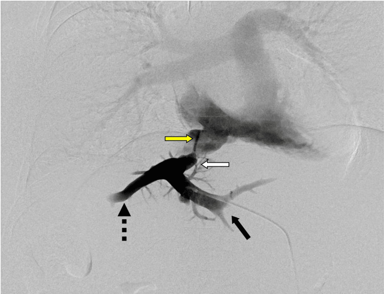
*(A) DSA qua đường chọc xuyên gan: **hẹp "lỗ kim"** ở đoạn gần tĩnh mạch gan (mũi tên vàng) — miệng nối giữa tĩnh mạch gan trái (mũi tên đen) và giữa (đứt) với **ống ghép tĩnh mạch (homograft) bị xẹp** (mũi tên trắng); chênh áp trước nong **14 mmHg**. Đây là hình ảnh "chốt" của hẹp miệng nối: **hẹp cực ngắn nhưng cản dòng gần như hoàn toàn**. Nguồn: Tomogane et al., Cureus 2026, PMC13124245 Fig. 5, CC BY 4.0.*

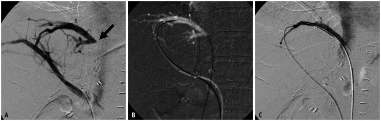
*Kỹ thuật **rendezvous**: (A) chọc/mở đường vào tĩnh mạch gan qua **tuần hoàn bàng hệ trong gan** từ nhánh còn thông (mũi tên); (B) dây dẫn được **bắt (snare)** trong tĩnh mạch chủ dưới từ đường tĩnh mạch cảnh; (C) đưa dụng cụ qua chỗ hẹp để nong/đặt stent. Dùng khi hẹp quá chặt hoặc giải phẫu miệng nối bất lợi làm **không chọn được nhánh đích** theo đường thường. Nguồn: Ko et al., Korean J Radiol 2021, PMC8236365 Fig. 4, CC BY-NC 4.0.*

**D. Sơ đồ quyết định:**

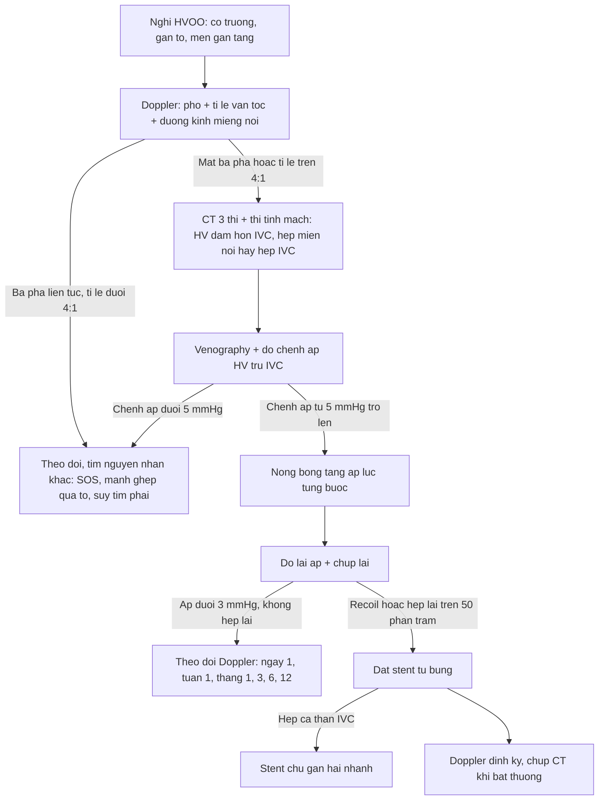

**E. Ngưỡng xử trí tóm tắt:**

| Tình huống | Hành động |
|---|---|
| Chênh áp **< 3 mmHg**, không triệu chứng | **Theo dõi**, không can thiệp |
| Chênh áp **3–5 mmHg**, có cổ trướng/gan to | Tranh luận — **đo lại + hội chẩn**, cân nhắc nong bóng |
| Chênh áp **≥ 5 mmHg** | **Can thiệp**: nong bóng trước, stent nếu recoil |
| **Tái hẹp sau nong bóng** | **Nong lại** (trẻ: khuyến cáo rõ) hoặc **stent**; tái hẹp **33–47%** ở trẻ |
| **Hẹp IVC + hẹp miệng nối** | **Stent chủ–gan nhiều nhánh**, không chỉ nong |
| **Huyết khối cấp** trong lòng | **Tiêu sợi huyết** ± stent |
| Thất bại nhiều lần / mảnh ghép mất chức năng | **Mổ lại / ghép lại** (cân nhắc ở trẻ vì stent không lớn theo trẻ) |

## 5. Biến thể bình thường và cạm bẫy

**A. Biến thể bình thường (normal variant) dễ gọi nhầm là hẹp:**

- **Phổ "răng cưa" hoặc một pha trong 2 tuần đầu sau ghép** do mảnh ghép phù, giảm đàn hồi — **tự về ba pha**. Không chụp mạch chỉ vì dấu hiệu này ở tuần 1.
- **Tĩnh mạch gan trái khó thấy cùng mặt phẳng** với phải/giữa (góc đổ khác nhau) → đừng kết luận "tắc" khi chỉ không dựng được mặt phẳng; dùng cửa sổ khác hoặc CEUS.
- **Không thấy tín hiệu màu trong tĩnh mạch gan** có thể do **góc tới gần 90°** hoặc do **nhịp tim che lấp**, không phải tắc.
- **Nhu mô ngấm không đồng nhất nhẹ** ở thì động mạch là **bình thường** (tưới máu động mạch không đều); chỉ có giá trị khi **kéo dài sang thì cửa/muộn**.
- **Tĩnh mạch gan giãn nhẹ** có thể gặp sau ghép **không hẹp** (mảnh ghép lớn, cung lượng cao) — phải đo **chênh áp** trước khi can thiệp.
- **Canxi hóa/mảnh clip quanh miệng nối** gây **nhiễu giả hẹp** trên CT — dùng MRI/CEUS hoặc venography.

**B. Cạm bẫy (pitfall):**

- **Chẩn đoán bằng đường kính:** ca trẻ có miệng nối **2,47 mm** nhưng **không có bất thường lâm sàng** — đường kính hẹp **không đồng nghĩa hẹp huyết động**. Ngược lại, hẹp "nhìn không nhiều" vẫn có thể chênh áp **14 mmHg**.
- **Bỏ qua thì tĩnh mạch:** chỉ đọc thì cửa sẽ **không thấy dấu hiệu HV > IVC** và dễ bỏ hẹp.
- **Sai lầm "hẹp IVC do kẹp"** khi thực ra là **stent tĩnh mạch gan nhô quá nhiều vào IVC**, hoặc **stent IVC che miệng nối tĩnh mạch gan** → luôn đánh giá **dòng ra tĩnh mạch gan sau khi đặt stent IVC**.
- **Nong bóng trên miệng nối "tươi"** (vài ngày sau ghép) có nguy cơ **rách miệng nối** — với hẹp sớm do xoắn/chèn ép, **stent** đôi khi được chọn thay vì nong.
- **Stent ở trẻ:** stent **không lớn theo trẻ**, làm **hẹp tương đối khi trẻ lớn** và **cản trở ghép lại** → chỉ đặt khi nong thất bại; ưu tiên **nong lặp lại**.
- **Nhầm với SOS/VOD:** SOS cũng cho gan to + ngấm "da báo" + cổ trướng, nhưng **không có hẹp khu trú và chênh áp không tăng tại một điểm** — stent sẽ vô ích.
- **"Satisfaction of search":** đã thấy hẹp miệng nối thì **vẫn phải đo IVC**; hẹp đồng thời hai tầng là lý do thất bại sau can thiệp.
- **Cổ trướng dịch tiết nhầm là "do xơ gan mảnh ghép"** — luôn loại trừ HVOO trước khi quy cho bệnh nhu mô.

## 6. Tự lượng giá — Blind Quiz

**Ca 1 — Nữ 50 tuổi, 2 năm sau ghép gan sống cho, tăng 7 kg trong 1 tháng, cổ trướng nhiều. Men gan gần như bình thường.**

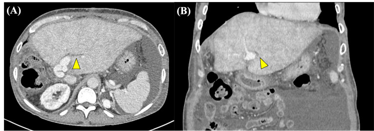

- Hỏi: (1) mô tả kiểu ngấm thuốc của gan; (2) dấu hiệu mũi tên vàng gọi là gì và vì sao nó xuất hiện? (3) ba chẩn đoán phân biệt?

<b>Bấm để hiện đáp án (findings + chẩn đoán)</b>

- **Dấu hiệu:** gan **ngấm thuốc không đồng nhất lan tỏa** + **dải/vòng giảm ngấm ôm quanh các nhánh cửa** (**periportal collar sign**, mũi tên vàng) + cổ trướng lượng nhiều. Đây là **phù gian bào và ứ bạch lạch dọc khoảng cửa**, không phải khối u.
- **Ba phân biệt:** hẹp dòng ra tĩnh mạch gan (HVOO) · SOS/VOD · viêm/loạn chức năng mảnh ghép (viêm gan, thải ghép cấp).
- **Chốt:** **thì tĩnh mạch** cho thấy **tĩnh mạch gan giãn, đậm hơn IVC** → hướng HVOO; venography đo **chênh áp 14 mmHg** xác định.
- Nguồn: Tomogane et al., Cureus 2026, PMC13124245 Fig. 1, CC BY 4.0.

**Ca 1 (tiếp) — cùng bệnh nhân, thì tĩnh mạch:**

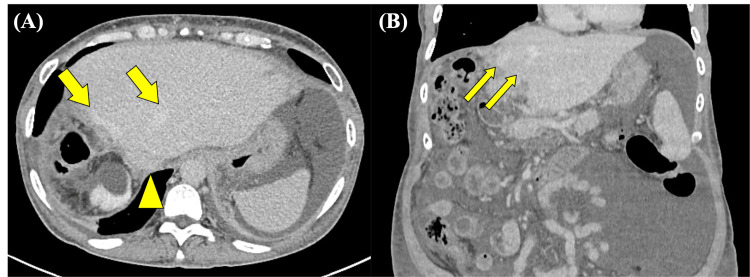

- Hỏi: vì sao tĩnh mạch gan **đậm hơn** tĩnh mạch chủ dưới? Dấu hiệu này loại trừ được gì?

<b>Bấm để hiện đáp án</b>

- **Tĩnh mạch gan trái và giữa giãn, đậm độ cao hơn IVC** (mũi tên). Lý do: máu trong tĩnh mạch gan **đã ngấm cản quang**, còn IVC **bị pha loãng bởi máu thận/chi dưới**; ứ huyết làm cột thuốc **tồn tại lâu**.
- **Loại trừ:** hẹp tĩnh mạch cửa và bệnh nhu mô đơn thuần (hai tình huống này **không** cho HV > IVC). **Không loại trừ** được hẹp IVC → phải đọc coronal/sagittal dọc IVC.
- Nguồn: Tomogane et al., Cureus 2026, PMC13124245 Fig. 2, CC BY 4.0.

**Ca 1 (theo dõi 31 tháng) — cùng bệnh nhân sau đặt 2 stent chồng nhau:**

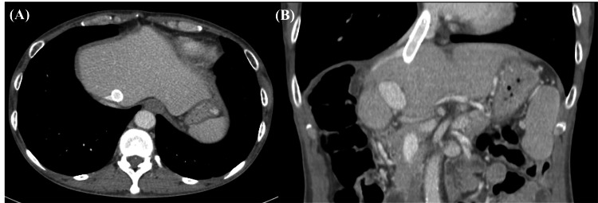

- Hỏi: (1) cổ trướng và 7 kg cân nặng đã đi đâu? (2) hai stent **10 × 40 mm** và **10 × 60 mm** được đặt vì lý do gì? (3) theo dõi tiếp bằng gì?

<b>Bấm để hiện đáp án</b>

- **(1)** Nhu mô **ngấm đồng nhất** trở lại, **không còn dấu hiệu ứ huyết**, cổ trướng hết, cân nặng về mức trước bệnh; stent **thông sau 31 tháng**.
- **(2)** Sau nong bóng **6 × 40 mm** (6/8/10 atm × 30 giây) chỉ đạt **nong một phần** → đặt stent. Stent thứ nhất **di trú về phía nhĩ phải**, không phủ đủ tổn thương → phải đặt **stent thứ hai dài hơn** chồng lên. Đây là **bẫy kỹ thuật**: đầu stent gần tim rất dễ trôi.
- **(3)** Doppler định kỳ (phổ + vận tốc + chênh áp nếu cần) và CT khi bất thường; chênh áp sau can thiệp **14 → 2 mmHg**, xuất viện **16 ngày** sau thủ thuật, **không biến chứng**.
- Nguồn: Tomogane et al., Cureus 2026, PMC13124245 Fig. 5, 6, 10, CC BY 4.0.

**Ca 2 — Trẻ 2 tuổi sau ghép gan thùy trái, không triệu chứng, siêu âm kiểm tra định kỳ:**

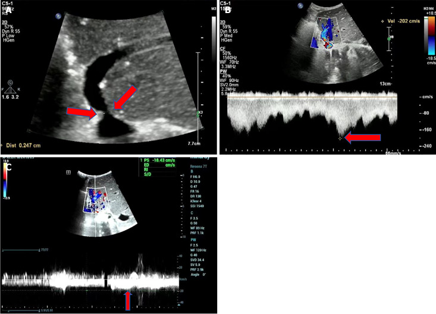

- Hỏi: (1) đọc ba khung A/B/C; (2) tính tỉ lệ vận tốc và so với ngưỡng; (3) vì sao **không** can thiệp ngay?

<b>Bấm để hiện đáp án</b>

- **(A)** miệng nối tĩnh mạch gan hẹp còn **2,47 mm**; **(B)** tại chỗ hẹp vận tốc **202 cm/s** kèm aliasing; **(C)** trong tĩnh mạch gan chính chỉ **18 cm/s** → **tỉ lệ 202/18 ≈ 11:1**, vượt xa ngưỡng **4:1**; phổ **dẹt/mất ba pha** → nghi hẹp dòng ra.
- **Vì sao chưa can thiệp:** **đường kính hẹp không đồng nghĩa hẹp huyết động**, bệnh nhân **không có triệu chứng và xét nghiệm bình thường** → cần **đo chênh áp** trước; chỉ can thiệp khi **≥ 5 mmHg** hoặc có cổ trướng/gan to/suy mảnh ghép.
- Nguồn: Zhao et al., World J Gastroenterol 2025, PMC11886290 Fig. 2, CC BY-NC 4.0.

**Ca 3 — Trẻ 2 tuổi ghép gan thùy trái vì teo đường mật, cổ trướng tái phát:**

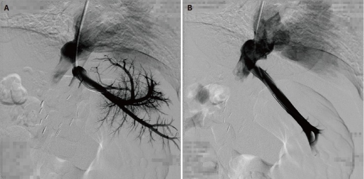

- Hỏi: (1) hình A chứng minh gì; (2) hình B là kết quả của thủ thuật nào; (3) chênh áp mong đợi sau thủ thuật?

<b>Bấm để hiện đáp án</b>

- **(A)** tắc/hẹp nặng dòng ra tĩnh mạch gan, **chênh áp nhĩ phải – tĩnh mạch gan trái 13 mmHg**; **(B)** sau **nong bóng**, dòng ra thông, nhu mô thoát thuốc.
- **Chênh áp sau thủ thuật:** loạt 5 trẻ/7 lần nong cho **12,0 ± 8,8 → 1,1 ± 1,5 mmHg**; thành công kỹ thuật **7/7**, lâm sàng **5/5**, theo dõi **4–33 tháng** (trung vị 15), **không biến chứng**. Tái hẹp vẫn **nong lại** được (tái hẹp **33–47%**).
- Nguồn: Zhang et al., World J Gastroenterol 2017, PMC5739929 Fig. 1, CC BY-NC 4.0.

## Bài liên quan chéo
- [1901 – Hội chứng Budd–Chiari: "flip-flop", hạch đuôi phì đại & bậc thang nong bóng → TIPS → ghép](../1901-hoi-chung-budd-chiari/lesson.md) — **cùng cơ chế tắc dòng ra**, khác bối cảnh (gan tự thân vs mảnh ghép).
- [127 – Gan tim & tăng áp cửa do tắc nghẽn dòng ra](../127-gan-tim-suy-tim-phai/lesson.md) — nguyên nhân dòng ra **trước gan**, bắt chước HVOO.
- [133 – Hẹp miệng nối & cholangiopathy thiếu máu sau ghép gan](../133-hep-mieng-noi-duong-mat-sau-ghep/lesson.md) — "người anh em" của biến chứng miệng nối sau ghép.
- [1809 – Rò mật–nang dai dẳng sau PAIR](../1809-ro-mat-nang-sau-pair/lesson.md) · [1810 – Cắt gan & ghép gan trong sán thể hang](../1810-cat-ghep-gan-trong-san-the-hang/lesson.md) — can thiệp trên mảnh ghép/gan đã mổ.
- [176 – TIPS/DIPS: theo dõi shunt](../176-tips-dips-theo-doi-shunt/lesson.md) — đo chênh áp cửa và theo dõi độ thông bằng Doppler (cùng logic "đo áp + Doppler định kỳ").
- [1908 – Thiếu máu mạc treo cấp–mạn & bóc tách động mạch tạng](../1908-thieu-mau-mac-treo-va-boc-tach-dong-mach-tang/lesson.md) — biến chứng mạch máu bụng khác sau mổ lớn.
- [093 – Chèn ép tĩnh mạch chủ trên](../093-hoi-chung-tinh-mach-chu-tren/lesson.md) — nguyên lý **stent cho hội chứng tắc dòng ra**, áp dụng tương tự cho IVC.

## Ảnh
- 9 ảnh + 1 ảnh ghép, tải từ **PMC CDN** của PubMed Central (bài open access), **không chỉnh sửa pixel**; nguồn + giấy phép từng file trong `images/CREDITS.md`.
- Tên file: `1906_hvoo_<nội dung>_<Modality>_PMCxxxxx-fN.jpg`; ảnh ghép `composite_truoc-sau.jpg` tạo bằng `tools/make_composite.py` (letterbox nền đen, **không crop/kéo giãn**), ghi rõ **đã thay đổi**.
- Ảnh **không** tải: Radiopaedia (chỉ dẫn link), AuntMinnie (chỉ dẫn link), các bài không rõ giấy phép — xem `sources.md`.

> Không dùng để chẩn đoán độc lập khi chưa có người hướng dẫn.
