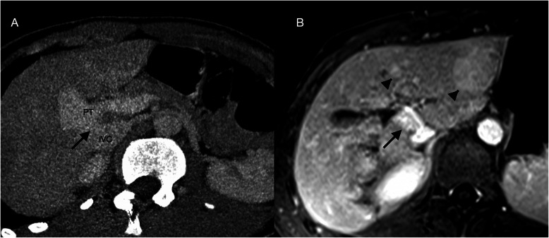
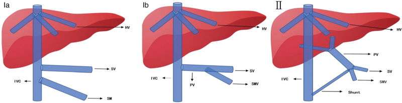
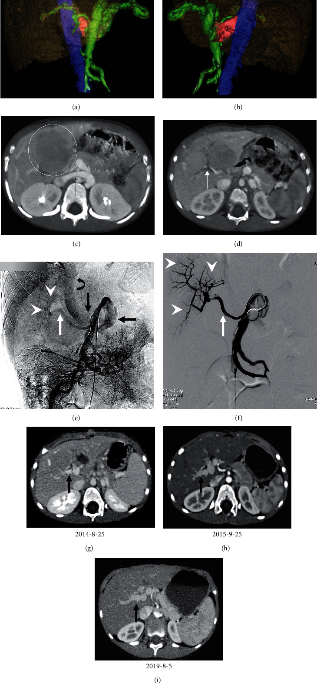
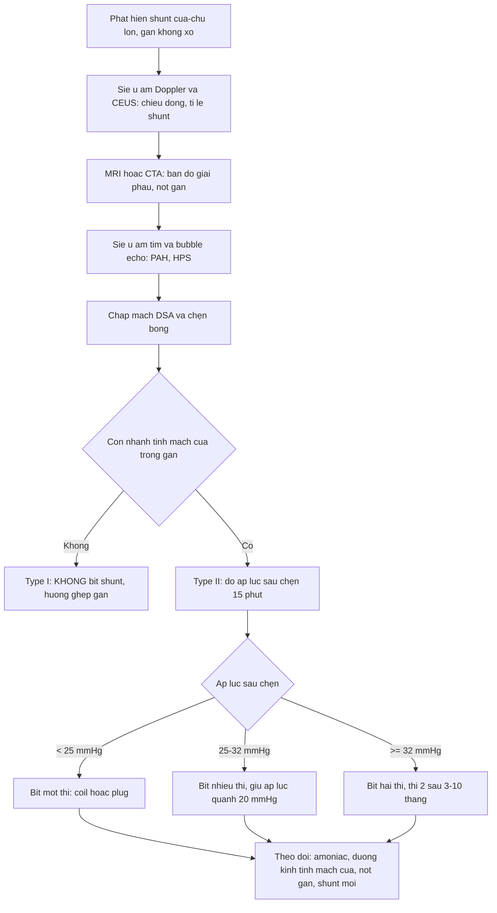
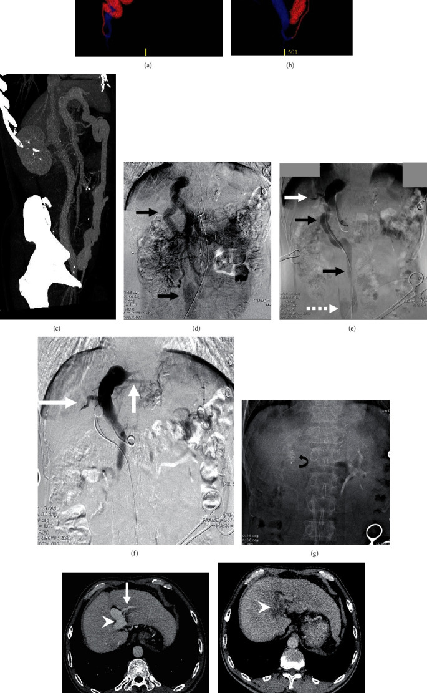
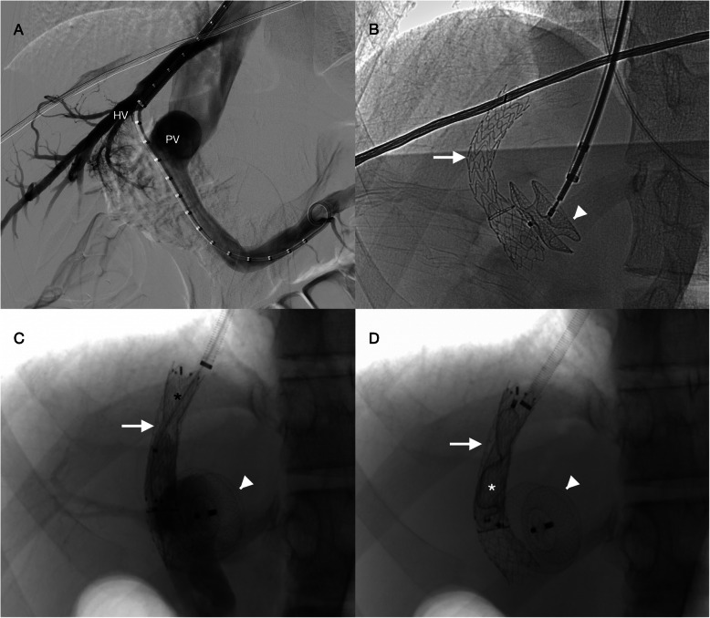

# 1907 — Shunt cửa–chủ lớn KHÔNG xơ gan (CEPS/Abernethy) & bít shunt qua da: vì sao phải đo áp lực tĩnh mạch cửa bằng bóng chẹn trước khi đóng / Large congenital extrahepatic portosystemic shunt (CEPS, Abernethy malformation): classification, decision-making by balloon-occlusion portal pressure, and percutaneous closure

**Tags:** `pattern:shunt-cua-chu` `pattern:gan-co-not` `pattern:gan-teo` `pattern:giam-ngam-nhu-mo` `pattern:tm-cua-gian` `pattern:di-dang-mach` `pattern:gan-nao` `vung:gan` `vung:tm-cua` `vung:tm-chu-duoi` `score:gradient-ap-luc` `incidentaloma:gan-not` `protocol:Doppler` `protocol:CEUS` `protocol:CTA` `protocol:MRI` `protocol:venography-do-ap-luc` `protocol:bong-boc-tach` `protocol:nut-mach`

**Mức chắc chắn (certainty):** tổng hợp y văn (literature synthesis) — số liệu lấy từ các bài **open-access đã đọc toàn văn**: Zhang J et al., *Biomed Res Int* 2021;2021:9951393 (PMC8187072, CC BY 4.0 — **23 bệnh nhân type II**, so sánh **mổ buộc** với **nút mạch**, có áp lực tĩnh mạch cửa trước/sau); Zeng P et al., *Chin Med J (Engl)* 2022;135(13):1610–1612 (PMC9532025, CC BY-NC-ND 4.0 — tổng quan phân loại và **ngưỡng áp lực khi bít**); Facas J et al., *CVIR Endovasc* 2021;4:79 (PMC8602598, CC BY 4.0 — **ca nguyên văn 15 tuổi** bít nhiều thì bằng TIPS + nút ASD, có ngưỡng áp lực). Bài **không** có ca nguyên văn riêng của nhóm; ca 1–3 là ca nguyên văn của các nguồn, ghi rõ Fig.

> **Câu hỏi gốc của bài:** bé gái **3 tuổi** được siêu âm vì **chậm phát triển + hay lơ mơ**, thấy **một mạch lớn nối tĩnh mạch cửa với tĩnh mạch chủ dưới**, gan **có nốt**, **amoniac máu tăng**, nhưng **không có xơ gan, không cổ trướng**. Vậy: (1) đây là **dị dạng bẩm sinh** hay **huyết khối tĩnh mạch cửa mạn**; (2) nếu bít shunt thì **bít ngay một thì hay phải hai thì** — và **con số nào quyết định**; (3) vì sao **không được bít shunt ở type I**?

## 1. Tổng quan — vì sao "máu cửa đi tắt" lại làm teo gan, sinh nốt và gây bệnh não

**A. Bệnh học (pathology) và cơ chế:**

- **Định nghĩa:** **shunt cửa–chủ ngoài gan bẩm sinh (congenital extrahepatic portosystemic shunt, CEPS)**, còn gọi **dị dạng Abernethy (Abernethy malformation)**, là **thông trực tiếp giữa hệ tĩnh mạch cửa (ngoài gan) và hệ tĩnh mạch hệ thống** — tĩnh mạch chủ dưới, tĩnh mạch thận trái hoặc tĩnh mạch chậu (PMC9532025, PMC8187072). Đây là bệnh **hiếm**: đến thời điểm bài so sánh được công bố mới có **dưới 400 ca** trong y văn (PMC8187072).
- **Phôi thai học — TẠI SAO có shunt:** trong thời kỳ phôi, **vòng tĩnh mạch noãn hoàng (vitelline venous ring)** quanh tá tràng phải thoái triển và nối với **xoang gan**; nếu **thoái triển quá mức** hoặc **không nối được với xoang gan/tĩnh mạch rốn**, **tĩnh mạch noãn hoàng phải** tồn tại và đổ thẳng vào **tĩnh mạch chủ dưới sau gan**, hoặc **tĩnh mạch noãn hoàng trái** tồn tại và đổ vào **tĩnh mạch chủ dưới/nhĩ phải cao hơn chỗ đổ của tĩnh mạch gan** (PMC9532025). Nếu ống nối **tĩnh mạch noãn hoàng – tĩnh mạch chủ dưới** chỉ tồn tại **một phần**, ta có **type II** (còn nhánh cửa trong gan giảm sản).
- **Phân loại Morgan–Superina (dùng rộng nhất, theo sự hiện diện của tĩnh mạch cửa trong gan):**
  - **Type I — KHÔNG có tĩnh mạch cửa trong gan** (shunt kiểu **end-to-side**): **Ia** = tĩnh mạch mạc treo tràng trên (SMV) và tĩnh mạch lách (SV) **đổ riêng rẽ** vào hệ thống; **Ib** = SMV và SV **hợp thành thân chung** rồi đổ vào hệ thống.
  - **Type II — CÒN tĩnh mạch cửa trong gan nhưng giảm sản** (shunt kiểu **side-to-side**).
  - Các cách chia bổ sung: theo **nơi đổ** (tĩnh mạch chủ dưới / tĩnh mạch thận trái / tĩnh mạch chậu); type II chia **IIa** (từ nhánh tĩnh mạch cửa), **IIb** (từ thân/bifurcation/ngã ba lách–mạc treo), **IIc** (từ tĩnh mạch mạc treo, tĩnh mạch vị, tĩnh mạch lách); và theo **mức độ loạn sản tĩnh mạch cửa trong gan**: nhẹ / vừa / nặng (PMC9532025).
- **Vì sao gan TEo và có NỐT:** máu cửa mang **yếu tố dinh dưỡng và insulin/glucagon** bị rút khỏi gan → **giảm tưới máu cửa** → **teo nhu mô, mỡ hóa**, và **tăng bù dòng động mạch gan (hepatic arterial buffer response)** → tăng sinh tế bào gan thành **nốt**. **Nốt gan gặp tới 65%** bệnh nhân CEPS; đa số **lành tính** (tăng sản nốt khu trú kiểu FNH, u tuyến) nhưng **có nguy cơ chuyển dạng ác tính**, và **một phần nốt nhỏ lại sau khi bít shunt** (PMC9532025). Đây là lý do phải **theo dõi nốt sau bít**, không cắt bỏ ngay mọi nốt.
- **Vì sao BỆNH NÃO GAN (hepatic encephalopathy):** amoniac và các sản phẩm đạm từ ruột **đi tắt qua shunt**, **không qua gan** (mất **first-pass effect**) → **tăng amoniac** → bệnh não. **Tần suất bệnh não tăng theo tuổi** (PMC9532025). Trên MRI sọ có thể thấy **tăng tín hiệu T1 đối xứng ở globus pallidus** (lắng đọng mangan) và **teo chất trắng** — dấu hiệu **gián tiếp của shunt lớn**, không phải bệnh gan mật.
- **Vì sao HỘI CHỨNG GAN–PHỔI (HPS) và TĂNG ÁP ĐỘNG MẠCH PHỔI (PAH):** các **chất vận mạch (vasoactive mediators)** từ ruột đi tắt qua gan → **giãn mao mạch phổi (HPS)** hoặc **tái cấu trúc mạch phổi (PAH)**. PAH là biến chứng **tiên lượng xấu**: **không hồi phục dù bít shunt muộn**, **tử vong tới 50%** (PMC9532025). Vì vậy **bít shunt sớm khi có triệu chứng**, không chờ.
- **TẠI SAO phải đo áp lực khi bóng chẹn (balloon occlusion test):** tĩnh mạch cửa của bệnh nhân CEPS **chưa từng chịu áp lực hệ cửa**. Bít đột ngột shunt lớn = **tăng áp cửa cấp** → **ứ máu ruột, thiếu máu ruột, chảy máu tiêu hóa, suy gan**. Vì vậy nguyên tắc: **bóng chẹn shunt → đo áp lực tĩnh mạch cửa trước và sau chẹn → quyết định một thì hay nhiều thì**; đồng thời **đo đường kính/độ dài shunt** để chọn **coil/plug** hay **mổ buộc** (PMC9532025, PMC8602598).
- **Vì sao type I KHÔNG bít shunt:** ở type I, **hệ cửa trong gan không tồn tại** — shunt là **đường thoát DUY NHẤT** của máu mạc treo và lách. Bít shunt = **tắc hoàn toàn dòng ra** → **tăng áp cửa nặng, nhồi máu ruột**. Điều trị triệt để của type I là **ghép gan** (PMC9532025). **Nhiều ca được CT/MRI xếp type I nhưng khi làm occlusion test lại thấy nhánh cửa giảm sản còn lại → thực ra là type II** — nên **occlusion test là bắt buộc** khi ảnh không thấy nhánh cửa trong gan (PMC9532025).

**B. Ngưỡng định lượng bắt buộc (cửa 1 Argon):**

| Đại lượng | Con số đã kiểm chứng | Ý nghĩa thực hành |
|---|---|---|
| Số ca y văn | **< 400 ca** (PMC8187072) | Bệnh hiếm — nhưng là **hàng DDx của "xơ gan không rõ nguyên nhân" ở trẻ** |
| Nốt gan | **tới 65%** bệnh nhân; đa số lành, **có nguy cơ ác tính**, một phần **nhỏ lại sau bít shunt** (PMC9532025) | **Theo dõi**, không sinh thiết/cắt mù mọi nốt |
| Bệnh não gan | **tăng theo tuổi** (PMC9532025) | Trẻ "lơ mơ, học kém" + amoniac cao → nghĩ shunt |
| PAH | **tử vong 50%**, **không hồi phục dù bít muộn** (PMC9532025) | **Bít sớm** khi có triệu chứng; sàng lọc **siêu âm tim** |
| Áp lực tĩnh mạch cửa sau chẹn bóng | **≥ 25–30 mmHg → khó bít một thì**; **≥ 32 mmHg → bít hai thì**, thì 2 sau **3–10 tháng**, giữ áp lực quanh **20 mmHg** (PMC9532025) | Ngưỡng **quyết định kỹ thuật**, không dựa vào "shunt to hay nhỏ" |
| Áp lực / chênh áp ngưỡng khác | **> 24 mmHg sau chẹn** HOẶC **chênh trước–sau > 9 mmHg → bít nhiều thì** (PMC8602598) | Hai bộ ngưỡng gần nhau; **ghi rõ đang dùng bộ nào** |
| Áp lực trước/sau bít thực tế | Mổ buộc: **12,9 ± 3,7 → 17,5 ± 3,8 mmHg** (P < 0,001); nút mạch: **15,9 ± 4,7 → 17,1 ± 4,8 mmHg** (P = 0,22) (PMC8187072) | Sau bít **luôn đo lại**, đích **< 25 mmHg** |
| Thời gian thủ thuật | **127,0 ± 43,2 phút** (nội mạch) vs **219,8 ± 56,7 phút** (mổ) (PMC8187072) | Nội mạch **ngắn hơn** (P < 0,001) |
| Mất máu | **32,0 ± 62,5 mL** vs **238,5 ± 396,9 mL** (PMC8187072) | Nội mạch **ít mất máu** (P = 0,001) |
| Amoniac trước → sau | **83,6 ± 32,5 → 19,2 ± 6,8 µmol/L** (mổ); **75,1 ± 30,5 → 13,5 ± 6,4 µmol/L** (nội mạch), về bình thường **6–12 tháng** (PMC8187072) | Amoniac là **marker theo dõi** đơn giản |
| Đường kính tĩnh mạch cửa | **9,3 ± 4,0 → 11,6 ± 2,3 mm** ở 36 tháng (nội mạch, P = 0,01); mổ **không khác biệt** (PMC8187072) | **Cửa LỚN LÊN sau bít** = bằng chứng tái tưới máu |
| Biến chứng sau bít | **1/10 huyết khối tĩnh mạch cửa** ở tháng 1, **tan sau 7 ngày** heparin + urokinase (PMC8187072) | Huyết khối cửa sớm là biến chứng **có thể điều trị**, không phải thất bại |

**C. TẠI SAO ảnh trông như vậy (vật lý hình ảnh):**

- **Siêu âm Doppler:** thấy **một mạch lớn nối cửa–chủ**, **dòng cửa đảo chiều (hepatofugal)** hoặc **dòng qua shunt**; **CEUS** (siêu âm cản quang) cho phép **ước tính tỉ lệ shunt** = **lưu lượng qua shunt / tổng lưu lượng tĩnh mạch cửa** (PMC9532025) — hữu ích để **theo dõi trước/sau bít**, nhưng **không có ngưỡng tuyệt đối** thay cho occlusion test.
- **CTA:** **độ phân giải không gian cao hơn MRI** cho **nhánh nhỏ**, dựng **VR** để thấy shunt **một thì nín thở**, và đánh giá **canxi hóa/giả phình**; dùng khi MRI không thuận lợi (PMC9532025). **CTA là "bản đồ" để chọn cỡ plug và đường vào.**
- **MRI:** **không bức xạ**, đánh giá **giải phẫu mạch cửa** tin cậy, **phát hiện nốt gan** tốt, và thấy **tổn thương não do shunt** (teo chất trắng, **T1 globus pallidus tăng tín hiệu**) (PMC9532025). **Gadoxetate (HBP)** giúp phân biệt nốt **giữ chức năng gan** với **u không có hepatocyte** — cùng nguyên lý **học thuyết động học bắt thuốc** của hệ Bụng.
- **Chụp mạch (DSA) = tiêu chuẩn tham chiếu:** thấy shunt và **nhánh cửa giảm sản mà CT/MRI bỏ sót**, **đo áp lực** trong lúc chẹn bóng, và **điều trị luôn** (coil/plug) (PMC9532025). Vì vậy **"type I trên CT" ≠ "type I thật"**.
- **TẠI SAO plug/coil "đóng được" mà không gây huyết khối lan:** plug gây **ứ trệ tại chỗ** và **huyết khối tổ chức hóa trong túi plug**, không lan vào tĩnh mạch cửa nếu **đường kính plug khớp shunt** (ca 16 mm dùng **plug ASD 16 mm**) (PMC8602598); coil đơn thuần dễ **di trú** khi shunt **ngắn và rộng** → khi đó **mổ buộc** hoặc **phối hợp**.

## 2. Mẫu hình + chẩn đoán phân biệt theo vị trí (Gamut)

**A. Theo NƠI ĐỔ của shunt (vị trí giải phẫu):**

- **Đổ vào tĩnh mạch chủ dưới (thường nhất):** shunt **cửa–chủ dưới**; type I (end-to-side) hay type II (side-to-side).
- **Đổ vào tĩnh mạch thận trái:** shunt **lách–thận**; dễ nhầm với **giãn tĩnh mạch lạc chỗ do xơ gan**.
- **Đổ vào tĩnh mạch chậu:** thường qua **tĩnh mạch cạnh rốn (paraumbilical)** — shunt **dài, ngoằn ngoèo**, điển hình ở người lớn (ca 54 tuổi trong PMC8187072 Fig. 3).
- **Đổ vào nhĩ phải (cao hơn tĩnh mạch gan):** gợi ý **type I** theo mô tả phôi thai (PMC9532025).

**B. Theo BỆNH CẢNH lâm sàng (gamut thực dụng):**

- **Trẻ chậm phát triển + lơ mơ + amoniac cao** → CEPS có **bệnh não gan**.
- **Khó thở, giảm oxy máu, tím khi đứng** → **HPS** (shunt trong phổi); sàng lọc **bubble echo**.
- **Khó thở, tăng áp phổi trên siêu âm tim** → **PAH** (tiên lượng xấu).
- **Gan có nhiều nốt, không xơ** → CEPS + **nốt tăng sản/u tuyến**, cần loại **HCC**.
- **Xuất huyết tiêu hóa** → shunt lớn + **giãn tĩnh mạch** hoặc loét; nhưng **không có xơ gan**.
- **Tình cờ thấy "tĩnh mạch cửa giãn, dòng đảo"** ở người lớn khỏe mạnh → nghĩ CEPS **thể ẩn**.

*Nam **15 tuổi**, tình cờ tăng bilirubin và enzym gan, **amoniac bình thường**. (A) **CT dựng đa bình diện**: **shunt ngắn, rộng 16 mm** nối **tĩnh mạch chủ dưới** với **thân tĩnh mạch cửa** (mũi tên đen) — đây là **type II** vì còn nhánh cửa trong gan giảm sản. (B) **MRI T1 thì cân bằng sau gadobutrol**: hai nốt **hơi tăng tín hiệu**, cũng tăng tín hiệu ở thì động mạch và thì cửa → phù hợp **nốt tăng sản (regenerative nodule)**. Bài học: **amoniac bình thường không loại trừ CEPS**, và **nốt gan ở CEPS thường lành tính**. Nguồn: Facas J et al., CVIR Endovasc 2021;4:79, PMC8602598 Fig. 1, CC BY 4.0.*

**C. Gamut phân biệt bắt buộc — "một mạch lớn nối cửa với hệ thống" còn là gì?**

- **Huyết khối tĩnh mạch cửa mạn + cavernoma (cavernous transformation):** các **tĩnh mạch quanh ống mật** thay thế tĩnh mạch cửa; **không phải một shunt đơn độc**, có **tiền sử** (rốn sơ sinh, viêm tụy, ung thư) và **tăng áp cửa**; phân biệt bằng **CTA/MRI thấy ổ tắc + mạng chằng chịt**, không có **thân shunt lớn**.
- **Dò động–cửa (arterioportal fistula):** **bắt thuốc thì động mạch rất sớm**, **tĩnh mạch cửa đậm ngay thì động mạch** — khác shunt **tĩnh mạch–tĩnh mạch** bắt thuốc **thì cửa**.
- **Xơ gan có shunt lạc chỗ tự phát:** **gan xơ, cổ trướng, giảm tiểu cầu**; shunt là **hệ quả**, không phải nguyên nhân.
- **Budd–Chiari (1901):** **tắc dòng ra tĩnh mạch gan** → gan to, **đậm thì muộn**, **không có shunt cửa–chủ ngoài gan lớn** (trừ khi đã đặt TIPS).
- **TIPS/ shunt phẫu thuật (176):** **có can thiệp trước**, hình dạng **ống ghép** giữa tĩnh mạch gan và cửa.
- **Phình tĩnh mạch cửa:** **giãn khu trú**, **không thông với hệ thống**.

## 3. Bảng so sánh phân biệt (ma trận đối chiếu)

| Thực thể (entity) | Hình ảnh điển hình | Chốt vào (rule-in) | Chốt loại (rule-out) | Gợi ý xác nhận |
|---|---|---|---|---|
| **CEPS type II** (còn nhánh cửa trong gan) | **Một thân shunt lớn** cửa→chủ dưới/thận/chậu; **nhánh cửa trong gan giảm sản nhưng thấy được** | **Occlusion test thấy nhánh cửa còn lại + áp lực sau chẹn chấp nhận được** | **Không có nhánh cửa trong gan kể cả khi chẹn bóng** → type I | DSA + đo áp lực; CTA/MRI VR |
| **CEPS type I** (không có cửa trong gan) | Shunt **end-to-side**, **hoàn toàn không thấy nhánh cửa trong gan**; thường kèm **dị dạng tim–niệu–xương** | **Occlusion test: không nhánh cửa + áp lực tăng vọt** | **Thấy nhánh cửa giảm sản khi chẹn** → type II | DSA; **không bít**; hướng **ghép gan** |
| **Huyết khối cửa mạn + cavernoma** | **Mạng tĩnh mạch quanh ống mật**, **không thân shunt lớn**, **lách to**, **giãn tĩnh mạch** | **Tiền sử + ổ tắc cửa + mạng cavernoma** | **Thân shunt đơn độc, cửa thông với hệ thống** → CEPS | CTA/MRI; **không nhầm để bít "shunt"** |
| **Dò động–cửa** | **Cửa đậm thì động mạch**, **động mạch gan giãn**, **dòng đảo ngược sớm** | **Bắt thuốc thì động mạch của tĩnh mạch cửa** | **Bắt thuốc thì cửa** → shunt tĩnh mạch | CTA 3 thì; DSA |
| **Xơ gan + shunt lạc chỗ** | **Gan xơ, bờ gồ, cổ trướng, tuần hoàn bàng hệ**, shunt **lách–thận** | **Xơ gan + tăng áp cửa** | **Gan không xơ, không cổ trướng** → CEPS | Elastography, xét nghiệm gan |
| **Budd–Chiari (1901)** | **Tĩnh mạch gan tắc/hẹp**, gan **to, đậm thì muộn**, **"nutmeg"** | **Tắc dòng ra tĩnh mạch gan** | **Tĩnh mạch gan thông, không shunt ngoài gan** | Doppler + MRI/CTV |
| **TIPS / shunt mổ (176)** | **Ống ghép** giữa **tĩnh mạch gan** và **tĩnh mạch cửa**, thấy **stent kim loại** | **Tiền sử can thiệp** | **Không tiền sử, shunt bẩm sinh** | CT; hỏi bệnh sử |
| **Phình tĩnh mạch cửa** | **Giãn khu trú** thân cửa, **không có đường thoát hệ thống** | **Túi giãn, dòng xoáy, không shunt** | **Có thân shunt nối hệ thống** → CEPS | Doppler/CTA |

*Sơ đồ phân loại **Morgan–Superina**: **Ia** — tĩnh mạch mạc treo tràng trên (SMV) và tĩnh mạch lách (SV) đổ **riêng rẽ** vào hệ thống; **Ib** — SMV và SV **hợp thành thân chung** rồi đổ vào hệ thống; **II** — **còn nhánh tĩnh mạch cửa trong gan (PV)** nhưng giảm sản, shunt **side-to-side**. Điểm mấu chốt: **type I không bít được shunt** vì shunt là đường thoát duy nhất của máu cửa. Nguồn: Zeng P et al., Chin Med J (Engl) 2022;135(13):1610–1612, PMC9532025 Fig. 1, CC BY-NC-ND 4.0 (nguyên bản, không chỉnh sửa).*

*Bé gái **3 tuổi**, CEPS **type II**, **bệnh não gan**, shunt **tĩnh mạch cửa – tĩnh mạch chủ dưới** lớn, kèm **u tuyến gan** (vòng tròn ở (c)). (a, b) **VR từ CTA**: tĩnh mạch cửa và nhánh (**xanh lá**), tĩnh mạch chủ dưới (**xanh dương**), **shunt** (**đỏ**). (c) CT trục: **shunt lớn** (mũi tên đen) và **u tuyến gan** (vòng). (d) **Nhánh cửa trong gan giảm sản** (mũi tên trắng). (e) **Chụp mạch cửa gián tiếp qua động mạch mạc treo tràng trên**: dòng ra qua **shunt** (mũi tên đen) vào **tĩnh mạch chủ dưới** (mũi tên cong), **tĩnh mạch cửa chính** (mũi tên trắng) và **nhánh cửa giảm sản** (đầu mũi tên). (f) **Chụp mạch cửa có bóng chẹn**: **áp lực tĩnh mạch cửa 14,7 mmHg trước và 16,5 mmHg sau chẹn 15 phút** → **bít được một thì**. (g–i) CT sau **buộc shunt** ở **1, 12 và 60 tháng**: **nhánh cửa trong gan lớn dần theo thời gian**. Nguồn: Zhang J et al., Biomed Res Int 2021;2021:9951393, PMC8187072 Fig. 2, CC BY 4.0.*

## 4. Protocol chụp + ngưỡng bít shunt

**A. Thứ tự đánh giá (không nhảy bước):**

1. **Siêu âm bụng + Doppler (± CEUS):** xác định **có shunt**, **chiều dòng cửa**, **kích thước gan/lách**, **nốt gan**; **ước tính tỉ lệ shunt** bằng CEUS (PMC9532025). Ở trẻ nhỏ, siêu âm là **bước sàng lọc đầu tay**, có thể **phát hiện trước sinh**.
2. **MRI bụng (khuyến nghị) hoặc CTA:** **bản đồ giải phẫu** — loại shunt, **đường kính/độ dài**, **nhánh cửa trong gan**, **nốt gan** (HBP/DWI), **huyết khối**. **CTA** khi cần **chi tiết nhánh nhỏ** hoặc **MRI không thuận lợi** (PMC9532025, PMC8187072).
3. **Siêu âm tim + bubble echo / đo oxy:** sàng lọc **PAH và HPS** — **bắt buộc** trước khi quyết định bít, vì **PAH nặng là chống chỉ định tương đối** (bít không cải thiện, nguy cơ suy tim).
4. **Chụp mạch (DSA) + occlusion test bằng bóng:** **bắt buộc** khi ảnh **không thấy nhánh cửa trong gan** (để phân biệt **type I/II**) và **luôn cần** trước bít để **đo áp lực** (PMC9532025).
5. **Đo áp lực:** ghi **áp lực tĩnh mạch cửa trước chẹn**, **sau chẹn 15 phút**, và **chênh áp**; ghi **đường kính shunt** trên cùng thì.
6. **Quyết định:** một thì (coil/plug ± mổ buộc) hay **nhiều thì** (tạo shunt tạm/TIPS hoặc nong dần, đóng shunt sau **3–10 tháng**).
7. **Theo dõi:** **amoniac**, **siêu âm/CT đường kính tĩnh mạch cửa**, **nốt gan**, **siêu âm tim**, và **tìm shunt mới** — vì sau bít có thể **tăng enzym gan, huyết khối, shunt mới, tăng áp cửa trở lại** (PMC9532025).

**B. Ngưỡng quyết định (bảng hành động):**

| Tình huống | Hành động |
|---|---|
| **Type I xác định (occlusion test: không nhánh cửa)** | **KHÔNG bít shunt**; hướng **ghép gan**; điều trị hỗ trợ HPS/PAH/HE (PMC9532025) |
| **Type II, áp lực sau chẹn < 25 mmHg** | **Bít một thì** bằng **coil/plug** (ưu tiên) hoặc **buộc shunt** |
| **Áp lực sau chẹn ≥ 25–30 mmHg** | **Khó bít một thì** → cân nhắc **bít nhiều thì**, **kiểm soát áp lực quanh 20 mmHg** trong vài tháng (PMC9532025) |
| **Áp lực sau chẹn ≥ 32 mmHg** | **Bít hai thì**, thì 2 sau **3–10 tháng** (PMC9532025) |
| **> 24 mmHg hoặc chênh trước–sau > 9 mmHg** | **Bít nhiều thì** (bộ ngưỡng của PMC8602598) |
| **Shunt NGẮN và RỘNG** | **Mổ buộc** ưu thế (nguy cơ **di trú plug/coil**, dòng xoáy) (PMC8602598) |
| **Shunt DÀI** | **Nội mạch một thì** thuận lợi hơn (PMC8602598) |
| **PAH nặng / HPS nặng** | **Cân nhắc rất thận trọng**; bít muộn **không hồi phục PAH** (tử vong 50%) → **bít sớm khi còn triệu chứng nhẹ** |
| **Nốt gan** | **Theo dõi**; **sinh thiết/cắt** khi **nốt lớn nhanh, AFB, ngấm thuốc điển hình HCC**; một số nốt **nhỏ lại sau bít** |
| **Sau bít: huyết khối tĩnh mạch cửa** | **Kháng đông + tiêu sợi huyết** (ca: heparin 40 U/kg + urokinase 4.000 U/kg ×2/ngày → **tan trong 7 ngày**) (PMC8187072) |

**C. Sơ đồ quyết định:**

## 5. Biến thể bình thường và cạm bẫy

**A. Biến thể bình thường (normal variant):**

- **Tĩnh mạch cạnh rốn (paraumbilical vein) thông với tuần hoàn cửa** ở người lớn khỏe mạnh — **nhỏ, không có shunt lớn**, không gây amoniac cao.
- **Dòng chảy chậm/thay đổi theo nhịp thở** trên Doppler tĩnh mạch cửa — **không phải dòng đảo**; đo lại **2 lần**, cùng tư thế.
- **Nốt tăng sản lành tính** ở gan không xơ (FNH) — **ngấm thuốc thì động mạch mạnh, có "spoke-wheel", không washout**; **không phải HCC**.
- **Giãn nhẹ tĩnh mạch lách** ở người trẻ — không kết luận shunt nếu **không thấy thân shunt**.

**B. Cạm bẫy (pitfall):**

- **"Amoniac bình thường nên không phải shunt":** ca 15 tuổi trong PMC8602598 có **amoniac hoàn toàn bình thường** mà vẫn là CEPS type II có **nốt gan**; amoniac **không dùng để loại trừ**.
- **"CT/MRI gọi type I rồi kết luận không bít được":** nhiều ca **type I trên ảnh** nhưng **occlusion test** thấy **nhánh cửa giảm sản** → **type II, bít được** (PMC9532025). **Không bỏ qua DSA.**
- **Bít shunt khi chưa đo áp lực:** nguy cơ **tăng áp cửa cấp**, **ứ máu ruột**; đây là lý do **occlusion test bắt buộc**.
- **Nhầm huyết khối cửa mạn + cavernoma thành "shunt bẩm sinh":** bít "shunt" trong trường hợp này là **bít đường thoát duy nhất của tĩnh mạch mạch treo** → **nhồi máu ruột**.
- **Bỏ sót PAH:** **bít shunt muộn không hồi phục PAH** (tử vong 50%) — **siêu âm tim trước mọi can thiệp**.
- **Coi shunt to là yếu tố duy nhất:** quyết định dựa trên **áp lực**, không dựa trên **đường kính**; shunt **ngắn–rộng** lại **khó nút** hơn shunt dài.
- **Không theo dõi nốt gan sau bít:** nốt **có thể nhỏ lại nhưng cũng có thể tiến triển**; cần **MRI định kỳ**.
- **Satisfaction of search:** thấy shunt rồi **không đọc nhu mô gan** → bỏ **HCC/u tuyến**; và **không đọc não** → bỏ **T1 globus pallidus**.

## 6. Tự lượng giá — Blind Quiz

**Ca 1 — Bé gái 3 tuổi, chậm phát triển, lơ mơ, amoniac cao; CT thấy một mạch lớn nối tĩnh mạch cửa với tĩnh mạch chủ dưới, gan có nốt.**

- Hỏi: (1) Đây là type I hay type II? (2) Dấu hiệu nào trên ảnh chứng minh? (3) Áp lực 14,7 → 16,5 mmHg cho phép làm gì?

<b>Bấm để hiện đáp án (findings + chẩn đoán)</b>

- **(1)** **CEPS type II** (còn nhánh cửa trong gan giảm sản).
- **(2)** (d) **nhánh cửa trong gan giảm sản vẫn thấy**; (e) chụp mạch qua động mạch mạc treo cho thấy **tĩnh mạch cửa chính + nhánh trong gan (mũi tên trắng)** bên cạnh shunt; **(f) khi bóng chẹn shunt, nhánh cửa trong gan hiện rõ** — đây là **chốt loại type I**.
- **(3)** Áp lực sau chẹn **16,5 mmHg < 25 mmHg** và chênh **1,8 mmHg** → **bít được một thì**; ca này được **buộc shunt**, nhánh cửa **lớn dần tới 60 tháng**.
- **Nguồn:** Zhang J et al., Biomed Res Int 2021;2021:9951393, PMC8187072 Fig. 2, CC BY 4.0.

**Ca 2 — Nam 54 tuổi, bệnh não gan tái diễn, không xơ gan; CT thấy shunt ngoằn ngoèo qua tĩnh mạch cạnh rốn đổ vào tĩnh mạch chậu phải.**

- Hỏi: (1) Vì sao shunt **dài, ngoằn ngoèo** lại thuận lợi cho nút mạch? (2) Áp lực 21,7 → 24,3 mmHg nói gì? (3) Biến chứng ở (i) là gì và xử trí?

<b>Bấm để hiện đáp án</b>

- **(1)** Shunt **dài** cho **đủ chỗ neo plug/coil**, ít nguy cơ **di trú** và **không cần bít tạm** — khác shunt **ngắn–rộng** (ưu tiên mổ).
- **(2)** Sau chẹn **24,3 mmHg** — **sát ngưỡng 24 mmHg**, chênh **2,6 mmHg** (< 9) → **vẫn bít được một thì**, nhưng phải **theo dõi sát áp lực và dấu hiệu tăng áp cửa**.
- **(3)** (i) **Huyết khối tĩnh mạch cửa ở tháng thứ nhất**; xử trí **heparin 40 U/kg (aPTT 40–60 giây) + urokinase 4.000 U/kg ×2/ngày**, **tan trong 7 ngày**, sau đó **rivaroxaban 10 mg/ngày × 4 tháng**.
- **Nguồn:** Zhang J et al., Biomed Res Int 2021;2021:9951393, PMC8187072 Fig. 3, CC BY 4.0.

**Ca 3 — Nam 15 tuổi, tình cờ phát hiện bilirubin 71,8 µmol/L, **amoniac bình thường**, CT thấy shunt cửa–chủ 16 mm × 4 mm và nhiều nốt gan; áp lực cửa 16 → 28 mmHg khi chẹn bóng.**

- Hỏi: (1) Vì sao **không bít một thì**? (2) Chiến lược nhiều thì gồm những bước nào? (3) Nốt gan thay đổi ra sao?

<b>Bấm để hiện đáp án</b>

- **(1)** Áp lực sau chẹn **28 mmHg (> 24 mmHg)** và **chênh 12 mmHg (> 9 mmHg)** → **nguy cơ tăng áp cửa** → **bít nhiều thì**.
- **(2)** Thì 1: tạo **TIPS** giữa tĩnh mạch gan giữa và nhánh cửa phải (**để giữ đường thoát**), rồi đóng shunt bằng **plug ASD 16 mm** (khớp đường kính shunt). Thì 2 (sau **40 ngày**): đặt **stent giảm dòng** cho TIPS, **chẹn bóng lại** (áp lực **14 mmHg**), rồi **đóng TIPS bằng vascular plug**.
- **(3)** Sau **1 năm**, **các nốt gan nhỏ lại**, bệnh nhân không triệu chứng, shunt đóng kín — phù hợp nhận định **nốt tăng sản có thể thoái triển sau bít shunt**.
- **Nguồn:** Facas J et al., CVIR Endovasc 2021;4:79, PMC8602598 Fig. 2, CC BY 4.0.

## Bài liên quan chéo
- [187 – Giãn tĩnh mạch lạc chỗ: TIPS/BATO/PTO & PSG thấp](../187-can-thiep-gian-tinh-mach-lac-cho/lesson.md) — **bít shunt lạc chỗ** ở bệnh nhân xơ gan (khác CEPS: ở đây **có** xơ gan).
- [188 – Bệnh tủy do gan sau shunt cửa–chủ/TIPS](../188-benh-tuy-do-gan-sau-shunt-cua-chu/lesson.md) — **myelopathy** do shunt, cùng cơ chế "máu cửa đi tắt".
- [149 – Tăng áp cửa KHÔNG do xơ gan (PSVD/NCPF)](../149-tang-ap-cua-khong-xo-gan/lesson.md) — **tăng áp cửa mà gan không xơ**, nhưng **dòng cửa bị chặn**, không phải shunt.
- [1901 – Hội chứng Budd–Chiari](../1901-hoi-chung-budd-chiari/lesson.md) — **tắc dòng ra**, hàng DDx của gan to + nốt.
- [176 – TIPS/DIPS: theo dõi shunt](../176-tips-dips-theo-doi-shunt/lesson.md) — **shunt do can thiệp**, và cách theo dõi đường thoát.
- [124 – Bệnh mạch máu gan](../124-benh-mach-mau-gan/lesson.md) — **dị dạng mạch gan**, phân biệt shunt tĩnh mạch với dò động–tĩnh mạch.
- [1902 – Bệnh não gan ẩn](../1902-benh-nao-gan-an-tinh/lesson.md) — **bệnh não gan** khi không có xơ gan.
- [123 – Nang gan & bệnh gan đa nang](../123-nang-gan-va-benh-gan-da-nang/lesson.md) — gamut **gan nhiều nốt/nang**.
- [121 – LI-RADS](../121-khoi-gan-LIRADS/lesson.md) — đọc **nốt gan ngấm thuốc**, phân biệt HCC.

## Ảnh
- 5 ảnh, tải từ **PMC CDN** của bài open access, **không chỉnh sửa pixel**; nguồn + giấy phép từng file trong `images/CREDITS.md`.
- Tên file: `1907_shunt-cua-chu_<nội dung>_<SourceID>.jpg`; **không** tạo ảnh ghép (ảnh sơ đồ, CTA VR, chụp mạch và CT — khác modality/thì).
- Ảnh **không** tải: Radiopaedia (chỉ dẫn link), AuntMinnie (chỉ dẫn link), bài không rõ giấy phép — xem `sources.md`.

> Không dùng để chẩn đoán độc lập khi chưa có người hướng dẫn.
