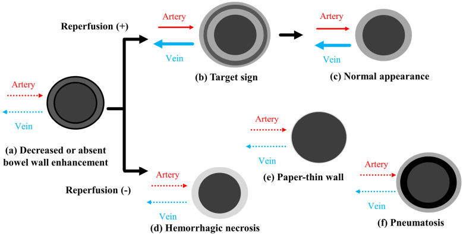
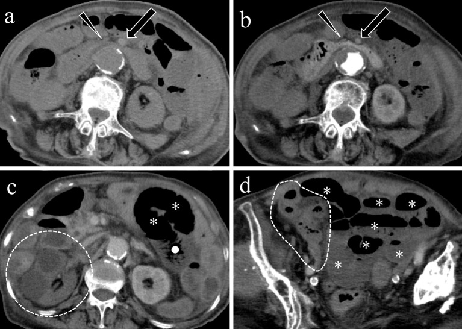
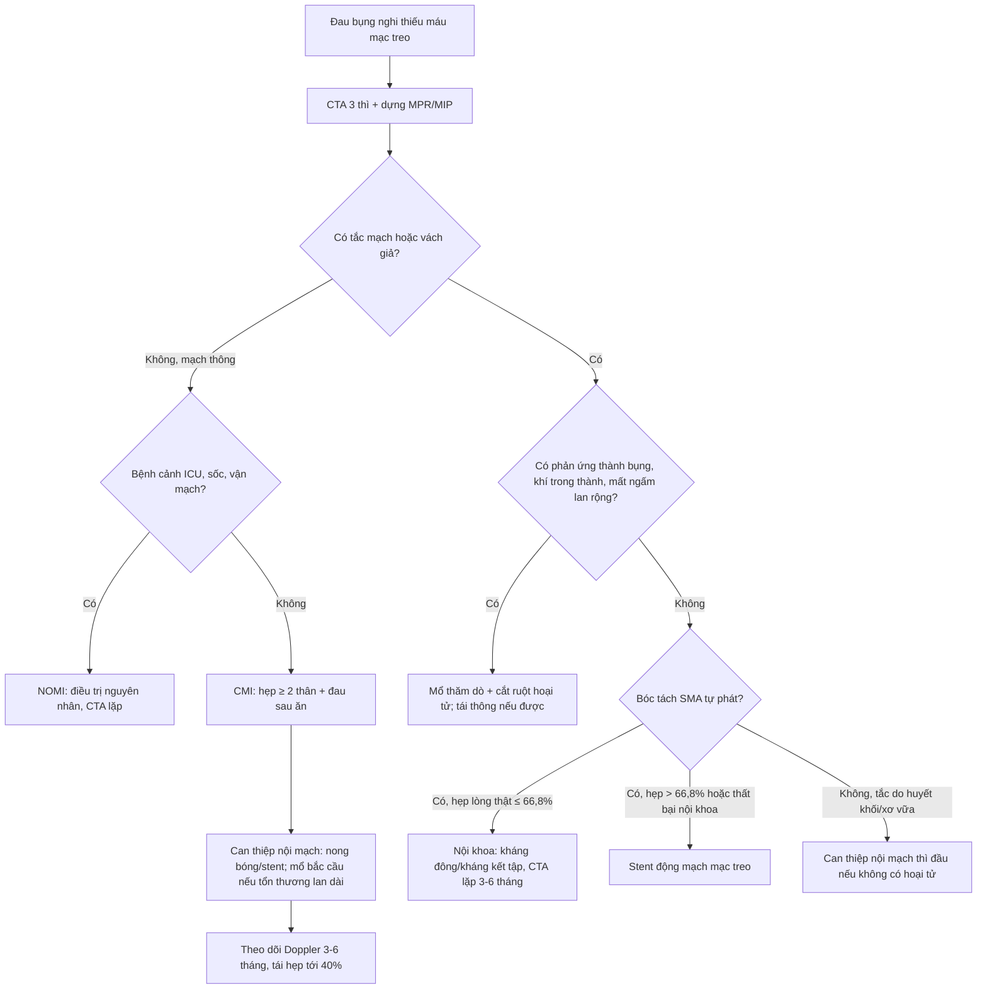
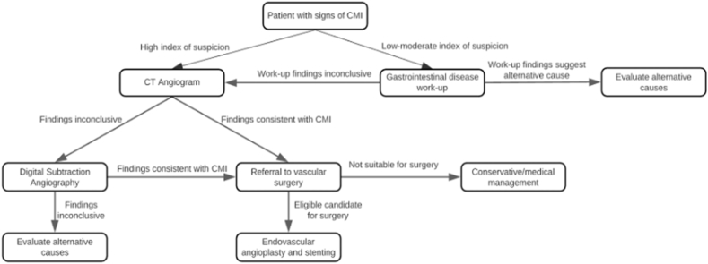
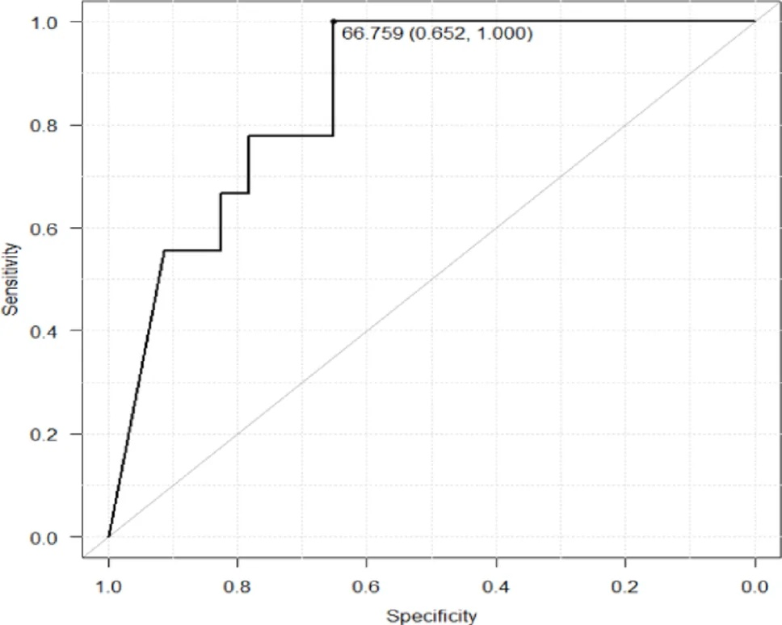
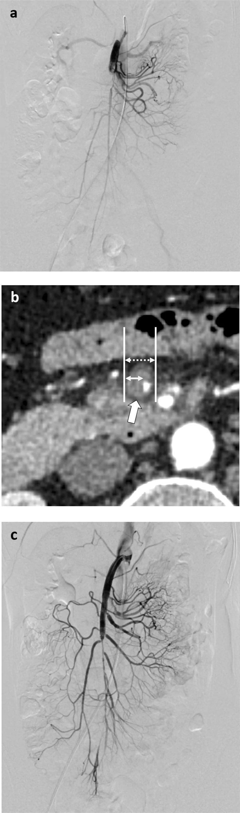
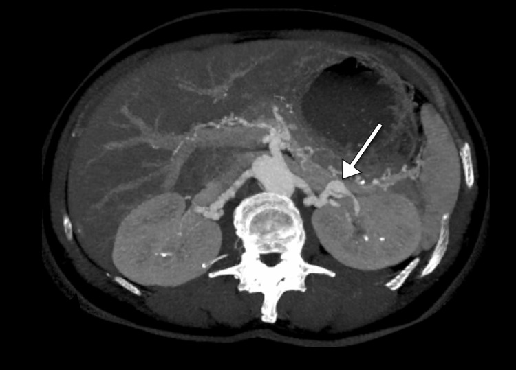
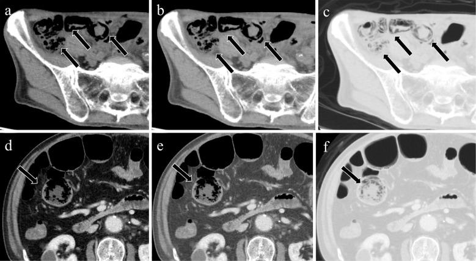

# 1908 — Thiếu máu mạc treo cấp & mạn, bóc tách động mạch tạng tự phát (ISMAD) và phân biệt với FMD/SAM: CTA 3 thì và ngưỡng can thiệp / Acute & chronic mesenteric ischemia and spontaneous visceral artery dissection

**Tags:** `pattern:hep-mach` `pattern:tac-mach` `pattern:boc-tach` `pattern:thieu-tuoi-mau-ruot` `vung:dong-mach-mac-treo` `vung:bung` `score:Tan` `protocol:CTA-3-thi` `protocol:DSA`

**Mức chắc chắn (certainty):** tổng hợp y văn (literature synthesis) — ghép 5 nguồn: **meta-analysis độ chính xác hình ảnh thiếu máu mạc treo cấp** 95 bài/14 meta-analysis (PMC11928508), **review tổng quan CTA và điều trị** (PMC10931623), **review thiếu máu mạc treo mạn** (PMC9422046), **đoàn hệ bóc tách SMA tự phát** 32 bệnh nhân (PMC13624004) và **bài bình luận phân tầng nguy cơ ISMAD** (PMC13458913). Không phải ca nguyên văn; số nào nguồn không nêu ghi "chưa rõ".

> **Câu chốt:** trong thiếu máu mạc treo, **hình ảnh quyết định thời điểm mổ, không phải xét nghiệm**. CTA cho **Se 92,0% / Sp 98,8%** chẩn đoán thiếu máu mạc treo cấp; **mất/giảm ngấm thành ruột** (OR **14,3**) và **khí trong thành ruột** (Sp **98,2%**) là dấu hiệu **hoại tử xuyên thành** — xuất hiện **muộn**, nên **không có khí không loại trừ**. Với **bóc tách SMA tự phát (ISMAD)**, phần lớn điều trị nội khoa; **hẹp lòng thật > 66,8%** là ngưỡng dự báo thất bại (AUC 0,855, NPV 1,00) — đây là con số quyết định đặt stent.

## 1. Tổng quan bệnh học – cơ chế hình ảnh

### 1.1 Vì sao ruột chịu được hẹp mạn nhưng sụp đổ khi tắc cấp (TẠI SAO)

- **Giải phẫu cấp máu:** ba thân — **thân tạng (celiac)**, **SMA**, **IMA** — nối với nhau bằng **cung Riolan (arc of Riolan)**, **động mạch bờ (marginal artery of Drummond)** và vòng quanh tá tụy. Vì vậy **hẹp một thân hiếm khi gây triệu chứng**; thiếu máu mạc treo mạn (chronic mesenteric ischemia — CMI) thường cần **hẹp ≥ 70% ở ≥ 2 thân**, và ngay cả khi **xơ vữa mạc treo gặp 6–29%** dân số chụp mạch, **chỉ thiểu số** thành CMI (PMC9422046).
- **Vì sao đau sau ăn:** tiêu hóa làm **tăng nhu cầu tưới máu**. Lưu lượng **thân tạng tăng sớm (5 ± 1 phút) và thoáng qua**, còn **SMA tăng muộn hơn (41 ± 4 phút) và kéo dài** — đau xuất hiện khi nhu cầu vượt khả năng cấp máu, nên bệnh nhân **sợ ăn, sụt cân**. **Tam chứng kinh điển (đau sau ăn + sụt cân + tiếng thổi) chỉ có đủ ở 20%** (PMC9422046).
- **Vì sao tắc cấp gây hoại tử nhanh:** **niêm mạc ruột có nhu cầu chuyển hóa cao nhất** và được nuôi bằng **cơ chế trao đổi ngược dòng (countercurrent)** ở nhung mao — lớp này **nhạy thiếu oxy nhất**, bong trước, rồi đến **thành cơ** và **thanh mạc**. Vì vậy **đau dữ dội nhưng bụng mềm** giai đoạn đầu (đau do tạng, chưa viêm phúc mạc), và khi có **phản ứng thành bụng** thì đã **hoại tử xuyên thành**.
- **Vì sao CTA thấy được nguyên nhân:** cục máu đông, mảng xơ vữa, **vách bóc tách** đều là **bất thường trong lòng mạch** → cần **thì động mạch mạch máu (25–35 giây)** để phân biệt **huyết khối tắc hoàn toàn** với **hẹp do xơ vữa** và **bóc tách**. **Thì tĩnh mạch cửa (60–70 giây)** cần cho **huyết khối tĩnh mạch mạc treo** và đánh giá **ngấm thành ruột**. Bóc tách cho **vách giả (dissection flap)** — dấu hiệu **đặc hiệu**, không gặp trong xơ vữa đơn thuần (PMC12078030).
- **Vì sao lactate đến muộn:** lactate tăng khi **chuyển hóa yếm khí lan rộng** — tức đã có **thiếu máu niêm mạc đáng kể**; **lactate bình thường không loại trừ** thiếu máu sớm, và **tăng lactate khi nhập viện liên quan tử vong cao hơn** (PMC10931623).
- **Vì sao khí trong thành/tĩnh mạch cửa là dấu hiệu muộn:** khí sinh ra khi **niêm mạc mất toàn vẹn + vi khuẩn lên men** trong thành ruột chết. Vì vậy **độ nhạy thấp nhưng độ đặc hiệu rất cao**: khí trong thành ruột **Sp 98,2%** cho thiếu máu mạc treo cấp (PMC11928508).

*Hình 1 — Diễn tiến tổn thương thành ruột trên CT: (a) **mất/giảm ngấm** là dấu hiệu sớm; nếu **tái tưới máu**, thành ruột dày và tạo **dấu bia (target sign)** với lớp trong tăng đậm (niêm mạc), lớp giữa nhược sắc (phù), rồi trở về bình thường; nếu **không tái tưới máu**, thành ruột chuyển **hoại tử xuất huyết**, **mỏng như tờ giấy** và cuối cùng có **khí trong thành**. Nguồn: Interventional Radiology 2025 (PMC12078030), **CC BY-NC 4.0**.*

### 1.2 Ngưỡng định lượng nằm lòng (bắt buộc nhớ)

| Chỉ số | Con số | Nguồn |
|---|---|---|
| Tử vong thiếu máu mạc treo cấp khi chẩn đoán muộn | **30–70%**; **mỗi 6 giờ chậm gấp đôi tử vong** | PMC10931623 |
| Tắc động mạch chiếm | **67–95%** ca thiếu máu mạc treo cấp (còn lại tĩnh mạch, NOMI) | PMC10931623 |
| CTA chẩn đoán thiếu máu mạc treo cấp | **Se 92,0% (86,3–95,5) / Sp 98,8% (95,1–99,8)** — 12 nghiên cứu/2.028 ca | PMC11928508 |
| Mất/giảm ngấm thành ruột | **Se 57,9% / Sp 90,8%**, **OR 14,3** (6,4–31,2) cho hoại tử xuyên thành | PMC11928508 |
| Thành ruột dày | **Se 56,4% / Sp 63,4%**, **OR 3,1** — dấu hiệu **kém đặc hiệu** | PMC11928508 |
| Khí trong thành ruột (pneumatosis) | Thiếu máu mạc treo cấp: **Se 27,0% / Sp 98,2%**; hoại tử xuyên thành: **Se 44,8% / Sp 84,1%**, **OR 2,36** | PMC11928508 |
| Thành ruột mỏng | Hoại tử xuyên thành: **Se 33,6% / Sp 98,0%** | PMC11928508 |
| Tổn thương đại tràng kèm theo | **~28%** ca thiếu máu mạc treo cấp, hay gặp **đại tràng phải** | PMC10931623 |
| CMI: CTA / Doppler | CTA **Se 100% / Sp 95%**; Doppler **Se 72–100% / Sp 77–90%** | PMC9422046 |
| CMI không điều trị | Tử vong 5 năm **gần 100%** | PMC9422046 |
| CMI sau can thiệp nội mạch | Giảm triệu chứng **86–96%** ở 5–10 năm; **tái hẹp tới 40%**; theo dõi Doppler **3–6 tháng/lần** | PMC9422046 |
| Bóc tách SMA tự phát (ISMAD) | Gặp **0,01–0,09%** trong tử thiết; nam **81,3%**, tuổi trung vị **56,7** | PMC13624004 |
| ISMAD: hẹp lòng thật dự báo thất bại nội khoa | **100% vs 55%** (thất bại vs thành công); **cut-off 66,8%**, **AUC 0,855**, **Se 100% / Sp 65,2%**, **NPV 1,00** | PMC13624004 |
| ISMAD: cung Riolan | Có cung Riolan ở **9/9 ca thất bại** vs **12/23 ca thành công** (P < 0,05) | PMC13624004 |
| Phân loại Tan (156 bệnh nhân, 8 hệ thống) | **C-statistic 0,750** — cao nhất; **type L** = bóc tách **> 5 cm**, **type S** = hẹp lòng thật **> 80%** | PMC13458913 |
| Can thiệp nội mạch vs mổ mở trong thiếu máu mạc treo cấp | Tử vong **24,9% vs 39,3%** (p = 0,01); nằm viện **12,9 vs 17,1 ngày** (679 ca) | PMC12205474 |

## 2. Mẫu hình + chẩn đoán phân biệt theo vị trí (gamut)

**Mẫu hình cần nhận ra:** bệnh nhân **đau bụng dữ dội không tương xứng với khám** (hoặc **đau sau ăn + sợ ăn + sụt cân**) → **CTA 3 thì** thấy **tắc/hẹp có/không có vách giả ở thân tạng, SMA hoặc IMA**, kèm **thành ruột mỏng – mất ngấm – khí trong thành/tĩnh mạch cửa** ở thể nặng.

**Gamut theo vị trí (mnemonic "GỐC – THÂN – TĨNH MẠCH – LAN TỎA"):**

1. **GỐC THÂN TẠNG:** **hội chứng dây chằng cung giữa (median arcuate ligament syndrome — MALS)** — hẹp hình móc ở mặt trên thân tạng khi thở ra; **hẹp gốc có vôi hóa** = xơ vữa; **FMD** hiếm ở gốc, thường **thân/đoạn giữa** (bài **850**).
2. **THÂN SMA:** **huyết khối do xơ vữa** (thường sát gốc, trên các nhánh hỗng tràng đầu tiên), **thuyên tắc (embolus)** (thường **cách gốc 3–10 cm**, **bỏ qua nhánh hỗng tràng đầu** — vùng thiếu máu từ hỗng tràng giữa đến đại tràng ngang), **bóc tách tự phát (ISMAD)** — vách giả, lòng thật hẹp.
3. **TĨNH MẠCH MẠC TREO:** huyết khối **tĩnh mạch mạc treo trên (superior mesenteric vein — SMV)** — thành ruột dày, **xung huyết mạc treo, dịch, khí trong thành, cổ trướng** nhiều hơn thể động mạch (PMC12078030).
4. **LAN TỎA/PHÂN BỐ MẠCH MÁU BÌNH THƯỜNG:** **NOMI** (non-occlusive mesenteric ischemia) — bệnh nhân ICU, sốc, dùng vận mạch, lọc máu; **mạch thông nhưng ruột thiếu máu**.
5. **IMA/ĐẠI TRÀNG:** tắc IMA đơn độc thường **im lặng** nhờ cung Riolan; biểu hiện **viêm đại tràng thiếu máu** ở vùng bản lề.
6. **MẠCH TẠNG NHIỀU Ổ:** **SAM/Loạn sản cơ trung mạc từng đoạn (segmental arterial mediolysis)** — phình/bóc tách **nhiều ổ, không chuỗi hạt**, có thể tự lành (bài **850**); **FMD** — chuỗi hạt (bài 850); **viêm mạch (Takayasu, PAN)** — hẹp nhiều ổ + dấu viêm.

*Hình 2 — Nam 50 tuổi, huyết khối tiểu nhĩ trái, đau bụng và đau chi dưới: (a) cục máu đông trong tiểu nhĩ trái; (b) **CT không cản quang, cửa sổ hẹp (WL 40/WW 120)**: **huyết khối tăng đậm độ trong lòng SMA** (mũi tên) — dấu hiệu dễ bỏ sót nếu chỉ nhìn cửa sổ bụng thường; (c,d) thì động mạch: **khuyết thuốc trong SMA**; nhánh xa giảm ngấm. Nguồn: Interventional Radiology 2025 (PMC12078030), **CC BY-NC 4.0**.*

## 3. Bảng so sánh phân biệt (ma trận đối chiếu)

| Thực thể (entity) | Hình ảnh điển hình (CTA 3 thì) | Chốt vào (rule-in) | Chốt loại (rule-out) | Gợi ý xác nhận |
|---|---|---|---|---|
| **CMI do xơ vữa** | Hẹp **≥ 70% ở ≥ 2 thân**, **gốc có vôi hóa**, hẹp lan dài, tuổi > 60 | Đau sau ăn + sụt cân + hẹp ≥ 2 thân + bệnh xơ vữa nơi khác | Hẹp một thân, không triệu chứng; hẹp **không vôi** ở người trẻ | CTA; Doppler (PSV, không có dòng sau ăn); DSA khi mổ |
| **Thuyên tắc SMA (embolus)** | **Khuyết thuốc đột ngột cách gốc 3–10 cm**, **bỏ qua nhánh hỗng tràng đầu**, tim có huyết khối/rung nhĩ | Đau bụng cấp + rung nhĩ + **khuyết thuốc khu trú** | Hẹp gốc lan dài có vôi → xơ vữa; vách giả → bóc tách | CTA thì động mạch; siêu âm tim |
| **Huyết khối SMA trên nền CMI** | **Tắc hoàn toàn** trên nền hẹp gốc có vôi, nhánh bàng hệ to | Tiền sử đau sau ăn/sụt cân + tắc đột ngột | Mạch bình thường, không tiền sử | CTA; so sánh với phim cũ nếu có |
| **ISMAD (bóc tách SMA tự phát)** | **Vách giả + hai lòng**, lòng thật hẹp; **không chuỗi hạt**, không vôi hóa | **Vách giả** trong SMA ở người trung niên, đau bụng không phản ứng thành bụng | Không vách giả; hẹp đối xứng gốc có vôi → xơ vữa | CTA; **đo % hẹp lòng thật**; DSA nếu can thiệp |
| **Huyết khối SMV** | **Khuyết thuốc trong tĩnh mạch mạc treo**, thành ruột dày, **xung huyết mạc treo + dịch + cổ trướng** | Khuyết thuốc tĩnh mạch + thành ruột dày | Động mạch bình thường, không khuyết thuốc tĩnh mạch | CTA thì cửa; kháng đông là điều trị đầu tay |
| **NOMI** | **Mạch thông**, **SMA nhỏ/không giãn**, thành ruột mất ngấm từng đoạn | Bệnh cảnh ICU/sốc/vận mạch + mạch thông + ruột mất ngấm | Có tắc/vách giả → thể tắc | CTA; theo dõi bằng CTA lặp; điều trị nguyên nhân |
| **FMD (bài 850)** | **Chuỗi hạt** (hẹp–giãn xen kẽ, bờ lượn sóng ở đoạn giữa–xa), có thể kèm phình/bóc tách | Bệnh nhân trẻ/nữ + **≥ 2 đoạn giãn xen kẽ hẹp** + nhiều vùng mạch | Hẹp **gốc, trơn, có vôi** → xơ vữa; **vách giả đơn độc** → ISMAD/SAM | CTA/MRA **đầu–khung chậu** một lần |
| **SAM (loạn sản cơ trung mạc từng đoạn)** | **Phình/bóc tách nhiều ổ**, **không chuỗi hạt**, có thể tự lành | Nhiều ổ phình/bóc tách tạng ở trung niên, không xơ vữa | Có chuỗi hạt → FMD; hẹp gốc có vôi → xơ vữa | CTA lặp 3–6 tháng |
| **MALS (dây chằng cung giữa)** | **Hẹp hình móc mặt trên thân tạng**, rõ khi **thở ra**, giảm khi thở vào | Hẹp thay đổi theo thì thở + đau sau ăn ở người trẻ, không xơ vữa | Hẹp cố định, có vôi → xơ vữa | CTA động – thở ra; đo gradient DSA |

## 4. Protocol chụp + hệ phân độ/điểm chuẩn hóa

### 4.1 Protocol CTA bụng – mạch tạng (3 thì)

- **Lát cắt ≤ 1 mm**, dựng **MPR mặt phẳng vành – dọc trục mạch**, **MIP** cho toàn bộ đường đi thân tạng/SMA/IMA và **VR** khi cần.
- **Thì không cản quang:** cần để phát hiện **máu tụ/thuyết khối tăng đậm độ** và **vôi hóa**. Đọc **cửa sổ hẹp WL 40/WW 120** (hoặc **WW 80**) giúp thấy huyết khối tăng đậm độ trong lòng mạch (PMC12078030).
- **Thì động mạch (25–35 giây):** nguyên nhân tắc, vách giả, mảng xơ vữa, phình.
- **Thì tĩnh mạch cửa (60–70 giây):** **ngấm thành ruột**, huyết khối tĩnh mạch, tạng.
- **Đọc khí trong thành ruột trên cửa sổ rộng:** cửa sổ bụng mặc định **WL 40/WW 350** dễ bỏ sót; chuyển **WL 0/WW 450** rồi **cửa sổ phổi WL −500/WW 1.500** để xác nhận (PMC12078030).
- **Đo và ghi vào báo cáo:** % hẹp lòng thật (với bóc tách), **chiều dài bóc tách**, có/không **huyết khối lòng giả**, **đường kính SMA**, tình trạng **ngấm thành ruột** và **khí**.

### 4.2 Phân tầng ISMAD (bóc tách SMA tự phát)

| Yếu tố | Ngưỡng / ý nghĩa | Nguồn |
|---|---|---|
| Hẹp lòng thật | **> 66,8%** dự báo thất bại nội khoa (**AUC 0,855**, **NPV 1,00**) | PMC13624004 |
| Chiều dài bóc tách | **> 5 cm** = **type L** (Tan) — nguy cơ cao | PMC13458913 |
| Hẹp lòng thật (Tan) | **> 80%** = **type S** — nguy cơ cao | PMC13458913 |
| Cung Riolan | Có cung Riolan **9/9** ca thất bại vs **12/23** ca thành công — dấu hiệu **nên theo dõi sát**, không phải dấu hiệu lành | PMC13624004 |
| So sánh 8 hệ phân loại (156 ca) | **Tan** tốt nhất, **C-statistic 0,750** | PMC13458913 |

### 4.3 Khi nào nội khoa, can thiệp, mổ

*Hình 3 — Sơ đồ tiếp cận CMI: nghi ngờ cao → **CTA**; không kết luận → **DSA**; phù hợp → **chuyển mạch máu**, ưu tiên **nong bóng – stent**; không mổ được → điều trị nội khoa. Nguồn: Shanmuga Anandan A & Munasinghe S, Ann Med Surg 2022 (PMC9422046), **CC BY-NC-ND 4.0** — nguyên bản.*

*Hình 4 — ROC: **AUC 0,855**; cut-off **66,8%** cho **Se 100% / Sp 65,2%**, **NPV 1,00** — nghĩa là **hẹp lòng thật dưới 66,8% gần như chắc chắn theo nội khoa được**, còn trên ngưỡng cần theo dõi sát/cân nhắc stent. Nguồn: PMC13624004, **CC BY 4.0**.*

**Điều trị theo thể (theo nguồn):**

- **Thiếu máu mạc treo cấp có hoại tử:** **mổ thăm dò + cắt đoạn hoại tử** là bắt buộc; can thiệp nội mạch **trước** chỉ khi chưa có hoại tử, và **không thay thế** việc đánh giá ruột sống (PMC10931623). Trong 679 ca, can thiệp nội mạch có tử vong **24,9% vs 39,3%** và nằm viện ngắn hơn, nhưng đây là **dữ liệu quan sát, chọn bệnh** (PMC12205474).
- **CMI:** can thiệp nội mạch là lựa chọn đầu ở tổn thương khu trú; giảm triệu chứng **86–96%** ở 5–10 năm, **tái hẹp tới 40%** → theo dõi **Doppler 3–6 tháng/lần**; mổ bắc cầu khi tổn thương lan dài/không phù hợp nội mạch (PMC9422046).
- **ISMAD:** **đa số điều trị nội khoa** (không phản ứng thành bụng, không thiếu máu ruột); **stent** khi hẹp lòng thật **> 66,8–80%**, đau không giảm, hoặc dấu hiệu thiếu máu tiến triển; **mổ** khi vỡ/hoại tử. Theo dõi CTA **3–6 tháng** để loại phình/bóc tách mới (PMC13624004, PMC13458913).
- **SAM/FMD:** xem bài **850** — FMD cần **chụp toàn bộ cây mạch một lần**, nong bóng ở người trẻ đang lớn; SAM theo dõi CTA lặp vì có thể tự lành hoặc tiến triển.

## 5. Biến thể bình thường và cạm bẫy

- **Cạm bẫy 1 — chờ lactate tăng:** lactate bình thường **không loại trừ**; mỗi 6 giờ chậm **gấp đôi tử vong**. Chỉ định CTA dựa trên **lâm sàng**, không dựa xét nghiệm.
- **Cạm bẫy 2 — chờ khí trong thành ruột:** khí chỉ có ở **27,0%** ca thiếu máu mạc treo cấp (Se thấp) dù **Sp 98,2%**; **không khí không loại trừ**, còn **có khí thường đã hoại tử xuyên thành**.
- **Cạm bẫy 3 — đọc "thành ruột dày" là thiếu máu:** dày thành **Se 56,4% / Sp 63,4%** — gặp trong viêm, phù, xuất huyết, bệnh lý tĩnh mạch. Phải phối hợp **mất ngấm** và **bối cảnh mạch**.
- **Cạm bẫy 4 — bỏ sót huyết khối vì đọc cửa sổ bụng thường:** huyết khối tăng đậm độ chỉ rõ trên **cửa sổ hẹp (WW 120 hoặc 80)**; trên cửa sổ mặc định **WL 40/WW 350** có thể "mất" (PMC12078030).
- **Cạm bẫy 5 — gọi hẹp thân tạng là bệnh:** **hẹp do dây chằng cung giữa** rất hay gặp và **phần lớn không triệu chứng**; chỉ điều trị khi có **đau sau ăn + hẹp thay đổi theo thì thở + loại trừ nguyên nhân khác**. Đừng đặt stent thân tạng chỉ vì "hẹp 70%".
- **Cạm bẫy 6 — can thiệp mọi ISMAD:** **đa số** ổn định với nội khoa; can thiệp dựa trên **% hẹp lòng thật > 66,8%**, chiều dài **> 5 cm**, hoặc **thất bại nội khoa**, không dựa cảm giác "bóc tách là nặng".
- **Cạm bẫy 7 — hiểu ngược cung Riolan:** có cung Riolan **không phải dấu hiệu bù tốt** — trong đoàn hệ ISMAD, cung Riolan gặp **9/9 ca thất bại** (so với 12/23 ca thành công); đây là dấu hiệu **bệnh mạn đã lâu**, cần theo dõi sát.
- **Cạm bẫy 8 — nhầm bóc tách với xơ vữa:** **vách giả** = bóc tách (ISMAD/SAM); **hẹp gốc có vôi** = xơ vữa; **chuỗi hạt ở đoạn giữa–xa** = FMD. Ba bệnh cảnh, ba hướng điều trị.
- **Biến thể bình thường:** **góc động mạch chủ – mạc treo hẹp (< 25°) và khoảng cách < 8 mm** gợi ý **hội chứng mạc treo – chủ (nutcracker/Wilkie)** — đau sau ăn ở người gầy, **không phải hẹp mạch**; **tĩnh mạch mạc treo giãn nhẹ sau ăn**; **vôi hóa hạch/động mạch nhỏ** không gây tắc.

## 6. Tự lượng giá — Blind Quiz ngay trên trang tĩnh

**Ca 1 — Nam 41 tuổi, đau bụng quanh rốn 3 ngày, không phản ứng thành bụng, không rung nhĩ. CTA bụng: (a) DSA SMA trước can thiệp, (b) CTA mặt phẳng vành/ngang qua SMA, (c) DSA sau can thiệp:**

- Câu hỏi: (1) Mô tả tổn thương trên (b). (2) Đây là bệnh gì và cơ chế đau? (3) Có chỉ định can thiệp ngay không — dựa vào con số nào?

<b>Bấm để hiện đáp án (findings + chẩn đoán)</b>

- **Findings:** (a) DSA SMA: **dòng chảy đầu xa kém**, lòng mạch bị chèn; (b) CTA: **vách bóc tách (flap) trong lòng SMA**, tạo **lòng thật hẹp** (mũi tên trắng, hai đường trắng đánh dấu đường kính lòng thật và lòng giả); (c) sau can thiệp: **stent mở rộng lòng thật**, dòng chảy đầu xa hồi phục.
- **Chẩn đoán:** **bóc tách SMA tự phát (ISMAD)** — cơ chế đau do **giảm tưới máu ruột** qua lòng thật hẹp, chưa hoại tử (không phản ứng thành bụng).
- **Chỉ định can thiệp:** không dựa vào "có bóc tách", mà vào **% hẹp lòng thật**: **> 66,8%** (AUC 0,855, NPV 1,00) hoặc **> 80%** (type S của Tan) / bóc tách **> 5 cm** (type L) / **thất bại điều trị nội khoa**. Ca này thất bại nội khoa nên được stent.
- **Nguồn ảnh:** Japanese Journal of Radiology 2026 (PMC13624004), **CC BY 4.0**.

**Ca 2 — Nữ 34 tuổi, tăng huyết áp khó kiểm soát, đau bụng mơ hồ, không xơ vữa. CTA bụng:**

- Câu hỏi: (1) Mũi tên chỉ gì? (2) Vì sao đây **không phải** bóc tách SMA hay xơ vữa? (3) Bước tiếp theo cần làm gì ngoài đánh giá thận?

<b>Bấm để hiện đáp án (findings + chẩn đoán)</b>

- **Findings:** CTA ngang: **phình động mạch thận trái** (mũi tên) kèm **hình chuỗi hạt (beaded appearance)** ở **động mạch thận và động mạch mạc treo** — các đoạn giãn xen kẽ hẹp, bờ lượn sóng.
- **Chẩn đoán:** **loạn sản cơ xơ (fibromuscular dysplasia — FMD)** thể đa ổ.
- **Vì sao không phải ISMAD/xơ vữa:** ISMAD có **vách giả đơn độc**, không chuỗi hạt; xơ vữa hẹp **sát gốc, trơn, có vôi**, ở người lớn tuổi. FMD ở **đoạn giữa–xa**, nhiều ổ, bệnh nhân trẻ/nữ.
- **Bước tiếp theo:** **chụp toàn bộ cây mạch từ đầu đến khung chậu một lần** để tìm phình/bóc tách không triệu chứng (phình nội sọ, bóc tách mạch cảnh, tổn thương ĐMC) — chi tiết ở bài **850**.
- **Nguồn ảnh:** Cureus 2023 (PMC10781897), **CC BY 4.0**.

**Ca 3 — Nam 78 tuổi, ICU, sốc nhiễm khuẩn, đang dùng vận mạch; đau bụng tăng, bụng chướng. Ảnh là cùng một bệnh nhân với ba cửa sổ khác nhau (a, b, c):**

- Câu hỏi: (1) Ở cửa sổ nào thấy rõ khí trong thành ruột nhất? (2) Khí trong thành ruột nói lên điều gì về giai đoạn bệnh? (3) Vì sao mạch có thể "thông" mà ruột vẫn thiếu máu?

<b>Bấm để hiện đáp án (findings + chẩn đoán)</b>

- **Findings:** (a) cửa sổ bụng mặc định **WL 40/WW 350**: khí trong thành ruột **mờ, dễ bỏ sót**; (b) **WL 0/WW 450**: khí rõ hơn; (c) **cửa sổ phổi WL −500/WW 1.500**: **khí trong thành ruột hiện rõ nhất** thành các đường/vòng đen trong thành.
- **Ý nghĩa giai đoạn:** khí trong thành ruột là dấu hiệu **muộn** của **hoại tử xuyên thành**; độ nhạy chỉ **27,0%** nhưng độ đặc hiệu **98,2%** (PMC11928508) — thấy khí là **chỉ định mổ thăm dò**, không chờ thêm.
- **Vì sao mạch thông vẫn thiếu máu:** đây là **NOMI** — co thắt/tưới máu không tương xứng do sốc và vận mạch, **không có tắc mạch**. Điều trị: **hồi sức, giảm/ngừng vận mạch, điều trị nguyên nhân**, CTA lặp để theo dõi tiến triển; mổ khi có hoại tử.
- **Nguồn ảnh:** Interventional Radiology 2025 (PMC12078030), **CC BY-NC 4.0**.

## Bài liên quan chéo
- [850 – FMD toàn thân ở trẻ và người trẻ: chuỗi hạt, phình, bóc tách](../850-loan-san-co-xo-fibromuscular-dysplasia-toan-than-o-tre/lesson.md)
- [163 – Viêm tắc tĩnh mạch cửa & huyết khối tĩnh mạch mạc treo](../163-pylephlebitis-huyet-khoi-tm-mac-treo/lesson.md)
- [162 – Tắc ruột: mức độ, dấu hiệu thiếu máu ruột và chỉ định mổ](../162-tac-ruot/lesson.md)
- [931 – Takayasu: can thiệp nội mạch và phẫu thuật bắc cầu](../931-takayasu-can-thiep-noi-mach-va-phau-thuat/lesson.md)
- [248 – Can thiệp nội mạch giả phình/bóc tách động mạch cổ – đốt sống](../248-can-thiep-noi-mach-gia-phinh-boc-tach-dong-mach-co-dot-song/lesson.md)
- [100 – Tổng quan hệ Bụng](../100-tong-quan-he-bung/lesson.md)
- [010 – Giải phẫu ngực – bụng cắt lớp](../010-giai-phau-nguc-cat-lop/lesson.md)

## Ảnh
- `1908_huyet-khoi-SMA_CT_PMC12078030-Fig2.jpg` — Interventional Radiology 2025 (PMC12078030), **CC BY-NC 4.0**.
- `1908_chien-luoc-CMI_so-do_PMC9422046-Fig1.jpg` — Shanmuga Anandan A & Munasinghe S, Ann Med Surg 2022 (PMC9422046), **CC BY-NC-ND 4.0**.
- `1908_ROC-hep-long-that_so-do_PMC13624004-Fig2.jpg` — Japanese Journal of Radiology 2026 (PMC13624004), **CC BY 4.0** (chuyển webp → JPG, không đổi nội dung).
- `1908_boc-tach-SMA_DSA-CT_PMC13624004-Fig3.jpg` — cùng bài, **CC BY 4.0** (chuyển webp → JPG).
- `1908_FMD-chuoi-hat_CTA_PMC10781897-Fig1.jpg` — Cureus 2023 (PMC10781897), **CC BY 4.0**.
- `1908_khi-trong-thanh-ruot_CT_PMC12078030-Fig7.jpg` — PMC12078030, **CC BY-NC 4.0**.
- `1908_dien-tien-ruot-thieu-mau_CT_PMC12078030-Fig6.jpg` — cùng bài, **CC BY-NC 4.0**.
- Chi tiết nguồn/giấy phép từng ảnh: `images/CREDITS.md`.

> Không dùng để chẩn đoán độc lập khi chưa có người hướng dẫn.
