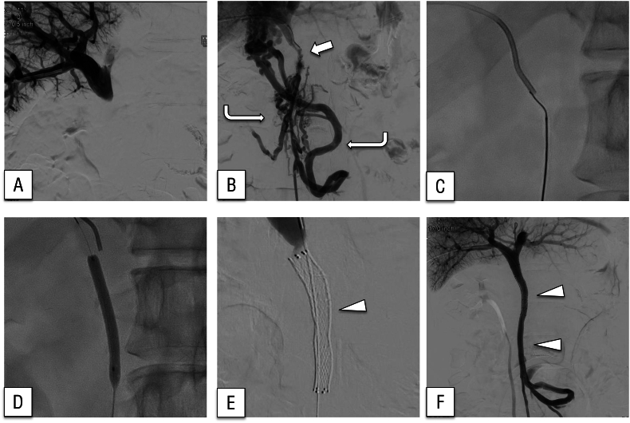
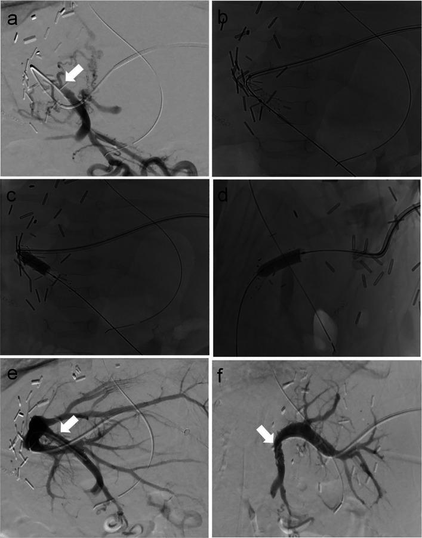
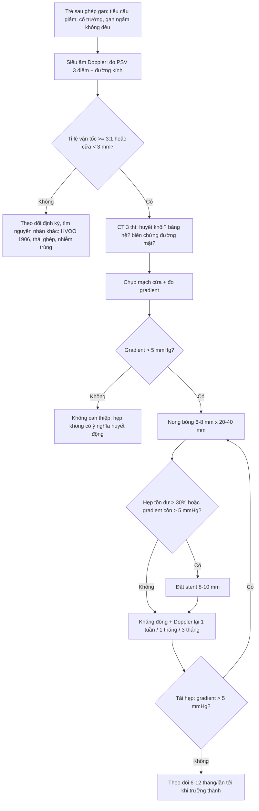
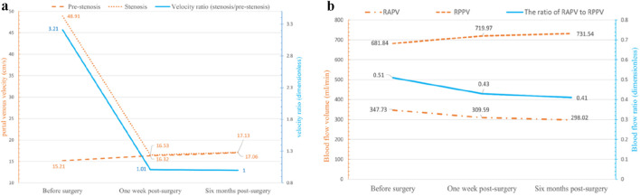
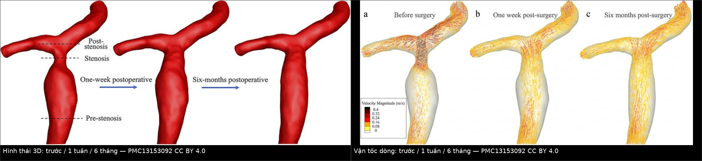
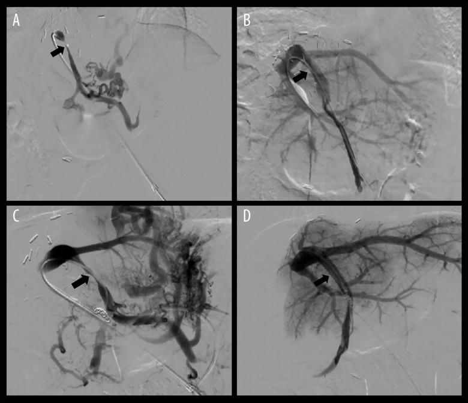

# 1909 — Hẹp–tắc tĩnh mạch cửa sau ghép gan: tỉ lệ vận tốc 3,21 → 1,01 sau nong bóng, tái hẹp 18,75% & OR 5,7 theo chênh lệch đường kính / Portal vein stenosis after liver transplantation

**Tags:** `pattern:hep-mieng-noi` `pattern:giai-doan-toc-do` `pattern:huyet-khoi` `pattern:giam-ngam-nhu-mo` `vung:gan` `vung:tm-cua` `vung:mieng-noi` `score:gradient-ap-luc` `score:ti-le-van-toc` `protocol:Doppler` `protocol:CT-3-thi` `protocol:venography-do-ap-luc` `protocol:nong-bong` `protocol:stent`

**Mức chắc chắn (certainty):** tổng hợp y văn (literature synthesis) — số liệu lấy từ 5 bài open access đã đọc toàn văn: Shuai M et al., *Ann Transplant* 2025 (PMC12377406, CC BY-NC-ND 4.0 — 67 ca hẹp tĩnh mạch cửa ở trẻ sau ghép gan); Hammer S et al., *CVIR Endovasc* 2025 (PMC12701888, CC BY 4.0 — 31 ca nong bóng, so sánh bệnh–chứng); Iseda N et al., *DEN Open* 2025 (PMC12621446, CC BY 4.0 — 2 ca hẹp/tắc cửa sau mổ tụy, stent); Yang F et al., *Front Bioeng Biotechnol* 2026 (PMC13153092, CC BY 4.0 — mô phỏng huyết động CFD trước/sau nong bóng); Tai M et al., *BMC Gastroenterol* 2026 (PMC13134106, CC BY-NC-ND 4.0 — siêu âm đàn hồi sau ghép gan). Bài **không** có ca nguyên văn riêng của nhóm; ca trong quiz là ca nguyên văn của nguồn, giữ đúng chú thích gốc và ghi rõ Fig.

> **Câu hỏi gốc của bài:** trẻ **4 tuần sau ghép gan thùy trái**, bụng to ra, tiểu ít, **tiểu cầu giảm**, men gan tăng nhẹ; siêu âm thấy **tĩnh mạch cửa giãn trước chỗ hẹp**, tại miệng nối **tốc độ 52,8 cm/s trong khi đoạn trước chỉ 13,5 cm/s**, phổ **aliasing**; CT thì cửa thấy gan **ngấm thuốc không đều**, có **mạng mạch bàng hệ quanh rốn**. Vậy: **hẹp ở miệng nối hay do huyết khối? khi nào chỉ theo dõi, khi nào nong bóng, khi nào đặt stent, và con số nào trên phim quyết định?**
> **Điểm tựa:** gan nhận **~75% máu từ tĩnh mạch cửa**, nhưng mảnh ghép **chỉ có một cửa vào chính là miệng nối tĩnh mạch cửa**. Theo **định luật Poiseuille (lưu lượng ∝ ΔP · r⁴ / 8ηL)**, giảm **một nửa bán kính** làm lưu lượng giảm **16 lần** nếu chênh áp giữ nguyên — nên cơ thể **buộc phải tăng tốc dòng** để giữ tưới máu. Vì vậy dấu hiệu sớm **không phải hình thái hẹp** mà là **tăng tốc tại chỗ + giãn đoạn trước hẹp**; còn chẩn đoán xác định là **chênh áp qua chỗ hẹp > 5 mmHg**.

## 1. Tổng quan — vì sao hẹp dòng VÀO gây teo mảnh ghép, giãn tĩnh mạch và "hẹp giả" trên Doppler

**A. Bệnh học (pathology) và cơ chế:**

- **Định nghĩa:** hẹp hoặc tắc **miệng nối tĩnh mạch cửa** (portal vein anastomosis) hoặc **thân tĩnh mạch cửa ngoài gan** của mảnh ghép sau ghép gan. Đây là **mặt đối xứng của 1906**: 1906 là bệnh của **dòng RA** (tĩnh mạch gan → tĩnh mạch chủ dưới), 1909 là bệnh của **dòng VÀO** (tĩnh mạch mạc treo → tĩnh mạch cửa → xoang gan).
- **Nguyên nhân theo thời điểm:**
  - **Sớm (ngày–tuần):** **kỹ thuật mổ** — miệng nối **căng (tension)**, **lệch cỡ** tĩnh mạch cho–nhận, **xoắn/gập** cuống mảnh ghép, **tắc do huyết khối** sau kẹp, **dùng mạch ghép cầu nối (interposition graft)** bị hẹp lòng.
  - **Muộn (tháng–năm):** **tăng sinh nội mạc (intimal hyperplasia)** và xơ quanh miệng nối; **hẹp tiến triển theo trẻ lớn lên** (miệng nối không lớn theo); **huyết khối tổ chức hóa**.
- **Vì sao hẹp dòng vào gây teo mảnh ghép:** tưới máu nhu mô **tỉ lệ với lưu lượng cửa**. Khi hẹp, **áp lực tưới máu sau hẹp giảm** và **dòng chảy thành tia (jet)** chỉ nuôi được vùng quanh trục mạch; nhu mô **xa trục** nhận ít máu → **teo vùng** (thường phân thùy được nuôi bởi nhánh cửa bị ảnh hưởng), trong khi **động mạch gan tăng bù** giữ cho phần gần trục không hoại tử. Đây là lý do hình ảnh hay gặp là **gan ngấm thuốc không đều theo vùng**, chứ không phải ổ hoại tử rõ.
- **Vì sao xuất hiện giãn tĩnh mạch và chảy máu tiêu hóa:** hẹp cửa làm **tăng áp lực hệ cửa** → mở **tuần hoàn bàng hệ** (quanh rốn, giãn tĩnh mạch thực quản/dạ dày). Ca sau mổ tụy trong PMC12621446 là ví dụ **cực đoan**: tĩnh mạch cửa tắc hoàn toàn → **giãn tĩnh mạch lạc chỗ ở miệng nối tụy–ruột (choledochojejunostomy)**, chảy máu ồ ạt **33 tháng** sau mổ, và **hết chảy máu sau khi đặt stent tái thông cửa** — chứng minh nguyên nhân là **huyết động**, không phải tổn thương ruột tại chỗ.
- **Vì sao đoạn TRƯỚC chỗ hẹp giãn ra:** theo **định luật Bernoulli**, tại chỗ hẹp **áp lực tĩnh (static pressure) giảm** còn **vận tốc tăng**; đoạn ngay trước hẹp chịu **áp lực cao hơn** và **dòng xoáy** → thành mạch **giãn dần theo thời gian**. Ca CFD (PMC13153092) cho thấy đoạn trước hẹp **12 mm lúc chẩn đoán**, co lại **11 mm sau 6 tháng** tái thông — tức **giãn là hậu quả huyết động, có thể hồi phục**.
- **Vì sao Doppler thấy tăng tốc nhưng KHÔNG đủ để chẩn đoán:** vận tốc tuyệt đối phụ thuộc **góc tới (angle of insonation), cung lượng tim, cỡ mảnh ghép, mức an thần** của trẻ. Vì vậy phải dùng **tỉ lệ vận tốc chỗ hẹp / đoạn trước hẹp** — một **đại lượng không thứ nguyên**, ít bị ảnh hưởng bởi cung lượng. Ngưỡng thực hành: **tăng gấp ~3 lần** so với đoạn trước hẹp.
- **Vì sao "hẹp giả" (pseudo-stenosis) tồn tại:** sau nong bóng, **thành mạch co thắt** và **phù nề** có thể làm dòng **vẫn nhanh** trong 24–72 giờ; ngược lại **miệng nối bị gập do tư thế** có thể "hẹp" trên một lần đo và **hết khi đổi tư thế**. Vì vậy chẩn đoán hẹp có ý nghĩa phải **đo lại** và **đo áp lực**.

**B. Ngưỡng định lượng bắt buộc (cửa 1 Argon):**

| Đại lượng | Con số đã kiểm chứng | Ý nghĩa thực hành |
|---|---|---|
| Tần suất hẹp tĩnh mạch cửa sau ghép gan | **2–14%** (PMC12377406); loạt đơn trung tâm **67/884 trẻ = 7,58%** | Trẻ ghép **thùy trái/split** và **mạch cầu nối** có nguy cơ cao nhất |
| Tuổi lúc chẩn đoán (trẻ) | **10,7 ± 16,2 tháng** (3–114 tháng) (PMC12377406) | Phần lớn lộ ra **trong năm đầu**, nhưng hẹp muộn vẫn có |
| Đường kính cửa cho – nhận | nhận **0,41 ± 0,15 cm**; cho **0,69 ± 0,23 cm**; **PVDr 88,5 ± 112,2%** (1–792%) (PMC12377406) | Chênh cỡ lớn **không tránh được** ở trẻ — nên phải **đo và ghi lại** để tiên lượng |
| Tiêu chuẩn chẩn đoán hẹp | **< 3 mm tuyệt đối** tại miệng nối **HOẶC** giảm **≥ 50%** đường kính so với cửa ngoài gan phía mạc treo, **kèm tăng tốc tới 3 lần** đoạn trước hẹp (PMC12377406) | Ba tiêu chuẩn **bổ sung nhau**, không thay nhau |
| Chênh áp chẩn đoán | **> 5 mmHg** qua chỗ hẹp (PMC12377406) | Đo bằng catheter trên bàn can thiệp — **tiêu chuẩn vàng** |
| Thành công kỹ thuật | **95,5%**; hiệu quả chung **96,9%** (PMC12377406) | Định nghĩa: qua được chỗ hẹp, nong/stent đủ, **gradient < 5 mmHg**, **hẹp tồn dư < 30%** |
| Nong bóng đơn thuần thành công | **81,25% (52/64)** ngay lần đầu (PMC12377406) | Đa số trẻ **chỉ cần nong bóng**, không cần stent |
| Tái hẹp sau nong bóng | **18,75% (12/64)**, trong đó **10 ca can thiệp lại thành công** (PMC12377406) | Tái hẹp **không đồng nghĩa thất bại** — nong lại/stent vẫn cứu được mảnh ghép |
| Yếu tố nguy cơ tái hẹp | **PVDr: OR 5,7** (KTC 1,49–21,93; p = 0,01); **mạch cầu nối cửa (PVB): OR 2,3** (KTC 0,39–13,67; không có ý nghĩa) (PMC12377406) | **Lệch cỡ là yếu tố dự báo mạnh nhất**, mạnh hơn cả việc có mạch ghép |
| Mô hình dự báo tái hẹp | **AUC 0,778** (KTC 0,596–0,96; p = 0,003); **cut-off 0,275**; **Se 66,7% / Sp 92,3%**; độ chính xác **89,1%** (PMC12377406) | Dùng để **chọn ca cần theo dõi sát**, không dùng để bỏ can thiệp |
| Vận tốc trước/sau nong | **52,8 ± 28,7 → 31,1 ± 12,1 cm/s**; đường kính **0,21 ± 0,06 → 0,51 ± 0,15 cm** (p < 0,001) (PMC12377406) | Đường kính là **biến số đáp ứng rõ nhất**, vận tốc còn phụ thuộc cung lượng |
| Tỉ lệ vận tốc (ca CFD) | **3,21 → 1,01 sau 1 tuần → 1,0 sau 6 tháng**; gradient **1,8 → 0,2 mmHg**; **WSS đỉnh 30,21 → 0,77 Pa** (PMC13153092) | Chứng minh **tỉ lệ ≈ 3:1 là ngưỡng thực hành** và **tái thông bình thường hóa huyết động** |
| Cỡ bóng/stent dùng thực tế | bóng **6–8 mm × 20–40 mm**; stent tự bung/đặt **10 mm × 25 mm** hoặc **8 mm × 40 mm** (PMC12377406, PMC12377406 Fig. 4) | Ở trẻ, **stent ít dùng** vì miệng nối còn lớn theo tuổi |
| Kết cục mảnh ghép sau nong bóng (trẻ < 7 tuổi) | sống mảnh ghép 7 năm **93%** (KTC 84–100) so với **88%** (80–97) nhóm chứng (p = 0,380); sống bệnh nhân **100% vs 86%** (p = 0,034) (PMC12701888) | Nong bóng đưa kết cục **về ngang nhóm không hẹp** |
| Nhóm chứng âm (tắc cửa mạn không can thiệp) | sống mảnh ghép 7 năm **75%** (KTC 50–100) — thấp hơn nhóm can thiệp **p = 0,032** (PMC12701888) | **Không tái thông = mất mảnh ghép**, đây là con số quyết định chỉ định |
| Biến chứng thủ thuật | **1/31 (3%)** biến chứng nhẹ; **độ thông dài hạn 100%** (PMC12701888) | Can thiệp qua da **an toàn** ở trẻ nhỏ |
| Sống còn sau can thiệp (loạt 67 ca) | bệnh nhân **98,5%**, mảnh ghép **92,5%**; 1 năm **100%**, 3 năm **95%** (bệnh nhân) và **91%** (mảnh ghép) (PMC12377406) | Tiên lượng tốt **nếu chẩn đoán trước khi teo mảnh ghép** |

**C. TẠI SAO ảnh trông như vậy (vật lý hình ảnh):**

- **Siêu âm Doppler màu:** màu là **vận tốc trung bình** theo thang đo; khi vận tốc vượt **giới hạn Nyquist** của thang (thường 30–50 cm/s ở trẻ) → **aliasing** (đảo màu). Vì vậy **aliasing chỉ là dấu hiệu "có tăng tốc"**, không phải "có hẹp" — phải **nâng thang đo** và **đo phổ** để lấy vận tốc thật.
- **Phổ Doppler xung:** **phổ dẹt, tăng vận tốc tâm thu, mất biến thiên theo nhịp thở** ở đoạn sau hẹp là hệ quả của **mất đàn hồi và tăng sức cản**; ngược lại **phổ liên tục bình thường** của tĩnh mạch cửa (biến thiên nhẹ theo hô hấp) **loại trừ hẹp có ý nghĩa**.
- **CT thì cửa:** tín hiệu ∝ **nồng độ iod trong nhu mô**. Vùng tưới máu kém ngấm **ít hơn**; vùng tăng tưới máu bù ngấm **nhiều hơn** → **ngấm không đều theo phân thùy**. Đây là **bất thường tưới máu**, nên **CT không cản quang bình thường** và tổn thương **không có bờ hình khối**.
- **Huyết khối cửa cấp trên CT:** **không ngấm thuốc** trong lòng mạch, **tăng đậm độ tự nhiên** (40–60 HU) trên phim không cản quang; khác **hẹp** (lòng mạch còn, chỉ nhỏ lại) và khác **huyết khối mạn** (canxi hóa, co nhỏ mạch, **cavernoma** = mạng mạch bàng hệ thay thế).
- **Chụp mạch cửa (portography) + đo áp lực:** cột cản quang cho thấy **hình thái** và **hướng dòng**; nhưng **chỉ số áp lực** mới là **chức năng**. Một hẹp 60% mà **gradient 2 mmHg** là **không có ý nghĩa huyết động**; một hẹp 40% mà **gradient 8 mmHg** thì **phải can thiệp**. Đây là lý do **không bao giờ can thiệp chỉ dựa trên hình thái**.
- **CFD (mô phỏng số):** giải **Navier–Stokes** trên hình học dựng từ CT, đặt **điều kiện biên từ Doppler** — cho ra **vận tốc, áp lực, ứng suất trượt thành mạch (WSS)** ở mọi điểm. Trong ca PMC13153092, **vận tốc mô phỏng 48,91 cm/s ≈ đo Doppler 51,26 cm/s** → mô hình đáng tin; WSS đỉnh **30,21 Pa** tại chỗ hẹp so với **0,57 Pa** đoạn trước hẹp (**tỉ lệ 9,28**) giải thích **tổn thương nội mạc** và **tái hẹp**.

## 2. Mẫu hình + chẩn đoán phân biệt theo vị trí (Gamut)

- **Hẹp/tắc tại MIỆNG NỐI (anastomotic):** hẹp do khâu, lệch cỡ, xoắn — **tăng tốc khu trú đúng tại miệng nối**, đoạn trước hẹp giãn; **hẹp muộn do tăng sinh nội mạc** thường **dài 3–10 mm**, bờ nhẵn, không vôi hóa.
- **Tắc do HUYẾT KHỐI (thrombosis):** **lòng mạch không ngấm thuốc**, có thể **lan vào nhánh trong gan**; cấp thì **mạch giãn**, mạn thì **mạch co nhỏ + cavernoma**.
- **Hẹp/tắc do NGUYÊN NHÂN NGOÀI (extrinsic):** mảnh ghép **quá to**, **máu tụ/tụ dịch quanh miệng nối**, **quai ruột chèn** — hẹp **thay đổi theo tư thế**, không có tổn thương nội mạc.
- **Hẹp do MẠCH GHÉP CẦU NỐI (interposition graft):** dùng tĩnh mạch ghép khi khoảng cách cho–nhận quá xa; **đoạn ghép bị xơ hẹp theo thời gian**, dễ tái hẹp sau nong (**OR 2,3** trong PMC12377406, không đạt ý nghĩa).
- **Hẹp "giả" sau nong bóng/phù nề:** tăng tốc **thoáng qua 24–72 giờ**, **gradient bình thường** — theo dõi, không can thiệp lại ngay.
- **Bệnh của DÒNG RA (HVOO — bài 1906):** **cùng bối cảnh "gan ngấm không đều sau ghép"** nhưng cơ chế **ngược**: tĩnh mạch cửa **không hẹp**, tĩnh mạch gan **giãn và đậm hơn IVC**, **mất sóng ba pha**, **gradient HV–IVC ≥ 5 mmHg**. Đây là **cạm bẫy số 1**: đọc "ngấm không đều" rồi đi tìm hẹp cửa trong khi bệnh ở dòng ra.
- **Tăng áp cửa do xơ gan/tái phát bệnh nền:** cửa **thông rộng**, nhưng có **giãn tĩnh mạch, lách to, cổ trướng**; **không có tăng tốc khu trú**.
- **Hội chứng tưới máu cửa quá mức (portal hyperperfusion) sau ghép:** vận tốc cửa **rất cao nhưng đều** dọc mạch, không có chỗ hẹp — **không nong**.

## 3. Bảng so sánh phân biệt (ma trận đối chiếu)

| Thực thể (entity) | Hình ảnh điển hình (US/CT/DSA) | Chốt vào (rule-in) | Chốt loại (rule-out) | Gợi ý xác nhận |
|---|---|---|---|---|
| **Hẹp miệng nối tĩnh mạch cửa** | Tăng tốc **khu trú** đúng miệng nối, **tỉ lệ ≥ 3:1**; đoạn trước hẹp giãn; CT thì cửa **ngấm không đều theo phân thùy** | **Gradient > 5 mmHg** qua chỗ hẹp + hẹp **≥ 50%** đường kính | **Gradient ≤ 3 mmHg** + phổ bình thường đoạn sau → không hẹp có ý nghĩa | Chụp mạch cửa + đo áp lực; nong bóng nếu gradient cao |
| **Huyết khối cửa cấp** | Lòng mạch **không ngấm**, **40–60 HU** trên phim không cản quang, có thể **lan vào nhánh trong gan** | **Khuyết thuốc trong lòng mạch** + không có dòng Doppler | **Dòng chảy thấy rõ trong lòng** ở mọi thì → không tắc | CTA/CTV 3 thì; Doppler màu; siêu âm cản quang |
| **Tắc cửa mạn + cavernoma** | **Mạng mạch bàng hệ quanh rốn** thay thế cửa chính; cửa chính **co nhỏ ≤ 3 mm** hoặc không thấy | **Không thấy tĩnh mạch cửa chính** + **nhiều mạch bàng hệ** + lách to | Thấy **cửa chính thông** dù nhỏ → không phải cavernoma | CT 3 thì / MRCP; đo áp lực gan–tĩnh mạch |
| **Hẹp do tăng sinh nội mạc MUỘN** | Hẹp **dài 3–10 mm**, bờ nhẵn, **không vôi**, xuất hiện **> 3 tháng** sau ghép | **Tiến triển theo thời gian trên 2 lần chụp** + gradient tăng dần | Tổn thương **không đổi qua nhiều năm**, gradient thấp → theo dõi | So sánh 2 lần Doppler cách 3–6 tháng |
| **Tắc do mạch ghép cầu nối** | Đoạn mạch ghép **xơ, hẹp đều**, thường **giữa hai miệng nối** | **Tiền sử dùng mạch ghép** + hẹp lan tỏa đoạn ghép | Cửa tự thân thông rộng, không can thiệp mạch ghép | Chụp mạch; **thường phải nong lại nhiều lần** |
| **Hẹp giả sau nong bóng** | Tăng tốc **thoáng qua**, thành mạch phù, **gradient thấp** | **Gradient < 5 mmHg** dù hình ảnh còn hẹp | Gradient **tăng lại > 5 mmHg** sau 72 giờ → tái hẹp thật | Đo lại sau 48–72 giờ trước khi can thiệp lần 2 |
| **HVOO (dòng ra — bài 1906)** | **TM gan giãn, đậm hơn IVC**, mất sóng ba pha, **cửa bình thường** | **Gradient HV–IVC ≥ 5 mmHg** | Gradient HV–IVC **≤ 3 mmHg** + sóng ba pha → loại trừ | Đo áp lực TM gan; CTAP thấy "lỗ kim" dòng ra |
| **Tăng áp cửa do bệnh nền** | Cửa **thông đều**, lách to, giãn TM thực quản, không tăng tốc khu trú | **Không có chỗ hẹp** + bằng chứng xơ gan/tái phát bệnh | Có **tăng tốc khu trú ≥ 3:1** → do hẹp cơ học | Sinh thiết gan; đo HVPG |

*Ca sau mổ tụy: (A) chụp cửa **không thấy tĩnh mạch mạc treo tràng trên** vì cửa đã tắc; (B) chụp tĩnh mạch mạc treo: **hẹp nặng tại miệng nối** (mũi tên) + **mạch bàng hệ ngoằn ngoèo** vòng qua đoạn tắc (mũi tên cong); (C) dây dẫn qua chỗ tắc; (D) nong bóng; (E–F) đặt stent → **dòng cửa phục hồi, mạch bàng hệ biến mất**. Nguồn: PMC12621446, CC BY 4.0.*

### Dấu hiệu trên từng modality (đọc theo thứ tự thực hành)

- **Siêu âm B-mode:** tĩnh mạch cửa **< 3 mm** tại miệng nối là **dấu hiệu muộn, đặc hiệu cao nhưng độ nhạy thấp**; giá trị lớn nhất là **đo đường kính đoạn trước hẹp** và **so sánh 2 lần**.
- **Doppler màu/xung:** đo **3 điểm** (trước hẹp – tại hẹp – sau hẹp) với **góc tới ≤ 60°**; ghi **vận tốc đỉnh tâm thu (PSV)** và **tỉ lệ**. Tăng tốc **≥ 3 lần** là ngưỡng thực hành; **aliasing** chỉ là gợi ý.
- **CT 3 thì:** đánh giá **nhu mô (ngấm không đều), miệng nối, huyết khối, mạch bàng hệ, biến chứng (hẹp đường mật, áp-xe)**. **Nhiễu kim loại** từ clip có thể che miệng nối → dùng **MIP/VR** và **lát mỏng ≤ 1 mm**.
- **Chụp mạch qua da + đo áp lực:** **tiêu chuẩn vàng**; đo **trước và sau nong**, đo **cả khi có stent** (đo trong lòng stent, tránh đầu catheter tựa thành).

*Bé trai 5 tháng, 4 tuần sau ghép thùy trái–phải (left lateral split): (a) DSA qua sheath 4F — **tắc hoàn toàn tĩnh mạch cửa** (mũi tên) với **mạch bàng hệ**; (b–d) đặt **stent Astron 7/20 mm** + nong bóng; (e, f) DSA sau can thiệp **hai bình diện** — hẹp **giải quyết hoàn toàn**. Nguồn: PMC12701888, CC BY 4.0.*

## 4. Protocol chụp + hệ phân độ/điểm chuẩn hóa

- **Bước 1 — Siêu âm Doppler (đầu tay, mọi lần theo dõi):** nhịn ăn 2–4 giờ nếu có thể; đo **đường kính + PSV** tại **miệng nối, 1 cm trước, 1 cm sau**; ghi **tỉ lệ**, **hướng dòng**, **phổ**; đo **kích thước gan, lách, dịch ổ bụng**. Tần suất: **tuần 1, tháng 1, tháng 3, tháng 6, tháng 12**, sau đó **6–12 tháng/lần**; sớm hơn nếu **tiểu cầu giảm, men gan tăng, cổ trướng mới**.
- **Bước 2 — CT bụng 3 thì (động mạch/cửa/muộn):** lát **≤ 1 mm**, tái tạo **MIP/VR**; chỉ định khi siêu âm không kết luận, nghi **huyết khối/bàng hệ/biến chứng đường mật**, hoặc **trước can thiệp**.
- **Bước 3 — Chụp mạch cửa + đo áp lực (can thiệp trị liệu):** đường vào **xuyên gan (transhepatic)** hoặc **qua mạc treo**; đo **áp lực trước và sau**; **nong bóng** trước, **đặt stent** nếu **hẹp tồn dư > 30%** hoặc **tái hẹp sớm**.
- **Chống đông sau can thiệp:** heparin trọng lượng phân tử thấp **72 giờ** (đích **aPTT 1,5–2,5** theo nguồn) rồi **warfarin đích INR 1,5–2,0**, hoặc **rivaroxaban 0,5–1 mg/kg/ngày × 12 tháng** (PMC12377406). Theo dõi **tiểu cầu, INR, siêu âm lại 1 tuần – 1 tháng – 3 tháng**.
- **Định nghĩa kết cục (dùng khi báo cáo):** **thành công kỹ thuật** = qua chỗ hẹp + nong/stent đủ + **gradient < 5 mmHg** + **hẹp tồn dư < 30%**; **thành công lâm sàng** = hết cổ trướng/tiểu cầu hồi phục; **tái hẹp** = **gradient tăng lại > 5 mmHg** hoặc **hẹp > 50%** trên chụp lại.

## 5. Biến thể bình thường và cạm bẫy

- **Biến thể bình thường:**
  - **Tĩnh mạch cửa nhỏ ở trẻ nhỏ** (đường kính 3–4 mm là bình thường ở nhũ nhi) → **không chẩn đoán hẹp** nếu chỉ dựa vào số tuyệt đối; phải so **tỉ lệ** và **gradient**.
  - **Phổ cửa biến thiên theo nhịp thở và theo nhịp tim** ở trẻ lớn — **mất biến thiên** mới là bất thường.
  - **Mạch bàng hệ quanh rốn nhỏ** sau ghép có thể tồn tại **vài tuần** rồi tự đóng; chỉ **bàng hệ lớn kèm cửa hẹp** mới bệnh lý.
  - **Ngấm thuốc không đều nhẹ ở thì động mạch** do **dòng cửa chưa ổn định** trong **24–72 giờ đầu** — đọc lại sau 1 tuần trước khi kết luận.
- **Cạm bẫy (pitfall):**
  - **Aliasing = hẹp?** Không. Aliasing là **giới hạn thang đo**; phải **nâng PRF** và đo phổ. Đã có ca **"hẹp" 100% trên màu nhưng gradient 1 mmHg**.
  - **Bỏ sót hẹp vì "cửa còn thấy rõ"**: hẹp **50%** vẫn có thể **gradient > 5 mmHg** nếu **dòng cao**; ngược lại hẹp **70%** có thể **gradient thấp** nếu có **bàng hệ lớn**. → **Luôn đo áp lực**.
  - **Nhầm huyết khối mạn + cavernoma với "hẹp dài"**: cavernoma là **mạch bàng hệ**, không phải **lòng cửa thật**; can thiệp vào "mạch bàng hệ" là **thất bại chắc chắn**.
  - **Satisfaction of search:** thấy hẹp cửa rồi dừng, bỏ **hẹp đường mật** (thường đi kèm, 15–25% ca ghép trẻ) — luôn đọc **đường mật** trên cùng phim.
  - **Đo gradient sai vị trí:** đầu catheter **tựa vào thành mạch** hoặc **nằm trong stent** cho số **giả cao**; phải đo **ở lòng tự do**, hai bên chỗ hẹp, **lặp 3 lần**.
  - **Can thiệp quá sớm sau nong:** phù nề 24–72 giờ làm hình ảnh **còn hẹp**; can thiệp lại ngay dễ **gây rách thành mạch**. Chờ **48–72 giờ**, đo lại, rồi quyết định.
  - **Quên rằng stent ở trẻ sẽ bị "chèn" khi trẻ lớn:** stent **không lớn theo** → có thể phải **nong lại trong stent** hoặc **phẫu thuật lại** khi trưởng thành; đây là lý do **ưu tiên nong bóng** ở trẻ.

## 6. Tự lượng giá — Blind Quiz ngay trên trang tĩnh

**Ca 1 — Bé trai 5 tháng, 4 tuần sau ghép thùy trái; bụng to, tiểu ít. Nhìn hình, mô tả trước khi mở đáp án.**

- Gợi ý lâm sàng: tiểu cầu giảm, cổ trướng mới, men gan tăng nhẹ; siêu âm có tăng tốc tại miệng nối.
- Câu hỏi: (1) Hình (a) cho thấy gì? (2) Vì sao có nhiều mạch nhỏ quanh rốn? (3) Sau can thiệp, dấu hiệu nào chứng minh thành công?

<b>Bấm để hiện đáp án (findings + chẩn đoán)</b>

- **Findings:** (a) DSA qua sheath 4F — **tắc hoàn toàn tĩnh mạch cửa** (mũi tên) kèm **mạch bàng hệ** lấp đầy; (b–d) **stent Astron 7/20 mm** + nong bóng; (e, f) DSA sau can thiệp **hai bình diện**: **hẹp giải quyết hoàn toàn**, nhu mô ngấm đều.
- **Chẩn đoán:** **hẹp–tắc miệng nối tĩnh mạch cửa sau ghép gan** — tắc tạo **tăng áp cửa** → mở bàng hệ quanh rốn; tái thông làm **bàng hệ mất đi** vì áp lực cửa trở về bình thường.
- **Vì sao thành công:** không chỉ "thấy mạch thông" mà **gradient giảm < 5 mmHg** và **hẹp tồn dư < 30%**.
- **Nguồn ảnh:** Hammer S et al., *CVIR Endovasc* 2025, Fig. 2, PMC12701888, CC BY 4.0.

**Ca 2 — Bệnh nhân sau cắt khối tá tụy, 33 tháng sau xuất hiện chảy máu tiêu hóa ồ ạt; nội soi thấy giãn tĩnh mạch ở miệng nối tụy–ruột.**

- Câu hỏi: Vì sao giãn tĩnh mạch lại nằm ở **miệng nối mổ** chứ không phải thực quản? Can thiệp gì và tại sao nó cắt được chảy máu?

<b>Bấm để hiện đáp án</b>

- **Findings:** (A) chụp cửa **không thấy tĩnh mạch mạc treo tràng trên** vì cửa đã tắc; (B) chụp mạc treo: **hẹp nặng tại miệng nối** + **mạch bàng hệ ngoằn ngoèo** vòng qua đoạn tắc; (C–D) dây dẫn qua chỗ tắc + nong bóng; (E–F) **stent** → **dòng cửa phục hồi, mạch bàng hệ biến mất**.
- **Chẩn đoán:** **hẹp/tắc tĩnh mạch cửa sau mổ** gây **tăng áp cửa lạc chỗ** — giãn tĩnh mạch hình thành tại **vùng miệng nối phẫu thuật** (nơi mô xơ yếu), chảy máu khi áp lực tăng.
- **Vì sao cắt được chảy máu:** giải quyết **nguyên nhân huyết động** (hạ áp cửa) chứ không phải đốt/khâu chỗ chảy máu — **đốt tại chỗ sẽ tái phát**.
- **Nguồn ảnh:** Iseda N et al., *DEN Open* 2025, Fig. 2, PMC12621446, CC BY 4.0.

**Ca 3 — Trẻ 8 tháng sau ghép gan, siêu âm: tốc độ tại miệng nối 51,26 cm/s, đoạn trước 13,45 cm/s. Nhìn biểu đồ, tính tỉ lệ và dự đoán sau nong bóng.**

- Câu hỏi: (1) Tỉ lệ vận tốc trước nong là bao nhiêu? (2) Sau nong bóng 1 tuần và 6 tháng, tỉ lệ còn bao nhiêu? (3) Vì sao dòng nhánh trước và sau lại **đổi phân bố** dù tổng lưu lượng gần như không đổi?

<b>Bấm để hiện đáp án</b>

- **Tính toán:** 51,26 / 13,45 = **3,81** (mô phỏng CFD cho **3,21** vì lấy vận tốc trục); sau 1 tuần **16,53 / 16,32 ≈ 1,01**; sau 6 tháng **17,13 / 17,06 ≈ 1,0** — tức **giảm ~66,3%** tỉ lệ vận tốc.
- **Chẩn đoán:** **hẹp miệng nối có ý nghĩa huyết động** (tỉ lệ ≥ 3:1, gradient catheter **1,8 → 0,2 mmHg**), được **nong bóng** thành công.
- **Vì sao phân bố đổi:** khi hẹp, **dòng ưu tiên nhánh có sức cản thấp nhất** (nhánh sau **681,84 mL/min** so với trước **347,73**; tỉ lệ **0,51**); sau tái thông, **sức cản hai nhánh cân lại** → tỉ lệ **0,41** ở 6 tháng. Đây là **tái cấu trúc huyết động (hemodynamic remodeling)**, không phải bệnh mới.
- **Ứng dụng:** theo dõi **tỉ lệ vận tốc** và **phân bố dòng nhánh** có thể phát hiện **hẹp sớm** trước khi nhu mô teo.
- **Nguồn ảnh:** Yang F et al., *Front Bioeng Biotechnol* 2026, Fig. 6, PMC13153092, CC BY 4.0.

*Trên: dựng hình 3D từ CT — chỗ hẹp (stenosis) và **đoạn trước hẹp giãn 12 mm**, co còn **11 mm ở 6 tháng**. Dưới: bản đồ vận tốc CFD — **tia tốc độ cao tại chỗ hẹp trước nong**, mất sau 1 tuần và ổn định ở 6 tháng. Nguồn: PMC13153092, CC BY 4.0; ảnh ghép letterbox, **đã thay đổi** (ghép + chú thích).*

*(A, B) Bé 8 tháng sau ghép gan hiến từ người chết vì teo đường mật: **hẹp cửa** (mũi tên) → chụp cửa sau nong bóng **hết hẹp**. (C, D) Bé 1 tuổi sau ghép gan hiến sống: hẹp ban đầu → **stent 8 mm × 4 cm** vì **tái hẹp sau nong bóng** → hết hẹp. Nguồn: PMC12377406, CC BY-NC-ND 4.0 (nguyên bản, không chỉnh sửa).*

## Bài liên quan chéo
- [1906 – Hẹp dòng ra tĩnh mạch gan sau ghép gan (HVOO)](../1906-hep-dong-ra-tm-gan-sau-ghep-gan/lesson.md) — mặt đối xứng: dòng RA
- [1901 – Hội chứng Budd–Chiari](../1901-hoi-chung-budd-chiari/lesson.md)
- [1908 – Thiếu máu mạc treo & bóc tách động mạch tạng](../1908-thieu-mau-mac-treo-va-boc-tach-dong-mach-tang/lesson.md)
- [124 – Bệnh mạch máu gan](../124-benh-mach-mau-gan/lesson.md) — huyết khối cửa, cavernoma
- [176 – TIPS, DIPS: theo dõi shunt](../176-tips-dips-theo-doi-shunt/lesson.md)
- [1910 – Hội chứng tắc xoang gan (SOS/VOD)](../1910-hoi-chung-tac-xoang-gan-sos/lesson.md) — "kẻ bắt chước" không hẹp khu trú
- [100 – Tổng quan hệ Bụng](../100-tong-quan-he-bung/lesson.md)

## Ảnh
- Tên file theo quy ước `1909_pvs_Modality_SourceID.jpg`; nguồn + giấy phép từng ảnh trong `images/CREDITS.md`.
- Không có ảnh nào từ Radiopaedia/AuntMinnie trong bài (chỉ dẫn link ở `sources.md`).

> Không dùng để chẩn đoán độc lập khi chưa có người hướng dẫn.
