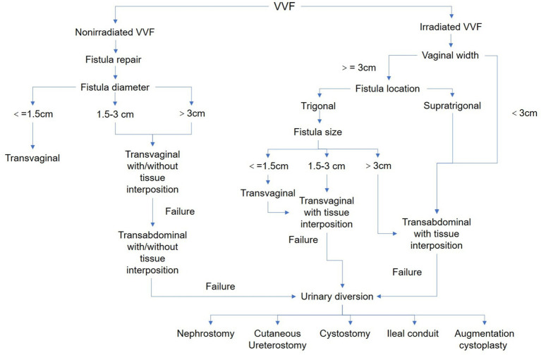
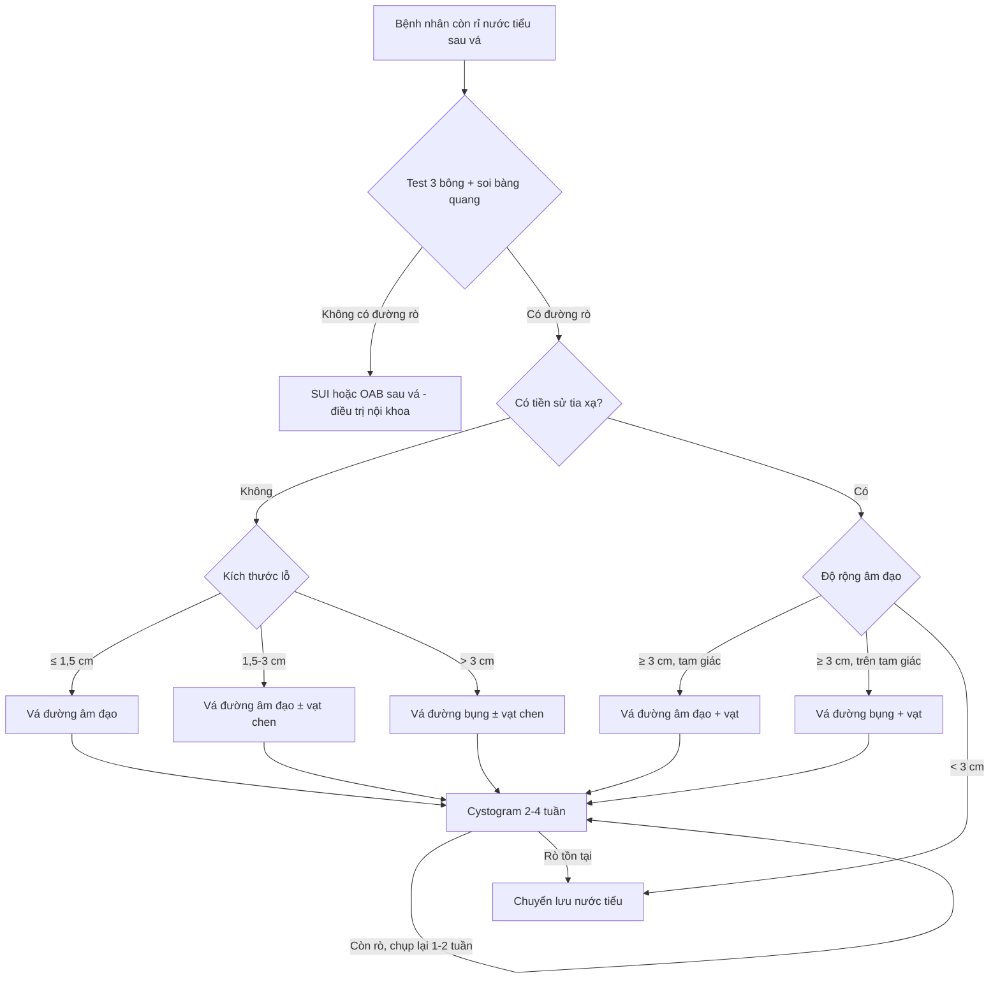
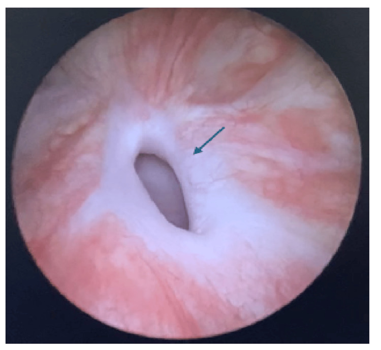
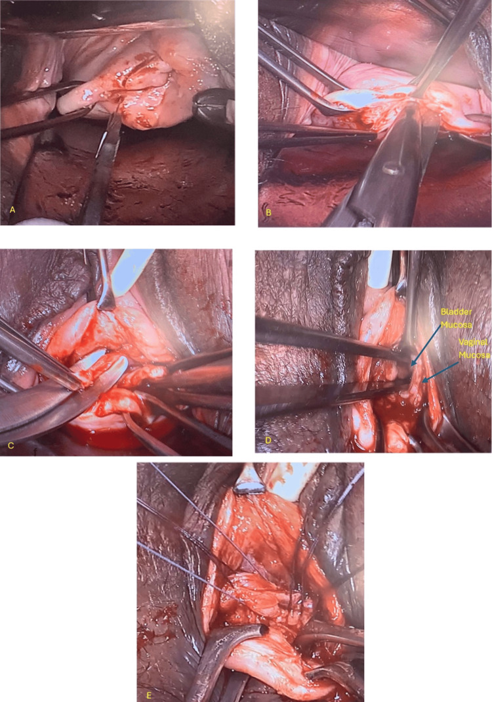

# 191 — Vá lại rò niệu–sinh dục THẤT BẠI: chọn lại đường mổ, vạt chen Martius, khi nào chuyển lưu nước tiểu

**Tags:** `pattern:ro-nieu-sinh-duc` `pattern:ro-tai-phat` `vung:am-dao` `vung:bang-quang` `vung:khung-chau` `score:Goh` `protocol:CT-cystography` `protocol:MRI-chau` `protocol:vat-chen-Martius`
**Mức chắc chắn (certainty):** tổng hợp y văn (literature synthesis) — tổng hợp 1 tổng quan hệ thống 21 nghiên cứu về yếu tố dự báo tái phát (2026), 1 đoàn hệ 64 ca chia nhóm có/không tia xạ có thuật toán xử trí (2026), 1 đoàn hệ tiến cứu 104 ca so sánh 3 đường mổ (2025), 1 đoàn hệ 78 ca (2026), 1 loạt trung tâm chuyên khoa 98 ca (2021) và 2 tổng quan kỹ thuật (2014, 2019). Không có ca nguyên văn riêng; số liệu đối chiếu PMCID trong `sources.md`.

## 1. Tổng quan bệnh học – cơ chế hình ảnh: vì sao vá lần đầu thất bại

- **Tần suất nền:** rò bàng quang–âm đạo (vesicovaginal fistula, VVF) sau cắt tử cung **0,8–1,0/1.000** phụ nữ; vá lần đầu thành công **80–95%**, nên **tái phát 10–30%** là con số phải nằm lòng trước khi tư vấn (Faridi 2026, PMC13337442).
- **Bốn yếu tố dự báo tái phát (gộp 21 nghiên cứu, 1994–2025):** lỗ rò **> 2–3 cm** (OR **1,0–6,0**); **xơ quanh lỗ rò nặng** (OR **2,7–12,0**); **liên quan niệu đạo và/hoặc cổ bàng quang** (OR **0,4–9,0**); **nhiều lỗ rò** (OR **4,0–8,0**). Bảo vệ: can thiệp sớm, mổ ở trung tâm chuyên khoa, **dùng vạt chen (interposition flap)**.
- **Tia xạ là biến số nặng nhất:** trong loạt 64 ca (44 ca có tia xạ, 20 ca không), tái phát sau vá **18,5% (đường âm đạo) và 50% (đường bụng)** ở nhóm tia xạ, so với **6,25% và 0%** ở nhóm không tia xạ; nhóm tia xạ chỉ **47,7%** được vá, **29,5%** phải chuyển lưu và **22,7%** vá + chuyển lưu (Ni 2026, PMC13194451).
- **Vị trí quyết định:** rò **tam giác** thất bại **32%** so với **6%** ở ngoài tam giác (p = 0,004); rò sau cắt tử cung vẫn có tỉ lệ thành công cao nhất **95%** (Wang 2026, PMC12924227).
- **TẠI SAO vá lại thất bại — cơ chế mô học, không phải "tay nghề":**
  - Tia xạ và viêm mạn làm **mô xơ hóa**: collagen đặc, mạch máu thưa → **thiếu oxy tại mép đường khâu** → nguyên bào sợi không tạo được cầu nối, mép khâu hoại tử từng điểm.
  - Xơ cũng làm mất đàn hồi: bàng quang co bóp tạo **lực căng (tension)** lên mối khâu → đường rò lại thường xuất hiện **ở góc mối khâu cũ** dưới dạng lỗ **"pinpoint"** rất nhỏ (Ghoniem 2014, PMC4434500).
  - Vì vậy vá lần hai **không thể chỉ khâu lại**: cần **cắt hết mô xơ tới niêm mạc lành** + **đưa mô có mạch máu tới** (vạt) + **giảm lực căng** (đường mổ phù hợp).
- **TẠI SAO hình ảnh trông như vậy (vật lý):**
  - Đường rò chỉ chứa đầy cản quang khi **có áp lực trong bàng quang** → phải **bơm đầy bàng quang (retrograde)** hoặc đọc **thì muộn 15–60 phút** của CT niệu đồ; chụp không bơm đầy dễ âm tính giả với lỗ < 5 mm.
  - Xơ quanh lỗ là **mô sợi đặc, nghèo nước** → trên MRI **T2W giảm tín hiệu**, ngấm cản quang **chậm và ít** ở thì sớm; đây chính là dấu hiệu "mô nền không lành được" — tương ứng trực tiếp với OR tái phát 2,7–12,0.

## 2. Mẫu hình + chẩn đoán phân biệt theo vị trí (gamut)

**Câu hỏi đầu tiên khi bệnh nhân còn rỉ nước tiểu sau một lần vá: đây có thật là "rò tái phát" không?** Có **6 mẫu hình** phải loại trừ trước khi mổ lại:

- **A — Rò lại đúng vị trí cũ (tái phát thật):** rỉ **liên tục**, ướt đều; sớm sau rút sonde (< 2 tuần) gợi ý **kỹ thuật/thiếu máu mép khâu**; xuất hiện muộn (tháng–năm) gợi ý **tia xạ, xơ tiến triển, hoại tử mô**.
- **B — Rò "pinpoint" ở góc mối khâu cũ:** lỗ **< 5 mm**, dễ âm tính trên cystogram; bệnh nhân ướt **từng đợt theo tư thế**; chỉ thấy khi soi bàng quang + xanh methylene.
- **C — Rò niệu quản–âm đạo (ureterovaginal fistula, UVF) bị bỏ sót:** bệnh nhân **vẫn tiểu được** mà vẫn rỉ; chiếm **< 1%** rò niệu sau cắt tử cung nhưng có thể **đồng thời** với VVF (Kothapalli 2025, PMC12449848) — bỏ sót là vá VVF xong vẫn ướt.
- **D — Nhiều đường rò / rò thứ hai:** OR tái phát **4,0–8,0**; phải bơm cả **hai bên** và xoay bệnh nhân để tìm lỗ thứ hai ở thành trước/sau.
- **E — Tiểu không kiểm soát do cơ thắt (stress urinary incontinence, SUI) sau vá:** **22,5%** bệnh nhân sau vá rò phức tạp bị SUI mới (13 ca phải mổ tiếp), rỉ **khi gắng sức**, không liên tục (Osman 2021, PMC8385280).
- **F — Bàng quang tăng hoạt (overactive bladder, OAB) sau vá:** **12,3%** bị OAB mới, biểu hiện **tiểu gấp, tiểu nhiều lần**, không ướt liên tục — điều trị bằng kháng cholinergic, **không mổ lại**.
- **Thêm hai thể dễ quên:** **rò bàng quang–tử cung** (menuria, tiểu ra máu theo chu kỳ) và **rò do lưới (mesh) sau đặt sling** — phải **lấy lưới** trước, vá sau (thường chờ 6 tuần).

## 3. Bảng so sánh phân biệt (ma trận đối chiếu)

| Thực thể (entity) | Hình ảnh điển hình (soi/CT/MRI) | Chốt vào (rule-in) | Chốt loại (rule-out) | Gợi ý xác nhận |
|---|---|---|---|---|
| **Rò tái phát tại chỗ** | Lỗ tại vị trí mối khâu cũ, bờ xơ dày; CT cystography bơm đầy thấy đường nối bàng quang–vòm âm đạo | **Rỉ liên tục + lỗ đúng vị trí vá cũ + bờ xơ** | Rỉ chỉ khi gắng sức, test 3 bông âm → SUI | Soi bàng quang + xanh methylene; CT cystography |
| **Rò pinpoint góc khâu** | Lỗ **< 5 mm**, không thấy trên CT thường, chỉ thấy khi bơm căng | **Ướt từng đợt theo tư thế + soi thấy lỗ nhỏ ở góc khâu** | Cystogram âm không loại trừ | Soi bàng quang, xanh methylene, bơm qua sonde |
| **UVF bỏ sót** | Niệu quản giãn nhẹ, cản quang từ niệu quản vào vòm âm đạo ở **thì muộn 15–60 phút** | **Vẫn tiểu được + rỉ liên tục + ứ nước nhẹ** | Bàng quang chứa đủ cản quang, không thấy đường từ niệu quản | CT urography thì muộn; soi bàng quang tìm hai lỗ niệu quản |
| **Nhiều đường rò** | Hai lỗ ở thành trước/sau hoặc vòm; một lỗ thấy rõ, một lỗ kín khi bơm ít | **OR tái phát 4,0–8,0; bơm thấy rò ở 2 vị trí** | Chỉ một lỗ khi bơm đủ áp lực 2 tư thế | CT cystography bơm đầy; soi toàn bộ vòm |
| **SUI sau vá** | Không có đường rò; cổ bàng quang mở, sàn chậu yếu | **Rỉ khi ho/gắng sức, test 3 bông âm, cystogram bình thường** | Ướt liên tục cả ngày lẫn đêm → rò | Nghiệm pháp gắng sức; niệu động học |
| **OAB sau vá** | Bàng quang thành dày, không rò | **Tiểu gấp, không ướt liên tục, cystogram sạch** | Có đường rò trên cystography | Niệu động học; đáp ứng kháng cholinergic |
| **Rò do lưới (mesh)** | Bóng lưới cạnh niệu đạo, đường rò quanh lưới | **Tiền sử sling + đau + rỉ sau mổ niệu đuôi** | Không có vật liệu nhân tạo | MRI chậu (lưới = tín hiệu lạ), soi niệu đạo |

*Thuật toán thực dụng của loạt 64 ca: nhóm không tia xạ đi theo kích thước lỗ (≤ 1,5 cm → đường âm đạo; 1,5–3 cm → âm đạo ± vạt; > 3 cm → đường bụng ± vạt); nhóm tia xạ đi theo **độ rộng âm đạo** (≥ 3 cm mới vá được; < 3 cm → chuyển lưu nước tiểu). Nguồn: Ni J et al., Frontiers in Medicine 2026, CC BY 4.0.*

## 4. Protocol: đánh giá lại – chọn đường – vạt chen – chuyển lưu

- **Bước 1 — Chẩn đoán lại đầy đủ (bắt buộc trước mọi lần vá thứ hai):** soi bàng quang + soi âm đạo + **test 3 bông (3-swab test)** + xanh methylene; **đánh giá toàn bộ đường niệu** (bàng quang, hai niệu quản, thận) vì "vá thất bại phải được đánh giá lại toàn bộ trước khi mổ lần sau" (PMC4434500). Bổ sung: **CT cystography bơm đầy** (hoặc CT urography thì muộn — xem bài 564) và **MRI chậu** khi tia xạ/lỗ lớn/nghi nhiều đường.
- **Bước 2 — Chờ đúng lúc:** với **tia xạ**, tránh mổ khi phản ứng xạ còn tiến triển — phản ứng xạ lành trong khoảng **1 năm**, thực hành thường **vá sau ≥ 6 tháng**; với rò không tia xạ, để lớp viêm lắng xuống (thực hành ≥ 3 tháng). Trong loạt trung tâm chuyên khoa, **trung vị thời gian từ khi có rò tới khi vá là 12 tháng (IQR 6–12)** — bằng chứng cho thấy "chờ" không làm mất cơ hội (PMC8385280).
- **Bước 3 — Chọn đường mổ theo thuật toán** (ảnh mục 3):
  - **Không tia xạ:** lỗ **≤ 1,5 cm → đường âm đạo**; **1,5–3 cm → âm đạo ± vạt**; **> 3 cm → đường bụng ± vạt**.
  - **Có tia xạ:** xét **độ rộng âm đạo** trước tiên — **≥ 3 cm** mới đủ chỗ vá (tam giác → theo kích thước; trên tam giác → **đường bụng + vạt**); **< 3 cm → chuyển lưu nước tiểu** (29,5% nhóm tia xạ trong loạt).
- **Bước 4 — Vạt chen (interposition):** chọn theo đường mổ — **vạt mỡ môi lớn Martius** (cuống mạch từ **động mạch màng niệu đạo trong/internal pudendal**) cho đường âm đạo; **mạc nối lớn (omental J-flap)** hoặc **vạt phúc mạc** cho đường bụng; một số chọn **mỡ quanh trực tràng** khi đường bụng - nội soi. Số liệu: dùng vạt ở **96/98 ca (98%)** ở loạt chuyên khoa; **Gousse: 100% khô khi có vạt so với 63% khi không có**; **Pshak: 49 ca (25 ca đã vá thất bại) vá đường âm đạo đạt 100%** dù không dùng vạt (Rajaian 2019, PMC6792412).
- **Bước 5 — Kết quả nên tư vấn:** trung tâm chuyên khoa đạt **khô vĩnh viễn 96%** dù **31,7%** bệnh nhân đã vá thất bại nơi khác và **41,8%** là rò phức tạp (tia xạ, nhiều lần vá); **2%** còn rò sau mổ, **2%** tái phát **> 2 năm** (PMC8385280).
- **Bước 6 — Theo dõi sau vá:** sonde niệu đạo **10–14 ngày** + kháng cholinergic giảm co thắt; **cystogram 2–4 tuần**: trong loạt 78 ca vá VVF, **3/78 (3,9%)** còn rò trên phim đầu và **1 ca tự kín** khi chụp lại sau 1–2 tuần — nên **chụp lại trước khi kết luận thất bại**. Lưu ý có tranh luận: tổng quan 2019 cho rằng **cystogram sau vá "không bắt buộc"** ở ca đơn giản.
- **Bước 7 — Chuyển lưu nước tiểu (khi vá không còn khả thi):** các lựa chọn trong thuật toán gồm **dẫn lưu thận qua da (nephrostomy)**, **dẫn lưu niệu quản ra da (cutaneous ureterostomy)**, **mở bàng quang ra da (cystostomy)**, **ruột non dẫn lưu (ileal conduit)**, **tăng dung tích bàng quang (augmentation cystoplasty)**. Chỉ định thực tế: **tia xạ + âm đạo < 3 cm**, lỗ **> 3 cm** đã vá thất bại nhiều lần, hoặc rò + hẹp niệu quản hai bên.

## 5. Biến thể bình thường và cạm bẫy

- **"Rò" trên cystogram 2–4 tuần có thể tự kín:** 1/3 ca còn rò trên phim đầu đã kín khi chụp lại 1–2 tuần (PMC8385280) → **không mổ lại ngay** dựa trên một phim.
- **Tiểu không kiểm soát sau vá ≠ rò tái phát:** **SUI 22,5%**, **OAB 12,3%** sau vá rò phức tạp; test 3 bông âm + cystogram sạch là chốt loại.
- **Bỏ sót UVF đồng thời:** bệnh nhân **vẫn tiểu được** là dấu hiệu cảnh báo (rò niệu quản), và **< 1%** rò sau cắt tử cung là UVF — nhưng khi có cả hai, vá xong VVF vẫn ướt.
- **Vá trong phản ứng xạ:** tái phát **50%** ở đường bụng trong nhóm tia xạ — chờ ≥ 6 tháng, và **dùng vạt** nếu vẫn vá.
- **Ép đường âm đạo khi âm đạo < 3 cm:** không đủ ánh sáng và khoảng làm việc; thuật toán của loạt 64 ca chuyển thẳng sang chuyển lưu.
- **Rò tam giác/niệu đạo:** thất bại **32%** (so với 6% ngoài tam giác) — luôn thêm vạt và cảnh báo nguy cơ tiểu không kiểm soát sau mổ.
- **Bẫy "satisfaction of search":** OR nhiều lỗ rò **4,0–8,0** — tìm thấy một lỗ không được dừng lại; bơm đủ áp lực và xoay bệnh nhân.

## 6. Tự lượng giá — Blind Quiz

**Ca 1 — Nữ 38 tuổi, rỉ nước tiểu liên tục 3 năm sau cắt tử cung toàn phần vì u xơ; đã được vá 1 lần ở tuyến trước, thất bại sau 10 ngày.**

- Câu hỏi: mô tả bờ lỗ rò? Vì sao bờ này dự báo vá lại dễ thất bại? Ba chẩn đoán phân biệt cần loại trừ trước mổ?

<b>Bấm để hiện đáp án (findings + chẩn đoán)</b>

- Dấu hiệu (findings): một lỗ rò **~10 mm** ở vòm âm đạo, **bờ dày, trắng, xơ** (mũi tên) — không phải niêm mạc mềm bình thường.
- Chẩn đoán: **VVF mạn, tái phát sau vá** — bờ xơ = mô thiếu máu, không tạo được cầu nối lành; đây đúng là biến số **"xơ quanh lỗ rò nặng, OR 2,7–12,0"** của tổng quan 21 nghiên cứu.
- Phân biệt trước mổ: **UVF bỏ sót** (bệnh nhân còn tiểu được), **lỗ rò thứ hai** (OR 4,0–8,0), **SUI/OAB sau vá** (không có đường rò).
- Nguồn ảnh: Silva DO et al., *Cureus* 2026;18(6):e110195, CC BY 4.0 — ảnh nguyên bản, không chỉnh sửa.

**Ca 2 — Cùng bệnh nhân, quyết định vá đường âm đạo và đưa thêm mô có mạch máu vào giữa bàng quang và âm đạo.**

- Câu hỏi: (A)–(E) đang làm gì? Hai lớp niêm mạc nào phải khâu riêng? Vì sao phải cắt "tới niêm mạc lành"?

<b>Bấm để hiện đáp án (findings + kỹ thuật)</b>

- (A) rạch hình bầu dục quanh lỗ rò trên niêm mạc âm đạo; (B) **cắt sâu toàn bộ đường rò** bằng kéo Metzenbaum tới **niêm mạc bàng quang lành**; (C) bộc lộ và khâu riêng; (D) **khâu hai lớp riêng biệt: niêm mạc bàng quang và niêm mạc âm đạo** (mũi tên xanh); (E) đóng niêm mạc âm đạo trên vạt.
- Vì sao: mép khâu phải tựa trên **mô có tưới máu**; để lại mô xơ = mép khâu thiếu máu = rò lại ở góc khâu. Vạt Martius (mỡ môi lớn, cuống **động mạch màng niệu đạo trong**) mang mạch máu mới tới đường khâu.
- Số liệu bổ trợ: dùng vạt **96/98 ca** ở loạt chuyên khoa; **100% khô khi có vạt so với 63% khi không** (Gousse, dẫn qua PMC6792412).
- Nguồn ảnh: Silva DO et al., *Cureus* 2026;18(6):e110195, CC BY 4.0 — ảnh nguyên bản, không chỉnh sửa.

**Ca 3 — Nữ 56 tuổi, ung thư cổ tử cung đã xạ trị 4 năm, rỉ nước tiểu liên tục; lỗ rò 3,5 cm, âm đạo hẹp còn 2 cm, đã vá 2 lần thất bại.**

<b>Bấm để hiện đáp án (quyết định)</b>

- Đây là **rò do tia xạ, lỗ lớn (> 3 cm), âm đạo < 3 cm, đã thất bại 2 lần** → theo thuật toán: **không cố vá nữa, chuyển lưu nước tiểu** (dẫn lưu thận qua da / niệu quản ra da / mở bàng quang ra da / ileal conduit).
- Số liệu để tư vấn: nhóm tia xạ chỉ **47,7%** vá được; **29,5%** chuyển lưu, **22,7%** vá + chuyển lưu; nếu vẫn vá đường bụng, tái phát **50%** (PMC13194451).
- Nếu bệnh nhân tha thiết giữ bàng quang: chỉ cân nhắc **vá đường âm đạo + vạt + mở bàng quang ra da vĩnh viễn** — phương án này được báo cáo thành công cao trong loạt trên, nhưng là lựa chọn cá thể hóa, không phải chuẩn.

## Bài liên quan chéo
- [564 – Rò bàng quang–âm đạo & rò niệu quản–âm đạo sau mổ phụ khoa](../564-ro-bang-quang-am-dao-sau-mo-phu-khoa/lesson.md) (chẩn đoán lần đầu: 3 bông, CT urography thì muộn)
- [562 – Hẹp âm đạo sau xạ trị](../562-hep-am-dao-sau-xa-tri/lesson.md) (cùng nền tia xạ, cùng vấn đề "âm đạo hẹp")
- [582 – Biến chứng tiêu hóa–niệu sau xạ trị phụ khoa](../582-bien-chung-tieu-hoa-nieu-sau-xa-tri-phu-khoa/lesson.md)
- [1608 – Ung thư niêm mạc thứ phát sau xạ trị tiểu khung](../1608-ung-thu-nieu-mac-thu-phat-sau-xa-tri-tieu-khung/lesson.md)

## Ảnh
- Tên file: `191_slug_Modality_SourceID.jpg`; nguồn + giấy phép từng ảnh trong `images/CREDITS.md`.
- Không dùng ảnh paywall (AuntMinnie) hay ảnh giấy phép mơ hồ.

> Không dùng để chẩn đoán độc lập khi chưa có người hướng dẫn.
