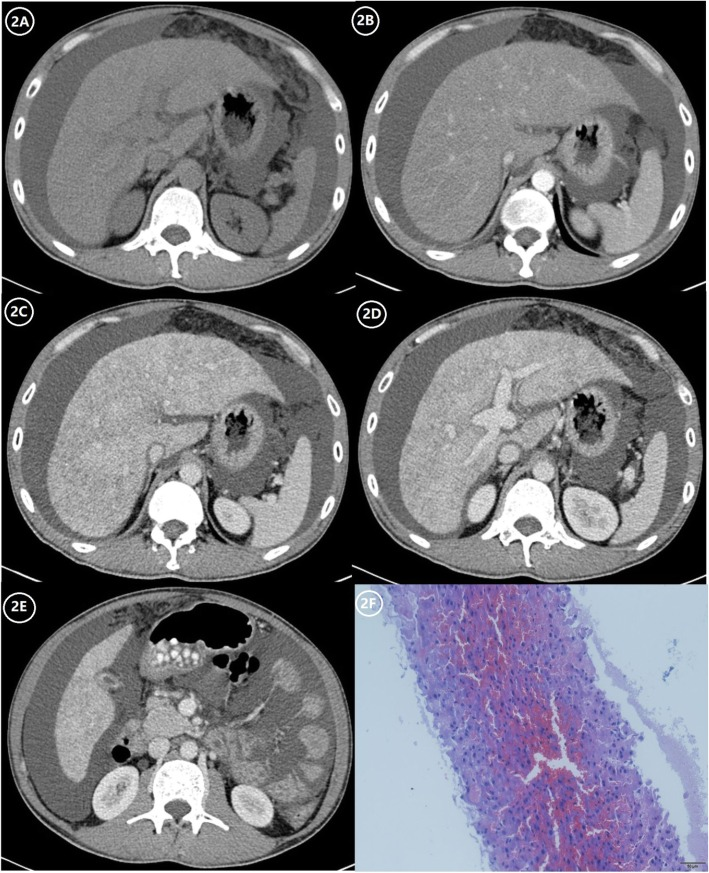
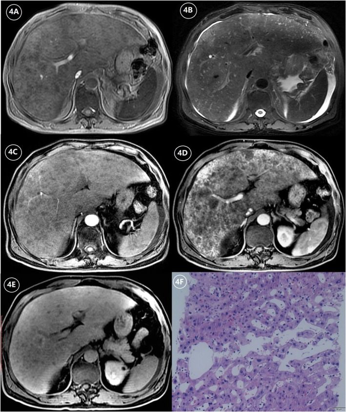
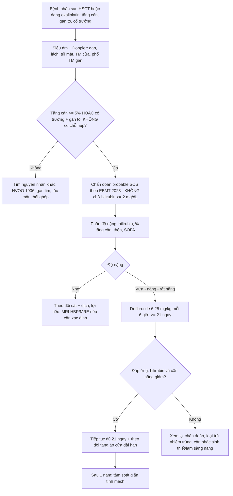
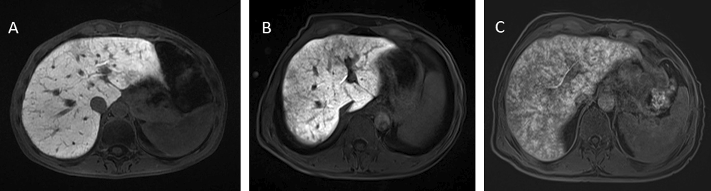
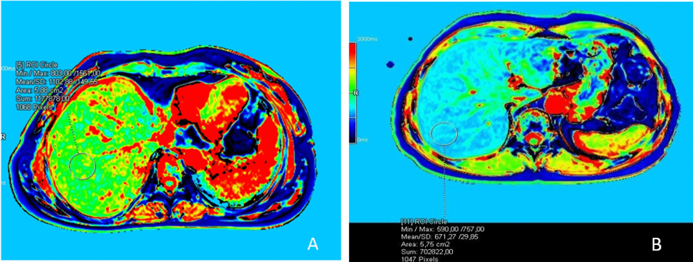
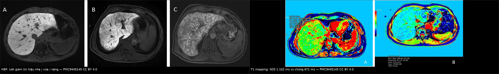

# 1910 — Hội chứng tắc xoang gan (SOS/VOD): gan to + ngấm "da báo", lưới giảm tín hiệu > 50% trên HBP = nặng, MRE 2,82 kPa / Hepatic sinusoidal obstruction syndrome (veno-occlusive disease)

**Tags:** `pattern:ngam-khong-dong-nhat` `pattern:gan-ung-huyet` `pattern:gan-to` `pattern:phu-quanh-cua` `pattern:giam-tin-hieu-luoi` `vung:gan` `vung:xoang-gan` `score:EBMT-2023` `score:MRE-LSM` `protocol:Doppler` `protocol:CT-3-thi` `protocol:MRI-HBP` `protocol:MRE`

**Mức chắc chắn (certainty):** tổng hợp y văn (literature synthesis) — số liệu lấy từ 5 bài open access đã đọc toàn văn: Zhang Y et al., *Insights Imaging* 2019 (PMC6868080, CC BY 4.0 — tổng quan hình ảnh SOS); Ichikawa H et al., *Bone Marrow Transplant* 2024 (PMC10994840, CC BY 4.0 — 161 ca ghép tế bào gốc, tiêu chuẩn EBMT 2023); Poker A et al., *Insights Imaging* 2022 (PMC9445145, CC BY 4.0 — MRI + MR elastography ở SOS do oxaliplatin); Bohte AE et al., *Pediatr Radiol* 2022 (PMC8741687, CC BY 4.0 — hình ảnh SOS ở trẻ); Escobar Gil T et al., *Cureus* 2025 (PMC11970208, CC BY 4.0 — ca nguyên văn, CT/MRI/US). Thêm dữ liệu dài hạn từ Alvarado-Tapias E et al., *JHEP Rep* 2026 (PMC13598180, CC BY 4.0) và cơ chế oxaliplatin từ *Cells* 2019 (PMC6952805, CC BY 4.0).

> **Câu hỏi gốc của bài:** bệnh nhân **ngày +10 sau ghép tế bào gốc đồng loài**, **tăng 4 kg trong 5 ngày**, bụng to, **bilirubin 22,2 mg/dL**, đau vùng gan; siêu âm **gan 17,6 cm**, **túi mật dày 11 mm**, **tĩnh mạch cửa 13 mm**; CT bụng **gan to, ngấm thuốc lổn nhổn từng vùng**, **phù quanh cửa**, **cổ trướng**. Vậy: **SOS hay hẹp dòng ra (HVOO)? có cần sinh thiết? khi nào bắt đầu defibrotide, và dấu hiệu nào trên MRI nói "đã nặng"?**
> **Điểm tựa:** SOS **không phải bệnh của một mạch lớn** mà là bệnh của **vi tuần hoàn xoang gan**: tế bào nội mạc xoang bị tổn thương → **bong, tạo vi huyết khối, xơ hóa tiểu tĩnh mạch trung tâm** → **sức cản sau xoang tăng** → ứ máu xoang → gan to, tăng áp cửa. Vì tổn thương **lan tỏa, không khu trú**, nên **không có chỗ hẹp để nong, không có chênh áp khu trú để đo** — đây chính là điểm phân biệt với **1906 (HVOO)** và là lý do **đặt stent là sai lầm**.

## 1. Tổng quan — vì sao SOS làm gan ngấm "da báo", HBP có "lưới" và MRE cứng hơn

**A. Bệnh học (pathology) và cơ chế:**

- **Định nghĩa:** tổn thương **nội mạc xoang gan** dẫn tới **tắc không do huyết khối** của **tiểu tĩnh mạch trung tâm tiểu thùy** (centrilobular venules) do **hoại tử và bong lớp dưới nội mạc**. Hậu quả: **ứ máu xoang → phì đại tế bào gan → tăng áp cửa**, cuối cùng **xơ hóa/xơ gan cục bộ**.
- **Nguyên nhân theo nhóm:**
  - **Ghép tế bào gốc tạo máu (HSCT):** độc tính của **phác đồ điều kiện hóa** (busulfan, cyclophosphamide, melphalan) — thể kinh điển, xuất hiện **≤ 21 ngày** sau ghép.
  - **Oxaliplatin** (hóa trị ung thư đại trực tràng di căn gan): tổn thương xoang **19–52%** trên mô bệnh; gan **"blue liver"** khi mổ.
  - **Alkaloid pyrrolizidine** (thuốc nam, "tǔ sān qī"): SOS **mạn**, thường **muộn, không rõ thời điểm**.
  - **Thuốc khác:** **inotuzumab ozogamicin**, **azathioprine/6-thioguanine**, **actinomycin D** ở trẻ.
  - **Sau ghép gan:** hiếm, gắn với **tổn thương bảo quản/thiếu máu–tái tưới máu**; hình ảnh **giống HVOO nhưng không có hẹp khu trú** — *điểm này là suy luận của nhóm từ cơ chế, chưa có con số riêng trong các nguồn của lượt này.*
- **Vì sao gan ngấm thuốc "da báo" (mottled/patchy):** ứ máu xoang **không đều giữa các tiểu thùy** (mức tổn thương nội mạc khác nhau) → **vùng còn tưới máu ngấm mạnh**, **vùng ứ huyết/hoại tử ngấm kém**. Vì vậy tổn thương **không có bờ hình khối**, **không theo lãnh thổ mạch**, và **thay đổi giữa các thì** — khác di căn (bờ tròn, ngấm theo thì) và khác áp-xe (viền ngấm, có dịch).
- **Vì sao "phù quanh cửa" (periportal edema):** ứ huyết làm **dịch thoát vào khoảng cửa** → dải **giảm ngấm ôm theo nhánh cửa**, **tăng T2, giảm T1**, **không hạn chế khuếch tán** (chỉ là nước tự do) — không phải u.
- **Vì sao túi mật dày và tĩnh mạch cửa giãn:** cùng một cơ chế **tăng áp cửa + ứ dịch** → **thành túi mật > 6 mm**, **tĩnh mạch cửa > 12 mm**, **tĩnh mạch gan < 3 mm** (bị chèn bởi nhu mô phù), **cổ trướng**.
- **Vì sao MRE cứng hơn dù chưa xơ:** **elastography đo độ cứng cơ học**, và **ứ máu + phù nội bào** cũng làm mô cứng lên. Vì vậy **MRE tăng không đồng nghĩa xơ hóa** — đây là cạm bẫy khi theo dõi bệnh nhân ung thư (xem mục 5).
- **Vì sao HBP (gadoxetate) có "lưới giảm tín hiệu":** gadoxetate được **hepatocyte bắt qua OATP1B1/B3** rồi thải qua MRP2. Ở SOS, **vùng ứ huyết/giảm tưới máu** làm **giảm bắt thuốc cục bộ** → **lưới giảm tín hiệu hình mạng (reticular hypointensity)** trên thì gan mật, **nổi bật hơn hẳn** so với thì thường. Mức lan của lưới **tương quan với độ nặng** và **không đặc hiệu cho nguyên nhân**.
- **Vì sao bilirubin tăng MUỘN:** bilirubin tăng do **ứ mật và suy chức năng gan**, xuất hiện **sau** giai đoạn tăng cân và gan to. Vì vậy **chờ bilirubin ≥ 2 mg/dL mới chẩn đoán là chờ quá muộn** — tiêu chuẩn EBMT 2023 đã sửa đúng điểm này.

**B. Ngưỡng định lượng bắt buộc (cửa 1 Argon):**

| Đại lượng | Con số đã kiểm chứng | Ý nghĩa thực hành |
|---|---|---|
| Tần suất SOS sau ghép tế bào gốc đồng loài | **2–15%** (PMC10994840) | Thể **nặng** có tử vong rất cao → chẩn đoán sớm là yếu tố sống còn |
| Tần suất ở TRẺ sau HSCT | **~20–60%** (PMC8741687) | Trẻ có **phác đồ điều kiện hóa myeloablative** nguy cơ cao nhất |
| Tổn thương xoang do oxaliplatin | **19–52%** trên mô bệnh; loạt 154 ca cắt gan: **51%** có giãn xoang/xuất huyết vi thể (PMC6952805) | "Blue liver" khi mổ là **biểu hiện đại thể** của SOS mạn |
| Lách to ≥ 50% khi đang hóa trị | **55%** có tổn thương xoang **vừa–nặng** khi cắt gan (PMC6952805) | **Lách to là dấu hiệu theo dõi rẻ tiền** trên MRI/CT định kỳ |
| Tiêu chuẩn Baltimore / Seattle sửa đổi | bilirubin **≥ 2 mg/dL** + **tăng cân ≥ 5%** + **gan to/đau** + **cổ trướng**, trong **21 ngày** sau HSCT | **Độ nhạy thấp ở thể không vàng da** — đây là lý do có tiêu chuẩn mới |
| Tiêu chuẩn EBMT 2023 | 3 mức: **probable / clinical / proven**; **bỏ giới hạn 21 ngày**, thêm **giảm tiểu cầu tiêu thụ/kháng truyền**; phân độ nặng có **SOFA** | **Probable** giúp chẩn đoán **sớm hơn** |
| Lợi ích chẩn đoán sớm của "probable" | chẩn đoán sớm hơn **5,0 ngày** (IQR 2–13; p < 0,001) so với "clinical" (PMC10994840) | 5 ngày là **cửa sổ để bắt đầu defibrotide** |
| Tỉ lệ KHÔNG vàng da lúc chẩn đoán | **66% (35/53)** ca "probable" có bilirubin **< 2 mg/dL** (PMC10994840) | **Không chờ vàng da** — đây là bẫy chết người |
| Thành phần lúc chẩn đoán "probable" | tăng cân **75%**, cổ trướng **85%**, gan to đau **21%**, bilirubin **34%**, siêu âm gợi ý **6%** (PMC10994840) | **Tăng cân + cổ trướng** là dấu hiệu sớm nhất |
| Độ nhạy/đặc hiệu của bộ tiêu chuẩn | Seattle sửa đổi **95,0%/75,2%**; probable **100%/76,6%**; clinical **100%/97,9%** (PMC10994840) | **Probable: độ nhạy 100%** nhưng **dương tính giả ~23%** → cần theo dõi, không cần sinh thiết ngay |
| Sống còn 100 ngày | "clinical" SOS **52,2%**; "probable" đơn thuần **86,2%** vs không SOS **94,3%** (p = 0,012) (PMC10994840) | Ngay **probable** đã làm **giảm sống còn** → không được coi là "nhẹ" |
| Siêu âm B-mode | thành túi mật **> 6 mm**, tĩnh mạch cửa **> 12 mm**, tĩnh mạch gan **< 3 mm**, lách to, cổ trướng (PMC6868080) | Bộ dấu hiệu **rẻ, làm được tại giường** |
| Doppler | **phổ tĩnh mạch gan một pha** (mất ba pha), vận tốc cửa **giảm 10–15 cm/s**, có thể **đảo dòng cửa (hepatofugal)** (PMC8741687) | **Đảo dòng cửa từng đoạn** có thể xuất hiện **trước** triệu chứng |
| Đàn hồi gan (SWE) | **11 kPa** ở ca SOS nhẹ–vừa (bình thường **5–6 kPa**) (PMC8741687) | Tăng **rất sớm**, trước khi bilirubin tăng; cần **giá trị nền** |
| Vận tốc tĩnh mạch gan | có thể **> 120 cm/s** giai đoạn sớm/bán lâm sàng rồi **bình thường hóa** (PMC8741687) | Tăng vận tốc là **bù trừ**, không phải hẹp |
| Chỉ số kháng động mạch gan | **0,74** (biên) ở ca SOS nhẹ (PMC8741687) | Không đặc hiệu, chỉ hỗ trợ |
| HBP: phân độ theo "lưới" | **nhẹ < 20%** nhu mô, **vừa 20–50%**, **nặng > 50%** (PMC9445145) | Phân độ **bán định lượng** dùng được trên lâm sàng |
| MRE (độ cứng gan) | SOS **3,14 ± 0,45 kPa** vs chứng **2,60 ± 0,50 kPa** (p = 0,01); **cut-off 2,82 kPa**, **AUC 0,88**, **Se 78% / Sp 81%** (PMC9445145) | Ngưỡng **2,82 kPa** dùng để phân biệt với gan không SOS sau oxaliplatin |
| Độ cứng theo độ nặng | **2,80 ± 0,22** (nhẹ) → **3,00 ± 0,33** (vừa) → **3,65 ± 0,28 kPa** (nặng); p = 0,002 (PMC9445145) | **Càng nặng càng cứng**, nhưng chồng lấp nhiều |
| cT1 (T1 đã hiệu chỉnh) | SOS **1181 ± 151 ms** vs chứng **1032 ± 129 ms** (p = 0,005); **cut-off 1101 ms**, **AUC 0,88**, **Se 80% / Sp 70%** (PMC9445145) | T1 mapping **tăng do phù/ứ huyết** |
| T2 | SOS **50,29 ± 3,6 ms** vs chứng **44 ± 3,9 ms** (p = 0,01) (PMC9445145) | T2 tăng = **nước tự do**, không phải tế bào |
| Defibrotide | **6,25 mg/kg TM mỗi 6 giờ, tối thiểu 21 ngày** (PMC11970208) | Bắt đầu **càng sớm càng tốt** khi đã chẩn đoán |
| Ca nguyên văn (đáp ứng) | bilirubin **22,2 → 2,4 mg/dL** trong **6 ngày** sau khởi trị (POD 16 → 22) nhưng bệnh nhân **tử vong POD 34** do suy đa tạng + xuất huyết (PMC11970208) | **Đáp ứng sinh hóa không đồng nghĩa sống còn** |
| Hậu quả dài hạn | **45% (10/22)** phát triển dấu hiệu **tăng áp cửa**, **36%** có biến chứng gan; tích lũy **27% ở 3 năm**; dùng defibrotide **HR 0,096** (p < 0,001) (PMC13598180) | SOS **không kết thúc khi ra viện** — cần theo dõi nhiều năm |

**C. TẠI SAO ảnh trông như vậy (vật lý hình ảnh):**

- **CT thì cửa:** tín hiệu ∝ **lượng iod trong nhu mô**. Ứ huyết xoang làm **giảm thể tích máu chứa trong xoang**, còn **phù tế bào** làm **tăng khoảng kẽ** → ngấm **không đều, dạng bản đồ (map-like)**. Vì tổn thương ở mức **tiểu thùy**, ranh giới **không theo phân thùy** và **không có vỏ bao**.
- **MRI T1/T2:** phù/ứ huyết làm **T1 giảm, T2 tăng**; **máu ứ trong xoang** có thể làm **T2 giảm cục bộ** (do hiệu ứng từ tính của deoxyhemoglobin) — vì vậy hình ảnh có thể **"lổn nhổn cả hai chiều"**, đây là lý do **không thể chẩn đoán chỉ bằng một chuỗi xung**.
- **HBP (gadoxetate thì 20 phút):** tín hiệu phản ánh **chức năng bắt thuốc của hepatocyte**, không phải mô học. Vùng ứ huyết **giảm bắt thuốc** → **lưới giảm tín hiệu**. Đây là **dấu hiệu chức năng**, nên **hồi phục được** khi tái thông huyết động — khác **xơ hóa thật** (giảm tín hiệu **không hồi phục**, kèm **co kéo bờ gan**).
- **MRE:** sóng cơ học 60 Hz lan trong gan; **độ cứng (kPa)** tỉ lệ với **mô đun đàn hồi**. **Ứ máu và phù làm tăng độ cứng** nên MRE SOS tăng **dù chưa xơ** — sai số hệ thống khi so với xơ gan.
- **Doppler:** phổ **một pha** của tĩnh mạch gan là dấu hiệu **mất đàn hồi và mất truyền sóng nhĩ phải** — **giống hệt HVOO (1906)**, nên **không dùng để phân biệt hai bệnh**; phân biệt phải dựa vào **có/không chỗ hẹp khu trú** và **có/không chênh áp**.

## 2. Mẫu hình + chẩn đoán phân biệt theo vị trí và cơ chế (Gamut)

- **SOS LAN TỎA (thể kinh điển):** gan to + ngấm không đều toàn gan + phù quanh cửa + cổ trướng + túi mật dày; **không có chỗ hẹp**. Nguyên nhân: HSCT, oxaliplatin, alkaloid pyrrolizidine.
- **SOS KHU TRÚ/nốt (focal SOS, "pseudotumor"):** một hoặc vài **nốt giảm tín hiệu T1, tăng T2**, ngấm **kém ở thì cửa**, có thể **giả u** trên CT — **bắt chước di căn/HCC**. Đây là thể **nguy hiểm nhất về chẩn đoán**, vì bệnh nhân ung thư đang theo dõi dễ bị gọi là **tái phát**.
- **SOS MẠN → PSVD/tăng áp cửa không xơ gan:** sau nhiều năm, bệnh nhân có **giãn tĩnh mạch, lách to, giảm tiểu cầu** nhưng **không xơ gan**. Đây là **di chứng của chính SOS**, không phải bệnh mới.
- **Hẹp DÒNG RA (HVOO — bài 1906):** cùng bối cảnh "sau ghép gan, gan to, ngấm không đều" nhưng **có hẹp khu trú miệng nối tĩnh mạch gan/IVC** và **chênh áp HV–IVC ≥ 5 mmHg**. **Đây là hàng phân biệt số 1**, và là bệnh **điều trị được bằng nong/stent**.
- **Gan tim (passive congestion):** tĩnh mạch chủ dưới và **tĩnh mạch gan GIÃN** (ngược với SOS: **hẹp/không thấy**), phù chi dưới, tăng áp lực nhĩ phải; ngấm thuốc **"vỏ hạt điều"** (nutmeg liver) — **giống SOS về hình ảnh**, khác ở **bối cảnh tim mạch**.
- **Viêm gan cấp/thải ghép:** men gan tăng **rất cao** (ALT > 1.000 U/L), không có dấu hiệu tăng áp cửa, không có lưới HBP.
- **Tắc mật:** giãn **đường mật trong gan** (không có trong SOS), bilirubin tăng **trực tiếp**, túi mật to nhưng **không dày**.
- **Thâm nhiễm (lymphoma, di căn lan tỏa):** gan to nhưng có **nốt/bờ khối**, **hạn chế khuếch tán mạnh** (ADC thấp), thường có hạch.

## 3. Bảng so sánh phân biệt (ma trận đối chiếu)

| Thực thể (entity) | Hình ảnh điển hình (US/CT/MRI) | Chốt vào (rule-in) | Chốt loại (rule-out) | Gợi ý xác nhận |
|---|---|---|---|---|
| **SOS sau HSCT (lan tỏa)** | Gan to, **ngấm "da báo"**, phù quanh cửa, túi mật **> 6 mm**, cửa **> 12 mm**, cổ trướng; HBP **lưới giảm tín hiệu** | **Tăng cân ≥ 5% + cổ trướng + gan to** trong bối cảnh HSCT, **kể cả bilirubin < 2 mg/dL** | Có **hẹp khu trú + gradient ≥ 5 mmHg** → HVOO, không phải SOS | Tiêu chuẩn EBMT 2023; siêu âm + Doppler; theo dõi cân nặng hằng ngày |
| **SOS do oxaliplatin (mạn/PSVD)** | Gan **bờ gồ ghề nhẹ**, lách to, **lưới HBP**, MRE **> 2,82 kPa**, cT1 **> 1.101 ms** | **Tiền sử oxaliplatin** + lách to **≥ 50%** + lưới HBP + tăng áp cửa không xơ gan | Gan bình thường trên HBP + MRE < 2,82 kPa → không SOS | MRI HBP + MRE; đối chiếu mô bệnh khi cắt gan |
| **HVOO sau ghép gan (1906)** | **TM gan giãn, đậm hơn IVC**, mất sóng ba pha, ngấm không đều; cửa **bình thường** | **Gradient HV–IVC ≥ 5 mmHg** qua chỗ hẹp | **Không có chỗ hẹp**, gradient bình thường → loại trừ | Chụp mạch + đo áp lực; nong/stent |
| **Gan tim (passive congestion)** | **IVC và TM gan GIÃN**, reflux, "vỏ hạt điều", phù chi dưới | **Bệnh tim + IVC giãn + reflux TM gan** | **TM gan < 3 mm, không thấy TM gan** → nghĩ SOS | Siêu âm tim; đo áp lực nhĩ phải |
| **Viêm gan cấp / thải ghép** | Gan to nhẹ, **ngấm đồng nhất**, không có lưới HBP, không có dấu hiệu tăng áp cửa | **ALT/AST > 1.000 U/L** + bối cảnh ngừng thuốc/thải ghép | Có **lưới HBP + tăng áp cửa** → không phải viêm gan đơn thuần | Xét nghiệm gan, sinh thiết nếu cần |
| **Tắc mật** | **Giãn đường mật trong gan**, ống mật chủ giãn, túi mật to **không dày** | **Giãn đường mật** trên US/CT/MRCP | **Không giãn đường mật** → loại trừ tắc mật | MRCP / ERCP |
| **Focal SOS (giả u)** | Nốt **T1 thấp, T2 cao**, ngấm kém thì cửa, **không hạn chế khuếch tán mạnh**, có thể nhiều nốt | **Bối cảnh hóa trị + nhiều nốt không theo lãnh thổ + ADC không thấp** | **ADC rất thấp + ngấm viền + tăng kích thước** → nghĩ di căn | DWI/ADC + theo dõi 4–8 tuần; **sinh thiết nếu không chắc** |
| **Thâm nhiễm/di căn lan tỏa** | Gan to, nốt/bờ khối, **hạn chế khuếch tán mạnh** | **ADC thấp + ngấm thuốc dạng khối + hạch** | Lưới HBP lan tỏa không khối → nghĩ SOS | PET/CT, sinh thiết |

*Nam 39 tuổi, SOS do thuốc nam chứa alkaloid pyrrolizidine: (2A) không cản quang — **gan to, đậm độ không đều**, cổ trướng; (2B) thì động mạch — **ngấm không đều**; (2C–2E) thì cửa/muộn — **dạng bản đồ (map-like)** rõ, **phù quanh cửa**; (2F) mô bệnh — **giãn xoang, ứ máu**. Nguồn: PMC6868080, CC BY 4.0.*

### Ba dấu hiệu "đọc được ngay" trên mọi modality

1. **Gan to + ngấm không đều KHÔNG có bờ khối** — nếu có bờ khối, nghĩ u.
2. **Phù quanh cửa (periportal collar) + túi mật dày + cổ trướng** — bộ ba của **tăng áp cửa do ứ huyết**.
3. **"Không có chỗ hẹp"** — đây là câu trả lời cho câu hỏi "SOS hay HVOO": **SOS = bệnh của vi tuần hoàn**, không có chỗ hẹp để can thiệp.

*(4A) T1W — gan to, **ổ giảm tín hiệu dạng mảng/nốt**; (4B) T2W — **ổ tăng tín hiệu** tương ứng + cổ trướng; (4C–4E) sau tiêm — ngấm không đều; (4F) mô bệnh — giãn xoang. Nguồn: PMC6868080, CC BY 4.0.*

## 4. Protocol chụp + hệ phân độ/điểm chuẩn hóa

- **Theo dõi lâm sàng (quan trọng hơn hình ảnh):** **cân nặng và vòng bụng mỗi ngày**, **cân bằng dịch vào–ra**, **bilirubin/ALT/AST/tiểu cầu mỗi 1–2 ngày** trong 21 ngày đầu sau HSCT. Tăng **> 2% cân nặng/ngày** hoặc **> 5% trong 3 ngày** là **cờ đỏ**.
- **Siêu âm + Doppler (đầu tay, lặp lại được):** đo **kích thước gan/lách**, **thành túi mật**, **đường kính tĩnh mạch cửa và tĩnh mạch gan**, **phổ tĩnh mạch gan** (ba pha? một pha?), **hướng dòng cửa**; đàn hồi gan (SWE) nếu có **giá trị nền**.
- **CT bụng 3 thì:** chỉ định khi **siêu âm không kết luận**, nghi **biến chứng** (thiếu máu ruột, thủng) hoặc cần **loại trừ hẹp mạch lớn**. Lát **≤ 1 mm**, có thì **cửa** và **muộn**.
- **MRI gan (khi có điều kiện):** **T1 in-phase/out-phase, T2 fat-sat, DWI/ADC**, và **HBP với gadoxetate (20 phút)** để phân độ "lưới"; **MRE** nếu cần định lượng độ cứng. Chống chỉ định: **suy thận nặng** (gadoxetate), **không hợp tác** (trẻ nhỏ cần an thần).
- **Phân độ nặng theo EBMT 2023:** **nhẹ / vừa / nặng / rất nặng**, dựa trên **bilirubin, % tăng cân, suy gan–thận, SOFA**; **"rất nặng"** = suy đa tạng. Ghi rõ phiên bản khi báo cáo.
- **Điều trị:** **defibrotide 6,25 mg/kg TM mỗi 6 giờ, ≥ 21 ngày** (PMC11970208); **cân nhắc ngừng** khi có **xuất huyết nặng/giảm tiểu cầu kháng trị** (ca nguyên văn phải ngắt nhiều lần); hỗ trợ **dịch, albumin, lợi tiểu, lọc máu** khi suy thận.
- **Theo dõi dài hạn:** **siêu âm/endoscopy tầm soát giãn tĩnh mạch** sau 1 năm ở ca nặng (vì **45% phát triển tăng áp cửa**, tích lũy **27% ở 3 năm** — PMC13598180).

## 5. Biến thể bình thường và cạm bẫy

- **Biến thể bình thường / dễ nhầm:**
  - **Ngấm thuốc không đều nhẹ ở thì động mạch** do **phân bố dòng cửa chưa ổn định** — bình thường ở người trẻ, không có cổ trướng, không tăng cân.
  - **Túi mật dày thoáng qua** sau ăn/uống thuốc — đo khi **nhịn ăn ≥ 4 giờ**.
  - **Lưới HBP nhẹ (< 20%)** có thể gặp ở **gan nhiễm mỡ/xơ hóa nhẹ**; phải so với **nhu mô lành** và **bối cảnh**.
  - **MRE tăng do ứ máu, không do xơ** — đừng gọi "xơ gan" chỉ vì kPa cao.
- **Cạm bẫy (pitfall):**
  - **Chờ bilirubin ≥ 2 mg/dL:** **66%** ca "probable" **không vàng da** lúc chẩn đoán — chờ là **mất cửa sổ defibrotide**.
  - **Đọc "ngấm không đều" rồi đi tìm hẹp:** nếu **không có chỗ hẹp và gradient bình thường**, đó là **SOS**, không phải HVOO; **đặt stent là sai lầm**.
  - **Focal SOS bị gọi là di căn:** nốt giảm T1/tăng T2 ở bệnh nhân ung thư → **đừng sinh thiết ngay** nếu **ADC không thấp** và **nhiều nốt không theo lãnh thổ**; chụp lại **4–8 tuần**.
  - **Sinh thiết gan ở SOS:** có thể **chảy máu nặng** do **tăng áp cửa + giảm tiểu cầu**; chỉ làm khi **thật cần phân biệt** và **đường tiếp cận an toàn** (qua tĩnh mạch cảnh).
  - **Bỏ sót biến chứng:** SOS nặng có thể gây **thiếu máu ruột, thủng ruột, suy thận** — đau bụng tăng + toan chuyển hóa là **cờ đỏ ngoại khoa**.
  - **Satisfaction of search:** thấy "lưới HBP" rồi dừng, bỏ **huyết khối tĩnh mạch cửa** (gặp **13–45%** trong PSVD) và **giãn tĩnh mạch** cần xử trí.

## 6. Tự lượng giá — Blind Quiz ngay trên trang tĩnh

**Ca 1 — Ngày +10 sau ghép tế bào gốc: tăng 4 kg, bụng to, bilirubin 22,2 mg/dL. Nhìn CT, mô tả trước.**

- Gợi ý: siêu âm gan 17,6 cm, túi mật 11 mm, tĩnh mạch cửa 13 mm, có cổ trướng; không có hẹp mạch lớn.
- Câu hỏi: (1) Mô tả kiểu ngấm thuốc của gan? (2) Vì sao có phù quanh cửa? (3) Chẩn đoán và bước tiếp theo?

<b>Bấm để hiện đáp án (findings + chẩn đoán)</b>

- **Findings:** gan to, **ngấm thuốc không đều dạng bản đồ (map-like)** ở thì cửa/muộn, **dải giảm ngấm quanh các nhánh cửa** (phù quanh cửa), **cổ trướng**; mô bệnh **giãn xoang + ứ máu**.
- **Chẩn đoán:** **SOS/VOD sau HSCT** — tổn thương **vi tuần hoàn lan tỏa**, không có chỗ hẹp nên **không can thiệp mạch**.
- **Bước tiếp theo:** chẩn đoán theo **EBMT 2023 (probable)** **không chờ bilirubin**, phân độ nặng, **defibrotide 6,25 mg/kg mỗi 6 giờ**; theo dõi cân nặng/creatinin hằng ngày.
- **Nguồn ảnh:** Zhang Y et al., *Insights Imaging* 2019, Fig. 2, PMC6868080, CC BY 4.0.

**Ca 2 — Bệnh nhân ung thư đại tràng di căn gan đang FOLFOX: MRI thì gan mật có "lưới".**

- Câu hỏi: (1) Ba mức (A, B, C) tương ứng độ nặng nào? (2) Vì sao lưới giảm tín hiệu? (3) Có nên ngừng oxaliplatin?

<b>Bấm để hiện đáp án</b>

- **Findings:** (A) **nhẹ < 20%** nhu mô, (B) **vừa 20–50%**, (C) **nặng > 50%** — lưới giảm tín hiệu trên thì gan mật (20 phút).
- **Vì sao:** vùng ứ huyết **giảm bắt gadoxetate** do tổn thương xoang → giảm tín hiệu **dạng mạng**, **không phải xơ hóa**.
- **Quyết định:** **không tự ngừng** — đánh giá **lách to, tiểu cầu, MRE/cT1**, cân nhắc **giảm liều/đổi phác đồ** cùng ung thư học; nguy cơ chính là **gan mất dự trữ khi cắt gan** ("blue liver").
- **Nguồn ảnh:** Poker A et al., *Insights Imaging* 2022, Fig. 1, PMC9445145, CC BY 4.0.

**Ca 3 — Cùng bệnh nhân Ca 2: T1 mapping đo được 1.102 ms ở vùng gan và 671 ms ở người chứng. Có ý nghĩa gì?**

- Câu hỏi: Vì sao T1 kéo dài? Ngưỡng nào dùng được? Có thay thế được sinh thiết?

<b>Bấm để hiện đáp án</b>

- **Vì sao:** **phù/ứ huyết** làm tăng lượng nước tự do → **T1 kéo dài**; đây là **dấu hiệu mô**, không phải chức năng.
- **Ngưỡng:** trong loạt này **cT1 cut-off 1.101 ms** cho **AUC 0,88, Se 80%, Sp 70%**; **MRE cut-off 2,82 kPa** cho **AUC 0,88, Se 78%, Sp 81%** — **hai phương pháp bổ sung**, không thay thế nhau.
- **Kết luận:** **không thay thế sinh thiết** trong ca không điển hình, nhưng **đủ để theo dõi và phân tầng** bệnh nhân đang hóa trị.
- **Nguồn ảnh:** Poker A et al., *Insights Imaging* 2022, Fig. 4, PMC9445145, CC BY 4.0.

*Trái: **phân độ lưới HBP** (nhẹ < 20% / vừa 20–50% / nặng > 50%). Phải: **T1 mapping** — SOS **1.102 ms** vs chứng **671 ms**. Nguồn: PMC9445145, CC BY 4.0; ảnh ghép letterbox, **đã thay đổi** (ghép + chú thích).*

## Bài liên quan chéo
- [1906 – Hẹp dòng ra tĩnh mạch gan sau ghép gan (HVOO)](../1906-hep-dong-ra-tm-gan-sau-ghep-gan/lesson.md) — **kẻ bắt chước số 1**, khác ở chỗ **có hẹp khu trú**
- [1909 – Hẹp–tắc tĩnh mạch cửa sau ghép gan](../1909-hep-tinh-mach-cua-sau-ghep-gan/lesson.md) — mặt **dòng vào**
- [1901 – Hội chứng Budd–Chiari](../1901-hoi-chung-budd-chiari/lesson.md)
- [1902 – Bệnh não gan thể ẩn](../1902-benh-nao-gan-an-tinh/lesson.md) — di chứng thần kinh của tăng áp cửa/shunt
- [124 – Bệnh mạch máu gan](../124-benh-mach-mau-gan/lesson.md)
- [100 – Tổng quan hệ Bụng](../100-tong-quan-he-bung/lesson.md)

## Ảnh
- Tên file theo quy ước `1910_sos_Modality_SourceID.jpg`; nguồn + giấy phép từng ảnh trong `images/CREDITS.md`.
- Không có ảnh nào từ Radiopaedia/AuntMinnie trong bài (chỉ dẫn link ở `sources.md`).

> Không dùng để chẩn đoán độc lập khi chưa có người hướng dẫn.
