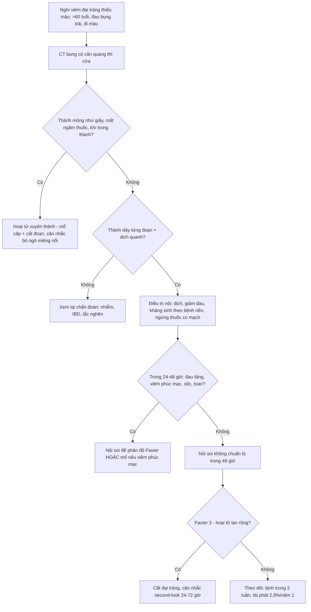
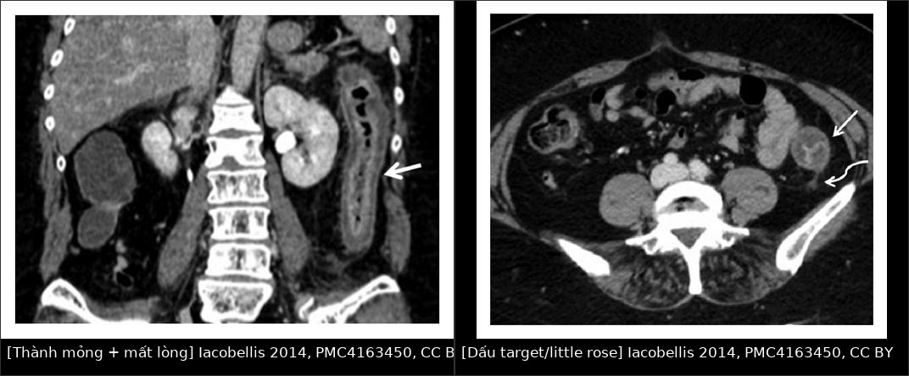
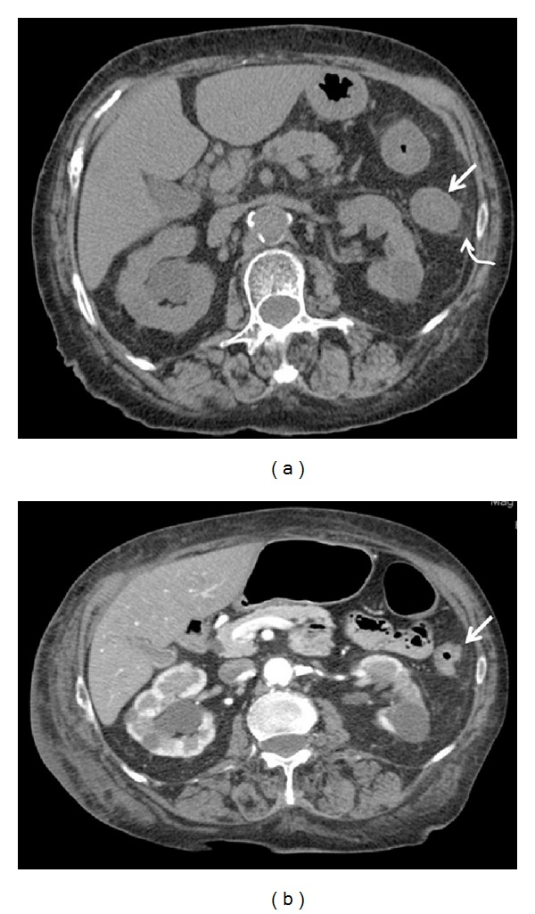
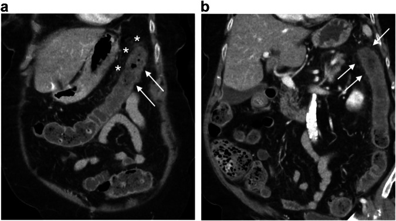

# 1911 — Viêm đại tràng thiếu máu / Ischemic colitis (IC)

**Tags:** `pattern:day-thanh-dai-trang` `pattern:thumbprinting` `pattern:giam-ngam-thanh` `pattern:khi-trong-thanh` `pattern:hoai-tu-dai-trang` `pattern:hep-long-dai-trang` `vung:dai-trang` `vung:o-bung` `protocol:CT-bung-co-tuong-phan` `protocol:CTA-bung` `protocol:noi-soi-dai-trang` `score:Favier`

**Mức chắc chắn (certainty):** tổng hợp y văn (literature synthesis) — **1 đoàn hệ CT 32 ca** (*BioMed Res Int* 2014, PMC4163450, **CC BY** — nguồn cho hình ảnh và phân kỳ), **1 tổng quan lâm sàng–chẩn đoán** (*Front Surg* 2017, PMC5591371, **CC BY**), **1 đoàn hệ 71 ca IC nặng có nội soi** (*Endosc Int Open* 2021, PMC8589548, **CC BY-NC-ND** — chỉ dùng số liệu, **không tạo phái sinh ảnh**), **1 so sánh CTA vs CT** (*ISRN Gastroenterol* 2014, PMC3947673, **CC BY**) và **1 bài giảng CT bụng cấp ở người già** (*Insights Imaging* 2025, PMC12058634, **CC BY 4.0**). Nhóm **không có bệnh nhân của mình**. Chỗ hai nguồn **mâu thuẫn** (tỉ lệ tử vong "chung 22%" của tổng quan so với **34%** trong đoàn hệ IC nặng) được ghi rõ là **khác quần thể** — đoàn hệ 71 ca chỉ gồm **bệnh nhân IC nặng nhập ICU**, không đại diện IC thường gặp.

> **Câu chốt:** IC là **bệnh của người già, đa số tự khỏi, nhưng là bệnh cảnh dễ bị đọc sai nhất trên CT bụng cấp**. Ba số phải thuộc: **(1)** tỉ lệ mới mắc **22,9/100.000 người–năm** và **đang tăng**, nhưng **80–85% không hoại tử**, **94% điều trị ngoại trú**; **(2)** điểm chốt trên CT **không phải "thành dày"** — trong **32 ca cấp**, chỉ **28,1%** có thành dày, còn **71,9% thành MỎNG như giấy** (không tái tưới máu) và **100% có dịch quanh đại tràng**; **(3)** **mất ngấm thuốc thành ruột** là dấu hiệu **hoại tử xuyên thành** (OR **10,7** cho độ Favier 3) → **mổ**, và **CTA thường KHÔNG đổi xử trí** (hẹp mạch 35,3% vs 9,3% nhưng **không khác tỉ lệ mổ/tử vong**).

## 1. Tổng quan bệnh học – cơ chế hình ảnh

### 1.1 Bệnh học: thiếu máu **không tắc mạch** là thể chính

- **Định nghĩa:** tổn thương đại tràng do **giảm tưới máu** (thiếu máu cục bộ) — từ **loét niêm mạc nông** đến **hoại tử xuyên thành**. Đây là thể **thường gặp nhất** của thiếu máu ruột (PMC5591371).
- **Hai cơ chế:** **tắc mạch** (huyết khối/thuyên tắc ĐM mạc treo dưới — IMA, hoặc nhánh) và **không tắc mạch** (tụt huyết áp, suy tim, co mạch, sau mổ tim/động mạch chủ). Trong **32 ca chụp CT cấp**, **62,5% KHÔNG có tắc SMA/IMA**, chỉ **37,5% có tắc IMA** → **đa số là thể không tắc**.
- **Phân bố theo "vùng bản lề" (watershed):** **góc lách (Griffith's point)** — nơi **động mạch viền Drummond mỏng**, **absent ở ~5%** người; **nối xích ma–trực tràng (Sudeck's point)**. Thêm vào đó **vasa recta ở đại tràng phải thưa hơn** → đại tràng phải cũng dễ thiếu máu khi **hạ huyết áp kéo dài**.
- **Hệ quả hình ảnh:** tổn thương **từng đoạn (segmental)**, **ranh giới rõ với đoạn lành**, hay gặp **đại tràng trái**: **88%** trong đoàn hệ Iceland 89 ca; đoàn hệ 71 ca IC nặng: **56% chỉ đại tràng trái**, **10% lan rộng**, **chỉ 1,4% chỉ đại tràng phải**.
- **Mô bệnh:** **hoại tử biểu mô + phù và xuất huyết dưới niêm mạc** → **niêm mạc phồng thành nốt** = **thumbprinting**; khi nặng → **loét, hoại tử cơ, thủng**.

### 1.2 Vật lý: **vì sao thành ruột MỎNG lại là dấu hiệu nặng hơn thành DÀY**

Đây là điểm **ngược trực giác** nhưng là chìa khoá đọc CT:

- **Giai đoạn cấp, chưa tái tưới máu:** mao mạch bị cắt dòng → **không có dịch thoát vào thành** → thành **mỏng như giấy (paper-thin)**, **mất trương lực**, lòng **giãn**. Trong 32 ca: **71,9%** ở tình trạng này, và **nhóm này không có tái tưới máu hiệu quả** → dễ **hoại tử**.
- **Giai đoạn bán cấp, ĐÃ tái tưới máu:** dòng máu trở lại → **tăng tính thấm mao mạch + phản ứng viêm** → **phù thành** → **thành dày**, **ngấm thuốc kiểu "bánh xe"/"target"** (lớp niêm mạc tăng ngấm, lớp dưới niêm mạc phù giảm ngấm). Trong 32 ca: thành dày **28,1% ở cấp** nhưng **86,4% ở bán cấp**. Nói cách khác: **thành dày = dấu hiệu TỐT (có tái tưới máu)**, không phải dấu hiệu nặng.
- **Dịch quanh đại tràng (pericolic fluid):** **100% ở giai đoạn cấp** và **tiêu dần** khi tái tưới máu hiệu quả → dấu hiệu **nhạy nhất của cấp**, nhưng **không đặc hiệu** (gặp trong viêm đại tràng nhiễm, đợt cấp IBD).
- **Mất ngấm thuốc thành (absent/decreased mural enhancement):** mao mạch **không còn tưới máu xuyên thành** → **hoại tử**. Đây là dấu hiệu **đặc hiệu nhất cho hoại tử**: trong đoàn hệ 71 ca, **khuyết ngấm thuốc** là yếu tố **duy nhất** liên quan độ Favier 3 (**OR 10,7; 95% CI 1,7–67,1**).
- **Khí trong thành (pneumatosis) / khí trong tĩnh mạch cửa:** khí từ lòng ruột **xuyên qua niêm mạc hoại tử** vào thành/tĩnh mạch → **dấu hiệu hoại tử nặng**, chỉ định **mổ cấp**.
- **Co thắt/giãn:** **giãn mất trương lực (ileus khu trú)** ở đoạn thiếu máu là dấu hiệu **nặng**; **hẹp lòng** ở giai đoạn mạn do **xơ hoá** (thành dày không đều, lòng hẹp).

### 1.3 Dịch tễ và tiên lượng — bệnh ngoại trú, tử vong tập trung ở nhóm nặng

- **Mới mắc 22,9/100.000 người–năm**, đang **tăng** (PMC8589548); Kaiser **424 ca: 94% ngoại trú**.
- **Không hoại tử 80–85%**, **hoại tử 15%**, **viêm toàn đại tràng tối cấp 1%** (PMC5591371).
- **Tử vong chung ~22%** (tổng quan), nhưng **nhóm IC nặng có nội soi: 34%**; **sau cắt đại tràng: 21%** (10.111 ca Mỹ, giảm **4,5%/năm**); **5–50%** tuỳ mức nặng.
- **Tái phát:** **8,5%** (118 ca); **2,9% năm 1 / 9,7% năm 5** (135 ca); đoàn hệ Iceland **15% sau 3 năm**; **sống 5 năm 69%** (phần lớn tử vong không do IC).
- **Sau mổ động mạch chủ:** IC **2,9%**, tử vong **> 50%**; trong dân số mổ phình ĐMC **2,2%**, **vỡ 8,9%**, **mổ hở 1,9% vs EVAR 0,5%**; sau mổ tim/ĐMC **15%** phát triển IC.

## 2. Mẫu hình + chẩn đoán phân biệt theo vị trí (gamut)

### 2.1 Gamut theo hình thái thành đại tràng

- **Thành mỏng như giấy + giãn + mất ngấm thuốc:** **IC cấp không tái tưới máu / hoại tử** (mổ).
- **Thành dày từng đoạn, ngấm thuốc "target"/"bánh xe":** **IC bán cấp sau tái tưới máu**, **viêm đại tràng nhiễm**, **IBD**, **viêm đại tràng do thuốc**.
- **Thành dày + phù dưới niêm mạc dạng nốt (thumbprinting):** **IC**, **xuất huyết dưới niêm mạc** (kháng đông), **nhiễm khuẩn** (E. coli O157, Shigella).
- **Thành dày + khí trong thành:** **hoại tử** (IC, tắc mạch, viêm đại tràng giả mạc nặng), **tràn khí màng bụng** nếu thủng.
- **Thành dày không đều + hẹp lòng + không phù:** **IC mạn/xơ hoá**, **ung thư đại tràng**, **viêm đại tràng do xạ**.

### 2.2 Gamut theo vị trí

- **Góc lách / đại tràng trái:** **IC** (kinh điển), **viêm đại tràng do tắc nghẽn phía trên** (ung thư đại tràng góc lách).
- **Đại tràng xích ma – trực tràng:** **IC** (Sudeck), **viêm túi thừa**, **viêm đại tràng do xạ**, **bệnh lây qua đường tình dục**.
- **Đại tràng phải:** **IC thể phải (nặng hơn)**, **viêm đại tràng do tắc nghẽn**, **viêm ruột thừa/viêm hồi manh tràng**, **nhiễm Yersinia/Campylobacter**.
- **Toàn đại tràng:** **viêm đại tràng tối cấp (fulminant)**, **C. difficile**, **IBD toàn thể**, **sốc**.

### 2.3 Gamut theo bối cảnh

- **Người > 60 tuổi, đau bụng trái + đi máu, có bệnh mạch vành/đái tháo đường:** **IC**.
- **Sau mổ tim/ĐMC/ghép tạng, tụt huyết áp:** **IC** (thể không tắc).
- **Sau kháng sinh phổ rộng, sốt, tiêu chảy:** **C. difficile** (bắt chước IC).
- **Táo bón nặng, phân rắn ứ đọng:** **viêm đại tràng do phân (stercoral colitis)** — có thể loét/thủng.
- **Đau bụng **không tương xứng** + lactate cao + rung nhĩ:** **thiếu máu mạc treo cấp (SMA)** — **khác hoàn toàn IC**.

## 3. Bảng so sánh phân biệt (ma trận đối chiếu)

| Thực thể (entity) | Hình ảnh điển hình | Chốt vào (rule-in) | Chốt loại (rule-out) | Gợi ý xác nhận |
|---|---|---|---|---|
| **Viêm đại tràng thiếu máu (IC)** | **Từng đoạn**, đại tràng trái; **dịch quanh đại tràng 100% ở cấp**; thành **mỏng (71,9%)** hoặc **dày (86,4% ở bán cấp)**; **thumbprinting** | **Đoạn ngắn ở vùng bản lề + mạch mạc treo THÔNG + bệnh nhân > 60 tuổi + đi máu** | **Tổn thương lan toàn đại tràng + mạch tắc hoàn toàn** → nghĩ thiếu máu mạc treo | CT bụng có cản quang thì cửa; **nội soi không chuẩn bị** để phân độ |
| **Thiếu máu mạc treo cấp (SMA)** | **Ruột non** (không phải đại tràng), thành mỏng, **mất ngấm thuốc**, **khí trong thành/tĩnh mạch cửa**, **tắc SMA** | **Đau dữ dội không tương xứng + lactate cao + tắc SMA trên CTA** | **Tổn thương khu trú đại tràng + mạch thông** → IC | **CTA cấp cứu**; mổ lấy huyết khối |
| **Viêm đại tràng nhiễm / C. difficile** | Thành dày **lan toàn đại tràng**, **dấu ấn ngón tay**, **phù dưới niêm mạc nặng**, dịch ổ bụng nhiều | **Sốt + tiêu chảy + kháng sinh trước đó + tổn thương lan rộng/liên tục** | **Tổn thương từng đoạn rõ + mạch máu bệnh lý** → IC | Cấy phân, độc tố C. difficile, nội soi thấy giả mạc |
| **Viêm loét đại tràng (UC)** | **Liên tục từ trực tràng**, mất haustra, thành dày đều, **tăng ngấm niêm mạc** | **Trực tràng luôn bị + liên tục + bệnh sử nhiều đợt** | **Chừa trực tràng + từng đoạn** → IC | Nội soi + mô bệnh (viêm mạn, crypt distortion) |
| **Viêm túi thừa** | **Túi thừa + dày thành khu trú + thâm nhiễm mỡ quanh đại tràng**, thường xích ma | **Túi thừa thấy được + viêm mỡ quanh đoạn đó** | **Không thấy túi thừa, tổn thương dài theo mạch** → IC | CT; nội soi **trì hoãn** (nguy cơ thủng) |
| **Viêm đại tràng do tắc nghẽn (ung thư phía trên)** | **Đoạn đại tràng trước chỗ hẹp bị dày/giãn**, có **khối/hẹp** ở đầu dưới | **Thấy khối hoặc hẹp lòng phía dưới đoạn dày** | **Không có chỗ hẹp phía trên** → IC nguyên phát | **Luôn đọc lên trên đoạn dày**; nội soi sau khi ổn định |
| **Viêm đại tràng do phân (stercoral)** | **Phân rắn ứ đọng + thành dày + loét**, chủ yếu trực tràng–xích ma | **Khối phân lớn + thành dày khu trú + bệnh nhân táo bón/giường bệnh** | **Không ứ phân** → IC | CT; tháo phân, theo dõi thủng |

### 3.1 Trình tự đọc CT — bốn dấu hiệu quyết định

1. **Vị trí có "từng đoạn" và nằm ở vùng bản lề không?** (góc lách, xích ma) — **từng đoạn + chừa trực tràng** = IC.
2. **Đo độ dày thành:** **mỏng như giấy** = **không tái tưới máu** (nặng); **dày** = đã tái tưới máu (thường lành).
3. **Có mất ngấm thuốc / khí trong thành / khí cửa không?** → **hoại tử, mổ**.
4. **Có chỗ hẹp phía trên đoạn dày không?** → **tắc nghẽn do ung thư** (bài 162).

## 4. Protocol chụp + phân độ + xử trí

### 4.1 Protocol

- **CT bụng–chậu có cản quang tĩnh mạch, thì tĩnh mạch cửa, lát ≤ 3 mm** là chuẩn; **không cần thì động mạch** trừ khi nghi **thiếu máu mạc treo cấp**.
- **CTA không thường quy:** trong so sánh **34 ca CTA vs 54 ca CT có cản quang**, CTA phát hiện **hẹp nhiều hơn (35,3% vs 9,3%, p = 0,0025)** nhưng **không khác tỉ lệ mổ và tử vong** → **CTA không đổi xử trí**; chỉ làm khi **nghi tắc mạch** hoặc **tái phát**.
- **Nội soi đại tràng:** **không chuẩn bị**, **trong 48 giờ**, **bơm hơi tối thiểu**, **ưu tiên CO₂** (hấp thu nhanh, giãn mạch); **không chuẩn bị ruột** vì có thể gây **giãn độc/ thủng**; **không nội soi khi có viêm phúc mạc**.
- **X-quang bụng** chỉ để loại trừ thủng/giãn; **siêu âm** có ích khi không có CT: **dày thành > 10 cm chiều dài** ở người > 50 tuổi là gợi ý mạnh (PMC5591371).

### 4.2 Phân độ và xử trí

- **Nội soi phân độ Favier** (đoàn hệ 71 ca IC nặng): **độ 1: 21%**, **độ 2: 45%**, **độ 3: 34%**. **Độ 3:** bất ổn huyết động **50–55%**, **cắt đại tràng 63–68%**, **tử vong 50–55%**.
- **Quyết định mổ thực tế:** dựa trên **huyết động 62%**, **CT 14%**, **nội soi chỉ 10%** → **nội soi không phải "trọng tài"**; **không được trì hoãn mổ vì chờ nội soi**.
- **Sau mổ:** **25%** cần **cắt thêm đại tràng**; **second-look nội soi 24–72 giờ** có tỉ lệ sống ~**65%**; **đại tràng phải → cắt nửa đại tràng phải + hồi tràng ra da**.
- **Không mổ được / hoại tử lan:** tỉ lệ tử vong **33–50%**.

## 5. Biến thể bình thường và cạm bẫy

- **CT bình thường trong thể nhẹ:** **12%** ca nặng có CT **không bất thường** (48 ca chụp: **88% bất thường**) — **CT âm không loại trừ IC**.
- **"Thành dày = nặng" là sai:** **71,9%** ca cấp có **thành mỏng**; **thành dày lại là dấu hiệu tái tưới máu** → đừng mổ chỉ vì thành dày.
- **Bỏ sót ung thư phía trên:** đoạn dày **do tắc nghẽn** có thể giống hệt IC — **luôn truy tìm chỗ hẹp/khối ở đầu dưới** (bài 162). Ca minh hoạ: IC **trên nền ung thư đại tràng phải**.
- **Nhầm với nhiễm trùng:** **C. difficile** cho **tổn thương lan rộng, dày thành nặng, cổ trướng nhiều** — hỏi **kháng sinh trước đó**.
- **Không chuẩn bị ruột trước nội soi:** chuẩn bị có thể gây **giãn độc/thủng**; **bơm hơi quá mức** làm nặng thiếu máu.
- **Nội soi "niêm mạc hoại tử nhưng thanh mạc bình thường":** **lệch niêm mạc–thanh mạc 45–50%** → đánh giá **thấp hơn** mức hoại tử thật; **không dựa vào nội soi để quyết định không mổ**.
- **Không dùng thuốc co mạch/vasopressor liều cao khi chưa cần:** làm nặng thiếu máu ruột; cân nhắc **truyền dịch + hỗ trợ** trước.
- **IC sau mổ động mạch chủ** là thể **tử vong > 50%** — bệnh nhân **đau bụng + toan lactic sau mổ ĐMC** phải **CT ngay**, không chờ.

## 6. Tự lượng giá — Blind Quiz

**Ca 1 — Nam 66 tuổi, đau bụng trái 1 ngày, đi máu; tiền sử tăng huyết áp, rung nhĩ đã ngừng kháng đông.**

- Hỏi: (1) Hai dấu hiệu trên CT; (2) thành mỏng hay dày là dấu hiệu nặng hơn; (3) bước tiếp theo?

<b>Bấm để hiện đáp án</b>

- **Dấu hiệu:** (A) mặt cắt trục/coronal: **thành đại tràng trái mỏng, lòng gần như mất** (mũi tên) — thiếu máu **chưa tái tưới máu**; (B) **thành dày + ngấm thuốc kiểu "target"/"little rose"** (mũi tên trắng + mũi tên cong) — lớp niêm mạc tăng ngấm, dưới niêm mạc phù.
- **Chẩn đoán:** **viêm đại tràng thiếu máu** — tổn thương **từng đoạn đại tràng trái**, mạch mạc treo thông.
- **Thành mỏng nặng hơn:** thành mỏng = **không tái tưới máu** (71,9% ca cấp) → nguy cơ **hoại tử**; thành dày = **đã tái tưới máu**, tiên lượng tốt hơn.
- **Bước tiếp:** nội khoa (dịch, giảm đau, ngừng thuốc co mạch); **nội soi không chuẩn bị trong 48 giờ** nếu không có viêm phúc mạc; **mổ** nếu mất ngấm thuốc/khí trong thành/viêm phúc mạc.
- **Nguồn ảnh:** Iacobellis F và cs., *BioMed Res Int* 2014;2014:895248, PMC4163450 Fig. 2–3 — **CC BY**, ảnh nguyên bản (ghép letterbox, không crop/kéo giãn).

**Ca 2 — Cùng bệnh nhân, sau 5 ngày điều trị nội khoa: đỡ đau, hết đi máu, CT chụp lại.**

- Hỏi: Vì sao thành **dày lên** sau điều trị? Dịch quanh đại tràng nói gì?

<b>Bấm để hiện đáp án</b>

- **Dấu hiệu:** (a) **thành đại tràng dày** (mũi tên thẳng) + **dịch quanh đại tràng** (mũi tên cong) — **phù do tái tưới máu**.
- **Vì sao dày:** mao mạch mở lại → **tăng tính thấm + viêm** → phù dưới niêm mạc; **đây là dấu hiệu TỐT**, không phải tiến triển.
- **Dịch quanh:** có ở **100% ca cấp**, **tiêu dần** khi tái tưới máu hiệu quả; còn nhiều + đau tăng → nghĩ **hoại tử/thủng**.
- **Nguồn ảnh:** Iacobellis F và cs., *BioMed Res Int* 2014, PMC4163450 Fig. 4 — **CC BY**.

**Ca 3 — Nam 90 tuổi, đau bụng trái, CT thì cửa.**

- Hỏi: Đoạn nào bị tổn thương, vì sao đúng vị trí đó? Cần tìm thêm gì trước khi kết luận IC nguyên phát?

<b>Bấm để hiện đáp án</b>

- **Dấu hiệu:** (a) trục + (b) coronal: **dày thành từng đoạn ở góc lách**, **ngấm thuốc phân lớp** (mũi tên), **thâm nhiễm mỡ quanh đại tràng**.
- **Vì sao góc lách:** **điểm bản lề Griffith** — động mạch viền Drummond mỏng/absent ~**5%**, dễ thiếu máu khi hạ tưới máu.
- **Tìm thêm:** **chỗ hẹp/khối phía trên** (ung thư gây tắc nghẽn), **túi thừa**, **phân ứ đọng** (stercoral), và **mạch mạc treo** (nếu nghi tắc) — trước khi gán "IC nguyên phát".
- **Nguồn ảnh:** Coutureau J, Millet I, Taourel P., *Insights into Imaging* 2025;16(1):95, PMC12058634 Fig. 2 — **CC BY 4.0**, ảnh nguyên bản.

## Bài liên quan chéo

- [1908 – Thiếu máu mạc treo & bóc tách động mạch tạng](../1908-thieu-mau-mac-treo-va-boc-tach-dong-mach-tang/lesson.md) — hàng phân biệt **bắt buộc**: đau không tương xứng, ruột non, phải mổ.
- [162 – Tắc ruột](../162-tac-ruot/lesson.md) — viêm đại tràng do tắc nghẽn phía trên khối u.
- [163 – Pylephlebitis & huyết khối tĩnh mạch mạc treo](../163-pylephlebitis-huyet-khoi-tm-mac-treo/lesson.md) — khí tĩnh mạch cửa, nhiễm trùng ổ bụng.
- [161 – Viêm ruột thừa cấp](../161-viem-ruot-thua-cap/lesson.md) — đau hố chậu phải ở người già.
- [115 – Khí tự do trong ổ bụng](../115-khi-tu-do/lesson.md) — thủng do hoại tử.
- [100 – Tổng quan hệ Bụng](../100-tong-quan-he-bung/lesson.md)

## Ảnh

- Tên file: `1911_viem-dai-trang-thieu-mau_Modality_SourceID.jpg`; nguồn + giấy phép từng ảnh ở `images/CREDITS.md`.
- **Ảnh ghép** `images/composite_target_sign.jpg` tạo bằng `tools/make_composite.py` (letterbox nền đen, **không crop/kéo giãn**), cả 2 ô **CC BY**.
- Không tải ảnh từ PMC8589548 (**CC BY-NC-ND**): chỉ dùng số liệu.

> Không dùng để chẩn đoán độc lập khi chưa có người hướng dẫn.
