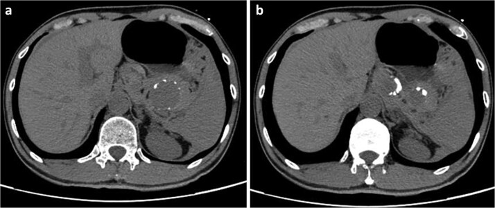
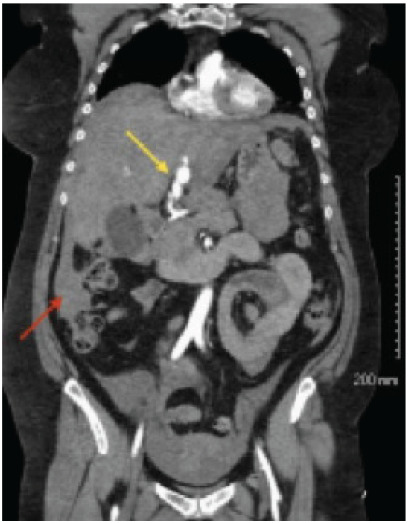
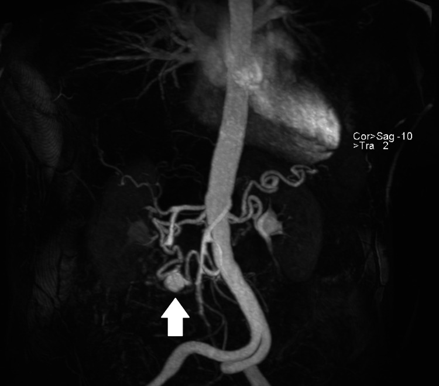
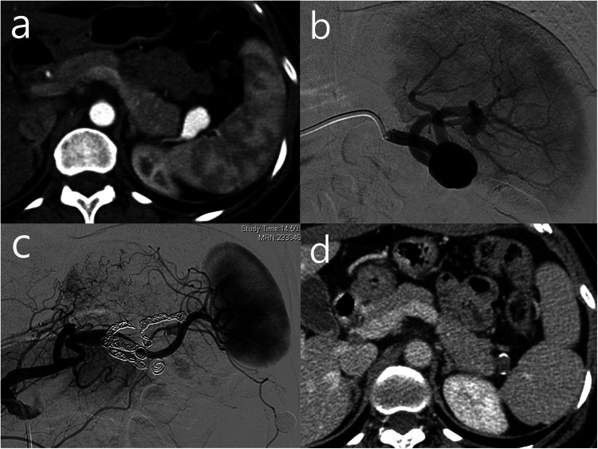
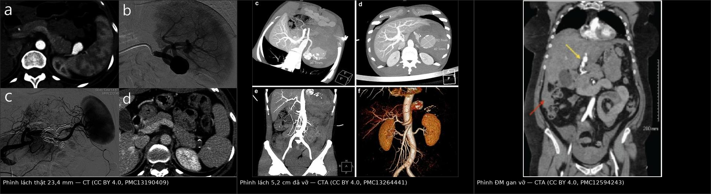
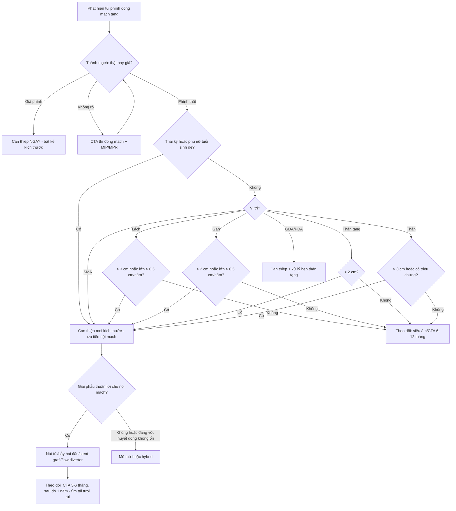
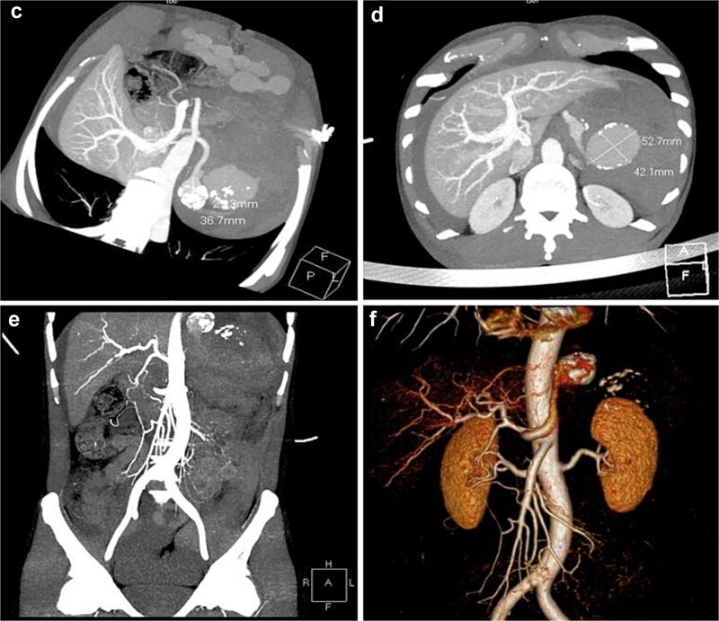
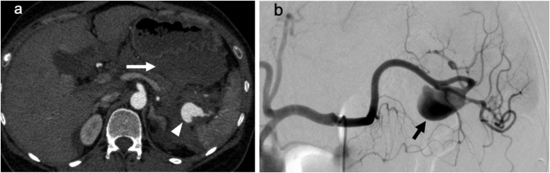
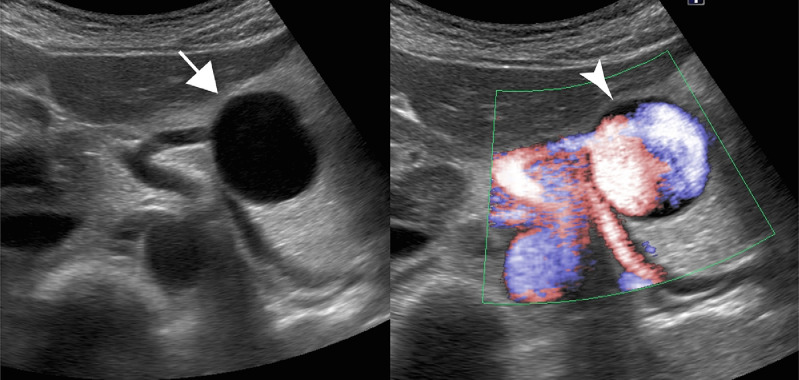

# 1912 — Phình động mạch tạng (lách, gan, thân tạng, SMA, tá tụy–tá tràng): ngưỡng can thiệp và cạm bẫy "giả nang tụy" / Visceral artery aneurysms — size thresholds, pregnancy and pitfalls

**Tags:** `pattern:phinh-mach` `pattern:vo-mach` `vung:dong-mach-tang` `vung:lach` `vung:gan` `score:SVS-2018` `protocol:CTA-3-thi` `incidentaloma:phinh-dong-mach-tang`
**Mức chắc chắn (certainty):** tổng hợp y văn (literature synthesis) — ghép 4 nguồn mở: **tổng quan hệ thống về bệnh nguyên – diễn tiến tự nhiên – điều trị VAA** (*Cardiovasc Diagn Ther* 2026, PMC13554317, CC BY-NC-ND), **tổng quan VAA ở thai và phụ nữ tuổi sinh đẻ** (*Medicina* 2026, PMC13118104, CC BY), **đoàn hệ nút mạch phình lách 64 bệnh nhân/66 ca** (*Front Surg* 2026, PMC13190409, CC BY) và **đoàn hệ nút mạch 97 phình tạng thật** (*CVIR Endovasc* 2025, PMC12950147). Ca minh họa là ca nguyên văn của từng bài gốc (ghi rõ Fig/PMCID); số nào nguồn không nêu ghi "chưa rõ".

> **Câu chốt:** ngưỡng can thiệp của phình tạng **không phải một con số duy nhất** — nó phụ thuộc **bản chất thành mạch (thật/giả)**, **vị trí**, **thai kỳ** và **tốc độ lớn**. **Giả phình: can thiệp ngay bất kể kích thước.** **Phình lách thật: theo dõi tới 2–2,5 cm; can thiệp khi > 3 cm hoặc lớn > 0,5 cm/năm; nhưng ở phụ nữ tuổi sinh đẻ/mang thai — can thiệp ở MỌI kích thước**, vì vỡ trong tam cá nguyệt III có tử vong mẹ **~75–80%** và thai **> 90%**.

## 1. Tổng quan bệnh học – cơ chế hình ảnh

### 1.1 Vì sao "thành mạch" quan trọng hơn "đường kính" (TẠI SAO)

- **Phình thật (true aneurysm)** = giãn **cả 3 lớp** thành mạch do **thoái hóa lớp áo giữa (medial degeneration)** — xơ vữa, tăng huyết áp, rối loạn mô liên kết (Marfan, Ehlers–Danlos, **loạn sản cơ trung mạc — FMD**), viêm mạch, **tăng áp lực cửa** (phình lách). Thành còn đủ lớp nên **diễn tiến chậm**: tốc độ lớn **~0,06–0,6 mm/năm** (PMC13554317).
- **Giả phình (pseudoaneurysm)** = **mất toàn bộ thành**, túi là **máu tụ được bao bọc** quanh chỗ rách nội mạc. Vì không có cơ trơn giữ, túi **không có "trần" giãn nở** → **nguy cơ vỡ cao bất kể đường kính**, cần can thiệp cấp (PMC13554317, PMC13118104). Bệnh nguyên điển hình: **viêm tụy, viêm túi mật, chấn thương, ERCP, mổ gan/tụy, nhiễm khuẩn (mycotic)**.
- **Vì sao đường kính vẫn quan trọng:** theo **định luật Laplace** (sức căng thành ∝ áp lực × bán kính), cùng một áp lực thì túi lớn hơn chịu sức căng lớn hơn → nguy cơ vỡ tăng theo đường kính. Đây là cơ sở của các ngưỡng 2 cm – 3 cm bên dưới, nhưng **Laplace không tính tới chất lượng thành** — nên một túi 1,2 cm ở người viêm tụy (giả phình) nguy hiểm hơn túi 2,5 cm vôi hóa viền ở người già.
- **Vì sao thai kỳ làm vỡ:** **tăng thể tích tuần hoàn và cung lượng tim**, **estrogen/progesterone/relaxin làm yếu mô liên kết thành mạch**, **tử cung to chèn ép – đẩy lệch mạch**, và **tuần hoàn tăng động** — cộng dồn ở **tam cá nguyệt III** (PMC13118104). Vì vậy **~25% phình lách được phát hiện trong thai kỳ** và phần lớn vỡ **ở 3 tháng cuối** (PMC13554317).

### 1.2 Vì sao nhìn thấy trên hình ảnh (vật lý từng chuỗi)

- **CTA thì động mạch (25–35 giây)** là chuẩn: lòng túi phình **ngấm thuốc đồng thì và đồng đậm độ với động mạch chủ** (cùng nồng độ iod trong lòng), nên **túi thật hiện thành cấu trúc "túi" thông với lòng mạch**. Đây là điều **cửa sổ không cản quang không thể làm được**.
- **Huyết khối trong túi (mural thrombus)** không ngấm thuốc → thấy **"lòng ngấm thuốc nhỏ hơn kích thước túi"**; phải đo **đường kính ngoài – ngoài (outer-to-outer)** trên CTA/không cản quang, vì **đo lòng ngấm thuốc làm đánh giá thấp nguy cơ vỡ**.
- **Vôi hóa viền (rim/shell calcification)** là di chứng xơ vữa ở thành — gặp nhiều ở **phình lách**, thấy rõ trên **X-quang/CT không cản quang** dưới dạng **vòng cung vôi hóa**. **Vôi hóa KHÔNG phải "hàng rào bảo vệ"**: túi vôi hóa viền vẫn vỡ (PMC13554317).
- **Vì sao CT không cản quang dễ nhầm thành nang:** túi phình **huyết khối hóa toàn bộ** hoặc **đang bị máu tụ vây quanh** có **đậm độ gần dịch** + **viền vôi hóa** → trông như **nang giả tụy/nang lách**. Chỉ **thì động mạch** mới phân biệt được "nang" với "túi thông lòng mạch". Ca nguyên văn: nam 49 tuổi đau thượng vị trái đột ngột, **CT không cản quang đọc là nang giả tụy**, sau đó **sụp tuần hoàn do "vỡ hai lần"**, CTA cấp cứu mới ra **phình lách khổng lồ 5,2 cm đã vỡ** (PMC13264441).
- **Siêu âm:** Doppler màu cho **dòng xoáy "yin-yang"** trong túi — dấu hiệu **có giá trị nhất** khi không được CT (thai phụ); nhưng **phụ thuộc người làm, thành bụng và tử cung to** (PMC13118104). Ca nguyên văn: phình lách ở thai phụ thấy **túi thông với động mạch lách + tín hiệu dòng vào** trên Doppler màu → được nút mạch chủ động **trong thai kỳ** (PMC7644823).

*Hình 1 — Cạm bẫy kinh điển. **CT không cản quang**: hai "tổn thương nang" đậm độ thấp, **viền vôi hóa**, ở thượng vị trái; tổn thương lớn **52 × 44 mm** sát đuôi tụy → bị đọc là **nang giả tụy**. Bệnh nhân sau đó **sụp tuần hoàn**; CTA cấp cứu (Hình 5) chứng minh **phình lách khổng lồ đã vỡ**. Nguồn: *J Surg Case Rep* 2026 (PMC13264441), **CC BY 4.0**.*

### 1.3 Ngưỡng định lượng nằm lòng (bắt buộc nhớ)

| Chỉ số | Con số | Nguồn |
|---|---|---|
| Tỉ lệ lưu hành VAA (tử thiết/chẩn đoán hình ảnh) | **0,01–0,2%**; nguồn khác **0,1–2%** | PMC13554317, PMC13118104 |
| Tử vong khi VAA vỡ (chưa điều trị) | **25–75%** | PMC13554317 |
| Phình lách (SAA) trong tổng số VAA | **60–80%**, nữ/nam **4:1**, **~25%** phát hiện trong thai kỳ | PMC13554317 |
| SAA vỡ trong thai: tử vong mẹ / thai | **~75–80%** / **> 90%**; hầu hết ở **tam cá nguyệt III** | PMC13554317, PMC13118104 |
| SAA là nguyên nhân tử vong mẹ (Úc 1997–2017) | **9/449 ca (2%)** | PMC13118104 |
| Ngưỡng can thiệp SAA thật, không triệu chứng | **> 3 cm** (grade II, level C) hoặc **lớn > 0,5 cm/năm** | PMC13554317 |
| Ngưỡng theo dõi an toàn SAA | **< 2–2,5 cm**, tốc độ lớn **0,06–0,6 mm/năm** | PMC13554317 |
| Phình gan (HAA) | **20%** VAA, nam/nữ **3:2**, nguy cơ vỡ **14–80%**; can thiệp khi **> 2 cm** hoặc lớn **> 0,5 cm/năm** | PMC13554317 |
| Phình thân tạng | **4–5%** VAA; vỡ **10–20%**, tử vong sau vỡ **~50%**; can thiệp khi **> 2 cm** (theo dõi nếu **< 30 mm**) | PMC13554317, PMC13118104 |
| Phình SMA | **6,7–6,9%** phình tạng; vỡ **38–50%**, tử vong **30–90%**; can thiệp **mọi kích thước (grade 1A)** | PMC13554317 |
| Phình GDA / PDA | **1–4%** / **< 2%** VAA; nguy cơ vỡ **tới 75%**; thường kèm **hẹp–tắc thân tạng** | PMC13554317 |
| Phình thận | **0,1–1%** dân số (tới **2,5%** ở người tăng huyết áp/chụp mạch); vỡ **< 5%** khi không triệu chứng – không thai; can thiệp **> 3 cm**, hoặc **mọi kích thước** nếu có triệu chứng/vỡ/phụ nữ tuổi sinh đẻ | PMC13554317 |
| Phình thận trong thai | Tử vong mẹ **5,1%**, thai **38%** (tới **85%**) | PMC13118104 |
| Ngưỡng cho thai / phụ nữ tuổi sinh đẻ | Can thiệp **mọi phình thật, bất kể kích thước** (SVS 2020, ESVS 2025, CIRSE 2024) | PMC13118104 |
| Giả phình | Can thiệp **bất kể kích thước và triệu chứng**; tử vong nếu không điều trị **tới ~90%** | PMC13554317, PMC13118104 |
| Liều thai nhi 1 lần CTA bụng | **< 25 mGy** (ngưỡng quái thai **> 100 mGy**) | PMC13118104 |
| Nút mạch vs mổ (meta 4.447 ca) | Tử vong **1,8% vs 2,1%**; biến chứng nặng **5,6% vs 8,4%** (OR 0,61); nằm viện **–4,3 ngày** | PMC13554317 |
| VAA **vỡ**: nút mạch vs mổ | Tử vong **4,1% vs 31%**; tái can thiệp 1 năm **9% vs 5%** | PMC13554317 |
| Kỹ thuật nút mạch VAA (643 ca) | Thành công **93,2%**; giữ tưới máu đầu xa **99,3%**; biến chứng nặng **3,5%**; tử vong 30 ngày **1,5%** | PMC13554317 |
| Nút mạch phình lách (66 ca) | Thành công kỹ thuật **100%**, thành công lâm sàng **94,1%**; **nhồi máu lách 37,5%** | PMC13190409 |
| Nút mạch phình tạng thật (97 ca) | Thành công **100%**; biến chứng nặng chu phẫu **5,2%**; sống 5 năm **89,4%**; tái tưới túi **8,2%** | PMC12950147 |

## 2. Mẫu hình + chẩn đoán phân biệt theo vị trí (gamut)

**Mẫu hình cần nhận ra:** **"vòng/vòm ngấm thuốc" nằm sát một động mạch, đồng đậm độ với động mạch chủ ở thì động mạch**, thường **không có nhu mô bao quanh** (khác u), có thể **vôi hóa viền**, ± **huyết khối không ngấm thuốc** trong túi. Phát hiện tình cờ khi chụp bụng vì lý do khác là thể phổ biến nhất.

**Gamut theo vị trí (mnemonic "LÁCH – GAN – THÂN TẠNG – RUỘT – THẬN"):**

1. **LÁCH (động mạch lách, nhất là đoạn đuôi tụy – rốn lách):** phình thật do xơ vữa/tăng áp cửa/FMD/thai; **giả phình sau viêm tụy**; **rò động mạch lách – tĩnh mạch lách** (tăng áp cửa, thổi liên tục); **phình trong ống sống**? không — nhưng nhớ **phình lách là VAA hay gặp nhất** và là **nguyên nhân tử vong mẹ** đã ghi nhận.
2. **GAN (động mạch gan chung/riêng, 20% VAA):** thật do xơ vữa; **giả phình sau ghép gan/ERCP/chấn thương/mổ đường mật** — vỡ vào đường mật gây **ho ra máu tiêu hóa / tam chứng Quincke** (đau hạ sườn phải + vàng da + xuất huyết tiêu hóa).

*Hình 2 — Nữ 57 tuổi, đau bụng và tụt huyết áp: CTA ngực–bụng–chậu thấy **phình động mạch gan trái nhiều thùy (bilobed)** (mũi tên vàng) và **máu tự do trong ổ bụng** (mũi tên đỏ) — phình gan vỡ có nguy cơ vỡ **14–80%**, tử vong cao nếu không nút mạch/mổ ngay. Nguồn: *Clin Pract Cases Emerg Med* 2025 (PMC12594243), **CC BY 4.0**.*
3. **THÂN TẠNG – TÁ TỤY/TÁ TRÀNG (GDA/PDA):** thường **hệ quả của hẹp–tắc thân tạng**: dòng bù qua cung tá tụy–tá tràng làm **phình nhánh bù**, vỡ tới 75%. **Bẫy:** nút mạch mà **không tái thông thân tạng** → thiếu máu gan/ruột (PMC13554317).

*Hình 3 — MIP thì động mạch: **túi phình động mạch tá tụy–tá tràng** (mũi tên) với **dòng ngấm ngược** vào động mạch gan, động mạch lách và các nhánh thân tạng **qua bàng hệ từ SMA**, kèm **tắc thân tạng đoạn dài không còn lỗ nguyên ủy**. Đây là "phình do dòng bù" — điều trị phải tính cả **hẹp/tắc thân tạng**, nếu chỉ nút túi sẽ làm thiếu máu gan. Nguồn: *Cureus* 2025 (PMC12809103), **CC BY 4.0**.*
4. **RUỘT (SMA, nhánh hỗng tràng/jejunal):** SMA **can thiệp mọi kích thước**; nhánh hỗng tràng **> 2 cm**; nguy cơ vỡ **38–60%**, tử vong cao; thường phát hiện khi đau bụng hoặc xuất huyết tiêu hóa ồ ạt.
5. **THẬN:** **> 3 cm**, hoặc **mọi kích thước ở phụ nữ tuổi sinh đẻ**; bắt buộc **tầm soát FMD** (bài **850**) và **tăng huyết áp**; can thiệp thường bằng **stent-graft** để giữ nhánh.
6. **NHIỀU Ổ / KHÔNG ĐIỂN HÌNH:** **SAM (loạn sản cơ trung mạc từng đoạn)** và **FMD** — phình/bóc tách nhiều ổ; **mycotic** — túi sùi, thâm nhiễm mỡ, sốt, có ổ nhiễm; **viêm mạch (PAN, Takayasu, Behçet)**.

*Hình 4 — Nữ 51 tuổi, phình lách thật **23,4 mm** ở động mạch lách đoạn xa, thể tích lách trước can thiệp **194 mL**: (a) CT thì động mạch — túi saccular cạnh rốn lách; (b) DSA — hai nhánh xa xuất phát **từ chính túi** (yếu tố quyết định kỹ thuật); (c) nút "trapping" bằng coil cả đầu vào và đầu ra; (d) CT 7 ngày sau — lách còn ngấm thuốc, không nhồi máu lớn. **Bài học:** vị trí **xa/rốn lách** làm tăng nguy cơ **nhồi máu lách** sau nút (37,5% — PMC13190409). Nguồn: *Front Surg* 2026 (PMC13190409), **CC BY 4.0**.*

## 3. Bảng so sánh phân biệt (ma trận đối chiếu)

| Thực thể (entity) | Hình ảnh điển hình (CTA thì động mạch) | Chốt vào (rule-in) | Chốt loại (rule-out) | Gợi ý xác nhận |
|---|---|---|---|---|
| **Phình lách thật** | Túi **ngấm thuốc đồng thì ĐMC** ở động mạch lách, ± **vôi hóa viền**, ± huyết khối trong túi; hay ở **đoạn thân/đuôi** | Túi thông lòng mạch + **vôi hóa viền** + bệnh nền (tăng áp cửa, thai, FMD) | **Không thấy túi thông lòng** trên mọi thì → không phải phình | CTA; siêu âm Doppler (yin-yang); đo **đường kính ngoài–ngoài** |
| **Giả phình sau viêm tụy** | Túi **không đều**, cổ hẹp, **thâm nhiễm mỡ/dịch tụy** quanh, ± máu tụ; thường **động mạch lách/gan/GDA** | **Bối cảnh viêm tụy/ERCP/chấn thương** + túi sùi + **không có 3 lớp thành** | Thành đều, vôi hóa viền, không bệnh cảnh viêm → phình thật | CTA; **can thiệp ngay, không chờ kích thước** |
| **Nang giả tụy / nang lách** | **Đậm độ dịch**, viền vôi hóa, **không ngấm thuốc ở MỌI thì**, không thông lòng mạch | Vị trí trong/quantụy + tiền sử viêm tụy; **không ngấm thì động mạch** | **Ngấm thuốc đồng thì ĐMC** → là phình, không phải nang | CTA (không dựa CT không cản quang); theo dõi ≥ 6 tuần |
| **Rò động mạch lách – tĩnh mạch lách** | **Tĩnh mạch lách/ cửa ngấm thuốc SỚM ở thì động mạch**, tĩnh mạch giãn, ± phình | **Ngấm thuốc tĩnh mạch thì động mạch** + tăng áp cửa | Không có ngấm sớm tĩnh mạch → chỉ phình đơn thuần | CTA 2 thì; đo áp lực cửa |
| **Phình GDA/PDA do hẹp thân tạng** | Túi ở **cung tá tụy–tá tràng**, kèm **hẹp/tắc gốc thân tạng**, động mạch tá tụy giãn | **Tắc thân tạng + túi ở nhánh bù** | Thân tạng thông tốt, không giãn nhánh bù | CTA dựng MIP; **điều trị cả hẹp thân tạng** |
| **Phình gan (HAA)** | Túi ở **động mạch gan chung/riêng**, ± vôi hóa; **giả phình sau can thiệp** ở miệng nối | **> 2 cm** hoặc lớn nhanh; **giả phình = cấp cứu** | Túi nhỏ < 2 cm, không triệu chứng, không tăng → theo dõi | CTA; **stent-graft** cho tổn thương ngoài gan |
| **Phình SMA** | Túi ở **thân SMA đoạn gần**, thường xơ vữa; ± huyết khối | **Mọi kích thước** đều có chỉ định (grade 1A) | Không loại trừ bằng kích thước nhỏ | CTA + **bản đồ bàng hệ mạc treo** trước can thiệp |
| **Mycotic / SAM / FMD** | Mycotic: túi sùi nhiều ổ + thâm nhiễm + khí; SAM: nhiều ổ **không chuỗi hạt**; FMD: **chuỗi hạt** | Mycotic: **sốt + ổ nhiễm + túi mới**; SAM/FMD: nhiều ổ ở người trẻ/trung niên | Một túi đơn độc + xơ vữa điển hình → không nghĩ SAM/FMD | CTA toàn thân; cấy máu; **stent-graft có thể chống chỉ định trong mycotic** |

*Hình 5 — Ba mức độ của cùng một bệnh lý. **Trái:** phình lách thật **23,4 mm** (ngấm thuốc đồng thì ĐMC, chưa vỡ — theo dõi/can thiệp chương trình). **Giữa:** **phình lách 5,2 cm đã vỡ** — CTA: hai túi **42,1 × 52,7 mm** và **36,7 × 27,3 mm**, **thoát thuốc hoạt tính** + máu tụ lan tỏa trong ổ bụng. **Phải:** **phình động mạch gan đã vỡ** — túi nhiều thùy + **máu tự do** (mũi tên đỏ) ở bệnh nhân đau bụng, tụt huyết áp. Nguồn: PMC13190409, PMC13264441, PMC12594243 — đều **CC BY 4.0**; ảnh ghép letterbox, không crop/kéo giãn.*

## 4. Protocol chụp + hệ phân độ/điểm chuẩn hóa

### 4.1 Protocol CTA bụng – mạch tạng

- **Lát ≤ 1 mm**, dựng **MPR** theo trục mạch, **MIP** cho toàn bộ đường đi động mạch lách/gan/SMA/thận và **VR** khi cần mô tả túi.
- **Thì không cản quang:** phát hiện **vôi hóa viền** và **máu tụ tăng đậm độ**; **không dùng để loại phình**.
- **Thì động mạch 25–35 giây:** chốt **túi thật/giả**, **cổ túi**, **nhánh xuất phát từ túi**, **thoát thuốc hoạt tính** (dấu hiệu vỡ/nguy cơ vỡ tức thì).
- **Thì tĩnh mạch cửa 60–70 giây:** phát hiện **rò động–tĩnh mạch** (tĩnh mạch ngấm sớm), huyết khối tĩnh mạch, tổn thương tạng kèm theo, **nhồi máu lách** sau nút mạch.
- **Đo và ghi vào báo cáo:** đường kính **lớn nhất ngoài–ngoài (mm)**, **đường kính cổ**, **chiều dài**, **số nhánh xuất phát từ túi**, **có huyết khối trong túi**, **vôi hóa**, vị trí **thân/đuôi/rốn lách**.
- **Thai phụ:** **siêu âm Doppler trước** (bàn đầu, không bức xạ); **CTA khi cần** — liều thai nhi 1 lần **< 25 mGy**, dưới ngưỡng quái thai **100 mGy**; **không trì hoãn chẩn đoán vì lo bức xạ** (PMC13118104).

### 4.2 Phân tầng và quyết định (theo SVS/ESVS 2025 – bảng ngưỡng mục 1.3)

### 4.3 Chọn kỹ thuật nội mạch (và cái giá phải trả)

| Kỹ thuật | Dùng khi | Cái giá / bẫy | Số liệu |
|---|---|---|---|
| **Ép túi (sac packing)** | Cổ hẹp, ít nhánh xuất phát từ túi | Tái tưới qua nhánh bên (type II endoleak) | Tái tưới túi **8,2%** (97 ca, PMC12950147) |
| **Bẫy hai đầu (trapping/sandwich)** | Túi ở đoạn xa, nhánh xa lấy từ bàng hệ | **Nhồi máu lách**, teo lách về sau | Nhồi máu **37,5%**, trong đó **50% tái tạo – 50% teo** (PMC13190409) |
| **Stent-graft (covered stent)** | Cổ rộng, cần giữ nhánh chính (gan/thận) | **Type I endoleak**; không dùng khi nhiễm khuẩn | Endoleak **12,5% stent tự bung vs 60% stent bóng** (PMC13554317) |
| **Flow diverter** | Mạch nhỏ ≤ 5–5,5 mm, túi phức tạp | Cần kháng kết tập; tắc nhánh xa | Kỹ thuật VAA **93,2–100%** (PMC13554317, PMC12950147) |
| **Vật liệu lỏng (glue/Onyx)** | Túi lớn, dòng cao, giả phình | Nguy cơ **tắc nhánh lành**, di trú | Dùng cho tổn thương dòng cao (PMC13554317) |

## 5. Biến thể bình thường và cạm bẫy

- **"Vôi hóa viền = lành" là hiểu sai nguy hiểm.** Vôi hóa chỉ là dấu hiệu của xơ vữa thành; **túi vôi hóa vẫn vỡ** (ca 5,2 cm vỡ sau khi bị đọc là nang giả tụy).
- **"Vỡ hai lần" (double-rupture phenomenon) — 12–21% ca phình lách vỡ.** Lần đầu vỡ vào **túi mạc nối (omental bursa)** → máu tụ **tự chèn ép** nên bệnh nhân **tạm ổn**; lần hai vỡ vào **ổ phúc mạc tự do** → sốc mất máu. **Bẫy gây chết người:** **khởi mê làm giảm áp lực ổ bụng** có thể **kích hoạt lần vỡ thứ hai** — đã có ca **sụp tuần hoàn ngay sau khởi mê** (PMC12019265). Vì vậy: **chẩn đoán trước, gây mê sau, luôn chuẩn bị máu và phòng mổ**.
- **Đo sai đường kính:** đo **lòng ngấm thuốc** thay vì **ngoài–ngoài** → đánh giá thấp túi có huyết khối thành, bỏ ngưỡng can thiệp.
- **Chỉ chụp thì tĩnh mạch cửa:** túi có thể **ngấm thuốc không rõ** và bị bỏ sót; **luôn có thì động mạch** khi nghi phình tạng.
- **Nút mạch GDA/PDA mà quên thân tạng hẹp:** nút "nhánh bù" ở bệnh nhân tắc thân tạng có thể **gây thiếu máu gan/ruột**; cần **tái thông thân tạng** hoặc chọn mổ bắc cầu (PMC13554317).
- **Tái tưới qua nhánh tụy (type II endoleak):** ca thai phụ nút phình lách vẫn còn **ngấm qua động mạch tụy ngang** → phải nút bổ sung nhánh này (PMC7644823). Sau nút **luôn chụp kiểm tra muộn**.
- **Thai phụ:** phình lách nhỏ **không được xem là "theo dõi an toàn"** chỉ vì < 2 cm — **can thiệp mọi kích thước** (SVS/ESVS/CIRSE); trì hoãn tới sau sinh là bỏ mất cửa sổ an toàn.
- **Biến thể bình thường dễ nhầm:** **quai/tortuosity động mạch lách** trên MIP trông như "túi"; **túi thừa (diverticulum) động mạch** không có cổ; **mảnh vôi hóa hạch/tụy** cạnh mạch. Đọc **đa mặt phẳng** + xem **lòng ngấm thuốc liên tục** để loại.

## 6. Tự lượng giá — Blind Quiz

**Ca 1 — Nam 49 tuổi, tăng huyết áp, đau thượng vị trái đột ngột, buồn nôn. CT không cản quang ở tuyến trước "không rõ nguyên nhân".**

- Câu hỏi: Hai "tổn thương nang" này khác nang giả tụy ở điểm nào? Cần làm gì tiếp theo và vì sao không được chờ?

<b>Bấm để hiện đáp án (findings + chẩn đoán)</b>

- Findings: hai tổn thương **đậm độ dịch, viền vôi hóa** ở thượng vị trái, lớn **52 × 44 mm** sát đuôi tụy → dễ đọc là **nang giả tụy**.
- Chẩn đoán thật: **phình động mạch lách khổng lồ đã vỡ** — CTA cấp cứu cho thấy **thoát thuốc hoạt tính** và máu tụ lan tỏa (Hình 5, giữa). Bệnh nhân **sụp tuần hoàn kiểu "vỡ hai lần"** trước khi được mổ cắt lách.

- Vì sao: trên **CT không cản quang**, máu trong túi + huyết khối có **đậm độ gần dịch**, viền vôi hóa làm "giả nang" — chỉ **thì động mạch** mới chứng minh túi thông với lòng mạch.
- Nguồn ảnh: *J Surg Case Rep* 2026 (PMC13264441), **CC BY 4.0**.

**Ca 2 — Nữ 40 tuổi, thai 35 tuần, đau bụng trên và nôn; thai suy nên mổ lấy thai cấp. Sau mổ, hút ra 400 g máu trong ổ bụng trên.**

- Câu hỏi: Dấu hiệu chính? Vì sao "chỉ thấy dịch cạnh phình" mà vẫn phải xử trí cấp? Kỹ thuật nào phù hợp?

<b>Bấm để hiện đáp án (findings + chẩn đoán)</b>

- Findings: **(a)** túi phình **37 mm** cạnh rốn lách (arrowhead) + **dịch/máu tụ nhiều** quanh túi và trong túi mạc nối (arrow) — dấu hiệu **vỡ kín (contained rupture)**. **(b)** DSA: túi phình lách, **không thấy thoát thuốc hoạt tính**.
- Chẩn đoán: **phình lách vỡ trong thai kỳ**. Vì DSA không có thoát thuốc nhưng có **máu tụ + tụt huyết áp khi mở túi mạc nối**, phải **mổ cắt lách kèm cắt đuôi tụy**; bệnh nhân ngừng tim thoáng qua khi mở túi mạc nối — minh họa đúng cơ chế **vỡ hai lần**.
- Vì sao thai kỳ là bối cảnh nguy hiểm: tăng thể tích tuần hoàn + relaxin làm yếu thành + tử cung chèn ép; **tử vong mẹ ~75–80%, thai > 90%** khi vỡ.
- Nguồn ảnh: *Int J Surg Case Rep* 2020 (PMC7533310), **CC BY 4.0**.

**Ca 3 — Nữ mang thai, phình lách phát hiện tình cờ trên siêu âm. Chưa có triệu chứng, đường kính 1,6 cm.**

- Câu hỏi: Có thể chỉ theo dõi sau sinh không? Nếu can thiệp, nên làm gì và cần kiểm tra gì sau nút?

<b>Bấm để hiện đáp án (findings + chẩn đoán)</b>

- Findings: siêu âm: **túi phình thông với động mạch lách**, Doppler màu có **tín hiệu dòng vào** (arrowhead) — khẳng định **túi còn thông và đang chịu áp lực**.
- Chẩn đoán/xử trí: **phình lách thật ở thai phụ** — hướng dẫn SVS 2020/ESVS 2025/CIRSE 2024 khuyến cáo **can thiệp mọi kích thước ở thai phụ/phụ nữ tuổi sinh đẻ**, không chờ sau sinh. Ca này được **nút mạch nội mạch**; sau nút vẫn còn **ngấm thuốc qua động mạch tụy ngang (type II endoleak)** → phải **nút bổ sung nhánh tụy ngang**.
- Cạm bẫy: nút "bẫy hai đầu" không đủ nếu còn **nhánh bàng hệ nuôi ngược túi** — luôn chụp kiểm tra thì muộn và tìm nhánh tụy/tá tụy.
- Nguồn ảnh: *Radiol Case Rep* 2021 (PMC7644823), **CC BY-NC-ND 4.0** (nguyên bản, không chỉnh sửa).

## Bài liên quan chéo
- [100 – Tổng quan hệ Bụng](../100-tong-quan-he-bung/lesson.md)
- [1908 – Thiếu máu mạc treo & bóc tách động mạch tạng](../1908-thieu-mau-mac-treo-va-boc-tach-dong-mach-tang/lesson.md)
- [1819 – Chảy máu muộn & giả phình mạch tạng](../1819-chay-mau-muon-gia-phinh-mach-tang/lesson.md)
- [1831 – Di trú coil/xuyên thành sau nút mạch tạng](../1831-di-tru-coil-sau-nut-mach-tang/lesson.md)
- [1832 – Nút mạch giả phình dưới hướng dẫn EUS](../1832-nut-mach-gia-phinh-eus/lesson.md)
- [1833 – Vascular plug trong nút mạch tạng](../1833-vascular-plug-nut-mach-tang/lesson.md)
- [850 – FMD toàn thân ở trẻ](../850-loan-san-co-xo-fibromuscular-dysplasia-toan-than-o-tre/lesson.md)
- [920 – Nút mạch cầm máu tiêu hóa](../920-vascular-embolization-gi-bleed/lesson.md)

## Ảnh
- 7 ảnh + 1 composite; nguồn và giấy phép từng ảnh trong `images/CREDITS.md`.
- Ba bài **CC BY-NC-ND** (PMC13554317, PMC7644823) chỉ dùng **nguyên bản**, không crop, không đưa vào composite.

> Không dùng để chẩn đoán độc lập khi chưa có người hướng dẫn.
