# 1913 — Hẹp & huyết khối động mạch gan sau ghép gan: phổ "tardus-parvus", PSV > 200 cm/s, RI < 0,5 — và cái bẫy RI > 0,8 trong 3 ngày đầu / Hepatic artery stenosis & thrombosis after liver transplantation

**Tags:** `pattern:hep-mach` `pattern:tac-mach` `pattern:huyet-khoi` `pattern:mat-song-toc-do` `pattern:giai-doan-toc-do` `pattern:nhoi-mau-gan` `pattern:giai-doan-ngam-thuoc` `vung:gan` `vung:dong-mach-gan` `vung:mieng-noi` `score:RI` `score:PSV` `score:SAT` `protocol:Doppler` `protocol:CEUS` `protocol:CTA-3-thi` `protocol:DSA` `protocol:nong-bong` `protocol:stent`

**Mức chắc chắn (certainty):** tổng hợp y văn (literature synthesis) — số liệu lấy từ các bài open-access đã đọc toàn văn: Delgado-Moraleda et al., *Insights Imaging* 2019 (PMC6694376, CC BY 4.0 — tổng quan hình ảnh có ảnh gốc); Lindner C et al., *World J Transplant* 2024 (PMC10989478, CC BY-NC 4.0 — tổng quan chẩn đoán HAT, ảnh CTA/DSA); Chau et al., *Abdom Radiol* 2025 (PMC11794643, CC BY 4.0 — CEUS và dấu "water-hammer", "bright band"); Pons et al., *J Surg Case Rep* 2025 (PMC12494202, CC BY 4.0 — ca nguyên văn HAT sau ghép lần 3); Desai et al., *CVIR Endovasc* 2024 (PMC11032299, CC BY 4.0 — can thiệp trong/ngoài gan); Shaaban Abdelgalil et al., *CVIR Endovasc* 2025 (PMC12501083, CC BY 4.0 — meta PTA vs stent); Minciuna et al., *Transpl Int* 2023 (PMC10716223, CC BY 4.0 — giá trị Doppler định kỳ); Babikir et al., *Saudi Med J* 2024 (PMC11463573, CC BY-NC 4.0 — RI ngày 1 → ngày 5). **Bổ sung 2026-11-10:** *J Clin Med* 2025 (PMC12251336 — 532 ca, HAT 2,4%, 66,6% không triệu chứng, ghép lại 46,1%); *Rev Col Bras Cir* 2026 (PMC13142963 — 1.362 ca, 2,6%, 43,8% phát hiện trong 48 giờ, tử vong 11–60%); *Transpl Int* 2024 (PMC11692146 — kháng kết tập tiểu cầu aHR 0,18); 2023 (PMC9955988 — trẻ 6,75%, miệng nối < 2 mm). Bài **không** có ca nguyên văn riêng của nhóm; ca 1–3 là ca nguyên văn của nguồn, ghi rõ Fig.

> **Câu hỏi gốc của bài:** bệnh nhân **ngày 3 sau ghép gan**, sốt nhẹ, **ALT/AST tăng vọt**, siêu âm **không thấy tín hiệu màu của động mạch gan**, nhưng phổ bắt được lại **có đỉnh tâm thu bình thường và đảo dòng tâm trương** — "trông như phổ bình thường". Vậy: **đây là huyết khối, là co thắt, hay là phổ giả? khi nào cần CEUS/CTA, khi nào chọc mạch can thiệp, và vì sao RI 0,85 ở ngày 1–3 KHÔNG được gọi là bệnh lý?**
> **Điểm tựa:** sau ghép gan, **động mạch gan là nguồn máu DUY NHẤT của đường mật và của miệng nối đường mật** (động mạch của mảnh ghép không có tuần hoàn bàng hệ, vì các nhánh nối đã bị thắt khi lấy tạng). Vì thế **tắc động mạch = hoại tử đường mật/gan**, chứ không chỉ là "thiếu máu thoáng qua". Chẩn đoán dựa trên **ba con số phổ Doppler** (RI, PSV, SAT) + **nhìn trực tiếp chỗ hẹp**, và **luôn phải loại trừ bẫy sinh lý của 3 ngày đầu**.

## 1. Tổng quan — vì sao động mạch gan là "cửa tử" của mảnh ghép, và vì sao phổ Doppler đổi hình dạng

**A. Bệnh học (pathology) và cơ chế:**

- **Giải phẫu bất thường sau ghép:** gan nhận **~75% máu từ tĩnh mạch cửa, ~25% từ động mạch gan**, nhưng **đường mật chỉ sống bằng động mạch gan**. Sau ghép, **động mạch gan của mảnh ghép là một ống nối tận–tận hoặc tận–bên duy nhất**, các nhánh nối quanh đường mật **đã bị thắt** → **không có tuần hoàn bàng hệ**. Do đó tắc động mạch gây **hoại tử biểu mô đường mật → hẹp/hoại tử đường mật (ischemic-type biliary lesion, ITBL)** và **nhồi máu nhu mô**; nhồi máu gan **gắn với tắc động mạch trong 85% ca** (PMC6694376).
- **Huyết khối động mạch gan (hepatic artery thrombosis, HAT):** **4–12%** ca ghép, chiếm **> 50% biến chứng động mạch** và là **nguyên nhân hàng đầu của mảnh ghép không chức năng** (PMC6694376). Chia **sớm (< 30 ngày)** — thường do kỹ thuật (xoắn, hẹp miệng nối, mảnh ghép nhỏ, dòng chảy thấp) — và **muộn** — thường do hẹp tiến triển hoặc thải ghép mạn.
- **Hẹp động mạch gan (hepatic artery stenosis, HAS):** **2–13%** ở **miệng nối** (PMC6694376), **thời gian trung vị tới chẩn đoán 3 tháng**, phần lớn trong **năm đầu** (PMC11794643); nguyên nhân: sang chấn khi mổ, **gập/xoắn mạch**, **chèn ép từ ngoài**, và viêm/thải ghép cấp góp phần.
- **Tần suất chung biến chứng mạch máu:** **~7%** ghép gan từ người chết não, **~13%** ghép gan sống cho (PMC6694376) — vì LDLT có nhiều miệng nối nhỏ hơn.
- **Vì sao hẹp → phổ "tardus-parvus" ở đoạn xa:** hẹp làm **giảm áp lực tưới máu** đoạn xa; giường mạch gan đáp ứng bằng **giãn tiểu động mạch** (giảm sức cản). Trên Doppler, sức cản ngoại vi thấp nghĩa là **dòng tâm trương còn nhiều** → **RI giảm < 0,5**; đồng thời sóng tâm thu **lên chậm và tù đầu** (kéo dài **thời gian tăng tốc tâm thu, SAT > 0,08 giây**) — đây là **hình dạng của "áp lực đến muộn và yếu"**, không phải hình dạng của mạch bị tắc.
- **Vì sao tại chỗ hẹp lại có vận tốc rất cao:** theo **phương trình liên tục**, vận tốc tỉ lệ nghịch với diện tích lòng mạch; hẹp > 50% đường kính làm **PSV > 200 cm/s** và gây **aliasing** khi vượt giới hạn Nyquist của thang đo. Aliasing là **giới hạn kỹ thuật**, không phải "dòng xoáy bệnh lý".
- **Vì sao đoạn TRƯỚC hẹp có RI cao (> 0,8):** đoạn trước hẹp phải đẩy máu qua một cửa hẹp → **sức cản tăng** → **RI tăng**, đỉnh tâm thu cao. Vì vậy **RI cao ở đoạn gần + RI thấp ở đoạn xa** là **cặp dấu hiệu định vị chỗ hẹp**, tốt hơn một con số đơn lẻ.
- **Vì sao HAT lại cho phổ "water-hammer" (búa nước):** khi động mạch tắc hoàn toàn, đoạn xa trở thành **túi cụt đàn hồi**; sóng áp lực dội lại tạo **đỉnh tâm thu bình thường + giảm nhanh + đảo dòng tâm trương**. Đây là **phổ giả "trông khỏe"** — bẫy kinh điển khiến người đọc bỏ sót HAT (PMC11794643).
- **Vì sao 3 ngày đầu RI > 0,8 là bình thường:** mảnh ghép **phù sau bảo quản/thiếu máu–tái tưới máu**, áp lực mô kẽ tăng → **sức cản tăng**; **~50% bệnh nhân có RI > 0,8 trong 3 ngày đầu**, và **về bình thường khoảng ngày thứ 4** (PMC6694376). Vì vậy **RI đơn độc không dùng để chẩn đoán trong 72 giờ đầu** — phải **nhìn trực tiếp động mạch** (màu, CEUS) và **so sánh các nhánh trong gan**.

**B. Ngưỡng định lượng bắt buộc (cửa 1 Argon):**

| Đại lượng | Con số đã kiểm chứng | Ý nghĩa thực hành |
|---|---|---|
| Biến chứng mạch máu sau ghép | **~7%** (người chết não), **~13%** (sống cho) (PMC6694376) | LDLT có nhiều miệng nối nhỏ → nguy cơ cao hơn |
| HAT | **4–12%**; **> 50%** biến chứng động mạch; nguyên nhân hàng đầu gây mảnh ghép không chức năng (PMC6694376) | Biến chứng **nặng nhất**, thường phải can thiệp/mổ lại |
| HAT trong các đoàn hệ gần đây | **2,4%** (532 ca; sớm **1,6%**, muộn **0,7%**) (PMC12251336); **2,6%** (35/1.362), **43,8%** phát hiện trong **48 giờ đầu** (PMC13142963) | HAT sớm vẫn là thể chính; **thời điểm phát hiện** quyết định cứu mảnh ghép |
| HAT sớm KHÔNG triệu chứng | **66,6%** ca HAT sớm không có triệu chứng, chỉ phát hiện nhờ **Doppler thường quy** (PMC12251336) | Lịch Doppler là **biện pháp chẩn đoán**, không phải xét nghiệm theo triệu chứng |
| HAT ở trẻ (ghép gan sống cho–nhận) | **6,75%** (27/400); **đường kính miệng nối < 2 mm** là yếu tố nguy cơ độc lập (PMC9955988) | Trẻ nhỏ = mạch nhỏ → **ngưỡng nghi thấp hơn**, dùng đầu dò tần số cao |
| HAT sớm trong phân tích gộp | eHAT **4,4%** / **21.822 ca** ghép; **tử vong 33,3%** — **trẻ 34,3%** vs **người lớn 25%** (PMC10989478) | eHAT là **cấp cứu**, không phải biến chứng theo dõi; trẻ có tiên lượng xấu hơn |
| Giá trị Doppler theo lịch ở trẻ | **PPV 92,3%**; **55,8%** biến chứng mạch chẩn đoán **ngày 1–7**; **94,7%** biến chứng động mạch trong **tuần đầu** (PMC9668490; 92 ca) | Ở trẻ, Doppler **tuần đầu** gần như bắt hết biến chứng động mạch |
| Tử vong và mất mảnh ghép do HAT | Tử vong **11–60%** (PMC13142963); **ghép lại 46,1%**, tử vong liên quan HAT **7,6%**, mất ghép **9,2%** ở theo dõi **86 tháng** (PMC12251336) | HAT vẫn là biến chứng **nguy hiểm nhất** của ghép gan |
| Dự phòng bằng kháng kết tập tiểu cầu | **aHR 0,18**; ở nhóm có ≥ 1 yếu tố nguy cơ: **3,2% vs 21,3%** (p < 0,001), **không tăng chảy máu** (PMC11692146) | HAT không chỉ là "lỗi kỹ thuật" — **biến cố huyết khối có thể dự phòng** |
| HAS tại miệng nối | **2–13%** (PMC6694376); trung vị chẩn đoán **3 tháng**, phần lớn trong **năm đầu** (PMC11794643) | Nghĩ tới khi men gan tăng mà không có nguyên nhân khác |
| PSV tại chỗ hẹp | **> 200 cm/s** + aliasing (bộ ba Dodd, PMC6694376; PMC11794643) | Đo **đúng góc ≤ 60°**, lấy **phổ tại miệng nối** |
| RI đoạn sau hẹp | **< 0,5** (PMC6694376; PMC11794643) | Kèm **SAT > 0,08 giây** |
| SAT (thời gian tăng tốc tâm thu) | **> 0,08 giây**; ngưỡng chặt **> 0,12 giây** + **RI < 0,4** giảm dương tính giả (Zheng 2018, dẫn trong PMC11794643) | Ngưỡng chặt dùng khi **sàng lọc không triệu chứng** |
| PSV đoạn xa trong tardus-parvus | **≤ 48 cm/s**: nhạy **69%**, đặc hiệu **99%** cho HAS (Park, dẫn trong PMC11794643) | Giá trị **đặc hiệu rất cao**, dùng để **chốt** |
| RI đoạn trước hẹp | **> 0,8** + đỉnh tâm thu cao (PMC6694376) | Dùng **định vị** chỗ hẹp |
| RI ngày 1–3 sau ghép | **> 0,8 ở ~50%** bệnh nhân, **bình thường hóa ~ngày 4** (PMC6694376); ca minh họa **0,84 ngày 1 → 0,65 ngày 5** (PMC11463573) | **Không chẩn đoán bệnh lý** chỉ vì RI cao trong 72 giờ đầu |
| Doppler định kỳ (rDUS) | **708** người lớn: HAT **7,1%**, PVT **8,2%**, HVOO **3,1%**; PPV **53,8%**, NND **90,5**; HAT chẩn đoán trung vị **4 ngày** (PMC10716223) | Lợi ích có thật nhưng **PPV thấp** → luôn cần CEUS/CTA xác nhận |
| Thời điểm biến chứng sớm | **POD 0: 26,9%**, **POD 1: 17,3%**, **POD 5: 17,3%** (PMC10716223) | Lịch chụp phải phủ **ngày 0–1 và ngày 7** |
| Tái huyết khối theo kiểu mổ lại | **12,5% (mạch cầu nối, AHCI) vs 47,3% (khâu lại miệng nối)**, p = 0,03; biến chứng mật **31,2% vs 47,4%**; tử vong **12,5% vs 5,3%** (PMC10874575; 37 ca eHAT) | Khi mổ lại, **mạch cầu nối** giảm tái huyết khối rõ rệt |
| Tiêu sợi huyết qua catheter | Thành công kỹ thuật **tới 80%**; urokinase **≤ 1,2 triệu U/24 giờ**, **≤ 7 ngày** (PMC12335213) | Chỉ có lợi khi **chưa hoại tử lan rộng** và **cửa sổ còn** |
| PTA vs stent (meta) | **9 nghiên cứu, 325 ca** (PTA **140**, stent **197**): không khác độ thông 6/12 tháng, thành công kỹ thuật, biến chứng nặng, bóc tách, vỡ mạch, HAT; stent **giảm can thiệp lại RR 0,57 (0,36–0,89)**, thời gian tới tái hẹp **+36,42 tháng (14,14–58,70)** (PMC12501083) | Stent **không** làm tăng biến chứng trong meta này; chọn theo hình thái và giải phẫu |
| Can thiệp trong gan vs ngoài gan | **21 thủ thuật/18 ca** vs **27/22**: tử vong liên quan gan 1 năm **10% vs 0%** (p = 0,10), biến chứng **29% vs 4%** (p = 0,015); ALT **−72 vs −112,5 U/L** (p = 0,60) (PMC11032299) | Khi giải phẫu bất lợi (góc gập **> 90°**), **can thiệp mạch ngoài gan** là lựa chọn an toàn |
| Giả phình ngoài gan | **2,5%** ca ghép; nhiễm khuẩn thành giả phình tới **81%** (PMC6694376) | **Chống chỉ định chọc sinh thiết** khi nghi giả phình nhiễm |
| Rò động–cửa sau sinh thiết | **~50%** nếu sinh thiết trong tuần đầu, **~10%** sau 1 tháng (PMC6694376) | Cân nhắc thời điểm sinh thiết |
| Ca nguyên văn (ghép lần 3) | nữ **25 tuổi**, HAT **ngày 3**, **ghép lần 4** cấp cứu, hồi phục hoàn toàn (PMC12494202) | HAT sớm sau ghép lại = **chỉ định ghép lại**, không chỉ can thiệp |

**C. TẠI SAO ảnh trông như vậy (vật lý hình ảnh):**

- **Doppler màu:** tín hiệu màu ∝ **vận tốc** trong cửa sổ; mất màu có thể do **tắc thật** hoặc do **góc tới ~90°, thang đo (PRF) quá thấp, mô phủ, khí, cử động** → **mất màu một mình không đủ chẩn đoán**.
- **Phổ xung (spectral):** RI = (PSV − EDV)/PSV. **RI thấp** = giường ngoại vi giãn (hẹp đoạn gần, viêm, shunt); **RI cao** = sức cản tăng (phù mảnh ghép, chèn ép, tắc đoạn xa). Vì RI là **tỉ lệ**, nó **không phụ thuộc cung lượng tim** — nhưng lại phụ thuộc **vị trí lấy mẫu**: luôn lấy **trong gan** (nhánh phải hoặc trái), không lấy ngay tại miệng nối.
- **CEUS:** vi bọt khí **thuần lòng mạch, không vào mô kẽ** → cho **hình ảnh tưới máu thật theo thời gian thực**. Trong HAT: nhu mô **ngấm sớm qua tĩnh mạch cửa**, còn **động mạch gan ngấm muộn và cụt đột ngột** (abrupt cutoff) (PMC11794643).
- **CTA:** cản quang trong lòng mạch → **khuyết thuốc (filling defect)** = huyết khối; **không ngấm đoạn xa** = tắc; MPR/MIP/VR cần thiết vì động mạch gan **nhỏ (3–5 mm)** và **cong** — lát **≤ 1 mm** và dựng theo trục mạch.
- **Nhồi máu gan trên CT:** vùng **giảm ngấm hình địa lý (geographic)**, thường **ngoại vi/hình nêm**, **bờ thẳng theo phân thùy**, không có hiệu ứng khối; khi hoại tử hóa lỏng hoặc nhiễm khí → **ổ dịch + khí** (dễ nhầm áp-xe).
- **Siêu âm B-mode:** nhồi máu = **vùng giảm âm bờ không rõ**; **"dấu dải sáng" (bright band sign)** = nhiều **dải tăng âm thẳng** cắt ngang vùng giảm âm → **rất gợi ý nhồi máu, ít gặp trong áp-xe** (PMC11794643).

## 2. Mẫu hình + chẩn đoán phân biệt theo vị trí (Gamut)

Gamut xếp theo **cơ chế dòng chảy**, vì cơ chế quyết định thủ thuật:

- **Mẫu A — tắc hoàn toàn (HAT):** **mất tín hiệu màu** trong lòng động mạch gan và **không có phổ** ở nhánh trong gan; hoặc phổ **"water-hammer"** giả khỏe; nhu mô **giảm ngấm từng vùng** hoặc **nhồi máu**. Điều trị: **tiêu sợi huyết/nong bóng/stent** nếu còn cửa sổ, **mổ lại/ghép lại** nếu mảnh ghép đã hoại tử.
- **Mẫu B — hẹp khu trú tại miệng nối (HAS):** **PSV > 200 cm/s** + aliasing tại chỗ hẹp; **RI < 0,5 + SAT > 0,08 giây** đoạn xa; **RI > 0,8** đoạn gần. Điều trị: **nong bóng trước, stent khi recoil/bóc tách**.
- **Mẫu C — hẹp gây "cướp máu" lách (splenic artery steal):** động mạch lách **giãn to**, động mạch gan **mảnh như sợi chỉ** ở thì động mạch, **tĩnh mạch gan phổ xoáy/rối loạn**; lâm sàng suy gan sau ăn. Điều trị: **nút động mạch lách (can thiệp mạch ngoài gan)** — đúng nhóm EHAI của PMC11032299.
- **Mẫu D — giả phình (pseudoaneurysm):** **túi ngấm thuốc thì động mạch**, Doppler có **dòng tiến–lùi "to-and-fro"** trong cổ túi; **ngoài gan 2,5%**, thường **nhiễm khuẩn (tới 81%)**. Điều trị: **nút coil/stent phủ**, không chọc vào túi.
- **Mẫu E — rò động–cửa (arterioportal fistula):** **ngấm thuốc sớm thì động mạch ở các nhánh cửa**; thường sau **sinh thiết** (**~50%** nếu làm trong tuần đầu). Điều trị: **nút coil**.

**Gợi nhớ THAS:** **T**hrombosis (HAT) · **H**epatic artery stenosis (miệng nối) · **A**neurysm (giả phình) · **S**teal (cướp máu lách).

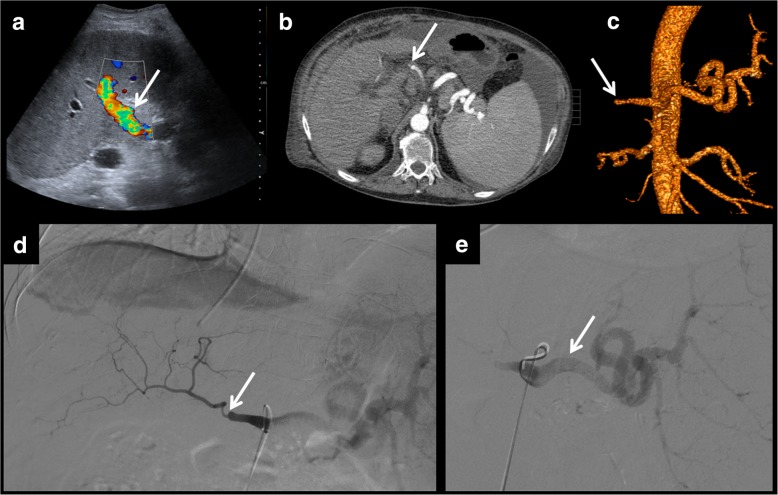
*Mẫu C: **(a)** siêu âm sau mổ — **không xác định rõ động mạch gan**, phổ tĩnh mạch gan **rối loạn/xoáy**; **(b)** CT thì động mạch — **hẹp khu trú nặng** động mạch gan và **động mạch gan mảnh như sợi chỉ** đoạn xa, trong khi **động mạch lách giãn** chiếm phần lớn lưu lượng. Đây là lý do **phải đọc cả động mạch lách** khi động mạch gan "yếu": hướng điều trị là **nút động mạch lách** (can thiệp mạch ngoài gan), không phải nong động mạch gan. Nguồn: Delgado-Moraleda et al., Insights Imaging 2019, PMC6694376 Fig. 6, CC BY 4.0.*

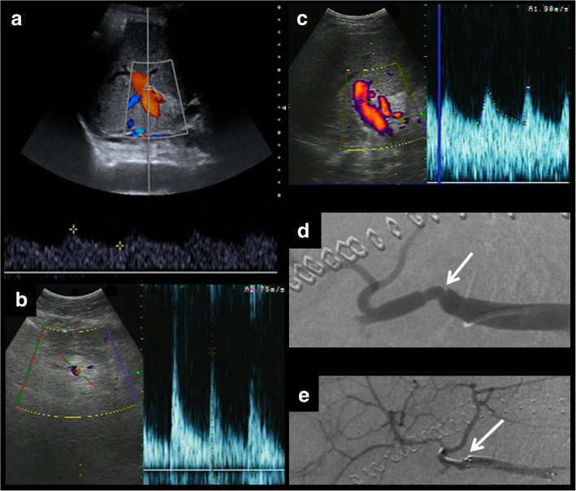
*Bốn khung của cùng một bệnh nhân: **(a)** Doppler màu **bình thường** ở nhánh trong gan — nếu chỉ đọc màu thì **không thấy hẹp**; **(b)** phổ **đoạn trước hẹp** — đỉnh tâm thu cao, **RI cao**; **(c)** phổ **tại chỗ hẹp** — **PSV 395 cm/s** kèm aliasing; **(d–e)** chụp mạch xác nhận hẹp khu trú và nong bóng. Đây chính là lý do **phải lấy phổ ở nhiều điểm**, không chỉ một nhánh. Nguồn: Delgado-Moraleda et al., Insights Imaging 2019, PMC6694376 Fig. 4, CC BY 4.0.*

## 3. Bảng so sánh phân biệt (ma trận đối chiếu)

| Thực thể (entity) | Hình ảnh điển hình | Chốt vào (rule-in) | Chốt loại (rule-out) | Gợi ý xác nhận |
|---|---|---|---|---|
| **Huyết khối động mạch gan (HAT)** | Mất màu trong lòng mạch; **không phổ** ở nhánh trong gan; phổ **"water-hammer"** giả khỏe; nhồi máu gan hình địa lý | **Khuyết thuốc trong lòng động mạch trên CTA** + **không ngấm đoạn xa**; CEUS **cụt đột ngột** | **Phổ ba pha bình thường ở nhánh trong gan** → loại trừ tắc hoàn toàn | CTA ≤ 1 mm + MPR; CEUS; **DSA** nếu định can thiệp |
| **Hẹp miệng nối động mạch gan (HAS)** | **PSV > 200 cm/s** + aliasing tại chỗ hẹp; **RI < 0,5** + **SAT > 0,08 giây** đoạn xa; **RI > 0,8** đoạn gần | **Bộ ba Dodd** (RI < 0,5; SAT > 0,08 giây; PSV > 200 cm/s) + **nhìn thấy chỗ hẹp** | **PSV đoạn xa > 48 cm/s** với phổ bình thường → **ít khả năng hẹp có ý nghĩa** | Doppler nhiều điểm; CTA; **DSA + đo chênh áp** |
| **Cướp máu lách (splenic steal)** | Động mạch lách **giãn**, động mạch gan **mảnh**, nhu mô **giảm ngấm**; tĩnh mạch gan phổ rối loạn | **Động mạch lách > động mạch gan** trên thì động mạch + suy gan sau ăn | **Động mạch gan đều, PSV bình thường** → không phải steal | CTA; **DSA + nút động mạch lách** |
| **Giả phình động mạch gan** | Túi ngấm thuốc thì động mạch; Doppler **to-and-fro** ở cổ túi; có thể vôi hóa viền | **Túi ngấm thuốc đồng thì với động mạch, giữ hình ở thì muộn** | **Không có túi, dòng chảy đều** → không phải giả phình | CTA; **không sinh thiết xuyên túi**; nút coil/stent phủ |
| **Rò động–cửa** | **Nhánh cửa ngấm sớm thì động mạch**; tĩnh mạch cửa giãn, đảo dòng | **Ngấm thuốc cửa thì động mạch** + tiền sử sinh thiết gần đây | **Cửa chỉ ngấm thì cửa** → không rò | CTA 3 thì; DSA + nút coil |
| **Nhồi máu gan** | Vùng **giảm ngấm hình địa lý**, bờ theo phân thùy; siêu âm **dấu dải sáng**; muộn → dịch hóa/kén | **Phân bố theo lãnh thổ mạch + bằng chứng tắc/hẹp động mạch** | **Ngấm đồng nhất toàn gan** → không nhồi máu | CEUS (giảm ngấm cả hai thì); CTA; theo dõi |
| **Áp-xe gan (bắt chước nhồi máu)** | Ổ dịch **bờ rõ**, **khí trong ổ**, viền ngấm thì động mạch kiểu **vòng/honeycomb** | **Viền ngấm + khí + sốt cao, bạch cầu tăng** | **Giảm ngấm cả hai thì, không viền** → nhồi máu, không áp-xe | CEUS phân biệt rõ; chọc hút khi cần |
| **Co thắt/suy giảm dòng do thuốc vận mạch** | Mất màu **lan tỏa**, phổ giảm biên độ nhưng **có**; hồi phục khi giảm thuốc | **Hồi phục sau khi chỉnh thuốc/huyết áp**; mạch **không khuyết thuốc** trên CTA | **Khuyết thuốc cố định** trên CTA → là huyết khối thật | CTA; theo dõi 24–48 giờ |

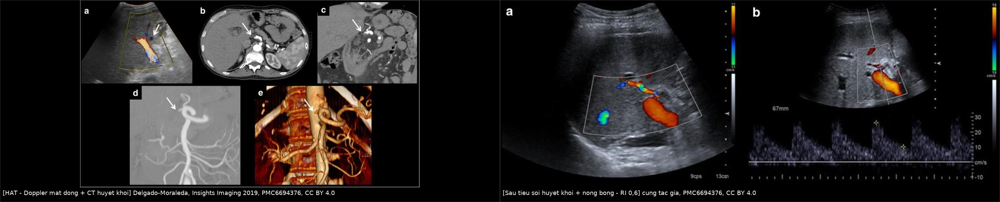
*Trái: **(a)** Doppler màu **mất tín hiệu** trong động mạch gan (mũi tên), **(b–c)** CT có **khuyết thuốc** trong lòng mạch và không ngấm đoạn xa, **(d–e)** chụp mạch khẳng định tắc. Phải: **sau tiêu sợi huyết + nong bóng** — dòng màu trở lại, phổ có dạng bình thường với **RI 0,6**. Cùng bệnh nhân, cùng máy → thay đổi **thuần tuý do tái thông**. Nguồn: Delgado-Moraleda et al., Insights Imaging 2019, PMC6694376 Fig. 2 + Fig. 3, CC BY 4.0. Ảnh ghép letterbox, **đã thay đổi** (ghép + chú thích).*

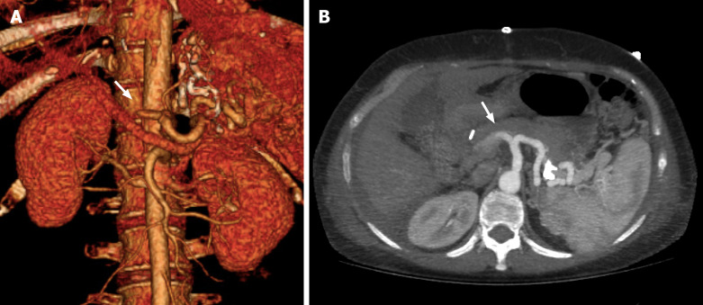
*Bệnh nhân nữ 51 tuổi, **ngày thứ 7 sau ghép gan**. Trái: **dựng hình 3D (VRT)** — động mạch gan **tắc ngay sau chỗ xuất phát**, không có thuốc ở đoạn xa (mũi tên). Phải: **lát cắt ngang MIP** — **khuyết thuốc** trong lòng động mạch gan tại rốn gan (mũi tên). Nhu mô gan vẫn ngấm thuốc **qua tĩnh mạch cửa** — đây là lý do "gan trông bình thường" trong khi đường mật đã thiếu máu. Nguồn: *World J Transplant* 2024, PMC10989478 Fig. 2, CC BY-NC 4.0 (nguyên bản, không chỉnh sửa).*

### Ba con số của phổ Doppler — đọc theo thứ tự nào

- **Bước 1 — RI ở nhánh TRONG GAN:** **< 0,5** → nghi hẹp/tắc đoạn gần hoặc shunt; **> 0,8** → nghi sức cản tăng (phù mảnh ghép, chèn ép, tắc đoạn xa) — **nhưng 72 giờ đầu bỏ qua**.
- **Bước 2 — hình dạng sóng:** **tardus-parvus** (lên chậm, tù đầu, **SAT > 0,08 giây**) → hẹp đoạn gần; **water-hammer** (đỉnh bình thường + đảo tâm trương) → **tắc đoạn xa**.
- **Bước 3 — PSV tại miệng nối:** **> 200 cm/s** → hẹp có ý nghĩa; **PSV ≤ 48 cm/s** ở đoạn xa kèm tardus-parvus → **đặc hiệu 99%** cho hẹp.

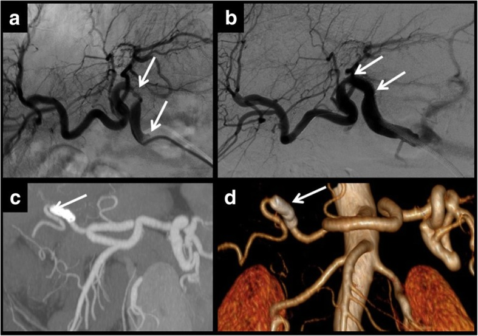
*Hẹp **nhiều điểm** trên cùng một động mạch gan: chụp mạch thấy **hai chỗ hẹp riêng biệt** (a, b) → phải **xử trí từng chỗ**; hai stent được đặt, CT kiểm tra (c: MIP, d: volume rendering) xác nhận **stent đúng vị trí và có dòng đoạn xa**. Bài học: **một chỗ hẹp được nong không có nghĩa là hết hẹp** — luôn chụp toàn bộ trục động mạch. Nguồn: Delgado-Moraleda et al., Insights Imaging 2019, PMC6694376 Fig. 5, CC BY 4.0.*

## 4. Protocol chụp + hệ phân độ/ngưỡng xử trí

**A. Siêu âm Doppler — công cụ sàng lọc:**

- **Lịch:** **24–48 giờ, ngày 7, tháng 1, tháng 3** sau ghép (PMC6694376); nghiên cứu rDUS dùng **POD 0, 1 và 7** và thấy **POD 0 chiếm 26,9%** biến chứng sớm (PMC10716223). Thêm chỉ định đột xuất: men gan tăng, sốt, vàng da, giảm tiểu cầu, mảnh ghép suy.
- **Bắt buộc ghi:** (1) **RI** ở **nhánh trong gan** (phải và trái); (2) **hình dạng phổ** (ba pha/tardus-parvus/water-hammer); (3) **PSV tại miệng nối** + góc đo; (4) **PSV đoạn trước hẹp** để tính **tỉ lệ**; (5) **SAT**; (6) tĩnh mạch cửa (chiều, vận tốc) và **phổ tĩnh mạch gan**; (7) **nhu mô** (vùng giảm âm, dải sáng, ổ dịch/khí).
- **Ngưỡng nghi:** **RI < 0,5** hoặc **> 0,8 sau ngày 4**; **SAT > 0,08 giây**; **PSV > 200 cm/s**; **mất tín hiệu màu** ở nhánh trong gan.
- **CEUS** ngay khi Doppler không kết luận: xác nhận **cụt động mạch**, phân biệt **nhồi máu (giảm ngấm cả hai thì)** với **áp-xe (viền/honeycomb)** (PMC11794643).

**B. CT / MRI:**

- **CTA 3 thì** (không cản quang, động mạch, cửa) với lát **≤ 1 mm**, dựng **MPR/MIP/VR** theo trục động mạch gan — vì mạch **3–5 mm** và cong mạnh.
- Đọc **ba tầng**: miệng nối, đoạn trong gan, và **nhu mô** (nhồi máu/áp-xe); **luôn đọc cả tĩnh mạch cửa và tĩnh mạch gan** (biến chứng thường đi đôi).
- **MRI** khi cần tránh iod hoặc nghi nhiễm: mảng nhồi máu **T1 giảm, T2 tăng, hạn chế khuếch tán ở thể cấp**, **không ngấm** sau tiêm.

**C. DSA — chẩn đoán và điều trị trong cùng một thì:**

- **Đường vào:** **động mạch đùi** (thường) hoặc **động mạch cánh tay** khi giải phẫu bất lợi.
- **Nong bóng (PTA)** trước: bóng **đường kính bằng mạch lành**, áp lực tăng dần; **chụp lại + đo chênh áp**.

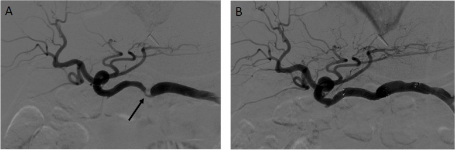
*Ví dụ chọn đường can thiệp: **(A)** chụp mạch cho thấy chỗ hẹp (mũi tên) nằm trên một **đoạn mạch thẳng**, thuận lợi cho **can thiệp trực tiếp trong gan** (nong bóng/stent); **(B)** kết quả sau can thiệp. Ngược lại, khi chỗ hẹp **sát đoạn gập > 90°**, dụng cụ khó vào và dễ gây bóc tách → chuyển **can thiệp mạch ngoài gan** (nút động mạch lách) với **4% biến chứng** so với **29%** ở nhóm can thiệp trong gan. Nguồn: Desai et al., CVIR Endovasc 2024, PMC11032299 Fig. 2, CC BY 4.0.*
- **Stent** khi **recoil/hẹp lại > 50%**, **bóc tách**, hoặc hẹp **dài/tái phát**. Meta **325 ca**: stent **giảm can thiệp lại RR 0,57** và **kéo dài thời gian tới tái hẹp +36,42 tháng**, **không** tăng biến chứng nặng (PMC12501083).
- **Can thiệp mạch ngoài gan (EHAI):** nút **động mạch lách** khi có **steal** hoặc khi chỗ hẹp **nằm sát đoạn gập > 90°** không đưa dụng cụ vào được — loạt **27 thủ thuật/22 ca** cho **0% tử vong liên quan gan 1 năm** và **4% biến chứng** (PMC11032299).
- **Chống chỉ định tương đối:** **giả phình nhiễm khuẩn** (nguy cơ vỡ) → ưu tiên **stent phủ/nút + kháng sinh**, cân nhắc mổ.

**D. Sơ đồ quyết định:**

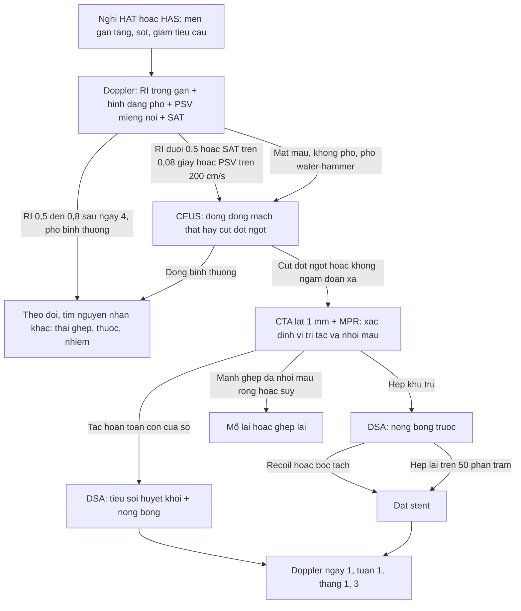

**E. Ngưỡng xử trí tóm tắt:**

| Tình huống | Hành động |
|---|---|
| **RI > 0,8 trong 3 ngày đầu**, phổ còn đỉnh rõ | **Theo dõi tới ngày 4–5**, không can thiệp |
| **RI < 0,5** nhưng **không thấy chỗ hẹp**, mạch liên tục | Tìm **shunt/steal/rò**, không nong mù |
| **PSV > 200 cm/s** + **nhìn thấy hẹp** | **DSA + nong bóng** |
| **Hẹp tái phát sau nong** | **Stent** (can thiệp lại **RR 0,57**) |
| **HAT sớm < 7 ngày**, mảnh ghép chưa hoại tử | **Tiêu sợi huyết/nong bóng/stent** trong cửa sổ hẹp |
| **HAT + nhồi máu rộng/hoại tử đường mật** | **Mổ lại hoặc ghép lại** (ca ghép lần 3 → ghép lần 4, PMC12494202) |
| **Giả phình nhiễm** | **Kháng sinh + nút/stent phủ**, tránh sinh thiết qua túi |
| **Nguy cơ cao HAT** (miệng nối làm lại, tái tạo động mạch, xơ gan không rõ nguyên nhân) | **Kháng kết tập tiểu cầu 3 tháng** — giảm HAT sớm **aHR 0,18**, không tăng chảy máu (PMC11692146) |

**F. Chọn kiểu điều trị HAT — bằng chứng 2024–2026:**

- **Tiêu sợi huyết qua catheter** (khi tắc mới, **chưa hoại tử lan rộng**): urokinase **≤ 1,2 triệu U/24 giờ**, tổng **≤ 7 ngày**, theo dõi DSA; thành công kỹ thuật **tới 80%** (PMC12335213). Hạn chế: **không đánh giá được toàn bộ tưới máu gan**, phải chụp lại nhiều lần, **không dùng khi có ổ hoại tử/nhiễm**.
- **Mổ lại — khâu lại miệng nối hay mạch cầu nối (AHCI):** loạt **37 ca eHAT** cho thấy **tái huyết khối 12,5% với AHCI vs 47,3% với khâu lại** (p = 0,03), biến chứng mật **31,2% vs 47,4%**, tử vong **12,5% vs 5,3%** (PMC10874575). Khi **miệng nối căng, mạch ngắn, thành mạch kém**, **mạch cầu nối** là lựa chọn hợp lý hơn.
- **Ghép lại (re-OLT):** chỉ định khi **hoại tử nhu mô lan rộng** hoặc **bệnh lý đường mật không hồi phục**; là **chuẩn vàng** trong nhiều loạt, chiếm **33,3–51,4%** ca HAT (PMC12251336, PMC13142963). Không chờ "thử can thiệp" ở bệnh nhân đã có **nhiễm trùng ổ bụng/hoại tử**.
- **Việc cần làm ngay sau khi tái thông:** **Doppler lại trong 12–24 giờ**, rồi theo **lịch 48 giờ – ngày 7 – tháng 1 – tháng 3**; **theo dõi đường mật bằng MRCP** vì tổn thương thiếu máu đã hình thành **không hồi phục** (biến chứng mật **31,2–47,4%** sau eHAT; PMC10874575).

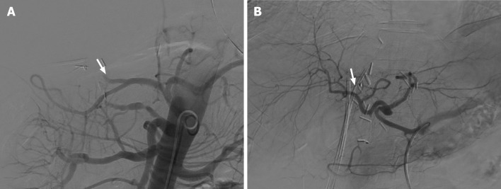
*Chụp mạch tạng **ngày thứ 3 sau ghép gan**. (A) **Tắc hoàn toàn động mạch gan** — chỉ còn gốc cụt (mũi tên). (B) **Sau lấy huyết khối**, động mạch gan **tái thông**, các nhánh trong gan hiện rõ. Đây là ví dụ cho thấy **cửa sổ can thiệp rất ngắn**: cùng một tổn thương, kết quả phụ thuộc vào **thời điểm** chứ không chỉ kỹ thuật. Nguồn: *World J Transplant* 2024, PMC10989478 Fig. 4, CC BY-NC 4.0 (nguyên bản, không chỉnh sửa).*

## 5. Biến thể bình thường và cạm bẫy

**A. Biến thể bình thường (normal variant):**

- **RI > 0,8 trong 72 giờ đầu** ở **~50%** bệnh nhân do phù mảnh ghép — **bình thường hóa ~ngày 4** (PMC6694376; ca **0,84 → 0,65**, PMC11463573).

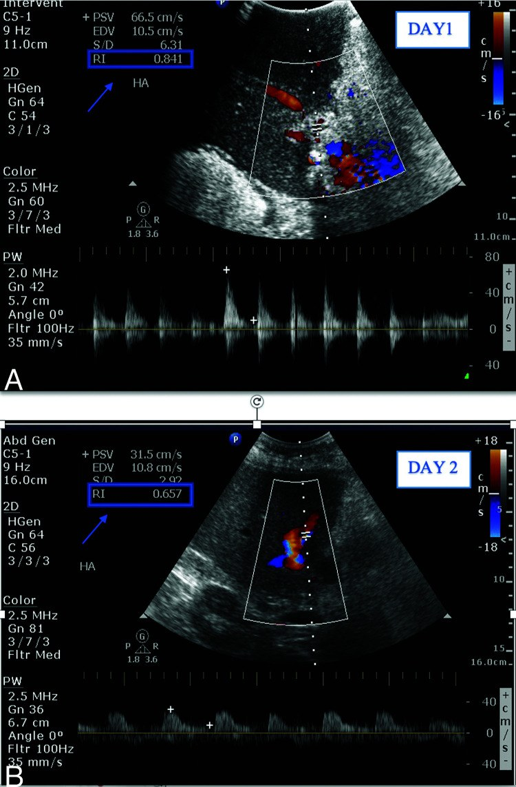
*Cùng một bệnh nhân: **(A)** **ngày 1** — phổ động mạch gan **RI 0,84** (dòng tâm trương rất thấp); **(B)** **ngày 5** — **RI 0,65**, phổ trở lại bình thường **không cần can thiệp gì**. Đây là hình ảnh của **phù mảnh ghép sau bảo quản**, không phải hẹp mạch — nếu nong bóng theo RI ngày 1 thì can thiệp không cần thiết. Nguồn: Babikir et al., Saudi Med J 2024, PMC11463573 Fig. 4, CC BY-NC 4.0.*
- **Động mạch gan nhỏ, cong, chạy sau tĩnh mạch cửa** — khó lấy phổ; **góc tới > 60°** làm **PSV bị đo thấp giả tạo**, dễ bỏ sót hẹp.
- **Động mạch gan thay thế từ động mạch mạc treo tràng trên (variant)** đi qua sau đầu tụy — dễ nhầm "không thấy mạch" khi chỉ khảo sát cửa sổ gan.
- **Tăng tín hiệu màu do nhiễu chuyển động/máy thở** — giảm bằng cách bảo bệnh nhân nín thở, giảm gain.
- **Nhu mô ngấm không đồng nhất nhẹ ở thì động mạch** ngay sau tái tưới máu là bình thường; chỉ có giá trị khi **kéo dài sang thì cửa/muộn** hoặc **có ổ giảm ngấm rõ**.

**B. Cạm bẫy (pitfall):**

- **Phổ "water-hammer" bị đọc là bình thường:** đỉnh tâm thu vẫn cao nhưng **đảo dòng tâm trương + mất dòng liên tục** = **tắc đoạn xa**, không phải mạch khỏe (PMC11794643).
- **Chỉ lấy phổ ở miệng nối:** hẹp có thể ở **đoạn trong gan** hoặc **nhiều điểm** — phải lấy **cả hai nhánh trong gan** và **chụp toàn trục** khi can thiệp.
- **Chẩn đoán HAT chỉ vì mất màu:** mất màu do **góc 90°, PRF thấp, khí, béo** — luôn dùng **power Doppler/CEUS** trước khi kết luận.
- **Men gan bình thường hoặc không triệu chứng không loại trừ HAT:** **66,6%** ca HAT sớm **không có triệu chứng** và chỉ được phát hiện nhờ **Doppler thường quy** (PMC12251336); ngược lại, **43,8%** ca được phát hiện **trong 48 giờ đầu** chính vì có lịch chụp (PMC13142963). Chẩn đoán dựa trên **lịch chụp**, không dựa triệu chứng.
- **Bỏ sót HAT vì men gan chỉ tăng nhẹ:** HAT **muộn** có thể chỉ biểu hiện **hẹp đường mật/áp-xe tái phát**; luôn khảo sát mạch ở mọi ca hẹp đường mật không giải thích.
- **"Satisfaction of search":** thấy HAT rồi **không đọc tĩnh mạch cửa/tĩnh mạch gan** — biến chứng mạch thường **đi đôi**.
- **Nhầm nhồi máu với áp-xe:** cả hai đều giảm âm/giảm ngấm; **dấu dải sáng** + **giảm ngấm cả hai thì trên CEUS** = nhồi máu; **viền ngấm + khí** = áp-xe (PMC11794643).
- **Sinh thiết qua giả phình:** nguy cơ **vỡ**, đặc biệt khi giả phình **nhiễm (tới 81%)** — chụp mạch trước khi sinh thiết nếu có khối đập theo mạch.
- **Nong bóng "mù" theo Doppler:** nong khi **không thấy chỗ hẹp** dễ gây **bóc tách**; luôn có **DSA + đo chênh áp**.
- **Quên rằng stent không lớn theo trẻ:** ở trẻ, stent động mạch **hẹp tương đối khi lớn** và **cản trở ghép lại** → ưu tiên **nong lặp lại**.

## 6. Tự lượng giá — Blind Quiz

**Ca 1 — Nam 65 tuổi, ngày 1 sau ghép gan, men gan tăng, nghi giảm dòng động mạch.**

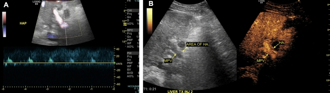

- Hỏi: (1) mô tả phổ ở khung (a); (2) vì sao phổ này **không** phải phổ bình thường? (3) khung (b) chứng minh gì?

<b>Bấm để hiện đáp án (findings + chẩn đoán)</b>

- **(a)** phổ **"water-hammer"**: **đỉnh tâm thu bình thường, giảm nhanh, đảo dòng trong thì tâm trương** — dấu hiệu của **túi cụt** phía sau chỗ tắc, không phải mạch thông tốt.
- **(b)** CEUS: **nhu mô ngấm sớm qua tĩnh mạch cửa** trong khi **động mạch gan ngấm muộn, nhỏ và cụt đột ngột** ngay trước chỗ chia đôi (mũi tên) → **huyết khối động mạch gan**, xác nhận trong mổ.
- **Chốt:** phổ "đẹp" không loại trừ tắc; **CEUS/CTA** mới xác định.
- Nguồn: Chau et al., Abdom Radiol 2025, PMC11794643 Fig. 1, CC BY 4.0.

**Ca 2 — Bệnh nhân sau ghép gan, Doppler màu trong gan "bình thường", nhưng men gan tăng kéo dài.**

- Hỏi: (1) vì sao khung (a) trông bình thường? (2) ba con số cần đo ở khung (b) và (c)? (3) ngưỡng chẩn đoán?

<b>Bấm để hiện đáp án</b>

- **(a)** Doppler màu **chỉ thấy có dòng**, không định lượng được hẹp → **phải lấy phổ**.
- **(b)** đoạn **trước hẹp**: **RI > 0,8**, đỉnh tâm thu cao; **(c)** **tại chỗ hẹp**: **PSV 395 cm/s** + aliasing; đoạn sau hẹp: **RI < 0,5** + **SAT > 0,08 giây** (tardus-parvus).
- **Ngưỡng:** bộ ba Dodd (**RI < 0,5**; **SAT > 0,08 giây**; **PSV > 200 cm/s**) + **nhìn thấy hẹp**; chụp mạch xác nhận và nong bóng.
- Nguồn: Delgado-Moraleda et al., Insights Imaging 2019, PMC6694376 Fig. 4, CC BY 4.0.

**Ca 3 — Nữ 25 tuổi, ghép gan lần 3 vì xơ gan mảnh ghép; ngày 3 sau mổ đau bụng, men gan tăng vọt.**

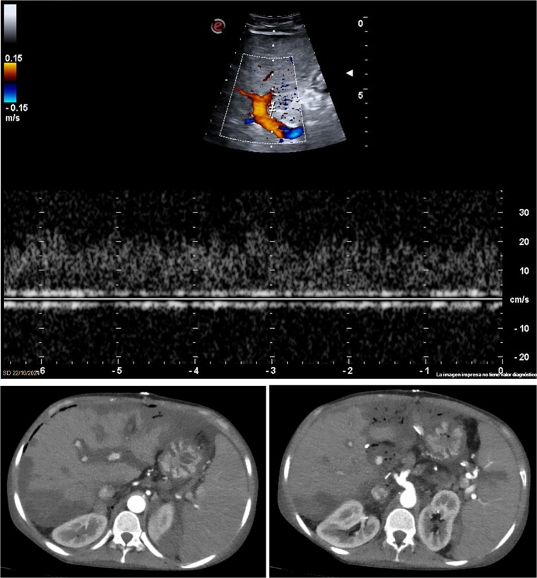

- Hỏi: (1) đọc (a) và (b–c); (2) vì sao **ghép lại** thay vì chỉ nong bóng? (3) yếu tố kỹ thuật nào của ca này làm nguy cơ cao?

<b>Bấm để hiện đáp án</b>

- **(a)** Doppler **mất hoàn toàn dòng động mạch gan**; **(b–c)** CTA: **tắc đoạn gần động mạch gan** + **nhiều vùng giảm ngấm trong nhu mô** phù hợp **thiếu máu/nhồi máu**.
- **Vì sao ghép lại:** tổn thương đã **lan rộng ra nhu mô** (nhồi máu), không còn "cửa sổ" tái thông; bệnh nhân được **ghép lần 4 cấp cứu**, tạo miệng nối mới giữa **nguyên ủy động mạch lách và miếng Carrel** của động mạch tạng người cho, hồi phục hoàn toàn.
- **Yếu tố nguy cơ:** **ghép lại nhiều lần** → dính, xơ rốn gan, mạch **giảm sản**, phải dùng **động mạch lách** làm nguồn → dòng thấp, dễ huyết khối.
- Nguồn: Pons et al., J Surg Case Rep 2025, PMC12494202 Fig. 2, CC BY 4.0.

**Ca 4 — Cùng bệnh nhân Ca 2 sau can thiệp:**

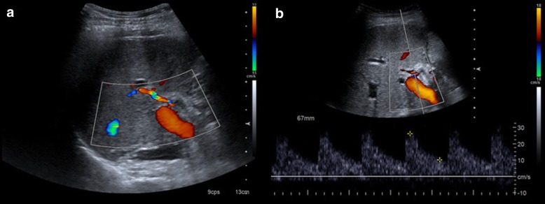

- Hỏi: (1) hai khung chứng minh điều gì? (2) RI sau thủ thuật là bao nhiêu và vì sao quan trọng?

<b>Bấm để hiện đáp án</b>

- **(a–b)** dòng màu **trở lại đầy đủ** trong động mạch gan, phổ **có đỉnh rõ và dòng tâm trương liên tục**.
- **RI 0,6** — nằm trong **khoảng bình thường 0,5–0,8**; đây là **đích cần đạt** sau tái thông (khác với **RI < 0,5** của hẹp còn tồn tại).
- Nguồn: Delgado-Moraleda et al., Insights Imaging 2019, PMC6694376 Fig. 3, CC BY 4.0.

**Ca 5 — Nam 55 tuổi, ngày 3 sau ghép gan, Doppler mất dòng động mạch gan; CTA xác nhận tắc hoàn toàn, nhu mô chưa có ổ hoại tử.**

- Hỏi: (1) mô tả (A); (2) vì sao **không** chọn ghép lại ngay ở ca này? (3) sau (B), cần theo dõi gì và trong bao lâu?

<b>Bấm để hiện đáp án</b>

- **(A)** **tắc hoàn toàn động mạch gan** — chỉ còn **gốc cụt**, không có nhánh trong gan.
- **Vì sao chưa ghép lại:** **chưa có hoại tử nhu mô/đường mật lan rộng** và còn **cửa sổ tái thông**; ghép lại là lựa chọn **khi tái thông thất bại** hoặc đã có tổn thương không hồi phục. Có thể **tiêu sợi huyết qua catheter** (thành công tới **80%**) hoặc **mổ lại** (AHCI giảm tái huyết khối còn **12,5%**).
- **Theo dõi:** Doppler **12–24 giờ** sau can thiệp, rồi **48 giờ – ngày 7 – tháng 1 – tháng 3**; theo dõi **bilirubin/men gan** và **MRCP** để phát hiện **hẹp đường mật do thiếu máu** (xuất hiện dù mạch đã thông).
- Nguồn: *World J Transplant* 2024, PMC10989478 Fig. 4, CC BY-NC 4.0.

## Bài liên quan chéo
- [1914 – Suy chức năng mảnh ghép gan sớm (EAD) & mảnh ghép không chức năng nguyên phát (PNF)](../1914-suy-chuc-nang-manh-ghep-som/lesson.md) — **cùng bệnh cảnh "men gan tăng ngày 3"**, nhưng chẩn đoán bằng **sinh hóa** và CĐHA chỉ để **loại trừ** hẹp/tắc mạch.
- [1906 – Hẹp dòng ra tĩnh mạch gan sau ghép (HVOO)](../1906-hep-dong-ra-tm-gan-sau-ghep-gan/lesson.md) — biến chứng mạch **dòng ra**, cùng logic **Doppler + đo chênh áp**.
- [1909 – Hẹp–tắc tĩnh mạch cửa sau ghép gan](../1909-hep-tinh-mach-cua-sau-ghep-gan/lesson.md) — biến chứng **dòng vào**; **PVT 8,2%** trong cùng đoàn hệ rDUS.
- [1910 – Hội chứng tắc xoang gan (SOS/VOD)](../1910-hoi-chung-tac-xoang-gan-sos/lesson.md) — gan ngấm không đồng nhất **không do tắc mạch lớn**.
- [133 – Hẹp miệng nối & cholangiopathy thiếu máu sau ghép gan](../133-hep-mieng-noi-duong-mat-sau-ghep/lesson.md) — **hậu quả đường mật** của HAT/HAS không được nhận ra.
- [1908 – Thiếu máu mạc treo cấp–mạn & bóc tách động mạch tạng](../1908-thieu-mau-mac-treo-va-boc-tach-dong-mach-tang/lesson.md) — cùng nguyên lý **"mất ngấm thành/tạng = thiếu máu"** trên CTA.
- [176 – TIPS/DIPS: theo dõi shunt](../176-tips-dips-theo-doi-shunt/lesson.md) — cùng phương pháp **Doppler định kỳ + đo áp** khi can thiệp mạch trong gan.

## Ảnh
- 11 ảnh + 1 ảnh ghép, tải từ **PMC CDN** của PubMed Central (bài open access), **không chỉnh sửa pixel**; nguồn + giấy phép từng file trong `images/CREDITS.md`.
- Tên file: `1913_<nội dung>_<Modality>_PMCxxxxx-fN.jpg`; ảnh ghép `composite_hat-truoc-sau.jpg` tạo bằng `tools/make_composite.py` (letterbox nền đen, **không crop/kéo giãn**), ghi rõ **đã thay đổi**.
- Ảnh **không** tải: Radiopaedia (chỉ dẫn link), AuntMinnie (chỉ dẫn link), các bài không rõ giấy phép — xem `sources.md`.

> Không dùng để chẩn đoán độc lập khi chưa có người hướng dẫn.
