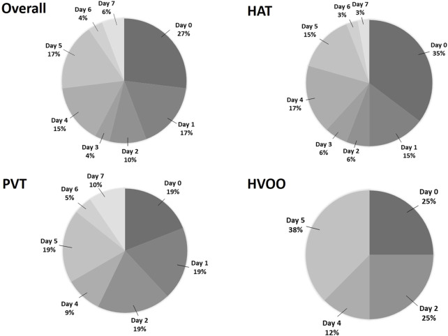
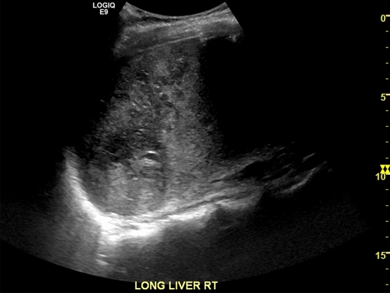
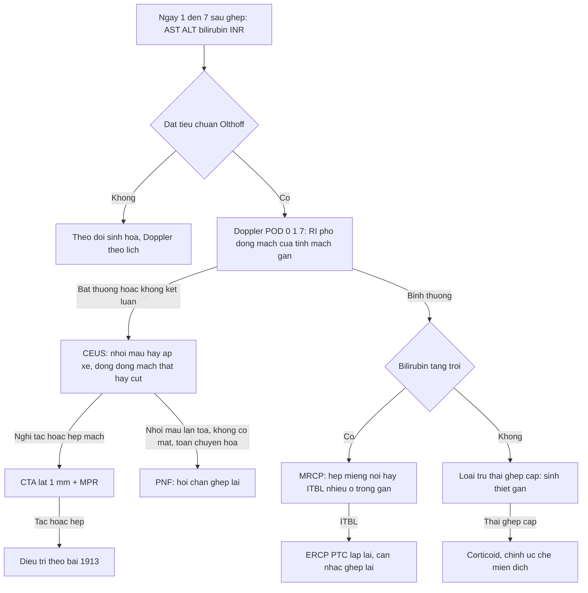
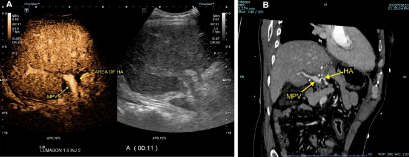
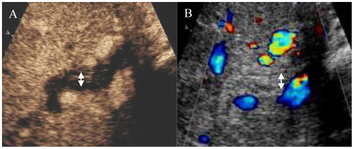
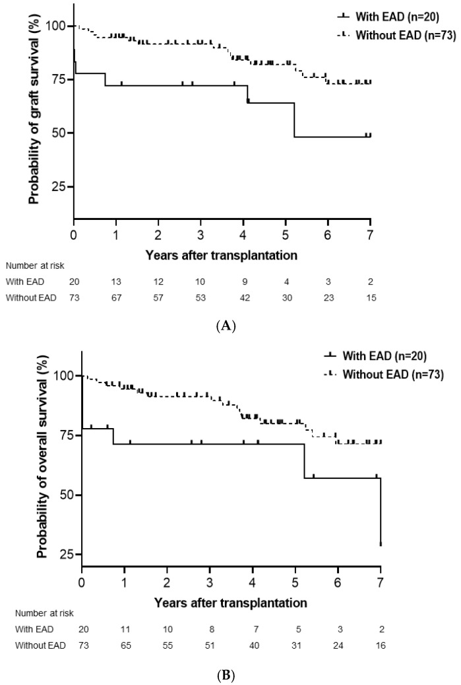

# 1914 — Suy chức năng mảnh ghép gan sớm (EAD) & mảnh ghép không chức năng nguyên phát (PNF): tiêu chuẩn Olthoff, dấu "dải sáng", và vì sao CĐHA **không** chẩn đoán EAD / Early allograft dysfunction & primary non-function

**Tags:** `pattern:suy-manh-ghep` `pattern:nhoi-mau-gan` `pattern:ngam-khong-dong-nhat` `pattern:hoai-tu-duong-mat` `pattern:ap-xe-gan` `pattern:giai-doan-ngam-thuoc` `vung:gan` `vung:duong-mat` `vung:mieng-noi` `score:Olthoff-EAD` `score:RI` `protocol:Doppler` `protocol:CEUS` `protocol:CTA-3-thi` `protocol:MRCP` `protocol:sinh-thiet-gan`

**Mức chắc chắn (certainty):** tổng hợp y văn (literature synthesis) — số liệu lấy từ 5 bài open-access đã đọc toàn văn: Shin & Suh, *Medicina (Kaunas)* 2025 (PMC12471369, CC BY 4.0 — 93 ca, tiêu chuẩn EAD và yếu tố nguy cơ); Minciuna et al., *Transpl Int* 2023 (PMC10716223, CC BY 4.0 — 708 ca, thời điểm biến chứng mạch máu sớm); Chau et al., *Abdom Radiol* 2025 (PMC11794643, CC BY 4.0 — dấu "dải sáng", CEUS phân biệt nhồi máu/áp-xe); Zhang et al., *PLoS One* 2014 (PMC4156319, CC BY 4.0 — CEUS đường mật trong ITBL); Saparbay et al., *J Clin Med* 2026 (PMC13467232, CC BY 4.0 — meta bơm tưới máy, tiêu chuẩn Olthoff); Tang et al., *Front* 2024 (PMC10793758, CC BY 4.0 — meta HOPE). Bài **không** có ca nguyên văn riêng của nhóm.

> **Câu hỏi gốc của bài:** bệnh nhân **ngày 7 sau ghép gan**, vàng da tăng, **bilirubin 14 mg/dL**, **INR 1,9**, AST đã về gần bình thường; siêu âm **mạch máu bình thường**, CT **không có ổ dịch**. Vậy: **đây là EAD, PNF, thải ghép cấp, hay một biến chứng mạch–mật đang bị bỏ sót? và CĐHA phải làm gì — chẩn đoán, hay chỉ loại trừ?**
> **Điểm tựa:** **EAD/PNF là chẩn đoán SINH HÓA, không phải chẩn đoán hình ảnh**. CĐHA **không** đo được chức năng gan; việc của nó là **loại trừ nguyên nhân ngoại khoa có thể chữa được** (hẹp/tắc động mạch gan, tắc tĩnh mạch cửa, hẹp dòng ra, hẹp đường mật, áp-xe) và **phát hiện tổn thương nhu mô không hồi phục** (nhồi máu, hoại tử đường mật) để quyết định **theo dõi hay ghép lại**.

## 1. Tổng quan — vì sao mảnh ghép "suy sớm", và vì sao ảnh chỉ đứng ở hàng thứ hai

**A. Bệnh học (pathology) và cơ chế:**

- **Định nghĩa EAD (tiêu chuẩn Olthoff, 2010):** có **≥ 1** trong ba tiêu chí — **bilirubin ≥ 10 mg/dL vào ngày 7**, **INR ≥ 1,6 vào ngày 7**, hoặc **ALT/AST > 2.000 IU/L trong 7 ngày đầu** (PMC12471369; PMC13467232). Đây là **tiêu chuẩn sinh hóa**, cố ý **không** dựa trên hình ảnh.
- **Định nghĩa PNF (primary non-function):** mảnh ghép **không bao giờ đạt chức năng**, thường phải **ghép lại trong 7 ngày đầu**. Không có tiêu chuẩn sinh hóa thống nhất giữa các nghiên cứu — vì vậy khi đọc y văn phải xem **định nghĩa của từng bài**, không gộp số.
- **Sinh lý bệnh:** **tổn thương thiếu máu–tái tưới máu (ischemia–reperfusion injury)** → **giảm ATP, rối loạn bơm ion, tế bào gan trương phồng** → **chèn ép xoang gan** và **"no-reflow"** (dòng không tái lập đủ ở vi tuần hoàn) → **ngấm thuốc chậm/không đồng nhất**; đồng thời **bạch cầu và Kupffer cell hoạt hóa** gây viêm nhu mô. **Đường mật chịu thiếu máu sớm nhất** (chỉ có nguồn động mạch) → **hoại tử biểu mô mật, hẹp đường mật thiếu máu (ITBL)** xuất hiện **hàng tuần đến hàng tháng sau**.
- **Vì sao EAD không đồng nghĩa với "mảnh ghép hỏng":** EAD là **phổ liên tục** từ "chậm hồi phục" tới "suy nặng"; phần lớn **hồi phục** nếu **không có nguyên nhân mạch–mật**. Nhưng EAD là **yếu tố tiên lượng độc lập**: trong **93 ca**, EAD **21,5%**, làm giảm **sống mảnh ghép (p = 0,021)** và **sống bệnh nhân (p = 0,027)** (PMC12471369).
- **Yếu tố nguy cơ định lượng (93 ca, PMC12471369):** **suy gan cấp trước ghép OR 6,228 (1,179–32,906), p = 0,031**; **tuổi người cho OR 1,051 mỗi năm (1,008–1,096), p = 0,020**; **thời gian thiếu máu ấm OR 1,048 mỗi phút (1,001–1,098), p = 0,046**.
- **Vì sao phải chụp mạch trong 7 ngày đầu:** biến chứng mạch máu **tập trung ngay tuần đầu** — **POD 0: 26,9%**, **POD 1: 17,3%**, **POD 5: 17,3%**; **HAT** được chẩn đoán trung vị **ngày 4**, **PVT ngày 47**, **HVOO ngày 21** (PMC10716223). Một ca "EAD" không loại trừ mạch có thể chỉ là **HAT được phát hiện muộn**.
- **Vì sao RI cao ngay sau ghép không phải bệnh:** phù mảnh ghép → **RI > 0,8 ở ~50% trong 3 ngày đầu**, **bình thường hóa ~ngày 4** (PMC6694376, dùng cho bài 1913). Vì vậy **"EAD + RI cao"** ở ngày 1–3 **không** đủ để kết luận hẹp mạch.
- **Vì sao bơm tưới máy (machine perfusion) làm giảm EAD:** rửa và cấp oxy trong bảo quản → **giảm ATP depletion và giảm hoạt hóa viêm** → tổn thương tái tưới máu nhẹ hơn. Meta **21 nghiên cứu/3.665 ca**: MP vs bảo quản lạnh tĩnh (SCS) giảm **EAD RR 0,67 (0,48–0,94), p = 0,020**, **PNF RR 0,31 (0,11–0,84), p = 0,020**, **mất mảnh ghép 1 năm RR 0,54 (0,36–0,81), p = 0,003**; hiệu quả tập trung ở **HMP/HOPE** (EAD **RR 0,66**; PNF **RR 0,23**), còn **NMP chưa đạt ý nghĩa** cho hai đích này (PMC13467232). Meta HOPE riêng (**11 nghiên cứu, 5 RCT, 1.000 ca**): **EAD RR 0,54**, **hẹp mật không miệng nối (NAS) RR 0,34**, **biến chứng mật RR 0,74**, **ghép lại RR 0,42**, **mất mảnh ghép 1 năm RR 0,38**; **PNF RR 0,54 không đạt ý nghĩa** (PMC10793758).

**B. Ngưỡng định lượng bắt buộc (cửa 1 Argon):**

| Đại lượng | Con số đã kiểm chứng | Ý nghĩa thực hành |
|---|---|---|
| EAD — tiêu chuẩn Olthoff | **bilirubin ≥ 10 mg/dL ngày 7** HOẶC **INR ≥ 1,6 ngày 7** HOẶC **ALT/AST > 2.000 IU/L trong 7 ngày** (PMC12471369; PMC13467232) | Chỉ cần **1 tiêu chí**; **không** dùng hình ảnh để chẩn đoán |
| Tần suất EAD | **21,5% (20/93)** (PMC12471369) | Con số tham chiếu khi đọc các loạt khác |
| Tiên lượng của EAD | sống mảnh ghép **p = 0,021**, sống bệnh nhân **p = 0,027** (độc lập) (PMC12471369) | EAD **không** phải "biến cố lành tính" |
| Nguy cơ EAD — suy gan cấp trước ghép | **OR 6,228 (1,179–32,906)**, p = 0,031 (PMC12471369) | Bệnh nhân nặng trước mổ → cảnh giác cao |
| Nguy cơ EAD — tuổi người cho | **OR 1,051/năm (1,008–1,096)**, p = 0,020 (PMC12471369) | Mỗi 10 năm tuổi cho ≈ **+65%** nguy cơ (theo mô hình) |
| Nguy cơ EAD — thiếu máu ấm | **OR 1,048/phút (1,001–1,098)**, p = 0,046 (PMC12471369) | Mỗi 10 phút ≈ **+60%** nguy cơ (theo mô hình) |
| PNF | mảnh ghép **không đạt chức năng**, thường **ghép lại ≤ 7 ngày**; **không có định nghĩa sinh hóa thống nhất** | Không gộp số giữa các nghiên cứu khác định nghĩa |
| Biến chứng mạch trong tuần đầu | HAT **7,1%**, PVT **8,2%**, HVOO **3,1%** (708 ca); **POD 0: 26,9%**, POD 1: **17,3%**, POD 5: **17,3%** (PMC10716223) | "EAD" phải được **loại trừ mạch** trước khi quy cho nhu mô |
| Thời điểm chẩn đoán | HAT trung vị **4 ngày**; PVT **47 ngày**; HVOO **21 ngày** (PMC10716223) | Lịch Doppler phải phủ **ngày 0, 1, 7** |
| RI sau ghép | **> 0,8 ở ~50%** trong 3 ngày đầu, **bình thường hóa ngày 4** (PMC6694376) | Không can thiệp chỉ vì RI cao sớm |
| Nhồi máu gan | gắn với **tắc động mạch trong 85%** ca (PMC6694376) | Thấy nhồi máu → **đi tìm tắc mạch** |
| Bơm tưới máy (MP) vs SCS | **21 nghiên cứu/3.665 ca**: EAD **RR 0,67**, PNF **RR 0,31**, mất ghép 1 năm **RR 0,54**; HMP/HOPE: EAD **RR 0,66**, PNF **RR 0,23** (PMC13467232) | Cải thiện **chức năng sớm** là có thật, không phải hiệu ứng hình ảnh |
| HOPE (meta riêng) | **11 nghiên cứu/1.000 ca**: EAD **RR 0,54**, NAS **RR 0,34**, ghép lại **RR 0,42**; PNF **RR 0,54 (không ý nghĩa)** (PMC10793758) | HOPE giảm **EAD và hẹp mật**, chưa chứng minh giảm PNF |
| ITBL & CEUS đường mật | thành ống mật rốn gan **ngấm mạnh** bình thường ↔ **ngấm kém** khi ITBL; sống mảnh ghép 1 năm **78,4% vs 92,9%**, 3 năm **53,2% vs 78,6%** (p = 0,008) (PMC4156319) | Hậu quả **muộn** của tổn thương thiếu máu |

**C. TẠI SAO ảnh trông như vậy (vật lý hình ảnh):**

- **CT:** tín hiệu ∝ **nồng độ iod trong nhu mô**. Mảnh ghép tổn thương nặng: **ngấm chậm, đỉnh thấp, không đồng nhất** ("patchy"), **phù nhu mô (giảm tỷ trọng lan tỏa)**, **hẹp xoang gan do tế bào trương phồng** → đây là **hình ảnh của "no-reflow"**, không phải khối u. **Không có ngưỡng HU** được các nguồn xác nhận cho "EAD" → bài **không** đưa số HU.
- **Nhồi máu trên CT:** vùng **giảm ngấm hình địa lý**, **bờ theo phân thùy**, không hiệu ứng khối; khi hoại tử hóa lỏng/nhiễm khí → **ổ dịch + khí**.
- **Siêu âm B-mode:** nhồi máu = **vùng giảm âm bờ không rõ**; **"dấu dải sáng" (bright band sign)** = **nhiều dải tăng âm thẳng** cắt ngang vùng giảm âm, do **phản xạ gương từ các bó cửa còn nguyên** trong vùng hoại tử — **gợi ý nhồi máu hơn là áp-xe** (PMC11794643).
- **CEUS:** vi bọt khí **thuần lòng mạch** → thấy **tưới máu thật**. **Nhồi máu: giảm ngấm ở CẢ thì động mạch và thì muộn**; **áp-xe: viền ngấm thì động mạch hoặc kiểu "honeycomb"** (PMC11794643). Đây là cách phân biệt **hai bệnh cảnh điều trị hoàn toàn khác nhau**.
- **CEUS đường mật (ITBL):** thành ống mật **không ngấm** ở thì động mạch = **mất mạng mao mạch quanh mật**; bình thường thành ống mật **ngấm mạnh** (PMC4156319).
- **MRI/MRCP:** dịch mật **tăng T2** → thấy **hẹp/giãn đường mật**; mảng nhồi máu **T1 giảm, T2 tăng**, **hạn chế khuếch tán ở thể cấp** (phù độc tế bào), **không ngấm** sau tiêm.

## 2. Mẫu hình + chẩn đoán phân biệt theo vị trí (Gamut)

Gamut xếp theo **cái gì đang hỏng**, vì quyết định là **theo dõi, can thiệp, hay ghép lại**:

- **Mẫu A — EAD "thuần túy" (chỉ sinh hóa):** men gan/bilirubin/INR đạt tiêu chuẩn Olthoff nhưng **mạch thông, không ứ mật, không ổ dịch**. Hình ảnh có thể **bình thường hoặc chỉ phù nhẹ**. Điều trị: **nội khoa, theo dõi**.
- **Mẫu B — PNF / nhồi máu lan tỏa:** mảnh ghép **không ngấm đủ**, **phù toàn bộ**, có thể **dải sáng** trên siêu âm, toan chuyển hóa, **không có mật**. Điều trị: **ghép lại**.
- **Mẫu C — nhồi máu KHU TRÚ theo lãnh thổ:** vùng giảm ngấm **hình nêm/theo phân thùy** + **bằng chứng tắc/hẹp mạch** (HAT, HAS, steal). Điều trị: **theo nguyên nhân mạch** (xem bài 1913).
- **Mẫu D — hẹp đường mật thiếu máu (ITBL):** nhiều ổ hẹp **trong gan, không ở miệng nối**, kèm **tắc/hẹp động mạch gan** hoặc tiền sử thiếu máu kéo dài. Điều trị: **nội soi can thiệp lặp lại, cân nhắc ghép lại**.
- **Mẫu E — nhiễm khuẩn (áp-xe) sau nhồi máu:** ổ dịch **bờ rõ + khí**, viền ngấm; **sốt, bạch cầu tăng**. Điều trị: **dẫn lưu + kháng sinh**.

**Gợi nhớ 4I:** **I**njury (EAD/PNF) · **I**nfarct (nhồi máu) · **I**schemic cholangiopathy (ITBL) · **I**nfection (áp-xe).

*Biểu đồ tròn của **708 ca** ghép gan: biến chứng mạch máu **tập trung vào ngày mổ và ngày 1** (POD 0: **26,9%**, POD 1: **17,3%**, POD 5: **17,3%**). Đây là lý do **không được quy một ca "EAD" cho nhu mô** trước khi có Doppler/CEUS trong tuần đầu: cùng một bệnh cảnh sinh hóa, **HAT** có thể là nguyên nhân và **chữa được** nếu phát hiện sớm. Nguồn: Minciuna et al., Transpl Int 2023, PMC10716223 Fig. 2, CC BY 4.0.*

## 3. Bảng so sánh phân biệt (ma trận đối chiếu)

| Thực thể (entity) | Hình ảnh điển hình | Chốt vào (rule-in) | Chốt loại (rule-out) | Gợi ý xác nhận |
|---|---|---|---|---|
| **EAD (suy chức năng sớm)** | Thường **bình thường** hoặc **phù nhẹ, ngấm hơi không đồng nhất**; mạch thông, không ứ mật | **Đạt tiêu chuẩn Olthoff** (bilirubin ≥ 10 mg/dL hoặc INR ≥ 1,6 ngày 7, hoặc ALT/AST > 2.000 IU/L) **+ mạch–mật đã loại trừ** | **Có tắc/hẹp mạch hoặc hẹp đường mật** → **không** gọi là EAD thuần túy | Sinh hóa ngày 1–7; Doppler POD 0/1/7; CEUS/CTA khi bất thường |
| **PNF (không chức năng nguyên phát)** | Mảnh ghép **ngấm kém lan tỏa**, phù, **không có mật**; có thể **dải sáng** | **Không đạt chức năng + phải ghép lại ≤ 7 ngày**; toan chuyển hóa, **không có mật** | **Có mật, INR giảm dần, men gan giảm** → không phải PNF | Theo dõi sát; **loại trừ HAT/PVS/HVOO** trước khi kết luận |
| **HAT (huyết khối động mạch gan)** | Mất tín hiệu màu; phổ **"water-hammer"**; **nhồi máu hình địa lý**; CEUS **cụt đột ngột** | **Khuyết thuốc trong lòng mạch trên CTA** + không ngấm đoạn xa | **Phổ và màu bình thường ở nhánh trong gan** → loại trừ | CTA ≤ 1 mm; CEUS; DSA (bài 1913) |
| **Tắc/hẹp tĩnh mạch cửa** | Tĩnh mạch cửa **không thấy/khuyết thuốc**, gan **giảm ngấm**, **cổ trướng** | **Khuyết thuốc tĩnh mạch cửa** + giãn mạch bàng hệ | **Cửa thông, phổ cửa liên tục** → loại trừ | Doppler cửa; CTV; (bài 1909) |
| **HVOO (hẹp dòng ra)** | Gan **ngấm không đồng nhất** + **periportal collar**, tĩnh mạch gan **giãn, đậm hơn IVC**, mất sóng ba pha | **Chênh áp HV–IVC ≥ 5 mmHg**; tỉ lệ vận tốc **> 4:1** | **Ba pha liên tục + chênh áp ≤ 3 mmHg** → loại trừ | Venography + đo áp (bài 1906) |
| **ITBL (hẹp đường mật thiếu máu)** | Nhiều ổ hẹp **trong gan, KHÔNG ở miệng nối**; giãn mật từng đoạn; thành ống mật **ngấm kém trên CEUS** | **Nhiều ổ hẹp trong gan + tiền sử thiếu máu/HAT/HAS** | **Một ổ hẹp tại miệng nối, bờ nhẵn** → hẹp miệng nối lành tính (bài 133) | MRCP; CEUS đường mật; ERCP/PTC |
| **Áp-xe gan** | Ổ dịch **bờ rõ**, **khí trong ổ**, **viền ngấm/honeycomb** trên CEUS | **Viền ngấm + khí + sốt, bạch cầu tăng** | **Giảm ngấm cả hai thì, không viền** → nhồi máu | CEUS; chọc hút/dẫn lưu |
| **Thải ghép cấp (ACR)** | Gan **to, phù**, tăng tín hiệu T2, **giảm ngấm thì tĩnh mạch**; **không có tắc mạch** | **Sinh thiết** (tiêu chuẩn vàng) + men gan tăng, **mạch–mật đã loại trừ** | **Không có thâm nhiễm/hoại tử trên mô** → không ACR | Sinh thiết gan; theo dõi đáp ứng corticoid |

*Vùng nhu mô **giảm âm bờ không rõ**, trong đó có **nhiều dải tăng âm thẳng** ("bright band sign") — do **phản xạ gương từ các bó cửa còn nguyên** nằm trong vùng nhồi máu. Dấu này **gợi ý nhồi máu hơn là áp-xe**; trên CEUS, nhồi máu **giảm ngấm cả hai thì**, còn áp-xe **có viền ngấm/honeycomb**. Nguồn: Chau et al., Abdom Radiol 2025, PMC11794643 Fig. 5, CC BY 4.0.*

## 4. Protocol chụp + hệ phân độ/ngưỡng xử trí

**A. Sinh hóa — chẩn đoán EAD/PNF (làm trước, không thay thế bằng ảnh):**

- **Ngày 1–7:** **AST, ALT, bilirubin, INR** hằng ngày; thêm **lactate, glucose, amoniac** khi nghi suy nặng.
- **Chốt EAD ngày 7** theo **Olthoff** (1 trong 3 tiêu chí); ghi rõ **tiêu chí nào** để so sánh giữa các ca.
- **PNF:** không có tiêu chuẩn thống nhất → ghi rõ **định nghĩa dùng** (ví dụ "ghép lại ≤ 7 ngày").

**B. Hình ảnh — thứ tự và mục đích:**

- **Doppler + CEUS: POD 0, 1 và 7** (theo mô hình rDUS), thêm chỉ định đột xuất khi men gan tăng/vàng da/sốt. **Bắt buộc ghi:** RI trong gan, hình dạng phổ, PSV miệng nối, phổ tĩnh mạch cửa và tĩnh mạch gan, **nhu mô** (vùng giảm âm, dải sáng, ổ dịch/khí).
- **CEUS ngay** khi Doppler bất thường hoặc không kết luận: phân biệt **nhồi máu (giảm ngấm cả hai thì)** với **áp-xe (viền/honeycomb)**, xác nhận **cụt động mạch**.
- **CTA 3 thì lát ≤ 1 mm + MPR/MIP/VR** khi nghi tắc/hẹp mạch; **luôn đọc cả tĩnh mạch cửa và tĩnh mạch gan**.
- **MRCP** khi **bilirubin tăng mà không có nguyên nhân mạch**: tìm **hẹp đường mật** (phân biệt **miệng nối** với **ITBL nhiều ổ trong gan**).
- **Sinh thiết gan** khi **đã loại trừ mạch–mật** mà men gan vẫn tăng: phân biệt **thải ghép cấp** với **tổn thương bảo quản**.

**C. Ngưỡng xử trí:**

| Tình huống | Hành động |
|---|---|
| Đạt Olthoff nhưng **mạch–mật bình thường** | **EAD** → nội khoa, theo dõi sinh hóa, **không can thiệp mạch** |
| **Không có mật + toan + không ngấm** | Nghi **PNF** → hội chẩn **ghép lại**, song song loại trừ HAT/PVS/HVOO |
| **Có tắc/hẹp mạch** | Điều trị **theo bài 1913** (nong bóng/stent/ghép lại) — **không** gọi là EAD |
| **Nhồi máu khu trú không nhiễm** | Theo dõi, kiểm tra mạch; **dẫn lưu chỉ khi có ổ dịch/khí** |
| **Nhiều ổ hẹp đường mật trong gan (ITBL)** | **ERCP/PTC lặp lại**, cân nhắc **ghép lại** khi tái hẹp |
| **Men gan tăng, mạch–mật loại trừ** | **Sinh thiết** để tìm thải ghép cấp |

**D. Sơ đồ quyết định:**

## 5. Biến thể bình thường và cạm bẫy

**A. Biến thể bình thường (normal variant):**

- **Men gan tăng rất cao trong 24–48 giờ đầu** rồi **giảm nhanh** là **diễn tiến bình thường** sau tái tưới máu — **không** đạt tiêu chí EAD nếu **ngày 7 đã về**.
- **RI > 0,8 trong 3 ngày đầu** ở **~50%** bệnh nhân (phù mảnh ghép) — **bình thường hóa ngày 4**.
- **Ngấm thuốc không đồng nhất nhẹ ở thì động mạch** ngay sau tái tưới máu — chỉ có giá trị khi **kéo dài sang thì cửa/muộn** hoặc **có ổ giảm ngấm rõ**.
- **Giãn nhẹ đường mật trong gan** ở mảnh ghép nhỏ/trái có thể do **thay đổi giải phẫu**, không phải tắc.
- **Dịch quanh gan ít, tự hết** sau mổ — không phải ổ nhiễm.

**B. Cạm bẫy (pitfall):**

- **Gọi "EAD" rồi bỏ qua mạch:** biến chứng mạch tập trung **POD 0–5**; **HAT chẩn đoán trung vị ngày 4** — một ca EAD không Doppler đúng lịch có thể là **HAT bị bỏ sót**.
- **Gọi "PNF" khi chưa loại trừ HVOO/PVS:** mảnh ghép **ngấm kém** do **ứ huyết dòng ra** cũng giống PNF; phải **đo chênh áp** trước khi kết luận không hồi phục.
- **Nhầm nhồi máu với áp-xe:** cả hai **giảm âm/giảm ngấm**; **dải sáng + giảm ngấm cả hai thì** = nhồi máu; **viền ngấm + khí** = áp-xe.
- **Bỏ sót ITBL vì "chỉ hẹp nhẹ":** ITBL là **nhiều ổ hẹp trong gan**, khác hẹp **một ổ tại miệng nối**; điều trị và tiên lượng khác hẳn.
- **Dùng hình ảnh để "chấm điểm" EAD:** không có ngưỡng HU/ADC nào được xác nhận cho EAD — **đừng bịa ngưỡng**; EAD vẫn là **chẩn đoán sinh hóa**.
- **Quên sinh thiết khi mọi thứ "âm tính":** men gan tăng kéo dài với mạch–mật bình thường thường là **thải ghép cấp** — chẩn đoán bằng **mô học**.
- **"Satisfaction of search":** thấy nhồi máu rồi **không đọc mạch**; nhồi máu gắn **tắc động mạch 85%** — luôn đi tìm nguyên nhân.
- **So sánh số EAD giữa các nghiên cứu mà không đọc định nghĩa:** tiêu chuẩn Olthoff **khác** các định nghĩa cũ (chỉ AST) → **không gộp số**.

## 6. Tự lượng giá — Blind Quiz

**Ca 1 — Bệnh nhân ngày 5 sau ghép gan, sốt, men gan tăng; siêu âm thấy vùng giảm âm trong gan.**

- Hỏi: (1) mô tả dấu hiệu trong vùng giảm âm; (2) dấu này gợi ý gì và **loại trừ** gì? (3) bước tiếp theo?

<b>Bấm để hiện đáp án (findings + chẩn đoán)</b>

- **(1)** Vùng **giảm âm bờ không rõ** chứa **nhiều dải tăng âm thẳng** = **"dấu dải sáng" (bright band sign)**.
- **(2)** Gợi ý **nhồi máu nhu mô** (dải sáng do phản xạ từ bó cửa còn nguyên), **ít gặp trong áp-xe** → giúp **loại trừ áp-xe**; nhưng **không** loại trừ nhiễm khuẩn trên nền nhồi máu.
- **(3)** **CEUS**: nhồi máu **giảm ngấm cả hai thì**; áp-xe **viền ngấm/honeycomb**. Đồng thời **CTA/Doppler động mạch gan** vì nhồi máu gắn **tắc động mạch 85%**.
- Nguồn: Chau et al., Abdom Radiol 2025, PMC11794643 Fig. 5, CC BY 4.0.

**Ca 2 — Bệnh nhân ngày 5 sau ghép, men gan tăng; siêu âm nghi giảm tưới máu.**

- Hỏi: (1) hai khung cho thấy gì? (2) vì sao ca này **không** được gọi là "EAD"? (3) nguyên tắc chung?

<b>Bấm để hiện đáp án</b>

- **(a)** CEUS: nhu mô **ngấm sớm qua tĩnh mạch cửa**, **động mạch gan ngấm muộn và cụt**; **(b)** CT có cản quang: **khuyết thuốc** trong động mạch gan → **huyết khối động mạch gan (HAT)**.
- **(2)** Vì **đã tìm được nguyên nhân ngoại khoa có thể chữa**; "EAD" chỉ là **mô tả chức năng**, không phải chẩn đoán cuối. Gọi EAD ở đây sẽ **bỏ qua can thiệp mạch**.
- **(3)** Nguyên tắc: **EAD là chẩn đoán sinh hóa; CĐHA để LOẠI TRỪ mạch–mật và tìm tổn thương nhu mô**.
- Nguồn: Chau et al., Abdom Radiol 2025, PMC11794643 Fig. 2, CC BY 4.0.

**Ca 3 — Bệnh nhân 6 tháng sau ghép, vàng da tăng dần, không sốt; MRCP thấy hẹp đường mật.**

- Hỏi: (1) thành ống mật ngấm thuốc thế nào ở thì động mạch? (2) chẩn đoán và cơ chế? (3) vì sao ca này liên quan tới EAD?

<b>Bấm để hiện đáp án</b>

- **(1)** Thành ống mật rốn gan **ngấm KÉM** ở thì động mạch (so với **ngấm mạnh** ở người không có ITBL).
- **(2)** **Hẹp đường mật thiếu máu (ITBL)** — mất mạng mao mạch quanh mật do **tổn thương thiếu máu** (động mạch gan là nguồn duy nhất của đường mật).
- **(3)** ITBL là **hậu quả muộn của tổn thương thiếu máu–tái tưới máu** (cùng cơ chế với EAD) và của **HAT/HAS không được nhận ra**; loạt dùng CEUS sớm cho sống mảnh ghép **1 năm 92,9% vs 78,4%**, **3 năm 78,6% vs 53,2%** (p = 0,008).
- Nguồn: Zhang et al., PLoS One 2014, PMC4156319 Fig. 4, CC BY 4.0.

**Ca 4 — Cùng đoàn hệ 93 ca: vì sao EAD đáng lo?**

- Hỏi: (1) đọc hai đường cong; (2) EAD có phải yếu tố tiên lượng **độc lập**? (3) ba yếu tố nguy cơ định lượng?

<b>Bấm để hiện đáp án</b>

- **(1)** Đường cong **sống mảnh ghép (A)** và **sống bệnh nhân (B)** của nhóm **EAD thấp hơn rõ** so với không EAD (p = 0,003 ở phân tích đơn biến của bài).
- **(2)** Có — EAD là yếu tố **độc lập** cho **sống mảnh ghép p = 0,021** và **sống bệnh nhân p = 0,027**.
- **(3)** **Suy gan cấp trước ghép OR 6,228 (1,179–32,906)**; **tuổi người cho OR 1,051/năm**; **thiếu máu ấm OR 1,048/phút**.
- Nguồn: Shin & Suh, Medicina (Kaunas) 2025, PMC12471369 Fig. 1, CC BY 4.0.

## Bài liên quan chéo
- [1913 – Hẹp & huyết khối động mạch gan sau ghép gan](../1913-hep-huyet-khoi-hep-dong-mach-gan-sau-ghep/lesson.md) — **bước loại trừ bắt buộc** của mọi ca "EAD"; phổ tardus-parvus, water-hammer, CEUS.
- [1906 – Hẹp dòng ra tĩnh mạch gan sau ghép (HVOO)](../1906-hep-dong-ra-tm-gan-sau-ghep-gan/lesson.md) — nguyên nhân **ứ huyết** bắt chước PNF.
- [1909 – Hẹp–tắc tĩnh mạch cửa sau ghép gan](../1909-hep-tinh-mach-cua-sau-ghep-gan/lesson.md) — **PVT 8,2%** trong tuần đầu, cùng nhóm "suy mảnh ghép sớm".
- [1910 – Hội chứng tắc xoang gan (SOS/VOD)](../1910-hoi-chung-tac-xoang-gan-sos/lesson.md) — gan ngấm không đồng nhất **không do tắc mạch**.
- [133 – Hẹp miệng nối & cholangiopathy thiếu máu sau ghép gan](../133-hep-mieng-noi-duong-mat-sau-ghep/lesson.md) — phân biệt **hẹp miệng nối** với **ITBL nhiều ổ trong gan**.
- [196 – HPS tồn tại sau ghép gan](../196-hps-ton-tai-sau-ghep-gan/lesson.md) — biến chứng **sau ghép** khác, cần phân biệt khi khó thở + giảm oxy.
- [1908 – Thiếu máu mạc treo cấp–mạn & bóc tách động mạch tạng](../1908-thieu-mau-mac-treo-va-boc-tach-dong-mach-tang/lesson.md) — cùng nguyên lý **"giảm ngấm = thiếu máu"**.

## Ảnh
- 5 ảnh, tải từ **PMC CDN** của PubMed Central (bài open access), **không chỉnh sửa pixel**; nguồn + giấy phép từng file trong `images/CREDITS.md`.
- Tên file: `1914_<nội dung>_<Modality>_PMCxxxxx-fN.jpg`; **không** tạo ảnh ghép: các ảnh của bài là **biểu đồ sống còn/thời điểm** và **siêu âm đơn khung**, không cùng chuỗi xung để đối chiếu trước–sau.
- Ảnh **không** tải: Radiopaedia (chỉ dẫn link), AuntMinnie (chỉ dẫn link), các bài không rõ giấy phép — xem `sources.md`.

> Không dùng để chẩn đoán độc lập khi chưa có người hướng dẫn.
