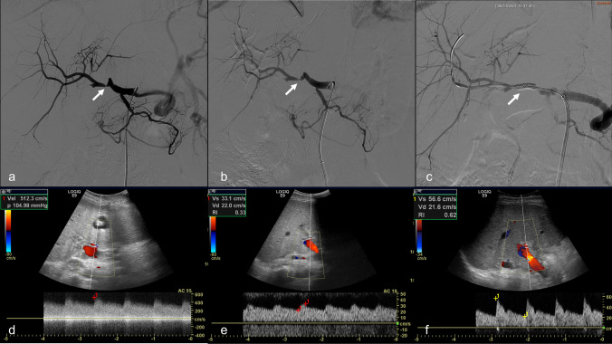
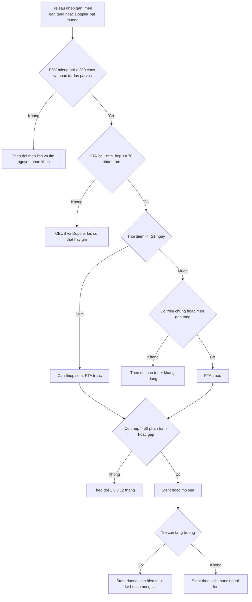
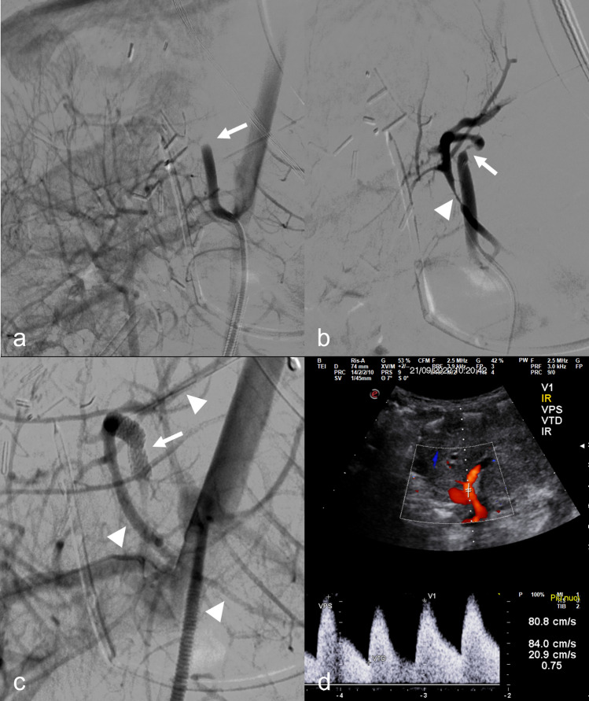
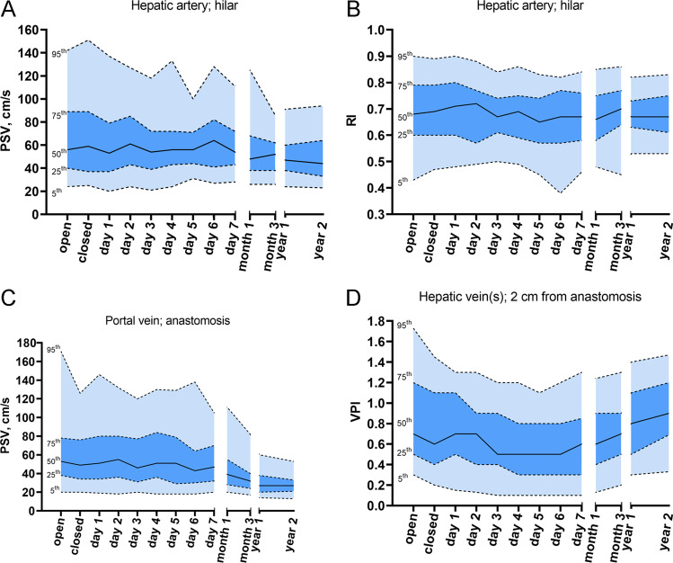
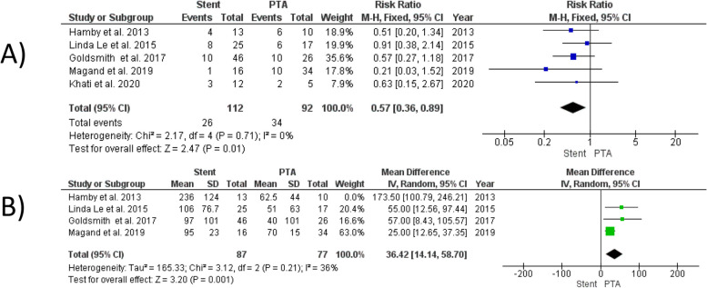

# 1915 — Hẹp động mạch gan ở TRẺ sau ghép gan: nong bóng lặp lại hay stent "không lớn theo trẻ"? / Hepatic artery stenosis in pediatric liver transplantation: repeat PTA versus a stent that does not grow

**Tags:** `pattern:hep-mach` `pattern:hep-mieng-noi` `pattern:tardus-parvus` `pattern:giam-ri` `pattern:gia-phinh-dong-mach` `pattern:hep-tuong-doi` `vung:gan` `vung:dong-mach-gan` `vung:mieng-noi` `score:RI` `score:PSV` `score:SAT` `protocol:Doppler` `protocol:CEUS` `protocol:CTA-3-thi` `protocol:DSA` `protocol:nong-bong` `protocol:stent`

**Mức chắc chắn (certainty):** tổng hợp y văn (literature synthesis) — số liệu chính lấy từ các bài **open-access đã đọc toàn văn**: Marra et al., *Cardiovasc Intervent Radiol* 2023 (PMC10616219, CC BY 4.0 — 17 trẻ, 21 thủ thuật, nong bóng và stent); Verhagen et al., *Eur Radiol* 2023 (PMC10415481, CC BY 4.0 — giá trị tham chiếu Doppler theo thời điểm ở 112 trẻ); Shaaban Abdelgalil et al., *CVIR Endovasc* 2025 (PMC12501083, CC BY 4.0 — meta PTA vs stent ở người lớn); Stefanowicz et al., *Children (Basel)* 2023 (PMC9955988, CC BY 4.0 — 400 ca LDLT trẻ, HAT 6,75%). Bổ sung **tóm tắt** của registry HEPATIC 2026 (11.443 ca ghép gan trẻ; HAS 1,2%) và Li et al. 2025 (327 ca, HAS 4%) — các bài này **không open access**, chỉ dùng số liệu tóm tắt, ghi rõ nguồn. Phần **tính toán "hẹp tương đối" theo tăng trưởng** là **suy luận (inference)** từ định luật Poiseuille, không phải số đo từ nghiên cứu. Bài **không** có ca nguyên văn riêng của nhóm; ca 1–2 là ca nguyên văn của PMC10616219.

> **Câu hỏi gốc của bài:** bé gái **3 tuổi**, **8 tháng sau ghép gan**, men gan tăng nhẹ, Doppler **PSV tại miệng nối 260 cm/s**, **RI trong gan 0,42**, CTA hẹp **70%** tại miệng nối. Nong bóng xong hẹp còn **40%** — có nên đặt stent? Và nếu đặt stent **3,5 mm** hôm nay, chuyện gì xảy ra khi cháu **10 tuổi**, mạch đã lớn gấp đôi? Bài này trả lời **khi nào can thiệp, khi nào chỉ theo dõi, và vì sao stent ở trẻ là một quyết định "vay mượn thì tương lai"**.

## 1. Tổng quan — vì sao hẹp động mạch gan ở trẻ khác người lớn, và vì sao stent không lớn theo trẻ

**A. Bệnh học (pathology) và cơ chế:**

- **Tần suất thật ở trẻ (registry HEPATIC, 11.443 ca ghép gan trẻ, 32 trung tâm):** biến chứng động mạch gan **4,8%** — **HAT 3,6%**, **HAS 1,2%**; **82,4%** biến chứng xảy ra **trong tháng đầu**, **HAT đỉnh trong 2 tuần đầu**, còn **HAS phân bố rải hơn**; giai đoạn **2012–2021** tăng lên **5,3%**, chủ yếu do **HAS tăng** còn HAT ổn định (tóm tắt HEPATIC 2026, PMID 42950133). Đây là con số **thấp hơn nhiều** so với các loạt cũ (HAS **4–11%**, tới **12%** ở trẻ; HAT tới **26%**) mà Marra trích dẫn — vì vậy **không được gộp số giữa các thời kỳ**.
- **Nhóm nguy cơ cao:** **trẻ < 1 tuổi có teo đường mật nhận gan toàn bộ**, và **ghép lại sau một biến chứng động mạch trước đó** có tỉ lệ biến chứng cao nhất; **ghép gan sống cho** có tỉ lệ biến chứng **3,4%**, **trung tâm thể tích lớn** có **3,8%** — thấp hơn mặt bằng chung (HEPATIC 2026).
- **Vì sao trẻ khác người lớn:** động mạch gan của trẻ **1–3 mm**, miệng nối làm bằng **mũi rời/khâu vi phẫu**, mảnh ghép **S2/3** nằm sát cơ hoành và **dễ gập khi gan tái tưới máu**; trẻ **tăng trưởng nhanh** nên mọi đoạn hẹp cố định sẽ **thành hẹp tương đối** theo thời gian. Trong loạt 400 ca LDLT trẻ, **HAT 6,75%**; yếu tố nguy cơ gồm **suy gan cấp trước ghép**, **đường kính miệng nối < 2 mm**, và **rối loạn dòng chảy động mạch trong mổ** (PMC9955988).
- **Sinh lý bệnh của hẹp:** hẹp làm **giảm áp lực tưới máu đoạn xa**; giường mạch gan **giãn tiểu động mạch** để bù → **RI giảm < 0,5** và **phổ tardus-parvus** (lên chậm, **SAT > 80 ms**). Tại chỗ hẹp, theo **phương trình liên tục**, vận tốc **tăng nghịch với diện tích lòng mạch** → **PSV > 200 cm/s** và aliasing. Đây là **vật lý của dòng chảy**, không phải "mạch viêm".
- **Vì sao hẹp ở trẻ lại nguy hiểm hơn ở người lớn:** **đường mật chỉ có nguồn động mạch gan**; ở trẻ, **dự trữ mạch bàng hệ quanh đường mật kém hơn** và **mảnh ghép còn phải lớn lên**. Hẹp kéo dài → **ITBL (hẹp đường mật thiếu máu)**, **sỏi/bùn mật**, **xơ gan mảnh ghép** — những tổn thương **không hồi phục** dù sau đó mở được mạch.
- **Vì sao PTA (nong bóng) là bước đầu:** bóng chỉ **rách vòng xơ/intima**, không để lại vật liệu lạ; mạch còn **khả năng lớn theo trẻ**. Nhưng PTA đơn thuần **chỉ thành công 5/21 thủ thuật (24%)** trong loạt trẻ của Marra; **stent cần cho 9/17 bệnh nhân (53%)**, **10/21 thủ thuật (48%)** vì **hẹp còn > 50%**, **tắc dai dẳng**, hoặc **miệng nối mới có nguy cơ vỡ**.
- **Vì sao stent "không lớn theo trẻ":** stent là **ống kim loại có đường kính cố định** (loạt trẻ dùng **stent/stent phủ mạch vành**, ví dụ **3,5 × 20 mm** và **3 × 20 mm**; một ca dùng **stent ngoại vi 4 × 15 mm**; bóng nong **1,5–5 mm**) (PMC10616219). Khi trẻ lớn, **đường kính mạch tăng** nhưng **đường kính stent không tăng tương ứng** → **hẹp tương đối tại hai đầu stent** và **tăng gradient áp lực**. Theo **Poiseuille**, trở kháng tỉ lệ nghịch với **r⁴**: nếu mạch tăng từ **3 mm lên 5 mm** mà stent vẫn **3 mm**, trở kháng của đoạn stent so với đoạn mạch mới là **(5/3)⁴ ≈ 7,7 lần** — đây là **suy luận**, không phải số đo lâm sàng.
- **Lập luận ngược của nhóm Marra:** Marra et al. **không lo** về stent nhỏ vì (1) **thiếu máu không đột ngột** → **tuần hoàn bàng hệ trong gan phát triển dần**, và (2) **có thể nong lại stent/post-dilate** khi hẹp trong stent. Họ thừa nhận **"long-term data will provide us with this relevant information"** — tức **chưa có bằng chứng dài hạn** (PMC10616219). Đây là điểm **phản biện trung thực**: stent nhỏ **không chắc** gây hại ngay, nhưng **chưa được chứng minh an toàn qua 10–20 năm tăng trưởng**.
- **Vì sao "không can thiệp" cũng là một lựa chọn:** HAS **muộn**, **không triệu chứng**, có **bàng hệ** có thể **theo dõi bảo tồn**. Loạt 327 ca trẻ: **13 HAS (4%)**, **3 sớm/10 muộn**; **sống mảnh ghép 100% ở nhóm sớm và 83% ở nhóm muộn**, **sống bệnh nhân 100%**; **một mảnh ghép mất trong nhóm bảo tồn**, nhóm can thiệp nội mạch **100%** (Li et al. 2025, PMID 39379231). Registry HEPATIC: **41,5% chỉ dùng kháng đông/kháng kết tập tiểu cầu**, **41,5% can thiệp nội mạch**, **không khác biệt sống còn 1 năm**; nhưng **HAS sớm ≤ 21 ngày** có **mất mảnh ghép 1 năm 16% vs 1%** (PMID 42869696). Vì vậy **thời điểm** quan trọng hơn **kỹ thuật**.

**B. Ngưỡng định lượng bắt buộc (cửa 1 Argon):**

| Đại lượng | Con số đã kiểm chứng | Ý nghĩa thực hành |
|---|---|---|
| Biến chứng động mạch ở trẻ (HEPATIC) | **4,8%** (HAT **3,6%**, HAS **1,2%**); **82,4%** trong tháng đầu; HAT đỉnh **2 tuần**; 2012–2021 **5,3%** (PMID 42950133) | HAS **hiếm hơn HAT** nhưng **đang tăng**; không gộp với loạt cũ |
| HAS ở trẻ (loạt đơn trung tâm) | **4% (13/327)**; **3 sớm/10 muộn**; sống ghép **100% sớm, 83% muộn**; sống bệnh nhân **100%** (PMID 39379231) | HAS muộn có thể **theo dõi bảo tồn** |
| HAT ở LDLT trẻ | **6,75% (27/400)**; nguy cơ: **suy gan cấp**, **miệng nối < 2 mm**, **rối loạn dòng trong mổ** (PMC9955988) | Kiểm tra **đường kính miệng nối** và **dòng chảy trong mổ** |
| Doppler bình thường ở trẻ — PSV động mạch gan | **ngày 0: 24–142 cm/s**; **ngày 1: 20–137**; **tháng 1: 26–125**; **tháng 3: 26–86**; **năm 1: 24–91**; **năm 2: 23–94** (5th–95th) (PMC10415481) | **PSV 150 cm/s là bình thường ở ngày 0** nhưng **bất thường ở năm 1** |
| Doppler bình thường ở trẻ — RI | **ngày 0: 0,43–0,90**; **ngày 1: 0,48–0,90**; **tháng 3: 0,45–0,86**; **năm 1: 0,53–0,82** (PMC10415481) | RI **0,5** chỉ là **bờ dưới**; RI **0,6–0,7** là bình thường |
| Tiêu chuẩn hẹp trên Doppler (trẻ) | **SAT > 80 ms** và/hoặc **PSV tại miệng nối > 2 m/s** và/hoặc **PSV trong gan < 50 cm/s kèm RI < 0,5** (PMC10616219) | Đo **đúng miệng nối**, góc **≤ 60°** |
| Tiêu chuẩn tắc trên Doppler | **PSV < 30 cm/s** hoặc **mất dòng** (PMC10616219) | Không nhầm với **co thắt** |
| Xác nhận hẹp trên CTA | **hẹp khu trú ≥ 70%** (PMC10616219) | CTA lát **≤ 1 mm**, MPR theo trục mạch |
| PTA đơn thuần ở trẻ | **5/21 thủ thuật (24%)** thành công (PMC10616219) | Đừng kỳ vọng PTA một lần là xong |
| Cần stent ở trẻ | **9/17 bệnh nhân (53%)**, **10/21 thủ thuật (48%)** (PMC10616219) | Chỉ định: hẹp còn **> 50%**, tắc dai dẳng, miệng nối mới nguy cơ vỡ, giả phình |
| Thành công kỹ thuật | **16/21 (76%)**; tiên phát **13/18 (72%)**, thứ phát **3/3 (100%)** (PMC10616219) | Thất bại thường do **không qua được chỗ tắc** hoặc **gập mạch** |
| Thành công lâm sàng | **14/17 (82%)**; thông mạch trung vị **367 ngày (IQR 114,5–500)** (PMC10616219) | Theo dõi **≥ 1 năm** mới nói "thành công" |
| Biến chứng thủ thuật | **3/17 (18%)** nhẹ; **1/17 (6%)** tử vong do **vỡ động mạch sau nong bóng** (PMC10616219) | **PTA không phải thủ thuật vô hại** |
| Stent ở trẻ — loạt 2006 | **7 trẻ** (4 HAS, 3 HAT); **3 vỡ mạch khi PTA** phải đặt **stent phủ** ngày 1/5/17; **2 stent thông**, **1 tắc sau 3 tháng**; theo dõi **9–40 tháng** (Boyvat 2006, PMID 17175359) | Stent **cứu được** vỡ mạch, nhưng **tắc stent** có thật |
| PTA vs stent (meta người lớn) | **9 nghiên cứu/325 ca** (PTA 140, stent 197): **không khác** độ thông 6/12 tháng/cuối theo dõi, thành công kỹ thuật, biến chứng nặng, bóc tách, vỡ mạch, HAT; stent **giảm can thiệp lại RR 0,57 (0,36–0,89)**, **tái hẹp muộn hơn +36,42 tháng (14,14–58,70)** (PMC12501083) | Stent **giảm số lần can thiệp**, không **tăng độ thông** |
| HAS sớm vs muộn (HEPATIC) | **≤ 21 ngày**: mất ghép 1 năm **16% vs 1%**; **5%** tiến triển HAT; sống ghép 1 năm **93%**, sống bệnh nhân **96%** (PMID 42869696) | **HAS sớm = can thiệp sớm**; HAS muộn có thể **bảo tồn** |
| Aspirin sau can thiệp (phác đồ Bergamo) | **5 mg/kg/ngày (tối đa 100 mg)**, **6 tháng** sau ghép, **tiếp tục vô thời hạn** sau tái thông (PMC10616219) | Không tự ngừng trước thủ thuật |
| Kháng đông sau can thiệp | **LMWH tới 2 tuần** sau thủ thuật (PMC10616219) | Cân nhắc **nguy cơ chảy máu** |

**C. TẠI SAO ảnh trông như vậy (vật lý hình ảnh):**

- **DSA:** cản quang trong lòng mạch → **hẹp = cột thuốc hẹp lại**, **tắc = cột thuốc cụt**; **không thấy nhánh xa** = tắc/co thắt. Trên trẻ, **động mạch 1–3 mm** nên phải dùng **catheter 4–5 F, dây 0,014–0,018 inch**, bơm **thì chọn lọc** để không bỏ sót **gập (kink)** ở miệng nối.
- **Doppler:** tín hiệu **tỉ lệ vận tốc**, không phải "lượng máu". **PSV tăng tại chỗ hẹp** do tiết diện giảm; **RI giảm đoạn xa** do giãn tiểu động mạch; **SAT kéo dài** vì sóng áp lực đến chậm. Vì **RI là tỉ lệ**, nó **không phụ thuộc cung lượng tim**, nhưng **phụ thuộc vị trí lấy mẫu** — luôn lấy **trong gan**, không lấy ngay miệng nối.
- **CEUS:** vi bọt **thuần lòng mạch** → thấy **tưới máu thật**, phân biệt **hẹp thật** với **co thắt** (co thắt hết sau vài phút/thuốc giãn), và đánh giá **nhánh xa** khi Doppler không kết luận.
- **CTA:** đầu dò **≤ 1 mm**, **MPR/MIP/VR**; động mạch nhỏ và cong nên **lát dày 3–5 mm sẽ bỏ sót hẹp**. **Hẹp ≥ 70%** mới được coi là nguyên nhân (PMC10616219), nhưng **hẹp 50–70%** vẫn có thể **có ý nghĩa nếu men gan tăng và RI thấp**.
- **Stent trên DSA:** **stent không cản quang hoàn toàn** — thấy **hai marker đầu/cuối** và **thay đổi dòng chảy**; sau đặt, **không thấy hẹp còn lại** và **nhánh xa hiện đủ** mới gọi là thành công kỹ thuật.
- **Siêu âm sau stent:** **stent gây tăng âm mạnh và che sau (blooming)** → **PSV trong stent có thể giả tăng**; phải đo **đoạn trước và sau stent**, so **RI trong gan**, và **không chẩn đoán hẹp trong stent chỉ bằng một điểm PSV**.

## 2. Mẫu hình + chẩn đoán phân biệt theo vị trí (Gamut)

Xếp theo **cái gì đang chặn dòng** và **có cần can thiệp không**:

- **Mẫu A — hẹp khu trú tại miệng nối, SỚM (≤ 21 ngày):** men gan tăng, **PSV > 200 cm/s**, **RI < 0,5**; CTA hẹp **≥ 70%**. Nguy cơ **mất mảnh ghép 16%** → **can thiệp sớm** (PTA trước, stent nếu thất bại).
- **Mẫu B — hẹp miệng nối MUỘN, có bàng hệ:** trẻ **không triệu chứng**, men gan **gần bình thường**, **RI không thấp**, CTA hẹp nhưng **nhánh xa còn đủ**. Có thể **theo dõi bảo tồn + kháng đông** (Li 2025; HEPATIC).
- **Mẫu C — hẹp dài/khúc khuỷu (kink) trước miệng nối:** PTA **dễ thất bại** vì **gập cơ học**, không phải xơ; **stent có thể mở thẳng góc gập** nhưng **dễ gãy stent** nếu gập liên tục → cân nhắc **mổ sửa**.
- **Mẫu D — co thắt động mạch (vasospasm):** xảy ra **sau chọc mạch/bơm thuốc**, hết sau **vài phút** hoặc sau **thuốc giãn**; **không đặt stent**.
- **Mẫu E — giả phình tại miệng nối:** **stent phủ (stent graft)** để **giữ mạch** và **bịt túi**, thay vì nút mạch (nút sẽ làm mất tưới máu gan) (PMC10616219).
- **Mẫu F — huyết khối (HAT):** **mất dòng**, **PSV < 30 cm/s**, **water-hammer**; xử trí **lấy huyết khối cơ học/stent-retriever** hoặc **mổ tái thông** — không phải bài này (xem 1913).
- **Mẫu G — hẹp trong stent/hẹp tương đối theo tăng trưởng:** trẻ **lớn nhanh**, stent **cố định**; PSV **tăng dần**, **RI giảm**, men gan tăng; **nong lại trong stent** hoặc **phẫu thuật**.
- **Mẫu H — chèn ép từ ngoài (tụ dịch, mảnh ghép phù):** Doppler **giảm dòng**, CTA **không có hẹp lòng mạch**; xử trí **dẫn lưu/giảm phù**, **không stent**.
- **Mẫu I — tăng áp lực ổ bụng/suy tim:** dòng **giảm toàn bộ**, RI **tăng**, không hẹp khu trú; xử trí **nguyên nhân hệ thống**.

## 3. Bảng so sánh phân biệt (ma trận đối chiếu)

| Thực thể (entity) | Hình ảnh điển hình (US/CT/DSA) | Chốt vào (rule-in) | Chốt loại (rule-out) | Gợi ý xác nhận |
|---|---|---|---|---|
| **Hẹp miệng nối sớm (≤ 21 ngày)** | PSV **> 200 cm/s** tại miệng nối, **RI < 0,5**, **SAT > 80 ms**; CTA hẹp **≥ 70%**; DSA thấy cột thuốc hẹp | **Hẹp ≥ 70% + men gan tăng + mất ghép 1 năm 16%** | **PSV bình thường theo tuổi + RI 0,6–0,7 + không hẹp trên CTA** | DSA + đo áp nếu cần; can thiệp sớm |
| **Hẹp miệng nối muộn có bàng hệ** | Hẹp trên CTA nhưng **nhánh xa còn**, **RI không thấp**, men gan gần bình thường | **Hẹp + bàng hệ + không triệu chứng** | **RI < 0,5 + men gan tăng + nhánh xa kém** → không được bảo tồn | Theo dõi 3–6 tháng; chụp lại khi triệu chứng |
| **Co thắt mạch** | Dòng **giảm thoáng qua**, hết sau **thuốc giãn/thời gian**; không hẹp cố định | **Hết co thắt khi lặp DSA/CEUS** | **Hẹp cố định trên CTA/DSA** | CEUS/DSA lặp; không stent |
| **Khúc khuỷu/gập mạch** | Góc gập **> 90°**, hẹp **không đối xứng**, **thay đổi theo thì**; PTA không cải thiện | **Hẹp do gập + PTA thất bại** | **Hẹp xơ cố định, bờ nhẵn** | DSA 2 thì; mổ sửa hoặc stent |
| **Giả phình miệng nối** | Túi cản quang **ngoài lòng mạch**, **không có lớp áo**; có thể vỡ | **Túi giả + nguy cơ vỡ/chảy máu** | **Không có túi, chỉ hẹp** | DSA + stent phủ; **không nút mạch** |
| **HAT (huyết khối)** | **Mất dòng**, **PSV < 30 cm/s**, **water-hammer**; CTA **khuyết thuốc** | **Không có dòng + khuyết thuốc** | **Có dòng trong gan + phổ bình thường** | DSA; lấy huyết khối (bài 1913) |
| **Hẹp trong stent/tương đối** | Stent **cố định**, PSV **tăng dần**, **RI giảm**, men gan tăng; CTA **hẹp trong stent** | **PSV tăng > 200 cm/s + RI < 0,5 + hẹp trong stent** | **Stent thông, PSV ổn định, RI bình thường** | Nong lại/post-dilate; theo dõi tăng trưởng |
| **Chèn ép từ ngoài** | Dòng giảm, **không hẹp lòng mạch** trên CTA; có **tụ dịch/mảnh ghép phù** | **Hồi phục sau dẫn lưu/giảm phù** | **Hẹp cố định trong lòng mạch** | Siêu âm + CTA; dẫn lưu |
| **Tăng áp lực ổ bụng/suy tim** | Dòng giảm **toàn bộ**, RI **tăng**, không hẹp khu trú | **Bệnh cảnh hệ thống + RI tăng** | **Hẹp khu trú + RI thấp** | Đo áp lực ổ bụng, siêu âm tim |

*Bé trai **14 tuổi**, **30 ngày sau ghép gan lại toàn bộ**: (a) DSA chọn lọc cho thấy **hẹp miệng nối** kèm **gập trước miệng nối**; (b) sau **nong bóng 3 mm**, hẹp **vẫn còn**; (c) sau **stent ngoại vi Herculink 4 × 15 mm**, mạch thẳng và **nhánh trong gan hiện đủ**; (d–e) Doppler trước thủ thuật: **vận tốc tại miệng nối tăng**, **RI trong gan 0,33**; (f) sau thủ thuật, **phổ về bình thường**. Đây là ca cho thấy **PTA một lần có thể không đủ** và **stent dùng để xử lý gập + hẹp còn lại**, không phải "stent cho mọi hẹp". Nguồn: Marra et al., Cardiovasc Intervent Radiol 2023;46(11):1610–1620, PMC10616219 Fig. 3, CC BY 4.0.*

## 4. Protocol chụp + ngưỡng xử trí

**A. Theo dõi Doppler (phác đồ của trung tâm có 20 năm ghép gan trẻ):**

- **Ngày 0–14: mỗi ngày**; **tuần 1–4: mỗi tuần**; sau đó **mỗi 6–12 tháng** (PMC10616219). Thêm **Doppler đột xuất** khi **men gan tăng, vàng da, sốt, giảm nước tiểu**.
- **Đo và ghi đủ:** **PSV và RI tại đoạn sau miệng nối trong gan** (không lấy ngay miệng nối), **PSV tĩnh mạch cửa tại miệng nối**, **VPI tĩnh mạch gan**, **nhu mô** (ổ dịch, vùng giảm âm).
- **Luôn so với giá trị theo thời điểm** (PMC10415481): **PSV 150 cm/s là bình thường ở ngày 0** nhưng **cao bất thường ở năm 1**; **RI 0,5 là bờ dưới**, không phải "ngưỡng tuyệt đối" cho mọi tuổi.

**B. Khi Doppler bất thường — thứ tự:**

1. **Lặp Doppler + CEUS:** phân biệt **co thắt** với **hẹp thật**; xem **nhánh xa** và **thời gian ngấm**.
2. **CTA 3 thì, lát ≤ 1 mm, MPR/MIP/VR:** xác nhận **hẹp khu trú ≥ 70%**, **gập**, **giả phình**, **huyết khối**; đọc cả **tĩnh mạch cửa** và **tĩnh mạch gan**.
3. **DSA + đo áp lực** khi CTA không kết luận hoặc trước can thiệp: đo **gradient trước–sau hẹp**; **gradient ≥ 5 mmHg** hoặc **hẹp ≥ 70%** là chỉ định can thiệp (ngưỡng áp dụng theo nguyên lý, số cụ thể của trẻ **chưa có trong nguồn** — ghi rõ "chưa rõ").
4. **Siêu âm tim/đo áp lực ổ bụng** khi dòng giảm toàn bộ, để **loại trừ nguyên nhân hệ thống**.

**C. Ngưỡng xử trí:**

| Tình huống | Hành động |
|---|---|
| **HAS sớm ≤ 21 ngày**, hẹp **≥ 70%**, men gan tăng | **PTA trước**; nếu còn **> 50%** hoặc **gập** → **stent**; **không trì hoãn** (mất ghép **16%**) |
| **HAS muộn, không triệu chứng**, nhánh xa đủ, RI bình thường | **Theo dõi + kháng đông/kháng kết tập tiểu cầu**; chụp lại **3–6 tháng** |
| **Hẹp + giả phình** | **Stent phủ** để giữ mạch; **không nút mạch** |
| **Co thắt** | **Không can thiệp**; lặp CEUS/DSA sau giãn |
| **Gập > 90°** không đáp ứng PTA | **Mổ sửa** hoặc **stent** nếu giải phẫu cho phép |
| **Hẹp trong stent do tăng trưởng** | **Nong lại/post-dilate**; nếu stent đã đạt đường kính tối đa → **mổ bắc cầu** |
| **Trẻ < 1 tuổi, động mạch < 2 mm** | **Hạn chế stent tối đa**; ưu tiên **PTA lặp lại**, vì stent nhỏ sẽ **hẹp tương đối** khi trẻ lớn |
| **Sau can thiệp** | **Aspirin 5 mg/kg/ngày (tối đa 100 mg)** theo phác đồ; **LMWH 2 tuần**; Doppler **1 ngày, 1 tuần, 1–3–6–12 tháng** |

**D. Sơ đồ quyết định:**

## 5. Biến thể bình thường và cạm bẫy

**A. Biến thể bình thường (normal variant):**

- **PSV rất cao trong 24–48 giờ đầu** do **tăng cung lượng và phù mảnh ghép**; **giảm dần** theo tuần (PMC10415481). **Không** gọi là hẹp nếu **RI bình thường** và **nhánh xa đủ**.
- **RI > 0,8 trong 3 ngày đầu** ở **~50%** trẻ (phù mảnh ghép), **bình thường hóa ~ngày 4** — không can thiệp chỉ vì RI cao sớm.
- **Động mạch gan nhỏ, cong** ở trẻ **S2/3** → **PSV có thể lên 140–150 cm/s** mà không hẹp; luôn **so với giá trị nền của chính bệnh nhi** và **đoạn đối diện**.
- **Tĩnh mạch cửa giãn nhẹ sau ghép** do **thay đổi giải phẫu**, không phải tắc.
- **Dịch quanh gan ít, tự hết** sau mổ — không phải chèn ép.

**B. Cạm bẫy (pitfall):**

- **Dùng ngưỡng người lớn cho trẻ:** **PSV > 200 cm/s** và **RI < 0,5** là ngưỡng **hẹp**, nhưng **PSV bình thường ở trẻ ngày 0 đã tới 142 cm/s**; nếu chỉ nhìn **một con số**, sẽ **overcall** hoặc **bỏ sót** tùy thời điểm.
- **Đặt stent cho "hẹp" do co thắt:** co thắt **hết** sau giãn; stent sẽ **cố định một đoạn mạch không bệnh** và **gây hẹp tương đối** sau này.
- **Đặt stent cho gập cơ học:** stent **mở thẳng** nhưng **gãy** nếu gập liên tục; **mổ sửa** có thể tốt hơn.
- **Quên rằng stent không lớn:** trẻ **tăng trưởng** → **hẹp tương đối**; cần **kế hoạch nong lại** ngay từ đầu, và **theo dõi đến khi trưởng thành**.
- **PTA "nhẹ tay" cho miệng nối mới:** nguy cơ **vỡ mạch** (3/7 ca trong loạt Boyvat; **1 tử vong** trong loạt Marra) — dùng **bóng nhỏ hơn đường kính**, **bơm chậm**, có **stent phủ sẵn sàng**.
- **Bỏ sót hẹp muộn vì "men gan bình thường":** HAS muộn có thể **im lặng** nhờ bàng hệ; nếu **không chụp**, sẽ chỉ phát hiện khi **ITBL/xơ gan**.
- **Nong bóng xong là kết thúc:** **tái hẹp** sau PTA là **thường gặp**; lịch Doppler **1–3–6–12 tháng** là bắt buộc.
- **Satisfaction of search:** thấy hẹp rồi **không đọc tĩnh mạch cửa/tĩnh mạch gan**; biến chứng mạch sau ghép thường **đi thành cụm**.

## 6. Tự lượng giá — Blind Quiz

**Ca 1 — Bé trai 14 tuổi, 30 ngày sau ghép gan lại, men gan tăng; Doppler thấy vận tốc tại miệng nối tăng, RI trong gan 0,33.**

- Hỏi: (1) mô tả hai bất thường trên DSA; (2) vì sao nong bóng 3 mm chưa đủ? (3) sau stent, dấu hiệu nào chứng minh thành công?

<b>Bấm để hiện đáp án (findings + chẩn đoán)</b>

- **(1)** Hẹp tại **miệng nối** + **gập (kinking) trước miệng nối**; RI trong gan **0,33** phù hợp **tardus-parvus** do hẹp.
- **(2)** Nong bóng **3 mm** chỉ xử lý được **vòng xơ**, không sửa **gập**; sau nong hẹp **vẫn còn** (ảnh b).
- **(3)** Stent ngoại vi **Herculink 4 × 15 mm** làm **mạch thẳng**, **nhánh trong gan hiện đủ**, và **phổ Doppler về bình thường** (ảnh c, f).
- Nguồn: Marra et al., Cardiovasc Intervent Radiol 2023, PMC10616219 Fig. 3, CC BY 4.0.

**Ca 2 — Bé gái 7 tháng tuổi, 4 ngày sau ghép gan split, mất dòng động mạch gan; DSA thấy tắc kèm gập và hẹp miệng nối.**

- Hỏi: (1) vì sao chọn **stent phủ** thay vì nong bóng đơn thuần? (2) loại stent và kích thước? (3) theo dõi gì sau đặt?

<b>Bấm để hiện đáp án</b>

- **(1)** Miệng nối **mới 4 ngày**, nguy cơ **vỡ** khi nong; **stent phủ** vừa **mở lòng** vừa **bọc chỗ nguy cơ**.
- **(2)** **Stent mạch vành phủ PK Papyrus 3,5 × 20 mm**; sau đó mạch và các nhánh trong gan hiện đủ.
- **(3)** **Doppler ngày 1, tuần 1, tháng 1–3–6–12**, tìm **hẹp trong stent/tương đối** khi trẻ lớn; **aspirin** theo phác đồ; **không bỏ theo dõi** vì stent "đã thông".
- Nguồn: Marra et al., Cardiovasc Intervent Radiol 2023, PMC10616219 Fig. 2, CC BY 4.0.

**Ca 3 — Cùng một giá trị PSV 150 cm/s: bình thường hay bất thường?**

- Hỏi: (1) đọc khoảng **5th–95th** của PSV động mạch gan ở **ngày 0** và **năm 1**; (2) vì sao **không thể dùng một ngưỡng cho mọi thời điểm**? (3) RI thay đổi thế nào?

<b>Bấm để hiện đáp án</b>

- **(1)** **Ngày 0: 24–142 cm/s**; **năm 1: 24–91 cm/s** (PMC10415481).
- **(2)** PSV **giảm dần** khi mảnh ghép hết phù và cung lượng ổn định; **150 cm/s ở ngày 0 là trong khoảng bình thường**, nhưng **ở năm 1 là trên 95th** → phải **so theo thời điểm**.
- **(3)** RI **ngày 0: 0,43–0,90**; **năm 1: 0,53–0,82** — RI **ổn định hơn** PSV nhưng vẫn **thay đổi theo loại mảnh ghép** (S2/3, S2/3/4, toàn bộ).
- Nguồn: Verhagen et al., Eur Radiol 2023;33(9):6404–6413, PMC10415481 Fig. 4, CC BY 4.0.

**Ca 4 — Stent có làm mạch thông lâu hơn không?**

- Hỏi: (1) đọc kết quả **can thiệp lại**; (2) đọc **thời gian tới tái hẹp**; (3) áp dụng vào trẻ như thế nào?

<b>Bấm để hiện đáp án</b>

- **(1)** Stent **giảm can thiệp lại**: **RR 0,57 (0,36–0,89)**, p = 0,01.
- **(2)** Stent **kéo dài thời gian tới tái hẹp**: **+36,42 tháng (14,14–58,70)**, p = 0,001.
- **(3)** Ở **người lớn**, stent **giảm số lần thủ thuật** nhưng **không tăng độ thông**; ở **trẻ**, lợi ích này phải **cân** với **stent cố định không lớn theo trẻ** → **PTA lặp lại** vẫn là lựa chọn đầu tay, stent để **cứu** tình huống thất bại/gập/giả phình.
- Nguồn: Shaaban Abdelgalil et al., CVIR Endovasc 2025;8:78, PMC12501083 Fig. 3, CC BY 4.0.

## Bài liên quan chéo
- [1913 – Hẹp & huyết khối động mạch gan sau ghép gan](../1913-hep-huyet-khoi-hep-dong-mach-gan-sau-ghep/lesson.md) — bộ ba Dodd, **water-hammer**, kỹ thuật can thiệp ở **người lớn**; đọc trước bài này.
- [1914 – Suy chức năng mảnh ghép sớm (EAD) & PNF](../1914-suy-chuc-nang-manh-ghep-som/lesson.md) — khi men gan tăng mà **mạch–mật đã loại trừ**.
- [1906 – Hẹp dòng ra tĩnh mạch gan sau ghép (HVOO)](../1906-hep-dong-ra-tm-gan-sau-ghep-gan/lesson.md) — **ứ huyết** làm giảm dòng động mạch, dễ nhầm hẹp.
- [1909 – Hẹp–tắc tĩnh mạch cửa sau ghép gan](../1909-hep-tinh-mach-cua-sau-ghep-gan/lesson.md) — biến chứng mạch **đi kèm** trong cùng mảnh ghép.
- [133 – Hẹp miệng nối & cholangiopathy thiếu máu sau ghép gan](../133-hep-mieng-noi-duong-mat-sau-ghep/lesson.md) — hậu quả **muộn** của hẹp động mạch không được điều trị.
- [1916 – Thải ghép cấp tế bào (ACR) sau ghép gan](../1916-thai-ghep-cap-te-bao-sau-ghep-gan/lesson.md) — nguyên nhân **nhu mô** khi mạch–mật đã loại trừ.

## Ảnh
- 4 ảnh, tải từ **PMC CDN** của bài open access, **không chỉnh sửa pixel**; nguồn + giấy phép từng file trong `images/CREDITS.md`.
- Tên file: `1915_<nội dung>_<Modality>_PMCxxxxx-fN.jpg`; **không** tạo ảnh ghép (các ảnh khác bệnh nhân/khác modality, không cùng chuỗi xung để đối chiếu).
- Ảnh **không** tải: Radiopaedia (chỉ dẫn link), AuntMinnie (chỉ dẫn link), các bài không rõ giấy phép — xem `sources.md`.

> Không dùng để chẩn đoán độc lập khi chưa có người hướng dẫn.
