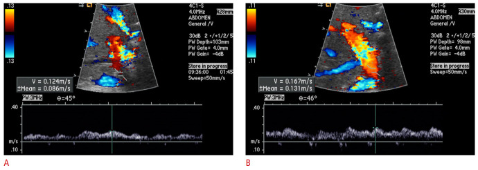
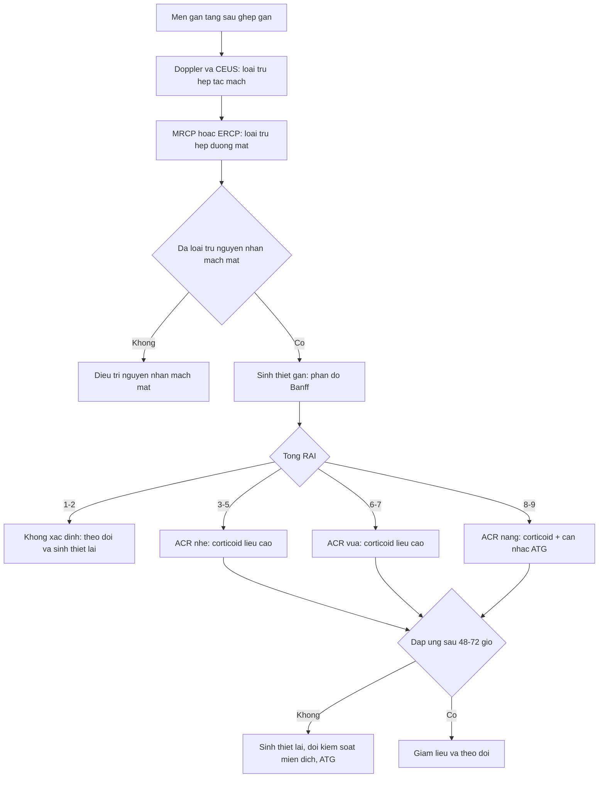
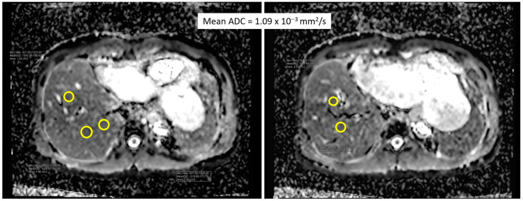
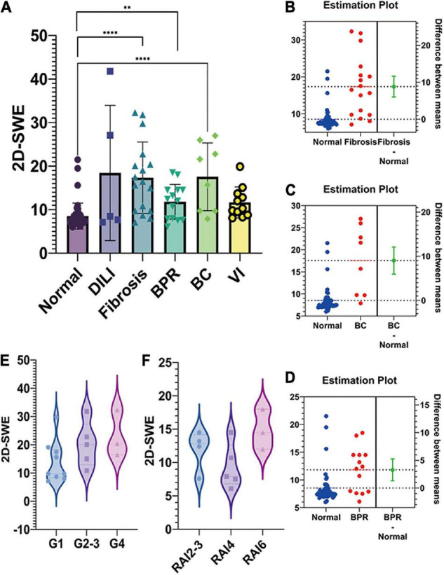
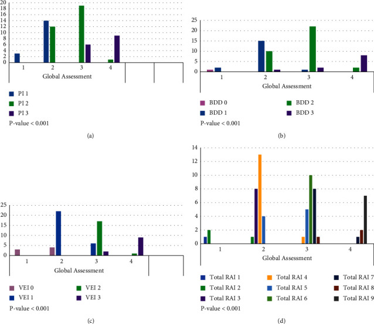

# 1916 — Thải ghép cấp tế bào (ACR/TCMR) sau ghép gan: phân độ Banff, khi nào sinh thiết, và vì sao siêu âm chỉ để LOẠI TRỪ / Acute cellular rejection after liver transplantation: Banff grading, biopsy indications, and why imaging only rules out

**Tags:** `pattern:thai-ghep-cap` `pattern:thai-ghep-te-bao` `pattern:men-gan-tang` `pattern:gan-to` `pattern:phu-nhu-mo` `pattern:giam-ngam-tinh-mach` `pattern:viem-khoang-cua` `vung:gan` `vung:duong-mat` `vung:mieng-noi` `score:Banff-RAI` `score:ADC` `score:LSM` `protocol:Doppler` `protocol:CEUS` `protocol:MRI-DWI` `protocol:MRE` `protocol:MRCP` `protocol:sinh-thiet-gan`

**Mức chắc chắn (certainty):** tổng hợp y văn (literature synthesis) — số liệu lấy từ các bài **open-access đã đọc toàn văn**: Agostini et al., *J Clin Med* 2023 (PMC10573382, CC BY 4.0 — tổng quan biến chứng sau ghép, ACR **15–25%**, khởi phát **2–6 tuần**); Dogan et al., *J Int Med Res* 2018 (PMC6136012, CC BY-NC 4.0 — **176 ca**, **43 đợt ACR**, yếu tố nguy cơ, đáp ứng corticoid); Eghtedari et al., *J Transplant* 2023 (PMC10070025, CC BY 4.0 — **90 mẫu sinh thiết**, đối chiếu Banff 2016 global assessment với **RAI**); Choi et al., *Ultrasonography* 2023 (PMC10555689, CC BY-NC 4.0 — Doppler **84 ca ACR**, PBV dự báo đáp ứng); Chiang et al., *Diagnostics (Basel)* 2024 (PMC11049147, CC BY 4.0 — **DWI/ADC 25 ca**, cutoff **1,133 × 10⁻³ mm²/s**); Gu et al., *Front Pediatr* 2022 (PMC9363609, CC BY 4.0 — **2D-SWE 98 trẻ**, LSM trong thải ghép); Schaapman et al., *Liver Transpl* 2025 (PMC11827683, CC BY-NC-ND 4.0 — **131 ca**, điểm MRI–huyết thanh, AUC **0,70**); Zeng et al., *BMC Gastroenterol* 2026 (PMC13185313, CC BY-NC-ND 4.0 — **sinh thiết qua tĩnh mạch cảnh 22 trẻ**); Babikir et al., *Saudi Med J* 2024 (PMC11463573, CC BY-NC 4.0 — vai trò siêu âm, ACR tới **40%**); Si et al., *Front Pediatr* 2022 (PMC9203720, CC BY 4.0 — **640 trẻ**, ACR muộn **6,4%/9,8%**). Bài **không** có ca nguyên văn riêng của nhóm; ca 1–4 là ca nguyên văn/minh họa của các nguồn, ghi rõ Fig.

> **Câu hỏi gốc của bài:** bệnh nhân **ngày 9 sau ghép gan**, **ALT 210 U/L**, **bilirubin 3,2 mg/dL**, không sốt; Doppler **mạch gan và tĩnh mạch cửa bình thường**, **MRCP không giãn đường mật**. Vậy: **có nên điều trị "thải ghép" ngay bằng corticoid liều cao, hay phải sinh thiết?** Và nếu sinh thiết ra **RAI 5** thì nghĩa là gì — trong khi siêu âm **hoàn toàn bình thường**?

## 1. Tổng quan — vì sao ACR là chẩn đoán MÔ HỌC, và vì sao ảnh không thể "thấy" thải ghép

**A. Bệnh học (pathology) và cơ chế:**

- **Định nghĩa:** **thải ghép cấp tế bào (acute cellular rejection, ACR)** = **thải ghép qua trung gian tế bào T (T-cell mediated rejection, TCMR)**; tổn thương nhắm vào **biểu mô ống mật, nội mạc tĩnh mạch cửa và khoảng cửa**. Đây là **phản ứng miễn dịch thích ứng**, khác **thải ghép thể dịch (AMR)** và khác **thải ghép mạn (ductopenia/obliterative arteriopathy)**.
- **Tần suất:** **15–25%** người nhận ghép gan (PMC10573382); có loạt báo **tới 40%** (PMC11463573); loạt **176 ca** của Dogan có **36/176 (20,5%)** người nhận, **43 đợt** ACR (PMC6136012). Ở trẻ, ACR **muộn** (sau 1 năm) gặp **41/640 (6,4%)** trong khoảng **1–2 năm** và **63/640 (9,8%)** sau **2 năm** (PMC9203720).
- **Thời điểm:** ACR điển hình **2–6 tuần** sau ghép (PMC10573382); trong loạt Dogan, **58,1%** đợt xảy ra trong **3 tháng đầu**, **65,1%** trong **năm đầu**, trung vị **2 tháng** (0–111 tháng) (PMC6136012). ACR **muộn** thường gắn với **giảm liều/tuân thủ kém**, **DSA**, hoặc **nồng độ tacrolimus thấp** (PMC9203720).
- **Vì sao ACR thường "im lặng":** phần lớn đợt ACR **không có triệu chứng**, chỉ **tăng men gan/cholestasis**; sốt, đau hạ sườn phải, vàng da là **không đặc hiệu** (PMC10573382; PMC11463573). Vì vậy **không thể loại trừ ACR bằng "bệnh nhân thấy khỏe"**.
- **Vì sao hình ảnh không chẩn đoán được:** tổn thương ACR là **viêm ở khoảng cửa và ống mật nhỏ** — **dưới độ phân giải** của siêu âm/CT/MRI thường quy. Siêu âm **không dùng để chẩn đoán thải ghép**, mà để **loại trừ nguyên nhân cơ học** (hẹp/tắc động mạch, tĩnh mạch cửa, tĩnh mạch gan, hẹp đường mật) **bắt chước ACR** (PMC11463573). Đây là **nguyên tắc trung tâm của bài**.
- **Vì sao RI cao muộn có thể gợi ý ACR:** trong giai đoạn **muộn** sau ghép, **RI tăng** có thể phản ánh **bệnh nhu mô** (bao gồm thải ghép), vì **phù/viêm làm tăng sức cản trong gan** (PMC11794643). Nhưng **RI tăng không đặc hiệu** — xơ gan, viêm gan, tắc mật, chèn ép đều làm tăng RI.
- **Vì sao DWI có thể "thấy" ACR:** viêm làm **tế bào trương phồng, giảm khoảng gian bào** → **hạn chế khuếch tán** → **ADC giảm**. Nghiên cứu **25 ca** (20 ACR: 10 nhẹ, 9 vừa, 1 nặng) cho thấy **ADC ở ACR thấp hơn**, **tăng trở lại sau điều trị**, **AUC 0,92**, **cutoff 1,133 × 10⁻³ mm²/s**, **Se 80%/Sp 95%**; **ACR nhẹ 1,03 ± 0,07** vs **vừa–nặng 0,92 ± 0,11** (p < 0,05) (PMC11049147).
- **Vì sao 2D-SWE có thể gợi ý:** viêm/phù làm **mô cứng hơn**. Ở trẻ, **LSM bình thường sau ghép 7,5–8,5 kPa**; **thải ghép có bằng chứng mô học (BPR) trung vị 12,2 kPa**, cao hơn nhóm hồi phục **+3,283 ± 0,992 kPa** (p = 0,0016); nhưng **LSM không tương quan với độ nặng ACR cấp** (PMC9363609).
- **Vì sao Doppler có ích nhưng không chẩn đoán:** **PBV < 20 cm/s**, **RI < 0,5**, **phổ tĩnh mạch gan một pha** là các bất thường **có thể gặp** trong ACR; **PBV thấp sau điều trị** dự báo **đáp ứng kém** (50% vs 7,8%; Se 50%/Sp 92,2%/Acc 82,1%), và **PBV giảm > 10%** cũng dự báo kém (Se 50%/Sp 79,7%/Acc 72,6%) (PMC10555689). Đây là **tiên lượng**, không phải **chẩn đoán**.
- **Vì sao vẫn phải sinh thiết:** **mô học là tiêu chuẩn vàng**; chỉ có mô học mới phân biệt **ACR** với **viêm gan do thuốc, nhiễm CMV, tái phát bệnh, thải ghép thể dịch** và cho **phân độ Banff** để quyết định **corticoid đơn thuần hay ATG**. Điểm MRI–huyết thanh (**AUC 0,70, NPV 0,80**) mới đủ để **giảm bớt** sinh thiết ở nhóm nguy cơ thấp, **chưa thay thế** sinh thiết (PMC11827683).
- **Vì sao điều trị theo phân độ:** **corticoid liều cao** giải quyết **79%** đợt ACR; **7%** chỉ cần **chỉnh liều ức chế miễn dịch**; **14%** **kháng corticoid** phải dùng **ATG** (PMC6136012). Phân độ **nặng (RAI 8–9)** và **thải ghép muộn** có xu hướng **kém đáp ứng** hơn — vì vậy **không điều trị mù**.

**B. Ngưỡng định lượng bắt buộc (cửa 1 Argon):**

| Đại lượng | Con số đã kiểm chứng | Ý nghĩa thực hành |
|---|---|---|
| Tần suất ACR | **15–25%** (PMC10573382); tới **40%** (PMC11463573); **20,5%** người nhận, **43 đợt** (PMC6136012) | Bệnh cảnh **thường gặp**, không được bỏ qua |
| ACR muộn ở trẻ | **41/640 (6,4%)** trong **1–2 năm**; **63/640 (9,8%)** sau **2 năm** (PMC9203720) | Theo dõi **lâu dài**, không chỉ 3 tháng |
| Thời điểm | **2–6 tuần** (PMC10573382); **58,1%** trong **3 tháng**, **65,1%** trong **năm đầu**, trung vị **2 tháng** (PMC6136012) | Nghĩ ACR khi men gan tăng **tuần 2–12** |
| Banff RAI — thành phần | **PI, BDD, VEI** mỗi thành phần **0–3**; tổng **0–9** (PMC10070025) | Ghi **từng thành phần**, không chỉ tổng |
| Banff RAI — nhóm | **1–2** không xác định; **3–5** nhẹ; **6–7** vừa; **8–9** nặng (theo cách nhóm của PMC10070025, sửa Banff 1997) | Quyết định **corticoid vs ATG** |
| Global assessment vs RAI | **Tương quan mạnh** với PI, BDD, VEI và tổng RAI (p < 0,001); **dùng thay thế nhau** (PMC10070025) | Có thể dùng **global** nếu trung tâm không chấm RAI |
| DWI/ADC | **Cutoff 1,133 × 10⁻³ mm²/s**; **AUC 0,92**, **Se 80%/Sp 95%**; nhẹ **1,03 ± 0,07**, vừa–nặng **0,92 ± 0,11** (PMC11049147) | **ADC thấp** gợi ý ACR; **tăng sau điều trị** = đáp ứng |
| 2D-SWE ở trẻ | Bình thường sau ghép **7,5–8,5 kPa**; **BPR 12,2 kPa**; chênh **+3,283 kPa** (p = 0,0016); **không tương quan độ nặng ACR** (PMC9363609) | **LSM cao** gợi ý, nhưng **không phân độ** |
| 2D-SWE — xơ hóa | **Cutoff 10,3 kPa** cho xơ hóa đáng kể; **AUC 88%** (PMC9363609) | Đừng nhầm **xơ hóa** với **ACR cấp** |
| Doppler — PBV | **PBV < 20 cm/s** là bất thường; PBV thấp sau điều trị ở **50%** kém đáp ứng vs **7,8%** đáp ứng tốt (PMC10555689) | Dùng **theo dõi đáp ứng**, không chẩn đoán |
| Doppler — dự báo kém đáp ứng | **PBV thấp sau điều trị**: Se **50%**, Sp **92,2%**, Acc **82,1%**; **PBV giảm > 10%**: Se **50%**, Sp **79,7%**, Acc **72,6%** (PMC10555689) | **Sp cao** → hữu ích để **xác nhận thất bại**, không để sàng lọc |
| Điểm MRI–huyết thanh | **131 ca**, **AUC 0,70**, **NPV 0,80**; **62%** có indeterminate/TCMR; **38%** không thải ghép (PMC11827683) | Có thể **tránh sinh thiết** ở nhóm **nguy cơ thấp**, chưa thay thế |
| Sinh thiết qua tĩnh mạch cảnh ở trẻ | **22 trẻ**, thành công kỹ thuật/lâm sàng **100%**, biến chứng **4,5%** (đau bụng nhẹ), không biến chứng nặng (PMC13185313) | Lựa chọn khi **rối loạn đông/giảm tiểu cầu/cổ trướng** |
| Đáp ứng corticoid | **79%** đáp ứng methylprednisolone; **7%** chỉnh liều; **14%** kháng → **ATG** (PMC6136012) | **1/7** sẽ cần **bậc thang điều trị** |
| Yếu tố nguy cơ — biến chứng mật | **OR 4,89 (2,00–11,98)** (PMC6136012) | **Luôn loại trừ hẹp/rò mật** trước khi gọi ACR |
| Yếu tố nguy cơ — CMV D+/R− | **OR 9,88 (1,18–82,36)** (PMC6136012) | Tầm soát **CMV** khi ACR |
| Yếu tố nguy cơ — bất đồng giới | **OR 3,16 (1,31–8,10)**; nữ cho + bất đồng giới **OR 3,00 (1,10–7,58)** (PMC6136012) | Gợi ý **nguy cơ miễn dịch** |

**C. TẠI SAO ảnh trông như vậy (vật lý hình ảnh):**

- **Siêu âm B-mode:** ACR **không có dấu hiệu đặc hiệu**; có thể **gan to, nhu mô không đồng nhất, giảm âm** do **phù/viêm**, nhưng **phù mảnh ghép sau mổ, viêm gan, tắc mật** cũng vậy. Vì vậy **B-mode bình thường không loại trừ ACR**.
- **Doppler:** **RI = (PSV − EDV)/PSV**. Trong ACR, **phù/viêm khoảng cửa** làm **tăng sức cản** → **RI tăng**; nhưng **RI tăng cũng gặp ở xơ gan, tắc mật, chèn ép, thải ghép mạn**. **RI giảm < 0,5** gợi ý **hẹp động mạch** hoặc **giãn mạch**, không phải ACR.
- **DWI/ADC:** **nước trong mô** khuếch tán tự do → **ADC cao**; khi **tế bào trương phồng/viêm** → **ADC thấp**. Vì vậy **ADC thấp** là dấu hiệu **gián tiếp của viêm**, không phải "hình ảnh của tế bào T". **Xơ hóa** cũng làm ADC thấp; **mỡ** làm ADC cao; **sắt** làm tín hiệu thấp → **ADC không tuyệt đối**.
- **2D-SWE:** đo **vận tốc sóng biến dạng** → **mô cứng** = **LSM cao**. **Viêm/phù** làm cứng **nhưng ít hơn xơ hóa**; vì vậy **LSM 12 kPa** có thể là **ACR hoặc xơ hóa sớm** — phải đọc **cùng mô học**.
- **MRI/HBP:** **chức năng gan** ( uptake gadoxetate ) và **cT1** phản ánh **viêm/xơ**; điểm phối hợp **MRI–huyết thanh** có **AUC 0,70** — đủ để **sàng lọc**, chưa đủ để **chẩn đoán**.
- **Mô học:** **H&E** thấy **thâm nhiễm lympho khoảng cửa**, **viêm ống mật**, **viêm nội mạc tĩnh mạch**; **không thấy vi khuẩn/nấm**, **không có thể CMV**; **hóa mô miễn dịch** (C4d, C3d) khi nghi **AMR**. Đây là **bằng chứng trực tiếp**, không phải suy đoán từ tín hiệu.

## 2. Mẫu hình + chẩn đoán phân biệt theo vị trí (Gamut)

Xếp theo **bệnh cảnh lâm sàng** và **cái gì phải loại trừ trước**:

- **Mẫu A — ACR sớm điển hình (2–6 tuần):** men gan tăng, **bilirubin tăng nhẹ**, không sốt; **Doppler mạch bình thường**, **MRCP không giãn mật** → **sinh thiết**; **RAI 3–7** thường đáp ứng corticoid.
- **Mẫu B — ACR muộn (> 6 tháng):** sau **giảm liều** hoặc **không tuân thủ**; có thể **âm thầm**, men gan tăng nhẹ; nguy cơ **xơ hóa/ductopenia** nếu chẩn đoán muộn.
- **Mẫu C — ACR + biến chứng mật:** **hẹp/rò mật** là **yếu tố nguy cơ** (OR 4,89) và cũng **bắt chước** ACR; phải **MRCP/ERCP** trước/đồng thời.
- **Mẫu D — ACR + CMV:** **CMV D+/R−** (OR 9,88); sốt, giảm bạch cầu, men gan tăng; **CMV DNA/pp65** và **mô học**.
- **Mẫu E — ACR + EAD (suy mảnh ghép sớm):** **EAD là chẩn đoán sinh hóa** (bilirubin ≥ 10 mg/dL hoặc INR ≥ 1,6 ngày 7, hoặc AST/ALT > 2.000 IU/L) và **không loại trừ ACR**; hai bệnh cảnh **có thể chồng lấp** (bài 1914).
- **Mẫu F — ACR + hẹp động mạch:** **RI thấp**, **PSV tăng**, **tardus-parvus**; ACR có thể **gây viêm quanh mạch** nhưng **hẹp thực thể** phải được **loại trừ bằng CTA/DSA** (bài 1913/1915).
- **Mẫu G — viêm gan do thuốc:** **temporal relation** với thuốc mới, **eosinophilia**, **autoantibody**; mô học có **eosinophil** nhưng **không có viêm ống mật/nội mạc điển hình**.
- **Mẫu H — tái phát bệnh nền:** **PSC, autoimmune hepatitis, HCV**; **MRCP** (PSC), **autoantibody/IgG**, mô học; **không đáp ứng corticoid** nếu là tái phát PSC.
- **Mẫu I — nhiễm trùng/cholangitis:** sốt, **bạch cầu tăng**, **đường mật giãn**; **cấy máu/mật**, **kháng sinh**; **không** điều trị corticoid mù.
- **Mẫu J — PTLD:** khối **ổ khoảng cửa/hạch**, có thể **hẹp đường mật/động mạch**; **EBV DNA**, **sinh thiết**; **không** nhầm với ACR lan tỏa.

## 3. Bảng so sánh phân biệt (ma trận đối chiếu)

| Thực thể (entity) | Hình ảnh điển hình | Chốt vào (rule-in) | Chốt loại (rule-out) | Gợi ý xác nhận |
|---|---|---|---|---|
| **ACR/TCMR** | Siêu âm **thường bình thường** hoặc **gan to, nhu mô không đồng nhất**; **RI tăng** ở giai đoạn muộn; **ADC thấp**, **LSM cao** | **Sinh thiết: PI + BDD + VEI, RAI ≥ 3**, sau khi **loại trừ mạch–mật** | **Mô học không có viêm khoảng cửa/ống mật** → không ACR | Sinh thiết; Banff RAI; theo dõi đáp ứng |
| **ACR không xác định (indeterminate)** | Hình ảnh **không đặc hiệu**; RAI **1–2** | **RAI 1–2** + men gan tăng nhẹ | **RAI 0** hoặc **bệnh khác rõ** | Sinh thiết lại sau **1–2 tuần** nếu không cải thiện |
| **EAD (suy mảnh ghép sớm)** | Mạch–mật **bình thường**; có thể **phù, ngấm không đồng nhất** | **Olthoff: bilirubin ≥ 10 mg/dL hoặc INR ≥ 1,6 ngày 7, hoặc AST/ALT > 2.000 IU/L** | **Mô học ACR dương** → không chỉ là EAD | Sinh hóa ngày 1–7; sinh thiết nếu nghi |
| **HAT/HAS** | **Mất dòng/PSV tăng, RI < 0,5, tardus-parvus**; CTA **khuyết thuốc/hẹp ≥ 70%** | **Bất thường Doppler + CTA/DSA** | **Mạch thông, RI bình thường** | Doppler/CTA/DSA (bài 1913, 1915) |
| **Hẹp miệng nối mật/ITBL** | **Giãn đường mật trong gan**, hẹp tại miệng nối hoặc **nhiều ổ trong gan**; **MRCP** thấy rõ | **Giãn mật + hẹp trên MRCP/ERCP** | **MRCP bình thường, không giãn** | MRCP/ERCP; CEUS đường mật |
| **CMV hepatitis** | Hình ảnh **không đặc hiệu**; có thể **gan to, tăng âm thô** | **CMV DNA dương/pp65 + thể CMV trong mô** | **CMV DNA âm, không thể CMV** | CMV PCR; hóa mô miễn dịch |
| **Viêm gan do thuốc** | **Không đặc hiệu**; có thể **gan to, phù** | **Thuốc mới + eosinophilia/autoantibody + mô học phù hợp** | **Không liên quan thuốc, không eosinophil** | Ngừng thuốc thử; sinh thiết |
| **Tái phát bệnh nền (PSC/AIH/HCV)** | **MRCP**: hẹp nhiều ổ (PSC); **AIH**: không đặc hiệu; **HCV**: không đặc hiệu | **MRCP/autoantibody/RNA virus + mô học** | **Không có dấu hiệu tái phát** | MRCP, IgG/autoantibody, HCV RNA |
| **Nhiễm trùng/cholangitis** | **Giãn đường mật**, **dày thành ống mật**, có thể **áp-xe** | **Sốt + bạch cầu tăng + cấy dương** | **Không sốt, cấy âm, không giãn mật** | Cấy máu/mật; kháng sinh |
| **PTLD** | **Khối khoảng cửa/hạch**, có thể **hẹp mật/mạch** | **EBV DNA + sinh thiết: tăng sinh lympho đơn dòng** | **Không khối, EBV âm** | Sinh thiết; EBV PCR; PET/CT |

*Bệnh nhân **50 tuổi**, **ACR với RAI 8** vào **ngày 8** sau ghép gan sống cho (mảnh ghép gan phải): (A) Doppler tại thời điểm chẩn đoán cho thấy **vận tốc tĩnh mạch cửa thấp (0,124 m/s = 12,4 cm/s)**; (B) sau điều trị, **PBV tăng lên 16,7 cm/s** nhưng vẫn **dưới 20 cm/s**. Đây là ví dụ cho thấy **Doppler thay đổi theo đáp ứng điều trị**, nhưng **không đủ để chẩn đoán ACR** — chẩn đoán vẫn là **mô học**. Nguồn: Choi et al., Ultrasonography 2023;42(4):572–579, PMC10555689 Fig. 1, CC BY-NC 4.0.*

## 4. Protocol chụp + phân độ Banff + ngưỡng xử trí

**A. Theo dõi và chẩn đoán — thứ tự bắt buộc:**

1. **Men gan (AST, ALT, ALP, GGT, bilirubin) và INR**: theo lịch trung tâm; **bất thường kéo dài > 1 tuần** hoặc **tăng > 2–3 lần ULN** → **đánh giá**.
2. **Doppler + CEUS**: loại trừ **HAT/HAS, tắc tĩnh mạch cửa, hẹp dòng ra**; ghi **RI, PSV, PBV, phổ tĩnh mạch gan**.
3. **MRCP** (hoặc ERCP/PTC khi cần can thiệp): loại trừ **hẹp miệng nối, ITBL, sỏi/bùn mật** — đặc biệt khi **bilirubin/ALP tăng trội**.
4. **Siêu âm/CT bụng**: loại trừ **áp-xe, tụ dịch, biến chứng mạch**; không dùng để chẩn đoán ACR.
5. **Sinh thiết gan**: khi **men gan tăng mà mạch–mật đã loại trừ**, hoặc **không đáp ứng điều trị**. **Percutaneous** là chuẩn; **transjugular** khi **INR > 1,5, tiểu cầu < 50 × 10⁹/L, cổ trướng nhiều** — ở **22 trẻ**, thành công **100%**, biến chứng **4,5%** (PMC13185313).
6. **Mô học**: đọc **PI, BDD, VEI**, tính **RAI**, ghi **global assessment**; **hóa mô miễn dịch** khi nghi **AMR**; **CMV** khi có bất thường.

**B. Phân độ Banff (RAI) và ý nghĩa:**

| Thành phần | 0 | 1 | 2 | 3 |
|---|---|---|---|---|
| **PI — viêm khoảng cửa** | Không | Ít, vài khoảng cửa | Vừa, nhiều khoảng cửa | Nặng, lan ra tiểu thùy |
| **BDD — tổn thương ống mật** | Không | Ít tế bào viêm quanh ống mật | Nhiều tế bào, tổn thương biểu mô | Tổn thương nặng/hoại tử biểu mô |
| **VEI — viêm nội mạc tĩnh mạch** | Không | Ít, dưới nội mạc | Rõ, nhiều tĩnh mạch | Nặng, có thể hoại tử nội mạc |

- **Tổng RAI 0–9:** **1–2** không xác định; **3–5** nhẹ; **6–7** vừa; **8–9** nặng (theo cách nhóm của PMC10070025, sửa Banff 1997).
- **Global assessment** (nhẹ/vừa/nặng) **tương quan mạnh** với tổng RAI và **có thể dùng thay thế** (PMC10070025). Banff 2016 bổ sung **viêm quanh tĩnh mạch và hoại tử quanh tĩnh mạch** — đừng bỏ qua khi chấm điểm.

**C. Ngưỡng xử trí:**

| Tình huống | Hành động |
|---|---|
| **Nghi ACR, mạch–mật chưa loại trừ** | **Không** dùng corticoid mù; làm **Doppler/CEUS + MRCP** trước |
| **RAI 1–2 (không xác định)** | **Theo dõi**, sinh thiết lại **1–2 tuần** nếu men gan không giảm; **không** tăng ức chế miễn dịch kéo dài |
| **RAI 3–5 (nhẹ)** | **Methylprednisolone liều cao** (người lớn **500 mg/ngày × 3 ngày**; trẻ **theo cân nặng/phác đồ trung tâm**), rồi **giảm liều** |
| **RAI 6–7 (vừa)** | **Corticoid liều cao**; kiểm tra **nồng độ tacrolimus**, **tuân thủ**, **DSA** |
| **RAI 8–9 (nặng)** | **Corticoid + cân nhắc ATG**; **sinh thiết lại** nếu không đáp ứng |
| **Không đáp ứng sau 48–72 giờ/1 tuần** | **Sinh thiết lại**: phân biệt **ACR kháng corticoid**, **AMR**, **nhiễm**, **tái phát bệnh**; **ATG/đổi phác đồ** |
| **ACR + biến chứng mật** | Điều trị **cả hai**; **không** quy hết men gan cho ACR |
| **ACR + CMV** | Điều trị **CMV** song song; **giảm ức chế miễn dịch** có kiểm soát |

**D. Sơ đồ quyết định:**

## 5. Biến thể bình thường và cạm bẫy

**A. Biến thể bình thường (normal variant):**

- **Men gan tăng nhẹ thoáng qua** trong **24–48 giờ đầu** sau tái tưới máu, rồi **giảm nhanh** — không phải ACR.
- **RI > 0,8 trong 3 ngày đầu** ở **~50%** bệnh nhân do **phù mảnh ghép**, **bình thường hóa ~ngày 4** — không phải ACR.
- **Gan to nhẹ, nhu mô không đồng nhất** ngay sau ghép do **phù/tái tưới máu**, tự hết.
- **PBV thấp thoáng qua** khi **đói, thở sâu, chèn ép nhẹ** — đo lại **2 lần**, cùng điều kiện.
- **Dịch quanh gan ít** sau mổ — không phải áp-xe.

**B. Cạm bẫy (pitfall):**

- **"Siêu âm bình thường nên không phải ACR":** sai — ACR **không có dấu hiệu hình ảnh đặc hiệu**; siêu âm bình thường **chỉ loại trừ được nguyên nhân cơ học lớn**.
- **Điều trị ACR mù khi chưa loại trừ hẹp mật:** **biến chứng mật OR 4,89**; corticoid sẽ **che triệu chứng** và **làm nặng nhiễm trùng**.
- **Bỏ sót CMV:** **D+/R− OR 9,88**; ACR và CMV **có thể cùng tồn tại**; phải **PCR/pp65**.
- **Chấm RAI mà bỏ qua viêm quanh tĩnh mạch:** Banff 2016 nhấn mạnh **perivenular inflammation/necrosis**; bỏ qua sẽ **đánh giá thấp** độ nặng.
- **Dùng ADC/LSM để "chẩn đoán chắc":** cả hai **không đặc hiệu**; **xơ hóa, mỡ, sắt, tắc mật** đều thay đổi; **cutoff** từ nghiên cứu nhỏ **không dùng đại trà**.
- **Sinh thiết một lần là đủ:** **sampling error** và **interobserver kappa 0–0,85** (PMC11827683); nếu **mô học không khớp lâm sàng**, **sinh thiết lại**.
- **Coi "đáp ứng corticoid" là bằng chứng chẩn đoán:** nhiều bệnh khác cũng giảm men gan với corticoid; **chẩn đoán vẫn dựa vào mô học ban đầu**.
- **Quên ACR muộn:** sau **1 năm** vẫn có **6,4–9,8%** ở trẻ (PMC9203720); **không** chỉ theo dõi 3 tháng.
- **Satisfaction of search:** thấy ACR trên mô học rồi **không đọc mạch–mật**; bệnh nhân có thể có **cả hai**.

## 6. Tự lượng giá — Blind Quiz

**Ca 1 — Bệnh nhân 50 tuổi, ngày 8 sau ghép gan, ALT tăng; Doppler tĩnh mạch cửa 12,4 cm/s, mô học RAI 8.**

- Hỏi: (1) PBV 12,4 cm/s gợi ý gì? (2) Doppler có chẩn đoán được ACR không? (3) RAI 8 nghĩa là gì và điều trị?

<b>Bấm để hiện đáp án (findings + chẩn đoán)</b>

- **(1)** **PBV < 20 cm/s** là bất thường, có thể gặp trong ACR do **tăng sức cản nhu mô**; nhưng **không đặc hiệu**.
- **(2)** **Không** — Doppler chỉ **gợi ý/tiên lượng**; chẩn đoán là **mô học** (RAI 8).
- **(3)** **ACR nặng (RAI 8–9)** → **corticoid liều cao**, cân nhắc **ATG** nếu không đáp ứng; kiểm tra **nồng độ tacrolimus** và **tuân thủ**.
- Nguồn: Choi et al., Ultrasonography 2023, PMC10555689 Fig. 1, CC BY-NC 4.0.

**Ca 2 — Bệnh nhân nghi ACR, ADC trung bình 1,09 × 10⁻³ mm²/s.**

- Hỏi: (1) ADC này nằm ở đâu so với cutoff? (2) Giá trị nào hỗ trợ ACR? (3) Sau điều trị, ADC thay đổi ra sao?

<b>Bấm để hiện đáp án</b>

- **(1)** **1,09 < 1,133 × 10⁻³ mm²/s** → **dưới cutoff**, phù hợp **hạn chế khuếch tán**.
- **(2)** **AUC 0,92, Se 80%, Sp 95%**; **ACR vừa–nặng** có ADC thấp hơn (**0,92 vs 1,03** ở nhẹ).
- **(3)** ADC **tăng trở lại** sau điều trị, gần mức **không ACR** → dùng **theo dõi đáp ứng**, không thay sinh thiết.
- Nguồn: Chiang et al., Diagnostics (Basel) 2024;14(8):807, PMC11049147 Fig. 1, CC BY 4.0.

**Ca 3 — Trẻ sau ghép gan, LSM 12,2 kPa; có phải ACR nặng?**

- Hỏi: (1) LSM bình thường sau ghép ở trẻ là bao nhiêu? (2) 12,2 kPa gợi ý gì? (3) LSM có phân độ ACR không?

<b>Bấm để hiện đáp án</b>

- **(1)** **7,5–8,5 kPa** ở trẻ ghép gan có chức năng bình thường.
- **(2)** **BPR trung vị 12,2 kPa**, cao hơn nhóm hồi phục **+3,283 kPa** (p = 0,0016) → gợi ý **thải ghép có bằng chứng mô học**, nhưng **không đặc hiệu**.
- **(3)** **Không** — LSM **không tương quan với độ nặng ACR cấp**; **xơ hóa** (cutoff **10,3 kPa**) cũng làm LSM cao. Cần **sinh thiết**.
- Nguồn: Gu et al., Front Pediatr 2022;10:918145, PMC9363609 Fig. 2, CC BY 4.0.

**Ca 4 — Mô học ACR: đọc phân độ Banff.**

- Hỏi: (1) ba thành phần của RAI? (2) tổng RAI 5 thuộc nhóm nào? (3) global assessment có thay thế RAI được không?

<b>Bấm để hiện đáp án</b>

- **(1)** **PI (viêm khoảng cửa), BDD (tổn thương ống mật), VEI (viêm nội mạc tĩnh mạch)** — mỗi thành phần **0–3**.
- **(2)** **RAI 5 = ACR nhẹ** (3–5); điều trị **corticoid liều cao**.
- **(3)** **Có** — global assessment **tương quan mạnh** với tổng RAI (p < 0,001) và **có thể dùng thay thế** để mô tả độ nặng.
- Nguồn: Eghtedari et al., J Transplant 2023;2023:3103335, PMC10070025 Fig. 1, CC BY 4.0.

## Bài liên quan chéo
- [1914 – Suy chức năng mảnh ghép sớm (EAD) & PNF](../1914-suy-chuc-nang-manh-ghep-som/lesson.md) — **EAD là chẩn đoán sinh hóa**, ACR là **mô học**; hai bệnh cảnh chồng lấp.
- [1913 – Hẹp & huyết khối động mạch gan sau ghép gan](../1913-hep-huyet-khoi-hep-dong-mach-gan-sau-ghep/lesson.md) — **loại trừ mạch** trước khi gọi ACR.
- [1915 – Hẹp động mạch gan ở trẻ sau ghép gan](../1915-hep-dong-mach-gan-tre-sau-ghep/lesson.md) — **RI thấp/tardus-parvus** khác với **RI tăng** của ACR.
- [133 – Hẹp miệng nối & cholangiopathy thiếu máu sau ghép gan](../133-hep-mieng-noi-duong-mat-sau-ghep/lesson.md) — **biến chứng mật OR 4,89** với ACR; phải loại trừ.
- [1909 – Hẹp–tắc tĩnh mạch cửa sau ghép gan](../1909-hep-tinh-mach-cua-sau-ghep-gan/lesson.md) — **PBV thấp** cũng gặp trong tắc cửa, không chỉ ACR.
- [1906 – Hẹp dòng ra tĩnh mạch gan sau ghép (HVOO)](../1906-hep-dong-ra-tm-gan-sau-ghep-gan/lesson.md) — **ứ huyết** làm gan to, men gan tăng, dễ nhầm ACR.
- [1910 – Hội chứng tắc xoang gan (SOS/VOD)](../1910-hoi-chung-tac-xoang-gan-sos/lesson.md) — **ngấm không đồng nhất** không do ACR.

## Ảnh
- 4 ảnh, tải từ **PMC CDN** của bài open access, **không chỉnh sửa pixel**; nguồn + giấy phép từng file trong `images/CREDITS.md`.
- Tên file: `1916_<nội dung>_<Modality>_PMCxxxxx-fN.jpg`; **không** tạo ảnh ghép (ảnh Doppler, bản đồ ADC, biểu đồ SWE và biểu đồ Banff — khác modality, không cùng chuỗi xung).
- Ảnh **không** tải: Radiopaedia (chỉ dẫn link), AuntMinnie (chỉ dẫn link), các bài không rõ giấy phép — xem `sources.md`.

> Không dùng để chẩn đoán độc lập khi chưa có người hướng dẫn.
