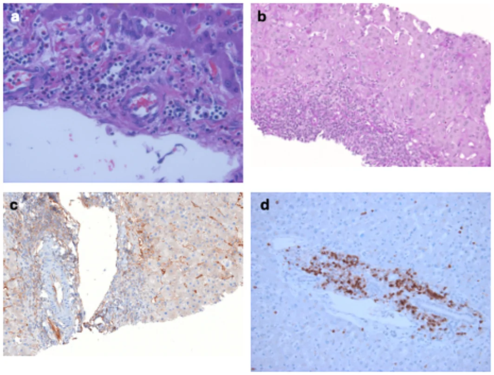
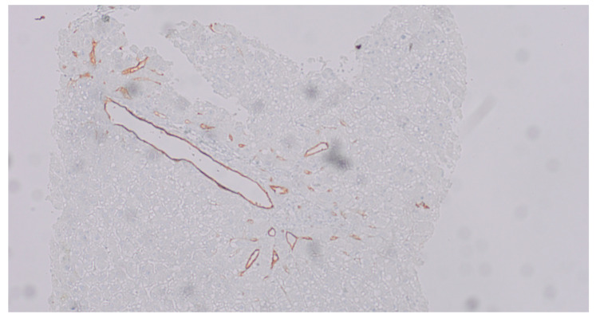
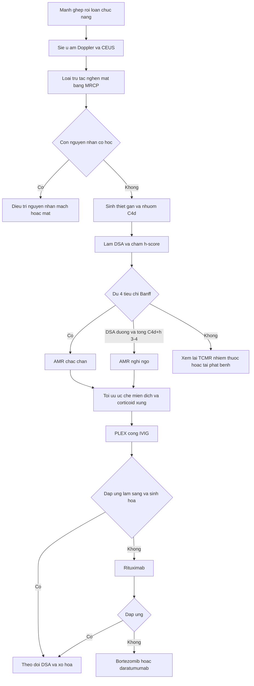
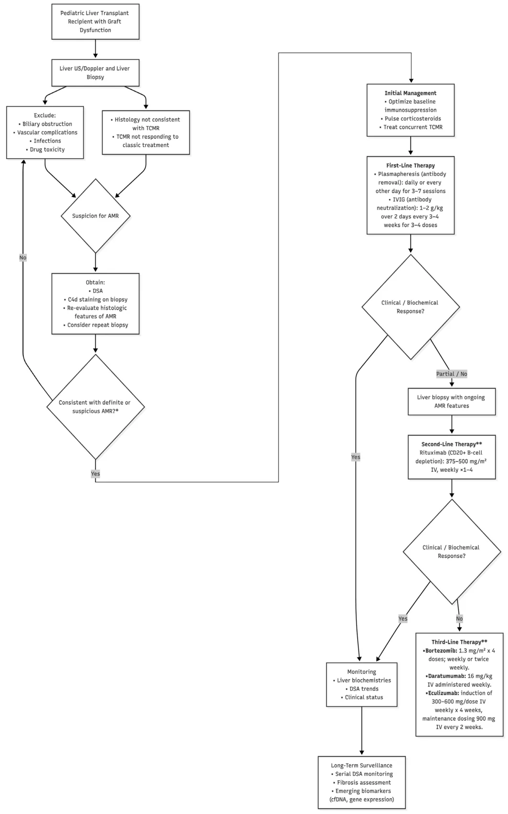
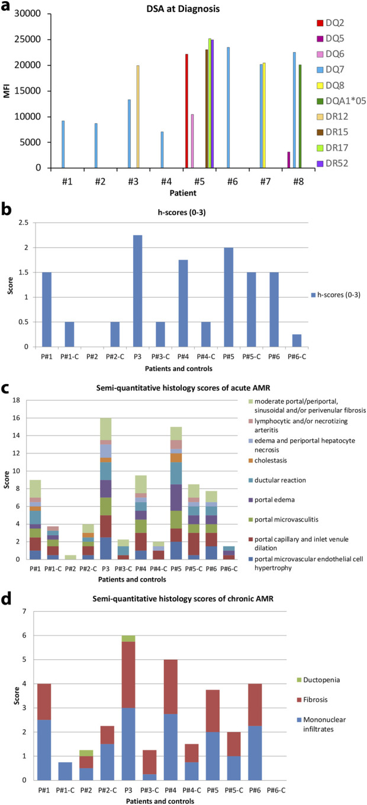
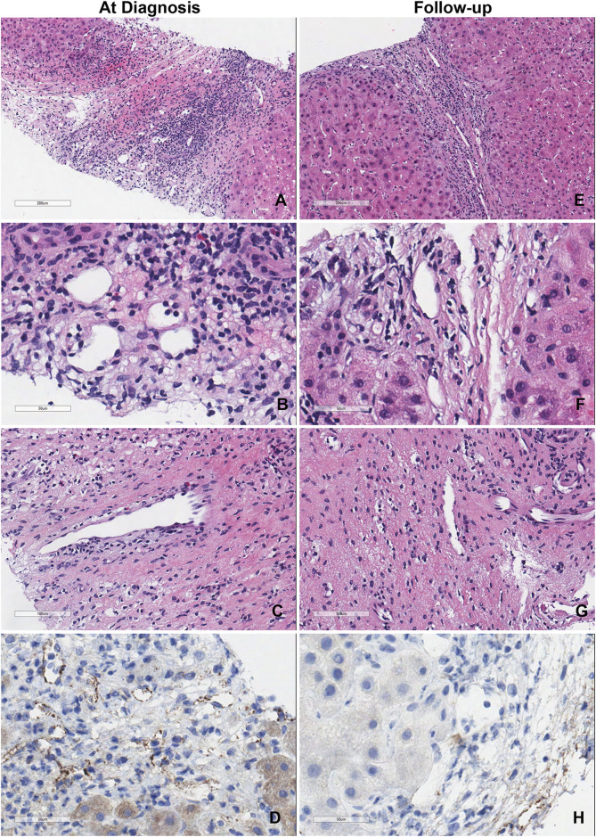

# 1917 — Thải ghép thể dịch (AMR) sau ghép gan: Banff 2016, C4d/h-score, DSA — và vì sao hình ảnh chỉ để LOẠI TRỪ / Antibody-mediated rejection after liver transplantation: Banff 2016, C4d and DSA, and why imaging only rules out

**Tags:** `pattern:thai-ghep-the-dich` `pattern:thai-ghep-cap` `pattern:men-gan-tang` `pattern:giam-ngam` `pattern:hep-duong-mat` `pattern:gan-to` `pattern:viem-khoang-cua` `vung:gan` `vung:duong-mat` `vung:dong-mach-gan` `score:Banff-AMR` `score:C4d` `score:h-score` `score:MFI` `protocol:Doppler` `protocol:MRCP` `protocol:sinh-thiet-gan` `protocol:DSA`

**Mức chắc chắn (certainty):** tổng hợp y văn (literature synthesis) — số liệu lấy từ các bài **open-access đã đọc toàn văn**: Jaramillo et al., *Pediatr Transplant* 2026 (PMC13552086, CC BY 4.0 — đồng thuận thực hành của Hội Ghép gan Nhi Hoa Kỳ: Banff 2016, bảng C4d/h-score, **liều PLEX–IVIG–rituximab–bortezomib**, thuật toán xử trí); Cicalese et al., *Transpl Int* 2024 (PMC11391112, CC BY 4.0 — **8 ca AMR người lớn**, theo dõi **1–11 năm**, tỉ lệ lui bệnh); Szymanska et al., *J Clin Med* 2026 (PMC13165025, CC BY 4.0 — **42 trẻ/62 sinh thiết**, **7 trẻ AMR**, phân bố C4d 1–3); Uebayashi et al., *J Clin Med* 2022 (PMC9409831, CC BY 4.0 — AMR mạn ở trẻ, **8–15%** ở người có DSA dai dẳng); den Dulk et al., *Transplant Direct* 2015 (PMC4946454, CC BY-NC-ND 4.0 — MRCP + **Leiden Biliary Stricture Classification**, cutoff **≥ 3 điểm**); Delgado-Moraleda et al., *Insights Imaging* 2019 (PMC6694376, CC BY 4.0 — **bộ ba Dodd** trên Doppler). Bài **không** có ca nguyên văn riêng của nhóm; ca 1–4 là ca nguyên văn/minh họa của các nguồn, ghi rõ Fig.

> **Câu hỏi gốc của bài:** bệnh nhân **ngày 12 sau ghép gan**, **ALT 180 U/L**, **bilirubin 2,6 mg/dL**, **tiểu cầu 78 × 10⁹/L**; Doppler mạch gan và tĩnh mạch cửa **bình thường**, MRCP **không hẹp miệng nối**. DSA **DQ7 MFI 12.000**. Sinh thiết: **C4d lan tỏa > 50% khoảng cửa**, **h-score 2**, có **viêm nội mạc tiểu tĩnh mạch**. Vậy: **đây là ACR hay AMR — và vì sao "siêu âm bình thường" không loại trừ được thải ghép?** Điều trị **PLEX + IVIG** đủ chưa, khi nào thêm **rituximab**, và **theo dõi bằng gì** khi không có dấu hiệu hình ảnh nào để bám?

## 1. Tổng quan — vì sao AMR là chẩn đoán MIỄN DỊCH–MÔ HỌC, và vì sao ảnh không thể "thấy" nó

**A. Bệnh học (pathology) và cơ chế:**

- **Định nghĩa:** **thải ghép thể dịch (antibody-mediated rejection, AMR)** = tổn thương mảnh ghép do **kháng thể kháng HLA của người cho (donor-specific antibody, DSA)** gắn vào **nội mạc vi mạch** mảnh ghép → hoạt hóa **bổ thể đường cổ điển** (sinh **C4d**), **ADCC** và **rối loạn chức năng nội mạc**. Đích tổn thương là **vi tuần hoàn khoảng cửa và xoang gan**, không phải mô gan nói chung.
- **Gan từng được coi là "miễn dịch đặc quyền" (immune-privileged):** diện nội mạc xoang rất lớn hấp thụ kháng thể, **HLA hòa tan** trung hòa DSA, **tế bào Kupffer** dọn phức hợp miễn dịch, khả năng tái sinh mạnh (PMC13552086). Vì thế AMR **hiếm hơn hẳn** thận/tim: ước tính **~1%** ở gan so với **10–30%** ở tim và **20–50%** ở thận (PMC9409831); thể **cấp ở ghép ABO tương thích < 5%** (PMC11391112). Nhưng **hiếm không có nghĩa không có** — đây chính là lý do chẩn đoán bị bỏ sót.
- **Thời điểm:** **tối cấp (hyperacute)** ngay khi tái tưới máu → **hoại tử xuất huyết, huyết khối động mạch/tĩnh mạch cửa, mất chức năng mảnh ghép nguyên phát**; **cấp** trong **vài tuần** (đôi khi ngay tuần đầu); **mạn** tiến triển **tháng–năm**, có thể **âm thầm với men gan bình thường** trong khi xơ hóa tiến triển (PMC13552086).
- **Vì sao chẩn đoán cần 4 thành phần:** Banff 2016 đòi hỏi **(1) hình thái học phù hợp, (2) C4d, (3) DSA, (4) loại trừ nguyên nhân khác**. Không thành phần nào một mình đủ — vì **C4d dương cũng gặp trong thiếu máu–tái tưới máu, tắc mật, viêm gan**, còn **DSA đơn độc có thể không gây tổn thương** (PMC13552086).
- **Vì sao C4d là "dấu chân" của kháng thể:** C4d là mảnh bền của **C4** sau khi đường cổ điển bị hoạt hóa; nó **gắn đồng hóa trị vào nội mạc/basement membrane** nên tồn tại **nhiều ngày** sau khi kháng thể đã biến mất. Vì vậy C4d **đánh dấu "đã từng có" kháng thể tại chỗ** — không phải "đang có" kháng thể trong máu. Điểm mấu chốt: **C4d lan tỏa (score 3, > 50% khoảng cửa)** mới có giá trị; **C4d từng ổ/yếu (score 1–2)** không đặc hiệu.
- **Vì sao h-score mô tả mức viêm vi mạch:** tổn thương AMR là **phì đại tế bào nội mạc, giãn mao mạch, viêm mao mạch với bạch cầu bám thành/lòng mạch**. Banff chấm theo **tỉ lệ khoảng cửa bị ảnh hưởng** và **số bạch cầu trong mao mạch bị ảnh hưởng nặng nhất**: **3–4 bạch cầu = h1**, **5–10 = h2**, **≥ 10 = h3** (PMC13552086).
- **Vì sao DSA là biến liên tục chứ không phải "dương/âm":** xét nghiệm **Luminex bead** phủ kháng nguyên; **MFI** là tín hiệu huỳnh quang, **phụ thuộc mật độ kháng nguyên trên hạt** (cao hơn trên tế bào thật) và **từng phòng xét nghiệm**; ngưỡng dương thường **1.000–2.000 MFI**. **MFI > 1.000** đã tăng nguy cơ mất ghép; **97%** người có **MFI > 10.000 ở năm 1** vẫn dương ở năm 5 (50% giữ mức cao), trong khi **40%** nhóm **1.000–4.999** giảm về âm ở năm 5 (PMC13552086).
- **Vì sao AMR và TCMR thường đi cùng:** nhánh tế bào T và nhánh kháng thể **phối hợp**; phần lớn sinh thiết AMR **cũng có dấu hiệu TCMR** (viêm nội mạc tĩnh mạch cửa, tổn thương ống mật). Vì thế **TCMR không đáp ứng corticoid** phải nghĩ AMR, và **điều trị AMR mà bỏ TCMR** (hoặc ngược lại) là sai lầm thường gặp (PMC13552086).
- **Vì sao điều trị theo bậc:** **PLEX** loại kháng thể lưu hành, **IVIG** trung hòa/điều hòa miễn dịch, **corticoid** giảm viêm; **rituximab** diệt tế bào B (nguồn tạo tương bào), **bortezomib** diệt tương bào, **daratumumab** diệt tương bào sống dài. Mỗi bậc nhắm một mắt xích khác nhau — vì vậy **không có "một thuốc" cho AMR** (PMC13552086).

**B. Ngưỡng định lượng bắt buộc (cửa 1 Argon):**

| Đại lượng | Con số đã kiểm chứng | Ý nghĩa thực hành |
|---|---|---|
| Tần suất AMR gan | **~1%** (PMC9409831); **cấp ở ABO tương thích < 5%** (PMC11391112) | Hiếm nhưng **không được bỏ**; so sánh: tim **10–30%**, thận **20–50%** (PMC9409831) |
| AMR mạn ở trẻ có DSA | **8–15%** ở người có **DSA de novo hoặc dai dẳng** (PMC9409831) | Nhóm **DSA+** phải theo dõi dài hạn |
| DSA de novo ở trẻ | **76/346 (21,8%)** trong **2 năm**; **74/76 (97%)** là **class II**, chủ yếu **DQ** (PMC13552086) | **DSA class II/DQ** là loại nguy hiểm nhất |
| Ngưỡng MFI | Phòng xét nghiệm dùng **1.000–2.000**; **MFI > 1.000** tăng nguy cơ mất ghép (PMC13552086) | Không dùng một ngưỡng chung cho mọi trung tâm |
| Độ bền DSA | **97%** ca **MFI > 10.000** ở năm 1 còn dương ở năm 5; **50%** giữ cao; **40%** ca **1.000–4.999** giảm về âm (PMC13552086) | **MFI cao dai dẳng** = nguy cơ tích lũy |
| C4d score | **0** không; **1** < 10% khoảng cửa; **2** 10–50%; **3** **> 50%** khoảng cửa (PMC13552086) | Chỉ **score 3 lan tỏa** nằm trong tiêu chuẩn "chắc chắn" |
| h-score | **1** = 3–4 bạch cầu; **2** = 5–10; **3** = **≥ 10** bạch cầu trong mao mạch nặng nhất (PMC13552086) | Chấm **cả tỉ lệ khoảng cửa** và **mức viêm** |
| "Nghi ngờ AMR" | **DSA dương + h-score khác 0 + tổng C4d+h = 3–4** (PMC13552086) | Chưa đủ "chắc chắn" — cân nhắc sinh thiết lại |
| "Không xác định" | **Tổng C4d+h ≥ 2**, kèm **DSA hoặc C4d không có/không rõ**, hoặc **có tổn thương đồng thời** (PMC13552086) | **Không điều trị mù** |
| AMR mạn "probable" | 4 tiêu chí, trong đó **C4d ≥ 10% khoảng cửa** và **DSA trong 3 tháng quanh sinh thiết** (PMC13552086) | Thể **âm thầm**, tiến triển xơ hóa |
| Thời gian khởi phát | **Cấp: vài tuần**; **mạn: tháng–năm** (PMC13552086) | Không chỉ theo dõi 3 tháng |
| PLEX | **1–1,5 thể tích huyết tương/lần × 3–7 lần**, cách ngày (PMC13552086) | Thường **cách ngày**, không hàng ngày kéo dài |
| IVIG | **1–2 g/kg trong 2 ngày**, mỗi **3–4 tuần × 3–4 liều** (PMC13552086) | Cho **sau khi kết thúc PLEX** |
| Rituximab | **375 mg/m²** (có nơi **500 mg/m²**), **chờ 48–72 giờ sau PLEX cuối** (PMC13552086) | PLEX sẽ **rửa trôi** thuốc nếu cho quá sớm |
| Bortezomib | **1,3 mg/m² × 4 liều**, tuần hoặc 2 lần/tuần; cho **sau PLEX trong ngày điều trị** (PMC13552086) | Bậc 3, ca kháng trị |
| Daratumumab | **16 mg/kg/tuần × 4 tuần** (PMC13552086) | Cứu vãn, dữ liệu còn mỏng |

**C. TẠI SAO ảnh trông như vậy (vật lý hình ảnh):**

- **Siêu âm B-mode:** AMR **không có dấu hiệu đặc hiệu**; có thể **gan to, nhu mô không đồng nhất** do **phù/viêm vi mạch**, nhưng **phù sau mổ, tắc mật, viêm gan, thiếu máu** đều giống. **B-mode bình thường không loại trừ AMR** — đây là nguyên tắc trung tâm của bài.
- **Doppler:** AMR **không có dấu hiệu Doppler đặc hiệu**. Thay đổi nếu có là **gián tiếp** (sức cản nhu mô tăng → RI cao) và **trùng lặp** với phù mảnh ghép, tắc mật, chèn ép. Ngược lại, Doppler **rất mạnh để loại trừ** **hẹp/tắc động mạch gan**: **bộ ba Dodd** gồm **PSV > 200 cm/s tại chỗ hẹp**, **RI < 0,5** và **SAT > 0,08 giây** đoạn xa (PMC6694376). Lưu ý bẫy sinh lý: **~50%** bệnh nhân có **RI > 0,8 trong 3 ngày đầu**, bình thường hóa **~ngày 4** (PMC6694376).
- **MRCP:** dùng để **loại trừ hẹp/tắc đường mật** — nguyên nhân cơ học hay bị nhầm nhất. Với **Leiden Biliary Stricture Classification**, cutoff **≥ 3 điểm** phát hiện **hẹp không miệng nối (NAS)**: **Se > 90%**, **Sp 50–82%**, **PPV 86–91%**, **NPV 80–100%**, tốt hơn ở **đường mật trong gan**; MRCP **không đủ để chấm độ nặng** (PMC4946454).
- **CT:** giá trị chính là **loại trừ** **áp-xe, nhồi máu, huyết khối mạch, tụ dịch**; **không** dùng để chẩn đoán AMR.
- **Mô học + hóa mô miễn dịch:** **H&E** thấy **phì đại nội mạc, giãn mao mạch, viêm mao mạch**; **C4d IHC** thấy **dải nâu dọc nội mạc mao mạch khoảng cửa** (khác **C4d trong xoang** — thường là **dương tính giả/không đặc hiệu**); **CD3** cho thấy phần lớn tế bào viêm là **T cell**, giải thích vì sao **AMR thường kèm TCMR** (PMC13552086).

*(a) H&E: lympho trong mao mạch khoảng cửa (viêm vi mạch), kèm bạch cầu ái toan rải rác. (b) PAS: làm rõ màng đáy mao mạch, viêm lan vào xoang quanh khoảng cửa. (c) **C4d IHC**: dải nâu dọc mao mạch khoảng cửa và màng đáy xoang quanh khoảng cửa — **nội mạc tĩnh mạch cửa/động mạch gan cũng bắt màu nhưng ít đặc hiệu**. (d) **CD3**: thâm nhiễm chủ yếu là T cell, có chỗ gây viêm tiểu tĩnh mạch — minh họa **AMR thường đi kèm TCMR**. Nguồn: Jaramillo et al., Pediatr Transplant 2026;30:e70455, PMC13552086 Fig. 1, CC BY 4.0.*

## 2. Mẫu hình + chẩn đoán phân biệt theo bối cảnh (Gamut)

Xếp theo **cái gì phải loại trừ trước** và **bệnh cảnh nào dễ bị gọi nhầm**:

- **Mẫu A — AMR cấp sớm (vài tuần đầu), người nhận nhạy cảm/ABO không tương thích:** men gan tăng, **bilirubin tăng**, **giảm tiểu cầu không đáp ứng truyền**, **bổ thể giảm**; DSA **MFI cao**; sinh thiết **C4d lan tỏa + h-score ≥ 1**. Đây là thể **"chắc chắn"** nếu đủ 4 tiêu chí.
- **Mẫu B — TCMR không đáp ứng corticoid:** hình thái giống TCMR nhưng **men gan không giảm sau methylprednisolone**; phải **nhuộm C4d + làm DSA** — phần lớn là **AMR hỗn hợp**.
- **Mẫu C — AMR mạn:** tiến triển **tháng–năm**, **xơ hóa khoảng cửa/xoang**, **ống mật thoái hóa/ductopenia**, **hẹp đường mật không miệng nối, nhiều ổ, lan vào nhánh trong gan**; **C4d có thể chỉ từng ổ (> 10%)**; men gan có thể **bình thường**.
- **Mẫu D — AMR giả dạng tắc xoang gan (SOS/VOD):** **viêm tiểu tĩnh mạch trung tâm**, **C4d xoang lan tỏa**, **DSA de novo**, không có viêm vi mạch khoảng cửa điển hình — một thể đã được báo cáo, dễ bị chẩn đoán là **SOS** (PMC13552086).
- **Mẫu E — DSA dương đơn độc, không rối loạn chức năng:** **không điều trị AMR**; kiểm tra tuân thủ, lặp DSA cùng phòng xét nghiệm, theo dõi men gan; DSA **có thể thoáng qua** (PMC13552086).
- **Mẫu F — AMR tối cấp:** ngay sau tái tưới máu, **hoại tử xuất huyết, huyết khối mạch, mất chức năng nguyên phát**; chẩn đoán trên **gan cắt bỏ/tử thiết**, xử trí **ghép lại**.
- **Mẫu G — viêm gan tự miễn de novo (dn AIH)/"plasma cell rejection":** ở trẻ ghép vì bệnh khác, xuất hiện **AIH-like**; có thể **chồng lấp AMR mạn**; cần **IgG, autoantibody, mô học** (PMC13552086).
- **Mẫu H — nguyên nhân cơ học/nhiễm (phải loại trừ TRƯỚC):** **hẹp/tắc động mạch gan (HAT/HAS)**, **hẹp miệng nối mật**, **cholangiopathy thiếu máu**, **áp-xe/sepssis**, **thuốc (DILI)**, **CMV/EBV/PTLD**, **tái phát PSC/AIH**.

## 3. Bảng so sánh phân biệt (ma trận đối chiếu)

| Thực thể (entity) | Hình ảnh điển hình | Chốt vào (rule-in) | Chốt loại (rule-out) | Gợi ý xác nhận |
|---|---|---|---|---|
| **AMR cấp chắc chắn** | Siêu âm/Doppler **thường bình thường** hoặc **không đặc hiệu**; MRCP **không hẹp** | **Đủ 4 tiêu chí Banff**: hình thái + **C4d score 3** + **DSA dương** + loại trừ nguyên nhân khác | **C4d âm + không có viêm vi mạch** → không AMR | C4d IHC, h-score, DSA; sinh thiết |
| **AMR "nghi ngờ"** | Không đặc hiệu | **DSA dương + h ≠ 0 + tổng C4d+h = 3–4** | Hình thái **không có viêm vi mạch** và C4d âm → không | Sinh thiết lại 1–2 tuần; DSA lặp |
| **AMR + TCMR hỗn hợp** | Như AMR; có thể **giãn mật nhẹ** do tổn thương ống mật | **C4d dương + viêm nội mạc tĩnh mạch cửa/tổn thương ống mật** | Chỉ TCMR thuần và **C4d âm, DSA âm** → không AMR | Điều trị **cả hai**; corticoid/ATG + PLEX |
| **AMR mạn (probable)** | **Xơ hóa khoảng cửa/xoang**; **MRCP: hẹp nhiều ổ, gần gốc, lan trong gan**; gan teo/không đồng nhất | **4 tiêu chí**, gồm **C4d ≥ 10% khoảng cửa** + **DSA trong 3 tháng** | **Không xơ hóa, không DSA, C4d âm** → không | Sinh thiết + MRCP; theo dõi xơ hóa |
| **TCMR đơn thuần** | **Bình thường** hoặc gan to nhẹ; **RI tăng muộn** không đặc hiệu | **RAI/PI+BDD+VEI** trên mô học, **C4d âm**, DSA âm | **C4d lan tỏa + DSA dương** → nghĩ AMR | Banff RAI (bài 1916) |
| **HAT/HAS** | **Mất dòng/PSV > 200 cm/s, RI < 0,5, SAT > 0,08 giây**; CTA hẹp/tắc | **Bất thường Doppler + CTA/DSA** | **Mạch thông, RI bình thường** | Doppler–CEUS–CTA (bài 1913/1915) |
| **Hẹp miệng nối mật** | **Giãn đường mật trong gan + hẹp đúng miệng nối** | **MRCP/ERCP thấy hẹp tại miệng nối** | **MRCP bình thường** | MRCP/ERCP (bài 133) |
| **Cholangiopathy thiếu máu/NAS** | **Hẹp nhiều ổ trong gan**, không đúng miệng nối; tiền sử **HAT/kéo dài thiếu máu lạnh** | **LBSC ≥ 3 điểm trên MRCP** + bối cảnh mạch máu | **MRCP bình thường** | MRCP; đối chiếu mạch gan |
| **Tái phát PSC/AIH** | PSC: **hẹp nhiều ổ + giãn**; AIH: **không đặc hiệu** | **MRCP/autoantibody/IgG + mô học** | Không có dấu hiệu tái phát | MRCP, IgG/autoantibody |
| **DILI** | **Không đặc hiệu** | **Thuốc mới + thời gian hợp lý + eosinophil/autoantibody** | **Không liên quan thuốc** | Ngừng thuốc thử; sinh thiết |
| **Nhiễm CMV/EBV, PTLD** | CMV: **không đặc hiệu**; PTLD: **khối khoảng cửa/hạch** | **PCR/pp65 dương; PTLD có tăng sinh lympho đơn dòng** | **PCR âm, không khối** | PCR, sinh thiết, PET/CT |

*C4d IHC, độ phóng đại ×10: **dải nâu dọc nội mạch tĩnh mạch cửa và mao mạch khoảng cửa**, không thành dải trong xoang. Đây là **C4d score 3 (lan tỏa > 50% khoảng cửa)** — thành phần **bắt buộc** để gọi "AMR chắc chắn" theo Banff 2016. Nguồn: Szymanska et al., J Clin Med 2026;15:3554, PMC13165025 Fig. 2, CC BY 4.0.*

## 4. Protocol chẩn đoán + phân độ Banff + ngưỡng điều trị

**A. Thứ tự bắt buộc khi mảnh ghép rối loạn chức năng:**

1. **Sinh hóa + huyết học:** AST/ALT/ALP/GGT/bilirubin, INR, **tiểu cầu**, bổ thể (C3/C4) — AMR cấp hay có **giảm tiểu cầu và bổ thể thấp** (PMC13552086).
2. **Siêu âm + Doppler (+ CEUS):** loại trừ **HAT/HAS, tắc tĩnh mạch cửa, hẹp dòng ra**; ghi **RI trong gan, PSV tại miệng nối, SAT**. Nhớ **RI > 0,8 trong 72 giờ đầu là sinh lý ở ~50%** (PMC6694376).
3. **MRCP:** loại trừ **hẹp miệng nối** và **NAS**; dùng **LBSC ≥ 3 điểm** để phát hiện NAS (Se **> 90%**), nhưng **không chấm độ nặng bằng MRCP** (PMC4946454).
4. **CT bụng có cản quang:** khi nghi **áp-xe, nhồi máu, huyết khối, tụ dịch** — không để chẩn đoán AMR.
5. **DSA (Luminex):** làm **trước khi bắt đầu điều trị kháng thể**, lặp **gần cuối đợt**, rồi **mỗi 1–3 tháng** đến khi ổn định, sau đó **3–6 tháng trong năm đầu** (PMC13552086).
6. **Sinh thiết gan + C4d IHC + h-score:** bắt buộc để **phân loại Banff**; sinh thiết lại nếu **mô học không khớp** hoặc **không đáp ứng điều trị**.
7. **Loại trừ nhiễm:** **CMV/EBV PCR**, cấy máu/mật khi sốt; **PTLD** khi có khối.

**B. Banff 2016 — phân loại AMR cấp:**

| Nhóm chẩn đoán | Tiêu chí bắt buộc |
|---|---|
| **AMR cấp chắc chắn (definite)** | (1) Hình thái phù hợp (**phì đại nội mạc vi mạch, giãn mao mạch, viêm mao mạch, phù khoảng cửa, phản ứng ống mật, ứ mật**) + (2) **DSA huyết thanh dương** + (3) **C4d lan tỏa — score 3** (ở ghép ABO không tương thích: **C4d mô đệm khoảng cửa**) + (4) **loại trừ hợp lý** nguyên nhân khác |
| **Nghi ngờ AMR (suspicious)** | **DSA dương** + **h-score khác 0** + **tổng C4d + h = 3–4** |
| **Không xác định (indeterminate)** | **Tổng C4d + h ≥ 2**, kèm **DSA không có/không rõ** hoặc **C4d không có/không rõ**, hoặc **có tổn thương đồng thời** |

**C. Chấm điểm thành phần (bắt buộc ghi cả hai):**

| Điểm | **C4d (miễn dịch)** | **h (mô học)** |
|---|---|---|
| **0** | Không có C4d ở vi mạch khoảng cửa | Không có dấu hiệu AMR |
| **1** | **< 10%** khoảng cửa có C4d ở **> 50% chu vi** nội mạc | Phì đại nội mạc ở **phần lớn** khoảng cửa + **3–4** bạch cầu bám/lòng mao mạch nặng nhất; giãn nhẹ |
| **2** | **10–50%** khoảng cửa; thường **không lan vào xoang** | **5–10** bạch cầu; phì đại rõ ở phần lớn khoảng cửa/xoang; giãn mao mạch rõ; có thể phù khoảng cửa |
| **3** | **> 50%** khoảng cửa; thường **lan vào tiểu tĩnh mạch vào/xoang quanh cửa** | **≥ 10** bạch cầu; giãn mao mạch rõ; **ít nhất từng ổ mất liên tục vi mạch + fibrin + hồng cầu ngoài mạch** |

**D. AMR mạn — "probable chronic" (cả 4):** (1) viêm đơn nhân khoảng cửa/quanh tiểu tĩnh mạch **không giải thích được** + **xơ hóa ít nhất vừa** khoảng cửa/quanh xoang/quanh tiểu tĩnh mạch; (2) **C4d ≥ 10%** nội mạc vi mạch khoảng cửa; (3) **DSA trong 3 tháng** quanh sinh thiết; (4) loại trừ nguyên nhân khác. **"Possible"** khi C4d **tối thiểu hoặc không có** (PMC13552086).

**E. Ngưỡng điều trị (bậc thang):**

| Bước | Can thiệp | Liều / thời gian |
|---|---|---|
| **0 — nền** | Tối ưu ức chế miễn dịch + **corticoid xung**; **điều trị TCMR đi kèm** | Theo phác đồ trung tâm |
| **1 — đầu tay** | **PLEX + IVIG** | **PLEX 1–1,5 thể tích huyết tương × 3–7 lần**, cách ngày; **IVIG 1–2 g/kg trong 2 ngày, mỗi 3–4 tuần × 3–4 liều** (sau PLEX) |
| **2 — không/đáp ứng một phần** | **Rituximab** | **375 mg/m²** (có nơi 500 mg/m²), **chờ 48–72 giờ sau PLEX cuối** |
| **3 — kháng trị** | **Bortezomib**; **daratumumab** | **Bortezomib 1,3 mg/m² × 4**; **daratumumab 16 mg/kg/tuần × 4** |
| **Theo dõi** | Men gan, **DSA**, xơ hóa, biomarker mới (cfDNA) | DSA **1–3 tháng** đến khi ổn định; sau đó **3–6 tháng/năm đầu** |

**F. Sơ đồ quyết định:**

*Thuật toán của nhóm đồng thuận: bước đầu **siêu âm/Doppler + sinh thiết**, **loại trừ tắc mật, biến chứng mạch, nhiễm, độc thuốc**; nếu nghi AMR → **DSA + C4d + đánh giá lại mô học, cân nhắc sinh thiết lại**; điều trị **PLEX + IVIG**, sau đó **rituximab**, rồi **bortezomib/daratumumab** nếu không đáp ứng. Nguồn: Jaramillo et al., Pediatr Transplant 2026;30:e70455, PMC13552086 Fig. 3, CC BY 4.0.*

## 5. Biến thể bình thường và cạm bẫy

**A. Biến thể bình thường (normal variant):**

- **RI > 0,8 trong 3 ngày đầu** sau ghép ở **~50%** do phù mảnh ghép, bình thường hóa **~ngày 4** — không phải AMR (PMC6694376).
- **C4d dương nhẹ/từng ổ** sau **thiếu máu–tái tưới máu**, **tắc mật**, **viêm gan** — không đủ chẩn đoán.
- **DSA MFI thấp, thoáng qua** (đặc biệt **1.000–5.000**) có thể **tự giảm**; **40%** nhóm này âm ở năm 5 (PMC13552086).
- **Giãn nhẹ đường mật trong gan** sau ghép do **phù miệng nối** — đối chiếu MRCP và men gan, không quy ngay cho AMR.
- **Gan to, nhu mô không đồng nhất** trong vài tuần đầu do **tái tưới máu** — tự hết.

**B. Cạm bẫy (pitfall):**

- **"Siêu âm bình thường nên không phải thải ghép":** sai — AMR **không có dấu hiệu hình ảnh đặc hiệu**; ảnh chỉ **loại trừ cơ học**.
- **Gọi AMR khi chỉ có C4d dương:** **C4d score 1–2** gặp trong nhiều bệnh cảnh; phải có **DSA + hình thái** và **loại trừ**.
- **Bỏ sót C4d âm:** AMR **C4d âm** đã được thừa nhận ở thận và **có thể gặp ở gan**; đừng loại trừ chỉ vì C4d âm khi **DSA + viêm vi mạch** rõ (PMC13552086).
- **Điều trị DSA dương đơn độc:** không có rối loạn chức năng/mô học → **theo dõi**, tránh PLEX/IVIG không cần thiết.
- **Bỏ TCMR đi kèm:** phần lớn sinh thiết AMR **có TCMR**; chỉ điều trị kháng thể mà **không corticoid/ATG** sẽ **không cải thiện men gan** (PMC13552086).
- **Cho rituximab ngay sau PLEX:** PLEX **rửa trôi** thuốc; phải **chờ 48–72 giờ** (PMC13552086).
- **Quên AMR mạn:** men gan **bình thường** nhưng **xơ hóa tiến triển**; hẹp **nhiều ổ, gần gốc, lan trong gan** khác hẹp miệng nối — dễ bị gọi là **"TCMR muộn"** hoặc **"xơ hóa không rõ nguyên nhân"**.
- **Nhầm hẹp do miễn dịch với hẹp do thiếu máu:** cả hai đều **hẹp không miệng nối**; phải đối chiếu **tiền sử HAT/thiếu máu lạnh** và **mạch gan**.
- **Sinh thiết một lần là đủ:** **sampling error** và **interobserver**; nếu **mô học không khớp lâm sàng**, **sinh thiết lại**.
- **Satisfaction of search:** thấy AMR rồi **không đọc mạch–mật**; bệnh nhân có thể có **cả AMR và hẹp động mạch/mật**.

## 6. Tự lượng giá — Blind Quiz

**Ca 1 — 8 bệnh nhân AMR: đọc DSA và h-score.**

- Hỏi: (1) MFI nào được coi là "cao"? (2) **7/8** ca đạt Banff — nghĩa là gì? (3) h-score 0,5 có loại trừ AMR không?

<b>Bấm để hiện đáp án (findings + chẩn đoán)</b>

- **(1)** Ngưỡng dương **1.000–2.000 MFI** tùy phòng xét nghiệm; **> 1.000** đã tăng nguy cơ mất ghép; phần lớn ca trong hình có **MFI 5.000–25.000** (DQ2, DQ7, DQ8, DQA1*05...).
- **(2)** **7/8** ca đủ **4 tiêu chí Banff 2016** → **AMR chắc chắn**; 1 ca **h-score thấp/không điển hình** vẫn được chẩn đoán nhờ **DSA + C4d + bối cảnh**.
- **(3)** **Không** — h-score **0,5** chỉ là **mức viêm thấp**, không loại trừ; phải đọc **cùng C4d và DSA**. Trong hình, nhiều ca **h-score 0,5–1,5** vẫn là AMR.
- Nguồn: Cicalese et al., Transpl Int 2024;37:13232, PMC11391112 Fig. 1, CC BY 4.0.

**Ca 2 — Sinh thiết có dải nâu dọc mao mạch khoảng cửa.**

- Hỏi: (1) Đây là C4d score mấy? (2) C4d nằm ở đâu mới đặc hiệu? (3) Có C4d này đã đủ chẩn đoán AMR chưa?

<b>Bấm để hiện đáp án</b>

- **(1)** **Score 3** — **lan tỏa > 50% khoảng cửa**, dọc nội mạc tĩnh mạch cửa và mao mạch.
- **(2)** **Vi mạch khoảng cửa** (mao mạch, tiểu tĩnh mạch vào); **C4d trong xoang** hoặc trên **tĩnh mạch lớn/ống mật quanh rốn gan** **ít đặc hiệu**.
- **(3)** **Chưa** — cần **DSA + hình thái + loại trừ**; C4d đơn độc có thể dương trong **thiếu máu–tái tưới máu/tắc mật/viêm gan**.
- Nguồn: Szymanska et al., J Clin Med 2026;15:3554, PMC13165025 Fig. 2, CC BY 4.0.

**Ca 3 — Sinh thiết lúc chẩn đoán và sau 6 tháng.**

- Hỏi: (1) Khung trái cho thấy gì? (2) Khung phải thay đổi ra sao? (3) Điều này nói gì về tiên lượng?

<b>Bấm để hiện đáp án</b>

- **(1)** **Viêm vi mạch khoảng cửa** với **phì đại nội mạc, giãn mao mạch, bạch cầu bám thành**, kèm **C4d dương** (D) — mô học AMR cấp điển hình.
- **(2)** Sau **6 tháng** điều trị: **viêm giảm rõ**, kiến trúc khoảng cửa hồi phục, **C4d giảm** (H) — phù hợp **lui bệnh**.
- **(3)** Trong loạt **8 ca**, **5/8 lui hoàn toàn**, **1** chuyển **AMR mạn**, **2** phải **ghép lại** → **điều trị sớm có thể đảo ngược**, nhưng **không phải tất cả**.
- Nguồn: Cicalese et al., Transpl Int 2024;37:13232, PMC11391112 Fig. 2, CC BY 4.0.

**Ca 4 — Bệnh nhân rối loạn chức năng mảnh ghép: chọn bước tiếp theo.**

- Hỏi: (1) Hai việc phải làm ngay? (2) Khi nào gọi "nghi ngờ AMR"? (3) Vì sao phải chờ 48–72 giờ sau PLEX mới cho rituximab?

<b>Bấm để hiện đáp án</b>

- **(1)** **Siêu âm/Doppler + sinh thiết gan**, đồng thời **loại trừ tắc mật, biến chứng mạch, nhiễm, độc thuốc**.
- **(2)** **DSA dương + h-score khác 0 + tổng C4d+h = 3–4**; nếu chưa đủ, **lặp DSA/C4d và cân nhắc sinh thiết lại**.
- **(3)** **PLEX loại bỏ kháng thể và cả thuốc khỏi huyết tương**; cho rituximab quá sớm sẽ **mất liều** — chờ **48–72 giờ sau phiên PLEX cuối**.
- Nguồn: Jaramillo et al., Pediatr Transplant 2026;30:e70455, PMC13552086 Fig. 3, CC BY 4.0.

## Bài liên quan chéo
- [1916 – Thải ghép cấp tế bào (ACR/TCMR) sau ghép gan](../1916-thai-ghep-cap-te-bao-sau-ghep-gan/lesson.md) — **đối thủ số 1** của AMR; **C4d âm, DSA âm**, đáp ứng corticoid; AMR thường **đi kèm**.
- [1913 – Hẹp & huyết khối động mạch gan sau ghép](../1913-hep-huyet-khoi-hep-dong-mach-gan-sau-ghep/lesson.md) — **loại trừ mạch** trước khi gọi AMR; bộ ba Dodd.
- [1915 – Hẹp động mạch gan ở trẻ sau ghép](../1915-hep-dong-mach-gan-tre-sau-ghep/lesson.md) — ngưỡng Doppler **theo tuổi** ở trẻ.
- [133 – Hẹp miệng nối & cholangiopathy thiếu máu sau ghép gan](../133-hep-mieng-noi-duong-mat-sau-ghep/lesson.md) — **hẹp mật** bắt chước AMR mạn.
- [1909 – Hẹp–tắc tĩnh mạch cửa sau ghép gan](../1909-hep-tinh-mach-cua-sau-ghep-gan/lesson.md) — men gan tăng + gan to, phải loại trừ trước.
- [1906 – Hẹp dòng ra tĩnh mạch gan sau ghép (HVOO)](../1906-hep-dong-ra-tm-gan-sau-ghep-gan/lesson.md) — ứ huyết gây rối loạn chức năng, không phải AMR.
- [1914 – Suy chức năng mảnh ghép sớm (EAD) & PNF](../1914-suy-chuc-nang-manh-ghep-som/lesson.md) — **PNF** là biểu hiện của AMR tối cấp.

## Ảnh
- 5 ảnh, tải từ **PMC CDN** của bài open access (CC BY 4.0), **không chỉnh sửa pixel**; nguồn + giấy phép từng file trong `images/CREDITS.md`.
- Tên file: `1917_amr_<nội dung>_<Modality>_PMCxxxxx-fN.(jpg|webp)`; **không** tạo ảnh ghép (H&E/PAS, IHC, biểu đồ Luminex và thuật toán — khác modality, không cùng chuỗi xung).
- Ảnh **không** tải: Radiopaedia (chỉ dẫn link), AuntMinnie (chỉ dẫn link), các bài không rõ giấy phép — xem `sources.md`.

> Không dùng để chẩn đoán độc lập khi chưa có người hướng dẫn.
