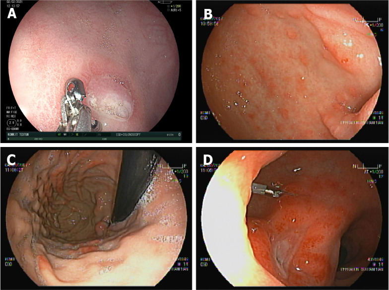
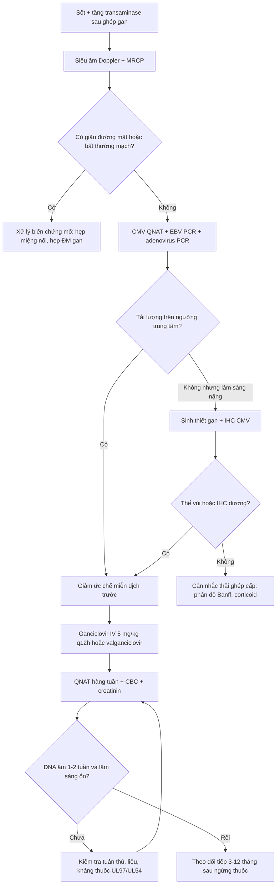
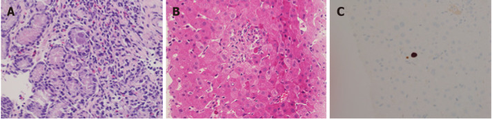

# 1918 — Nhiễm CMV sau ghép gan ở trẻ: viêm gan CMV vs thải ghép cấp, ngưỡng tải lượng và khi nào giảm ức chế miễn dịch

**Tags:** `pattern:viem-gan-sau-ghep` `pattern:tang-transaminase` `pattern:day-thanh-ruot` `pattern:loet-niem-mac` `vung:gan` `vung:duong-mat` `vung:ruot` `vung:phoi` `protocol:PCR-CMV` `protocol:noi-soi-tieu-hoa` `protocol:sinh-thiet-gan` `protocol:MRCP` `score:CMV-DNA` `incidentaloma:khong`
**Mức chắc chắn (certainty):** tổng hợp y văn (literature synthesis) — ghép **tổng quan về CMV sau ghép gan ở trẻ** (World J Hepatol 2022, PMC8891677), **đoàn hệ 96 trẻ ghép gan** (Viruses 2023, PMC10222744), **phân tích gộp 27 nghiên cứu/6.308 ca ghép tạng** (BMC Infect Dis 2025, PMC12482134) và **ca nguyên văn có ảnh nội soi + mô học** (PMC8891677). Không có ca do nhóm tự chụp.

> **Câu hỏi thực hành:** bé trai **8 tháng tuổi**, ghép gan **35 ngày** vì teo đường mật, **D+/R− CMV**. Sốt **38,5°C** 3 ngày, vàng da tăng, **ALT 180 U/L**, **WBC 2,8 × 10⁹/L**, **tiểu cầu 90 × 10⁹/L**, **CMV DNA 3.200 IU/mL**. Siêu âm: mảnh ghép đều, **không giãn đường mật**, động mạch gan bình thường. Bác sĩ hỏi: **"Đây là viêm gan CMV hay thải ghép cấp? Có cần sinh thiết không? Giảm ức chế miễn dịch hay tăng?"**
> Bài chốt **năm quyết định**: **(1) trẻ ghép gan D+/R− có tỉ lệ nhiễm CMV 44–65% nếu không dự phòng, và 63% có antigenemia dù đã điều trị tiên phát; (2) CMV làm tăng nguy cơ thải ghép cấp — gộp 27 nghiên cứu: OR 2,02; riêng gan OR 4,43 (2,20–8,92); (3) viêm gan CMV và thải ghép cấp KHÔNG phân biệt được bằng xét nghiệm gan/hình ảnh — phải sinh thiết + nhuộm hóa mô miễn dịch; (4) bệnh xâm lấn mô có thể có tải lượng máu rất thấp hoặc không phát hiện được, nên PCR âm không loại trừ; (5) bước đầu tiên khi có tải lượng đáng kể là GIẢM ức chế miễn dịch, rồi mới kháng virus.**

## 1. Tổng quan bệnh học – cơ chế hình ảnh: vì sao CMV vừa gây viêm gan vừa "giả thải ghép"

- **Bản chất virus:** CMV (cytomegalovirus, HSV-5) thuộc họ Herpesviridae, **tiềm ẩn suốt đời trong tế bào dòng tủy**; khi ức chế miễn dịch (đặc biệt **lympho T CD4/CD8**) suy giảm, virus **tái hoạt** hoặc **lây mới từ mảnh ghép**. Ở trẻ, phần lớn là **nhiễm tiên phát** vì **chưa từng tiếp xúc** — đây là lý do trẻ có tỉ lệ bệnh cao hơn người lớn.
- **Dịch tễ định lượng:**
  - Huyết thanh dương tính ở phụ nữ tuổi sinh sản **45–100%** tùy vùng (PMC8891677).
  - Loạt **146 ca ghép gan**: nhiễm CMV sau ghép **71,4% ở trẻ** so với **33,4% ở người lớn**; thời gian tới viremia trung bình **11,5 ngày ở trẻ** so với **30 ngày ở người lớn** (PMC8891677).
  - Không dự phòng: **D+/R− nhiễm 44–65%**, **D−/R− chỉ 1–2%**; trẻ nhỏ **44–65% trong 6 tháng** (PMC8891677).
  - Có điều trị tiên phát (Nhật Bản): antigenemia **63% D+/R−**, **38% D+/R+**, **11% D−/R+**, **6% D−/R−**; bệnh CMV **11% / 2% / 0% / 6%** tương ứng (PMC8891677).
  - Nhiễm muộn sau khi ngừng dự phòng: **10,5%** nhiễm và **4,4%** bệnh (PMC8891677).
  - Đoàn hệ 96 trẻ ghép gan (Anh): **35,4% nhiễm CMV**, trung vị **42 ngày** sau ghép (IQR **30,75–66**); **D+/R−** là yếu tố nguy cơ độc lập (**p = 0,013**), **D−/R−** bảo vệ (**p = 0,04**) (PMC10222744).
- **TẠI SAO CMV gây tổn thương gan — cơ chế mô học:** CMV nhiễm **tế bào nội mô và tế bào biểu mô ống mật**, gây **viêm và phù nhu mô**, sau đó **hoại tử tế bào gan từng ổ** và **áp-xe vi mô bạch cầu trung tính**. Trên hình ảnh, điều này chỉ tạo ra **bất thường không đặc hiệu**: gan to, **phù quanh khoảng cửa (periportal halo)**, giảm đậm độ nhu mô, dày thành túi mật — **không có dấu hiệu nào đủ chẩn đoán**.
- **TẠI SAO hình ảnh KHÔNG phân biệt được với thải ghép cấp:** cả hai đều là **viêm nhu mô + phù khoảng cửa**; trên siêu âm/CT/MRI, viêm gan CMV, thải ghép cấp và **nhiễm adenovirus/EBV** đều có thể chỉ là **gan to + phù quanh cửa**. Điểm khác biệt nằm ở **mô học** (thể vùi trong nhân/tế bào chất, **hóa mô miễn dịch CMV dương**) và **PCR mô**, không ở HU hay mm.
- **TẠI SAO tải lượng máu không tương ứng với mức bệnh:** trong **bệnh xâm lấn mô** (viêm gan, viêm ruột), virus **khu trú trong mô**, có thể **không có hoặc rất ít DNA trong máu**; hiệp hội ghép tạng khuyến cáo **không dùng PCR huyết thanh để quyết định ngừng thuốc** khi có bệnh mô học — phải dựa vào **lâm sàng + mô học** (PMC8891677).
- **TẠI SAO CMV làm tăng thải ghép:** CMV điều hòa tăng **phân tử MHC lớp I/II** trên tế bào nội mô mảnh ghép, tăng **cytokine viêm**, và làm **rối loạn tế bào T điều hòa** → mảnh ghép "dễ thấy" hơn với hệ miễn dịch. Gộp **27 nghiên cứu, 6.308 ca**: thải ghép cấp **OR 2,02 (95% CI 1,64–2,49)**; **gan OR 4,43 (2,20–8,92)**, thận **2,22 (1,70–2,89)**, phổi **1,38 (1,01–1,90)** (PMC12482134).
- **Vì sao trẻ < 18 tháng khó xác định huyết thanh:** **IgG mẹ truyền** có thể còn dương tính tới **18 tháng**; ở trẻ < 18 tháng phải dùng **IgG + PCR/cấy nước tiểu–nước bọt**, không dựa IgG đơn thuần (PMC8891677).
- **Định nghĩa "hội chứng CMV" (để không gọi nhầm):** có **DNA CMV trong máu** + **≥ 2** trong các tiêu chí: **sốt > 38°C ≥ 2 ngày trong 4 ngày**, mệt mới, **giảm bạch cầu/trung tính 2 lần**, **≥ 5% lymphocyte không điển hình**, **giảm tiểu cầu**, **transaminase > 3 lần giới hạn trên** (PMC8891677).

## 2. Mẫu hình + chẩn đoán phân biệt theo vị trí (Gamut)

- **Theo CƠ QUAN bị ảnh hưởng (CMV "đi đâu"):**
  - **Gan (viêm gan CMV):** tăng transaminase, vàng da, gan to; **không giãn đường mật**; mô học có **thể vùi** và **áp-xe vi mô bạch cầu trung tính**; IHC CMV dương.
  - **Đường tiêu hóa (viêm thực quản/dạ dày/ruột):** đau bụng, tiêu chảy, **xuất huyết tiêu hóa**, thiếu máu; nội soi: **loét, niêm mạc đỏ phù, chảy máu**; sinh thiết là chốt.
  - **Phổi (viêm phổi CMV):** ho, khó thở, **giảm oxy máu**; CT: **kính mờ lan tỏa, đông đặc mảng**, có thể **nốt nhỏ**; không đặc hiệu, phải loại trừ *Pneumocystis*, adenovirus, nấm.
  - **Mắt (viêm võng mạc CMV):** hiếm ở ghép gan nhưng **mù nếu bỏ sót**; soi đáy mắt thấy **xuất tiết dạng "bánh pizza"** dọc mạch; không dùng CT.
  - **Thần kinh (viêm não – màng não – tủy):** sốt + tri giác thay đổi + co giật; MRI: **tăng tín hiệu quanh não thất, màng não**; chẩn đoán bằng **PCR dịch não tủy**.
- **Theo VỊ TRÍ tổn thương trong gan (gamut hình ảnh):**
  - **Đường mật:** hẹp miệng nối, rò mật, ứ mật — **giãn đường mật** trên siêu âm/MRCP → nghĩ biến chứng mổ, không phải CMV.
  - **Mạch máu:** hẹp/tắc động mạch gan, huyết khối tĩnh mạch cửa — Doppler bất thường → nghĩ mạch.
  - **Nhu mô lan tỏa:** viêm gan CMV, thải ghép cấp, EBV/PTLD, adenovirus, độc tính thuốc — **không giãn đường mật, Doppler bình thường**.
  - **Ổ khu trú:** áp-xe, u, PTLD — cần CT/MRI có cản quang.
- **Theo BỆNH CẢNH "sốt sau ghép gan" (DDx theo thời gian):**
  - **< 30 ngày:** nhiễm khuẩn mổ, nấm, herpes simplex, **CMV sớm** (trung vị 42 ngày nhưng có thể sớm hơn), thải ghép cấp.
  - **1–6 tháng:** **CMV**, EBV/PTLD, *Pneumocystis*, adenovirus, thải ghép cấp, hẹp đường mật.
  - **> 6 tháng:** cộng đồng (hô hấp, tiêu hóa), **CMV muộn sau ngừng dự phòng**, PTLD, thải ghép mạn.

## 3. Bảng so sánh phân biệt (ma trận đối chiếu)

| Thực thể (entity) | Hình ảnh / xét nghiệm điển hình | Chốt vào (rule-in) | Chốt loại (rule-out) | Gợi ý xác nhận |
|---|---|---|---|---|
| **Viêm gan CMV** | Gan to, phù quanh cửa, **không giãn đường mật**; ALT tăng; CMV DNA máu **có thể thấp** | **Thể vùi CMV + IHC dương trong mô gan** | **IHC âm + không có thể vùi** (không loại trừ nếu lấy mẫu kém) | Sinh thiết gan + IHC CMV + PCR mô |
| **Thải ghép cấp (ACR)** | Gan to, phù quanh cửa; ALT/ALP tăng; **không có thể vùi** | **Thâm nhiễm lympho khoảng cửa + viêm nội mô tĩnh mạch + ống mật** (phân độ Banff) | **Có thể vùi CMV/IHC dương** → CMV là nguyên nhân chính | Sinh thiết + phân độ Banff; đáp ứng corticoid |
| **Hẹp miệng nối đường mật** | **Giãn đường mật trong gan**, chỗ hẹp trên MRCP; bilirubin/ALP tăng | **Giãn đường mật + chỗ hẹp** | **Đường mật không giãn** | Siêu âm Doppler + MRCP; ERCP/PTBD |
| **Hẹp/tắc động mạch gan** | Doppler: **RI thấp, mất dòng tâm trương**, tăng tốc độ; CTA xác nhận | **Bất thường Doppler + CTA** | **Doppler bình thường 3 mạch** | CTA; can thiệp nong/stent |
| **PTLD do EBV** | Khối/hạch, có thể **hoại tử**, ngấm thuốc; EBV DNA cao | **Mô học tăng sinh lympho + EBV dương** | **EBV DNA âm + không có khối** | Sinh thiết; PET-CT; EBV DNA |
| **Nhiễm adenovirus** | Viêm gan/viêm ruột, sốt; có thể **hoại tử lan tỏa** | **PCR adenovirus dương trong máu/mô** | **PCR âm** | PCR; sinh thiết |
| **Độc tính thuốc (MMF, tacrolimus)** | Tăng transaminase, **không sốt**, không thể vùi | **Cải thiện sau giảm/đổi thuốc** | **Sốt + CMV DNA tăng** → nghĩ nhiễm | Thử ngừng thuốc có kiểm soát |
| **Nhiễm khuẩn huyết / áp-xe** | Ổ dịch, khí trong mô, **đậm độ dịch** trên CT | **Cấy máu/ổ dương tính** | **Cấy âm + không ổ** | Cấy, siêu âm/CT |

*Nội soi: (A, B) bé 13 tháng, D+/R−, thiếu máu nặng 3 tháng sau ghép; (C, D) bé 14 tuổi, nôn ra máu 2 tháng sau ghép. Niêm mạc đỏ, phù, loét rải rác — hình ảnh không đặc hiệu, chẩn đoán phải bằng sinh thiết. Nguồn: World J Hepatol 2022, PMC8891677, CC BY-NC 4.0.*

## 4. Protocol chẩn đoán – điều trị – dự phòng

- **Trước ghép — phân tầng nguy cơ (bắt buộc):**
  - **Người nhận:** IgG CMV; nếu **< 18 tháng** thì thêm **PCR/cấy nước tiểu–nước bọt** vì IgG mẹ có thể còn dương.
  - **Người cho:** IgG CMV; **< 18 tháng** mà **IgM dương** thì coi như **dương**.
  - **Phân nhóm:** **D+/R− = nguy cơ cao**; **D−/R+ = trung bình**; **D+/R+ và D−/R− = thấp**.
- **Theo dõi sau ghép:**
  - **QNAT (quantitative nucleic acid testing) huyết tương** — **cùng một loại mẫu, cùng một assay**, báo theo **IU/mL** chuẩn WHO.
  - **Hàng tuần trong 12 tuần đầu**; sau đó **hàng tháng tới 12 tháng** ở nhóm nguy cơ trung bình/cao, đặc biệt **3 tháng sau khi ngừng dự phòng** (đỉnh CMV muộn).
  - **pp65 antigenemia** là thay thế ở nơi không có PCR: ngưỡng tham khảo **5 tế bào dương/50.000 bạch cầu** (Nhật Bản).
- **Ngưỡng khởi trị tiên phát (pre-emptive) — không có ngưỡng chung, phải theo assay của trung tâm:**
  - Tham khảo: **500 copies/mL** (Ấn Độ), **650 copies/mL** (Ý), **5 pp65+/50.000 BC** (Nhật).
  - Nhóm **D+/R−**: **1.500 IU/mL** huyết tương; **D+/R+**: **2.275 IU/mL** hoặc **2.500 copies/mL**; **máu toàn phần 2.520–3.000 copies/mL**; **R+ 3.983 IU/mL** (PMC8891677).
  - **Ngưỡng tiên lượng bệnh nặng** ở người lớn ghép gan: **180 copies/mL (164 IU/mL)** — dùng để tham khảo, **không áp nguyên cho trẻ** (PMC8891677).
- **Điều trị (khi có bệnh hoặc tải lượng đáng kể):**
  - **Bước 1 — giảm ức chế miễn dịch** (đặc biệt khi bệnh nặng/tải lượng cao): giảm **calcineurin inhibitor**, cân nhắc bỏ **MMF/azathioprine**; đây là bước **ưu tiên trước kháng virus** (PMC8891677).
  - **Ganciclovir IV 5 mg/kg mỗi 12 giờ** (điều chỉnh theo chức năng thận) là **first-line** cho bệnh nặng; **valganciclovir uống** tương đương ở bệnh nhẹ–trung bình.
  - **Liều valganciclovir:** **< 15 kg: 15 mg/kg/lần × 1 lần/ngày**; **> 15 kg: 500 mg/m²/lần × 1 lần/ngày**; **tối đa 900 mg/lần** (PMC8891677).
  - **Thời gian:** **tối thiểu 2 tuần**; với hội chứng CMV, kết thúc khi **lâm sàng ổn + DNA < 200 IU/mL ở 1–2 mẫu cách 1 tuần**; với **bệnh xâm lấn mô**, kết thúc theo **lâm sàng + mô học**, **không dựa PCR máu** (PMC8891677).
  - **Theo dõi trong điều trị:** **CBC, creatinin, điện giải mỗi tuần**; **QNAT hàng tuần**; ngừng/đổi thuốc nếu **giảm bạch cầu trung tính**.
- **Kháng thuốc:**
  - Nghi khi **DNA còn dương sau ≥ 6 tuần tích lũy ganciclovir** hoặc **≥ 2 tuần dùng liều đầy đủ**; tỉ lệ **2–4%** ở trẻ.
  - Cơ chế: **UL97** (ganciclovir) và **UL54** (DNA polymerase); xét nghiệm gen trước khi đổi.
  - Phương án: **foscarnet 60 mg/kg mỗi 8 giờ** hoặc **90 mg/kg mỗi 12 giờ**; **cidofovir 5 mg/kg/tuần × 2 liều rồi mỗi 2 tuần**; kháng ganciclovir có thể dùng **ganciclovir 7,5–10 mg/kg mỗi 12 giờ** + foscarnet (PMC8891677).
- **Dự phòng (prophylaxis):**
  - **D+/R−: 3–6 tháng**; nhóm khác **3–4 tháng** hoặc **2–4 tuần** + theo dõi.
  - Thuốc: **valganciclovir** (liều như trên) hoặc **ganciclovir IV**; **acyclovir kém hiệu quả hơn**.
  - **Dự phòng chỉ TRÌ HOÃN nhiễm, không xóa bỏ** → vẫn phải theo dõi sau khi ngừng (PMC10222744).
- **Sơ đồ quyết định:**

## 5. Biến thể bình thường và cạm bẫy

- **"PCR âm là không có CMV" — SAI:** bệnh xâm lấn mô có thể có **DNA máu rất thấp/không phát hiện**; nếu lâm sàng và mô học phù hợp, **vẫn điều trị** (PMC8891677).
- **CMV và thải ghép cấp CÙNG TỒN TẠI:** CMV làm tăng **OR thải ghép 4,43** ở gan; thấy thể vùi **không loại trừ** ACR đồng thời. Điều trị cả hai, nhưng **không tăng ức chế miễn dịch** khi chưa kiểm soát virus.
- **Tăng ức chế miễn dịch vì "nghĩ thải ghép" khi đang có CMV:** có thể làm **bùng phát CMV**, thủng ruột, viêm phổi, tử vong. Khi chưa có mô học, **giảm ức chế miễn dịch là hướng an toàn hơn**.
- **IgG dương ở trẻ < 18 tháng:** có thể là **IgG mẹ truyền**, không phải nhiễm thật → phải kèm **PCR/cấy**.
- **CMV muộn sau dự phòng:** đỉnh **~3 tháng sau ngừng thuốc**; không theo dõi là bỏ sót. Đoàn hệ Anh: **10,5% nhiễm muộn**, **4,4% bệnh** (PMC8891677).
- **Giảm bạch cầu trên ganciclovir:** dễ nhầm với **ức chế tủy do MMF** hoặc nhiễm khuẩn; kiểm tra **công thức máu, nồng độ tacrolimus, CMV DNA**, và cân nhắc **G-CSF** hoặc đổi sang **foscarnet** nếu nặng.
- **Tổn thương gan "ổ khu trú" trên siêu âm ở trẻ ghép:** có thể là **PTLD** hoặc **áp-xe**, không phải viêm gan CMV lan tỏa; cần **CT/MRI có cản quang + sinh thiết**.
- **Không dùng hình ảnh để quyết định ngừng kháng virus:** với bệnh đường tiêu hóa, phải **nội soi + sinh thiết** chứng minh hết mô học, không dùng PCR máu (PMC8891677).
- **Co-nhiễm:** EBV, HHV-6, adenovirus, nấm có thể cùng lúc; **một xét nghiệm dương không loại trừ tác nhân thứ hai**.

## 6. Tự lượng giá — Blind Quiz

**Ca 1 — Bé 13 tháng, ghép gan vì teo đường mật, D+/R−, không dự phòng. 3 tháng sau ghép: thiếu máu nặng, phân đen. Nội soi dạ dày–tá tràng:**

- Gợi ý: Hb giảm, không sốt cao, không tiêu chảy; siêu âm gan không giãn đường mật.
- Câu hỏi: (1) Mô tả tổn thương nội soi. (2) Ba chẩn đoán phân biệt? (3) Xét nghiệm nào chốt chẩn đoán? (4) Có cần kháng virus ngay không?

<b>Bấm để hiện đáp án (findings + chẩn đoán)</b>

- **Findings:** niêm mạc dạ dày–tá tràng **đỏ, phù, loét rải rác**, có ổ chảy máu; không có khối u.
- **DDx:** **viêm dạ dày–ruột do CMV**, loét do stress, loét do NSAID, bệnh dạ dày–ruột do EBV/adenovirus, bệnh Crohn (hiếm ở tuổi này).
- **Chốt:** **sinh thiết niêm mạc + IHC CMV**; PCR CMV mô; **không dựa PCR máu** vì bệnh mô có thể không có viraemia.
- **Điều trị:** giảm ức chế miễn dịch + **ganciclovir IV 5 mg/kg q12h**; theo dõi CBC/creatinin; nội soi kiểm tra lại nếu còn xuất huyết.
- **Nguồn ảnh:** World J Hepatol 2022, PMCID **PMC8891677**, CC BY-NC 4.0 — nguyên bản, không cắt/ghép.

**Ca 2 — Bé 8 tháng, D+/R−, ngày 35 sau ghép: sốt 38,5°C, ALT 180 U/L, WBC 2,8, tiểu cầu 90, CMV DNA 3.200 IU/mL. Sinh thiết gan:**

- Câu hỏi: (1) Mô tả thể vùi. (2) Phân biệt với thải ghép cấp. (3) Bước đầu tiên trong xử trí?

<b>Bấm để hiện đáp án</b>

- **Findings:** (A) sinh thiết dạ dày — **tế bào phình to, thể vùi ưa base trong nhân và tế bào chất** ở tế bào niêm mạc; (B) sinh thiết gan — **áp-xe vi mô bạch cầu trung tính** quanh tế bào gan có **thể vùi hạt ưa base**; (C) **hóa mô miễn dịch CMV dương** (nhân nâu).
- **Chẩn đoán:** **viêm gan CMV** (kèm tổn thương dạ dày) — không phải thải ghép cấp đơn thuần.
- **Phân biệt:** ACR có **thâm nhiễm lympho khoảng cửa + viêm nội mô**, **không có thể vùi/IHC âm**; CMV có **thể vùi + IHC dương**; hai bệnh có thể cùng tồn tại.
- **Bước đầu:** **giảm ức chế miễn dịch** (giảm tacrolimus/MMF) rồi **ganciclovir IV 5 mg/kg q12h**; theo dõi QNAT hàng tuần, mục tiêu **< 200 IU/mL** và lâm sàng ổn.
- **Nguồn ảnh:** World J Hepatol 2022, PMCID **PMC8891677**, CC BY-NC 4.0.

**Ca 3 — Bé 4 tuổi, ghép gan 8 tháng, ngừng dự phòng 2 tháng: sốt, tiêu chảy máu, CMV DNA ÂM.**

- Câu hỏi: Có loại trừ CMV được không? Làm gì tiếp?

<b>Bấm để hiện đáp án</b>

- **Không loại trừ.** Bệnh xâm lấn đường tiêu hóa có thể **không có DNA trong máu**.
- **Nội soi tiêu hóa + sinh thiết + IHC CMV**; đồng thời cấy phân, PCR adenovirus/EBV, *C. difficile*.
- Nếu mô học CMV dương: **giảm ức chế miễn dịch + ganciclovir**, theo dõi tới khi **mô học lành** chứ không chỉ PCR âm.
- **Nguồn:** PMC8891677 (bệnh mô không tương quan viraemia; kết thúc điều trị theo mô học).

## Bài liên quan chéo
- [1916 – Thải ghép cấp tế bào sau ghép gan](../1916-thai-ghep-cap-te-bao-sau-ghep-gan/lesson.md)
- [1914 – Suy chức năng mảnh ghép sớm](../1914-suy-chuc-nang-manh-ghep-som/lesson.md)
- [1915 – Hẹp động mạch gan trẻ sau ghép gan](../1915-hep-dong-mach-gan-tre-sau-ghep/lesson.md)
- [1906 – Hẹp dòng ra tĩnh mạch gan sau ghép gan](../1906-hep-dong-ra-tm-gan-sau-ghep-gan/lesson.md)
- [133 – Hẹp miệng nối đường mật sau ghép](../133-hep-mieng-noi-duong-mat-sau-ghep/lesson.md)
- [107 – MRCP với gadoxetic acid ở bệnh đường mật](../107-mrcp-gadoxetic-acid-hbp/lesson.md)

## Ảnh
- `images/1918_cmv_Noi-soi-PMC8891677-F1.jpg` — nội soi dạ dày–tá tràng ở 2 trẻ D+/R− (World J Hepatol 2022, PMCID PMC8891677, **CC BY-NC 4.0**, nguyên bản).
- `images/1918_cmv_Mo-hoc-PMC8891677-F2.jpg` — mô học thể vùi CMV + hóa mô miễn dịch (cùng bài, **CC BY-NC 4.0**, nguyên bản).
- Chi tiết giấy phép: `images/CREDITS.md`; nguồn đầy đủ: `sources.md`.

> Không dùng để chẩn đoán độc lập khi chưa có người hướng dẫn.
