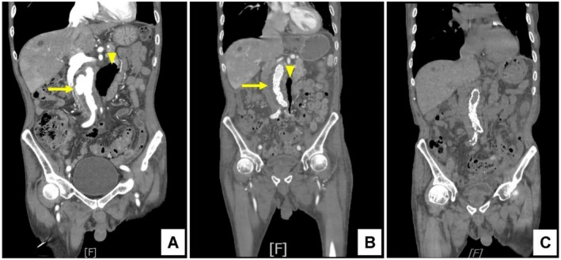
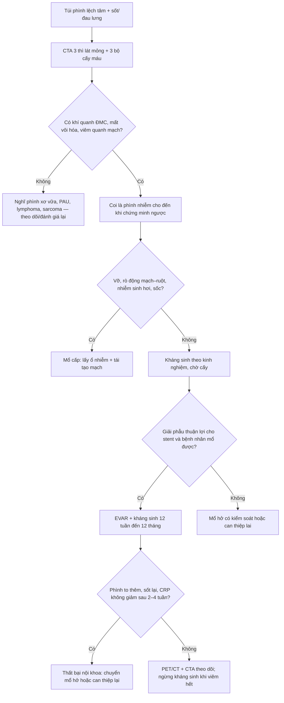
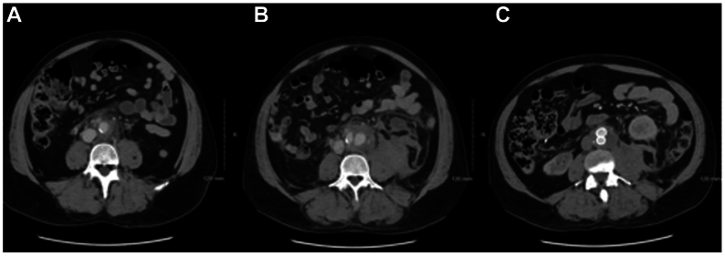

# 1919 — Phình động mạch chủ bụng nhiễm khuẩn (mycotic / infective native aortic aneurysm): chẩn đoán trên CTA, chẩn đoán phân biệt và khi nào EVAR thay mổ hở

**Tags:** `pattern:phinh-dang-tui` `pattern:viem-quanh-dong-mach` `pattern:khi-quanh-dong-mach` `pattern:tu-dich-sau-phuc-mac` `pattern:ngam-thuoc-thanh-mach` `vung:dong-mach-chu-bung` `vung:o-bung` `protocol:CTA-3-thi` `protocol:PET-FDG` `protocol:cay-mau` `score:MAGIC` `incidentaloma:khong`
**Mức chắc chắn (certainty):** tổng hợp y văn (literature synthesis) — **ca nguyên văn có ảnh CTA nối tiếp** (Clin Case Rep 2026, PMC13093503), **ca nguyên văn bị đọc nhầm là lymphoma rồi vỡ sau 3 ngày** (J Vasc Surg Cases Innov Tech 2025, PMC12148370), **thuật toán 10 năm của đơn vị mạch máu–nhiễm** (J Clin Med 2026, PMC12986184), **ca EVAR theo dõi 6 năm** (Cureus 2024, PMC11302981) và **ca sarcoma nội mạc ĐMC giả phình nhiễm** (Cureus 2025, PMC12182782). Không có ca do nhóm tự chụp.

> **Câu hỏi thực hành:** nam **76 tuổi**, sốt **37,9°C**, mệt và đau bụng không đặc hiệu **vài ngày**, cấy máu ra **E. coli**, CT bụng có **túi phình lệch tâm 3,9 cm** dưới động mạch thận kèm **đám khí quanh ĐMC** và **viêm túi thừa sigma**. Bác sĩ hỏi: **"Đây có phải phình nhiễm khuẩn không? Có khí rồi thì mổ hở hay đặt stent? Kháng sinh bao lâu?"**
> Bài chốt **năm quyết định**: **(1)** phình nhiễm khuẩn chỉ chiếm **1–3%** mọi phình động mạch nhưng **vỡ là biến cố chết người** — không được "theo dõi 3 tháng"; **(2)** hình ảnh chốt là **túi lệch tâm + viêm/mỡ quanh ĐMC + khí quanh ĐMC + mất liên tục vôi hóa thành**, không phải kích thước; **(3)** **khí quanh mảnh ghép cũ ≠ khí quanh ĐMC nguyên bản** — với mảnh ghép phải chờ **≥ 7 tuần**, với ĐMC nguyên bản có khí + sốt là **nhiễm cho đến khi chứng minh ngược**; **(4)** **EVAR + kháng sinh dài hạn** kiểm soát được **tới ~1/3** phình nhiễm ĐMC nguyên bản, nhưng **phình to thêm khi đang dùng kháng sinh là chỉ định can thiệp**; **(5)** kháng sinh **12 tuần đến 12 tháng**, ngừng chỉ khi **chỉ số viêm bình thường + PET/CT hết ngấm**.

## 1. Tổng quan bệnh học – cơ chế hình ảnh (TẠI SAO)

- **Tên gọi sai lịch sử:** "mycotic" (Osler) nghĩa là *giống nấm*, nhưng tác nhân thật **gần như luôn là vi khuẩn**; thuật ngữ chính xác hiện dùng là **infective native aortic aneurysm (INAA)**. **S. aureus** là tác nhân đơn loài hay gặp nhất; **Salmonella** chiếm tới **15%** các ca nhiễm khuẩn huyết gieo vào mảng xơ vữa (PMC6903872). Khi có **rò động mạch–ruột**, cấy thường **đa loài** (Candida + Enterobacteriaceae) (PMC12986184).
- **Tần suất:** phình nhiễm khuẩn chiếm **1–3%** mọi phình động mạch (PMC12148370); nhiễm mảnh ghép ĐMC (bài 148) chiếm **1–2%** ca đặt mảnh ghép (PMC12986184). Đây là hai thực thể **khác nhau về tiên lượng và cách theo dõi**.
- **TẠI SAO thành ĐMC bị phá hủy:** vi khuẩn gieo vào **vasa vasorum** ở lớp ngoài → **viêm mủ lớp áo giữa** → **hoại tử tổ chức đàn hồi và collagen** → thành mất sức chịu lực, giãn ra **lệch tâm, dạng túi (saccular)**, bờ **không đều, nhiều thùy**. Vì mất thành từng ổ chứ không phải giãn đều toàn chu vi, **đường kính có thể còn nhỏ (3–4 cm) mà nguy cơ vỡ đã cao** — đây là lý do **ngưỡng 5,5 cm của phình xơ vữa KHÔNG áp dụng**.
- **TẠI SAO có khí quanh ĐMC:** vi khuẩn sinh hơi + ổ mủ hoại tử tạo **bọt khí trong mô quanh mạch**. Khí quanh ĐMC **nguyên bản** (không có mảnh ghép) là dấu hiệu **rất đặc hiệu** cho nhiễm; khác hẳn khí bẫy lành tính sau đặt stent (bài 148).
- **TẠI SAO mất liên tục vôi hóa là dấu hiệu chốt:** mảng vôi hóa là phần **cứng nhất** của thành; viêm mủ phá hủy mô đàn hồi **dưới** mảng vôi làm mảng **tách và biến mất khu trú** trên CTA. Một chỗ **mất vôi hóa + túi lệch tâm cùng vị trí** mạnh hơn nhiều so với "thành dày" đơn thuần.
- **TẠI SAO sốt và cấy máu không đủ:** bệnh cảnh thường **âm ỉ** (mệt, đau lưng, gầy sút); **cấy máu âm** ở một phần đáng kể ca **đã dùng kháng sinh trước đó**, và **không có xét nghiệm nào loại trừ**. Chẩn đoán là **tổng hợp lâm sàng + cấy máu + hình ảnh**, không phải một tiêu chuẩn duy nhất.
- **TẠI SAO PET/CT hữu ích nhưng không thay CTA:** đại thực bào hoạt hóa quanh ổ nhiễm **tăng tiêu thụ FDG** → ổ **ngấm khu trú, không đồng nhất**. Trong nhiễm mạch máu, PET/CT có **Se 91%, Sp 72%, độ chính xác 88%** (152 ca, PMC10611872 — dân số mảnh ghép); **dương tính giả** gặp sau mổ, trong mảng xơ vữa viêm, và ở u. Vì vậy PET dùng để **định hướng và theo dõi**, không phải để chẩn đoán một mình.
- **TẠI SAO tiên lượng nặng:** nhóm nhiễm mảnh ghép ĐMC không được lấy mảnh ghép có **tử vong 70–100% sau 2 năm** dù dùng kháng sinh (PMC12986184); với phình nhiễm ĐMC nguyên bản, số liệu tốt hơn nhờ can thiệp sớm — EVAR cho **sống 30 ngày 90%, sống 2 năm 82%** (Kan, dẫn qua PMC6903872), và một nghiên cứu Thụy Điển cho **sống 3 tháng 96% với EVAR so với 74% với mổ hở** (dẫn qua PMC6903872).
- **Con số quyết định can thiệp:** ca của PMC11302981 **phình to thêm 13 mm sau 4 tuần kháng sinh** — đây là định nghĩa thực hành của **thất bại điều trị nội khoa**, buộc phải can thiệp dù bệnh nhân "đỡ sốt".

## 2. Mẫu hình + chẩn đoán phân biệt theo hình thái và vị trí (Gamut)

- **Theo hình thái túi phình:**
  - **Dạng túi lệch tâm, nhiều thùy, bờ không đều** → nhiễm khuẩn, giả phình sau can thiệp/chấn thương, **loét xuyên thành (PAU)**, sarcoma nội mạc.
  - **Hình thoi đều, vôi hóa liên tục** → phình xơ vữa lành tính; nếu kèm **dày thành đồng tâm** → viêm ĐMC (Takayasu, GCA, IgG4).
  - **Túi + mức khí–dịch trong ổ** → áp-xe quanh ĐMC; **khí trong thành** → nhiễm sinh hơi.
- **Theo vị trí và cấu trúc lân cận:**
  - **Quanh ĐMC bụng dưới thận + viêm túi thừa/đại tràng** → nhiễm **lan kế cận** (ca PMC13093503).
  - **Quanh ĐMC + tổn thương đĩa đệm–thân sống (spondylodiscitis)** → nhiễm gieo từ xương hoặc lan ngược (ca PMC11046692, PMC11648744).
  - **Quanh ĐMC + dày ruột non kề, mất lớp mỡ giữa ĐMC và ruột, chảy máu "báo trước"** → **rò động mạch–ruột (aorto-enteric fistula)** — cấp cứu, khác hoàn toàn túi phình đơn thuần.
  - **Quanh ĐMC + hạch lớn nhiều tầng, không có túi thật** → lymphoma (đây chính là bẫy của ca PMC12148370).
  - **Quanh ĐMC + khối bao quanh, hẹp/tắc các động mạch tạng, KHÔNG viêm quanh mạch** → **sarcoma nội mạc ĐMC** (ca PMC12182782: hẹp SMA, tắc thân tạng).
- **Gamut "khối quanh ĐMC" (periaortic mass):** nhiễm khuẩn, máu tụ tổ chức hóa, lymphoma, xơ hóa sau phúc mạc, IgG4, sarcoma, di căn hạch, phình giả viêm.
- **Mnemonic 4 chữ cho phình nhiễm:** **S**accular (túi lệch tâm), **S**tranding (mỡ quanh mạch), **S**epsis (sốt/cấy máu), **S**trange gas (khí quanh ĐMC).

## 3. Bảng so sánh phân biệt (ma trận đối chiếu)

| Thực thể (entity) | Hình ảnh điển hình (CTA/MRI) | Chốt vào (rule-in) | Chốt loại (rule-out) | Gợi ý xác nhận |
|---|---|---|---|---|
| **Phình nhiễm ĐMC nguyên bản (INAA)** | **Túi lệch tâm, nhiều thùy**; **mỡ/đám mờ quanh ĐMC**; **khí quanh ĐMC**; **mất liên tục vôi hóa**; có thể **dày thành ngấm thuốc** | **Sốt + cấy máu dương + túi lệch tâm có viêm/khí quanh mạch** | **Vôi hóa liên tục, không viêm quanh mạch, không khí** và cấy âm nhiều lần → nghĩ lành/tumor | Cấy máu **3 bộ trước kháng sinh**; CTA 3 thì lát mỏng; PET/CT khi cấy âm |
| **Nhiễm mảnh ghép nội mạch (bài 148)** | Dịch/khí **quanh mảnh ghép**; giả phình miệng nối; bờ dịch dày ngấm thuốc | Khí **≥ 7 tuần** hoặc dịch **≥ 3 tháng** sau EVAR, khí **tăng dần**, cấy dương | Khí/dịch **sớm < 7 tuần–3 tháng**, bờ mỏng, nhỏ dần → sinh lý sau EVAR | MAGIC (chính/phụ × lâm sàng/hình ảnh/xét nghiệm) |
| **Giả phình vô khuẩn sau can thiệp** | Cổ túi rõ, thành nhẵn, **không khí**, không thâm nhiễm mỡ | **Tiền sử thủ thuật đúng vị trí**, không sốt, cấy âm | **Khí trong mô quanh mạch + sốt** → nhiễm | So phim cũ; theo dõi kích thước |
| **Loét xuyên thành (PAU)** | **Ổ loét trên mảng vôi**, lồi ra ngoài, **không có khối mềm quanh mạch** | **Mảng vôi dày + ổ loét + không viêm quanh mạch** | **Khí quanh mạch + sốt + cấy dương** → nhiễm | CTA; đánh giá tụ máu trong thành |
| **Viêm ĐMC (Takayasu/GCA/IgG4)** | **Dày thành đồng tâm, đều**, ngấm thuốc, **không có túi lệch tâm**; hẹp các nhánh | **Dày thành đồng tâm + tuổi/bệnh hệ thống phù hợp** | **Túi lệch tâm + khí** → nhiễm | MRI thành mạch, PET/CT, IgG4, sinh thiết |
| **Sarcoma nội mạc ĐMC** | **Khối trong lòng/bao quanh**, nhiều thùy, **KHÔNG viêm mỡ quanh mạch**; **hẹp/tắc động mạch tạng**; di căn xương | **Khối phát triển dù kháng sinh + không có ổ nhiễm** | **Khí quanh mạch + cấy dương + sốt cao** → nhiễm | Sinh thiết/mổ; PET/CT; theo dõi tăng trưởng |
| **Lymphoma / xơ hóa sau phúc mạc** | Hạch/khối **bao quanh nhưng không làm hẹp lòng ĐMC**, đồng nhất, không khí | **Hạch nhiều tầng + không túi phình** | **Túi lệch tâm thật + khí** → nhiễm | Sinh thiết; PET/CT |

*Nam 76 tuổi, **E. coli** huyết, phình dưới thận **3,9 cm** lệch tâm kèm viêm túi thừa sigma. **(A)** Trước can thiệp: bờ túi không đều (mũi tên vàng) + **đám khí quanh ĐMC** (đầu mũi tên). **(B)** Sau PEVAR: túi bị loại khỏi dòng chảy, trở thành lòng giả huyết khối; **khí và viêm quanh mạch giảm rõ**. **(C)** Theo dõi: stent ổn định, không rò nội, viêm gần hết. Nguồn: Clin Case Rep 2026 (PMC13093503), Fig. 1, CC BY 4.0.*

## 4. Protocol chụp + phân tầng điều trị

- **CTA bụng–chậu 3 thì, lát ≤ 1 mm**: thì **không cản quang** (phát hiện vôi hóa, máu trong thành), thì **động mạch** (bờ lòng, cổ túi, mạch tạng), thì **tĩnh mạch/muộn** (ngấm thuốc thành, tụ dịch). Dựng MPR coronal/sagittal **bắt buộc** vì túi lệch tâm dễ bị bỏ sót trên lát ngang.
- **Đo và ghi vào báo cáo:** đường kính lớn nhất, **hình dạng (túi/hình thoi)**, **bờ (đều/nhiều thùy)**, **vôi hóa (liên tục/đứt đoạn)**, **mỡ quanh mạch (mm)**, **khí (có/không)**, **mạch tạng và thận**, **cột sống kề** (tìm spondylodiscitis), **ruột kề** (tìm rò).
- **Cấy máu: 3 bộ trước kháng sinh**, càng nhiều bộ càng tăng tỉ lệ dương; cấy mô/ổ mủ khi can thiệp; **PCR 16S** khi cấy âm mà vẫn nghi (PMC12986184).
- **MRI** khi có chống chỉ định iod hoặc cần đánh giá tủy/cột sống: **T1, T2, T1 sau tiêm fat-sat, DWI**; dày thành ngấm thuốc + phù tủy xương kề hỗ trợ nhiễm.
- **PET/CT FDG** khi **cấy âm**, khi cần phân biệt nhiễm với phản ứng sau mổ, hoặc **theo dõi đáp ứng** trước khi ngừng kháng sinh (PMC12986184).
- **Tiêu chuẩn MAGIC chỉ dùng cho NHIỄM MẢNH GHÉP** (bài 148); **ĐMC nguyên bản không có bộ tiêu chuẩn được thẩm định** — đừng áp nguyên xi "khí ≥ 7 tuần" cho ĐMC chưa có stent.
- **Kháng sinh:** khung **12 tuần** (6 tuần IV + 6 tuần đường uống có sinh khả dụng tốt) cho ca đã kiểm soát ổ nhiễm; **kéo dài 12 tháng** hoặc **duy trì suốt đời** khi không lấy được mảnh ghép/ổ nhiễm. **Ngừng** khi **CRP/ESR bình thường VÀ PET/CT không còn ngấm** (PMC12986184).
- **Chọn can thiệp:** ổn định + giải phẫu thuận lợi → **EVAR + kháng sinh** (tới **~1/3** phình nhiễm nguyên bản được kiểm soát mà không phải lấy stent về sau); **vỡ, rò động mạch–ruột, nhiễm sinh hơi, phình to khi đang kháng sinh, không có túi nội mạch phù hợp** → **mổ hở lấy ổ nhiễm + tái tạo mạch bằng mạch tự thân/ống ghép sinh học**.

## 5. Biến thể bình thường và cạm bẫy

- **Cạm bẫy 1 — đọc "mô mềm quanh ĐMC" thành lymphoma.** Ca PMC12148370: CT đầu tiên kết luận **"nghi lymphoma"** vì có mô quanh ĐMC + hạch; **3 ngày sau phình vỡ**. Bài học: ở bệnh nhân có **sốt/đau lưng**, mô mềm quanh ĐMC phải được đọc là **viêm nhiễm cho đến khi loại trừ**, và cần **CTA có cản quang ngay** + cấy máu.
- **Cạm bẫy 2 — "kích thước nhỏ nên lành".** Túi **3,9 cm** vẫn có thể vỡ vì thành mất từng ổ; **ngưỡng 5,5 cm** dành cho phình xơ vữa, **không** dành cho phình nhiễm.
- **Cạm bẫy 3 — khí sau đặt stent là bình thường.** Đừng gọi nhiễm mảnh ghép khi khí **< 7 tuần** sau EVAR mà không có sốt/tăng dần (bài 148). Ngược lại, **khí quanh ĐMC nguyên bản** gần như luôn bệnh lý.
- **Cạm bẫy 4 — cấy máu âm.** Bệnh nhân đã dùng kháng sinh ở tuyến trước thường **cấy âm**; cấy âm **không loại trừ**. Lấy máu **trước** liều kháng sinh kế tiếp, cấy nhiều bộ, và gửi **PCR 16S**.
- **Cạm bẫy 5 — sarcoma nội mạc ĐMC.** Khối nhiều thùy **không viêm mỡ quanh mạch**, kèm **hẹp/tắc mạch tạng**, **không có ổ nhiễm** → đừng đặt stent rồi theo dõi như nhiễm; cần **mô bệnh** (PMC12182782).
- **Cạm bẫy 6 — bỏ sót ổ nhiễm thứ hai.** Sau khi tìm thấy túi phình, phải soát **cột sống, đĩa đệm, túi thừa, đường mật, van tim**; bỏ sót ổ nguyên phát làm nhiễm tái phát sau mổ.
- **Biến thể bình thường dễ nhầm:** **hạch quanh ĐMC nhỏ, đều, < 1 cm** ở người trẻ; **mảng xơ vữa dày** gây "dày thành giả"; **máu tụ sau phúc mạc cũ** có bờ giả túi nhưng **không ngấm thuốc, không khí**.

## 6. Tự lượng giá — Blind Quiz (ảnh ngoài, đáp án trong khối chi tiết)

**Ca 1 — Nam 76 tuổi, sốt, E. coli huyết, đau bụng không đặc hiệu.**

- Câu hỏi: mô tả **hình dạng túi**, tìm **dấu hiệu ngoài lòng mạch**; 3 chẩn đoán phân biệt; dấu hiệu nào khiến bạn không thể "theo dõi 3 tháng"?

<b>Bấm để hiện đáp án (findings + chẩn đoán)</b>

- Dấu hiệu: **túi lệch tâm, bờ không đều** dưới động mạch thận + **đám khí quanh ĐMC** + **mỡ/đám mờ quanh mạch**, kèm viêm túi thừa sigma kề bên.
- Chẩn đoán: **phình ĐMC nhiễm khuẩn do lan kế cận từ viêm túi thừa** — vì vi khuẩn phá hủy lớp áo giữa từng ổ tạo túi lệch tâm, và ổ mủ sinh hơi tạo khí quanh mạch.
- Xử trí trong ca gốc: **kháng sinh + PEVAR**; theo dõi CTA cho thấy khí và viêm thoái triển.
- Nguồn ảnh: Clin Case Rep 2026 (PMC13093503), Fig. 1, CC BY 4.0.

**Ca 2 — Nam 55 tuổi, sốt về đêm, đau bụng; CT đầu tiên được đọc là "nghi lymphoma".**

- Câu hỏi: hình **A** có gì bất thường quanh ĐMC? Nếu bạn là người đọc ca này, bạn thêm **hai việc** gì ngay hôm đó?

<b>Bấm để hiện đáp án (findings + chẩn đoán)</b>

- Dấu hiệu: **(A)** mô mềm quanh ĐMC + hạch quanh mạch lan từ ngực dưới xuống chậu — dễ đọc thành lymphoma; **(B)** **3 ngày sau: phình vỡ** ngay trên chỗ chia đôi; **(C)** 1 tháng sau: khối máu tụ sau phúc mạc nhỏ dần, đậm độ giảm.
- Chẩn đoán: **phình ĐMC nhiễm khuẩn do MSSA** (cấy máu dương), **đã vỡ** — vì mô mềm quanh mạch là viêm mủ chứ không phải hạch.
- Hai việc phải làm: **(1) cấy máu ngay trước kháng sinh**; **(2) CTA có cản quang lát mỏng + dựng MPR** để tìm túi lệch tâm/khí/mất vôi hóa, thay vì kết luận lymphoma rồi hẹn theo dõi.
- Nguồn ảnh: J Vasc Surg Cases Innov Tech 2025 (PMC12148370), Fig. 1, **CC BY-NC-ND 4.0** — nguyên bản, không cắt/ghép.

## Bài liên quan chéo

- [100 – Tổng quan hệ Bụng](../100-tong-quan-he-bung/lesson.md)
- [148 – Nhiễm trùng mảnh ghép nội mạch ĐMC: MAGIC, PET/CT & lấy hay giữ mảnh ghép](../148-nhiem-trung-manh-ghep-noi-mach-dmc/lesson.md)
- [171 – Bóc tách ĐMC bụng & IMH](../171-boc-tach-dong-mach-chu-bung-va-IMH/lesson.md)
- [095 – Hẹp/tắc tĩnh mạch trung tâm & lọc máu](../095-hep-tac-tinh-mach-trung-tam-loc-mau/lesson.md)
- [147 – Sốt kéo dài (FUO) & ổ nhiễm ẩn trong bụng](../147-sot-keo-dai-fuo-o-nhiem-an-trong-bung/lesson.md)
- [1912 – Phình động mạch tạng (lách/gan/thân tạng/SMA)](../1912-phinh-dong-mach-tang/lesson.md)

## Ảnh

- `1919_phinh-nhiem-khuan_CTA_CCR3-2026-F1.jpg` — Clin Case Rep 2026 (PMC13093503), Fig. 1, **CC BY 4.0**.
- `1919_phinh-nhiem-khuan_CT_CCR-2025-F1.jpg` — J Vasc Surg Cases Innov Tech 2025 (PMC12148370), Fig. 1, **CC BY-NC-ND 4.0** (nguyên bản).
- Không tải ảnh từ PMC11302981 (Cureus, có video) và PMC12986184 (thuật toán dạng hình) — chỉ dẫn số liệu.
- Nguồn + giấy phép từng ảnh: `images/CREDITS.md`.

> Không dùng để chẩn đoán độc lập khi chưa có người hướng dẫn.
