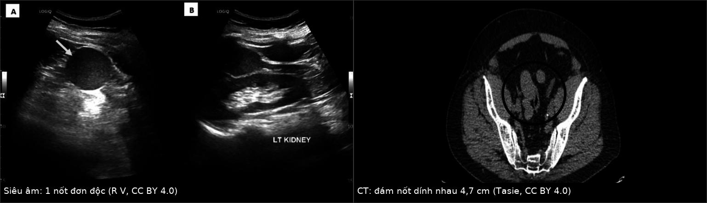
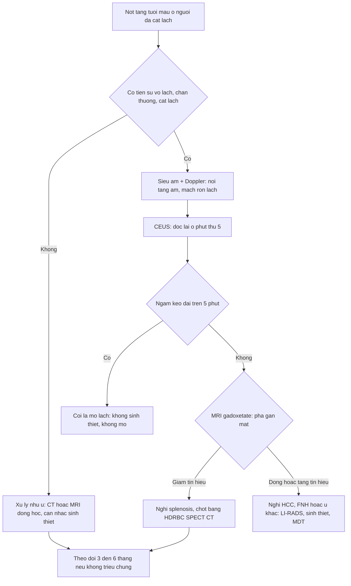
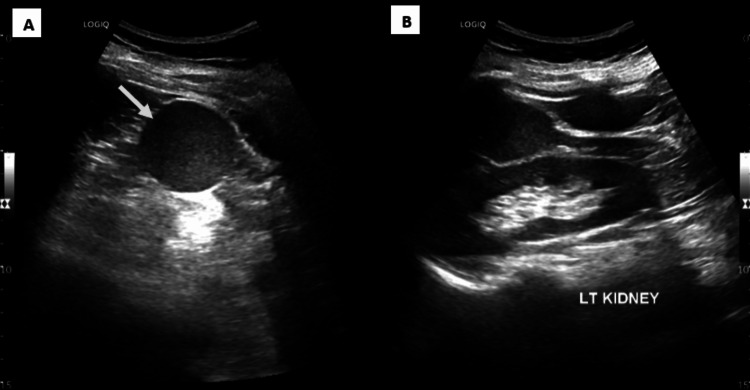
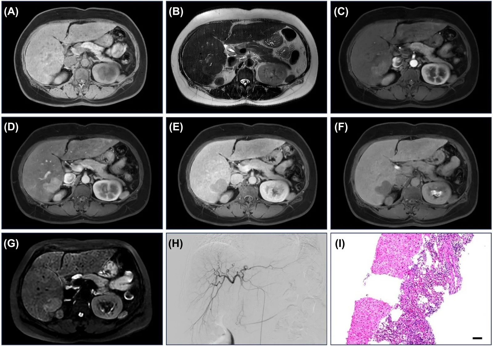
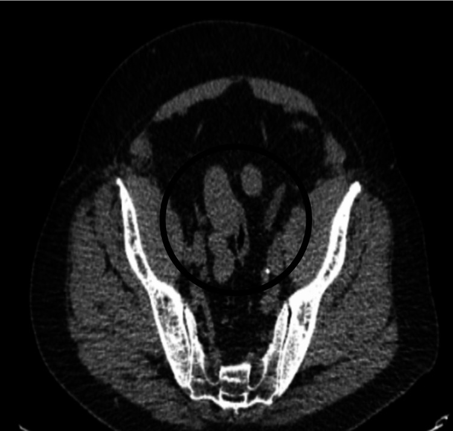

# 192 — Splenosis & lách phụ phì đại sau cắt lách: "giả di căn" nguy hiểm nhất của ổ bụng

**Tags:** `pattern:not-ngam-thuoc` `pattern:dam-not-phuc-mac` `pattern:gia-di-can` `pattern:not-gan` `vung:lach` `vung:gan` `vung:phuc-mac` `vung:hoc-lach` `protocol:CEUS` `protocol:MRI-gan-tuong-phan` `protocol:xa-hinh-HDRBC`

**Mức chắc chắn (certainty):** tổng hợp y văn (literature synthesis) — 1 bài tổng quan có hệ thống về CEUS của mô lách lạc chỗ (*Diagnostics* 2026, PMC13115550, CC BY 4.0), 1 loạt 11 ca splenosis trong gan (*Curr Med Imaging* 2026, PMC13584078), 2 ca nguyên văn có ảnh (PMC13262777, PMC12700140), 1 ca CT giả di căn (PMC13466073) và 2 ca chứng minh bẫy PET (PMC12888567, PMC12582902). Không có nghiên cứu tiến cứu; các con số dịch tễ đều từ y văn giải phẫu bệnh/loạt ca.

> **Câu chốt:** splenosis là **mô lách tự cấy** sau vỡ/cắt lách, gặp tới **67%** người sau chấn thương lách — nó **tăng tưới máu, hạn chế khuếch tán, ngấm thuốc kiểu lách ở mọi thì**, tức là **giống u ác về mọi mặt trừ nguồn gốc**. Hậu quả thật: **63%** ca splenosis trong gan từng bị **mổ** và chỉ **15,5%** được chẩn đoán đúng ngay từ đầu (PMC13115550). Chốt chẩn đoán **không phải** hình thái nốt, mà là **bằng chứng mô lách chức năng**: CEUS ngấm kéo dài **≥ 5 phút** (tỉ lệ tín hiệu lách còn **99%** ở phút thứ 5) hoặc **⁹⁹ᵐTc-HDRBC/SPECT-CT**.

## 1. Tổng quan bệnh học – cơ chế hình ảnh (TẠI SAO)

### 1.1 Hai thực thể khác nguồn gốc, chung một câu hỏi

- **Lách phụ (accessory spleen)** — **bẩm sinh**: đảo mô lách tách ra trong quá trình xoay ruột, thường **10–20%** người trưởng thành; đa số chỉ **1** lách phụ, **8–20%** có **2–3**. Loạt **3.000 tử thiết** của Halpert & Györkey: **311 người (10,5%)** có **364 lách phụ**, trong đó **61 (16,7%) nằm trong tụy** — tức **2%** toàn bộ người được khám, **100% ở đuôi tụy** (PMC13115550).
- **Splenosis** — **mắc phải**: mô lách sống sót rơi vào ổ phúc mạc/màng phổi sau **vỡ lách, chấn thương bụng, cắt lách**, bám vào bề mặt có mạch máu, hình thành mạch nuôi kiểu **mạch ký sinh (parasitic supply)**. Gặp **tới 67%** người sau vỡ lách chấn thương và cắt lách; **94,6%** ca splenosis trong gan có tiền sử chấn thương/cắt lách (PMC13115550). Xuất hiện **sau nhiều tháng tới nhiều năm** (PMC13262777).
- **Vì sao khó phân biệt với ung thư:** mô lách là **cơ quan tưới máu nhiều nhất trên mỗi gram**, nên nốt splenosis **bắt thuốc mạnh ở thì động mạch**, đặc biệt ở **nhu mô gan/đuôi tụy** — đúng kiểu hình của **HCC**, **di căn tăng sinh mạch**, **u thần kinh nội tiết tụy**. Không có vỏ, không có hiệu ứng khối lớn: nốt **ép/gặm** cơ quan chủ (dấu "embedded organ sign" âm tính, "beak sign" âm tính) (PMC12700140).

### 1.2 Vật lý của 4 phép đo quyết định

| Phép đo | Cơ sở vật lý/sinh lý | Ngưỡng đọc | Nguồn |
|---|---|---|---|
| CEUS (SonoVue) | mô lách giữ vi hạt trong **hệ nội mô võng (RES)** và có dòng xoang chậm → **ngấm kéo dài** | lách **99%** tín hiệu ở 5 phút trong khi **gan và thận giảm**; **≥ 5 phút = mạnh gợi ý mô lách** | PMC13115550 |
| ⁹⁹ᵐTc-HDRBC (hồng cầu bị gia nhiệt) | **90%** hồng cầu đánh dấu bị **tế bào RES của lách** bắt giữ → độ tập trung lách **gấp 2–4 lần gan** | ổ tăng tập trung khớp vị trí nốt trên SPECT-CT | PMC13115550; PMC13584078 |
| MRI gadoxetate (HBP) | mô lách **không có tế bào gan** → không bắt gadoxetate | **tất cả tổn thương giảm tín hiệu ở thì gan mật** (8/11 ca được chụp gadoxetate) | PMC13584078 |
| DWI/ADC | tủy trắng lách giàu tế bào lympho → **hạn chế khuếch tán thật** | DWI sáng, ADC thấp **như mô lách** — **không** loại trừ splenosis | PMC13262777 |

- **Hệ quả thực hành:** một nốt **tăng tưới máu + hạn chế khuếch tán + không có vỏ** ở người đã cắt lách **không đủ** để gọi là di căn. Câu hỏi đúng là: *"nốt này có mô lách chức năng không?"* — trả lời bằng **thuốc đặc hiệu cho RES** (HDRBC, CEUS) hoặc **pha gan mật** (âm tính).
- **Vì sao splenosis "mọc" ở những chỗ lạ:** mảnh lách đi theo **dịch phúc mạc** (mạc treo, phúc mạc thành, hố chậu, mặt dưới cơ hoành), theo **vết thương xuyên cơ hoành → lồng ngực**, hoặc **theo đường máu tới gan**; hiếm gặp ở não/mô dưới da (PMC13115550; PMC13466073).

### 1.3 Hậu quả lâm sàng (không chỉ là "bất thường vô hại")

- **Bị mổ oan:** **63%** ca splenosis trong gan trong y văn **được phẫu thuật** vì không xác nhận được bằng hình ảnh/sinh thiết; trong **80 ca công bố 1993–2025**, **57%** chẩn đoán nhờ **mổ** và **21%** nhờ **sinh thiết** (PMC13115550). Loạt 11 ca gần đây: **2 ca bị chẩn đoán nhầm HCC vì AFP tăng**, thoát mổ nhờ sinh thiết (PMC13584078).
- **Chảy máu:** nốt splenosis **dưới bao gan/mặt phúc mạc** vỡ có thể gây **máu trong ổ bụng**; sinh thiết kim vào đúng nốt này là nguy cơ chảy máu thật, không phải "thủ thuật vô hại".
- **Tái phát bệnh nền:** splenosis phì đại sau cắt lách **có thể đủ chức năng để tái phát ITP** — đã có ca ITP kháng trị tái phát kèm splenosis ổ bụng (PMC11910191); với tân sinh máu, mô lách còn lại **không thay thế được lách** về miễn dịch.
- **Bẫy hình ảnh chức năng:** mô lách **bắt ⁶⁸Ga-DOTATATE và PSMA** — splenosis lồng ngực/chậu từng bị đọc là **di căn** trên PET PSMA và PET thụ thể somatostatin (PMC12888567; PMC12582902).

## 2. Mẫu hình + chẩn đoán phân biệt theo VỊ TRÍ (Gamut)

- **Hố lách/cạnh lách:** nốt **đồng âm/đồng tín hiệu với lách**, bờ nhẵn, có **mạch vào–ra rốn lách**; lách phụ **9 mm** ở mặt trên thận trái từng bị nghi u thận (PMC13115550). Sau cắt lách: **cùng vị trí lách cũ** → splenosis thể đơn độc, **25 mm**, **46 mm** (PMC13262777; PMC13115550).
- **Trong gan (khó nhất):** nốt **1,0–4,2 cm**, thường **dưới bao**, một hoặc nhiều ổ; có thể **"fast in – fast out"** giống HCC (PMC13584078). Gamut: HCC, di căn, adenoma, FNH, hemangioma, **splenosis**.
- **Phúc mạc/mạc treo/hố chậu:** **đám nốt dính nhau ("omental cake")** — gamut: **di căn phúc mạc, carcinomatosis, lymphoma, lao phúc mạc, endometriosis, splenosis**. Ca thật: chùm nốt mô mềm dưới bụng, **nốt lớn nhất 4,7 cm**, dính nhau (PMC13466073).
- **Trong tụy (đuôi):** lách phụ **trong tụy** — gamut: **u thần kinh nội tiết tụy**, u đặc–nhầy nhú, ung thư tụy; đặc điểm gợi ý: **đồng tín hiệu với lách ở mọi thì**, mạch nuôi từ lách, **không cản trở ống tụy**.
- **Lồng ngực/màng phổi:** splenosis **màng phổi** sau vỡ lách + rách cơ hoành — gamut: **u phổi, di căn màng phổi, mesothelioma**; **< 10–15%** có triệu chứng (đau ngực, ho ra máu) (PMC13115550).
- **Thận/sau phúc mạc:** nốt cạnh thận từng bị nghi **u thận → cắt thận oan** (PMC13466073 thảo luận; PMC13115550).

## 3. Bảng so sánh phân biệt (ma trận đối chiếu)

| Thực thể (entity) | Hình ảnh điển hình | Chốt vào (rule-in) | Chốt loại (rule-out) | Gợi ý xác nhận |
|---|---|---|---|---|
| Splenosis | Nốt/đám nốt bờ nhẵn, **đồng tín hiệu với lách** trên T1/T2, **ngấm mạnh thì động mạch, ngấm kéo dài**, **giảm tín hiệu pha gan mật**, DWI sáng/ADC thấp | **Tiền sử vỡ/cắt lách + CEUS ngấm ≥ 5 phút hoặc HDRBC dương** | Nốt có **vỏ**, hoại tử trung tâm, xâm lấn mạch, hạch mới → không phải splenosis | ⁹⁹ᵐTc-HDRBC + SPECT/CT; CEUS 5 phút; MRI gadoxetate |
| Lách phụ | Nốt **< 3 cm** cạnh rốn lách/đuôi tụy, **đồng âm – đồng tín hiệu tuyệt đối** với lách, có mạch rốn | **Mạch vào–ra kiểu rốn lách + tín hiệu y hệt lách** | Không thấy mạch nuôi kiểu lách + tăng sinh mạch bất thường → nghĩ u | CEUS, MRI; theo dõi 3–6 tháng nếu không chắc |
| HCC | Nốt trong gan xơ, **ngấm mạnh thì động mạch + thải thuốc**, có vỏ, có huyết khối tĩnh mạch cửa | **Ngấm động mạch + washout + vỏ + AFP tăng tiến triển** | **Ngấm kéo dài, pha gan mật giảm tín hiệu nhưng CEUS > 5 phút** → không phải HCC | LI-RADS trên CT/MRI đa thì; sinh thiết nếu vẫn không chắc |
| Di căn phúc mạc | Nốt phúc mạc nhiều ổ, **dày mạc nối, cổ trướng**, hạch, u nguyên phát | **Cổ trướng + tổn thương nguyên phát + nốt không đồng tín hiệu lách** | Nốt **đồng tín hiệu lách + không cổ trướng + CEUS kéo dài** → splenosis | CT bụng–chậu có cản quang, PET/CT, giải phẫu bệnh có hướng |
| Lymphoma | Hạch/đám mô mềm **đồng đậm độ**, không canxi, bắt thuốc đồng nhất, nhiều tầng hạch | **Nhiều hạch ở nhiều trạm + LDH tăng + PET dương mạnh** | Tổn thương **giảm tín hiệu pha gan mật** ở người cắt lách → nghĩ splenosis | Sinh thiết hạch, PET/CT |
| U thần kinh nội tiết tụy | Nốt đuôi tụy **tăng tưới máu mạnh**, có thể di căn gan/hạch | **Bắt DOTATATE mạnh + tăng chromogranin A** | **Đồng tín hiệu lách trên mọi chuỗi + mạch nuôi kiểu lách** → lách phụ | EUS + CEUS, DOTATATE; **không sinh thiết mù** |
| U thận (RCC) | Khối thận **xâm lấn/xuất phát từ nhu mô thận**, ngấm không đồng nhất, có thành phần hoại tử | **Dấu hiệu xuất phát từ thận, méo nhu mô thận** | Khối **ép mặt thận, tín hiệu như lách, CEUS kéo dài** → splenosis | MRI, CEUS; **tránh cắt thận trước khi loại splenosis** |
| Endometriosis/IMT | Nốt phúc mạc/hố chậu, ngấm thuốc chậm, đau chu kỳ; IMT có viền ngấm | **Triệu chứng chu kỳ + tổn thương chậu + không có tiền sử cắt lách** | Tiền sử cắt lách + đồng tín hiệu lách → splenosis | MRI chậu, theo dõi; sinh thiết chọn lọc |

*Trái (A–B): siêu âm — hố lách trống (đã cắt lách), một nốt **đồng âm với lách** nằm sát cực trên thận trái. Phải: CT khung chậu — **chùm nốt mô mềm dính nhau**, nốt lớn nhất tới **4,7 cm**, bị đọc là "di căn hoặc lymphoma". Cùng một bệnh, hai bộ mặt: **một nốt** và **giả carcinomatosis**. Nguồn: R V và cs. (CC BY 4.0, PMC13262777); Tasie J và cs. (CC BY 4.0, PMC13466073). Ảnh ghép letterbox, giữ tỉ lệ.*

## 4. Protocol + lưu đồ chẩn đoán

### 4.1 Thứ tự phép đo (rẻ, không xâm lấn → đặc hiệu)

1. **Siêu âm B-mode + Doppler** (đầu tay): tìm **lách phụ ở hố lách/đuôi tụy**, nốt **đồng âm**, mạch rốn lách; ghi kích thước (mm).
2. **CEUS với SonoVue**: đặt pha động mạch (10–30 giây), pha tĩnh mạch (30–60 giây) và **đọc lại ở phút thứ 5**; **ngấm kéo dài ≥ 5 phút** ở nốt đồng âm với lách = mô lách (PMC13115550).
3. **MRI gan mật**: T1 in/out-phase, T2 FS, DWI + ADC, động học gadolinium, và **pha gan mật bằng gadoxetate** khi nghi nốt trong gan — mô lách **giảm tín hiệu ở pha gan mật** (PMC13584078).
4. **⁹⁹ᵐTc-HDRBC ± SPECT/CT** — "chuẩn vàng không xâm lấn" khi cần chốt dứt điểm; ổ tập trung **gấp 2–4 lần gan** khớp đúng vị trí nốt (PMC12700140; PMC13584078).
5. **DSA** chỉ khi vẫn còn tranh cãi: splenosis trong gan có **mạch nuôi ký sinh từ động mạch hoành/liên sườn**, khác kiểu cấp máu HCC (PMC13584078).
6. **Sinh thiết**: chỉ khi **đã loại splenosis** hoặc khi kết quả sẽ đổi điều trị; **tránh** với nốt dưới bao/dễ chảy máu.

### 4.2 Lưu đồ: nốt tăng tưới máu ở người đã cắt lách

### 4.3 Khi nào điều trị

- **Không triệu chứng:** **không mổ, không sinh thiết** — theo dõi **3–6 tháng** bằng siêu âm/CEUS hoặc MRI; splenosis **không tiến triển thành ung thư**.
- **Có triệu chứng** (chảy máu, tắc ruột, đau, tái phát ITP): cắt nốt **chọn lọc** hoặc nút mạch; với splenosis phì đại gây ITP tái phát, **cắt phần mô lách hoạt động** là lựa chọn sau khi xác định bằng HDRBC (PMC11910191).

## 5. Biến thể bình thường và cạm bẫy

- **Lách phụ là biến thể bình thường** (10–20%), không phải bệnh; đừng gọi "u đuôi tụy" khi nốt **< 3 cm, đồng tín hiệu lách, có mạch rốn lách**.
- **Hạn chế khuếch tán KHÔNG loại trừ splenosis:** mô lách có DWI sáng/ADC thấp thật (PMC13262777) — dùng DWI để phân biệt u ác ở đây là **bẫy kinh điển**.
- **"Fast in – fast out" trong gan KHÔNG loại trừ splenosis:** loạt 11 ca mô tả ngấm không đều kiểu vào nhanh–ra nhanh, đúng như HCC (PMC13584078). Chốt là **thuốc đặc hiệu mô lách**, không phải kiểu ngấm.
- **AFP tăng không đồng nghĩa HCC:** 2/11 ca bị chẩn đoán nhầm HCC vì AFP tăng; xơ gan nền làm AFP tăng "vô tội vạ".
- **PET có thể dương giả:** mô lách bắt **PSMA** và **DOTATATE** → splenosis lồng ngực/chậu bị đọc là di căn (PMC12888567; PMC12582902). Người đã cắt lách + nốt bắt mạnh DOTATATE/PSMA **phải** đối chiếu vị trí với ổ chấn thương cũ.
- **Sinh thiết nốt dưới bao gan = nguy cơ chảy máu**, và mô lách dễ vỡ; nếu CEUS/HDRBC đã dương thì **không sinh thiết**.
- **Đừng bỏ sót lách phụ khi cắt lách vì ITP:** lách phụ bỏ sót là nguyên nhân **thất bại cắt lách** — đếm và ghi vị trí **trước** mổ.
- **Splenosis lồng ngực** thường không triệu chứng; **chọc kim xuyên thành ngực** vào nốt này là nguy cơ ho ra máu — ưu tiên HDRBC.

## 6. Tự lượng giá — Blind Quiz

**Ca 1 — Nữ 40 tuổi, cắt lách sau tai nạn 10 năm trước, siêu âm kiểm tra định kỳ.**

- Gợi ý: (A) hố lách; (B) cực trên thận trái — cùng một nốt.
- Câu hỏi: mô tả âm vang và bờ nốt; 3 chẩn đoán phân biệt; phép đo nào chốt mà **không cần sinh thiết**?

<b>Bấm để hiện đáp án</b>

- Dấu hiệu: hố lách **trống** (đã cắt lách); nốt **bờ nhẵn, đồng âm với nhu mô lách**, nằm sát cực trên thận trái, không có thành phần nang/hoại tử.
- Chẩn đoán: **splenosis thể đơn độc (solitary)**. Chốt: tiền sử cắt lách + **đồng âm tuyệt đối với lách** + CEUS **ngấm kéo dài ≥ 5 phút**; nếu còn nghi → **⁹⁹ᵐTc-HDRBC/SPECT-CT**.
- Phân biệt: u thận (khối xuất phát từ nhu mô thận), lymphadenopathy, u mô mềm sau phúc mạc.
- Nguồn ảnh: R V, Sai V, Govindarajan A, Kumar DC. *Cureus* 2026 — PMC13262777, CC BY 4.0.

**Ca 2 — Nam 49 tuổi, khối 2,3 cm gan phải, xơ gan nhẹ: HCC hay không?**

- Gợi ý: (A) T1, (B) T2, (C) động mạch, (D) tĩnh mạch cửa, (E) muộn, (F) **pha gan mật**, (G) DWI, (H) chụp mạch gan chọn lọc, (I) mô bệnh học.
- Câu hỏi: ô nào **loại HCC**? Vì sao DWI không giúp? Chụp mạch (H) cho thông tin gì?

<b>Bấm để hiện đáp án</b>

- Dấu hiệu: tổn thương **giảm tín hiệu ở pha gan mật (F)** — mô lách **không có tế bào gan** nên không bắt gadoxetate; (G) **DWI sáng/ADC thấp** — hạn chế khuếch tán thật của tủy trắng lách nên **không phân biệt được** với HCC.
- Chốt: (H) chụp mạch cho thấy **mạch nuôi ký sinh từ động mạch hoành/liên sườn**, không phải kiểu cấp máu HCC; (I) mô học = mô lách.
- Bẫy: kiểu ngấm **"vào nhanh–ra nhanh"** không đều đã được mô tả trong loạt 11 ca → **không dùng động học để loại splenosis**; 2 ca còn bị nhầm HCC vì **AFP tăng**.
- Nguồn ảnh: Li S và cs. *Curr Med Imaging* 2026 — PMC13584078, CC BY 4.0.

**Ca 3 — Bệnh nhân ung thư, CT thấy chùm nốt dưới bụng: di căn phúc mạc?**

- Gợi ý: bệnh nhân có sỏi thận và **tiền sử cắt lách**; không cổ trướng, không hạch.
- Câu hỏi: mô tả tổn thương; 3 chẩn đoán phân biệt; một phép đo hạt nhân nào giải quyết trong 1 lần chụp?

<b>Bấm để hiện đáp án</b>

- Dấu hiệu: **chùm nốt mô mềm dính nhau** vùng bụng dưới/tiểu khung, nốt lớn nhất **4,7 cm**, không có cổ trướng, không hạch — hình ảnh "giả carcinomatosis".
- Chẩn đoán: **splenosis** (giả di căn). Chốt: **⁹⁹ᵐTc-HDRBC + SPECT/CT** — 90% hồng cầu gia nhiệt bị RES lách bắt, tập trung **gấp 2–4 lần gan**, khớp đúng vị trí từng nốt.
- Phân biệt: di căn phúc mạc, lymphoma, lao phúc mạc, endometriosis.
- Nguồn ảnh: Tasie J, Adatula I, Hakim Mena K, Salameh A, Felix M. *Cureus* 2026 — PMC13466073, CC BY 4.0.

## Bài liên quan chéo
- [140 – Lách & chấn thương tạng đặc: AAST](../140-lach-tang-dac/lesson.md)
- [141 – Phúc mạc: cổ trướng, carcinomatosis vs lao](../141-phuc-mac/lesson.md)
- [143 – U trung biểu mô phúc mạc vs carcinomatosis](../143-u-trung-bieu-mo-phuc-mac-vs-carcinomatosis/lesson.md)
- [121 – LI-RADS & HCC](../121-khoi-gan-LIRADS/lesson.md)
- [122 – U lành gan: hemangioma, FNH, adenoma](../122-u-lanh-gan/lesson.md)
- [119 – Lách lạc chỗ & xoắn lách](../119-lach-lac-cho-va-xoan-lach/lesson.md)

## Ảnh
- `192_splenosis-sau-cat-lach_SieuAm_PMC13262777-F1.jpg`, `192_splenosis-sau-cat-lach_MRI_PMC13584078-F2.jpg`, `192_splenosis-sau-cat-lach_CT_PMC13466073-F2.jpg`, `192_splenosis-sau-cat-lach_XaHinh_PMC12700140-F3.jpg`, `composite_mot-not-vs-dam-not.jpg`.
- Nguồn + giấy phép từng ảnh: `images/CREDITS.md` (tất cả **CC BY 4.0** — ảnh ghép hợp lệ).

> Không dùng để chẩn đoán độc lập khi chưa có người hướng dẫn.
