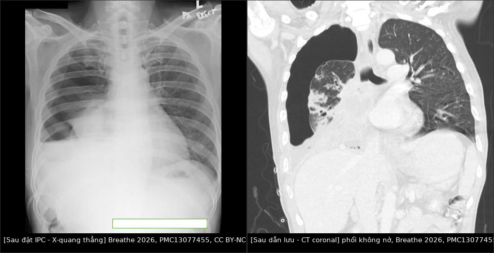
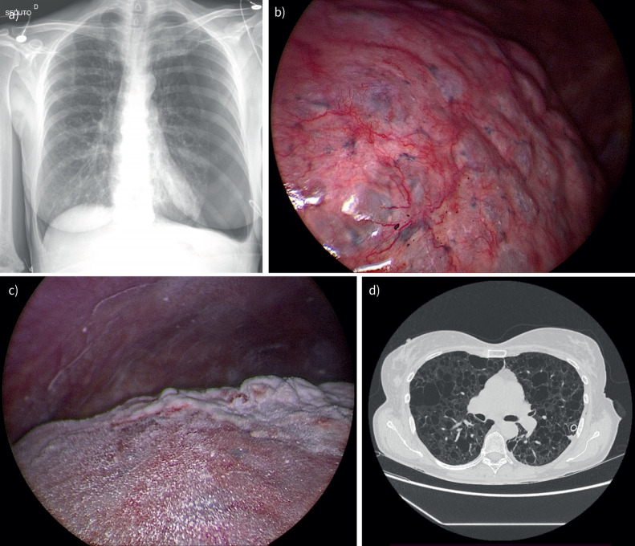
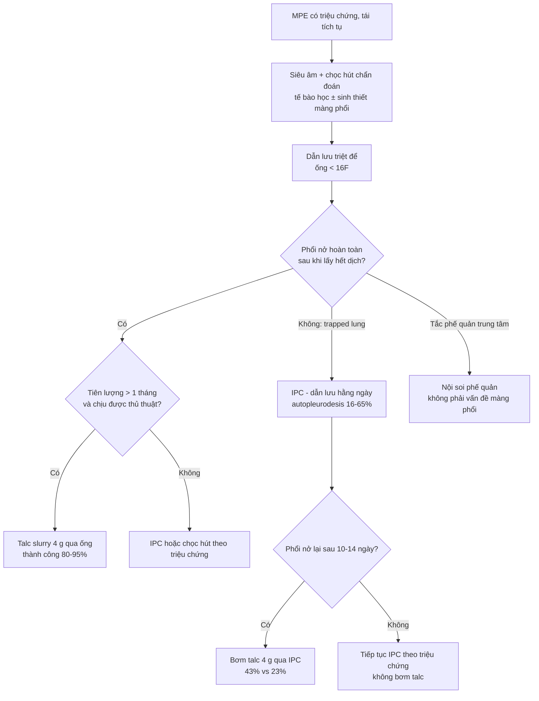
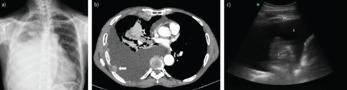
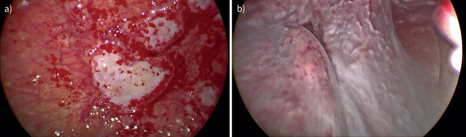

# 1920 — Tràn dịch màng phổi ác tính: catheter màng phổi lưu (IPC) hay talc pleurodesis / Malignant pleural effusion – indwelling pleural catheter vs talc pleurodesis

**Tags:** `pattern:tran-dich` `pattern:phe-quan-bi-giam` `vung:mang-phoi` `vung:phoi` `protocol:SA-mang-phoi` `protocol:catheter-mang-phoi-luu` `protocol:talc-pleurodesis`
**Mức chắc chắn (certainty):** tổng hợp y văn (literature synthesis) — số liệu lấy từ các thử nghiệm ngẫu nhiên có đối chứng (TIME2, ASAP, AMPLE, AMPLE II, IPC-Plus) và 2 bài tổng quan open access; nhóm tự tổng hợp, không có ca nguyên văn riêng.

## 1. Tổng quan bệnh học – cơ chế hình ảnh

### 1.1 Vì sao dịch hình thành (và vì sao nó luôn quay lại)

- Dịch màng phổi bình thường **5–15 mL**, được tái hấp thu chủ yếu qua **lỗ bạch mạch (stomata) ở màng phổi thành**. Ung thư gây tràn dịch theo **3 cơ chế chồng lấn**:
  1. **Di căn màng phổi** → tăng tính thấm mao mạch + **tắc lỗ bạch mạch** → dịch tích tụ đúng nơi có u;
  2. **Tắc hạch trung thất / ống ngực** → áp lực bạch mạch tăng, dịch thoát ra mà không thoát được;
  3. **Xẹp phổi do u phế quản gốc hoặc do chính khối u** → áp lực âm trong khoang màng phổi kéo dịch vào.
- Hệ quả điều trị: **không có can thiệp màng phổi nào kéo dài sống** ở tràn dịch màng phổi ác tính (MPE) đã xác định; mục tiêu là **giảm khó thở, chặn tái tích tụ, giảm nhập viện** (Breathe 2023, PMC10729815). Mọi lựa chọn vì thế được chấm bằng **số ngày nằm viện, số lần can thiệp lặp, tỷ lệ pleurodesis** — không phải bằng đáp ứng u.

### 1.2 Cơ chế hình ảnh: đậm độ, siêu âm, và "phổi có nở hay không"

- **CT:** dịch đơn thuần **0–20 HU**; máu **30–60 HU**; dịch tiết đặc/mủ có thể **> 20 HU** nhưng **HU KHÔNG phân biệt dịch tiết – dịch thấm** và **không phân biệt MPE với viêm màng phổi** — vì thành phần protein/fibrin thay đổi đậm độ chỉ vài HU, dưới ngưỡng phân giải của CT. Vì vậy chẩn đoán MPE là **tế bào học/mô học**, không phải hình ảnh.
- **Siêu âm:** dịch là **khoảng trống âm (anechoic)**; thấy **vách, fibrin, nốt màng phổi, dày màng phổi tạng** — những thứ CT thường bỏ qua và là dấu hiệu **khu trú / phổi không nở**. Siêu âm cũng là công cụ **hướng dẫn chọc** an toàn nhất tại giường.
- **"Phổi không nở" (non-expandable lung, NEL)** — biến số quyết định toàn bộ bài này: khi **màng phổi tạng bị bao xơ (visceral pleural peel)** do u/di căn hoặc do viêm cũ, phổi **không thể nở lại** dù dịch đã lấy hết. Đo bằng **độ đàn hồi khoang màng phổi (pleural elastance)**: ở 11 ca trapped lung xác nhận, elastance **19–149 cmH₂O/L** (giá trị cao = thành màng phổi cứng), kèm **dày màng phổi tạng bất thường trên CT khí cản quang**; dịch ít tế bào, LDH trung bình **124 IU/L**, protein **2,9 g/dL** (Huggins và cs, *Chest* 2007 — PMID 17218577).
- **Tại sao talc "dính" được hai lá màng phổi:** talc gây viêm hạt mạn, tạo **cầu xơ giữa lá thành và lá tạng**. Không có **hai lá áp sát nhau** thì không có cầu xơ — nên talc **thất bại ở phổi không nở**. Đây là lý do vật lý – mô học khiến "chọn IPC hay talc" thực chất là câu hỏi **"phổi có nở không?"**.

### 1.3 Ngưỡng định lượng của cả bài

| Đại lượng | Con số | Ý nghĩa thực hành |
|---|---|---|
| Tỷ lệ thành công của talc | **80–95%** (tổng quan), điển hình **~80%** | Talc là chất gây dính tốt nhất; RR **1,21** (95% CI 1,01–1,45) so với chất khác |
| Autopleurodesis của IPC | **16–65%** | IPC "tự dính" ở một phần bệnh nhân — không phải 0% |
| Biến chứng IPC | **10–20%**; nhiễm màng phổi **~5%** (95% trong số đó khỏi chỉ bằng kháng sinh) | Không cần tháo catheter ngay khi nhiễm |
| Di căn đường hầm catheter | **tới 14%** (cao nhất ở mesothelioma) | Khối dưới da dọc đường hầm ở bệnh nhân ung thư — nghĩ di căn, không phải áp-xe |
| Ngưỡng chọn đường dẫn lưu | ống **< 16F** (BTS); ống **< 12F** thất bại nhiều hơn 24F (TIME1: 24F thất bại **19,7%**, 48/244) | Ống nhỏ đủ dùng, trừ ống quá nhỏ |
| Talc gây dính qua IPC | **4 g** talc slurry (IPC-Plus) | Chỉ làm khi **không có trapped lung sau 10 ngày** |

## 2. Mẫu hình + chẩn đoán phân biệt theo vị trí (gamut)

### 2.1 Mẫu hình 1 — "một bên, lượng lớn, tái nhanh"

Gamut theo **cơ chế**:

- **Ác tính (MPE):** phổi/vú/lymphoma/buồng trứng; thường **một bên**, **tái nhanh sau chọc** (ngày–tuần), không sốt, có thể kèm **nốt màng phổi, dày màng phổi dạng nốt, xẹp phổi do u**.
- **Nhiễm trùng (parapneumonic → empyema):** sốt, đau ngực, dịch **pH < 7,20 / glucose < 3,3 mmol/L / LDH > 1.000 IU/L** → cần dẫn lưu, **không phải pleurodesis**.
- **Lao màng phổi:** người trẻ, sốt nhẹ, **dịch tiết lympho**, ADA cao; pleurodesis không phải điều trị.
- **Máu (hemothorax), dưỡng trấp (chylothorax):** dịch **30–60 HU** / **triglyceride > 110 mg/dL** — sai đường điều trị nếu gọi là MPE.
- **Tim – gan – thận (dịch thấm):** thường **hai bên**, kèm bệnh nền; **không đặt IPC** cho tràn dịch do suy tim.

### 2.2 Mẫu hình 2 — "đã dẫn lưu hết dịch mà phổi vẫn xẹp"

Gamut của **phổi không nở**: **màng phổi tạng dày do u (MPE)**; **fibrothorax sau lao/mủ màng phổi**; **sau CABG**; **sau xạ trị**; **viêm khớp dạng thấp**; **xẹp phổi do tắc phế quản trung tâm** (u trong lòng phế quản — nội soi mới giải quyết).

Gợi nhớ **NEL**: **N**eoplasm (u/di căn), **E**mpyema/TB cũ, **L**ung surgery/radiation (CABG, xạ).

## 3. Bảng so sánh phân biệt (ma trận đối chiếu)

| Thực thể (entity) | Hình ảnh / bối cảnh điển hình | Chốt vào (rule-in) | Chốt loại (rule-out) | Gợi ý xác nhận |
|---|---|---|---|---|
| **IPC (catheter màng phổi lưu)** | Catheter **15,5F** đường hầm, đầu trong khoang màng phổi; X-quang sau đặt xác nhận vị trí | **Khó thở + phổi KHÔNG nở**; **tiên lượng ngắn**; bệnh nhân muốn điều trị ngoại trú | Phổi nở hoàn toàn + muốn "chốt một lần" → talc rẻ và ít thiết bị hơn | Thử dẫn lưu 10 ngày; nếu phổi nở → có thể chuyển talc qua catheter |
| **Talc slurry qua ống dẫn lưu** | Ống **< 16F**, bơm **4 g** talc; đau + sốt 24–48 giờ sau bơm | **Phổi nở hoàn toàn sau khi lấy hết dịch**; không tắc phế quản | **Còn khoang màng phổi > 1/3** hoặc phổi không nở → talc **chắc chắn thất bại** | X-quang sau dẫn lưu: phổi nở? rồi mới bơm |
| **Talc poudrage (nội soi màng phổi)** | Nội soi, phun talc dưới hình ảnh; phổi nở ngay tại bàn | Cần **sinh thiết + gây dính một lần**, phổi nở được | **Thể trạng không chịu được gây mê**; pleurodesis qua ống **không thua kém** về thành công | Chọn theo nguồn lực, không theo "hiệu quả vượt trội" |
| **Chọc hút lặp (thoracentesis)** | Dịch tái nhanh, mỗi lần chọc 1–2 L | Chẩn đoán; **giảm khó thở tạm** | Tái tích tụ **< 2 tuần** nhiều lần → không còn là giải pháp | Đếm số lần chọc/tháng; > 2 lần → chuyển IPC/talc |
| **Phổi không nở (trapped lung)** | CT: **dày màng phổi tạng**, phổi xẹp dai dẳng sau dẫn lưu; elastance cao | **Elastance 19–149 cmH₂O/L**; phổi không nở sau **7–10 ngày** dẫn lưu đúng | Phổi nở sau khi lấy dịch → loại trapped lung | Đo áp lực màng phổi khi dẫn lưu; CT khí cản quang |

*Trái: **X-quang thẳng sau đặt catheter màng phổi lưu** — dịch phải còn nhiều, catheter nằm trong khoang màng phổi. Phải: **CT coronal sau khi dẫn lưu** — dịch đã giảm nhưng **phổi phải vẫn không nở**, màng phổi dày, đầu catheter thấy trong khoang màng phổi: đây là **phổi không nở (trapped lung)**, lý do talc sẽ thất bại. Nguồn: *Breathe* 2026, **PMC13077455**, **CC BY-NC 4.0**; ảnh ghép letterbox, không crop/kéo giãn.*

## 4. Protocol chụp + hệ phân độ/điểm chuẩn hóa

### 4.1 Trình tự hình ảnh

1. **Siêu âm màng phổi tại giường** (đầu tay): xác nhận dịch, **khu trú/vách**, **dày màng phổi tạng**, chọn vị trí chọc; đo **thể tích ước tính** và **khoảng an toàn** trên cơ hoành.
2. **X-quang ngực thẳng** sau mỗi lần can thiệp: kiểm tra **phổi nở**, vị trí catheter/ống, tràn khí.
3. **CT ngực có cản quang** khi: nghi **u phế quản gốc** (phổi không nở vì tắc, không phải vì màng phổi), **khu trú/mủ**, **nốt màng phổi**, hoặc trước can thiệp lớn.
4. **Đo áp lực màng phổi (manometry)** khi nghi trapped lung: elastance tăng (**19–149 cmH₂O/L** trong loạt ca trapped lung) là bằng chứng khách quan **trước khi** bơm talc.

### 4.2 Kỹ thuật – ngưỡng

- **Dẫn lưu:** ống **< 16F** (BTS); bơm talc **4 g** pha trong 50–100 mL nước muối sinh lý qua ống; kẹp 1–2 giờ, sau đó dẫn lưu tiếp. Ống **< 12F** có tỷ lệ thất bại cao hơn 24F trong TIME1.
- **IPC:** đặt **15,5F** đường hầm; **dẫn lưu hằng ngày trong 14 ngày đầu** (làm tăng autopleurodesis), sau đó theo triệu chứng; nếu **phổi nở** có thể bơm talc **4 g** qua chính catheter (IPC-Plus).
- **Giới hạn mỗi lần lấy dịch:** khoảng **1–1,5 L** khi **không** theo dõi áp lực, để tránh **phù phổi do tái nở (re-expansion pulmonary edema)** — biến chứng hiếm nhưng có thật, đặc biệt ở phổi xẹp lâu.
- **Không bơm talc khi:** phổi không nở, khoang màng phổi còn lớn, đang nhiễm trùng màng phổi chưa kiểm soát, hoặc tiên lượng **< 1 tháng** (chỉ chăm sóc giảm nhẹ bằng chọc/ IPC).

*(a) X-quang sau talc poudrage: **phổi nở hoàn toàn**, không còn khoang màng phổi — điều kiện bắt buộc để talc "dính" được. (b–c) Hình nội soi màng phổi: màng phổi thành xung huyết và lớp talc trắng phủ trên bề mặt. (d) CT ngực cùng bệnh nhân. **Lưu ý trung thực nguồn:** ca trong hình là **tràn khí tự phát do LAM**, không phải MPE — dùng để minh họa kỹ thuật và kết quả "phổi nở", không đại diện mô bệnh MPE. Nguồn: *Breathe* 2024, PMC11348907, CC BY-NC 4.0.*

### 4.3 Bằng chứng chọn lựa (các thử nghiệm then chốt)

| Thử nghiệm | So sánh | Kết quả định lượng |
|---|---|---|
| **TIME2** (2012) | IPC (n=52) vs ống dẫn lưu + talc (n=54) | IPC **cải thiện khó thở rõ hơn ở 6 tháng** (p=0,01), **thời gian nằm viện ban đầu ngắn hơn** (p<0,001), **ít can thiệp lặp** (p=0,03) |
| **ASAP** (2016) | IPC dẫn hằng ngày (n=73) vs cách ngày (n=76) | Autopleurodesis **47% vs 24%** (p=0,003); trung vị **54 vs 90 ngày** |
| **AMPLE** (2017) | IPC (n=74) vs talc slurry (n=72) | Số ngày nằm viện từ điều trị đến tử vong: **10 (3–17) vs 12 (7–21)**, p=0,03; **không khác** về khó thở/chất lượng sống |
| **AMPLE II** (2018) | IPC dẫn hằng ngày (n=43) vs theo triệu chứng (n=44) | Autopleurodesis **37,2% vs 11,4%** (3 tháng, p=0,0049); **44,2% vs 15,9%** (6 tháng, p=0,004) |
| **IPC-Plus** (2018) | Talc **4 g** qua IPC (n=69) vs giả dược (n=70), **chỉ khi không trapped lung sau 10 ngày** | Pleurodesis **43% vs 23%** (p=0,008) |

### 4.4 Thuật toán chọn can thiệp

## 5. Biến thể bình thường và cạm bẫy

- **"Dịch còn sau dẫn lưu" không luôn là thất bại kỹ thuật:** có thể là **khu trú** (vách fibrin — siêu âm thấy), **phổi không nở**, hoặc **catheter nằm ngoài khoang** (X-quang/CT xác nhận).
- **Catheter nằm sai chỗ:** ca PMC13077455 (Fig. 4) mô tả **đầu catheter đi lạc vào trung thất sau trái ngang T8/T9** — nguyên nhân "hút không ra dịch" và đau ngực; luôn **chụp X-quang sau đặt** và không dẫn lưu khi chưa xác nhận vị trí.
- **Nhiễm màng phổi do IPC không đồng nghĩa tháo catheter:** trong loạt **> 1.000 bệnh nhân**, nhiễm **~5%**, **95% khỏi chỉ bằng kháng sinh**; tháo chỉ khi nhiễm không kiểm soát.
- **Khối dưới da dọc đường hầm = di căn đường hầm tới 14%**, không phải áp-xe; chọc/dẫn lưu "ổ áp-xe" này chỉ làm loét da.
- **Dịch dưới đáy (subpulmonic) trên phim ngửa** dễ bị đọc là "hoành cao" — bài [1888](../1888-tran-dich-duoi-day-phoi/lesson.md); **dịch màng phổi vs cổ trướng** phân biệt bằng **displaced crus sign / bare area sign**, không bằng HU.
- **Talc không phân bậc (có hạt < 10 µm) gây sốt nhiều hơn:** **41% vs 4%** (talc graded) và khí máu xấu hơn (chênh **1,45 kPa**, 95% CI 0,2–2,7; p=0,03) — luôn hỏi loại talc, không chỉ hỏi "talc".

## 6. Tự lượng giá — Blind Quiz

**Ca 1 — Nam 68 tuổi, khó thở tăng dần, ung thư phổi đã xác định. Nhìn 3 hình, mô tả trước.**

- Gợi ý lâm sàng: khó thở khi gắng sức, không sốt, không đau ngực kiểu màng phổi.
- Câu hỏi: (1) Mô tả 3 hình; (2) 3 chẩn đoán phân biệt của một tràn dịch lớn một bên; (3) dấu nào trên CT gợi ý **ác tính** chứ không chỉ "dịch nhiều"?

<b>Bấm để hiện đáp án (findings + chẩn đoán)</b>

- Dấu hiệu (findings): (a) X-quang: **mờ đặc nửa dưới phổi phải**, xóa bờ hoành và góc sườn hoành, không thấy bóng vị; (b) CT ngang có cản quang: **dịch lượng lớn** khoang màng phổi phải (mũi tên trắng) + **dày màng phổi dạng nốt** và **xẹp phổi thùy dưới** (mũi tên xám); (c) siêu âm: khoảng trống âm có vách, đầu dò đặt trên khoang liên sườn.
- Chẩn đoán (diagnosis): **tràn dịch màng phổi ác tính** — dày màng phổi dạng nốt + xẹp phổi kèm u nguyên phát là dấu hiệu định hướng; HU không phân biệt được, chẩn đoán xác định bằng **tế bào học dịch** (kết hợp sinh thiết màng phổi dưới siêu âm đạt **≥ 90%**).
- Vì sao quan trọng: đây là bệnh nhân **có thể** là ứng viên talc **nếu phổi nở**, hoặc IPC **nếu không nở** — câu trả lời nằm ở phim **sau khi lấy hết dịch**, không nằm ở lượng dịch.
- Nguồn ảnh: *Breathe* 2023, **PMC10729815**, Fig. 1; **CC BY-NC 4.0**.

**Ca 2 — Bệnh nhân MPE được đặt catheter màng phổi lưu. Hai hình dưới là cùng một người.**

- Gợi ý lâm sàng: sau 2 tuần dẫn lưu hằng ngày, bệnh nhân hết khó thở nhưng **vẫn còn "dịch" trên phim** và không thể bơm talc.
- Câu hỏi: (1) Vì sao phổi không nở dù đã dẫn lưu? (2) Bạn đo gì để chứng minh? (3) Bước tiếp theo?

<b>Bấm để hiện đáp án</b>

- Dấu hiệu: X-quang còn mờ đáy phải với catheter trong khoang màng phổi; CT coronal cho thấy **màng phổi tạng dày, phổi phải xẹp dính vào trung thất**, khoang màng phổi còn lại không có dịch tự do lớn.
- Chẩn đoán: **phổi không nở (trapped lung)** do **vỏ xơ màng phổi tạng** — elastance **19–149 cmH₂O/L** ở loạt ca đã xác nhận; **talc chắc chắn thất bại** vì hai lá màng phổi không áp sát.
- Bước tiếp: **tiếp tục IPC theo triệu chứng** (autopleurodesis tự xảy ra 16–65%); nếu sau **10–14 ngày** phổi nở lại mới cân nhắc **talc 4 g qua IPC** (43% vs 23%, IPC-Plus).
- Nguồn ảnh: *Breathe* 2026, **PMC13077455**, Fig. 2–3; **CC BY-NC 4.0** (ảnh ghép letterbox).

**Ca 3 — Nội soi màng phổi ở bệnh nhân MPE tái phát. Nhìn ảnh, đoán trước khi mở.**

- Gợi ý lâm sàng: bệnh nhân ung thư phổi, dịch tái phát 3 lần trong 2 tháng, phổi nở hoàn toàn sau dẫn lưu.
- Câu hỏi: (1) Ảnh (a) cho thấy gì? (2) Ảnh (b) là gì? (3) Vì sao ca này **nên** làm pleurodesis còn ca 2 **không nên**?

<b>Bấm để hiện đáp án</b>

- Dấu hiệu: (a) **nốt màng phổi thành** trên nền màng phổi xung huyết ở bệnh nhân ung thư tuyến phổi di căn màng phổi; (b) màng phổi sau khi **phun talc vô khuẩn** — bề mặt trắng đục, đó là lớp talc gây viêm dính.
- Chẩn đoán: **MPE có chỉ định pleurodesis** vì **phổi nở hoàn toàn**; talc thành công **80–95%**.
- Khác ca 2: ca 2 **phổi không nở** → không có hai lá áp sát → talc thất bại; chọn IPC.
- Ghi chú phản biện: ảnh (b) chụp trong ca **tràn khí tự phát do LAM** (Fig. 3 của bài nguồn), không phải ca MPE — dùng để minh họa **bề mặt màng phổi sau phun talc**, không đại diện mô bệnh của MPE.
- Nguồn ảnh: *Breathe* 2024, **PMC11348907**, Fig. 1(a) và Fig. 3(c); **CC BY-NC 4.0**.

## Bài liên quan chéo
- [040 – Tràn dịch màng phổi](../040-tran-dich-mang-phoi/lesson.md) (tiếp cận chung, tiêu chuẩn Light)
- [1888 – Tràn dịch dưới đáy phổi](../1888-tran-dich-duoi-day-phoi/lesson.md) (dịch dưới đáy, "hoành cao" giả)
- [1890 – Đo áp lực màng phổi và phổi bị giảm nở](../1890-do-ap-luc-mang-phoi-va-phoi-bi-giam/lesson.md) (manometry, trapped lung)
- [1881 – Tràn dưỡng trấp màng phổi chấn thương kín](../1881-tran-duong-trap-mang-phoi-chan-thuong-kin/lesson.md) (dịch dưỡng trấp — hàng phân biệt)
- [079 – Tràn dịch đường trấp (chylothorax)](../079-tran-dich-duong-trap-chylothorax/lesson.md)
- [001 – Tổng quan hệ Ngực](../001-tong-quan-he-nguc/lesson.md)

## Ảnh
- `images/1920_mpe_CXR-CT_PMC10729815.jpg` — *Breathe* 2023, Fig. 1, **PMC10729815**, CC BY-NC 4.0.
- `images/1920_talc_noi-soi_PMC11348907.jpg` — *Breathe* 2024, Fig. 1, **PMC11348907**, CC BY-NC 4.0.
- `images/1920_talc-poudrage_XR_PMC11348907.jpg` — *Breathe* 2024, Fig. 3, **PMC11348907**, CC BY-NC 4.0.
- `images/1920_ipc_XR_PMC13077455.jpg` — *Breathe* 2026, Fig. 2, **PMC13077455**, CC BY-NC 4.0.
- `images/1920_trapped-lung_CT_PMC13077455.jpg` — *Breathe* 2026, Fig. 3, **PMC13077455**, CC BY-NC 4.0.
- `images/composite_1920_ipc-vs-trapped.jpg` — ảnh ghép letterbox từ 2 ảnh trên (`tools/make_composite.py`).

> Không dùng để chẩn đoán độc lập khi chưa có người hướng dẫn.
