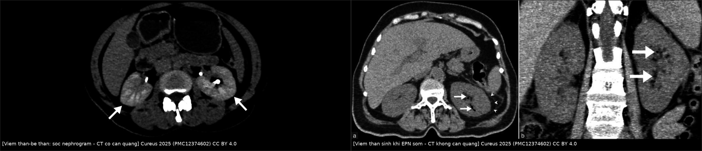
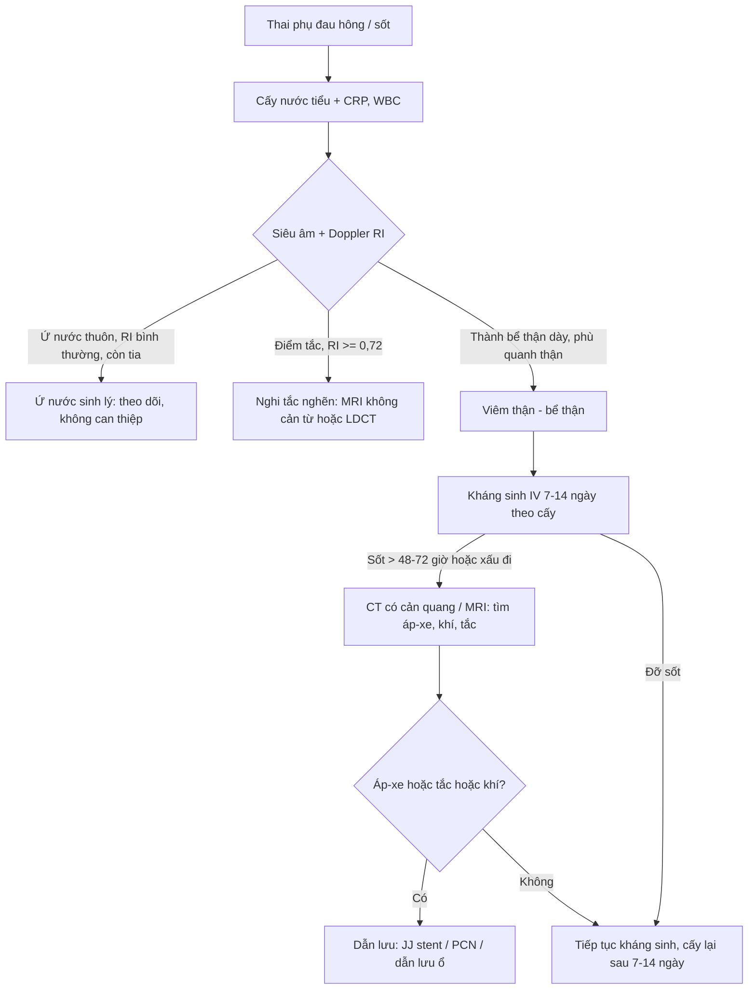
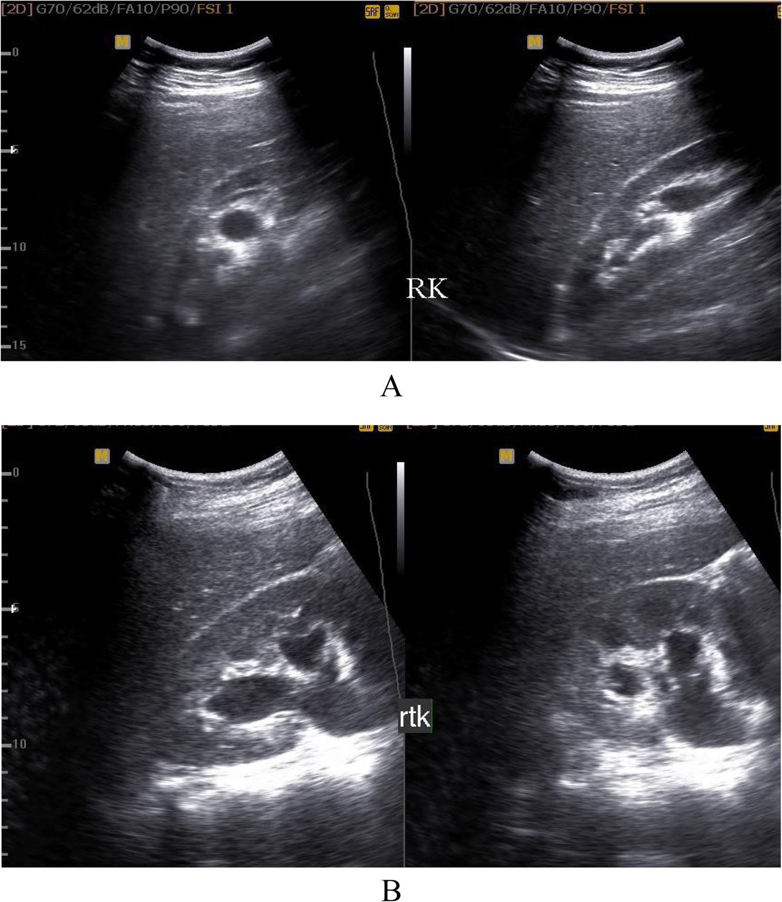
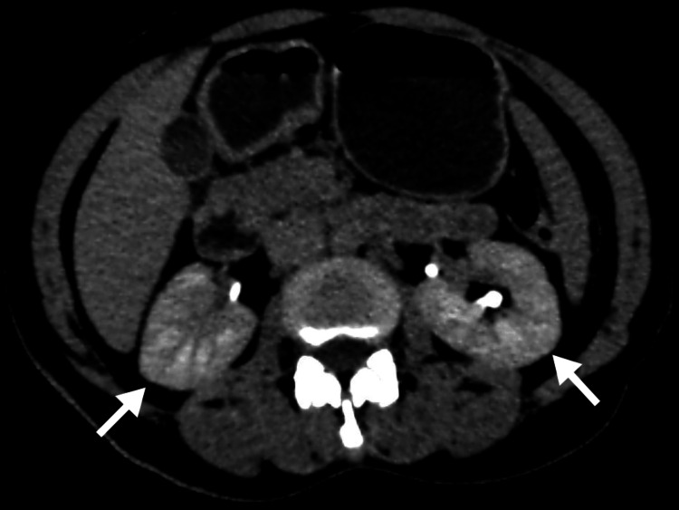
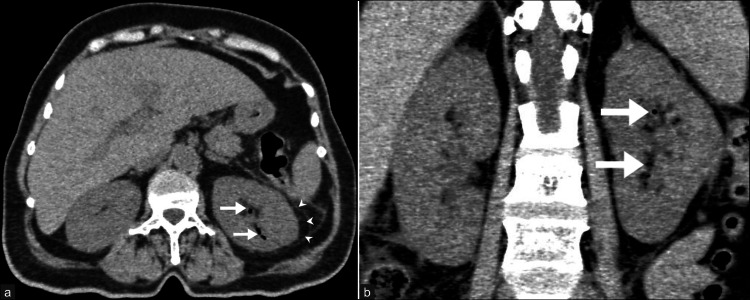
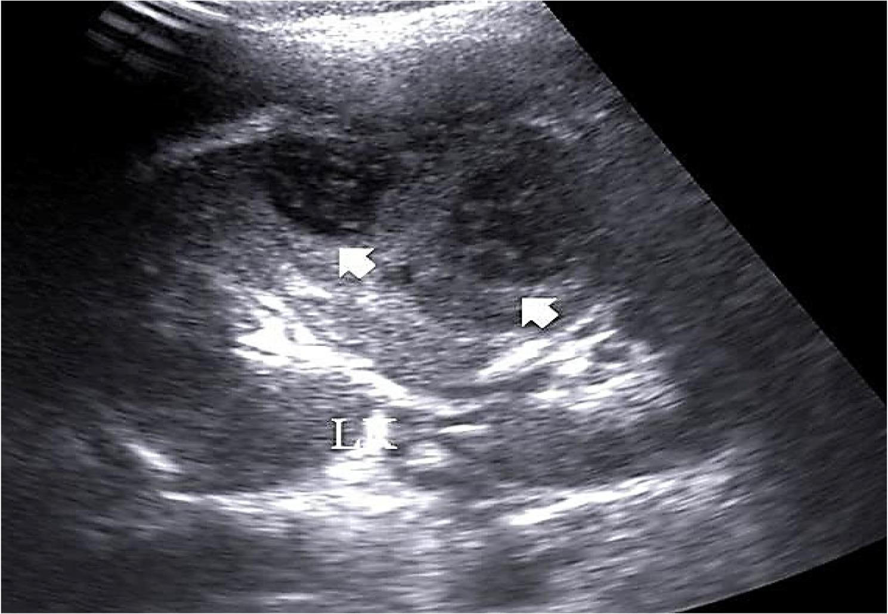

# 1921 — Nhiễm khuẩn niệu không triệu chứng & viêm thận–bể thận cấp ở thai phụ: cấy ≥ 10⁵, "giãn ≠ tắc", khi nào CT/MRI và khi nào dẫn lưu / Asymptomatic bacteriuria & acute pyelonephritis in pregnancy

**Tags:** `pattern:u-nuoc` `pattern:viem` `vung:than` `vung:nieu-quan` `vung:thai-nhi` `vung:o-bung` `protocol:sieu-am-bung` `protocol:MRI-khong-can-tu` `protocol:CT-lieu-thap` `score:Huang-Tseng` `score:EAU-2025`
**Mức chắc chắn (certainty):** tổng hợp y văn (literature synthesis) — ghép 6 nguồn mở: **tổng quan CT các thể viêm thận** (*Cureus* 2025, PMC12374602, **CC BY 4.0**, 8 hình), **thuật toán siêu âm–Doppler cho đau hông ở thai** (*BMC Pregnancy Childbirth* 2026, PMC13063533, **CC BY 4.0**, 6 hình), **so sánh 13 guideline kháng sinh trong thai** (*Antibiotics* 2022, PMC9740524, **CC BY 4.0**), **tổng quan hệ thống hiệu quả sàng lọc–điều trị ASB** (*BMJ Open* 2019, PMC6429717, CC BY-NC), **thời gian tan dấu hiệu CT của viêm thận** (*Cureus* 2026, PMC13634368, CC BY 4.0) và **đoàn hệ viêm thận–bể thận ở thai** (*Am J Perinatol* 2019, PMC6864490, CC BY-NC-ND — chỉ dùng số liệu). Số nào nguồn không nêu ghi "chưa rõ".

> **Câu chốt:** **Nhiễm khuẩn niệu không triệu chứng (asymptomatic bacteriuria, ASB) là bệnh của NUÔI CẤY, không phải của hình ảnh** — siêu âm/thận bình thường không loại trừ, và cấy **≥ 10⁵ CFU/mL** là ngưỡng duy nhất để điều trị. Điều trị ASB giảm viêm thận–bể thận **RR 0,24 (0,13–0,42), ARR 17,6%, NNT 6** và giảm cân nặng sơ sinh thấp **RR 0,63, NNT 23**. Khi đã có viêm thận–bể thận, **96,5% thai phụ đau hông có ứ nước trên siêu âm** — nghĩa là **"giãn" không phải "tắc"**: chốt phân biệt nằm ở **thành bể thận dày + Doppler RI ≥ 0,72 + tia nước tiểu**, không phải ở mức độ giãn.

## 1. Tổng quan bệnh học – cơ chế hình ảnh

### 1.1 Vì sao thai phụ dễ bị nhiễm niệu và vì sao phải điều trị ASB (TẠI SAO)

- **Dịch tễ:** ASB gặp ở **2–10% thai phụ**; nhiễm khuẩn niệu được chẩn đoán trong **tới 50–60% số thai kỳ** nếu tính cả viêm bàng quang và viêm thận–bể thận (PMC9740524). Các đoàn hệ ngoài Âu–Mỹ dao động rộng vì khác ngưỡng cấy: **3,42% (221/6.471 thai, Ả Rập Xê Út)** với nguy cơ tăng ở **quý I (OR 2,04)** và **có tiền sử nhiễm niệu (OR 2,98)** (PMC9766479), trong khi gộp tại Ấn Độ là **13,5% (11,1–15,8)** (PMC10795867) — **đừng lấy một con số "chuẩn" cho mọi quần thể**.
- **Cơ chế nội tiết – cơ học:** **progesterone** làm giãn cơ trơn niệu quản và giảm nhu động, **tử cung to chèn ép niệu quản** (phải nhiều hơn trái vì đại tràng sigma đẩy tử cung sang phải), thêm **táo bón** và **ứ nước sinh lý** — tất cả tạo **ứ trệ nước tiểu**, là điều kiện cho vi khuẩn đường ruột đi ngược dòng. **E. coli chiếm 80–90%** (PMC9740524).
- **Vì sao ASB phải điều trị dù không triệu chứng:** thai phụ **không có "hàng rào" niệu quản như người không mang thai** — ứ trệ + giảm nhu động biến khuẩn niệu thành nhiễm mô. Trong các thử nghiệm cũ, ASB không điều trị tiến triển thành **viêm bàng quang có triệu chứng ở 30%**, và trong số đó **tới 50% thành viêm thận–bể thận** (PMC9740524); gộp 12 thử nghiệm cho **ARR 17,6%** (PMC6429717). Đây là lý do **11/13 guideline (85%) khuyến cáo sàng lọc ASB bằng cấy nước tiểu ở lần khám thai đầu, lý tưởng 12–16 tuần** (PMC9740524).
- **Hệ quả sản khoa (nếu bỏ sót):** sốt – nhiễm – đau làm tăng co bóp tử cung; **viêm thận–bể thận ở thai là nguyên nhân nhập ICU** — trong **110 thai phụ** nhập viện vì viêm thận–bể thận, **86 người KHÔNG sốt lúc vào**, và **điểm cảnh báo sớm sản khoa dương tính dự báo nhập ICU với aOR 16,54 (1,29–212,5)** (PMC6864490).

### 1.2 Vì sao hình ảnh trông như vậy (vật lý từng phương thức)

- **Siêu âm — dịch, sỏi, và "giãn":** nước tiểu **không hồi âm** vì gần như không có mặt phân cách trở kháng âm; **sỏi tăng hồi âm mạnh + bóng lưng sạch** vì cản âm gần như hoàn toàn. Nhưng **"giãn" chỉ là hình học của dịch**, không phải bằng chứng tắc: **ứ nước sinh lý có từ quý II, đỉnh 24–28 tuần**, và trong đoàn hệ 87 thai phụ đau hông, **siêu âm thấy ứ nước ở 96,5%**, **bên phải 77%** (PMC13063533) — nếu chỉ dựa vào "có ứ nước" thì gần như **mọi thai phụ đau hông đều "tắc"**.
- **Doppler — chỉ số kháng lực (resistive index, RI = (PSV − EDV)/PSV):** tắc cấp làm tăng áp lực trong nang/BH, **giảm dòng thì tâm trương** → RI tăng. Trong cùng đoàn hệ, **tắc cao độ có RI ≥ 0,72 (trung bình 0,78)**, còn **chèn ép sinh lý giữ RI bình thường + còn tia nước tiểu** (PMC13063533). Hình A/B dưới đây in đúng **RI 0,77 và 0,74** kèm S/D 4,33 và 3,88 — tức **sát ngưỡng**, nên **RI chỉ có giá trị khi đo đúng động mạch gian thùy và đối chiếu bên đối diện**.
- **CT — "sọc" (striated nephrogram) hình thành thế nào:** mủ và phù kẽ **chèn ép ống thận** → trụ ống + phù gian bào → các **bó ống tủy giảm ngấm** xen kẽ các dải ngấm bình thường, tạo **dải sọc tỏa từ tủy ra vỏ**. Vì vậy dấu hiệu **rõ nhất ở thì nephrographic (80–100 giây)** — đúng thì mà **độ chính xác chẩn đoán viêm thận cấp đạt 90–92%** — và **mờ đi ở thì muộn** (PMC12374602). Kèm theo: thận to, **dải giảm đậm độ hình nêm**, **dải mỡ quanh thận (perinephric stranding)**, dày cân thận.
- **Vì sao CT "nhìn thấy" còn MRI "nhìn ra":** khí trong mô có **HU ≈ −1000** nên CT là chìa khóa của thể sinh khí; MRI **T2 sáng** với phù/nước, **DWI hạn chế** ở vùng mủ (edema tế bào + mủ đặc), còn **sỏi là "trống tín hiệu"** trên mọi chuỗi vì không có proton linh động — nên MRI **loại trừ tắc nghẽn tốt** nhưng **không thấy sỏi trực tiếp**.
- **Hiệu năng:** CT **Se 86–98% / Sp 87–97%** cho viêm thận cấp (PMC12374602); **nephrographic là thì quyết định**; **CT urography đủ 3 thì liều 8–15 mSv**, còn **LDCT < 3,5 mSv / ULCT < 1,9 mSv** — đây là lý do không dùng CTU đủ thì cho một ca viêm thận–bể thận đơn thuần ở thai.

### 1.3 Ngưỡng định lượng nằm lòng (bắt buộc nhớ)

| Chỉ số | Con số | Nguồn |
|---|---|---|
| ASB ở thai | **2–10%**; tại chỗ: **3,42% (221/6.471)** / gộp Ấn Độ **13,5%** | PMC9740524, PMC9766479, PMC10795867 |
| Ngưỡng cấy ASB | **≥ 10⁵ CFU/mL** một loài (lý tưởng 2 lần cấy; thực tế 1 lần đủ) | PMC9740524 |
| Sàng lọc | **11/13 guideline (85%)**, lần khám đầu, **12–16 tuần** | PMC9740524 |
| Điều trị ASB | viêm thận–bể thận **RR 0,24 (0,13–0,42); ARR 17,6%; NNT 6**; cân nặng thấp **RR 0,63; ARR 4,4%; NNT 23** | PMC6429717 |
| ASB không điều trị | viêm bàng quang **30%**; trong số đó **tới 50%** thành viêm thận–bể thận | PMC9740524 |
| Căn nguyên | **E. coli 80–90%** | PMC9740524 |
| Thời gian kháng sinh | viêm bàng quang/ASB **3–7 ngày** (fosfomycin **1 liều**); viêm thận–bể thận **7–14 ngày** | PMC9740524 |
| Cấy kiểm tra sau điều trị | **8/13 guideline (62%)** cấy lại sau **7–14 ngày** (nhiễm dưới); **4/13 (31%)** sau viêm thận–bể thận | PMC9740524 |
| Siêu âm ở thai đau hông | ứ nước **96,5%**; phải **77%**; thành BH dày/phù **75%**; sỏi **23%**; tắc cao độ **11,5%** | PMC13063533 |
| Doppler RI | tắc cao độ **≥ 0,72 (trung bình 0,78)**; chèn ép sinh lý RI bình thường + còn tia | PMC13063533 |
| CT viêm thận cấp | **Se 86–98% / Sp 87–97%**; thì nephrographic **80–100 s**, chính xác **90–92%** | PMC12374602 |
| Liều CT | CTU đủ 3 thì **8–15 mSv**; LDCT **< 3,5**; ULCT **< 1,9 mSv** | PMC12374602, PMC10487296 |
| Hai bên | **~20%** (gợi ý đường máu) | PMC12374602 |
| Khí trong thận | **HU ≈ −1000**; **90%** thể sinh khí có đái tháo đường | PMC12374602 |
| Dấu hiệu CT tồn tại | **149 ± 100 ngày**; còn bất thường **105 ngày sau khi hết triệu chứng** | PMC13634368 |
| Thai không sốt vẫn nặng | **86/110** không sốt lúc vào; MEWC dương → ICU **aOR 16,54** | PMC6864490 |
| Dẫn lưu ở thai | đặt stent **13,8% → 9,7%** sau khi chuẩn hóa; thời gian quyết định **24,3 → 12,8 giờ** | PMC13633813 |
| Vi khuẩn đa kháng | **34/171 (19,9%)**; tiền sử kháng sinh **OR 20,37**; thủ thuật niệu **OR 13,23** | PMC12937342 |

## 2. Mẫu hình + chẩn đoán phân biệt theo vị trí (gamut)

Bốn mẫu hình gặp trên bàn phím khi đọc ca thai phụ đau hông/sốt:

- **A. "Giãn bể thận – niệu quản" ở thai phụ:** ứ nước **sinh lý** (hai bên, phải > trái, **thuôn nhẵn, không điểm tắc**, không thành dày, còn tia nước tiểu) · **sỏi tắc** (điểm tắc đột ngột + bóng sỏi, RI tăng) · **viêm (pyelitis)** (thành bể thận dày > 2 mm, phù quanh thận, không sỏi) · **hẹp khúc nối/van niệu quản** · **chèn ép từ khối tiểu khung** (u xơ, khối buồng trứng) — đừng quên **thai** là "khối" chèn ép lớn nhất.
- **B. Thận to + giảm ngấm từng vùng:** áp-xe thận (ổ dịch viền ngấm) · XGP · nhồi máu thận · lymphoma thận · viêm thận kẽ cấp do thuốc (AIN) · tắc nghẽn cấp.
- **C. Khí trong thận:** **viêm thận sinh khí (EPN)** · viêm bể thận sinh khí (khí **chỉ trong ĐTH** — tiên lượng tốt hơn) · áp-xe sinh khí (khí **trong ổ có viền**) · rò tiêu hóa–niệu · khí do thủ thuật.
- **D. Ổ dịch trong nhu mô thận:** nang đơn thuần · nang nhiễm trùng · **áp-xe** · máu tụ · ổ hoại tử trong XGP.

Gợi nhớ nhanh cho mẫu hình A ở thai: **"SINH LÝ – SỎI – VIÊM – SẸO/HẸP"** — thứ tự này cũng là thứ tự tần suất, và **chỉ hai chữ giữa mới cần can thiệp cấp**.

## 3. Bảng so sánh phân biệt (ma trận đối chiếu)

| Thực thể (entity) | Hình ảnh điển hình | Chốt vào (rule-in) | Chốt loại (rule-out) | Gợi ý xác nhận |
|---|---|---|---|---|
| Ứ nước sinh lý thai kỳ | Giãn bể thận–niệu quản **hai bên, phải > trái**, **thuôn nhẵn**, không điểm tắc, không thành dày | **Còn tia nước tiểu + RI bình thường + giãn đối xứng theo tuổi thai** | **Điểm tắc đột ngột + RI ≥ 0,72** → không phải sinh lý | US + Doppler; so bên đối diện; khám lại sau 24–48 giờ |
| Viêm thận–bể thận cấp (APN) | Thận to, **dải giảm đậm độ hình nêm**, **striated nephrogram thì nephrographic**, dải mỡ quanh thận, dày cân thận | **Sốt + đau hông + dải giảm ngấm hình nêm** | **Vùng giảm ngấm bờ rất sắc + "cortical rim sign"** → nhồi máu | CT có cản quang (hoặc MRI nếu thai); cấy máu/niệu |
| Nhồi máu thận | **Nêm giảm đậm độ bờ rất sắc**, **viền vỏ còn ngấm (cortical rim sign)**, không dải mỡ | **Cortical rim sign + bệnh tim mạch/rung nhĩ** | **Có dải mỡ quanh thận + sốt** → viêm | CTA; không đáp ứng kháng sinh |
| Lymphoma thận | Nhiều ổ giảm ngấm hoặc thâm nhiễm lan, thận to, **không dải mỡ**, hạch sau phúc mạc | **Hạch + không sốt + không dải mỡ** | **Dải mỡ + sốt + đau** → viêm | Sinh thiết; PET-CT |
| Viêm thận kẽ cấp (AIN) | **Hai bên, lan tỏa**, thận to, ngấm thuốc kiểu "nhiều nốt mờ", **không nêm** | **Thuốc mới + creatinin tăng + không sốt cao** | **Tổn thương khu trú hình nêm** → APN | Ngừng thuốc; cân nhắc sinh thiết |
| Áp-xe thận | Ổ **dịch có viền ngấm**, khí có thể có, dải mỡ quanh thận | **Viền ngấm + trung tâm không ngấm + sốt kéo dài > 72 giờ** | **Chỉ phù lan tỏa, không ổ** → APN chưa hoại tử | CT; US dẫn lưu; **> 3 cm thường cần dẫn lưu** (chưa rõ ngưỡng tuyệt đối) |
| Viêm thận sinh khí (EPN) | **Khí trong nhu mô** (HU ≈ −1000), phá hủy nhu mô, có thể lan quanh thận | **Khí trong NHU MÔ** trên CT không cản quang | **Khí chỉ trong ĐTH** → viêm bể thận sinh khí (nhẹ hơn) | CT + phân độ Huang–Tseng; cấy máu; kiểm soát đường huyết |
| XGP | Thận to, **sỏi san hô 70–80%**, **hình "chân gấu"**, mô mỡ thay thế nhu mô | **Sỏi trung tâm + chân gấu + viêm tái diễn** | **Không sỏi + ổ dịch cấp** → áp-xe | CT; đa số phải cắt thận |

*Trái: viêm thận phải — **striated nephrogram** (mũi tên) ở thì có cản quang. Phải: (a) khí sớm trong nhu mô thận trái; (b) mặt phẳng trán cho thấy các ổ khí — thể sinh khí. Nguồn: *Cureus* 2025 (PMC12374602), Figs. 2–3, **CC BY 4.0**; ghép bằng `tools/make_composite.py` (letterbox, không crop).*

### 3.1 Vì sao "sọc" lại quan trọng hơn "thận to"
Thận to chỉ là hệ quả; **sọc là bằng chứng tổn thương ống tủy do mủ**, và nó **đảo chiều chẩn đoán** khi so với nhồi máu: nhồi máu cho **nêm bờ sắc + viền vỏ còn ngấm**, viêm cho **dải mờ + dải mỡ quanh thận**. Trên thai phụ, **"sọc" còn giúp tránh chụp lại nhiều lần** vì nó **tồn tại rất lâu** (xem mục 5).

### 3.2 Khí trong thận: đọc theo HU, không đọc theo "đốm đen"
Khí = **−1000 HU**; mỡ quanh thận = **−40 đến −120 HU**; đừng nhầm mỡ xoang quanh thận với khí. **Vị trí khí quyết định tên gọi và tiên lượng**: trong **đài–bể thận** = viêm bể thận sinh khí; trong **nhu mô** = EPN; **lan ra quanh thận** = độ 3A trở lên. Đây là chỗ **CT không cản quang đã đủ chẩn đoán** — không cần liều cản quang ở thai phụ nghi EPN.

## 4. Protocol chụp + hệ phân độ/điểm chuẩn hóa

### 4.1 Trình tự hình ảnh ở thai phụ nghi nhiễm niệu trên
1. **Siêu âm bụng–thận–niệu quản + Doppler RI + bàng quang căng** (không tia): đo **độ giãn theo phân độ 0–III**, **độ dày thành bể thận**, **RI động mạch gian thùy 3 lần mỗi bên**, tìm **tia nước tiểu**, tìm sỏi (thêm **đầu dò âm đạo** cho sỏi 1/3 dưới — TVUS phát hiện **94%** so với **29%** khi chỉ quét qua bụng, PMC10487296).
2. **MRI không cản từ (SSFSE/HASTE + DWI)** khi siêu âm không kết luận: phù **T2 sáng**, mủ **DWI hạn chế**, sỏi **trống tín hiệu** — loại trừ tắc nghẽn rất tốt.
3. **CT liều thấp (LDCT/ULCT)** khi cần câu trả lời dứt khoát (nghi EPN, áp-xe, sỏi cản quang, thất bại điều trị): **không cản quang** nếu tìm sỏi/khí; **có cản quang thì nephrographic 80–100 giây** nếu tìm "sọc"/áp-xe. **ACOG** xem nguy cơ thai nhi là rất thấp dưới **50 mGy** và **không một khảo sát chẩn đoán đơn lẻ nào vượt 100 mGy** — nhưng vẫn theo ALARA.
4. **Chỉ chụp lại khi có lý do lâm sàng** (sốt tiếp diễn, đau tăng, creatinin xấu đi) — **không chụp lại để "kiểm tra hình ảnh đã sạch chưa"** (mục 5).

### 4.2 Phân độ viêm thận sinh khí — Huang & Tseng (dùng để chọn can thiệp)
| Độ | Khí ở đâu | Hướng xử trí |
|---|---|---|
| 1 | Chỉ trong đài–bể thận (viêm bể thận sinh khí) | Kháng sinh + dẫn lưu nếu tắc |
| 2 | Trong nhu mô, chưa ra quanh thận | Kháng sinh + dẫn lưu ổ; theo dõi sát |
| 3A | Lan ra **khoang quanh thận** | Dẫn lưu ± can thiệp ngoại |
| 3B | Lan ra **khoang cạnh thận/tạng lân cận** | Can thiệp ngoại sớm |
| 4 | **Hai bên** hoặc thận **độc nhất** | Cân nhắc cắt thận/ lọc máu |

### 4.3 Sơ đồ quyết định (Mermaid)

### 4.4 Sàng lọc – điều trị ASB (điều dưỡng/sản khoa, nhưng CĐHA phải biết để không "chụp thay cấy")
- **Cấy ở 12–16 tuần** cho mọi thai phụ; **≥ 10⁵ CFU/mL** → điều trị **3–7 ngày**; **cấy lại sau 7–14 ngày** (62% guideline yêu cầu).
- **Tránh**: **nitrofurantoin ở quý III (> 36 tuần)** vì tan máu sơ sinh (và **GFR < 45 mL/phút**, thiếu G6PD); **TMP-SMX ở quý I và quý III**; **amoxicillin–clavulanate** có liên hệ **viêm ruột hoại tử sơ sinh**; **fosfomycin** tránh khi nguy cơ sinh non cao (PMC9740524).
- **Dự phòng** khi ASB dai dẳng sau điều trị, **≥ 2 đợt nhiễm niệu** trong thai: cephalexin **250–500 mg**, nitrofurantoin **50–100 mg**, hoặc fosfomycin **3 g mỗi 7–10 ngày** (PMC9740524).

## 5. Biến thể bình thường và cạm bẫy

- **Cạm bẫy số 1 — "ứ nước = tắc":** **96,5%** thai phụ đau hông có ứ nước trên siêu âm (PMC13063533). Chốt phân biệt là **hình thái (thuôn nhẵn vs điểm tắc) + thành bể thận + RI + tia nước tiểu**, không phải độ giãn. Đừng đặt stent cho một thận "giãn đẹp" mà không có bằng chứng tắc.
- **Cạm bẫy số 2 — RI "sát ngưỡng":** RI **0,74–0,77** (như hình B) nằm **ngay trên ngưỡng 0,72**; tăng huyết áp, đái tháo đường, tuổi, nhịp tim và **tư thế đo** đều làm RI lệch. Luôn đo **3 lần, so bên đối diện**, và nhớ **RI bình thường không loại trừ tắc từng phần**.
- **Cạm bẫy số 3 — chụp lại để "xem đã sạch chưa":** dấu hiệu CT của viêm thận tồn tại **149 ± 100 ngày**, và còn bất thường **105 ngày sau khi bệnh nhân đã hết triệu chứng** (93 bệnh nhân/288 lần chụp, PMC13634368). **Chụp lại theo hình ảnh sẽ dẫn tới kháng sinh kéo dài hoặc can thiệp vô ích** — chỉ chụp lại khi lâm sàng xấu đi.
- **Cạm bẫy số 4 — "không sốt nên nhẹ":** **86/110** thai phụ nhập viện vì viêm thận–bể thận **không sốt lúc vào**, và **điểm cảnh báo sớm dương tính dự báo ICU với aOR 16,54** (PMC6864490). Hình ảnh nặng + lâm sàng "êm" là **ca phải theo dõi sát nhất**, không phải ca nhẹ nhất.
- **Cạm bẫy số 5 — dùng siêu âm để chẩn đoán ASB:** ASB **không có bất thường hình ảnh**; siêu âm bình thường **không loại trừ** và siêu âm bất thường (ứ nước sinh lý) **không chứng minh nhiễm**. Chẩn đoán bằng **cấy**; hình ảnh chỉ trả lời "có biến chứng/tắc không".
- **Cạm bẫy số 6 — cấy một lần rồi thôi:** ngưỡng **10⁵** chỉ có giá trị khi **mẫu nước tiểu giữa dòng sạch**; **≥ 2 loài = nhiễm bẩn**, cấy lại; và **vẫn phải cấy kiểm tra sau điều trị** vì **tái phát/dai dẳng** là lý do chính để dự phòng.
- **Cạm bẫy số 7 — quên sỏi "vô hình":** sỏi **không cản quang** (urate) không thấy trên CT không cản quang và **trống tín hiệu trên MRI**; nếu triệu chứng tái diễn mà không thấy sỏi, **đừng kết luận "không sỏi"** — chuyển siêu âm đầu dò âm đạo/ CT có cản quang thì muộn.
- **Cạm bẫy số 8 — dẫn lưu muộn:** trong **451 thai phụ** viêm thận–bể thận cấp, việc chuẩn hóa quyết định giảm **stent từ 13,8% → 9,7%** nhưng cũng rút **thời gian quyết định từ 24,3 → 12,8 giờ** (PMC13633813) — tức **không phải "dẫn lưu nhiều hơn" mà là "dẫn lưu đúng và sớm hơn"**.

## 6. Tự lượng giá — Blind Quiz

**Ca 1 — Thai 26 tuần, đau hông phải 2 ngày, không sốt, CRP 42 mg/L. Siêu âm thận phải:**

- Hỏi: (1) mô tả độ giãn; (2) đây là ứ nước sinh lý hay tắc? (3) hai nghiệm pháp bổ sung để chốt?

<b>Bấm để hiện đáp án (findings + chẩn đoán)</b>

- **Findings:** (A) giãn nhẹ đài–bể thận, còn thấy các đài **hình chén** — **độ II**; (B) đài thận **căng tròn, bể thận giãn rõ** — **độ III**. Không thấy sỏi, không thấy điểm tắc đột ngột.
- **Chẩn đoán:** hình ảnh **phù hợp ứ nước** — nhưng **một mình siêu âm B-mode không phân biệt sinh lý với tắc**. Cần **Doppler RI** (tắc cao độ **≥ 0,72**, trung bình 0,78) và **tia nước tiểu** (còn tia + RI bình thường → chèn ép sinh lý).
- **Vì sao:** thai kỳ làm giãn đường niệu do progesterone + chèn ép; **96,5% thai phụ đau hông có ứ nước** nên "thấy giãn" là chuyện thường, "thấy tắc" mới là chuyện cần chứng minh.
- **Nguồn ảnh:** *BMC Pregnancy Childbirth* 2026 (PMC13063533), Fig. 1, **CC BY 4.0**.

**Ca 2 — Thai 22 tuần, sốt 39 °C, đau hông trái, siêu âm không thấy sỏi; CT có cản quang thì nephrographic:**

- Hỏi: dấu hiệu chính? Ba chẩn đoán phân biệt? Dấu hiệu nào **loại** nhồi máu thận?

<b>Bấm để hiện đáp án (findings + chẩn đoán)</b>

- **Findings:** **dải sọc giảm–tăng đậm độ xen kẽ** ở nhu mô thận hai bên (mũi tên), **dải mỡ quanh thận**, không có ổ dịch.
- **Chẩn đoán:** **viêm thận–bể thận cấp** với **striated nephrogram** (mủ + phù kẽ chèn ống thận → giảm ngấm từng bó ống tủy).
- **Phân biệt:** nhồi máu thận — lymphoma — AIN. **Loại nhồi máu** bằng **bờ nêm rất sắc + cortical rim sign** (viền vỏ còn ngấm) và **không có dải mỡ**; viêm thận cho **dải mờ + dải mỡ + sốt**.
- **Ghi chú phản biện:** đây là ảnh minh họa từ bài tổng quan, **không phải thai phụ** — hình thái giống hệt, nhưng ở thai nên ưu tiên **MRI** trước CT.
- **Nguồn ảnh:** *Cureus* 2025 (PMC12374602), Fig. 2, **CC BY 4.0**.

**Ca 3 — Thai 30 tuần, đái tháo đường thai kỳ, sốt 3 ngày, đau hông trái; CT không cản quang:**

- Hỏi: mô tả bất thường? Chẩn đoán và phân độ? Bước xử trí tiếp theo?

<b>Bấm để hiện đáp án (findings + chẩn đoán)</b>

- **Findings:** (a) các **ổ khí nhỏ (mũi tên)** trong nhu mô và đài–bể thận trái + dải mỡ quanh thận nhẹ; (b) mặt phẳng trán xác nhận khí trong nhu mô, **chưa lan rõ ra quanh thận**.
- **Chẩn đoán:** **viêm thận sinh khí (EPN) sớm**, **Huang–Tseng độ 2** (khí trong nhu mô, chưa ra khoang quanh thận).
- **Xử trí:** kháng sinh phổ rộng + **kiểm soát đường huyết + dẫn lưu**; theo dõi sát vì **90% EPN có đái tháo đường** và thể này có tử vong cao. **Khí = −1000 HU**, khác mỡ quanh thận (**−40 đến −120 HU**).
- **Nguồn ảnh:** *Cureus* 2025 (PMC12374602), Fig. 3, **CC BY 4.0**.

**Ca 4 — Thai 18 tuần, sốt dai dẳng 5 ngày dù kháng sinh; siêu âm thận trái:**

- Hỏi: hai ổ giảm hồi âm là gì? Vì sao phải chụp thêm? Ngưỡng can thiệp?

<b>Bấm để hiện đáp án</b>

- **Findings:** **hai ổ dịch thành dày, dịch đục (turbid)**, mũi tên — gợi ý **áp-xe thận**, không phải nang đơn thuần (nang có thành mỏng, dịch trong).
- **Vì sao chụp thêm:** siêu âm **không đánh giá được vỏ–viền ngấm và khí**; **CT có cản quang (hoặc MRI)** xác định **ổ dịch có viền ngấm**, số ổ, và có khí hay không — quyết định **dẫn lưu qua da**.
- **Ngưỡng:** áp-xe **> 3 cm** thường phải **dẫn lưu** (số cụ thể thay đổi theo nguồn — **chưa rõ ngưỡng tuyệt đối**); **áp-xe nhỏ + đáp ứng kháng sinh** có thể theo dõi.
- **Nguồn ảnh:** *BMC Pregnancy Childbirth* 2026 (PMC13063533), Fig. 5, **CC BY 4.0**.

## Bài liên quan chéo
- [500 – Tổng quan hệ Vú & Sản phụ khoa](../500-tong-quan-vu-san-phu-khoa/lesson.md)
- [1818 – Sỏi niệu quản ở thai phụ: siêu âm – MRI, dẫn lưu tạm và khi nào lấy sỏi](../1818-soi-nieu-quan-thai/lesson.md)
- [152 – Sỏi niệu](../152-soi-nieu/lesson.md)
- [191 – Vá lại rò niệu–sinh dục thất bại](../191-va-lai-ro-nieu-sinh-duc-that-bai/lesson.md)
- [1667 – Tắc ruột non do dính ở thai phụ (đau bụng cấp ở thai: cùng nguyên tắc "MRI trước CT")](../1667-tac-ruot-non-do-dinh-thai-phu/lesson.md)

> Không dùng để chẩn đoán độc lập khi chưa có người hướng dẫn.
