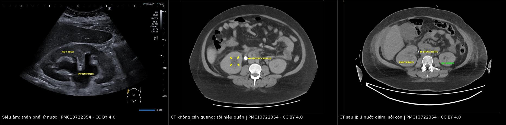
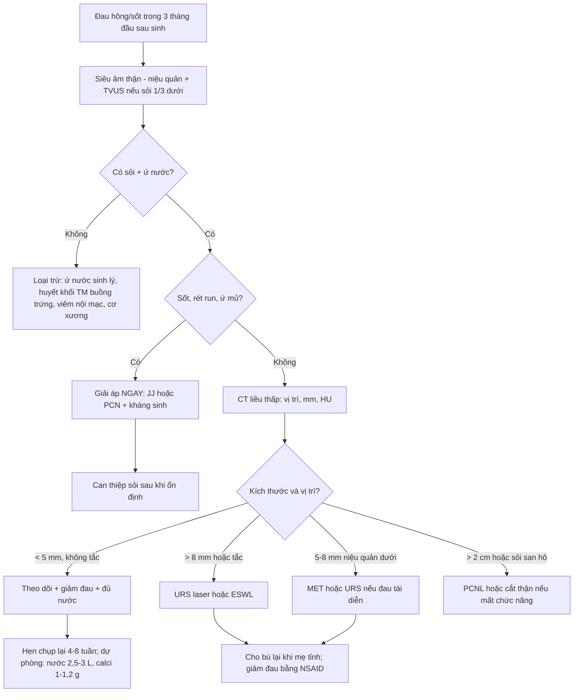
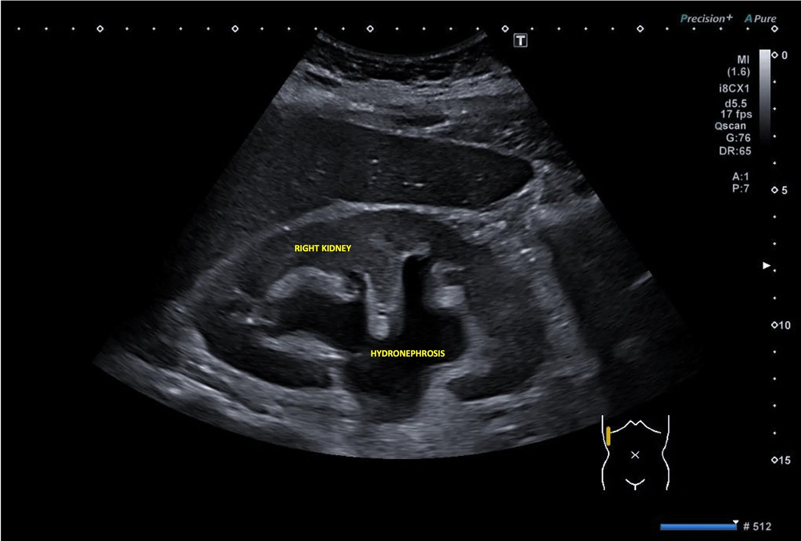
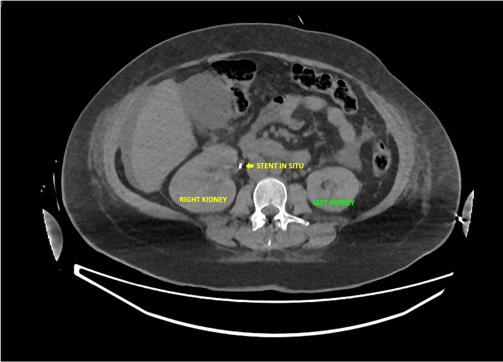
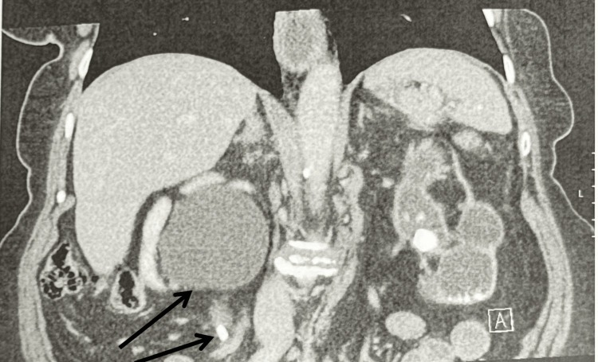

# 1922 — Sỏi niệu ở bà mẹ sau sinh đang cho con bú: đỉnh nguy cơ 0–3 tháng, 25% còn sỏi sau thai, chọn ESWL/URS và thuốc an toàn với sữa mẹ / Postpartum nephrolithiasis in breastfeeding mothers

**Tags:** `pattern:soi-nieu` `pattern:u-nuoc` `pattern:tac-nghen` `vung:than` `vung:nieu-quan` `vung:thai-nhi` `protocol:sieu-am-bung` `protocol:CT-lieu-thap` `score:EAU-2025`
**Mức chắc chắn (certainty):** tổng hợp y văn (literature synthesis) — ghép **nghiên cứu bệnh–chứng 945 ca/1.890 chứng** về nguy cơ sỏi theo tam cá nguyệt và sau sinh (Thongprayoon 2021, *Am J Kidney Dis*, PMID 33867205), **đoàn hệ 120 thai phụ sỏi niệu quản 14 năm** (PMC13668503), **đoàn hệ 208 thai** (PMC11895682), **tổng quan ứ nước thai** (PMC11210578), **ca lâm sàng có ảnh** (PMC13722354, PMC13298540), **khung quyết định ngưng cho bú theo nguy cơ** (PMC13706221), **ca gây mê – cho bú** (PMC13157709), **tổng quan codeine qua sữa** (PMC13519785), **hướng dẫn chuyển hóa sỏi Brazil 2025** (PMC11913452), **nghiên cứu ESWL/URS** (PMC12813581, PMC12662765) và dữ liệu kích thước sỏi – tự ra đã dùng ở bài 1818 (PMC10487296). Số nào nguồn không nêu ghi "chưa rõ".

> **Câu chốt:** nguy cơ sỏi **đạt đỉnh sau sinh chứ không phải trong thai**: so với phụ nữ không mang thai, **OR 0,92 ở tam cá nguyệt I → 2,00 ở quý II → 2,69 ở quý III → 3,53 ở 0–3 tháng sau sinh**, rồi về mức nền sau 1 năm (PMID 33867205). Trong 120 thai phụ sỏi niệu quản, **75% sỏi tự ra** nhưng **25% (30/120) còn sỏi sau khi kết thúc thai** — **8 ca ESWL, 22 ca URS sau sinh** (PMC13668503). Vì vậy câu hỏi thực hành không phải "có sỏi không" mà là **"ai cần can thiệp triệt để ngay sau sinh, bằng cách nào, và thuốc/gây mê nào không phải ngừng cho bú"**.

## 1. Tổng quan bệnh học – cơ chế hình ảnh

### 1.1 Vì sao "sau sinh" mới là đỉnh nguy cơ (TẠI SAO)

- **Đường cong nguy cơ theo thời gian (số liệu quyết định):** nghiên cứu bệnh–chứng dân số Olmsted County 1984–2012, **945 phụ nữ sỏi triệu chứng lần đầu 15–45 tuổi + 1.890 chứng ghép tuổi**, so với phụ nữ không mang thai: **quý I OR 0,92 (p = 0,8)**, **quý II OR 2,00 (p = 0,007)**, **quý III OR 2,69 (p = 0,001)**, **0–3 tháng sau sinh OR 3,53 (p < 0,001)**, và **về mức nền sau 1 năm**; **có thai trước đó > 1 năm OR 1,27 (p = 0,01)** (PMID 33867205). Kết quả giữ nguyên sau hiệu chỉnh tuổi/chủng tộc và đái tháo đường/tăng huyết áp/béo.
- **Vì sao đỉnh lại nằm sau sinh:** ba thay đổi của thai kỳ **chỉ đảo chiều từ từ sau đẻ**, trong khi **viên sỏi đã hình thành thì vẫn nằm đó**:
  1. **Tăng calci niệu và acid uric niệu** do **1,25-(OH)₂ vitamin D từ bánh nhau** tăng hấp thu calci — nước tiểu "quá bão hòa" calci oxalat;
  2. **Ứ trệ:** tử cung chèn ép + progesterone làm giãn cơ trơn niệu quản; hệ đài–bể giữ thêm **200–300 mL nước tiểu**, và thai phụ có **nguy cơ viêm thận–bể thận cao hơn 40%** so với không mang thai (PMC11210578);
  3. **Cơn đau quặn và can thiệp trong thai thường chỉ là "cầu nối"** (JJ/PCN), nên sỏi vẫn còn nguyên khi ra viện.
- **Sau sinh có thêm 2 yếu tố làm bộc lộ sỏi:** **lợi tiểu sau đẻ** (giảm thể tích ngoài tế bào, cô đặc nước tiểu) và **mất nước do cho bú** nếu mẹ uống không đủ; đồng thời **đau lưng – đau hông được mặc định là "đau sau sinh"** nên chẩn đoán bị trễ.
- **Cho bú có làm tăng sỏi không?** Sữa mẹ lấy **200–250 mg calci/ngày** từ xương mẹ, chủ yếu qua **PTHrP**, làm **giảm 3–9% mật độ xương** trong thai–cho bú (PMC13389467). Tuy vậy **chưa có bằng chứng cho bú làm tăng nguy cơ sỏi**; sai lầm thực hành là **hạn chế calci ăn vào** và **giảm uống nước** vì sợ "sỏi do calci" — cả hai đều **làm tăng** nguy cơ tái phát (mục 4.5).
- **Vì sao đau dữ dội:** sỏi kẹt làm tăng áp lực trong bể thận → **căng bao thận** (giàu cảm giác) + **co thắt niệu quản**; đau lan xuống bẹn/sinh dục. Khi có **nhiễm kèm tắc kín** → **viêm thận–bể thận ứ mủ (pyonephrosis)** và **sốc nhiễm khuẩn** — đây là con đường tử vong, không phải bản thân viên sỏi.

### 1.2 Vì sao nhìn thấy — vật lý từng phương thức

- **Siêu âm (bước 1, không tia xạ):** sỏi là **cấu trúc tăng hồi âm mạnh + bóng lưng sạch** vì cản âm gần như hoàn toàn; ứ nước là **dịch vô hiệu (anechoic)** trong đài–bể. **Siêu âm không phát hiện được sỏi ở 1/3 giữa–dưới** khi ruột che; trong đoàn hệ thai 146 ca, **sỏi chỉ thấy trước mổ ở 30%** và **ứ nước có độ đặc hiệu chỉ 1,5%** cho sỏi (PMC12159928, dẫn ở bài 1818) — **"không thấy sỏi" không loại trừ tắc**.
- **CT không cản quang liều thấp (chuẩn vàng):** sỏi cản quang tự nhiên nên **không cần thuốc**; **90% sỏi cản quang**, phim **KUB chỉ thấy sỏi ≥ 2 mm** và **độ nhạy < 50%** với sỏi niệu quản, trong khi **CT liều thấp Se 90–98%/Sp 88–100%** (PMC11913452; PMC10487296). Liều: **CTKUB chuẩn 4,5–5 mSv, LDCT < 3,5 mSv, ULCT < 1,9 mSv**.
- **Mật độ HU gợi ý thành phần và khả năng tán sỏi:** **acid uric 200–400 HU**, **calci oxalat 600–1.200 HU**, **> 1.000 HU khó vỡ bằng ESWL** (PMC11913452) — hữu ích khi chọn ESWL hay URS.
- **MRI/MRU:** sỏi là **vùng mất tín hiệu (signal void)** trên T2 vì không có proton linh động; MRU phát hiện **ứ nước/tắc nghẽn** tốt (**Se 82%/Sp 98%**) nhưng **không thấy sỏi trực tiếp** (PMC10487296) — dùng khi cần tránh tia xạ, không dùng để "đếm sỏi".
- **Thuốc cản quang khi đang cho bú:** với cản quang iod, **< 1% liều mẹ vào sữa trong 24 giờ** và **< 1% lượng nuốt vào được hấp thu** → liều hệ thống cho trẻ **< 0,01% liều mẹ**, **không cần ngưng cho bú, không cần "pump and dump"**; CT không cản quang, siêu âm, MRI không gadolinium **không cần bất kỳ dự phòng nào** (PMC13706221). Với gadolinium, dữ liệu sữa chủ yếu từ **gadopentetate dimeglumine** (chất tuyến tính); khuyến cáo châu Âu cho phép tiếp tục cho bú với **chất macrocyclic** (PMC13706221).

### 1.3 Ngưỡng định lượng nằm lòng (bắt buộc nhớ)

| Đại lượng | Ngưỡng / con số | Ý nghĩa thực hành | Nguồn |
|---|---|---|---|
| Nguy cơ sỏi theo giai đoạn | **OR 0,92 → 2,00 → 2,69 → 3,53** (quý I → II → III → 0–3 tháng sau sinh) | Đau hông trong 3 tháng đầu sau sinh **phải loại trừ sỏi/tắc**, không quy cho "đau sau sinh" | PMID 33867205 |
| Sỏi tự ra theo kích thước | **< 4 mm: 55%**; **4–8 mm: 42%**; **> 8 mm: 0%**; sỏi 1/3 trên chỉ **27%** | Sỏi > 8 mm sau sinh gần như **luôn cần can thiệp** | PMC10487296 |
| Sỏi còn lại sau thai | **25% (30/120)**: 8 ESWL, 22 URS sau sinh | Phải **hẹn khám + chụp lại sau sinh**, không "xong khi sinh xong" | PMC13668503 |
| Kích thước mảnh sỏi "sạch" | **Không còn mảnh > 4 mm** = stone-free | Mảnh 4–5 mm vẫn có thể lớn lại/gây tắc | PMC12662765 |
| Thể tích nước tiểu mục tiêu | **2,5–3,0 L/ngày**; nước uống **30 mL/kg/ngày + 400 mL** | Mục tiêu dự phòng, **không mâu thuẫn với cho bú** | PMC11913452 |
| Calci ăn vào | **1.000–1.200 mg/ngày**, **KHÔNG hạn chế** | Hạn chế calci làm tăng oxalat niệu và mất xương | PMC11913452 |
| Muối | **NaCl < 6 g/ngày** | Giảm calci niệu | PMC11913452 |
| Calci niệu 24 giờ (nữ) | **> 250 mg/ngày** = mức hành động | Cân nhắc thiazide | PMC11913452 |
| Citrat niệu | **< 320 mg/ngày** = giảm citrat | Cân nhắc kali citrat | PMC11913452 |
| Đổi stent trong thai | **4–6 tuần/lần** (3 tuần nếu đóng cặn nhanh) | Sau sinh: rút/đổi ngay khi có kế hoạch điều trị | PMC11210578 |

## 2. Mẫu hình + chẩn đoán phân biệt theo vị trí (gamut)

- **Đau hông MỘT bên + không sốt + đau quặn từng cơn:** sỏi niệu quản tắc (gamut số 1), hẹp khúc nối, huyết khối tĩnh mạch thận (hiếm), đau cơ–xương thành bụng.
- **Đau hông + SỐT/rét run sau sinh:** **viêm thận–bể thận trên nền tắc** hoặc **ứ mủ thận** — cấp cứu giải áp, không chờ kết quả cấy.
- **Đau hông + sốt + khối cạnh tử cung sau sinh:** **huyết khối tĩnh mạch buồng trứng** (bài 1623) — bắt chước viêm thận–bể thận, chẩn đoán bằng CT tĩnh mạch.
- **Đau lưng – hông hai bên, không sốt, sau đẻ vài tuần:** **ứ nước sinh lý tồn tại** (giảm dần) — chỉ theo dõi nếu không sỏi, không tắc, chức năng thận bình thường.
- **Sốt + đau bụng dưới + ra máu âm đạo:** viêm nội mạc tử cung/sót nhau (bài 1624) — không phải sỏi dù có đau lan.
- **Đau hông + buồn nôn + sốt nhẹ ở người trẻ sau sinh:** viêm ruột thừa (ruột thừa bị đẩy cao) — siêu âm/MRI, không dựa vào điểm đau cổ điển.
- **Không triệu chứng, phát hiện tình cờ:** sỏi thận không tắc — **không can thiệp**, nhưng **sỏi 24 mm + vỏ thận mỏng** là tổn thương đã mất chức năng (mục 5).

## 3. Bảng so sánh phân biệt (ma trận đối chiếu)

| Thực thể (entity) | Hình ảnh điển hình (US/CT) | Chốt vào (rule-in) | Chốt loại (rule-out) | Gợi ý xác nhận |
|---|---|---|---|---|
| **Sỏi niệu quản tắc sau sinh** | Sỏi **tăng hồi âm + bóng lưng** trên US; **CT: điểm cản quang trong lòng niệu quản + ứ nước trên sỏi** | **Sỏi thấy được + ứ nước cùng bên + đau quặn**; **sỏi > 8 mm gần như 0% tự ra** | Ứ nước hai bên, niệu quản thuôn nhẵn, không sỏi → ứ nước sinh lý | CT liều thấp (không cản quang) |
| **Viêm thận–bể thận ứ mủ trên nền tắc** | Thận to, đài–bể giãn chứa **dịch đặc/mảnh vụn**, có thể **khí**; dải mỡ quanh thận | **Sốt/rét run + đau hông + ứ nước + sỏi tắc**; **dịch đặc trong bể** | Đau hông không sốt, CRP thấp → ít nghĩ ứ mủ | CT + cấy máu/nước tiểu; **giải áp khẩn** (bài 1924) |
| **Ứ nước sinh lý tồn tại sau sinh** | Ứ nước **hai bên, phải > trái**, niệu quản **thuôn nhẵn**, không sỏi | **Không sỏi, không sốt, đau giảm dần, chức năng thận ổn** | **Sỏi + bậc thang đột ngột + ứ nước tiến triển** → bệnh lý | Siêu âm lặp sau vài tuần; CT khi nghi tắc |
| **Huyết khối tĩnh mạch buồng trứng** | **Ống tĩnh mạch giãn > 1 cm có huyết khối**, thường bên phải, sau sinh | **Sốt + đau hông + khối cạnh tử cung**, CT tĩnh mạch có khuyết thuốc | Đường niệu bình thường, không sỏi, không ứ nước | CT tĩnh mạch; kháng đông (bài 1623) |
| **Sỏi còn lại không triệu chứng** | Sỏi **< 5 mm** không tắc, không ứ nước | **Không đau, không sốt, không tắc** | **Sỏi > 8 mm + ứ nước + đau tái diễn** → can thiệp | Chụp lại 4–8 tuần; tư vấn nguy cơ tái phát |
| **Sỏi thận mất chức năng "câm"** | **Sỏi bể thận 24 mm + vỏ thận mỏng < 2 mm**, thận không ứ nước cấp | **Không đau, không nhiễm, thận còn lại bù** | **Đau + sốt + ứ nước** → tắc cấp, không phải thể câm | CT; xạ hình chức năng nếu cân nhắc can thiệp |

*Hình 1 — **Trái:** siêu âm thận phải, ứ nước rõ (đài–bể giãn, nhu mô mỏng). **Giữa:** CT không cản quang — **sỏi niệu quản** (mũi tên vàng) + ứ nước cùng bên. **Phải:** CT sau đặt **JJ** — **stent in situ**, ứ nước giảm nhưng **sỏi vẫn còn** (stent là cầu nối, không phải điều trị triệt để). Nguồn: *Cureus* 2026, PMC13722354, **CC BY 4.0**; ảnh ghép letterbox, không crop/kéo giãn.*

## 4. Protocol chụp + phân tầng điều trị + thuốc an toàn với sữa mẹ

### 4.1 Chẩn đoán hình ảnh sau sinh (thứ tự và lý do)

1. **Siêu âm bụng–hông + siêu âm đầu dò âm đạo** nếu sỏi 1/3 dưới (TVUS phát hiện **94%** sỏi 1/3 dưới so với **29%** khi chỉ quét qua bụng — PMC10487296): đo **kích thước sỏi (mm)**, **độ ứ nước**, **tia nước tiểu**, **RI** (bất thường **> 0,70**).
2. **CT không cản quang liều thấp** khi US không kết luận, đau tái diễn, hoặc cần lập kế hoạch can thiệp: xác định **vị trí – kích thước – mật độ HU**; **không cần cản quang** cho sỏi.
3. **CT có cản quang** chỉ khi nghi biến chứng (áp-xe, huyết khối, rò) — **đang cho bú vẫn chụp được, không cần ngừng bú** (mục 1.2).
4. **Không dùng KUB đơn thuần để loại trừ**: chỉ thấy sỏi **≥ 2 mm**, độ nhạy **< 50%** với sỏi niệu quản (PMC11913452).

### 4.2 Chọn can thiệp triệt để sau sinh (theo kích thước – vị trí – bối cảnh)

| Tình huống | Lựa chọn ưu tiên | Số liệu chính | Ghi chú cho mẹ đang cho bú |
|---|---|---|---|
| **Sỏi < 5 mm, không tắc, đau kiểm soát** | Theo dõi + giảm đau + uống đủ nước | **< 4 mm: 55% tự ra** (PMC10487296) | Không cần ngừng bú; khám lại nếu sốt/đau tăng |
| **Sỏi 5–8 mm niệu quản 1/3 dưới** | Cân nhắc **MET** hoặc URS nếu đau tái diễn | **4–8 mm: 42% tự ra**; URS sạch sỏi **85,2%** (PMC12813581) | Tamsulosin: dữ liệu sữa hạn chế (mục 4.4) |
| **Sỏi > 8 mm hoặc tắc/ứ nước tiến triển** | **URS laser** (niệu quản giữa–dưới) hoặc **ESWL** (niệu quản trên < 1 cm) | **> 8 mm: 0% tự ra**; ESWL sỏi niệu quản trên sạch **90%**, biến chứng **5%** vs URS **22,2%** (PMC12813581) | Gây mê: cho bú lại khi mẹ tỉnh (mục 4.3) |
| **Sỏi thận 1–2 cm** | **ESWL** ± JJ trước thủ thuật | Sạch **82,6% có stent vs 67,8% không**; steinstrasse **3,5% vs 13,0%**; **OR 2,14** (PMC12662765) | Đặt stent **24–48 giờ trước** ESWL trong nghiên cứu |
| **Sỏi > 2 cm / sỏi san hô / thận mất chức năng** | **PCNL** hoặc **cắt thận** nếu mất chức năng hoàn toàn | Không có số riêng cho sau sinh | Tránh ESWL đơn thuần |
| **Nhiễm kèm tắc (sốt, ứ mủ)** | **Giải áp NGAY** (JJ hoặc PCN) + kháng sinh, **can thiệp sỏi sau** | Không giải áp → tử vong **19,2% vs 8,82%** (bài 1924) | Không chờ hết sốt mới giải áp |
| **Sỏi còn lại sau thai, không triệu chứng** | **Theo dõi** nếu < 5 mm, không tắc; **can thiệp** nếu > 8 mm/ứ nước/đau | **25% còn sỏi sau thai** (PMC13668503) | Hẹn khám + chụp lại **4–8 tuần** |

**Thời điểm:** không có RCT về "mấy tuần sau sinh thì mổ". Nguyên tắc thực hành: **can thiệp khi hồi phục sản khoa cho phép gây mê** (thường sau vài tuần, sớm hơn nếu đau/tắc/nhiễm), **không cần chờ cai sữa**; nếu đang có **JJ/PCN**, **rút hoặc đổi stent ngay khi lên kế hoạch** vì nguy cơ đóng cặn cao (trong thai đổi **4–6 tuần/lần**, PMC11210578). Đây là **suy luận thực hành** từ dữ liệu đoàn hệ (8 ESWL + 22 URS sau sinh, PMC13668503), không phải khuyến cáo mức A.

### 4.3 Gây mê – phẫu thuật và cho con bú (bảng số)

Nguyên tắc: **RID < 10%** (liều trẻ theo cân nặng / liều mẹ theo cân nặng) được coi là tương thích; **phần lớn thuốc gây mê có RID rất thấp và sinh khả dụng đường uống kém**, nên **cho bú lại khi mẹ tỉnh, alert, giữ được con** — **không dựa vào mốc giờ** và **không "pump and dump"** (PMC13157709; PMC13706221).

| Thuốc | Nhóm | RID | Khuyến cáo khi cho bú |
|---|---|---|---|
| Propofol | Khởi mê IV | **< 0,1%** | Tương thích |
| Fentanyl | Opioid | **< 1%** | Tương thích, theo dõi trẻ nếu lặp liều |
| Hydromorphone | Opioid | **~2–3%** | Tương thích, **liều thấp nhất – thời gian ngắn nhất** |
| Lidocaine | Tê tại chỗ/IV | **< 1%** | Tương thích |
| Vecuronium | Giãn cơ | Không đáng kể | Tương thích |
| Sevoflurane | Mê bốc hơi | Không đo được | Tương thích, thải nhanh qua phổi |
| Ketorolac | NSAID | **< 1%** | Tương thích, ưu tiên giảm đau đa mô thức |
| Cefazolin | Kháng sinh | **< 1%** | Tương thích |
| Metronidazole | Kháng sinh | **< 10%** (liều đơn) | Tương thích với liều chu phẫu |
| Dexmedetomidine | An thần α2 | Thấp (dữ liệu hạn chế) | Tương thích theo dược lý, chưa có nhiều dữ liệu sữa |
| Sugammadex | Giải giãn cơ | Thấp (dữ liệu hạn chế) | Phân tử lớn, ưa nước, hấp thu uống kém |

### 4.4 Giảm đau – kháng sinh – tống sỏi khi đang cho bú

- **Giảm đau:** **NSAID là lựa chọn đầu** — trong RCT 1.500 người, **diclofenac IM giảm đau hiệu quả hơn morphine 50% sau 30 phút** (PMC11913452); **ketorolac RID < 1%** (PMC13157709). **Paracetamol** an toàn. **Tránh codeine và tramadol**: codeine chuyển thành morphine qua **CYP2D6**; người mẹ **ultrarapid metabolizer** có thể gây **ức chế hô hấp ở trẻ**, và cơ sở **EudraVigilance ghi nhận 15 ca tử vong ở trẻ liên quan phơi nhiễm opioid qua sữa mẹ** (PMC13519785).
- **Kháng sinh khi có nhiễm:** ưu tiên **cephalosporin (cefazolin/ceftriaxone)** — cefazolin **RID < 1%**; **metronidazole** chấp nhận với liều đơn chu phẫu; **theo dõi tiêu chảy/thay đổi phân ở trẻ** (PMC13157709). Không có "kháng sinh nào bắt buộc ngừng bú" trong nhóm thường dùng cho viêm thận–bể thận; chọn theo kháng sinh đồ.
- **MET (tamsulosin 0,4 mg/ngày):** lợi ích **khiêm tốn**, chủ yếu sỏi **1/3 dưới ≥ 5 mm**; **dữ liệu nồng độ trong sữa ở người còn thiếu** (LactMed xếp nhóm dữ liệu hạn chế), nên nếu dùng: **liều thấp, thời gian ngắn, theo dõi trẻ bú kém/ngủ gà**. Không có số RID đáng tin — ghi **"chưa rõ"** thay vì bịa.
- **Kali citrat / thiazide / allopurinol** (khi có chỉ định chuyển hóa): đều **tương thích với cho bú** theo dược lý (phân tử nhỏ, protein binding cao hoặc tác dụng tại ống thận), nhưng **chưa có RCT ở bà mẹ cho bú** — theo dõi điện giải của mẹ là chính.

### 4.5 Dự phòng tái phát (số liệu từ hướng dẫn 2025)

- **Nước:** mục tiêu **nước tiểu 2,5–3,0 L/ngày**, uống **30 mL/kg/ngày + 400 mL** — **tăng khi cho bú** vì mất nước qua sữa; đây là biện pháp **rẻ nhất và hiệu quả nhất**.
- **Calci ăn vào 1.000–1.200 mg/ngày, KHÔNG hạn chế** (hạn chế calci → tăng oxalat niệu + mất xương); **NaCl < 6 g/ngày**; **protein 0,8–1,0 g/kg/ngày**; **giảm oxalat**; **nhiều rau quả** (chế độ DASH/Địa Trung Hải).
- **Tầm soát chuyển hóa** khi: **tái phát, hai bên/nhiều sỏi, tiền sử gia đình, khởi phát trẻ, sỏi brushite/acid uric/struvite, thận độc nhất** — nước tiểu 24 giờ gồm **thể tích, creatinin, Ca, Na, K, oxalat, citrat, acid uric, pH** (mức B).
- **Điều trị theo bất thường:** **thiazide** khi **calci niệu > 250 mg/ngày (nữ)** (lưu ý **NOSTONE** không xác nhận lợi ích của HCTZ liều thấp); **kali citrat** khi **citrat < 320 mg/ngày** (liều tham chiếu **55 mEq/ngày**, cũng dùng sau ESWL); **allopurinol** khi tăng acid uric niệu/sỏi acid uric.
- **Tái phát tự nhiên:** **11% – 20% – 31% – 39% ở 2 – 5 – 10 – 15 năm** (ROKS nomogram) → **theo dõi hình ảnh ≥ 2 năm** với sỏi cản quang, **≥ 3 năm** với sỏi không cản quang (mức 80%); **5 năm** nếu muốn chắc 90% (PMC11913452).

### 4.6 Sơ đồ quyết định

## 5. Biến thể bình thường và cạm bẫy

- **"Đau lưng sau sinh là bình thường":** đây là cạm bẫy bỏ sót số 1 — **0–3 tháng sau sinh là đỉnh nguy cơ sỏi (OR 3,53)**; đau hông + không giảm khi đổi tư thế + buồn nôn phải **siêu âm**, không kê giảm đau rồi cho về.
- **Siêu âm âm không loại trừ sỏi:** trong thai, **sỏi chỉ thấy trước mổ ở 30%**; **ứ nước có độ đặc hiệu 1,5%** cho sỏi (PMC12159928) — **đau điển hình + ứ nước một bên** vẫn cần CT liều thấp.
- **Ứ nước sinh lý tồn tại:** giãn đài–bể hai bên, phải > trái, **niệu quản thuôn nhẵn**, không sỏi, giảm dần sau đẻ — **không đặt stent vì "thấy ứ nước"**; nhưng **ứ nước một bên + sỏi + đau** là bệnh lý.
- **Stent "quên":** JJ ở thai phụ **đóng cặn nhanh** (tăng calci/acid uric niệu + ứ trệ) — đổi **4–6 tuần/lần**; sau sinh **rút/đổi ngay khi lên kế hoạch mổ**, nếu không sẽ phải xử lý stent encrusted phức tạp.
- **Mảnh sỏi ≤ 4–5 mm:** "sạch sỏi" theo định nghĩa **không còn mảnh > 4 mm**, nhưng mảnh nhỏ vẫn có thể **lớn lại**; hẹn chụp lại thay vì kết luận khỏi.
- **Sỏi "câm" gây mất thận:** ca 79 tuổi, **sỏi bể thận trái 24 mm + vỏ thận mỏng nặng**, **không đau, không máu niệu**, creatinin **0,9 mg/dL**, eGFR **65** — thận trái đã mất chức năng; sỏi **8,7 mm niệu quản phải** mới là bên cần cứu (PMC13298540). Bài học: **không đau không có nghĩa không tắc**.
- **Ngừng cho bú oan sau cản quang/gây mê:** **< 0,01% liều cản quang iod đến trẻ**, **không cần ngưng**; thuốc mê **RID < 10%** — ngừng bú không có lợi ích, còn **giảm sữa và tăng nguy cơ viêm vú**.
- **Codeine/tramadol sau sinh:** nguy cơ **ức chế hô hấp ở trẻ** do CYP2D6 ultrarapid; **15 ca tử vong** trong EudraVigilance (PMC13519785) — dùng **NSAID/paracetamol ± opioid khác liều thấp**.
- **Hạn chế nước/calci vì "sợ sỏi":** làm **tăng** nguy cơ; mục tiêu là **nước tiểu 2,5–3 L** và **calci đủ 1.000–1.200 mg**.

## 6. Tự lượng giá — Blind Quiz

**Ca 1 — Thai 30 tuần, đau hông phải dữ dội; siêu âm chỉ nói "ứ nước", không thấy sỏi. Bạn làm gì tiếp?**

- Gợi ý lâm sàng: đau hông phải, không sốt lúc đầu; siêu âm không thấy sỏi.
- Câu hỏi: (1) Mô tả dấu hiệu chính? (2) Vì sao siêu âm có thể âm? (3) Bước tiếp theo và ngưỡng can thiệp?

<b>Bấm để hiện đáp án (findings + chẩn đoán)</b>

- **Findings:** thận phải **ứ nước rõ** — đài–bể giãn, nhu mô mỏng; **không thấy sỏi** trong lát cắt này.
- **Chẩn đoán:** **ứ nước do tắc** (ca thật: sỏi khúc nối bể–niệu quản phải, sau đó **sốc nhiễm khuẩn**, cấy **Klebsiella pneumoniae**; CT mới thấy sỏi — PMC13722354).
- **Vì sao siêu âm âm:** sỏi 1/3 trên có thể bị che bởi ruột/xương; **ứ nước có độ đặc hiệu 1,5%** cho sỏi, còn **sỏi chỉ thấy trước mổ ở 30%** (PMC12159928) → **không loại trừ**.
- **Bước tiếp:** **CT không cản quang liều thấp** (thai: cân nhắc lợi ích/nguy cơ, che chắn, MRU nếu cần tránh tia); nếu **sốt/ứ mủ** → **giải áp ngay** (JJ/PCN), không chờ.
- **Nguồn ảnh:** *Cureus* 2026, PMC13722354, Fig. 1, **CC BY 4.0** — ca **thai 30 tuần**, dùng làm hình thái; phần quyết định sau sinh áp dụng cùng nguyên lý.

**Ca 2 — Cùng bệnh nhân sau đặt JJ: ứ nước giảm, nhưng sỏi vẫn còn. Khi nào lấy sỏi và mẹ cho bú thì xử trí ra sao?**

- Câu hỏi: (1) Stent giải quyết được gì và không giải quyết được gì? (2) Chọn ESWL hay URS? (3) Gây mê xong có phải ngừng cho bú?

<b>Bấm để hiện đáp án (findings + chẩn đoán)</b>

- **Findings:** **stent JJ in situ** (mũi tên vàng), **ứ nước giảm** so với trước; **sỏi vẫn còn**.
- **Stent = cầu nối:** giải áp, kiểm soát nhiễm, nhưng **không lấy sỏi**; sỏi > 8 mm **0% tự ra** → cần **can thiệp triệt để** (ESWL nếu sỏi niệu quản trên < 1 cm, sạch **90%**; URS nếu sỏi giữa–dưới, sạch **85,2%** — PMC12813581).
- **Thời điểm:** sau khi hồi phục sản khoa cho phép gây mê; **không cần chờ cai sữa**; rút/đổi stent ngay khi lên kế hoạch (đổi **4–6 tuần/lần** trong thai — PMC11210578).
- **Cho bú:** **cho bú lại khi mẹ tỉnh, alert**; propofol **RID < 0,1%**, fentanyl **< 1%**, ketorolac **< 1%** — **không "pump and dump"** (PMC13157709).
- **Nguồn ảnh:** PMC13722354, Fig. 4, **CC BY 4.0**.

**Ca 3 — Phụ nữ 79 tuổi, chụp CT tầm soát phổi: sỏi bể thận trái 24 mm, vỏ thận mỏng nặng; sỏi niệu quản phải 8,7 mm gây ứ nước. Không đau, creatinin 0,9 mg/dL.**

- Câu hỏi: (1) Bên nào cần can thiệp? (2) Vì sao bên 24 mm lại theo dõi? (3) Bài học cho bà mẹ sau sinh?

<b>Bấm để hiện đáp án (findings + chẩn đoán)</b>

- **Findings:** **thận phải ứ nước do sỏi niệu quản 8,7 mm** (còn chức năng); **thận trái: sỏi bể thận 24 mm + vỏ thận mỏng nặng** — hình ảnh **mất chức năng mạn**.
- **Quyết định:** **can thiệp bên PHẢI** (lấy sỏi, giải áp); **bên trái theo dõi** vì đã mất chức năng và không nhiễm (PMC13298540).
- **Bài học sau sinh:** **triệu chứng không tương quan với mức tắc** — bà mẹ có thể chỉ "đau lưng nhẹ" nhưng đã ứ nước; ngược lại **sỏi câm** có thể đã phá thận. Luôn đối chiếu **hai bên**, **độ dày nhu mô**, và **chức năng thận** trước khi kết luận "sỏi nhỏ, theo dõi".
- **Nguồn ảnh:** *Cureus* 2026, PMC13298540, Fig. 1, **CC BY 4.0** — ca **79 tuổi**, không phải sau sinh; dùng làm hình thái "sỏi câm".

## Bài liên quan chéo
- [500 – Tổng quan hệ Vú & Sản phụ khoa](../500-tong-quan-vu-san-phu-khoa/lesson.md)
- [1818 – Sỏi niệu quản ở thai phụ: siêu âm – MRI, dẫn lưu tạm và khi nào lấy sỏi](../1818-soi-nieu-quan-thai/lesson.md)
- [1921 – Nhiễm khuẩn niệu không triệu chứng & viêm thận–bể thận cấp ở thai phụ](../1921-nhiem-khuan-nieu-thai-ky/lesson.md)
- [1923 – Áp-xe thận & áp-xe quanh thận ở thai phụ](../1923-ap-xe-than-quanh-than-thai/lesson.md)
- [1924 – Sốc nhiễm khuẩn từ đường niệu ở thai phụ](../1924-soc-nhieu-khuan-nieu-thai/lesson.md)
- [1623 – Huyết khối tĩnh mạch buồng trứng sau sinh (bắt chước sốt sau sinh)](../1623-huyet-khoi-tinh-mach-buong-trung-sau-sinh/lesson.md)
- [152 – Sỏi niệu, ứ nước & nhiễm trùng niệu trên](../152-soi-nieu/lesson.md)

## Ảnh
- `1922_soi-nieu_US_PMC13722354-Fig1.jpg` — siêu âm ứ nước thận phải (PMC13722354, Fig. 1, CC BY 4.0).
- `1922_soi-nieu_CT_PMC13722354-Fig2.jpg` — CT không cản quang: sỏi niệu quản + ứ nước (PMC13722354, Fig. 2, CC BY 4.0).
- `1922_soi-nieu_CT-stent_PMC13722354-Fig4.jpg` — CT sau đặt JJ: stent in situ, ứ nước giảm (PMC13722354, Fig. 4, CC BY 4.0).
- `1922_soi-nieu_CT_PMC13298540-Fig1.jpg` — CT: sỏi niệu quản phải + ứ nước, sỏi bể thận trái 24 mm (PMC13298540, Fig. 1, CC BY 4.0).
- `composite_chan-doan.jpg` — ảnh ghép 3 bước (US → CT → CT sau JJ), letterbox nền đen, CC BY 4.0.

> Không dùng để chẩn đoán độc lập khi chưa có người hướng dẫn.
