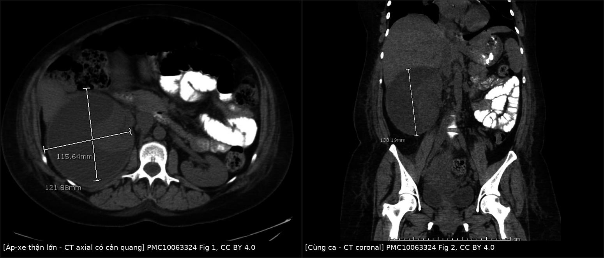
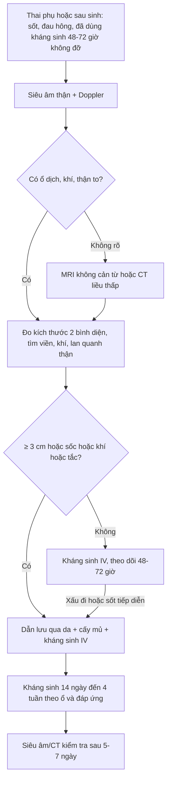
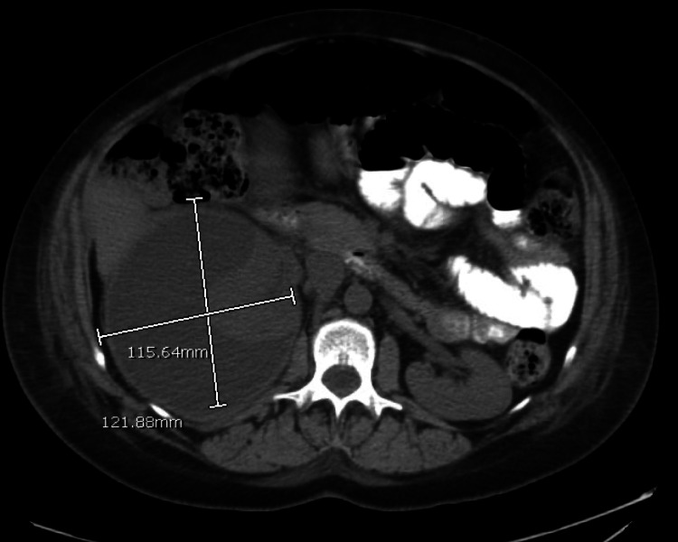
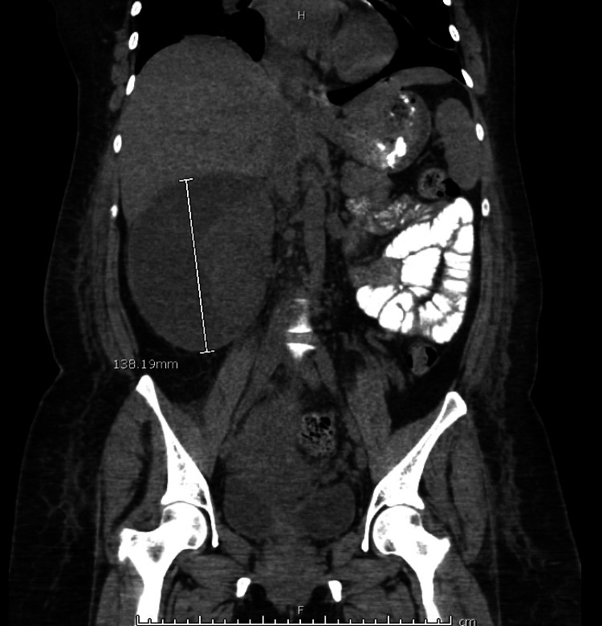
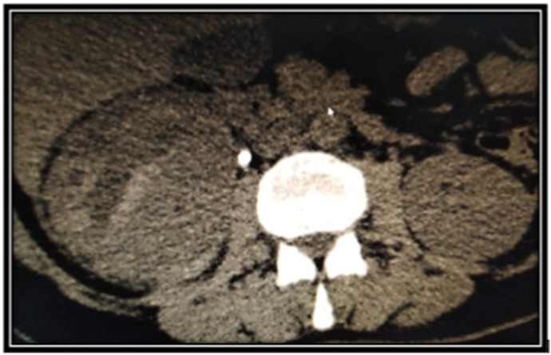
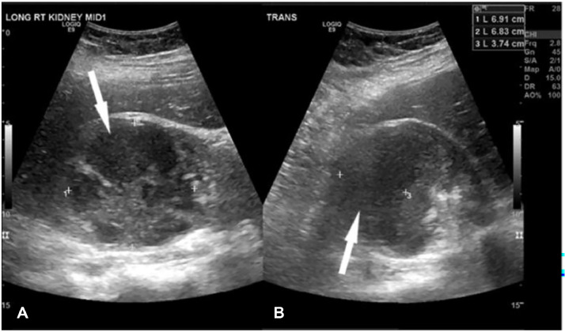
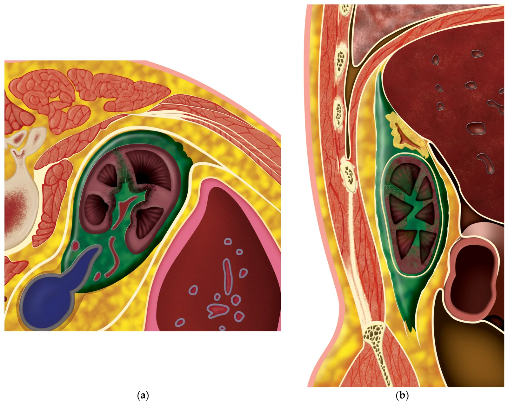

# 1923 — Áp-xe thận & áp-xe quanh thận ở thai phụ: "ổ dịch có viền" sau viêm thận–bể thận, ngưỡng dẫn lưu và cạm bẫy sau sinh / Renal and perinephric abscess in pregnancy

**Tags:** `pattern:o-dich` `pattern:viem` `pattern:khi` `vung:than` `vung:thai-nhi` `vung:o-bung` `protocol:sieu-am-bung` `protocol:MRI-khong-can-tu` `protocol:CT-lieu-thap` `score:Huang-Tseng`
**Mức chắc chắn (certainty):** tổng hợp y văn (literature synthesis) — ghép 4 ca nguyên văn có ảnh (PMC10063324, PMC9207609, PMC11403430, PMC11693407), 1 đoàn hệ người lớn 2.192 ca (PMC3752624), 1 tổng quan về ứ mủ thận (PMC13703377) và 1 tổng quan áp-xe cơ thắt lưng–chậu ở thai (PMC10867082). Phần ngưỡng dẫn lưu **3 cm** là **quy ước thực hành**, không phải ngưỡng từ thử nghiệm ngẫu nhiên — ghi rõ "chưa rõ" ở chỗ nguồn không đủ.

> **Câu chốt:** Áp-xe thận ở thai **không phải bệnh của một triệu chứng** mà là **biến chứng của viêm thận–bể thận không đáp ứng**. Chốt hình ảnh là **ổ dịch trung tâm không ngấm + viền ngấm dày + dải mỡ quanh thận** (khí = **−1000 HU** là thể sinh khí, tiên lượng khác). Chốt xử trí là **kích thước + đáp ứng 48–72 giờ + có sốc/khí/tắc**, không phải con số bạch cầu: trong loạt 2.192 ca người lớn, **74,8% chỉ dùng kháng sinh**, **14,6% dẫn lưu qua da**, tử vong nội viện **2,6%** (PMC3752624). Ở thai, ca lớn nhất trong y văn có ảnh là **13,8 × 12,2 × 11,6 cm**, hút ra **730 mL mủ**, và bệnh nhân chỉ được chẩn đoán **sau sinh** (PMC10063324).

## 1. Tổng quan bệnh học – cơ chế hình ảnh

### 1.1 Từ viêm thận–bể thận đến ổ mủ (TẠI SAO)

- **Viêm thận–bể thận cấp (acute pyelonephritis, APN)** xảy ra ở **1–2% thai kỳ**, hay gặp **quý II**, **thận phải** nhiều hơn vì tử cung xoay sang phải; **nhiễm khuẩn niệu không triệu chứng (asymptomatic bacteriuria)** có ở **~3%** thai và là bước đệm (PMC9207609). **Tái phát APN trong thai tới 20–25%** (PMC11693407).
- **Cơ chế ổ mủ:** vi khuẩn đường niệu đi ngược dòng → viêm ống thận và kẽ → **phù + mủ chèn ép ống thận** (tạo **striated nephrogram**) → vùng hoại tử–mủ khu trú không có mao mạch → **ổ dịch trung tâm**, xung quanh là **tổ chức hạt + vỏ xơ** có mao mạch → **viền ngấm thuốc**. Khi mủ phá vỡ vỏ thận → **áp-xe quanh thận (perinephric abscess)**; lan ra **cơ thắt lưng–chậu** → **áp-xe cơ chậu (psoas abscess)**.
- **Vì sao thai dễ hơn:** progesterone làm giãn cơ trơn niệu quản, giảm nhu động; tử cung chèn ép; **ứ nước sinh lý** từ quý II (đỉnh **24–28 tuần**); thêm **đái tháo đường thai kỳ**, **thiếu máu**, **táo bón** — tất cả làm ứ trệ và tăng nguy cơ nhiễm mô. Trong loạt 66 thai phụ nhiễm khuẩn niệu trên có **urosepsis**, **thiếu máu 69,7% vs 50,0%** và **ứ nước độ 2–3 81,8% vs 52,8%** so với không sepsis (PMC10673142).
- **Tần suất áp-xe thận ở thai:** **chưa được xác lập**; y văn chủ yếu là **ca lẻ**, và ca lớn nhất được phát hiện **ngay sau sinh** (PMC10063324). Đây là lý do **không được dùng "hiếm" để loại trừ**.

### 1.2 Vì sao hình ảnh trông như vậy (vật lý từng phương thức)

- **Siêu âm (US):** mủ là dịch **có hồi âm lấm tấm** (tế bào, protein, mảnh tổ chức) — khác nang đơn thuần **trong, không hồi âm**; thành dày, bờ không đều; **tăng âm phía sau** vì dịch dẫn âm tốt hơn mô; **không có tín hiệu Doppler** trong trung tâm hoại tử. Khí trong ổ cho **điểm tăng âm + bóng bẩn (dirty shadowing)** — khác sỏi cho **bóng lưng sạch**.
- **CT:** nước tiểu trong **0–10 HU**; **mủ đặc hơn** nhờ tế bào và protein nên thường **10–30 HU** (các loạt ứ mủ thận báo trung bình **~10–20 HU**, nhưng **ngưỡng thay đổi theo protocol**, không có cut-off chung — PMC13703377). Trung tâm ổ **không ngấm**, **viền ngấm** ở thì **nephrographic 80–100 giây**; **dải mỡ quanh thận (perinephric stranding)** và **dày cân thận** là dấu hiệu viêm lan. Khí = **−1000 HU**; mỡ quanh thận = **−40 đến −120 HU** — đừng nhầm.
- **MRI:** mủ **T1 thấp, T2 cao**, nhưng **đặc và nhớt** nên **khuếch tán hạn chế: DWI sáng, ADC thấp** — đây là chỗ phân biệt với **nang đơn thuần/ứ nước** (dịch tự do khuếch tán mạnh, ADC cao). Với thai, **MRI không cản từ (HASTE/SSFSE + DWI)** là lựa chọn ưu tiên sau siêu âm.
- **Vì sao "viền" không đồng nghĩa ác tính:** viền là **tổ chức hạt** quanh ổ hoại tử, không phải vỏ u; bờ **đều, mảnh** ở ổ viêm cấp; u hoại tử thường **bờ trong gồ ghề, thành dày lệch tâm** và có **phần đặc ngấm thuốc**.

### 1.3 Ngưỡng định lượng nằm lòng

| Chỉ số | Con số | Nguồn |
|---|---|---|
| APN ở thai | **1–2%** thai kỳ; tái phát **20–25%** | PMC9207609, PMC11693407 |
| Nhiễm khuẩn niệu không triệu chứng | **~3%** thai (riêng ASB 2–10% — xem bài 1921) | PMC9207609 |
| Áp-xe thận ở thai | **chưa có tỉ lệ**; y văn chủ yếu ca lẻ | PMC10063324 |
| Loạt người lớn 2.192 ca | tử vong nội viện **2,6%** (ĐTĐ 2,3% vs không ĐTĐ 3,4%); nằm viện **18,9 vs 16,2 ngày** | PMC3752624 |
| Điều trị trong loạt trên | kháng sinh đơn thuần **74,8%**; dẫn lưu qua da **14,6%**; mổ dẫn lưu **6,3%**; cắt thận **4,3%** | PMC3752624 |
| Tử vong theo phương thức | **1,1–3,8%**, không khác biệt có ý nghĩa | PMC3752624 |
| Ngưỡng "nhỏ" | **< 3 cm** + bệnh nhân ổn định: có thể chỉ kháng sinh | PMC3752624 (dẫn lại), PMC12066547 (nhi) |
| Ca áp-xe thận lớn nhất có ảnh | **13,8 × 12,2 × 11,6 cm**; **730 mL** dịch đục; **46.840 WBC/mm³** | PMC10063324 |
| Ca áp-xe quanh thận | **7 cm**, CRP **284 mg/L**, creatinin **212 µmol/L**, cấy nước tiểu **âm** | PMC9207609 |
| Viêm túi thừa đài thận nhiễm trùng | **6,9 × 6,8 × 3,7 cm**, dẫn lưu ở **16 tuần**, sinh **3.379 g ở 40 tuần** | PMC11403430 |
| Ứ mủ thận (pyonephrosis) | không giải áp: tử vong **19,2% vs 8,82%**; trễ ≥ 2 ngày **aOR 1,29** | PMC12693273 |
| Viêm thận sinh khí (EPN) | tử vong **~25%**; **95%** có ĐTĐ; **25–75%** có tắc nghẽn | PMC11693407 |
| Áp-xe cơ chậu ở thai | **< 12 ca** trong y văn; xuất hiện **13–39 tuần**; **sốt vắng mặt ở hơn một nửa** | PMC10867082 |

## 2. Mẫu hình + chẩn đoán phân biệt theo vị trí (gamut)

Bốn mẫu hình theo **vị trí** quyết định gamut:

- **A. Ổ dịch trong nhu mô thận:** áp-xe thận · viêm thận–bể thận thể nốt (acute lobar nephronia — chưa có ổ dịch thật) · nang thận nhiễm trùng · u thận hoại tử (RCC, lymphoma) · máu tụ trong nang/ADPKD · ổ hoại tử trong XGP.
- **B. Ổ dịch quanh thận:** áp-xe quanh thận · **nước tiểu thoát (urinoma)** sau chấn thương/tắc · máu tụ dưới bao · lymphocele sau mổ/ghép · **áp-xe cơ thắt lưng–chậu**.
- **C. Ổ dịch trong hệ đài–bể thận:** **ứ mủ thận (pyonephrosis)** · viêm túi thừa đài thận nhiễm trùng · ứ nước đơn thuần · **viêm thận sinh khí (EPN)** khi có khí trong nhu mô.
- **D. Bắt chước sau sinh:** **viêm nội mạc tử cung** · **huyết khối tĩnh mạch buồng trứng (POVT)** · áp-xe vùng chậu · tụ máu thành bụng · **bệnh cảnh "sốt sau sinh"** — mọi ca sốt sau sinh kèm đau hông phải được coi là áp-xe thận cho tới khi loại trừ.

Gợi nhớ: **"MỦ – NƯỚC – MÁU – KHÍ"** — nhìn đậm độ/HU trước, rồi mới hỏi vị trí; **khí ở đâu quyết định tên gọi và tiên lượng** (đài–bể = ứ mủ; nhu mô = EPN; quanh thận = độ 3 trở lên).

## 3. Bảng so sánh phân biệt (ma trận đối chiếu)

| Thực thể (entity) | Hình ảnh điển hình | Chốt vào (rule-in) | Chốt loại (rule-out) | Gợi ý xác nhận |
|---|---|---|---|---|
| Áp-xe thận | Ổ **dịch trung tâm không ngấm**, **viền ngấm (dày/không đều tùy giai đoạn)**, dải mỡ quanh thận; có thể có khí | **Viền ngấm + trung tâm 10–30 HU + sốt > 72 giờ dù kháng sinh** | **Nang thành mảnh, dịch 0–10 HU, không viền, không dải mỡ** → nang đơn thuần | CT có cản quang thì nephrographic; US dẫn lưu; cấy mủ |
| Áp-xe quanh thận | Ổ dịch **ngoài vỏ thận**, đẩy thận, dày cân thận; có thể lan cơ chậu | **Ổ dịch ngoài nhu mô + mất mặt phẳng mỡ quanh thận** | **Dịch trong bao thận, thành mảnh, không viêm** → nang/nước tiểu | CT/MRI; đo creatinin dịch (urinoma rất cao) |
| Ứ mủ thận (pyonephrosis) | **Đài–bể thận giãn chứa dịch đặc**, mảnh vụn lơ lửng, thành dày; thận to | **Dịch đài–bể đậm độ cao + mảnh vụn + tắc nghẽn** | **Dịch trong, không mảnh vụn, không viêm** → ứ nước đơn thuần | US/CT; **cấy dịch qua chọc hút hoặc lúc dẫn lưu**; giải áp sớm |
| Viêm túi thừa đài thận | Ổ dịch **thông với đài thận** qua cổ hẹp; bờ nhẵn; có thể có sỏi trong túi | **Thấy cổ thông trên MRI/CT thì muộn** | **Không thấy đường thông + viền dày** → áp-xe | MRI T2/CT muộn; theo dõi sau dẫn lưu |
| Viêm thận sinh khí (EPN) | **Khí trong nhu mô** (HU ≈ −1000), phá hủy nhu mô, có thể lan quanh thận | **Khí trong NHU MÔ** trên CT không cản quang | **Khí chỉ trong đài–bể** → ứ mủ (nhẹ hơn) | CT + phân độ Huang–Tseng; kiểm soát đường huyết |
| Urinoma | Ổ dịch **nước tiểu**, thành mảnh, **không viền ngấm**, thường sau tắc/chấn thương | **Creatinin dịch ≈ creatinin máu (rất cao)** | **Viền ngấm + sốt + dải mỡ** → áp-xe | CT muộn (rò cản quang); đo creatinin dịch |
| Máu tụ quanh thận | Đậm độ **50–80 HU** (máu cấp), **không viền**, hình liềm/dưới bao | **Không viền + đậm độ máu + tiền sử chấn thương/đẻ** | **Viền ngấm + khí** → áp-xe | CT không cản quang; theo dõi Hb |
| Áp-xe cơ chậu | Ổ dịch **trong cơ thắt lưng–chậu**, mất mặt phẳng cơ, lan dưới dây chằng bẹn | **Đau lưng + đi khập khiễng + sốt (nhưng sốt có thể vắng)** | **Ổ dịch trong thận** → áp-xe thận | CT/MRI; dẫn lưu dưới siêu âm |

*Trái: CT axial có cản quang — ổ dịch lớn thận phải, đo **121,9 × 115,6 mm**, viền mỏng, đẩy nhu mô. Phải: mặt phẳng coronal cùng ca, chiều dài **158,2 mm**. Nguồn: PMC10063324, Figs. 1–2, **CC BY 4.0**; ghép bằng `tools/make_composite.py` (letterbox, không crop).*

### 3.1 Vì sao phải đo cả hai bình diện
Ổ mủ không phải hình cầu hoàn hảo: ca trên có **121,9 × 115,6 mm** trên axial nhưng **158,2 mm** trên coronal — nếu chỉ đo một mặt cắt sẽ **đánh giá thấp thể tích** và có thể chọn dẫn lưu không đủ. Với ổ **> 5 cm**, nên dùng **catheter 10–14 F** thay vì kim hút đơn thuần vì mủ đặc dễ tắc.

### 3.2 "Viền ngấm" của áp-xe khác "cortical rim sign" của nhồi máu
Nhồi máu thận cho **nêm giảm đậm độ bờ rất sắc + viền vỏ mảnh còn ngấm** do tuần hoàn vỏ còn nguyên; áp-xe cho **viền dày, không đều, kèm dải mỡ và sốt**. Đây là cặp dễ nhầm nhất trên CT có cản quang, và là lý do **không đọc CT viêm thận mà bỏ qua bối cảnh lâm sàng**.

## 4. Protocol chụp + hệ phân độ/điểm chuẩn hóa

### 4.1 Trình tự hình ảnh ở thai phụ/sau sinh nghi áp-xe
1. **Siêu âm bụng–thận–niệu quản + Doppler** (không tia): xác định **ổ dịch, thành, mảnh vụn, khí, ứ nước, sỏi**. Siêu âm là **bước đầu tiên** vì nhanh, không tia, và đủ để quyết định có ổ dịch cần dẫn lưu.
2. **MRI không cản từ (HASTE/SSFSE, T2 fat-sat, DWI/ADC)** khi siêu âm không kết luận hoặc cần phân biệt **áp-xe – túi thừa đài thận – u hoại tử**: mủ **DWI sáng/ADC thấp**, túi thừa **thấy cổ thông**, u **có phần đặc ngấm**.
3. **CT liều thấp** khi cần **khí, sỏi cản quang, mức lan quanh thận** hoặc trước dẫn lưu: **không cản quang** nếu tìm khí/sỏi; **có cản quang thì nephrographic 80–100 giây** nếu cần thấy viền/ổ. **ACOG**: nguy cơ thai nhi **dưới 50 mGy là rất thấp**, không một khảo sát đơn lẻ nào vượt **100 mGy**, nhưng vẫn ALARA.
4. **Chọc hút/dẫn lưu dưới hướng dẫn hình ảnh** vừa là điều trị vừa là **lấy mẫu vi sinh** — không chọc hút chỉ để "xem dịch trong hay đục" khi đã có chỉ định dẫn lưu.
5. **Siêu âm/CT kiểm tra sau 5–7 ngày** (hoặc sớm hơn nếu sốt tiếp diễn) — không chụp lại mỗi ngày.

### 4.2 Ngưỡng và kỹ thuật dẫn lưu (quy ước thực hành, không phải RCT)

| Tình huống | Xử trí | Căn cứ |
|---|---|---|
| Ổ **< 3 cm**, bệnh nhân ổn định, không khí, không tắc | **Kháng sinh IV + theo dõi 48–72 giờ**; dẫn lưu nếu không đỡ | Loạt người lớn: ổ nhỏ < 3 cm có thể chỉ kháng sinh (PMC3752624); loạt nhi: **100% ổ < 3 cm** khỏi với kháng sinh (PMC12066547) |
| Ổ **≥ 3 cm** | **Dẫn lưu qua da** + kháng sinh | Quy ước thực hành; **chưa có RCT xác định ngưỡng ở thai** |
| **Sốc nhiễm khuẩn, khí trong nhu mô, tắc nghẽn, không đỡ sau 48–72 giờ** | **Dẫn lưu ngay** (không chờ đủ 3 cm) | Ứ mủ không giải áp: tử vong **19,2% vs 8,82%** (PMC12693273) |
| **Áp-xe quanh thận/cơ chậu** | Dẫn lưu **theo đường ngắn nhất, tránh đại tràng/màng phổi**; có thể **lumbar** hoặc **transpsoas** | Ca 7 cm và 20 × 10 cm đều dẫn lưu thành công (PMC9207609, PMC10867082) |
| **Sau dẫn lưu** | Kháng sinh **14 ngày** (áp-xe thận) đến **4 tuần** (quanh thận) tùy đáp ứng; cấy mủ để xuống thang | Ca 13,8 cm: ceftriaxone **14 ngày**; ca quanh thận: **4 tuần** (PMC10063324, PMC9207609) |

- **Chọn catheter:** ổ lớn/mủ đặc dùng **10–14 F**; ca 13,8 cm dùng **10 F**, hút **730 mL** ngay lần đầu (PMC10063324). **Không bơm rửa mạnh** vì có thể làm mủ lan vào máu.
- **Cấy mủ là bắt buộc** vì **cấy nước tiểu có thể âm** (ca quanh thận 7 cm: cấy nước tiểu âm, cấy mủ ra *E. coli*) (PMC9207609).
- **EPN — phân độ Huang–Tseng** (dùng để chọn can thiệp): độ 1 khí chỉ trong đài–bể; độ 2 trong nhu mô; 3A lan quanh thận; 3B lan cạnh thận/tạng lân cận; 4 hai bên hoặc thận độc nhất. Ca EPN ở thai 30 tuần trong bài 1924 là **Huang II** và khỏi với kháng sinh đơn thuần (PMC11693407) — **không phải mọi EPN đều phải mổ**.

### 4.3 Sơ đồ quyết định (Mermaid)

## 5. Biến thể bình thường và cạm bẫy

- **Cạm bẫy 1 — "sốt sau sinh là viêm nội mạc tử cung":** ca 36 tuổi sốt **100,9 °F ngày hậu sản 1**, đau hông phải, được điều trị viêm nội mạc tử cung **3 ngày** trước khi siêu âm/CT phát hiện **áp-xe 13,8 cm** (PMC10063324). **Đau góc sườn–cột sống + sốt sau sinh** phải chụp thận.
- **Cạm bẫy 2 — cấy nước tiểu âm:** ca 24 tuần có **cấy nước tiểu âm** nhưng CT sau sinh cho **áp-xe quanh thận 7 cm**, cấy mủ ra *E. coli* (PMC9207609). **Không loại trừ bằng cấy nước tiểu** khi hình ảnh/lâm sàng phù hợp.
- **Cạm bẫy 3 — "ứ nước sinh lý" che ổ dịch:** thai kỳ làm giãn đài–bể, nên **ổ dịch trong thận bị đọc thành "giãn"**. Chốt là **thành dày, mảnh vụn, viền ngấm, dải mỡ** — không phải mức giãn.
- **Cạm bẫy 4 — nang thận nhiễm trùng vs áp-xe:** nang nhiễm trùng có **thành mảnh + dịch đục**, áp-xe có **viền dày + phù quanh thận**; điều trị nang nhiễm trùng đôi khi chỉ cần kháng sinh + chọc hút, còn áp-xe lớn cần **catheter**.
- **Cạm bẫy 5 — máu tụ quanh thận sau đẻ:** máu cấp **50–80 HU**, **không viền**, không khí; **đừng dẫn lưu** một máu tụ vô khuẩn — theo dõi Hb và chụp lại.
- **Cạm bẫy 6 — urinoma:** dịch **0–10 HU**, thành mảnh, **creatinin dịch rất cao**; dẫn lưu urinoma không có nhiễm trùng có thể không cần kháng sinh, nhưng **phải loại trừ rò niệu quản**.
- **Cạm bẫy 7 — khí trong đài–bể không phải EPN:** khí **chỉ trong hệ đài–bể** là **ứ mủ thận** (tiên lượng tốt hơn EPN); khí **trong nhu mô** mới là EPN. Đọc **vị trí khí**, không chỉ đọc "có khí".
- **Cạm bẫy 8 — "ổ nhỏ nên không cần dẫn lưu":** ngưỡng **3 cm** chỉ đúng với **bệnh nhân ổn định**; ổ **2 cm + sốc/khí/tắc** vẫn phải giải áp. Ngược lại, ổ **4 cm + đáp ứng lâm sàng** có thể theo dõi — **kích thước là một trục, không phải quyết định duy nhất**.
- **Cạm bẫy 9 — dùng kháng sinh kéo dài thay dẫn lưu:** trong loạt 2.192 ca, **74,8% chỉ kháng sinh** nhưng đây là **dữ liệu hành chính, có confounding by indication**; ở thai, ổ lớn/khí/tắc **không được trì hoãn dẫn lưu** vì mẹ và thai đều chịu nhiễm.
- **Cạm bẫy 10 — bỏ sót áp-xe cơ chậu:** **sốt vắng mặt ở hơn một nửa** ca áp-xe cơ chậu ở thai; đau lưng + đi khập khiễng + hạn chế duỗi háng là gợi ý (PMC10867082).

## 6. Tự lượng giá — Blind Quiz

**Ca 1 — 36 tuổi, sau sinh mổ ngày 2, sốt 38,3 °C, đau hông phải, đã điều trị "viêm nội mạc tử cung" 3 ngày không đỡ. CT bụng có cản quang:**

- Hỏi: (1) mô tả ổ dịch và viền; (2) ba chẩn đoán phân biệt; (3) bước tiếp theo và ngưỡng?

<b>Bấm để hiện đáp án (findings + chẩn đoán)</b>

- **Findings:** ổ dịch lớn thận phải, **trung tâm không ngấm**, **viền mỏng ngấm**, đo **121,9 × 115,6 mm** trên axial (và **158,2 mm** trên coronal — xem ảnh ghép); nhu mô thận còn lại bị đẩy; không thấy khí rõ.
- **Chẩn đoán:** **áp-xe thận phải** sau viêm thận–bể thận tái diễn; cấy mủ ra *E. coli* đa kháng ampicillin/ciprofloxacin/TMP-SMX; hút **730 mL** dịch đục, **46.840 WBC/mm³**.
- **Phân biệt:** nang thận nhiễm trùng (thành mảnh, không viền dày) — máu tụ (50–80 HU, không viền) — u thận hoại tử (phần đặc ngấm, bờ trong gồ ghề).
- **Xử trí:** **dẫn lưu qua da 10 F** + ceftriaxone **14 ngày**; siêu âm lại sau 5 ngày thấy ổ thu nhỏ; khỏi hoàn toàn lúc 6 tháng.
- **Nguồn ảnh:** PMC10063324, Fig. 1, **CC BY 4.0**.

**Ca 2 — 24 tuổi, thai 24 tuần, sốt 5 ngày, đau hông phải, CRP 284 mg/L, creatinin 212 µmol/L; cấy nước tiểu âm. Sau khi thai chết lưu và sinh, CT bụng:**

- Hỏi: (1) ổ dịch nằm trong hay ngoài thận? (2) vì sao cấy nước tiểu âm không loại trừ? (3) xử trí?

<b>Bấm để hiện đáp án (findings + chẩn đoán)</b>

- **Findings:** ổ dịch **quanh thận phải**, đẩy thận, **dày cân thận/dải mỡ**, kích thước **7 cm**; không thấy khí.
- **Chẩn đoán:** **áp-xe quanh thận (perirenal abscess)** biến chứng viêm thận–bể thận; cấy mủ ra *E. coli*; bệnh cảnh có **thai chết lưu** — biến chứng nặng nhất của nhiễm khuẩn niệu trên ở thai.
- **Vì sao cấy nước tiểu âm:** ổ mủ đã **khu trú và có thể không thông với hệ đài–bể**, hoặc đã dùng kháng sinh trước đó; **cấy mủ mới là mẫu chuẩn**.
- **Xử trí:** **dẫn lưu qua da** + kháng sinh **4 tuần**; sau dẫn lưu bệnh nhân hết sốt, xuất viện sau 2 tuần.
- **Nguồn ảnh:** PMC9207609, Fig. 1, **CC BY-NC-ND 4.0** (nguyên bản, không chỉnh sửa).

**Ca 3 — 29 tuổi, thai 15 tuần 4 ngày, đau hông phải, tiểu máu; siêu âm thấy tổn thương phức hợp 6,9 × 6,8 × 3,7 cm:**

- Hỏi: (1) đây là áp-xe hay thể khác? (2) MRI cần tìm gì? (3) khi nào dẫn lưu?

<b>Bấm để hiện đáp án (findings + chẩn đoán)</b>

- **Findings:** tổn thương **giảm hồi âm không đồng nhất**, bờ không đều, **không có tín hiệu Doppler** trong trung tâm; kích thước **6,9 × 6,8 × 3,7 cm**.
- **Chẩn đoán:** **viêm túi thừa đài thận nhiễm trùng (infected calyceal diverticulum)** — không phải áp-xe thận; MRI T2 cho thấy **cổ thông với đài thận giữa**, đây là chốt phân biệt.
- **Vì sao khó:** túi thừa đài thận là **bất thường bẩm sinh** có cổ hẹp, dễ ứ và nhiễm; trên siêu âm giống áp-xe, trên CT có thể giống nang.
- **Xử trí:** **dẫn lưu qua da ở 16 tuần** + kháng sinh; thai tiếp tục, sinh **3.379 g ở 40 tuần** — cho thấy **dẫn lưu bảo tồn** có thể đủ trong thai.
- **Nguồn ảnh:** PMC11403430, Fig. 1, **CC BY-NC-ND 4.0** (nguyên bản, không chỉnh sửa).

**Ca 4 — Sơ đồ: mủ phá vỏ thận lan ra khoang quanh thận. Nhìn hình, mô tả đường lan trước khi mở đáp án:**

- Hỏi: (1) mủ đi qua mốc nào? (2) vì sao áp-xe quanh thận dễ lan xuống cơ chậu? (3) dấu hiệu CT nào báo đã phá vỏ?

<b>Bấm để hiện đáp án (findings + chẩn đoán)</b>

- **Findings:** hình cắt dọc/ngang thận cho thấy mủ **phá vỏ thận → khoang quanh thận → khoang cạnh thận**, men theo **cân thận (Gerota)** và **mạc cơ thắt lưng–chậu**.
- **Cơ chế:** khoang quanh thận **không có sàn**, mủ chảy xuống theo trọng lực dọc **cơ thắt lưng–chậu** → **áp-xe cơ chậu**; đây là lý do đau lan ra trước háng và **hạn chế duỗi háng**.
- **Dấu hiệu CT:** **mất mặt phẳng mỡ quanh thận**, **dày cân thận**, ổ dịch **ngoài vỏ**, đẩy thận; khí ngoài nhu mô = lan rộng.
- **Nguồn ảnh:** PMC13703377, Fig. 1, **CC BY 4.0** (hình minh họa của bài tổng quan).

## Bài liên quan chéo
- [500 – Tổng quan hệ Vú & Sản phụ khoa](../500-tong-quan-vu-san-phu-khoa/lesson.md)
- [1921 – Nhiễm khuẩn niệu không triệu chứng & viêm thận–bể thận cấp ở thai phụ](../1921-nhiem-khuan-nieu-thai-ky/lesson.md)
- [1818 – Sỏi niệu quản ở thai phụ: siêu âm – MRI, dẫn lưu tạm và khi nào lấy sỏi](../1818-soi-nieu-quan-thai/lesson.md)
- [1817 – Đau bụng cấp ở thai phụ: protocol MRI không cản từ](../1817-dau-bung-cap-thai-phu-mri/lesson.md)
- [1623 – Huyết khối tĩnh mạch buồng trứng sau sinh (bắt chước sốt sau sinh)](../1623-huyet-khoi-tinh-mach-buong-trung-sau-sinh/lesson.md)
- [150 – Nang thận Bosniak](../150-nang-than-Bosniak/lesson.md)
- [164 – Nang thận trong ADPKD và biến chứng](../164-nang-than-adpkd-bien-chung/lesson.md)

> Không dùng để chẩn đoán độc lập khi chưa có người hướng dẫn.
