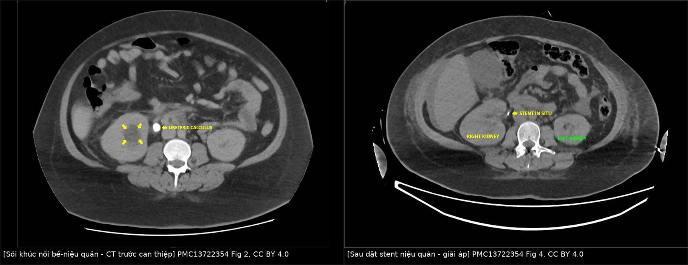
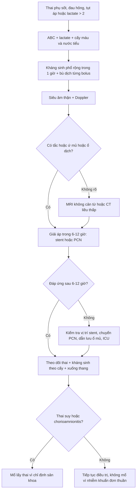
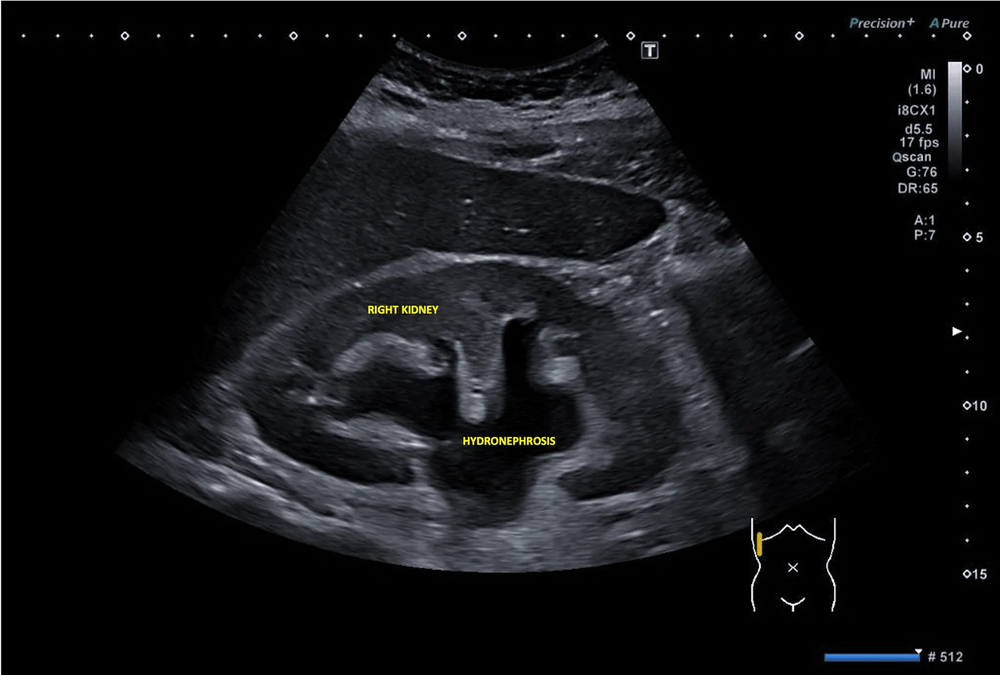
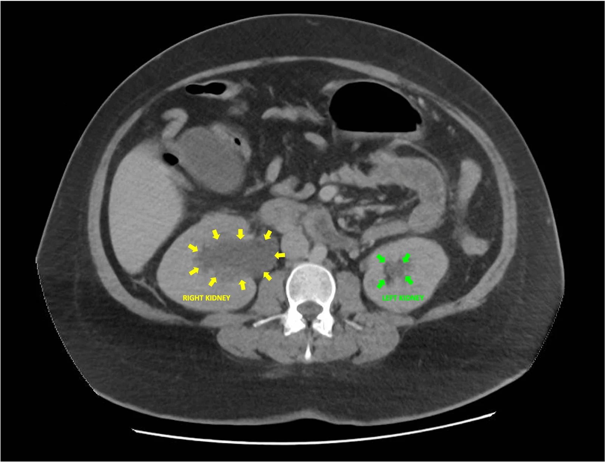
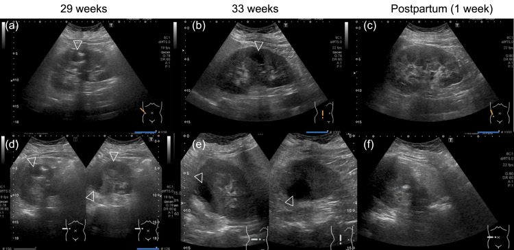
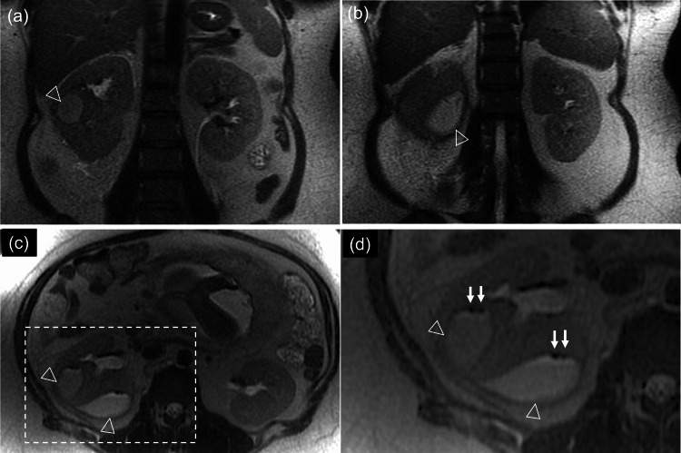
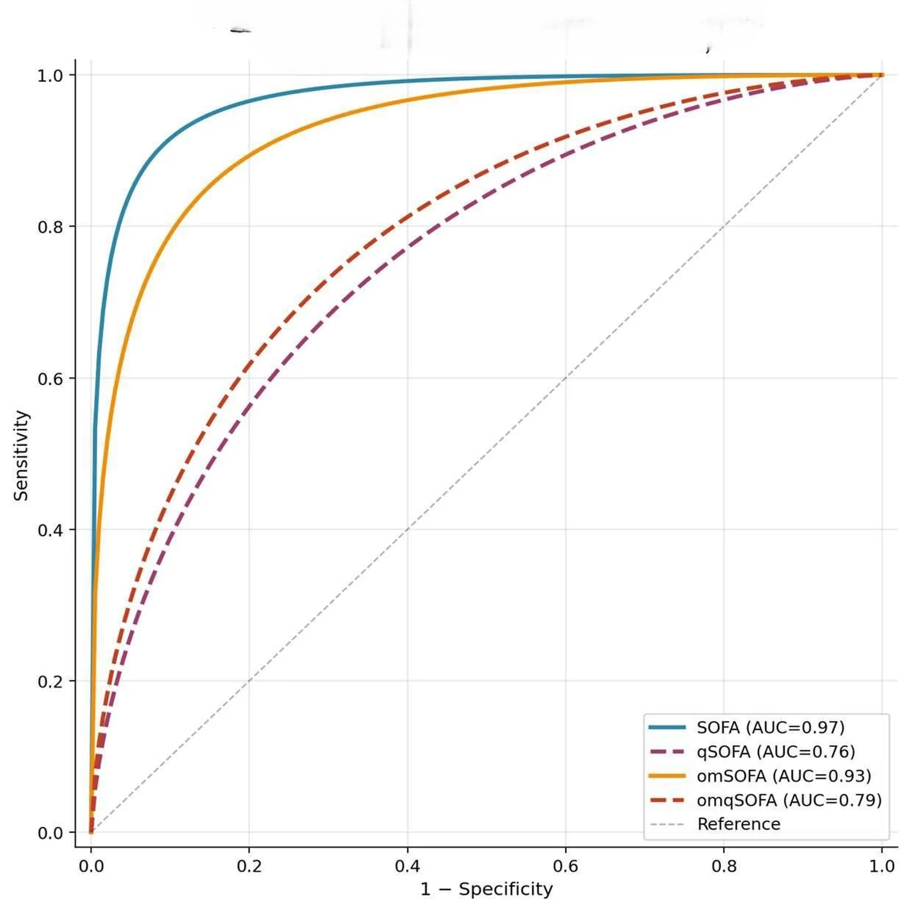
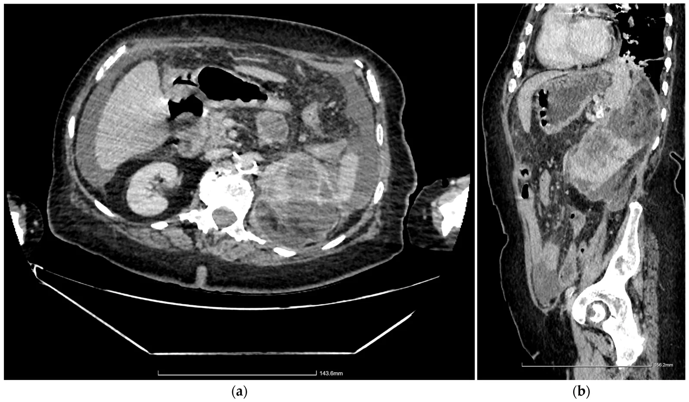

# 1924 — Sốc nhiễm khuẩn từ đường niệu ở thai phụ (urosepsis): nhận diện trong 1 giờ, giải áp trong 6–12 giờ, và vì sao qSOFA không đủ / Urosepsis in pregnancy

**Tags:** `pattern:soc-nhiem-khuan` `pattern:u-nuoc` `pattern:tac-nghen` `pattern:viem` `vung:than` `vung:nieu-quan` `vung:thai-nhi` `protocol:sieu-am-bung` `protocol:MRI-khong-can-tu` `protocol:CT-lieu-thap` `score:qSOFA` `score:SOFA` `score:Huang-Tseng`
**Mức chắc chắn (certainty):** tổng hợp y văn (literature synthesis) — ghép 2 đoàn hệ sản–niệu (PMC10673142: 66 urosepsis/164 nhiễm khuẩn niệu trên; PMC10744995: 183 thai), 1 nghiên cứu điểm số ở 188 thai phụ nguy cơ cao (PMC13650759), 1 tổng quan hệ thống về **thời gian giải áp** (PMC12693273), 1 tổng quan ứ mủ thận (PMC13703377), 2 ca nguyên văn có ảnh (PMC13722354, PMC11693407) và dữ liệu **86/110 thai phụ không sốt** từ bài 1921 (PMC6864490). Ngưỡng nào nguồn không đủ ghi "chưa rõ".

> **Câu chốt:** **Urosepsis ở thai = nhiễm khuẩn niệu trên + rối loạn chức năng cơ quan**, và **nguyên nhân chết người thường là ổ tắc không được giải áp**, không phải vi khuẩn kháng thuốc. Hai con số quyết định: **không giải áp → tử vong 19,2% vs 8,82%** khi có giải áp; **trễ ≥ 2 ngày → aOR tử vong 1,29** (PMC12693273). Chẩn đoán điểm số: **SOFA AUC 0,97** nhưng **qSOFA chỉ 0,76**; qSOFA **âm** không loại trừ, vì **86/110 thai phụ viêm thận–bể thận nhập viện không sốt** (PMC13650759, PMC6864490).

## 1. Tổng quan bệnh học – cơ chế hình ảnh

### 1.1 Vì sao thai phụ dễ tiến triển từ nhiễm niệu sang sốc (TẠI SAO)

- **Ổ nhiễm khởi đầu:** vi khuẩn đường ruột đi ngược dòng → **viêm thận–bể thận cấp (acute pyelonephritis, APN)** ở **1–2%** thai kỳ; **tái phát 20–25%** (PMC11693407). **E. coli** chiếm **80–90%**; *Klebsiella*, *Proteus*, *Enterococcus* đứng sau.
- **Bước ngoặt là TẮC NGHẼN:** ứ nước sinh lý do progesterone + tử cung chèn ép làm **giảm dòng nước tiểu**; nếu thêm **sỏi** hoặc **hẹp khúc nối**, áp lực trong đài–bể tăng → **thiếu máu nhu mô + mủ ứ dưới áp lực** → vi khuẩn và nội độc tố vào máu → **sốc nhiễm khuẩn**. Vì vậy **kháng sinh đơn thuần không đủ** khi còn tắc: ổ mủ kín không có nguồn thoát.
- **Định nghĩa Sepsis-3:** sepsis = rối loạn chức năng cơ quan đe dọa tính mạng do đáp ứng viêm mất kiểm soát, với **SOFA tăng ≥ 2 điểm**; **sốc nhiễm khuẩn** = cần vận mạch để giữ **MAP ≥ 65 mmHg** và **lactate > 2 mmol/L** dù đã bù dịch đủ. **qSOFA** (nhịp thở **≥ 22**, huyết áp tâm thu **≤ 100 mmHg**, tri giác **GCS < 15**) chỉ là **công cụ sàng lọc tại giường**, không phải tiêu chuẩn chẩn đoán.
- **Vì sao thai làm điểm số "lệch":** bình thường thai kỳ đã **tăng nhịp tim 10–20 lần/phút**, **giảm huyết áp 5–15 mmHg**, **bạch cầu 12–16 × 10⁹/L** (có thể tới 18), **creatinin giảm còn 0,4–0,6 mg/dL** do tăng lọc cầu thận, **thiếu máu pha loãng**. Vì vậy một thai phụ "bình thường" theo ngưỡng người không mang thai có thể đã **có rối loạn chức năng cơ quan**.
- **Không sốt không có nghĩa nhẹ:** trong **110 thai phụ** nhập viện vì viêm thận–bể thận, **86 người (78%) không sốt lúc vào**; **điểm cảnh báo sớm sản khoa dương tính dự báo nhập ICU với aOR 16,54 (1,29–212,5)** (PMC6864490, dẫn qua bài 1921). Đây là lý do **phải đo lactate, creatinin, và đánh giá toàn thân**, không chờ sốt cao.

### 1.2 Vì sao hình ảnh trông như vậy (vật lý từng phương thức)

- **Siêu âm:** thấy **ứ nước, thành bể thận dày, sỏi tăng âm + bóng lưng sạch, mảnh vụn trong đài–bể**; nhưng **không phân biệt được ứ nước sinh lý với tắc** chỉ bằng độ giãn, và **sỏi 1/3 dưới niệu quản thường bị bỏ sót** vì ruột/khối thai. Trong ca 30 tuần dưới đây, siêu âm chỉ thấy **ứ nước phải vừa, không thấy sỏi** — CT mới phát hiện **sỏi khúc nối bể–niệu quản** (PMC13722354).
- **CT:** **khí = −1000 HU**, mỡ = **−40 đến −120 HU**, dịch mủ **10–30 HU** (xem bài 1923). CT liều thấp không cản quang đủ để thấy **sỏi cản quang, khí trong nhu mô, mức độ ứ nước, dải mỡ**; CT có cản quang thì **nephrographic 80–100 giây** cho viền áp-xe/hoại tử.
- **MRI:** **T2 HASTE/SSFSE** cho thấy **ứ nước, mảnh vụn, ổ mủ**; **DWI/ADC** phân biệt **mủ đặc (ADC thấp)** với **nước tiểu tự do (ADC cao)**; khí là **trống tín hiệu**. MRI là lựa chọn khi cần tránh tia, nhưng **không thấy sỏi trực tiếp**.
- **Vì sao lactate quan trọng hơn bạch cầu:** lactate phản ánh **giảm tưới máu mô và chuyển hóa yếm khí**, không phản ánh trực tiếp số vi khuẩn; **lactate 3,7 → 11 mmol/L** trong ca dưới đây là dấu hiệu **sốc đang tiến triển** dù huyết áp còn "tạm ổn" (102/51 mmHg).

### 1.3 Ngưỡng định lượng nằm lòng

| Chỉ số | Con số | Nguồn |
|---|---|---|
| APN ở thai | **1–2%**; tái phát **20–25%** | PMC11693407 |
| Urosepsis trong nhiễm khuẩn niệu trên | **66/230 (28,7%)** | PMC10673142 |
| Yếu tố nguy cơ urosepsis (đa biến) | **thiếu máu OR 2,62 (1,22–5,63)**; **ứ nước độ 2–3 OR 6,58 (2,80–15,46)**; **sốt > 38 °C OR 11,61 (4,80–28,07)** | PMC10673142 |
| So sánh urosepsis vs không sepsis | bạch cầu **18.191 vs 14.350/mm³**; CRP **142,7 vs 72,8**; creatinin **0,77 vs 0,59 mg/dL** | PMC10673142 |
| Can thiệp niệu | **87,9% vs 36%**; chuyển sản khoa vì thai suy **22,7% vs 1,2%**; stent di trú **6,1% vs 0,6%** | PMC10673142 |
| Kết cục thai (đoàn hệ 183) | ối vỡ non **aOR 5,59 (2,02–15,40)**; sinh non **aOR 2,47 (1,15–5,33)**; nhập NICU tăng | PMC10744995 |
| Điểm số ở 188 thai nguy cơ cao (15 tử vong mẹ) | **SOFA AUC 0,97** (cắt **≥ 10**: Se 93,3%/Sp 89,7%); **omSOFA 0,93**; **omqSOFA 0,79**; **qSOFA 0,76** | PMC13650759 |
| qSOFA | cắt **≥ 2**: **Se 100%/Sp 54,1%**, PPV 15,8%, **NPV 100%** | PMC13650759 |
| Không giải áp | tử vong **19,2% vs 8,82%**; **OR 2,6 (1,9–3,7)** | PMC12693273 |
| Trễ giải áp | **≥ 2 ngày: aOR 1,29 (1,03–1,63)**; **> 24 giờ: OR ~2** | PMC12693273, PMC13703377 |
| Giải áp ≤ 48 giờ | tử vong **0,16% vs 0,47%** (OR 0,43; p = 0,044) | PMC12693273 |
| Giải áp sớm và thời gian nằm | đặt stent **≤ 6 giờ: 35,6 vs 71,6 giờ** (p = 0,01); **≤ 10 giờ: 45,7 vs 82,4 giờ** (p = 0,04) | PMC12693273 |
| Sốc nhiễm khuẩn trong các loạt | **20,8%** và **33,3%** | PMC12693273 |
| Urosepsis sau giải áp | **18,7%**; liên quan **ứ mủ thận + procalcitonin cao** | PMC12693273 |
| EPN | tử vong **~25%**; **95%** ĐTĐ; **25–75%** tắc nghẽn | PMC11693407 |
| Ca sốc thực tế | lactate **3,7 → 11 mmol/L**, pH **7,20**, HCO₃ **11**, creatinin **139 → 618 µmol/L** | PMC13722354 |

## 2. Mẫu hình + chẩn đoán phân biệt theo vị trí (gamut)

- **A. Thai phụ sốt + đau hông:** APN không biến chứng · **urosepsis** · **ứ mủ thận** · **áp-xe thận/quanh thận** · **EPN** · **sỏi tắc** · **viêm túi thừa đài thận**.
- **B. Thai phụ tụt áp:** **sốc nhiễm khuẩn niệu** · **sốc nhiễm khuẩn ối/chorioamnionitis** · **sốc mất máu** (nhau bong non, vỡ tử cung, chửa ngoài) · **sốc tim** (bệnh cơ tim chu sản) · **thuyên tắc ối** · **sốc phản vệ**.
- **C. "Giãn ≠ tắc":** ứ nước **sinh lý** (hai bên, phải > trái, thuôn nhẵn, còn tia nước tiểu, RI bình thường) · **tắc do sỏi/hẹp** (điểm tắc đột ngột, RI **≥ 0,72**) · **chèn ép từ khối tiểu khung** · **thai** là "khối" chèn ép lớn nhất.
- **D. Bắt chước "sốt sau sinh/trong thai":** **viêm nội mạc tử cung** · **huyết khối tĩnh mạch buồng trứng (POVT)** · **viêm ruột thừa** · **viêm túi mật** · **áp-xe cơ chậu** · **nhau bong non** (đau + shock nhưng không sốt).

Gợi nhớ: **"TẮC – MỦ – SỐC – NGUỒN"** — luôn hỏi **có tắc không**, **có ổ mủ không**, **đã sốc chưa**, và **nguồn đã được giải áp chưa**. Câu cuối là câu quyết định tử vong.

## 3. Bảng so sánh phân biệt (ma trận đối chiếu)

| Thực thể (entity) | Hình ảnh điển hình | Chốt vào (rule-in) | Chốt loại (rule-out) | Gợi ý xác nhận |
|---|---|---|---|---|
| Urosepsis | Ứ nước + sỏi/tắc + **dải mỡ quanh thận**; có thể ổ mủ/khí | **Lactate > 2 + MAP < 65 hoặc SOFA ≥ 2 + ổ niệu** | **Lactate bình thường, không rối loạn cơ quan** → nhiễm khuẩn niệu đơn thuần | Cấy máu/niệu, lactate, creatinin, CT/MRI |
| APN không biến chứng | Thận to, **striated nephrogram**, dải mỡ, **không ổ dịch** | **Sốt + đau hông + dải giảm ngấm hình nêm** | **Ổ dịch có viền/khí** → áp-xe/EPN | CT nephrographic; cấy; đáp ứng 48–72 giờ |
| Ứ mủ thận (pyonephrosis) | Đài–bể giãn chứa **dịch đặc, mảnh vụn**, thành dày | **Dịch đài–bể đậm độ cao + tắc nghẽn** | **Dịch trong, không mảnh vụn** → ứ nước | Giải áp + cấy dịch; CT/MRI |
| EPN | **Khí trong nhu mô** (HU ≈ −1000), phá hủy nhu mô, có thể lan quanh thận | **Khí trong NHU MÔ** trên CT không cản quang | **Khí chỉ trong đài–bể** → ứ mủ | Huang–Tseng; kiểm soát đường huyết; dẫn lưu/mổ khi độ cao |
| Viêm màng ối–chorioamnionitis | Thai, **nước ối đục**, thành tử cung dày, khí trong buồng tử cung (hiếm) | **Sốt + đau tử cung + dịch ối hôi + thai suy** | **Không có tổn thương tử cung/ối** → ổ niệu | Siêu âm thai; CRP; cấy ối; theo dõi tim thai |
| Huyết khối tĩnh mạch buồng trứng | Ổ huyết khối trong tĩnh mạch buồng trứng, **dấu hiệu nhắm (target)**, lan tĩnh mạch chủ dưới | **Sốt sau sinh + đau hông + huyết khối tĩnh mạch** | **Không huyết khối, có ổ niệu** → urosepsis | CT có cản quang; Doppler; kháng đông |
| Viêm ruột thừa | Ruột thừa **> 7 mm**, không nén được, mỡ quanh | **Điểm đau khu trú + ruột thừa > 7 mm** | **Ổ niệu rõ + sỏi tắc** → urosepsis | MRI không cản từ (thai); siêu âm |
| Sốc mất máu | Tử cung căng, dịch ổ bụng, **Hb tụt**, không sốt | **Mạch nhanh + Hb tụt + dịch ổ bụng** | **Sốt + ổ niệu + lactate cao** → nhiễm khuẩn | Siêu âm cấp cứu; theo dõi Hb |

*Trái: CT bụng — **sỏi khúc nối bể–niệu quản phải** (mũi tên vàng), đài–bể giãn. Phải: sau **đặt stent niệu quản**, stent tại chỗ, giảm ứ nước. Nguồn: PMC13722354, Figs. 2 & 4, **CC BY 4.0**; ghép bằng `tools/make_composite.py` (letterbox, không crop).*

### 3.1 Vì sao "giãn" không đủ để gọi là tắc
Trong ca 30 tuần, siêu âm đầu tiên chỉ thấy **ứ nước phải vừa, không thấy sỏi**, và bác sĩ đã cân nhắc **"ứ nước sinh lý"**. Vài giờ sau bệnh nhân sốt **40,2 °C**, mạch **140**, thở **34**, lactate **3,7** — CT mới lộ **sỏi khúc nối bể–niệu quản**. Bài học: **khi lâm sàng nặng lên, "giãn" phải được coi là tắc cho tới khi chứng minh ngược lại**, và **siêu âm bình thường không loại trừ sỏi**.

### 3.2 Vì sao không được chờ "đủ tiêu chuẩn sốc"
Bệnh nhân trên có huyết áp **102/51 mmHg** lúc đầu — vẫn trong ngưỡng "bình thường" của thai, nhưng **lactate 3,7** và **creatinin 139 µmol/L** (gấp đôi baseline **68**) đã là **rối loạn chức năng cơ quan**. Nếu chờ tụt áp mới hành động, đã bỏ qua **cửa sổ vàng** để giải áp.

## 4. Protocol chụp + hệ phân độ/điểm chuẩn hóa

### 4.1 Bó 1 giờ (sepsis bundle) ở thai phụ nghi urosepsis
1. **ABC + monitor**: SpO₂, huyết áp, nhịp tim, nước tiểu, **lactate mao mạch/máu tĩnh mạch**; đặt đường truyền lớn.
2. **Cấy máu 2 bộ + cấy nước tiểu TRƯỚC kháng sinh**, nhưng **không chậm quá 45 phút**; nếu đang sốc, **kháng sinh ngay sau khi lấy mẫu**.
3. **Kháng sinh phổ rộng trong 1 giờ** khi có sốc/nghi sepsis: **piperacillin–tazobactam 4,5 g mỗi 8 giờ** (ca dưới đây) hoặc **cefepime**; chỉnh theo chức năng thận; **tránh nitrofurantoin khi > 36 tuần**, **tránh TMP-SMX quý I và quý III**, **tránh fosfomycin trong sốc**.
4. **Bù dịch tinh thể 30 mL/kg** theo SSC 2021, nhưng ở thai **chia thành bolus 250–500 mL và đánh giá lại** sau mỗi bolus vì nguy cơ phù phổi; **norepinephrine** là vận mạch đầu tay để giữ **MAP ≥ 65 mmHg**.
5. **Giải áp ổ tắc trong 6–12 giờ** (không chờ 24 giờ): **dẫn lưu thận qua da (PCN)** hoặc **stent niệu quản ngược dòng**; nếu thất bại/không tiếp cận được → **PCN**.
6. **Theo dõi thai**: monitor tim thai liên tục; **không mổ lấy thai chỉ để "điều trị nhiễm khuẩn"** — mổ khi có **thai suy/thai chết lưu/chorioamnionitis** hoặc chỉ định sản khoa.
7. **ICU** khi cần vận mạch, thở máy, lọc máu, DIC; **tránh ergometrine** (co mạch vành) nếu cần co tử cung.

### 4.2 Chọn đường giải áp: PCN hay stent?
- **Stent ngược dòng:** ít xâm lấn, không để ống ra ngoài, nhưng **có thể thất bại khi sỏi lớn/niệu quản gập**, và **di trú 6,1%** trong một đoàn hệ (PMC10673142). **Đặt stent ≤ 6 giờ giảm thời gian nằm 35,6 vs 71,6 giờ** (người lớn tắc niệu quản nhiễm trùng, **không riêng thai**) (PMC12693273).
- **PCN:** giải áp chắc chắn hơn khi mủ đặc/niệu quản không tiếp cận, nhưng **ống ra ngoài**, dễ tắc/đổi, và **tăng dùng ICU** trong một số loạt (có confounding by indication) (PMC12693273).
- **Không có thử nghiệm đủ lớn chứng minh một bên ưu việt** trong hệ thống nhiễm trùng; **yếu tố quyết định là THỜI GIAN**, không phải dụng cụ (PMC12693273, PMC13703377).
- **Sau giải áp:** cấy dịch đài–bể (không chỉ nước tiểu bàng quang — trong loạt 73 bệnh nhân tắc niệu quản do sỏi, **cấy dịch đài–bể dương 58,9% nhưng cấy nước tiểu giữa dòng chỉ dương 28,9%**, tức **âm 71,1%**) và **xuống thang kháng sinh** theo kết quả (PMC13703377).

### 4.3 Phân độ EPN — Huang–Tseng (dùng để chọn can thiệp)
| Độ | Khí ở đâu | Hướng xử trí |
|---|---|---|
| 1 | Chỉ đài–bể thận | Kháng sinh + giải áp nếu tắc |
| 2 | Trong nhu mô, chưa ra quanh thận | Kháng sinh ± dẫn lưu; theo dõi sát |
| 3A | Lan khoang quanh thận | Dẫn lưu ± can thiệp ngoại |
| 3B | Lan khoang cạnh thận/tạng lân cận | Can thiệp ngoại sớm |
| 4 | Hai bên hoặc thận độc nhất | Cân nhắc cắt thận/lọc máu |

### 4.4 Sơ đồ quyết định (Mermaid)

### 4.5 Điểm số nào dùng?
| Điểm | Cấu trúc | AUC ở thai nguy cơ cao | Dùng thế nào |
|---|---|---|---|
| **SOFA** | 6 hệ cơ quan (hô hấp, đông máu, gan, tim mạch, thần kinh, thận) | **0,97** (cắt ≥ 10) | Tốt nhất để **phân tầng nguy cơ/tử vong**, nhưng cần xét nghiệm |
| **omSOFA** | SOFA hiệu chỉnh cho thai | **0,93** (cắt ≥ 9) | Thay thế khi có công cụ |
| **qSOFA** | 3 dấu hiệu lâm sàng | **0,76** (cắt ≥ 2) | **Sàng lọc nhanh**: NPV 100%, nhưng **Sp 54%** → nhiều dương giả; **âm không loại trừ** |
| **omqSOFA** | qSOFA hiệu chỉnh thai | **0,79** | Sàng lọc tại giường; chưa thay được SOFA |

> Lưu ý phương pháp: nghiên cứu điểm số có **15 tử vong mẹ/188**, cắt điểm **dò và đánh giá trên cùng một đoàn hệ**, **không có so sánh thống kê cặp đôi** — nên coi là **gợi ý**, không phải chuẩn xác nhận (PMC13650759).

## 5. Biến thể bình thường và cạm bẫy

- **Cạm bẫy 1 — "ứ nước sinh lý" làm chậm chẩn đoán:** ca 30 tuần chỉ có **ứ nước vừa, không thấy sỏi** trên siêu âm; CT mới thấy **sỏi khúc nối** (PMC13722354). **Siêu âm bình thường không loại trừ tắc**, nhất là sỏi 1/3 dưới.
- **Cạm bẫy 2 — qSOFA âm:** qSOFA có **Sp 54,1%** — một nửa bệnh nhân không đủ điểm vẫn có thể tử vong; **NPV 100% chỉ đúng trong đoàn hệ nhỏ này**. Ở thai, **SOFA/omSOFA** mới là công cụ phân tầng.
- **Cạm bẫy 3 — không sốt:** **78% (86/110)** thai phụ viêm thận–bể thận nhập viện **không sốt**; **đừng chờ sốt** để cấy/kháng sinh (PMC6864490).
- **Cạm bẫy 4 — creatinin "bình thường":** thai tăng lọc cầu thận nên **creatinin 0,9 mg/dL có thể đã là AKI**. So với **baseline** (ca trên: **139 vs 68 µmol/L**), không so với ngưỡng người không mang thai.
- **Cạm bẫy 5 — bạch cầu "bình thường":** thai bình thường đã **12–16 × 10⁹/L**; **bạch cầu không tăng** không loại trừ sepsis. Dùng **lactate, creatinin, CRP/PCT, tri giác, huyết áp**.
- **Cạm bẫy 6 — cấy nước tiểu âm:** ổ mủ kín hoặc đã dùng kháng sinh → cấy bàng quang âm; **cấy máu và cấy dịch đài–bể** mới có giá trị (PMC9207609, PMC13703377).
- **Cạm bẫy 7 — kháng sinh trước cấy:** làm mất kết quả; nhưng **không trì hoãn kháng sinh quá 45 phút** khi sốc. Lấy mẫu nhanh rồi tiêm.
- **Cạm bẫy 8 — trễ giải áp:** **trễ ≥ 2 ngày aOR 1,29**; **không giải áp tử vong 19,2% vs 8,82%** (PMC12693273). **Kháng sinh không thay được giải áp.**
- **Cạm bẫy 9 — stent "đã đặt là xong":** stent có thể **gập, tắc, di trú 6,1%**; nếu sốt tiếp diễn sau 6–12 giờ, **kiểm tra vị trí và chuyển PCN** (PMC10673142).
- **Cạm bẫy 10 — mổ lấy thai để "điều trị nhiễm khuẩn":** mổ **không loại bỏ ổ niệu**; chỉ mổ vì **thai suy/chorioamnionitis** hoặc chỉ định sản khoa, rồi **vẫn phải giải áp niệu quản** (ca trên: mổ lấy thai **xong mới đặt stent**).
- **Cạm bẫy 11 — NSAID che sốt và hại thận:** giảm đau bằng NSAID có thể **che triệu chứng** và **làm nặng AKI** trong sepsis; ưu tiên paracetamol, dùng opioid thận trọng.
- **Cạm bẫy 12 — EPN "phải mổ ngay":** ca EPN **Huang II** ở 29 tuần khỏi với **kháng sinh đơn thuần**, thai sinh ở 39 tuần (PMC11693407); **không phải mọi EPN đều cắt thận**.

## 6. Tự lượng giá — Blind Quiz

**Ca 1 — 26 tuổi, G5P3, thai 30 tuần, đau hông phải dữ dội; vài giờ sau sốt 40,2 °C, mạch 140, thở 34, lactate 3,7 mmol/L. CT bụng:**

- Hỏi: (1) bất thường chính? (2) vì sao huyết áp 102/51 vẫn là sốc? (3) thứ tự xử trí?

<b>Bấm để hiện đáp án (findings + chẩn đoán)</b>

- **Findings:** **sỏi khúc nối bể–niệu quản phải** gây **ứ nước độ cao**, dải mỡ quanh thận; sau đó **stent niệu quản** được đặt, ứ nước giảm (ảnh phải).
- **Vì sao vẫn là sốc:** huyết áp "bình thường" của thai (giảm 5–15 mmHg) + **lactate 3,7** + **creatinin 139 vs baseline 68** = **rối loạn chức năng cơ quan**; sau đó tụt **92/41**, mạch **160–170**, **pH 7,20**, **HCO₃ 11**, **lactate 11**.
- **Xử trí:** cấy máu/niệu → **piperacillin–tazobactam 4,5 g q8h trong 1 giờ** → bù dịch từng bolus → **giải áp trong 6–12 giờ**; vì thai suy + mẹ sốc → **mổ lấy thai category 1** rồi **đặt stent**; hậu phẫu **ICU, thở máy, vận mạch, lọc máu, điều trị DIC**; cấy *Klebsiella pneumoniae*; mẹ và bé sống.
- **Nguồn ảnh:** PMC13722354, Figs. 2 & 4, **CC BY 4.0** (ghép letterbox).

**Ca 2 — 32 tuổi, thai 29 tuần 4 ngày, ĐTĐ type 2, sốt 39,0 °C, đau hông phải; siêu âm và MRI lúc 30 tuần:**

- Hỏi: (1) mô tả tổn thương; (2) chẩn đoán và phân độ; (3) có buộc phải mổ/dẫn lưu không?

<b>Bấm để hiện đáp án (findings + chẩn đoán)</b>

- **Findings:** nhiều ổ **T2 tăng tín hiệu** trong nhu mô thận phải (mũi tên), bên trong có **ổ trống tín hiệu** (mũi tên đầu) = **khí**; thận to, dải mỡ quanh thận.
- **Chẩn đoán:** **viêm thận sinh khí (EPN) + nhiều ổ áp-xe**, **Huang độ II** (khí trong nhu mô, chưa lan quanh thận); cấy nước tiểu *E. coli*; bạch cầu **26.300/µL**, CRP **27,15 mg/dL**.
- **Xử trí:** đổi kháng sinh sang **piperacillin–tazobactam**, theo dõi; **không dẫn lưu/mổ** vì đáp ứng; nằm viện **52 ngày**, sinh mổ ở **39 tuần**, bé **3.382 g**, Apgar 8/9; ổ áp-xe **tan sau sinh**.
- **Phân biệt:** khí **chỉ trong đài–bể** = ứ mủ thận (nhẹ hơn); khí **trong nhu mô** = EPN. **EPN không đồng nghĩa cắt thận** — phân độ quyết định.
- **Nguồn ảnh:** PMC11693407, Fig. 3, **CC BY 4.0**.

**Ca 3 — So sánh 4 điểm số trên 188 thai phụ nguy cơ cao (15 tử vong mẹ):**

- Hỏi: (1) điểm nào phân tầng tốt nhất? (2) vì sao không dùng qSOFA để loại trừ? (3) giới hạn của hình?

<b>Bấm để hiện đáp án (findings + chẩn đoán)</b>

- **Findings:** **SOFA AUC 0,97 (0,94–0,99)**, cắt **≥ 10**: Se **93,3%**, Sp **89,7%**, PPV 42,4%, **NPV 99,4%**; **omSOFA 0,93**; **omqSOFA 0,79**; **qSOFA 0,76 (0,68–0,84)**, cắt **≥ 2**: **Se 100%**, Sp **54,1%**, PPV 15,8%, **NPV 100%**.
- **Vì sao không dùng qSOFA để loại trừ:** **Sp thấp** → rất nhiều dương giả; nhưng **NPV 100%** trong đoàn hệ này chỉ có nghĩa "nếu âm thì ít nguy cơ" **trong mẫu nhỏ**, không chuyển được sang mọi thai phụ. **SOFA/omSOFA** mới phân tầng tốt.
- **Giới hạn:** **chỉ 15 tử vong**, cắt điểm **dò và đánh giá cùng bộ dữ liệu**, **không so sánh thống kê cặp đôi** → coi là **giả thuyết**, cần ngoại kiểm.
- **Nguồn ảnh:** PMC13650759, Fig. 1, **CC BY 4.0**.

**Ca 4 — CT không cản quang: thận phải mất cấu trúc, đài–bể giãn chứa dịch đặc, có mức khí–dịch; thận trái bình thường:**

- Hỏi: (1) chẩn đoán? (2) khí nằm ở đâu? (3) vì sao phải giải áp khẩn?

<b>Bấm để hiện đáp án (findings + chẩn đoán)</b>

- **Findings:** thận phải **to, phá hủy nhu mô**, đài–bể giãn chứa **dịch đặc + mảnh vụn**, có **khí** trong hệ đài–bể và lan quanh thận; dải mỡ quanh thận.
- **Chẩn đoán:** **ứ mủ thận (pyonephrosis) biến chứng**, có khí; đây là **cấp cứu niệu khoa** — mủ dưới áp lực + nhiễm trùng huyết.
- **Vì sao giải áp khẩn:** **không giải áp tử vong 19,2% vs 8,82%**; **trễ ≥ 2 ngày aOR 1,29** (PMC12693273). Kháng sinh đơn thuần không thoát được mủ.
- **Nguồn ảnh:** PMC13703377, Fig. 3, **CC BY 4.0** (ca 74 tuổi, không phải thai — dùng làm hình thái; ghi rõ để không suy diễn lâm sàng).

## Bài liên quan chéo
- [500 – Tổng quan hệ Vú & Sản phụ khoa](../500-tong-quan-vu-san-phu-khoa/lesson.md)
- [1921 – Nhiễm khuẩn niệu không triệu chứng & viêm thận–bể thận cấp ở thai phụ](../1921-nhiem-khuan-nieu-thai-ky/lesson.md)
- [1923 – Áp-xe thận & áp-xe quanh thận ở thai phụ](../1923-ap-xe-than-quanh-than-thai/lesson.md)
- [1818 – Sỏi niệu quản ở thai phụ: siêu âm – MRI, dẫn lưu tạm và khi nào lấy sỏi](../1818-soi-nieu-quan-thai/lesson.md)
- [1817 – Đau bụng cấp ở thai phụ: protocol MRI không cản từ](../1817-dau-bung-cap-thai-phu-mri/lesson.md)
- [1623 – Huyết khối tĩnh mạch buồng trứng sau sinh (bắt chước sốt sau sinh)](../1623-huyet-khoi-tinh-mach-buong-trung-sau-sinh/lesson.md)
- [1908 – Thiếu máu mạc treo cấp và mạn (đau bụng + toan chuyển hóa)](../1908-thieu-mau-mac-treo-va-boc-tach-dong-mach-tang/lesson.md)

> Không dùng để chẩn đoán độc lập khi chưa có người hướng dẫn.
