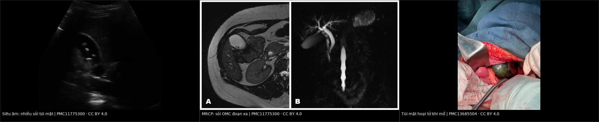
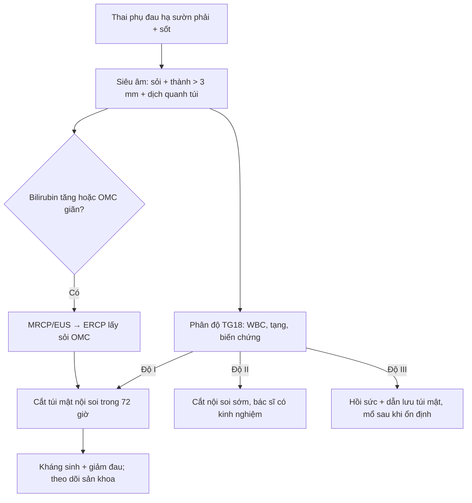
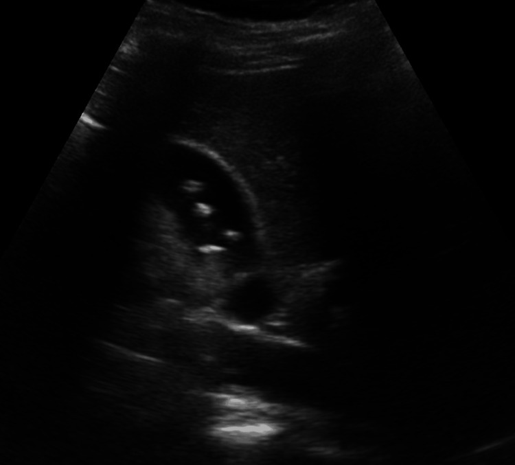
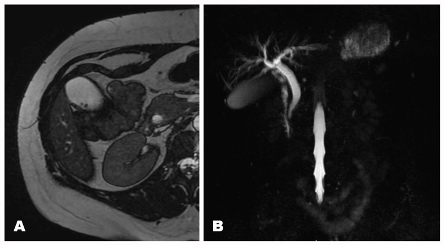
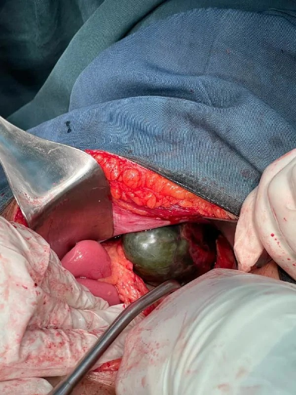

# 1925 — Viêm túi mật cấp ở thai phụ: cắt nội soi bất kể tam cá nguyệt, phân độ TG18, ERCP cho sỏi OMC và cái giá của "chờ sau sinh" / Acute cholecystitis in pregnancy

**Tags:** `pattern:viem` `pattern:soi` `pattern:o-dich` `pattern:tac-nghen` `vung:tui-mat` `vung:thai-nhi` `protocol:sieu-am-bung` `protocol:MRI-khong-can-tu` `score:TG18`
**Mức chắc chắn (certainty):** tổng hợp y văn (literature synthesis) — ghép **hướng dẫn SAGES 2024 về nội soi trong thai** (PMC11133165), **đoàn hệ 48 thai phụ bệnh mật phức tạp** (PMC12823679), **ca viêm túi mật hoại tử có ảnh** (PMC13685504), **ca sỏi OMC – MRCP – stent có ảnh** (PMC11775300), **phân độ TG18** (PMC12986065), **tổng quan sỏi OMC** (PMC12647019) và **nghiên cứu BORN về cắt túi mật/ERCP trong viêm tụy mật** (PMC12606018). Số nào nguồn không nêu ghi "chưa rõ".

> **Câu chốt:** viêm túi mật cấp là **cấp cứu ngoại khoa không sản khoa phổ biến thứ 2** ở thai phụ, và **SAGES 2024 khuyến cáo cắt túi mật nội soi thay cho điều trị nội khoa, bất kể tam cá nguyệt** (khuyến cáo có điều kiện, bằng chứng thấp). Cái giá của "chờ sinh xong": **27% ca tái phát sau cơn đau quặn mật chuyển thành biến chứng** (viêm túi mật, viêm đường mật, viêm tụy) và **29% ca trong đoàn hệ 48 người phải can thiệp trong vòng 90 ngày sau sinh** (PMC12823679). Ở tam cá nguyệt III, cắt túi mật so với quý II làm **tăng sinh non với AOR 7,2 (3,09–16,77)** — nên quyết định phải sớm, không phải muộn (PMC11133165).

## 1. Tổng quan bệnh học – cơ chế hình ảnh

### 1.1 Vì sao thai phụ dễ có sỏi và dễ viêm túi mật (TẠI SAO)

- **Dịch tễ:** viêm túi mật cấp gặp ở **0,01–0,06% thai kỳ** (SAGES 2024, PMC11133165); **cắt túi mật là phẫu thuật bụng không sản khoa phổ biến thứ 2** sau cắt ruột thừa; riêng tại Mỹ **~30.000 thai phụ/năm** có can thiệp vì bệnh mật (PMC12823679).
- **Cơ chế 2 bước:** **estrogen** làm gan tăng bài xuất cholesterol vào mật → **mật quá bão hòa cholesterol**; **progesterone** làm **giảm co bóp túi mật và ứ trệ** → **bùn mật (sludge) và sỏi** hình thành nhanh trong thai. Sỏi mật có ở **10–15%** phụ nữ trưởng thành; **sỏi OMC gặp ở 13,7% (11,8–15,9%)** ca viêm túi mật cấp (PMC12647019).
- **Vì sao viêm tiến triển nhanh:** sỏi kẹt cổ túi → **ứ mật + tăng áp lực trong thành túi** → **thiếu máu thành túi** → **viêm – hoại tử – thủng**. Thai phụ có thêm **tăng thể tích máu, giảm phản ứng viêm rõ rệt** và **chậm trễ chẩn đoán vì "đau bụng là chuyện của thai"** → dễ vào viện ở giai đoạn **hoại tử (gangrenous)**.
- **Vì sao đau lan vai phải:** kích thích phúc mạc hoành qua **dây thần kinh hoành (C3–C5)** — đau vai cùng bên là dấu hiệu của **viêm phúc mạc khu trú**, không phải "đau cơ".
- **Vì sao can thiệp sớm lại an toàn hơn:** thai phụ **không được hưởng lợi từ "chờ đợi"** — mỗi cơn đau quặn là một lần tăng nguy cơ biến chứng; **ACOG** nêu rõ **không được từ chối hoặc trì hoãn phẫu thuật cần thiết vì lý do thai kỳ**, bất kể tam cá nguyệt (dẫn trong PMC11133165).

### 1.2 Vì sao nhìn thấy — vật lý từng phương thức

- **Siêu âm (bước 1):** sỏi là **cấu trúc tăng hồi âm + bóng lưng** (sỏi cholesterol nhỏ có thể **không có bóng**); viêm túi mật là **thành túi mật dày > 3 mm**, **dịch quanh túi mật**, **dấu Murphy siêu âm**, túi căng. Siêu âm **không tia xạ**, làm được ngay tại giường — phù hợp nhất với thai.
- **MRI/MRCP (khi nghi sỏi OMC):** mật là **dịch T2 sáng**, sỏi là **vùng mất tín hiệu** trong lòng ống → MRCP cho **bản đồ đường mật không cần cản quang, không tia xạ**. MRCP không đánh giá được **sỏi < 3 mm** tốt bằng EUS; **EUS gộp Se 0,97/Sp 0,90** cho sỏi OMC (PMC12647019) — nhưng EUS xâm lấn và cần gây mê.
- **CT:** chỉ dùng khi nghi biến chứng (thủng, áp-xe, viêm tụy hoại tử) hoặc sau mổ; **tránh trong thai nếu không cần**, vì liều tử cung tăng theo pha và kích thước thai.
- **X-quang/fluoroscopy trong ERCP:** dùng **che chắn chì, giảm thời gian chiếu, chụp từng khung**; ERCP **không chống chỉ định** trong thai khi có chỉ định giải áp đường mật (SAGES 2024).

### 1.3 Ngưỡng định lượng nằm lòng

| Đại lượng | Ngưỡng / con số | Ý nghĩa | Nguồn |
|---|---|---|---|
| Tần suất viêm túi mật trong thai | **0,01–0,06%** | Bệnh hiếm nhưng **không được bỏ sót** | PMC11133165 |
| Thành túi mật | **> 3 mm** = dày | Tiêu chuẩn siêu âm chính | PMC11775300 |
| Sỏi OMC trong viêm túi mật cấp | **13,7% (11,8–15,9%)** | Phải **tầm soát OMC** trước khi mổ | PMC12647019 |
| TG18 độ II | **WBC > 18.000/µL**, khối vùng hạ sườn phải, **triệu chứng > 72 giờ**, viêm hoại tử/áp-xe/viêm phúc mạc mật | Chuyển mổ **sớm, bác sĩ có kinh nghiệm** | PMC12986065 |
| TG18 độ III | Suy tạng: **dopamine ≥ 5 µg/kg/phút hoặc norepinephrine**, **PaO₂/FiO₂ < 300**, **creatinin > 2,0 mg/dL**, **PT-INR > 1,5**, **tiểu cầu < 100.000/µL**, rối loạn tri giác | **Hồi sức + dẫn lưu túi mật trước**, mổ sau | PMC12986065 |
| Thời điểm mổ độ I | **Trong 72 giờ** từ khởi phát | Mổ sớm giảm biến chứng | PMC12986065 |
| Tam cá nguyệt III vs II | **Sinh non AOR 7,2 (3,09–16,77)** | Càng muộn càng cân nhắc kỹ | PMC11133165 |
| Tái phát thành biến chứng | **27%** sau cơn đau quặn mật | "Chờ sau sinh" không miễn phí | PMC12823679 |

## 2. Mẫu hình + chẩn đoán phân biệt theo vị trí (gamut)

- **Đau hạ sườn phải + sốt + Murphy dương:** **viêm túi mật cấp** (gamut số 1).
- **Đau hạ sườn phải từng cơn, không sốt, tự hết:** **đau quặn mật** — có thể theo dõi nhưng **tái phát tới 27% thành biến chứng**.
- **Đau + vàng da + sốt/rét run:** **sỏi OMC/viêm đường mật** — cần **MRCP/EUS + ERCP**, không chỉ cắt túi mật.
- **Đau thượng vị lan sau lưng + nôn + amylase/lipase tăng:** **viêm tụy do sỏi** — ưu tiên hồi sức, ERCP nếu tắc; cắt túi mật sau (PMC12606018).
- **Đau hạ sườn phải + tăng huyết áp + protein niệu + tiểu cầu giảm:** **HELLP/preeclampsia** — không mổ túi mật; xử trí sản khoa.
- **Vàng da + hạ đường huyết + rối loạn đông máu ở quý III:** **gan nhiễm mỡ cấp do thai (AFLP)** — cấp cứu sản khoa, không phải mật.
- **Đau hố chậu phải/thượng vị + sốt:** **viêm ruột thừa** (bài 145) — ruột thừa bị đẩy lên, dễ nhầm.
- **Đau hông + tiểu máu:** **sỏi niệu** (bài 1818, 1922).

## 3. Bảng so sánh phân biệt (ma trận đối chiếu)

| Thực thể (entity) | Hình ảnh điển hình | Chốt vào (rule-in) | Chốt loại (rule-out) | Gợi ý xác nhận |
|---|---|---|---|---|
| **Viêm túi mật cấp trên sỏi** | Sỏi + **thành > 3 mm** + dịch quanh túi + Murphy siêu âm | **Sỏi + thành dày + đau khu trú + sốt/bạch cầu tăng** | Thành mỏng, không dịch, không sỏi → đau quặn đơn thuần | Siêu âm; CT/MRI nếu biến chứng |
| **Sỏi OMC / viêm đường mật** | **Ống mật chủ giãn + sỏi mất tín hiệu trên MRCP** | **Vàng da + giãn OMC + sỏi trên MRCP/EUS** | OMC không giãn, không sỏi → loại trừ tắc | MRCP/EUS; ERCP điều trị |
| **Viêm tụy do sỏi** | Tụy phù, dịch quanh tụy, **lipase > 3× ULN** | **Đau thượng vị lan lưng + lipase tăng + sỏi** | Lipase bình thường → không viêm tụy | CT/MRI; ERCP nếu tắc |
| **HELLP / preeclampsia** | Gan có thể **hồ máu dưới bao**, không sỏi | **HA ≥ 140/90 + protein niệu + tiểu cầu < 100.000** | Không tăng HA, không protein niệu → ít nghĩ | Xét nghiệm sản khoa; không mổ mật |
| **Gan nhiễm mỡ cấp (AFLP)** | Gan **giảm đậm độ lan tỏa**, không sỏi | **Vàng da + hạ đường huyết + rối loạn đông máu** | Không rối loạn đông, không hạ đường huyết | Xét nghiệm; cấp cứu sản khoa |
| **Viêm ruột thừa** | Ruột thừa **> 6 mm, không đè xẹp**, vị trí cao | **Đau hố chậu phải/thượng vị + sốt + không đè xẹp** | Túi mật bình thường, không sỏi | Siêu âm/MRI (bài 145, 1817) |

*Hình 1 — **Trái:** siêu âm túi mật, nhiều sỏi cholesterol **4–9 mm** (một số không có bóng lưng). **Giữa:** MRI/MRCP — **giãn ống mật chủ + sỏi đoạn xa** (mất tín hiệu trong lòng ống). **Phải:** hình mổ — **túi mật hoại tử (gangrenous)**, thành đen–xanh, hoại tử lan rộng. Nguồn: PMC11775300 Fig. 1–2 và PMC13685504 Fig. 1, **CC BY 4.0**; ảnh ghép letterbox, không crop/kéo giãn.*

## 4. Protocol + phân độ + quyết định theo tam cá nguyệt

### 4.1 Chẩn đoán

1. **Siêu âm bụng** (thành túi mật, sỏi, dịch quanh túi, Murphy) — **bước 1, không tia xạ**.
2. **Xét nghiệm:** WBC, CRP, bilirubin, **ALT/AST/ALP**, **lipase/amylase**, đông máu, chức năng thận.
3. **MRCP** khi **bilirubin/ALP tăng hoặc OMC giãn** trên siêu âm; **EUS** nếu MRCP không kết luận và cần can thiệp.
4. **Không chọc hút túi mật qua da (PTC)** thường quy ở thai phụ còn mổ được — chỉ khi **TG18 độ III, không chịu được mổ**.

### 4.2 Phân độ TG18 và đường điều trị

### 4.3 Tam cá nguyệt — bằng chứng và cách chọn

| Tam cá nguyệt | Khuyến cáo | Số liệu / lý do |
|---|---|---|
| **Quý I** | **Cắt nội soi được** nếu có chỉ định; ưu tiên nội khoa **chỉ khi đau quặn đơn thuần** | Không có bằng chứng mổ làm tăng dị tật; **ACOG: không trì hoãn mổ cần thiết** |
| **Quý II** | **Thời điểm thuận lợi nhất** (tử cung chưa quá lớn, thai đã qua tạo cơ quan) | **64,7% ca can thiệp trong đoàn hệ 48 người rơi vào quý II** (PMC12823679) |
| **Quý III** | **Vẫn mổ được** khi viêm túi mật cấp; **đau quặn đơn thuần** có thể chờ | Cắt túi mật quý III vs quý II: **sinh non AOR 7,2 (3,09–16,77)**; **50% (2/5) ca quý III sinh non** trong đoàn hệ nhỏ (PMC12823679) |
| **Sau sinh** | **Mổ ngay khi có chỉ định** — không cần chờ cai sữa | **29% ca phải can thiệp trong 90 ngày sau sinh** nếu trì hoãn (PMC12823679); thuốc mê/giảm đau tương thích cho bú (bài 1922) |

### 4.4 Kỹ thuật mổ và ERCP

- **Cắt túi mật nội soi (LC):** vào bụng **mở (Hasson)**, **pneumoperitoneum 10–12 mmHg** (không quá 15), **nghiêng trái 15°** để giảm chèn ép tĩnh mạch chủ, **không thao tác tử cung**, theo dõi tim thai trước–sau mổ. Trong đoàn hệ 48 ca, **toàn bộ cắt túi mật đều nội soi, 0 ca chuyển mổ mở** (PMC12823679).
- **ERCP** cho sỏi OMC có triệu chứng: **SAGES 2024 khuyến cáo ERCP thay cho mổ mở ống mật chủ** (khuyến cáo có điều kiện, bằng chứng thấp); **ERCP + cắt túi mật nội soi** là chuẩn "hai thì" hoặc một thì. Biến chứng cần nhớ: **viêm tụy sau cắt cơ vòng 9,7%** (PMC12647019) — theo dõi lipase sau thủ thuật.
- **Kháng sinh:** cephalosporin phổ rộng ± metronidazole; điều chỉnh theo kháng sinh đồ; **không kéo dài sau khi đã kiểm soát ổ nhiễm**.

## 5. Biến thể bình thường và cạm bẫy

- **"Chỉ mổ ở quý II":** đây là quan niệm cũ — SAGES 2024 và ACOG **không giới hạn tam cá nguyệt**; trì hoãn vì "chờ quý II" làm tăng **biến chứng 27%** và **can thiệp sau sinh 29%**.
- **Siêu âm bình thường trong 24 giờ đầu:** thành túi mật có thể chưa dày rõ; **đau + sốt + sỏi** vẫn đủ để điều trị; lặp siêu âm sau 12–24 giờ nếu chưa chắc.
- **Sỏi cholesterol nhỏ không có bóng lưng:** dễ bỏ sót trên siêu âm — tìm **dấu Murphy siêu âm** và **dịch quanh túi**.
- **Bỏ sót sỏi OMC:** **13,7%** ca viêm túi mật cấp có sỏi OMC — phải **kiểm tra bilirubin/ALP + MRCP** trước khi chỉ cắt túi mật.
- **Túi mật hoại tử:** ca 26 tuổi thai 25 tuần, **sau 24 giờ điều trị nội khoa tình trạng xấu đi**, mổ mở thấy **túi mật hoại tử**; mẹ và thai đều ổn (PMC13685504) — **không chờ "đủ 48–72 giờ kháng sinh"** khi bệnh nhân xấu đi.
- **ERCP ở thai:** không phải chống chỉ định; **che chắn + giảm fluoroscopy**, nhưng **không được vì sợ tia mà bỏ tắc đường mật có nhiễm**.
- **Sau sinh:** đừng hoãn mổ vì đang cho bú — **thuốc mê và giảm đau tương thích** (bài 1922); ngừng bú oan làm tăng nguy cơ viêm vú và giảm sữa.

## 6. Tự lượng giá — Blind Quiz

**Ca 1 — Thai 28 tuần, đau hạ sườn phải từng cơn sau ăn; siêu âm thấy nhiều sỏi nhỏ, thành túi mật 2 mm, không dịch quanh túi.**

- Câu hỏi: (1) Chẩn đoán? (2) Có chỉ định mổ ngay không? (3) Theo dõi thế nào?

<b>Bấm để hiện đáp án (findings + chẩn đoán)</b>

- **Findings:** nhiều **sỏi cholesterol 4–9 mm**, một số **không có bóng lưng**; thành túi mật **2 mm** (bình thường), **không dịch quanh túi**.
- **Chẩn đoán:** **đau quặn mật (biliary colic)**, chưa phải viêm túi mật cấp.
- **Quyết định:** có thể **theo dõi nội khoa** (giảm đau, ăn ít mỡ), nhưng **tư vấn nguy cơ tái phát** — **27% tái phát chuyển thành biến chứng**; nếu đau tái diễn nhiều lần, **cắt túi mật nội soi** kể cả trong thai.
- **Nguồn ảnh:** *Cureus* 2024, PMC11775300, Fig. 1, **CC BY 4.0**.

**Ca 2 — Cùng bệnh nhân, bilirubin tăng nhẹ, siêu âm OMC 8 mm; MRCP có sỏi đoạn xa. Bước tiếp theo?**

- Câu hỏi: (1) Mô tả findings? (2) Chọn ERCP hay mổ mở ống mật chủ? (3) Có phải ngừng thai kỳ để làm thủ thuật?

<b>Bấm để hiện đáp án (findings + chẩn đoán)</b>

- **Findings:** **(A)** T2 axial: sỏi nhỏ trong túi mật; **(B)** MRCP: **giãn ống mật chủ** với **sỏi đoạn xa** (mất tín hiệu trong lòng ống).
- **Chẩn đoán:** **sỏi OMC có triệu chứng** trên nền sỏi túi mật.
- **Lựa chọn:** **ERCP** (SAGES 2024 khuyến cáo ERCP thay mổ mở OMC); sau đó **cắt túi mật nội soi** cùng đợt hoặc sau sinh tùy tam cá nguyệt.
- **Không ngừng thai kỳ**: thủ thuật được làm **dưới che chắn, giảm fluoroscopy**; theo dõi **viêm tụy sau ERCP (9,7%)**.
- **Nguồn ảnh:** PMC11775300, Fig. 2, **CC BY 4.0**.

**Ca 3 — Thai 25 tuần, viêm túi mật cấp; sau 24 giờ kháng sinh vẫn sốt, đau tăng, bạch cầu 21.000/µL. Mổ hay tiếp tục nội khoa?**

- Câu hỏi: (1) Phân độ TG18? (2) Vì sao không chờ thêm? (3) Kết cục của ca này?

<b>Bấm để hiện đáp án (findings + chẩn đoán)</b>

- **Findings:** túi mật **căng, thành đen–xanh, hoại tử lan rộng**; mô bệnh xác nhận **viêm túi mật hoại tử**.
- **TG18:** **độ II** (WBC **21.000/µL** > 18.000, triệu chứng kéo dài, viêm hoại tử) — chỉ định **mổ sớm**; nếu có suy tạng thì là **độ III** và phải hồi sức/dẫn lưu trước.
- **Vì sao không chờ:** thất bại nội khoa sau 24 giờ + bạch cầu tăng là dấu hiệu **hoại tử/thủng sắp xảy ra**; chờ thêm làm tăng nguy cơ **viêm phúc mạc mật, nhiễm khuẩn huyết**.
- **Kết cục:** ca thật được **mổ mở lấy túi mật**, hồi phục không biến chứng và **sinh thai đủ tháng khỏe mạnh** (PMC13685504).
- **Nguồn ảnh:** *Case Rep Surg* 2026, PMC13685504, Fig. 1, **CC BY 4.0**.

## Bài liên quan chéo
- [500 – Tổng quan hệ Vú & Sản phụ khoa](../500-tong-quan-vu-san-phu-khoa/lesson.md)
- [1817 – Đau bụng cấp ở thai phụ: protocol MRI không cản từ](../1817-dau-bung-cap-thai-phu-mri/lesson.md)
- [145 – Viêm ruột thừa trong thai kỳ](../145-viem-ruot-thua-trong-thai-ky/lesson.md)
- [1922 – Sỏi niệu ở bà mẹ sau sinh đang cho con bú](../1922-soi-nieu-sau-sinh-cho-con-bu/lesson.md)
- [130 – Túi mật: viêm, sỏi, polyp](../130-tui-mat/lesson.md)
- [6146 – Sỏi túi mật ở trẻ em](../6146-soi-tui-mat-o-tre/lesson.md)

## Ảnh
- `1925_viem-tui-mat_US_PMC11775300-Fig1.jpg` — siêu âm nhiều sỏi cholesterol (PMC11775300, Fig. 1, CC BY 4.0).
- `1925_viem-tui-mat_MRCP_PMC11775300-Fig2.jpg` — MRI + MRCP: sỏi OMC đoạn xa (PMC11775300, Fig. 2, CC BY 4.0).
- `1925_viem-tui-mat_mo_PMC13685504-Fig1.jpg` — túi mật hoại tử khi mổ (PMC13685504, Fig. 1, CC BY 4.0).
- `composite_chan-doan.jpg` — ảnh ghép 3 bước, letterbox nền đen, CC BY 4.0.

> Không dùng để chẩn đoán độc lập khi chưa có người hướng dẫn.
