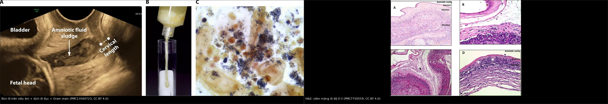
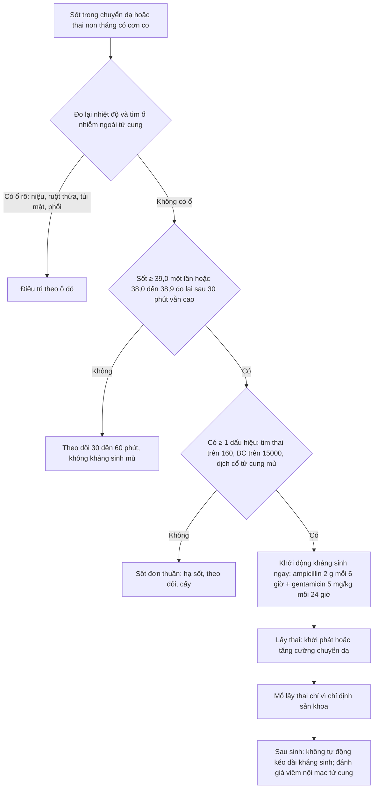
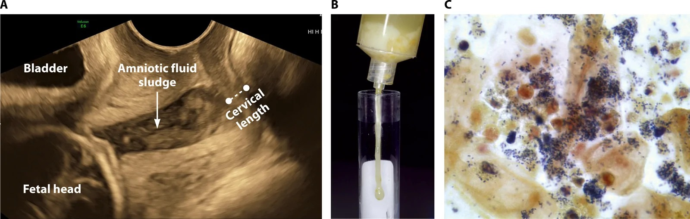
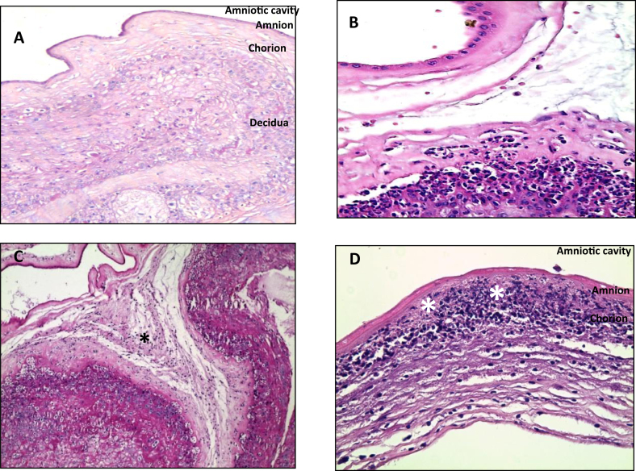
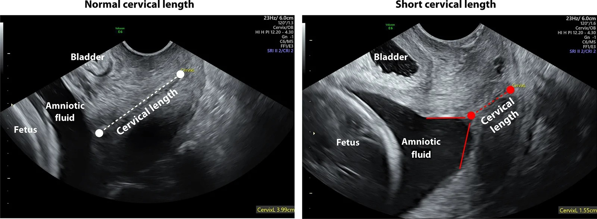

# 1926 — Viêm màng ối – nhiễm khuẩn ối (chorioamnionitis / Triple I): chẩn đoán bằng lâm sàng + dịch ối, hình ảnh chỉ để khoanh vùng nguy cơ / Chorioamnionitis and intra-amniotic infection

**Tags:** `pattern:viem` `pattern:dich-oi-duc` `pattern:co-tu-cung-ngan` `pattern:hoai-tu` `vung:manh-oi` `vung:thai-nhi` `protocol:sieu-am-dau-do` `protocol:MRI-thai` `score:Triple-I`
**Mức chắc chắn (certainty):** tổng hợp y văn (literature synthesis) — ghép **tổng quan *Clin Microbiol Rev* 2026** (PMC13560723: định nghĩa, ngưỡng dịch ối, tần suất nhiễm khuẩn khoang ối), **tổng quan *Front Med* 2023** (PMC10244675: tiêu chuẩn Triple I, phác đồ kháng sinh theo 5 hướng dẫn), **nghiên cứu bệnh–chứng *Heliyon* 2020** (PMC7750559: phân độ mô học màng ối và dây rốn, có ảnh H&E), **khảo sát dược lâm sàng 2026** (PMC13159593: tỉ lệ chẩn đoán vượt), **đoàn hệ 2024** (PMC10953497: viêm màng ối lâm sàng vs dưới lâm sàng) và **nghiên cứu 2025** (PMC12334475: nhiễm khuẩn huyết mẹ khi sốt chuyển dạ). Số nào nguồn không nêu ghi "chưa rõ".

> **Câu chốt:** viêm màng ối là **chẩn đoán lâm sàng + xét nghiệm dịch ối**, **không có hình ảnh nào chẩn đoán được**. Ba con số quyết định: **3,9% tổng số sản phụ** có viêm màng ối lâm sàng, nhưng **9,1% thai non tháng còn ối và 24% ối vỡ non** có vi khuẩn trong khoang ối; **chỉ 81,4% ca được điều trị kháng sinh thực sự đủ tiêu chuẩn chẩn đoán** (PMC13159593) — nghĩa là **chẩn đoán vượt là lỗi thường gặp**, trong khi **thể dưới lâm sàng lại bị bỏ sót** (PMC13560723). Hình ảnh chỉ có 2 việc: **đo cổ tử cung** và **tìm bùn ối** để khoanh nguy cơ, cộng loại trừ ổ nhiễm ngoài tử cung.

## 1. Tổng quan bệnh học – cơ chế hình ảnh

### 1.1 Vì sao nhiễm trùng đi LÊN và vì sao "chỉ kháng sinh" không đủ (TẠI SAO)

- **Đường vào chính là đi lên (ascending):** vi khuẩn từ âm đạo – cổ tử cung → **màng rụng (decidua)** → **màng ối** → **khoang ối** → **thai**. Bốn chặng này giải thích **tại sao cổ tử cung ngắn và bùn ối lại là dấu hiệu nguy cơ**: cả hai đều là bằng chứng vi khuẩn đã tới **cực dưới tử cung** (PMC13560723).
- **Vì sao vi khuẩn "trú" được dù có kháng sinh:** vi khuẩn trong dịch ối tạo **màng sinh học (biofilm)** bám màng ối và bánh nhau, kháng sinh khó thấm qua; đồng thời **không có tuần hoàn hiệu quả** trong khoang ối để đưa thuốc tới. Vì vậy **lấy thai ra là biện pháp "dẫn lưu ổ nhiễm"**, còn kháng sinh chỉ để **giảm lây sang mẹ và thai trong lúc chờ** (PMC10244675).
- **Vì sao sốt xuất hiện MUỘN và không đáng tin:** sốt là phản ứng toàn thân với **nồng độ cytokine** trong máu mẹ, không phải với số vi khuẩn tại chỗ; thai non tháng có **thể tích khoang ối lớn, ít tế bào viêm** nên **nhiễm khuẩn khoang ối có thể tiến triển nhiều giờ đến nhiều ngày trước khi mẹ sốt**. Vì thế **triệu chứng mẹ là chỉ điểm kém nhạy** và **chẩn đoán xác định cần phân tích dịch ối** (PMC13560723).
- **Vì sao bạch cầu mẹ khó diễn giải:** thai kỳ bình thường đã có **bạch cầu 12.000–16.000/mm³** (đôi khi tới 18.000); ngưỡng **> 15.000/mm³** của tiêu chuẩn lâm sàng vì thế **không đặc hiệu**, và **giảm đau/gây tê ngoài màng cứng** cũng gây sốt do **giảm bài tiết nhiệt** — đây là nguồn "dương tính giả" lớn nhất tại phòng sinh.
- **Vì sao mô học khác lâm sàng:** **viêm màng ối mô học (histologic chorioamnionitis)** là **đáp ứng viêm của mẹ** (bạch cầu trung tính vào màng ối/đĩa đệm), còn **viêm dây rốn (funisitis)** là **đáp ứng của thai** — dấu hiệu **nặng hơn** vì chứng tỏ vi khuẩn đã vào tuần hoàn thai. Hai thực thể này **có thể có mà không có sốt**, và ngược lại.

### 1.2 Vì sao hình ảnh trông như vậy (vật lý từng phương thức)

- **Siêu âm đầu dò âm đạo (transvaginal ultrasound):** nước ối là **dịch đồng nhất, trống âm (anechoic)**; khi có **tế bào viêm, mảnh vụn, vi khuẩn kết tụ** thì xuất hiện **hạt tăng hồi âm lơ lửng** = **bùn ối (amniotic fluid sludge)**, thường nằm **ngay trên lỗ trong cổ tử cung**. Bùn ối không phải "máu cục" (máu có hồi âm không đều, lắng theo trọng lực) và không phải "bã nhầy" (dính thành, di động chậm).
- **Đo chiều dài cổ tử cung:** đầu dò âm đạo, **bàng quang rỗng**, đo **lỗ trong → lỗ ngoài** theo trục ống cổ tử cung, **3 lần lấy trị số ngắn nhất**; hình **chữ T** = bình thường, **chữ Y/U (funneling)** = cổ tử cung ngắn + mở lỗ trong. Ngưỡng **< 2,5 cm** là "ngắn"; trong ca minh họa dưới đây **3,99 cm** so với **1,55 cm**.
- **MRI thai:** **T2 HASTE/SSFSE** cho dịch ối **sáng**, mô thai **trung gian**, **DWI/ADC** đánh giá **não thai** khi nghi **đáp ứng viêm thai nhi (FIRS)**; nhưng **MRI không thấy vi khuẩn** và **không thay thế chọc ối**.
- **CT:** **hạn chế tối đa** vì liều tử cung tăng theo tuổi thai; chỉ dùng khi nghi biến chứng ngoài tử cung (áp-xe thận, viêm ruột thừa thủng) mà siêu âm/MRI không giải quyết.

### 1.3 Ngưỡng định lượng nằm lòng

| Đại lượng | Ngưỡng / con số | Ý nghĩa | Nguồn |
|---|---|---|---|
| Viêm màng ối lâm sàng (toàn bộ sản phụ) | **3,9%** | Bệnh lý nhiễm khuẩn hay gặp nhất khi sinh | PMC10244675 |
| Nhiễm khuẩn khoang ối | **9,1%** thai non tháng còn ối; **24%** ối vỡ non | Tỉ lệ tăng theo mức non tháng | PMC13560723 |
| Thai 23–26 tuần chuyển dạ còn ối | **45%** cấy dịch ối dương tính | Càng non càng nhiều vi khuẩn | PMC13560723 |
| Cổ tử cung ngắn không triệu chứng | **9%** có nhiễm khuẩn khoang ối dưới lâm sàng | Cổ tử cung ngắn ≠ nhiễm, nhưng là cửa sổ nguy cơ | PMC13560723 |
| Viêm màng ối mô học ở 21–24 tuần | **> 94%** | Gần như quy luật ở tuổi thai rất non | PMC10244675 |
| Viêm màng ối lâm sàng đủ tháng | **1–3%** còn ối; **6–10%** ối vỡ | Sốt đơn thuần đủ tháng thường không phải nhiễm | PMC10244675 |
| sốt được xác nhận | **≥ 39,0 °C một lần**, hoặc **38,0–38,9 °C đo lại sau 30 phút vẫn ≥ 38,0 °C** | Định nghĩa "documented fever" của Triple I | PMC10244675 |
| Viêm khoang ối (dịch ối) | **BC ≥ 50 tế bào/mm³**, hoặc **IL-6 ≥ 2,6 ng/mL**, hoặc **MMP-8 > 23 ng/mL** | Tiêu chuẩn xét nghiệm, không phải hình ảnh | PMC13560723 |
| Đáp ứng viêm thai nhi (FIRS) | **IL-6 dây rốn ≥ 11 pg/mL** | Tiên lượng xấu: loạn sản phế quản, bạch sản quanh não thất | PMC13560723 |
| Nguy cơ nhiễm khuẩn huyết sơ sinh sớm | **≈ 5 lần** so với trẻ không phơi nhiễm | Lý do phải khám nhi ngay | PMC13560723 |
| Chẩn đoán vượt | Chỉ **81,4%** ca được điều trị đủ tiêu chuẩn | Lỗi thực hành phổ biến | PMC13159593 |
| Nguy cơ kết cục thai xấu | Tăng **2–3,5 lần** khi có viêm màng ối | Không phụ thuộc thời gian nhiễm | PMC10244675 |

## 2. Mẫu hình + chẩn đoán phân biệt theo vị trí (gamut)

**Mẫu hình chính:** *sốt trong chuyển dạ / thai non tháng có cơn co + cổ tử cung ngắn ± bùn ối* → nghĩ **viêm màng ối**. Gamut dưới đây xếp theo **vị trí ổ nhiễm** — vì hình ảnh chỉ có giá trị khi nó **trả lời "ổ này ở đâu"**.

- **Khoang ối – màng ối (trong tử cung):** viêm màng ối do vi khuẩn đi lên (**E. coli, GBS, Ureaplasma/Mycoplasma, Bacteroides**) — sốt + cơn co + cổ tử cung ngắn/bùn ối.
- **Đường niệu trên:** **viêm thận–bể thận/urosepsis** (bài 1924) — đau hông lưng, ấn đau góc sườn–cột sống, **78% không sốt lúc vào viện**, ứ nước trên siêu âm.
- **Ruột thừa:** **viêm ruột thừa trong thai** (bài 145) — đau **hố chậu phải cao hơn** do tử cung đẩy, ruột thừa **> 6 mm, không đè xẹp**.
- **Túi mật – đường mật:** **viêm túi mật cấp** (bài 1925) — Murphy, thành túi mật **> 3 mm**, sỏi; **viêm đường mật** (bài 1929) — vàng da, giãn ống mật chủ.
- **Phổi:** viêm phổi (bài 031) — ho, đờm, đám mờ trên X-quang; cúm/COVID có thể gây sốt + suy hô hấp mà **không có ổ bụng**.
- **Bánh nhau:** **nhau bong non** — tử cung căng đau, ra máu âm đạo, **sốt thường nhẹ/vắng**; siêu âm có thể **bình thường**, chẩn đoán là lâm sàng + monitoring thai.
- **Ngoài ổ nhiễm:** **sốt do gây tê ngoài màng cứng**, **mất nước**, **thuốc**, **cường giáp** — không có ổ, không đáp ứng kháng sinh, và **không cần mổ**.
- **Sau sinh (khác bài này):** **viêm nội mạc tử cung** — sốt sau sinh ≥ 24 giờ, tử cung mềm đau, sản dịch hôi; điều trị khác hẳn (clindamycin + gentamicin).

## 3. Bảng so sánh phân biệt (ma trận đối chiếu)

| Thực thể (entity) | Hình ảnh / xét nghiệm điển hình | Chốt vào (rule-in) | Chốt loại (rule-out) | Gợi ý xác nhận |
|---|---|---|---|---|
| **Viêm màng ối – nhiễm khuẩn ối** | Cổ tử cung **< 2,5 cm** ± **bùn ối**; dịch ối **BC ≥ 50/mm³**, **IL-6 ≥ 2,6 ng/mL**; cấy/PCR dương | **Sốt ≥ 39,0 °C** hoặc **38,0–38,9 °C đo lại sau 30 phút** + **≥ 1 dấu hiệu** (nhịp tim thai **> 160** ≥ 10 phút, **BC > 15.000/mm³**, dịch cổ tử cung mủ/hôi) | Sốt có **ổ rõ ràng ngoài tử cung** + dịch ối **BC < 50/mm³**, **IL-6 < 2,6 ng/mL**, cấy âm → không phải viêm khoang ối | Chọc ối (khi non tháng, còn ối); cấy + PCR 16S |
| **Sốt do gây tê ngoài màng cứng / sốt đơn thuần** | Không có ổ; **bùn ối vắng**, cổ tử cung bình thường; BC **12.000–15.000** (nền thai kỳ) | **Sốt xuất hiện sau đặt catheter**, không nhịp tim thai nhanh, không đau tử cung, **hết sốt khi hạ sốt/ngừng thuốc** | **Nhịp tim thai > 160 kéo dài** + dịch cổ tử cung mủ + BC tăng dần → không được coi là "sốt vô khuẩn" | Đo lại nhiệt độ trực tràng, theo dõi 30–60 phút, không vội kháng sinh |
| **Viêm thận–bể thận / urosepsis** | Thận to, **ứ nước**, sỏi; **CT liều thấp** thấy sỏi; cấy nước tiểu dương | **Đau hông lưng + ấn đau góc sườn–cột sống + cấy nước tiểu dương** | Không đau hông, không ứ nước, cấy nước tiểu âm → loại | Siêu âm thận–niệu quản; cấy máu + nước tiểu |
| **Viêm ruột thừa** | Ruột thừa **> 6 mm, không đè xẹp**, dịch quanh; MRI không cản từ nếu siêu âm mờ | **Đau hố chậu phải cao + ấn đau khu trú + ruột thừa không đè xẹp** | Ruột thừa đè xẹp được, không dịch → loại | Siêu âm → MRI; CT liều thấp khi cần |
| **Viêm túi mật cấp** | Sỏi + **thành túi mật > 3 mm** + dịch quanh túi + Murphy siêu âm | **Đau hạ sườn phải + Murphy + sỏi + thành dày** | Thành **< 3 mm**, không sỏi, không dịch → loại | Siêu âm bụng (bài 1925) |
| **Nhau bong non** | Siêu âm **có thể bình thường**; khối máu sau bánh nhau là dấu hiệu **không nhạy** | **Tử cung căng đau + ra máu + bất thường tim thai** | Cơn co thưa, không ra máu, tim thai bình thường → ít nghĩ | Monitoring thai liên tục; siêu âm chỉ hỗ trợ |
| **Viêm phổi / cúm / COVID** | Đám mờ, **tree-in-bud**, đông đặc; X-quang ngực | **Ho, khó thở, SpO₂ giảm + đám mờ** | Phổi sạch, không thiếu oxy → loại | X-quang ngực; PCR virus |

*Hình 1 — **Trái:** siêu âm đầu dò âm đạo, mũi tên chỉ **bùn ối** (hạt tăng hồi âm lơ lửng trên lỗ trong cổ tử cung); kèm ảnh **dịch ối đục** hút ra và **Gram stain** nhiều bạch cầu + cầu khuẩn Gram dương. **Phải:** H&E màng ối — **(A)** bình thường, **(B)** viêm màng đệm độ 1, **(C)** viêm màng ối độ 2 (bạch cầu vào mô liên kết ối, dấu \*), **(D)** viêm màng ối hoại tử độ 3 (hoại tử biểu mô ối, dấu \*). Nguồn: PMC13560723 Fig. 6 và PMC7750559 Fig. 1, **CC BY 4.0**; ảnh ghép letterbox, không crop/kéo giãn.*

### Đọc đúng 2 dấu hiệu hình ảnh

- **Bùn ối (amniotic fluid sludge):** định nghĩa là **khối hạt tăng hồi âm, lơ lửng tự do trong khoang ối**, thường sát **lỗ trong cổ tử cung**, ở người **còn ối**. Đây là dấu hiệu của **viêm/nhiễm khoang ối, chuyển dạ non tháng sắp xảy ra và viêm màng ối**, nhưng **không đặc hiệu cho vi khuẩn** — bùn ối vô khuẩn vẫn có (PMC13560723).
- **Cổ tử cung ngắn + funneling:** nguy cơ nhiễm khuẩn khoang ối **tăng khi chiều dài giảm**; ở người **không triệu chứng** với cổ tử cung ngắn, **9%** đã có nhiễm khuẩn dưới lâm sàng. Vì vậy cổ tử cung ngắn là **chỉ định cân nhắc chọc ối** ở thai non tháng, không phải chỉ định mổ.

## 4. Protocol + phân độ + quyết định

### 4.1 Chẩn đoán (không có hình ảnh nào thay được)

1. **Nhiệt độ:** đo **miệng/trực tràng**, nếu **38,0–38,9 °C** thì **đo lại sau 30 phút**; **≥ 39,0 °C một lần** đã đủ.
2. **Tìm ổ ngoài tử cung trước khi kết luận:** cấy máu, cấy nước tiểu, X-quang ngực, siêu âm thận – túi mật – ruột thừa khi có định hướng.
3. **Đánh giá thai:** monitoring tim thai liên tục (nhịp tim thai **> 160/phút ≥ 10 phút** là tiêu chuẩn), đếm cơn co, siêu âm **chiều dài cổ tử cung + bùn ối**.
4. **Chọc ối (khi còn ối, thai non tháng, còn cửa sổ điều trị):** gửi **đếm tế bào, glucose, IL-6/MMP-8, Gram stain, cấy + PCR 16S** — kết quả **định hướng kháng sinh** và **tránh điều trị mù** (PMC13560723).

### 4.2 Phân độ mô học (khi có bánh nhau)

| Phân độ | Mô học | Ý nghĩa |
|---|---|---|
| **Mẹ – độ 1** | Viêm màng đệm (chorionitis): bạch cầu giới hạn ở mô đệm màng đệm | Đáp ứng mẹ, nhẹ |
| **Mẹ – độ 2** | Viêm màng ối: bạch cầu vào **mô liên kết màng ối** | Đáp ứng mẹ, rõ |
| **Mẹ – độ 3** | Viêm màng ối **hoại tử**: hoại tử biểu mô ối | Nặng, nguy cơ cao |
| **Thai – độ 1** | Viêm tĩnh mạch rốn | Đáp ứng thai, sớm |
| **Thai – độ 2** | Viêm động mạch rốn | Đáp ứng thai, muộn/nặng |

### 4.3 Điều trị: kháng sinh + LẤY THAI là điều trị ổ nhiễm

- **Kháng sinh (ACOG):** **ampicillin 2 g IV mỗi 6 giờ + gentamicin 5 mg/kg IV mỗi 24 giờ**; dị ứng penicillin nặng: **clindamycin 900 mg mỗi 8 giờ** hoặc **vancomycin 1 g mỗi 12 giờ + gentamicin** (PMC10244675). Các hướng dẫn khác (NICE, Pháp, Tây Ban Nha, Slovenia) dùng phác đồ tương đương — **không có bằng chứng phác đồ nào trội hơn**.
- **Thời điểm lấy thai:** **khởi phát hoặc tăng cường chuyển dạ ngay**; **mổ lấy thai chỉ vì chỉ định sản khoa**, vì mổ trên nền viêm màng ối làm tăng **huyết khối tĩnh mạch, viêm nội cơ tử cung và nhiễm vết mổ** (PMC10244675).
- **Sau sinh:** **không tự động kéo dài kháng sinh**; chỉ kéo dài khi có **yếu tố nguy cơ viêm nội mạc tử cung** (mổ lấy thai, chuyển dạ kéo dài, béo phì) (PMC10244675).
- **Trẻ sơ sinh:** phơi nhiễm làm tăng **nhiễm khuẩn huyết sớm ≈ 5 lần**; khám + theo dõi sát, **không chọc dò tủy sống thường quy ở trẻ không triệu chứng**, kháng sinh theo thuật toán sơ sinh (PMC13560723).

## 5. Biến thể bình thường và cạm bẫy

- **"Sốt là phải kháng sinh":** sai. **Sốt đơn thuần** (không đủ tiêu chuẩn) gặp ở **gây tê ngoài màng cứng, mất nước, thuốc**; điều trị mù làm tăng **kháng thuốc và loạn khuẩn** — và chỉ **81,4%** ca được điều trị thực sự đủ tiêu chuẩn (PMC13159593).
- **Bỏ sót thể dưới lâm sàng:** **9,1%** thai non tháng còn ối và **24%** ối vỡ non có vi khuẩn mà **mẹ không sốt**; ở **21–24 tuần**, viêm màng ối mô học **> 94%** (PMC13560723, PMC10244675). Đừng chờ sốt ở thai rất non.
- **Bạch cầu nền của thai kỳ:** **12.000–16.000/mm³** là bình thường; ngưỡng **15.000** vì thế **không đủ một mình** để chẩn đoán hay loại trừ.
- **Bùn ối vô khuẩn:** bùn ối là dấu hiệu **viêm**, không đồng nghĩa **nhiễm khuẩn**; vẫn cần **dịch ối (BC, IL-6, cấy/PCR)** trước khi kết luận.
- **Cổ tử cung ngắn không phải chỉ định mổ:** đây là **yếu tố nguy cơ**, không phải chẩn đoán; xử trí gồm **progesterone/đặt vòng nâng cổ tử cung theo chỉ định sản khoa**, không phải "mổ ngay".
- **Sốt do gây tê và sốt thật chồng lấp:** gây tê ngoài màng cứng làm **giảm bài tiết nhiệt**; nhưng **nhịp tim thai > 160 kéo dài** hoặc **dịch cổ tử cung mủ** thì **không được quy cho gây tê**.
- **Nhau bong non "giả viêm":** bánh nhau hoại tử có thể gây **sốt nhẹ + bạch cầu tăng**; nếu chỉ nhìn xét nghiệm sẽ điều trị kháng sinh oan và **bỏ sót thai suy**.
- **Sau sinh đừng nhầm viêm nội mạc tử cung:** sốt sau sinh **≥ 24 giờ**, tử cung mềm đau, sản dịch hôi → phác đồ **khác** (clindamycin + gentamicin), không phải "tiếp tục phác đồ chuyển dạ".

## 6. Tự lượng giá — Blind Quiz

**Ca 1 — Thai 27 tuần, cơn co mỗi 5 phút, không sốt, không ra máu. Siêu âm đầu dò âm đạo: cổ tử cung 1,55 cm, có hạt tăng hồi âm trên lỗ trong.**

- Câu hỏi: (1) Mũi tên chỉ gì? (2) Nó nói lên điều gì và **không** nói lên điều gì? (3) Bước tiếp theo để quyết định kháng sinh?

<b>Bấm để hiện đáp án (findings + chẩn đoán)</b>

- **Findings:** **(A)** siêu âm âm đạo — **bùn ối**: hạt tăng hồi âm lơ lửng ngay trên **lỗ trong cổ tử cung**, trước **đầu thai**; **(B)** dịch ối hút ra **đục, vàng nhạt**; **(C)** **Gram stain** — nhiều **bạch cầu trung tính** và **cầu khuẩn Gram dương**.
- **Chẩn đoán:** **viêm/nhiễm khoang ối dưới lâm sàng** trên nền **cổ tử cung ngắn** — bùn ối là dấu hiệu **viêm**, chưa chứng minh **vi khuẩn**.
- **Bước tiếp theo:** **chọc ối** (còn ối) gửi **BC, glucose, IL-6, Gram stain, cấy + PCR**; kèm **corticosteroid** nếu 24–34 tuần và **magie sulfate** bảo vệ não thai theo chỉ định sản khoa. **Không** mổ lấy thai chỉ vì bùn ối.
- **Nguồn ảnh:** *Clin Microbiol Rev* 2026, PMC13560723, Fig. 6, **CC BY 4.0**.

**Ca 2 — Bánh nhau của thai 24 tuần sinh non, mẹ KHÔNG sốt. Đọc H&E màng ối.**

- Câu hỏi: (1) Xếp độ cho từng ảnh? (2) Vì sao mẹ không sốt mà vẫn có tổn thương? (3) Ý nghĩa tiên lượng?

<b>Bấm để hiện đáp án (findings + chẩn đoán)</b>

- **Findings:** **(A)** màng ối **bình thường**, **không có bạch cầu**; **(B)** **viêm màng đệm độ 1** — bạch cầu giới hạn ở mô đệm màng đệm; **(C)** **viêm màng ối độ 2** — bạch cầu đã vào **mô liên kết màng ối** (dấu \*); **(D)** **viêm màng ối hoại tử độ 3** — **hoại tử biểu mô ối** (dấu \*).
- **Vì sao không sốt:** viêm màng ối **mô học** là **đáp ứng tại chỗ của mẹ**, có thể **không đủ cytokine toàn thân** để gây sốt — đúng lý do **triệu chứng mẹ là chỉ điểm kém nhạy**.
- **Tiên lượng:** độ càng cao + có **viêm dây rốn** (đáp ứng thai) càng tăng nguy cơ **nhiễm khuẩn huyết sớm, loạn sản phế quản, bạch sản quanh não thất**.
- **Nguồn ảnh:** *Heliyon* 2020, PMC7750559, Fig. 1, **CC BY 4.0**.

**Ca 3 — Thai 39 tuần, đã gây tê ngoài màng cứng 3 giờ, nhiệt độ 38,4 °C; tim thai 140/phút, không đau tử cung, bạch cầu 14.000/mm³. Xử trí?**

- Câu hỏi: (1) Đủ tiêu chuẩn viêm màng ối chưa? (2) Việc đầu tiên? (3) Khi nào mới dùng kháng sinh?

<b>Bấm để hiện đáp án (findings + chẩn đoán)</b>

- **Findings:** ảnh so sánh **cổ tử cung bình thường 3,99 cm (chữ T)** với **cổ tử cung ngắn 1,55 cm + funneling chữ Y** — công cụ **đo nguy cơ**, không chẩn đoán nhiễm.
- **Đánh giá:** **38,4 °C nhưng chưa đo lại** → chưa phải "documented fever"; **không nhịp tim thai nhanh**, **không đau tử cung**, **BC 14.000** (trong nền thai kỳ) → **chưa đủ tiêu chuẩn** viêm màng ối.
- **Việc đầu tiên:** **đo lại nhiệt độ sau 30 phút** (miệng/trực tràng), tìm ổ nhiễm (cấy máu, cấy nước tiểu), tiếp tục monitoring thai; hạ sốt bằng paracetamol.
- **Khi nào kháng sinh:** nếu **đo lại vẫn ≥ 38,0 °C** → **sốt được xác nhận**; thêm **bất kỳ dấu hiệu nào** (tim thai **> 160** ≥ 10 phút, **BC > 15.000**, dịch cổ tử cung mủ) → **khởi động ampicillin + gentamicin** và **lấy thai**.
- **Bài học:** đây là nhóm **"sốt đơn thuần"** — điều trị mù ở nhóm này là lý do **chỉ 81,4%** ca được điều trị đủ tiêu chuẩn.
- **Nguồn ảnh:** PMC13560723, Fig. 4, **CC BY 4.0**.

## Bài liên quan chéo
- [500 – Tổng quan hệ Vú & Sản phụ khoa](../500-tong-quan-vu-san-phu-khoa/lesson.md)
- [1924 – Sốc nhiễm khuẩn từ đường niệu ở thai phụ: sốt vắng 78%, giải áp 6–12 giờ](../1924-soc-nhieu-khuan-nieu-thai/lesson.md)
- [1925 – Viêm túi mật cấp ở thai phụ: TG18, cắt nội soi bất kể tam cá nguyệt](../1925-viem-tui-mat-cap-thai-ky/lesson.md)
- [1921 – Nhiễm khuẩn niệu không triệu chứng & viêm thận–bể thận cấp ở thai phụ](../1921-nhiem-khuan-nieu-thai-ky/lesson.md)
- [145 – Viêm ruột thừa trong thai kỳ](../145-viem-ruot-thua-trong-thai-ky/lesson.md)
- [1817 – Đau bụng cấp ở thai phụ: protocol MRI không cản từ](../1817-dau-bung-cap-thai-phu-mri/lesson.md)

## Ảnh
- `1926_viem-mang-oi_US_PMC13560723-Fig6.jpg` — siêu âm bùn ối + dịch ối đục + Gram stain (PMC13560723, Fig. 6, CC BY 4.0).
- `1926_viem-mang-oi_US-co-tu-cung_PMC13560723-Fig4.jpg` — đo chiều dài cổ tử cung: bình thường 3,99 cm vs ngắn 1,55 cm + funneling (PMC13560723, Fig. 4, CC BY 4.0).
- `1926_viem-mang-oi_HE_PMC7750559-Fig1.jpg` — H&E phân độ viêm màng ối 0–3 (PMC7750559, Fig. 1, CC BY 4.0).
- `1926_viem-mang-oi_HE-funisitis_PMC7750559-Fig2.jpg` — H&E phân độ viêm dây rốn (PMC7750559, Fig. 2, CC BY 4.0).
- `composite_chan-doan.jpg` — ảnh ghép letterbox (PMC13560723 Fig. 6 + PMC7750559 Fig. 1), CC BY 4.0.

> Không dùng để chẩn đoán độc lập khi chưa có người hướng dẫn.
