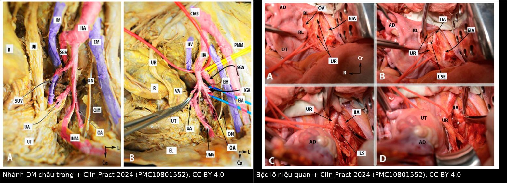
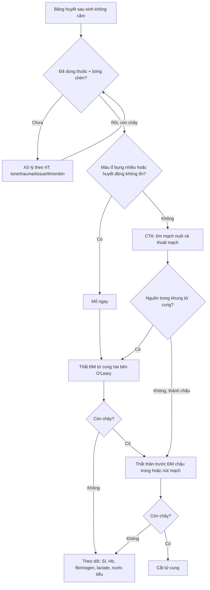
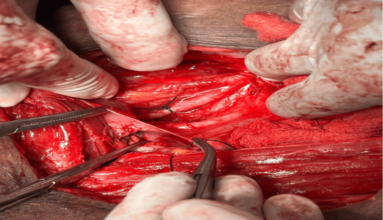
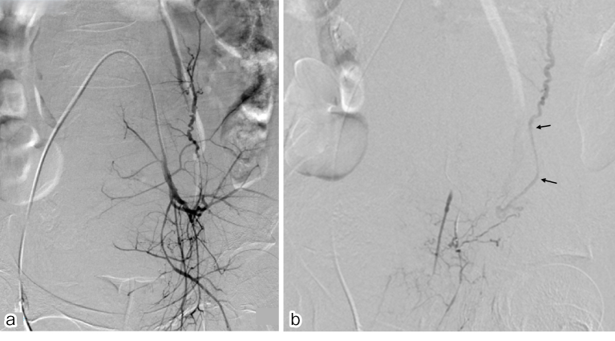

# 1927 — Thắt động mạch tử cung (O'Leary) và thắt động mạch chậu trong khi băng huyết sau sinh không cầm / Uterine artery ligation (O'Leary) and internal iliac artery ligation for refractory postpartum hemorrhage

**Tags:** `pattern:chay-mau` `pattern:thoat-mach` `pattern:gia-phinh` `pattern:mat-mau-o-at` `vung:tu-cung-phan-phu` `vung:chau` `protocol:CTA-bung` `protocol:DSA` `protocol:that-dong-mach` `score:4T` `score:shock-index`
**Mức chắc chắn (certainty):** tổng hợp y văn (literature synthesis) — ghép 1 bài giải phẫu–kỹ thuật 8 hình tiêu bản về thắt động mạch chậu trong (Clin Pract 2024, PMC10801552), 1 ca nguyên văn có 4 ảnh mổ (Cureus 2026, PMC11534795), 1 tổng quan can thiệp nội mạch theo nguyên nhân chảy máu (2026, PMC12504023), 1 nghiên cứu so sánh thắt ĐM tử cung vs thắt ĐM chậu trong về sinh sản (2024, PMC11576652), 1 tổng quan hệ thống–phân tích gộp 13 nghiên cứu/939 bệnh nhân về thắt ĐM chậu trong trong nhau cài răng lược (2026, PMC12858212) và 1 thử nghiệm ngẫu nhiên so sánh thắt ĐM tử cung hai bên vs mũi B-Lynch (2025, PMC12296886). **Không có thử nghiệm ngẫu nhiên nào về thắt mạch trong băng huyết sau sinh (PPH)** — mọi tỷ lệ thành công dưới đây là dữ liệu quan sát, có nguy cơ chọn lựa bệnh nhân, và cần đọc kèm mục (5).

## 1. Tổng quan bệnh học – cơ chế hình ảnh

- **Vì sao phải thắt mạch khi băng huyết sau sinh (postpartum hemorrhage, PPH):** máu đến tử cung từ **3 tầng**: (1) **động mạch tử cung (uterine artery)** — nhánh của **thân trước động mạch chậu trong (internal iliac artery, IIA)**; (2) **động mạch buồng trứng (ovarian artery)** — nhánh trực tiếp của **động mạch chủ bụng**, đi vòng ngoài bó mạch tử cung; (3) các nhánh **động mạch âm đạo/cổ tử cung, động mạch trực tràng giữa, động mạch dây chằng tròn (artery of round ligament — Sampson)**. Cắt một nhánh **không** làm ngừng chảy — đó là lý do lâm sàng của cả bài.
- **TẠI SAO thắt mạch cầm máu (vật lý dòng chảy):** theo **Poiseuille**, lưu lượng $Q \propto \Delta P \cdot r^4/(8\eta L)$. Thắt **không** đưa $Q$ về 0 vì có **vòng nối (collateral)**; điều thắt làm được là **hạ áp lực**: sau thắt hai bên IIA, **áp lực mạch đập (pulse pressure) phía dưới chỗ thắt giảm ~85%** và **áp lực trung bình giảm ~25%**, biến hệ động mạch chậu thành **hệ áp lực thấp kiểu tĩnh mạch** — cục máu đông hình thành **không bị đẩy bật** (PMC10801552). Vì vậy thắt mạch **chỉ hiệu quả khi đã có đông máu**; fibrinogen thấp thì thắt xong vẫn chảy (bài 1932).
- **Động mạch tử cung (O'Leary):** thắt **hai lần** bó mạch tử cung trong dây chằng rộng — **mũi 1 khoảng 2 cm trên đoạn dưới tử cung**, **mũi 2 khoảng 2 cm dưới** — nhằm bắt cả **nhánh đi lên và nhánh đi xuống**; tiêm **vasopressin** hoặc ấn động mạch chủ trước khi thắt giúp nhìn rõ. Tỷ lệ thành công được báo cáo **> 90%** (PMC11576652).
- **Thắt ĐM chậu trong:** thắt **thân trước** (anterior division) ở **~3 cm dưới chỗ chia đôi ĐM chậu chung**, **giữ lại thân sau/động mạch mông trên (superior gluteal artery)** để tránh hoại tử cơ mông; **không cần và không nên bộc lộ thân sau** vì dễ làm rách tĩnh mạch chậu trong nằm ngay dưới–trong động mạch (PMC10801552).
- **Mốc giải phẫu định lượng bắt buộc nhớ (PMC10801552):**
  - Chỗ chia đôi ĐM chậu chung ở **đĩa gian đốt L5–S1** (82% tiêu bản), **ngang L5** (15%); chiều dài IIA **~4 cm**, **bên phải thường dài hơn bên trái**.
  - **Định luật Luschka:** **niệu quản trái bắt chéo ĐM chậu chung ~1,5 cm DƯỚI** chỗ chia đôi, còn **niệu quản phải bắt chéo ~1,5 cm TRÊN** chỗ chia đôi (tức bắt chéo ĐM chậu ngoài). Đây là lý do **bên phải nguy hiểm hơn** khi bóc tách mù.
  - Cấu trúc **"kiềng ba chân" (tripod)**: niệu quản **phía trong**, ĐM chậu ngoài **phía ngoài**, IIA ở giữa — nhìn đủ ba thành phần mới được đặt chỉ.
- **Tần suất và kết cục (để quyết định, không để hứa hẹn):**
  - Băng huyết sau sinh cần **truyền máu khối lượng lớn** (≥ 8 đơn vị hồng cầu trong 24 giờ) gặp **65/100.000 ca sinh**; **lượng máu mất trung vị 6.000 mL**, **cắt tử cung chu sinh 30%**, **tử vong 2,3%** (Acta Obstet Gynecol Scand 2019, PMID 30667050 — dân số Hà Lan 2011–2012).
  - Trong băng huyết nặng đã thất bại nội khoa, **thắt mạch hoặc nút mạch** là bước giữa **mô khâu chèn/bóng chèn** và **cắt tử cung**; **can thiệp nội mạch (IR) đạt thành công kỹ thuật và lâm sàng > 90%** (PMC12504023).
- **Vì sao phải chụp hình trước khi thắt/nút:**
  - **Máu tụ cấp trên CT ~ 40–60 HU**, **thoát mạch hoạt động (contrast extravasation) ≥ 100 HU** vì chứa iod (Z = 53); **chụp không cản quang không phân biệt được hai thứ này** → mọi ca nghi còn chảy phải **CTA có cản quang** (bài 1728).
  - **Động mạch buồng trứng chỉ thấy được trên chụp ĐM chủ ở ~20% bệnh nhân**; **CE-CT xác định được nguyên ủy và đường đi** để không bỏ sót nguồn chảy ngoài khung chậu (PMC12504023). Bỏ sót nhánh buồng trứng là lý do **thất bại/thất bại lại** điển hình sau nút ĐM tử cung.

## 2. Mẫu hình + chẩn đoán phân biệt theo vị trí (Gamut)

Câu hỏi định vị đổi từ "chảy từ đâu" sang **"mạch nào đang nuôi chỗ chảy"** — vì chọn thắt tử cung hay thắt chậu trong là quyết định theo **bản đồ mạch**, không theo triệu chứng.

**Gamut theo mạch nuôi (nhìn trên CTA/DSA):**

- **ĐM tử cung (nhánh thân trước IIA):** đờ tử cung, nhau cài răng lược (PAS), chảy từ diện nhau/mổ lấy thai đoạn dưới; DSA thấy **phì đại, xoắn, thoát mạch thì động mạch**.
- **ĐM buồng trứng (từ ĐM chủ):** chảy **đỉnh/thân tử cung**, đặc biệt **sau khi đã nút ĐM tử cung trước đó** (tuần hoàn bàng hệ phì đại); CE-CT thấy **ĐM buồng trứng to, nguyên ủy lạc chỗ từ ĐM thận phụ** (PMC12504023).
- **ĐM dây chằng tròn (Sampson):** nhánh của **ĐM thượng vị dưới**; nuôi **sừng tử cung và thành bụng trước**; thường bị bỏ sót khi nút "theo giải phẫu kinh điển".
- **Nhánh âm đạo/cổ tử cung:** rách cổ tử cung, đờ cổ tử cung, máu tụ **dưới ổ nhớp (supra-levator)** lan vào dây chằng rộng; DSA có thể **co thắt không thấy thoát mạch**.
- **ĐM trực tràng giữa/ĐM thẹn trong:** chảy sau cắt tử cung hoặc từ thành chậu; thường sau **mổ** hoặc **xạ trị**.
- **Giả phình (pseudoaneurysm) ĐM tử cung/cổ tử cung:** ổ tăng quang **giữ hình thì muộn**, Doppler **"yin–yang" + to-and-fro**; vỡ giả phình là nguyên nhân chảy máu muộn (bài 1723).

**Gamut theo vị trí tổn thương:**

- **Thân tử cung, đờ tử cung hoặc PAS:** ĐM tử cung ± buồng trứng.
- **Đoạn dưới/sẹo mổ lấy thai:** ĐM tử cung nhánh xuống ± nhánh âm đạo.
- **Cổ tử cung/rách cùng đồ:** nhánh cổ tử cung của ĐM tử cung, ĐM âm đạo.
- **Thành chậu/sau cắt tử cung:** ĐM chậu trong (thân trước) → thắt hoặc nút **thân trước**.
- **Sàn chậu/âm hộ:** ĐM thẹn trong, ĐM mông dưới.

## 3. Bảng so sánh phân biệt (ma trận đối chiếu)

| Thực thể (entity) | Hình ảnh / dữ liệu điển hình | Chốt vào (rule-in) | Chốt loại (rule-out) | Gợi ý xác nhận |
|---|---|---|---|---|
| **Thắt ĐM tử cung hai bên (O'Leary)** | Không cần hình ảnh để làm; DSA trước cho thấy ĐM tử cung phì đại/xoắn, thoát mạch thì động mạch | **Đờ tử cung/PAS, nguồn chảy trong khung tử cung, tử cung còn sống, đã thất bại thuốc + bóng chèn** | Máu tụ **lan ra dây chằng rộng/thành chậu** hoặc nguồn từ ĐM buồng trứng → thắt tử cung đơn thuần **thất bại** | Thành công **> 90%**; mũi trên/dưới cách đoạn dưới **~2 cm**; BUAL vs mũi B-Lynch: máu mất và thời gian nằm viện **tương đương** (PMC12296886) |
| **Thắt ĐM chậu trong hai bên (IIAL)** | Mốc: chỗ chia đôi L5–S1, thắt **~3 cm dưới chia đôi**, **thân trước**, chừa **ĐM mông trên** | **Chảy từ thành chậu/sau cắt tử cung, hoặc đờ tử cung không đáp ứng thắt tử cung, cần hạ áp lực toàn khung chậu** | Mong đợi "cắt hết máu" → **sai**: vẫn còn tuần hoàn bàng hệ; IIAL đơn thuần trong PAS **không giảm lượng máu mất** (MD **−177 mL**, P = 0,51, I² = 95%) | Áp lực mạch đập giảm **~85%**, áp lực trung bình **~25%**; biến chứng **4,1%** vs nút mạch **16,7%** |
| **Nút mạch (UAE/IR)** | DSA: thoát mạch, giả phình, **co thắt** ĐM tử cung; CE-CT định vị ĐM buồng trứng | **Bệnh nhân còn ổn định, không chảy ồ ạt vào ổ bụng, cơ sở có IR** | Huyết động không ổn + máu ổ bụng nhiều → **mổ**, không chờ IR | Thành công **> 90%**; nút **thân trước IIA** khi không chọn được nhánh; **co thắt = cạm bẫy** (mục 5) |
| **Mô khâu chèn (B-Lynch, Hayman, Cho)** | Không có dấu hiệu hình ảnh đặc hiệu; dùng khi tử cung còn nguyên khối | **Đờ tử cung, buồng tử cung kín, không có khuyết thành** | Có **khuyết thành/vỡ** → không dùng (bài 1728) | B-Lynch **79,1%**; **+ thắt ĐM tử cung > 90%** (dẫn trong bài 1728) |
| **Bóng chèn trong tử cung** | Bóng căng trong buồng, không thoát ra ngoài | **Đờ tử cung, buồng kín** | Bóng **thoát ra ổ bụng/âm đạo** = còn khuyết thành → sai chỉ định | Bakri **66,7–80%**; thể tích bơm trung vị **150 mL** (bài 1728) |
| **Cắt tử cung (hysterectomy)** | Tử cung hoại tử, vỡ không khâu được, PAS xâm lấn bàng quang | **Đã thất bại 2 bước cầm máu, hoặc tử cung không còn khả năng bảo tồn** | Còn khả năng bảo tồn + bệnh nhân ổn → chưa cắt | Cắt tử cung chu sinh **30%** ở nhóm cần truyền máu khối lượng lớn (PMID 30667050) |

*Trái: các nhánh IIA — UA = động mạch tử cung, UR = niệu quản, SGA = động mạch mông trên, EIA/EIV = ĐM/TM chậu ngoài. Phải: (A) mở phúc mạc, xác định niệu quản (UR); (B) thấy "kiềng ba chân" IIA–EIA–UR; (C) bộc lộ thân trước; (D) đặt chỉ. Nguồn: Clin Pract 2024 (PMC10801552), CC BY 4.0. Ảnh ghép letterbox, không crop/kéo giãn.*

### Ba dấu hiệu quyết định trên bàn mổ / trên màn hình

- **Nhìn thấy niệu quản trước khi đặt chỉ** — đặt sling quanh niệu quản; nhớ **niệu quản trái bắt chéo 1,5 cm dưới, phải 1,5 cm trên** chỗ chia đôi.
- **Chỉ luồn dưới thân trước, ~3 cm dưới chỗ chia đôi** — đường đi **từ ngoài vào trong**; **không bộc lộ thân sau**.
- **Xác nhận mạch đập phía dưới giảm sau khi thắt** — nếu còn phập mạnh, khả năng cao đã thắt nhầm thân sau hoặc chỉ mới thắt một bên.

## 4. Protocol chụp + hệ phân độ/điểm chuẩn hóa

### 4.1. Chọn hình ảnh theo tình huống

| Tình huống | Ưu tiên | Lý do / ngưỡng |
|---|---|---|
| Huyết động **không ổn**, nghi chảy vào ổ bụng | **Siêu âm tại giường (FAST)** → **mổ ngay** | CT làm chậm cầm máu; không chờ hình ảnh |
| Huyết động **ổn**, chưa rõ nguồn | **CTA bụng–chậu có cản quang** (thì động mạch + tĩnh mạch) | Thoát mạch **≥ 100 HU**; máu tụ **40–60 HU**; xác định **ĐM buồng trứng/Sampson** trước khi nút |
| Đã nút ĐM tử cung thất bại/lái chảy | **CE-CT rồi DSA** | ĐM buồng trứng chỉ thấy trên chụp ĐM chủ ở **~20%**; CE-CT chỉ đường |
| Sau mổ, Hb giảm tiếp | **CTA** | Máu tụ, hoại tử, giả phình, thoát mạch còn |

### 4.2. Thang bậc can thiệp (step-up) — thứ tự không được đảo

1. **Thuốc:** oxytocin, misoprostol, methylergometrine + **tranexamic acid 1 g IV** (bài 1932).
2. **Cơ học:** ấn tử cung, bóng chèn, mô khâu chèn.
3. **Thắt ĐM tử cung hai bên (O'Leary)** — đơn giản, nhanh, thành công **> 90%**.
4. **Thắt ĐM chậu trong hai bên** — khi nguồn ngoài tử cung hoặc thắt tử cung thất bại.
5. **Nút mạch (IR)** — nếu bệnh nhân ổn định và có cơ sở IR; có thể **làm trước mổ** ở ca PAS có kế hoạch.
6. **Cắt tử cung** — bước cuối, **không trì hoãn** sau khi đã thất bại hai bước.

### 4.3. Kỹ thuật thắt ĐM chậu trong — 8 bước (PMC10801552)

1. Xác định **chỗ chia đôi ĐM chậu chung** (ngang **L5–S1**, đường nối hai gai chậu trước trên).
2. **Mở phúc mạc thành** từ **dây chằng tròn** lên tới ĐM chậu chung; đường mổ **giữa bó mạch buồng trứng và cơ thắt lưng lớn**.
3. **Xác định và treo niệu quản** (sling/vessel loop) — bước bắt buộc.
4. Bóc tổ chức liên kết, thấy **"kiềng ba chân"**: niệu quản trong, ĐM chậu ngoài ngoài, IIA giữa.
5. **Mở khoang cạnh trực tràng bên (Latzko)** để đẩy niệu quản vào trong và tạo khoảng trống.
6. **Tách ĐM khỏi tĩnh mạch chậu trong** (tĩnh mạch nằm **dưới và hơi trong**) — đây là bước nguy hiểm nhất.
7. **Luồn chỉ dưới thân trước ~3 cm dưới chỗ chia đôi**, từ ngoài vào trong.
8. **Thắt (không cắt)**; kiểm tra mạch đập phía dưới; đóng theo lớp.

### 4.4. Điểm chuẩn hóa dùng trong quyết định

- **4T:** **T**one (đờ tử cung) — **T**rauma (rách/vỡ) — **T**issue (sót nhau/PAS) — **T**hrombin (rối loạn đông máu). Thắt mạch **chỉ xử lý T** ở nhóm tone/trauma; **thrombin** phải sửa bằng fibrinogen/yếu tố (bài 1932).
- **Shock index (SI = nhịp tim/huyết áp tâm thu):** **SI > 0,8** là ngưỡng vào phác đồ; **SI > 1,7** là ngưỡng **kích hoạt truyền máu khối lượng lớn** trong lưu đồ PPH (PMC13399376); **SI ≥ 1,4** = sốc nặng.
- **Ngưỡng huyết động học khi nút mạch:** **fibrinogen < 2 g/L** và **pH < 7,2** làm tăng thất bại; **fibrinogen < 40 mg/dL** đã được báo cáo ở ca còn chảy dù ĐM co thắt (PMC12504023).

## 5. Biến thể bình thường và cạm bẫy

- **"Thắt ĐM chậu trong = ngừng toàn bộ máu đến chậu" — SAI.** Áp lực mạch đập chỉ giảm **~85%**, áp lực trung bình **~25%**; máu vẫn đến qua **ĐM mông trên, ĐM cùng giữa, ĐM trực tràng trên, ĐM thượng vị dưới, ĐM buồng trứng**. Thắt mạch **tạo điều kiện** cho cục đông, không thay thế đông máu.
- **Thắt nhầm thân sau (hoặc thắt cả IIA):** nguy cơ **hoại tử cơ mông, đau cách hồi mông, liệt dương, hoại tử bàng quang/trực tràng**; đã báo cáo **hoại tử mông 1/54 ca** (PMC10801552). **Chỉ thắt thân trước, chừa ĐM mông trên.**
- **Bỏ sót ĐM buồng trứng:** sau nút/thắt ĐM tử cung, **ĐM buồng trứng phì đại** và là nguồn chảy chính; **chỉ 20% thấy trên chụp ĐM chủ** → phải **CE-CT** hoặc **chụp chọn lọc** (PMC12504023).
- **"Co thắt ĐM tử cung = đã cầm máu" — SAI.** Ở bệnh nhân sốc/DIC, ĐM tử cung **co thắt, không thoát mạch** trên DSA nhưng vẫn chảy (ca **SI 1,7, fibrinogen < 40 mg/dL**); phải **đẩy microcatheter ra ngoại vi** và **nút cả nhánh âm đạo**, nếu không sẽ **tái thông và chảy lại** (PMC12504023).
- **Kỳ vọng quá mức vào IIAL trong PAS:** phân tích gộp 13 nghiên cứu/**939 bệnh nhân** cho thấy thắt IIA trong PAS **không giảm** lượng máu mất (MD **−177,10 mL**; KTC 95% **−701,46 đến 347,27**; P = 0,51; **I² = 95%**), **không giảm** số đơn vị truyền (MD **−0,06 đơn vị**; P = 0,95), **không giảm** thời gian mổ, tổn thương bàng quang hay thời gian nằm viện (PMC12858212). Nghĩa là: IIAL **không được dùng để thay thế** kỹ thuật kiểm soát tại chỗ trong PAS.
- **Số liệu nhỏ, đừng đọc như chân lý:** "BUAL > 90%" và "B-Lynch 79,1%" đến từ các nghiên cứu **quan sát/1 trung tâm**; một thử nghiệm ngẫu nhiên 86 ca (43 vs 43) thấy **BUAL và B-Lynch tương đương** về máu mất và thời gian nằm viện (PMC12296886). Sai lệch chủ yếu do **chọn bệnh nhân**.
- **Tư vấn sinh sản phải phân biệt hai kỹ thuật:** sau **BUAL**, sinh non **12,8%**; sau **thắt ĐM chậu trong**, sinh non **32,2%** (so với **6%** nhóm chứng; P = 0,001); **sảy thai, vô sinh, tiền sản giật, sinh mổ** không khác biệt (PMC11576652). Đây là lý do **ưu tiên thắt ĐM tử cung trước** khi bệnh cảnh cho phép.

## 6. Tự lượng giá — Blind Quiz

**Ca 1 — Sản phụ đờ tử cung sau mổ lấy thai; đã dùng oxytocin 20 IU, misoprostol 800 µg, methergine 0,25 mg và mũi B-Lynch, tử cung vẫn mềm và còn chảy.**

- Câu hỏi: Cấu trúc đang được đặt chỉ là gì? Vì sao phải bộc lộ niệu quản trước? Bước tiếp theo nếu vẫn chảy?

<b>Bấm để hiện đáp án (findings + chẩn đoán)</b>

- **Findings:** kẹp phẫu tích luồn dưới **thân trước động mạch chậu trong bên phải**, ngay dưới chỗ chia đôi ĐM chậu chung; niệu quản đã được xác định và đẩy vào trong.
- **Lưu ý kỹ thuật (đối chiếu nguồn):** bài ca này mô tả chỉ đặt **~1 cm dưới chỗ chia đôi**, còn hướng dẫn giải phẫu của Kostov khuyến cáo **~3 cm** để chắc chắn đã qua nguyên ủy **động mạch mông trên** — hai con số khác nhau, phụ thuộc nơi thân sau tách ra; nguyên tắc chung là **phải nhìn thấy thân trước tách khỏi thân sau** rồi mới đặt chỉ.
- **Chẩn đoán:** đờ tử cung kháng trị → **thắt thân trước ĐM chậu trong hai bên** sau khi thắt ĐM tử cung (O'Leary) thất bại.
- **Vì sao chừa thân sau:** giữ **ĐM mông trên** để tránh hoại tử cơ mông; chỉ thắt **thân trước** ở **~3 cm dưới chỗ chia đôi**.
- **Nếu vẫn chảy:** kiểm tra **fibrinogen** (bài 1932), tìm **nhánh buồng trứng/âm đạo** còn sót, rồi **cắt tử cung** — không chờ thêm.
- Nguồn ảnh: Cureus 2026 (PMC11534795), CC BY 4.0.

**Ca 2 — Cùng bệnh cảnh: nhìn bản đồ mạch trước khi quyết định thắt.**

- Câu hỏi: Kể tên 3 nhánh của thân trước IIA có thể là nguồn chảy. Mốc nào để không thắt nhầm thân sau? Vì sao bên phải khó hơn bên trái?

<b>Bấm để hiện đáp án (findings + chẩn đoán)</b>

- **Findings:** trên tiêu bản, **UA (động mạch tử cung)** là nhánh lớn đi vào dây chằng rộng; **UR (niệu quản)** bắt chéo phía trước; **SGA (động mạch mông trên)** là nhánh của **thân sau** — phải giữ lại.
- **Ba nhánh thân trước thường là nguồn chảy:** **động mạch tử cung**, **động mạch âm đạo/cổ tử cung**, **động mạch trực tràng giữa** (thêm **ĐM thẹn trong**, **ĐM mông dưới**).
- **Mốc an toàn:** thắt **~3 cm dưới chỗ chia đôi**, **thấy "kiềng ba chân" niệu quản–ĐM chậu ngoài–IIA**; **không bộc lộ thân sau**.
- **Bên phải khó hơn:** theo **định luật Luschka**, niệu quản phải bắt chéo **1,5 cm TRÊN** chỗ chia đôi (tức nằm ngay vùng bóc tách), còn niệu quản trái bắt chéo **1,5 cm DƯỚI**.
- Nguồn ảnh: Clin Pract 2024 (PMC10801552), CC BY 4.0; ảnh ghép letterbox.

**Ca 3 — Băng huyết sau sinh, DSA ĐM chậu trong trái: ĐM tử cung teo nhỏ, không thấy thoát mạch; bệnh nhân vẫn đang chảy, SI 1,7, fibrinogen < 40 mg/dL.**

- Câu hỏi: Vì sao không thấy thoát mạch mà vẫn chảy? Xử lý nội mạch đúng là gì? Nguy cơ nếu chỉ nút "theo giải phẫu"?

<b>Bấm để hiện đáp án (findings + chẩn đoán)</b>

- **Findings:** (a) chụp ĐM chậu trong trái — **ĐM tử cung co thắt** (mũi tên), **không có thoát mạch** ở thì đầu; (b) sau khi nút **thân trước IIA**, lộ ra **thoát mạch từ nhánh âm đạo** (mũi tên).
- **Vì sao:** co thắt mạch do sốc/giảm thể tích và **DIC** (**fibrinogen < 40 mg/dL**) che mất chỗ rách; mạch co làm dòng chảy chậm, không đủ để thuốc cản quang thoát ra.
- **Xử lý đúng:** **đẩy microcatheter ra ngoại vi** trước khi bơm vật liệu, **nút cả nhánh âm đạo**, và **sửa đông máu song song**; nếu không, mạch **tái thông sau khi hết co thắt** → chảy lại.
- **Nguy cơ:** nút "theo giải phẫu" chỉ ở ĐM tử cung → **bỏ sót nhánh âm đạo/ĐM buồng trứng** → thất bại, phải mổ lại.
- Nguồn ảnh: *J Clin Med* 2026 (PMC12504023), CC BY-NC 4.0.

## Bài liên quan chéo
- [1728 – Chảy máu sau vỡ tử cung: khâu bảo tồn, bóng chèn, UAE, cắt tử cung](../1728-chay-mau-sau-vo-tu-cung/lesson.md)
- [1932 – Truyền máu khối lượng lớn và rối loạn đông máu trong băng huyết sau sinh](../1932-truyen-mau-khoi-luong-lon-bang-huyet-sau-sinh/lesson.md)
- [1717 – Vỡ tử cung trên sẹo mổ lấy thai](../1717-vo-tu-cung-tren-seo-mo-lay-thai/lesson.md)
- [1723 – Giả phình động mạch tử cung: yin–yang, to-and-fro, nút mạch](../1723-gia-phinh-dong-mach-tu-cung/lesson.md)
- [1657 – Dị dạng động–tĩnh mạch tử cung & tăng sinh mạch cơ tử cung](../1657-di-dang-dong-tinh-mach-tu-cung/lesson.md)
- [1816 – REBOA: chọn bóng, chiều dài chèn, ngưỡng thời gian](../1816-reboa-bong-chen-noi-mach-chu/lesson.md)
- [920 – Nút mạch cầm máu đường tiêu hóa](../920-vascular-embolization-gi-bleed/lesson.md)

## Ảnh
- `images/composite_giai-phau-that-dm-chau.jpg` — ghép tiêu bản nhánh IIA + các bước bộc lộ (PMC10801552), CC BY 4.0.
- `images/1927_giai-phau-dm-chau_GP_PMC10801552-F1.jpg` — tiêu bản nhánh IIA (PMC10801552), CC BY 4.0.
- `images/1927_cac-buoc-that_GP_PMC10801552-F4.jpg` — các bước bộc lộ niệu quản/IIA (PMC10801552), CC BY 4.0.
- `images/1927_that-dm-chau-trong_MO_PMC11534795-F3.jpg` — mổ: đặt chỉ thân trước IIA phải (PMC11534795), CC BY 4.0.
- `images/1927_dsa-co-that_DSA_PMC12504023-F5.jpg` — DSA: ĐM tử cung co thắt và thoát mạch từ nhánh âm đạo (PMC12504023), CC BY-NC 4.0.
- Nguồn, giấy phép và ghi chú phái sinh từng ảnh: `images/CREDITS.md`.

> Không dùng để chẩn đoán độc lập khi chưa có người hướng dẫn.
