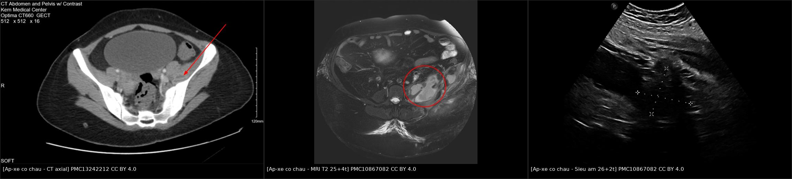
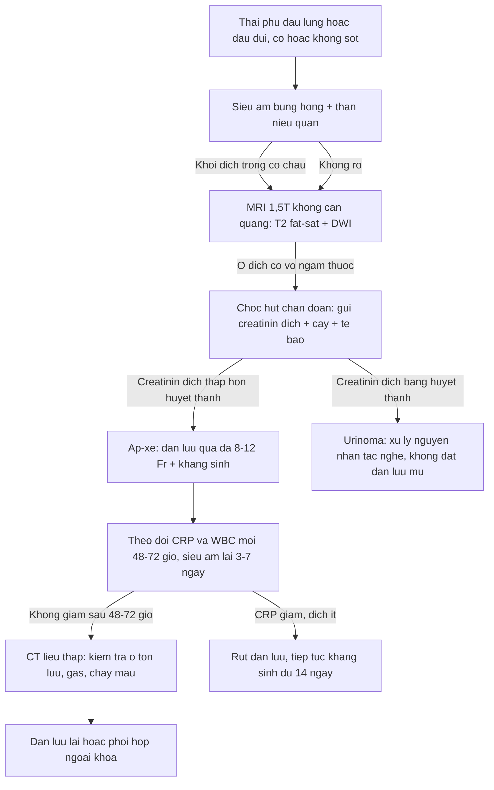
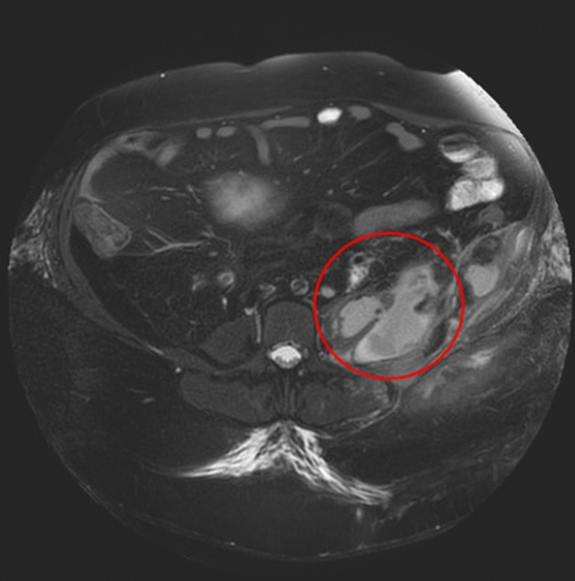
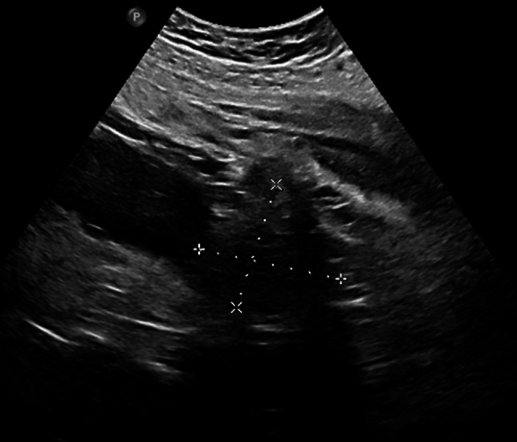
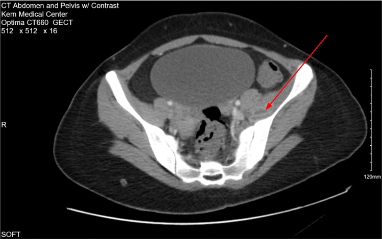

# 1928 — Áp-xe cơ chậu ở thai phụ: sốt VẮNG ở hơn nửa số ca, dẫn lưu qua da là ngưỡng can thiệp / Psoas abscess in pregnancy

**Tags:** `pattern:o-dich` `pattern:viem` `pattern:phu-co` `pattern:mat-duong-vien-co` `vung:thai-nhi` `vung:co-chau` `vung:sau-phuc-mac` `protocol:sieu-am-bung` `protocol:MRI-khong-can-tu` `protocol:CT-lieu-thap`
**Mức chắc chắn (certainty):** tổng hợp y văn (literature synthesis) — ghép **tổng quan 10 ca áp-xe cơ chậu trong thai** kèm 1 ca chỉ điểm có ảnh MRI + siêu âm (Arch Gynecol Obstet 2024, PMC10867082, CC BY 4.0), **đoàn hệ 233 ca áp-xe cơ chậu người lớn** để lấy ngưỡng sinh học – tử vong (BMC Infect Dis 2026, PMC13227668), và **ca áp-xe cơ chậu sau thủ thuật phụ khoa có ảnh CT** (Cureus 2026, PMC13242212, CC BY 4.0). Số nào nguồn không nêu ghi "chưa rõ".

> **Câu chốt:** áp-xe cơ chậu (psoas abscess) là bệnh **hiếm nhưng không được bỏ sót**: chỉ **10 ca** được báo cáo trong thai kỳ, xuất hiện **13–39 tuần**, và **sốt VẮNG ở hơn một nửa số ca** — tam chứng Mynter (đau lưng + sốt + đi khập khiễng) chỉ đủ ở **4/10 ca**. Vì thế bệnh nhân thường bị gọi là "đau lưng do thai" hoặc "thoát vị đĩa đệm", chẩn đoán muộn sau sinh, trong khi **siêu âm + MRI đủ để chẩn đoán** và **dẫn lưu qua da + kháng sinh 14 ngày** chữa khỏi mà không cần mổ (PMC10867082). Ngược lại, ở người lớn nói chung, áp-xe cơ chậu đã có sepsis **9,0%** và tử vong trong viện **5,2%** (PMC13227668) — nên "chờ xem" không phải lựa chọn.

## 1. Tổng quan bệnh học – cơ chế hình ảnh

### 1.1 Vì sao thai phụ dễ có áp-xe cơ chậu (TẠI SAO)

- **Giải phẫu:** cơ chậu–thắt lưng (iliopsoas) chạy từ **T12–L5 và cánh chậu** xuống **mấu chuyển nhỏ** xương đùi, nằm sát **thận, niệu quản, đại tràng, tĩnh mạch chậu** và **khớp háng** — nên ổ mủ từ 4 hướng đều đổ vào đây: **máu (nguyên phát)**, **cột sống**, **đường niệu**, **đường tiêu hóa/khớp háng (thứ phát, lan liên tục)**.
- **Trong thai, thể nguyên phát chiếm ưu thế:** 10 ca y văn có **8 nguyên phát / 2 thứ phát** (PMC10867082). Lý do: **thay đổi miễn dịch của thai** (giảm miễn dịch qua trung gian tế bào) + **ứ nước – nhiễm khuẩn đường niệu** do progesterone và chèn ép cơ học.
- **Con đường thực dụng nhất trong sản khoa là đường niệu:** ứ nước thận → **viêm thận–bể thận** → đặt **double J** → **thủng đài bể thận nhỏ (fornix rupture) không thấy được vì không được soi ngược dòng dưới huỳnh quang** → nước tiểu thoát ra khoang sau phúc mạc (**urinoma**) → bội nhiễm → **áp-xe cơ chậu**. Ca chỉ điểm là đúng chuỗi này: đặt double J ở **15 + 3 tuần**, rút ở **23 + 1 tuần**, sốt và đau đùi trái tái phát, MRI ở **24 + 0 tuần** cho ổ **20 × 10 cm** (PMC10867082).
- **Vì sao mủ tụ được trong cơ:** cơ chậu là **khoang kín giữa mạc chậu và mạc ngực–thắt lưng**, ít mô mỡ, dẫn lưu bạch huyết kém → ổ nhiễm khuẩn nhanh chóng thành **khối dịch có vỏ xơ** thay vì tự tiêu.
- **Vì sao đau kiểu "đau đùi khi gấp háng":** cơ chậu–thắt lưng là **cơ gấp háng mạnh nhất**; căng cơ trên ổ viêm gây đau khi **nâng chân, gấp háng chủ động**, và tư thế đùi gấp–dạng nhẹ để giảm đau = **dáng đi khập khiễng** — đây là gốc của "tam chứng Mynter".

### 1.2 Vì sao nhìn thấy — vật lý từng phương thức

- **Siêu âm (bước 1, không tia xạ):** mủ là **dịch giàu tế bào và protein** → **giảm hồi âm, không đồng nhất, có echo lợn cợn bên trong**, **tăng hồi âm phía sau** (khuếch đại âm do dịch), **không có tín hiệu Doppler trong lòng ổ** (khác u đặc), và **mất mặt phẳng mỡ sáng giữa cơ với cơ quan lân cận**. Đây là lý do siêu âm đủ để **đặt dẫn lưu** ngay tại giường.
- **MRI (bước 2, không tia xạ):** mủ là **nước tự do + xác tế bào** → **T2W/STIR rất sáng**, **T1W tối** (khác máu bán cấp có T1 sáng do methemoglobin), **DWI hạn chế khuếch tán – ADC thấp** vì dịch **nhớt và giàu tế bào** (không khuếch tán tự do như nước tiểu trong bàng quang); **vỏ áp-xe ngấm thuốc** vì là **mô hạt có mao mạch**. MRI còn trả lời câu hỏi mà siêu âm không trả lời được: **có viêm đĩa đệm–thân sống, có tổn thương thận, có urinoma** hay không.
- **CT (dự phòng):** trung tâm ổ mủ **0–20 HU** (gần nước), **vỏ ngấm thuốc thì muộn**, **khí trong ổ hiếm nhưng là dấu hiệu đặc hiệu**; cửa sổ xương cho thấy **hủy xương đốt sống / gai chậu**. CT dùng khi cần **bản đồ dẫn lưu** hoặc khi bệnh nhân không hợp tác được với MRI — luôn **liều thấp, giới hạn lát**.
- **X-quang bụng/thắt lưng:** **mất bóng cơ chậu một bên**, **vôi hóa**, **liệt ruột** — độ nhạy thấp, chỉ là dấu gợi ý; nhưng X-quang khung chậu vẫn cần khi **đau khi vận động háng** để loại trừ gãy/vỡ khớp.

### 1.3 Ngưỡng định lượng nằm lòng

| Đại lượng | Ngưỡng / con số | Ý nghĩa | Nguồn |
|---|---|---|---|
| Số ca áp-xe cơ chậu trong thai (y văn đến 2024) | **10 ca** | Bệnh hiếm — nhưng chính vì hiếm nên dễ bỏ sót | PMC10867082 |
| Tuổi thai khi phát hiện | **13–39 tuần** | Đa số ở **quý II–III** | PMC10867082 |
| Thể nguyên phát : thứ phát | **8 : 2** | Trong thai, đường máu chiếm ưu thế | PMC10867082 |
| Đủ tam chứng Mynter | **4/10 ca** | Không đủ tam chứng **không loại trừ** | PMC10867082 |
| Sốt | **vắng ở > 50%** | Dấu hiệu "âm" mạnh nhất bị bỏ qua | PMC10867082 |
| Mổ lấy thai : sinh ngả âm đạo | **4 : 4** | Áp-xe **không** phải chỉ định mổ lấy thai | PMC10867082 |
| Sinh trước 35 tuần | **0 ca** | Không có kết cục thai xấu được báo cáo | PMC10867082 |
| Kích thước ca chỉ điểm | **20 × 10 cm → 7 × 6 cm** | Co lại sau **11 ngày** dẫn lưu + kháng sinh | PMC10867082 |
| CRP ca chỉ điểm | **278 mg/L → 5 mg/L** | Mốc theo dõi đáp ứng | PMC10867082 |
| Thời gian kháng sinh ca chỉ điểm | **14 ngày** | Kèm rửa dẫn lưu 2 lần/ngày | PMC10867082 |
| Sốt trong đoàn hệ 233 ca người lớn | **39,1%** | Sốt cũng **không** là triệu chứng chính | PMC13227668 |
| Đau hông lưng trong đoàn hệ 233 ca | **55,8%** | Triệu chứng hay gặp nhất | PMC13227668 |
| Cấy dương tính | **38,7%** | Cấy âm không loại trừ | PMC13227668 |
| Tác nhân | **S. aureus 41,4% · E. coli 34,3%** | Chọn kháng sinh theo 2 nhóm này | PMC13227668 |
| Sepsis / tử vong trong viện | **9,0% / 5,2%** | Bệnh không "lành tính" | PMC13227668 |
| Đái tháo đường (yếu tố nguy cơ) | **28,8%** | Hỏi bệnh nền trước khi kết luận "đau lưng thai kỳ" | PMC13227668 |

## 2. Mẫu hình + chẩn đoán phân biệt theo vị trí (gamut)

- **Mẫu hình (pattern) cốt lõi:** **khối dịch một bên trong cơ chậu–thắt lưng, đường viền cơ mất, vỏ ngấm thuốc**, kèm **phù cơ** xung quanh. Gamut được chia theo **nguồn lan**, vì nguồn quyết định kháng sinh và có cần mổ hay không.
- **Nguồn từ máu (nguyên phát):** *S. aureus* (hay gặp nhất), liên cầu, *Klebsiella*; ở vùng dịch tễ — **lao cột sống** (3/10 ca trong thai, 2 ca hai bên).
- **Nguồn từ cột sống:** **viêm đĩa đệm–thân sống** (đau lưng + phù tủy 2 đốt + đĩa) lan ra cơ chậu; cần MRI cột sống, không chỉ MRI bụng.
- **Nguồn từ đường niệu:** **viêm thận–bể thận**, **áp-xe thận**, **sỏi niệu tắc**, **urinoma sau double J / sau chọc thận** — hay gặp trong thai; **creatinin dịch chọc hút ≈ huyết thanh** là chốt loại áp-xe.
- **Nguồn từ tiêu hóa:** **bệnh Crohn** (1 ca trong thai), viêm ruột thừa, viêm túi thừa, thủng đại tràng sau soi.
- **Nguồn từ khớp háng nhân tạo:** **nhiễm khớp nhân tạo** biểu hiện bằng áp-xe cơ chậu — bỏ sót thì thay khớp lại nhiều lần vô ích.
- **Bắt chước (mimic) không nhiễm:** **máu tụ cơ chậu** (sau sinh, chống đông), **u cơ – sarcoma**, **di căn cơ**, **lymphocele sau ghép thận**, **thoát vị đĩa đệm**, **đau dây thần kinh tọa**, **đau lưng – khung chậu do thai**.

## 3. Bảng so sánh phân biệt (ma trận đối chiếu)

| Thực thể (entity) | Hình ảnh điển hình | Chốt vào (rule-in) | Chốt loại (rule-out) | Gợi ý xác nhận |
|---|---|---|---|---|
| **Áp-xe cơ chậu** | Khối dịch trong cơ, vỏ mỏng ngấm thuốc, phù cơ quanh ổ, mất mặt phẳng mỡ với thận/đại tràng | **Vỏ ngấm thuốc + hạn chế khuếch tán + mật độ 0–20 HU trung tâm** | **Mật độ mỡ −40 đến −120 HU**, không vỏ, không hạn chế khuếch tán | Chọc hút dưới siêu âm: mủ + cấy; **creatinin dịch thấp hơn huyết thanh** |
| **Urinoma** | Khối dịch quanh thận/niệu quản, hình bầu dục theo đường thoát nước tiểu, thành mỏng đều | **Creatinin dịch chọc hút ≈ creatinin huyết thanh**; tiền sử can thiệp niệu quản | **Không có vỏ ngấm thuốc**, dịch "sạch" trên MRI, bệnh nhân không sốt | Đo creatinin dịch — xét nghiệm rẻ nhất và quyết định nhất |
| **Máu tụ cơ chậu** | Khối trong cơ, **T1W sáng** khi bán cấp (methemoglobin), không vỏ | **T1 sáng + không hạn chế khuếch tán mạnh + Hct dịch giảm dần** | Không sốt, không tăng CRP đáng kể, có chống đông/sau sinh | Theo dõi kích thước; chọc hút chỉ khi chẩn đoán chưa rõ |
| **Viêm cơ chưa hóa mủ** | Phù cơ lan tỏa, T2W sáng, **không có ổ dịch khu trú** | Phù cơ + đau + CRP tăng, **chưa có khoang dịch** | Không có vỏ, không có ổ dịch | Kháng sinh trước, MRI lại sau 48–72 giờ |
| **Viêm đĩa đệm–thân sống** | Phù tủy 2 đốt kề đĩa, đĩa tăng tín hiệu, viền ngấm, áp-xe dưới dây chằng | **Hai đốt + đĩa + hủy xương trên CT** | Cơ chậu bình thường, không ổ dịch trong cơ | MRI cột sống có tiêm; cấy máu/sinh thiết đĩa |
| **Sarcoma cơ – u đặc** | Khối đặc, ngấm thuốc không viền, có vùng hoại tử, **không hạn chế khuếch tán đồng nhất** | Khối đặc có thành phần mô mềm thật trên T1/T2 | Không sốt, CRP bình thường, không đau kiểu viêm | Sinh thiết có hình ảnh — **không chọc mù** |
| **Nhiễm khớp háng nhân tạo** | Nang hoạt dịch cơ chậu, khí, mất đường viền cơ, lỏng/vỡ quanh implant | **Khí + nang cơ chậu + tiền sử thay khớp** | Không có implant, không khí | Chọc khớp; cấy dịch khớp trước khi mổ lại |
| **Thoát vị đĩa đệm / đau thai kỳ** | MRI cột sống: lồi đĩa chèn rễ, **cơ chậu bình thường** | Đau theo rễ, không ổ dịch | **Có ổ dịch trong cơ = loại** | Không cần chọc hút |

## 4. Protocol chụp + hệ phân độ/điểm chuẩn hóa

### 4.1 Trình tự hình ảnh trong thai

1. **Siêu âm bụng – hông bên đau (bước 1, ngay tại giường):** tìm **khối giảm hồi âm trong cơ chậu**, so sánh hai bên, đo **hai chiều lớn nhất**, **đánh dấu vị trí đặt dẫn lưu**; kèm **siêu âm thận – niệu quản** để tìm ứ nước, sỏi, urinoma. Thêm **Doppler xung đo chỉ số sức cản (RI)** của động mạch thận khi nghi tắc nghẽn — công cụ được nêu là **đã kiểm chứng** cho rối loạn tắc niệu quản (PMC10867082).
2. **MRI 1,5 T không cản quang (bước 2):** **T2W fat-sat/STIR axial + coronal**, **DWI/ADC**, kèm **chuỗi cột sống thắt lưng** nếu đau lưng là triệu chứng chính. Gadolinium **chỉ khi cần phân biệt vỏ áp-xe với mô đặc**; có thể dùng trong thai khi có chỉ định, không cần ngừng cho con bú (ACR).
3. **CT liều thấp (bước 3, dự phòng):** khi cần **bản đồ dẫn lưu phức tạp**, khi MRI không thực hiện được, hoặc nghi **biến chứng (thủng, khí trong ổ, chảy máu)**.
4. **Không chọc mù khối chưa xác định bản chất:** chọc hút chỉ sau khi có ảnh mặt cắt, và **luôn gửi creatinin dịch** cùng cấy.

### 4.2 Ngưỡng can thiệp và theo dõi

- **Chỉ định dẫn lưu:** ổ dịch **đã hóa mủ, có vỏ**, hoặc **không đáp ứng kháng sinh sau 48–72 giờ**, hoặc **ổ lớn gây chèn ép/đau không kiểm soát**. Ca chỉ điểm: ổ **20 × 10 cm** được **dẫn lưu qua da dưới siêu âm** thành công ở **24 + 0 tuần**, kể cả bệnh nhân **BMI 45 kg/m²** (PMC10867082).
- **Kỹ thuật:** catheter **8–12 Fr** (cỡ theo độ nhớt mủ và độ sâu), **rửa 2 lần/ngày**; nếu catheter **tuột** (đã xảy ra ở **24 + 5 tuần** trong ca chỉ điểm) → **đặt lại ngay** vào ổ còn lại, không chờ.
- **Kháng sinh:** theo **S. aureus và trực khuẩn Gram âm đường ruột** (ampicillin/sulbactam hoặc piperacillin/tazobactam; ca chỉ điểm dùng **piperacillin/tazobactam 1,5 g × 3/ngày**, vi khuẩn *Prevotella bivia*); **14 ngày** trong ca chỉ điểm, **2–4 tuần** với ổ lớn — ngưỡng thời gian **chưa có thử nghiệm ngẫu nhiên** ở thai, ghi rõ "chưa rõ chuẩn".
- **Theo dõi:** **CRP + WBC mỗi 48–72 giờ**, siêu âm lại **mỗi 3–7 ngày**; rút dẫn lưu khi **lâm sàng hết sốt, dịch < 10–20 mL/ngày và CRP giảm > 50%** (mốc thực hành, chưa có chuẩn thống nhất). Ca chỉ điểm rút ở **26 + 6 tuần** với **CRP 5 mg/L** và **WBC 10 × 10⁹/L**.
- **Phối hợp sản khoa — điều KHÔNG làm:** **không mổ lấy thai vì áp-xe**. Trong 10 ca y văn, **4 mổ lấy thai / 4 sinh ngả âm đạo**, **không ca nào sinh < 35 tuần**, **không có kết cục thai xấu** (PMC10867082). Sản khoa chỉ can thiệp vì **chỉ định sản khoa**, không vì ổ mủ sau phúc mạc.

**Phân tầng độ nặng (không có hệ phân độ riêng cho áp-xe cơ chậu — dùng Sepsis-3):** có **sepsis/septic shock** là mốc chuyển hồi sức; trong đoàn hệ 233 ca, **9,0% có sepsis** và **5,2% tử vong trong viện** (PMC13227668).

## 5. Biến thể bình thường và cạm bẫy

- **Bất đối xứng cơ chậu là bình thường:** cơ chậu **to hơn bên phải** ở người thuận phải, và **to lên ở vận động viên**; chỉ gọi bệnh khi có **ổ dịch, phù, hoặc mất mặt phẳng mỡ** — không dựa vào "cơ to hơn".
- **Cạm bẫy 1 — "không sốt thì không phải áp-xe":** sốt **vắng ở > 50%** ca trong thai (PMC10867082) và chỉ **39,1%** trong đoàn hệ người lớn (PMC13227668). Đau cơ – đùi kiểu "gấp háng đau" + CRP tăng **đủ để chụp**.
- **Cạm bẫy 2 — đọc MRI cột sống mà bỏ cơ chậu:** ca chỉ điểm khởi đầu bị nghĩ **thoát vị đĩa đệm**; ổ mủ chỉ lộ ra khi **MRI lấy hết trường nhìn cơ chậu**. Đây là **satisfaction of search** kinh điển: thấy bất thường đĩa là dừng tìm.
- **Cạm bẫy 3 — chọc hút rồi gọi "mủ" mà không đo creatinin:** urinoma bội nhiễm trông như áp-xe trên mọi chuỗi xung; **creatinin dịch ≈ huyết thanh** là chốt loại, và điều trị là **giải quyết tắc nghẽn**, không phải đặt dẫn lưu mủ.
- **Cạm bẫy 4 — quy "đau lưng" cho thai:** nếu triệu chứng **kéo dài và tăng dần**, phải chụp lại; trong y văn nhiều ca chỉ được chẩn đoán **sau sinh** vì triệu chứng bị coi là của thai (PMC10867082).
- **Cạm bẫy 5 — coi "ổ nhỏ lại" là khỏi:** ca chỉ điểm giảm **20 × 10 cm → 7 × 6 cm trong 11 ngày** nhưng vẫn cần dẫn lưu và kháng sinh đủ liệu trình; kích thước giảm **không** thay thế theo dõi CRP.
- **Cạm bẫy 6 — dùng CT sớm ở thai phụ:** CT chỉ để **lập kế hoạch dẫn lưu** hoặc khi nghi biến chứng; MRI/siêu âm trả lời được gần như toàn bộ câu hỏi chẩn đoán.

## 6. Tự lượng giá — Blind Quiz ngay trên trang tĩnh

**Ca 1 — Thai phụ 24 tuần, đau đùi trái, KHÔNG sốt**

- Gợi ý lâm sàng (clinical context): 38 tuổi, BMI 45 kg/m², đã đặt và rút double J vì ứ nước nhiễm khuẩn; đau và yếu chân trái khi nâng chân, **không sốt**, CRP 278 mg/L, WBC 17 × 10⁹/L.
- Câu hỏi: Khối dịch nằm ở **khoang nào** và **lan theo đường nào**? Nêu 3 chẩn đoán phân biệt? Dấu hiệu nào trên ảnh chốt bản chất **áp-xe** thay vì **urinoma**?

<b>Bấm để hiện đáp án (findings + chẩn đoán)</b>

- Dấu hiệu (findings): khối **tăng tín hiệu T2 không đồng nhất, nhiều thùy** trong **cơ chậu–thắt lưng trái** (khoanh đỏ), **mất mặt phẳng mỡ** giữa cơ và thận trái; ổ đo **7 × 6 cm** ở lần chụp này — **trước đó 11 ngày là 20 × 10 cm** trên MRI ngoài viện.
- Chẩn đoán (diagnosis): **áp-xe cơ chậu trái** sau đặt double J vì ứ nước nhiễm khuẩn. Chốt loại urinoma bằng **creatinin dịch chọc hút thấp hơn huyết thanh**; chốt loại máu tụ bằng **T1 không sáng** và bệnh cảnh nhiễm.
- Nguồn ảnh: Arch Gynecol Obstet 2024 (PMC10867082), Fig. 2 — CC BY 4.0.

**Ca 2 — Cùng bệnh nhân, 6 ngày sau**

- Gợi ý lâm sàng: đang dẫn lưu qua da, rửa 2 lần/ngày, CRP đang giảm.
- Câu hỏi: Hai dấu hiệu siêu âm nào xác nhận **dịch tự do trong ổ**? Khi nào được rút dẫn lưu?

<b>Bấm để hiện đáp án (findings + chẩn đoán)</b>

- Dấu hiệu (findings): ổ **giảm hồi âm, echo lợn cợn**, thước đo **5 × 5 cm**; **không có tín hiệu Doppler trong lòng ổ**; đuôi tăng hồi âm phía sau.
- Chẩn đoán (diagnosis): ổ áp-xe **đang thu nhỏ** dưới điều trị — rút dẫn lưu khi hết sốt, dịch < 10–20 mL/ngày, CRP giảm (ca này rút ở **26 + 6 tuần** với CRP 5 mg/L).
- Nguồn ảnh: Arch Gynecol Obstet 2024 (PMC10867082), Fig. 3 — CC BY 4.0.

**Ca 3 — Nữ 21 tuổi sau thủ thuật phụ khoa, đau hai chân, không đi được**

- Gợi ý lâm sàng: sốt, mạch nhanh, WBC 32.000/µL; đau lan hai chân, không đứng được; cấy máu *Streptococcus pyogenes*.
- Câu hỏi: Mô tả **đậm độ và vỏ** của ổ? Vì sao **không đặt dẫn lưu** ở ca này?

<b>Bấm để hiện đáp án (findings + chẩn đoán)</b>

- Dấu hiệu (findings): ổ **giảm đậm độ, không đồng nhất** trong **cơ chậu trái** (mũi tên đỏ) ở thì có cản quang, **vỏ ngấm thuốc mảnh**, phù mô mỡ quanh cơ; **không có khí**.
- Chẩn đoán (diagnosis): **áp-xe cơ chậu do S. pyogenes sau nạo hút thai** — ổ còn nhỏ, chưa có vỏ dày nên **không dẫn lưu được**, điều trị **kháng sinh đích theo cấy máu** và hồi phục (Cureus 2026, PMC13242212).
- Phản biện: ca này **không phải thai đang tiến triển**, nên dùng làm ví dụ **hình ảnh CT**, không dùng để suy ra tỷ lệ trong thai.
- Nguồn ảnh: Cureus 2026 (PMC13242212), Fig. 1 — CC BY 4.0.

## Bài liên quan chéo
- [1923 – Áp-xe thận – quanh thận ở thai phụ](../1923-ap-xe-than-quanh-than-thai/lesson.md)
- [1921 – Nhiễm khuẩn niệu và viêm thận–bể thận ở thai phụ](../1921-nhiem-khuan-nieu-thai-ky/lesson.md)
- [1922 – Sỏi niệu và đặt stent sau sinh](../1922-soi-nieu-sau-sinh-cho-con-bu/lesson.md)
- [1721 – Nhiễm khuẩn stent niệu quản](../1721-nhiem-khuan-stent-nieu-quan/lesson.md)
- [1924 – Sốc nhiễm khuẩn niệu ở thai phụ](../1924-soc-nhieu-khuan-nieu-thai/lesson.md)

## Ảnh
- 3 ảnh gốc + 1 ảnh ghép, tất cả **CC BY 4.0** — chi tiết Fig/PMCID trong `images/CREDITS.md`.
- Không tải ảnh từ PMC13227668 (CC BY-NC-ND, chỉ dùng số liệu) và không dùng Radiopaedia/AuntMinnie cho bài này.

> Không dùng để chẩn đoán độc lập khi chưa có người hướng dẫn.
