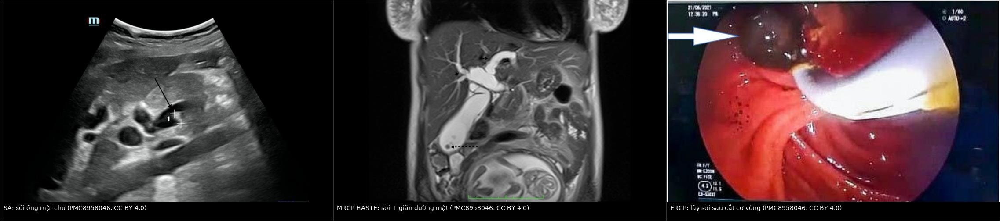
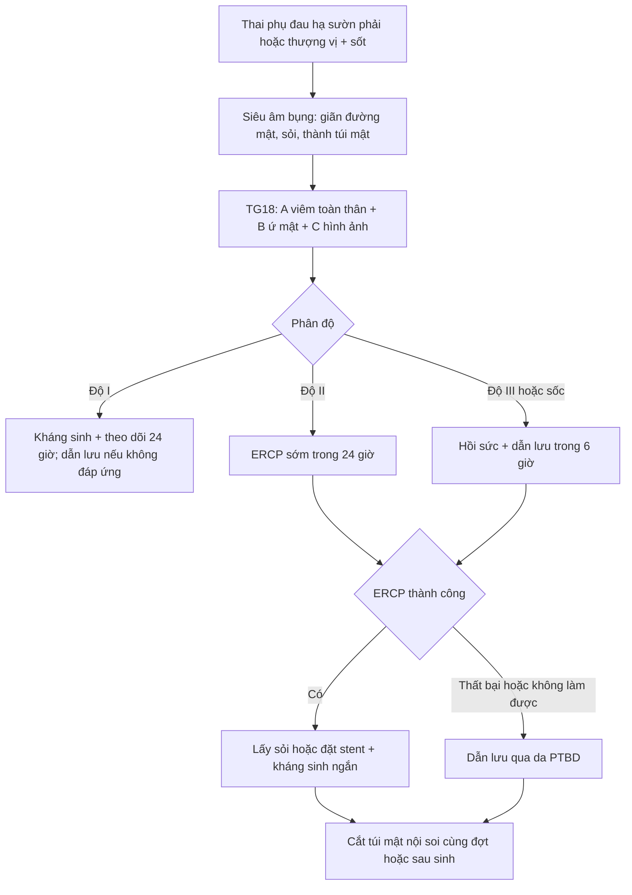
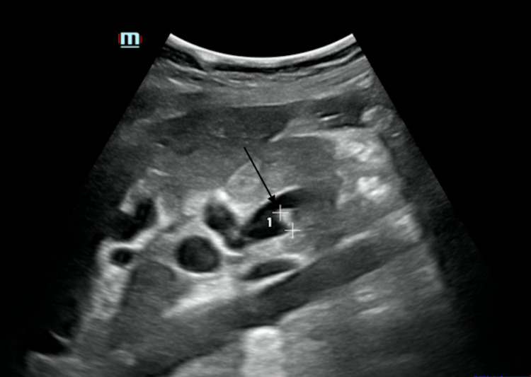
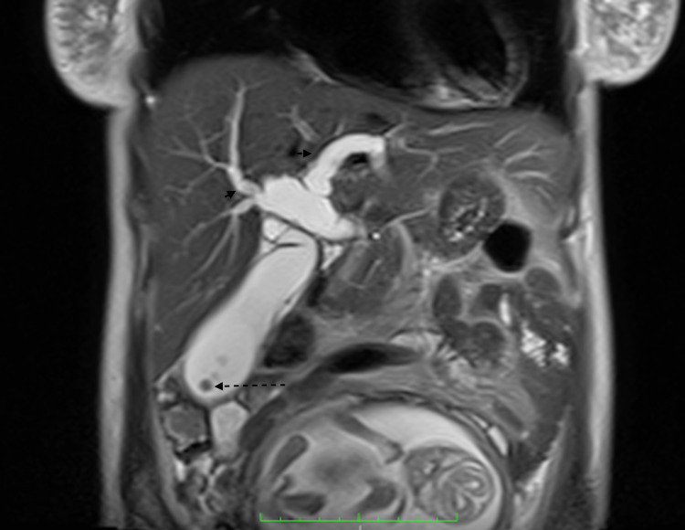
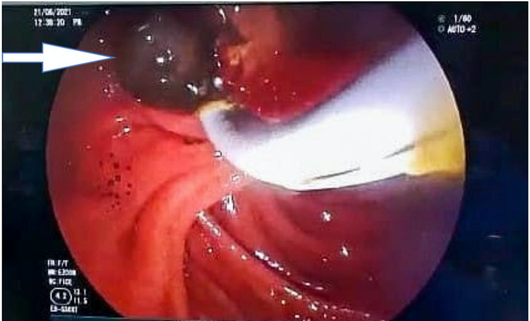

# 1929 — Viêm đường mật cấp ở thai phụ (acute cholangitis): TG18, dẫn lưu trong 6–24 giờ, ERCP dưới 0,5 mGy / Acute cholangitis in pregnancy

**Tags:** `pattern:viem` `pattern:tac-nghen` `pattern:gian-ong-mat` `pattern:soi` `vung:duong-mat` `vung:tui-mat` `vung:thai-nhi` `score:TG18` `protocol:sieu-am-bung` `protocol:MRCP` `protocol:ERCP`
**Mức chắc chắn (certainty):** tổng hợp y văn (literature synthesis) — ghép **tổng quan điều trị nhiễm khuẩn đường mật 2023** (PMC10380792: tiêu chuẩn và phân độ TG18, thời điểm dẫn lưu), **ca thai phụ có ảnh siêu âm – MRCP – ERCP** (PMC8958046), **phân tích tổng hợp ERCP trong thai 27 nghiên cứu/1.307 ca** (PMC6941455), **sổ đăng ký toàn quốc Thụy Điển** (PMC10793794: 291 cắt túi mật + 63 ERCP ở thai), **nghiên cứu thời điểm ERCP** (PMC7145040, PMC9594008, PMC13467050), **tổng quan kỹ thuật ERCP ở thai** (PMC7541181), **phân tích tổng hợp kháng sinh ngắn vs dài** (PMC10237100) và **nghiên cứu giá trị Charcot/TG18** (PMC12482217). Số nào nguồn không nêu ghi "chưa rõ".

> **Câu chốt:** viêm đường mật ở thai phụ là **nhiễm khuẩn ứ mật dưới áp lực** — **kháng sinh không cứu được nếu không giải áp**, và **ERCP không chống chỉ định vì thai**. Ba con số quyết định: **tử vong chung 1,9%** nhưng tới **20%** khi có vi khuẩn kháng đa thuốc; **dẫn lưu trong 6 giờ** nếu sốc, và **ERCP < 24 giờ giảm 20% tử vong** so với ≥ 24 giờ; trong thai, ERCP có **biến cố thai 5,2–6,2%** và **liều xạ trung bình < 0,5 mGy** — **thấp hơn 20 lần ngưỡng 10 mGy gây dị tật**.

## 1. Tổng quan bệnh học – cơ chế hình ảnh

### 1.1 Vì sao thai phụ có sỏi và vì sao sỏi gây NHIỄM (TẠI SAO)

- **Sỏi hình thành nhanh trong thai:** **estrogen** làm gan tăng bài xuất cholesterol → **mật quá bão hòa**; **progesterone** làm **giảm co bóp túi mật** → **ứ trệ**. Trong nghiên cứu tiến cứu **3.200 thai phụ** có siêu âm bình thường ban đầu, **sỏi/bùn mật mới xuất hiện ở 7,1% (quý II), 7,9% (quý III) và 10,2% (6 tuần sau sinh)**; **1,2%** có triệu chứng, và **10%** trong số có triệu chứng tiến triển thành biến chứng nặng (viêm túi mật, **viêm đường mật**, sỏi ống mật chủ, hẹp, viêm tụy) (PMC6941455). Sỏi mật gặp ở **12%** thai kỳ và hậu sản; **sỏi ống mật chủ ≈ 1/1.200 ca sinh** (PMC8958046).
- **Vì sao ứ mật thành nhiễm khuẩn:** sỏi kẹt → **tăng áp lực trong ống mật** → **giãn đường mật** + **trào ngược vi khuẩn từ tá tràng (cholangiovenous reflux)** → vi khuẩn đường ruột (**E. coli, Klebsiella, Enterococcus, Enterobacter**) vào máu. Vì vậy **tam chứng Charcot chỉ là phần nổi**: sốt – đau – vàng da, còn **tụt áp và rối loạn tri giác (ngũ chứng Reynolds)** là đã có **nhiễm khuẩn huyết**.
- **Vì sao kháng sinh đơn thuần thất bại:** thuốc không thấm vào **mật ứ dưới áp lực** và **màng sinh học** trên sỏi; ổ nhiễm chỉ được giải quyết khi **áp lực đường mật giảm** (dẫn lưu). Đây là lý do TG18 đặt **dẫn lưu đường mật là điều trị cốt lõi**, kháng sinh chỉ hỗ trợ (PMC10380792).
- **Vì sao thai làm bệnh nặng hơn:** **giảm dự trữ chức năng gan–thận, tăng thể tích máu, giảm đáp ứng viêm** và **chậm trễ chẩn đoán vì "đau bụng là chuyện của thai"** → thai phụ thường tới ở giai đoạn **sốc nhiễm khuẩn**.

### 1.2 Vì sao hình ảnh trông như vậy (vật lý từng phương thức)

- **Siêu âm (bước 1):** sỏi là **cấu trúc tăng hồi âm + bóng lưng sạch**; **giãn ống mật chủ** là **ống dạng dịch, trống âm, chạy song song tĩnh mạch cửa** ("dấu ống song song"). Siêu âm **không tia xạ**, làm tại giường, nhưng **bỏ sót sỏi đoạn xa** vì hơi ruột và **không phân biệt được bùn/sỏi nhỏ**.
- **MRCP (khi nghi sỏi hoặc cần bản đồ trước ERCP):** mật là **dịch T2 rất sáng**, sỏi là **vùng mất tín hiệu (signal void)** trong lòng ống, **không cần cản quang** → **không cần gadolinium** (an toàn hơn cho thai). Hình dày lát **MIP** cho bản đồ toàn bộ cây đường mật; hạn chế là **sỏi < 3 mm** và **bùn** dễ bị bỏ sót.
- **CT:** **hạn chế trong thai**; dùng **liều thấp** khi nghi biến chứng (thủng, áp-xe, viêm tụy hoại tử) hoặc khi siêu âm/MRCP không trả lời được câu hỏi can thiệp.
- **ERCP:** không phải "chẩn đoán hình ảnh" mà là **điều trị + chẩn đoán tại chỗ** — nhìn **mủ chảy ra từ bóng Vater** (dấu hiệu chắc chắn nhất của viêm đường mật mủ), cắt cơ vòng, lấy sỏi, đặt stent. Fluoroscopy chỉ dùng **ngắn** để xác nhận vị trí.

### 1.3 Ngưỡng định lượng nằm lòng

| Đại lượng | Ngưỡng / con số | Ý nghĩa | Nguồn |
|---|---|---|---|
| Sỏi/bùn mật mới trong thai | **7,1% quý II · 7,9% quý III · 10,2% sau sinh 6 tuần** | Bệnh lý mật tăng dần theo tuổi thai | PMC6941455 |
| Sỏi ống mật chủ ở thai | **≈ 1/1.200 ca sinh** | Hiếm nhưng là nguyên nhân chính của viêm đường mật | PMC8958046 |
| Vàng da theo TG18 | **bilirubin ≥ 2 mg/dL** | Tiêu chuẩn B1 (ứ mật) | PMC10380792 |
| Chẩn đoán TG18 | **Nghi: A + (B hoặc C) · Xác định: A + B + C** | A = viêm toàn thân, B = ứ mật, C = hình ảnh | PMC10380792 |
| Độ III (nặng) | Suy tạng: **dopamine ≥ 5 µg/kg/phút hoặc norepinephrine**, **PaO₂/FiO₂ < 300**, **creatinin > 2,0 mg/dL**, **PT-INR > 1,5**, **tiểu cầu < 100.000/mm³**, rối loạn tri giác | Phải **dẫn lưu khẩn** | PMC10380792 |
| Độ II (trung bình) | **2 trong 5**: **BC > 12.000 hoặc < 4.000/mm³**, **sốt ≥ 39 °C**, **tuổi ≥ 75**, **bilirubin ≥ 5 mg/dL**, **albumin thấp** | Dẫn lưu sớm | PMC10380792 |
| Sốc nhiễm khuẩn | Dẫn lưu đường mật **trong 6 giờ** | Không chờ "ổn định" | PMC10380792 |
| ERCP < 24 giờ | **Giảm 20% tử vong** so với ≥ 24 giờ (phân tích tổng hợp) | Dẫn lưu sớm có lợi | PMC10380792 |
| Tử vong chung | **1,9%** (84.063 bệnh nhân, 14 nghiên cứu); **4,3%** khi loại nghiên cứu cơ sở dữ liệu hành chính | Nền để so sánh | PMC7145040 |
| Tử vong khi kháng đa thuốc | tới **20%** | Lý do cấy + xuống thang kháng sinh | PMC10380792 |
| Xạ trong ERCP ở thai | **fluoroscopy trung bình 15 giây, liều < 0,5 mGy** | Ngưỡng phản ứng mô **10 mGy** → an toàn | PMC7541181 |
| Biến cố ERCP ở thai | **15,9%** tổng; **thai 5,2–6,2%**; **mẹ liên quan thai 7,1–8,4%** | 27 nghiên cứu, 1.307 thai phụ | PMC6941455 |
| Kháng sinh ngắn (2–3 ngày) | **OR 0,78 (0,23–2,67)** so với dài hơn | Không thua kém về tử vong | PMC10237100 |

## 2. Mẫu hình + chẩn đoán phân biệt theo vị trí (gamut)

**Mẫu hình chính:** *đau hạ sườn phải/thượng vị + sốt ± vàng da ở thai phụ* → **giãn đường mật + sỏi** → **viêm đường mật**. Gamut xếp theo **vị trí ổ và mức tắc**:

- **Trong lòng ống mật:** sỏi ống mật chủ (hay nhất), **sỏi kẹt bóng Vater**, **bùn mật**, **ký sinh trùng (Ascaris, Fasciola)**, **mảnh stent cũ/di trú** — giãn đường mật + sỏi thấy trên siêu âm/MRCP.
- **Thành ống mật:** **hẹp lành tính sau cắt túi mật** (bài 108), hẹp miệng nối sau ghép, **xơ đường mật nguyên phát (PSC)** — giãn + hẹp dài, không sỏi.
- **Ngoài lòng ống (chèn ép):** **Mirizzi** (sỏi ống túi mật chèn ống gan chung), **u đường mật/tụy đầu** (bài 136), **hạch** — giãn đường mật, không sỏi trong lòng.
- **Gan – nhu mô:** **viêm gan virus/thuốc** (ALT/AST rất cao, **không giãn đường mật**), **áp-xe gan**, **bệnh gan do xạ**.
- **Thai kỳ đặc thù:** **ứ mật trong thai (ICP)** — ngứa, acid mật tăng, **không sốt, không giãn**; **HELLP/preeclampsia** — tăng huyết áp, protein niệu, tiểu cầu giảm; **gan nhiễm mỡ cấp (AFLP)** — hạ đường huyết, rối loạn đông máu, bệnh não.
- **Ổ ngoài đường mật:** **viêm túi mật cấp** (bài 1925), **viêm tụy do sỏi**, **viêm thận–bể thận phải** (bài 1924), **viêm ruột thừa** (bài 145), **loét dạ dày thủng**.

## 3. Bảng so sánh phân biệt (ma trận đối chiếu)

| Thực thể (entity) | Hình ảnh / xét nghiệm điển hình | Chốt vào (rule-in) | Chốt loại (rule-out) | Gợi ý xác nhận |
|---|---|---|---|---|
| **Viêm đường mật cấp** | **Giãn ống mật chủ + sỏi**; thành ống dày; mủ từ bóng Vater khi ERCP | **Sốt/rét run + vàng da (bilirubin ≥ 2 mg/dL) + giãn đường mật/sỏi** | Đường mật **không giãn**, không sỏi, **không viêm toàn thân** → loại | Siêu âm → MRCP; ERCP điều trị |
| **Viêm túi mật cấp** | Sỏi + **thành túi mật > 3 mm** + dịch quanh túi + Murphy siêu âm | **Đau hạ sườn phải + Murphy + thành dày + sỏi** | Đường mật **không giãn**, bilirubin bình thường → ít nghĩ viêm đường mật | Siêu âm (bài 1925) |
| **Sỏi ống mật chủ KHÔNG nhiễm** | Sỏi trong ống giãn, **không dịch quanh**, thành mỏng | **Đau + vàng da tắc mật nhưng KHÔNG sốt, BC bình thường** | **Sốt + BC tăng + rét run** → đã nhiễm, không còn "không nhiễm" | MRCP/EUS; ERCP lấy sỏi |
| **Viêm tụy do sỏi** | Tụy phù, dịch quanh tụy; **lipase > 3× ULN** | **Đau thượng vị lan sau lưng + lipase > 3× ULN + sỏi** | Lipase bình thường → loại | Lipase, CT/MRI; ERCP nếu kèm tắc |
| **Viêm gan virus/thuốc** | Gan không giãn đường mật; **ALT/AST > 1.000 U/L** | **ALT/AST rất cao + không giãn đường mật + không sỏi** | **Giãn đường mật + sỏi** → không phải viêm gan đơn thuần | Huyết thanh virus, tiền sử thuốc |
| **Ứ mật trong thai (ICP)** | Không giãn đường mật, không sỏi; **acid mật tăng** | **Ngứa + acid mật tăng + không sốt** | **Sốt + đau + giãn đường mật** → không phải ICP | Acid mật, men gan; theo dõi thai |
| **HELLP / preeclampsia** | Gan có thể **hồ máu dưới bao**, **không giãn đường mật** | **HA ≥ 140/90 + protein niệu + tiểu cầu < 100.000/mm³ + LDH tăng** | Không tăng HA, không protein niệu → ít nghĩ | Xét nghiệm sản khoa; **không ERCP** |
| **Gan nhiễm mỡ cấp (AFLP)** | Gan **giảm đậm độ lan tỏa**, không giãn đường mật | **Vàng da + hạ đường huyết + rối loạn đông máu + bệnh não** | Đường mật giãn + sỏi → không phải AFLP | Xét nghiệm; cấp cứu sản khoa |

*Hình 1 — **Trái:** siêu âm ngang ống mật chủ, mũi tên chỉ **sỏi tăng hồi âm** trong lòng ống giãn. **Giữa:** MRCP HASTE coronal — nhiều **sỏi mất tín hiệu** trong túi mật căng và **giãn đường mật trong + ngoài gan**. **Phải:** ERCP sau cắt cơ vòng — **sỏi** (mũi tên) được lấy ra khỏi bóng Vater. Nguồn: PMC8958046 Fig. 2, 3, 5, **CC BY 4.0**; ảnh ghép letterbox, không crop/kéo giãn.*

## 4. Protocol + phân độ TG18 + quyết định

### 4.1 Chẩn đoán theo TG18 (2018)

1. **A – Viêm toàn thân:** sốt và/hoặc rét run; **BC tăng/giảm**, **CRP tăng**.
2. **B – Ứ mật:** **vàng da (bilirubin ≥ 2 mg/dL)**; **ALP, GGT, transaminase tăng**.
3. **C – Hình ảnh:** **giãn đường mật**; **bằng chứng nguyên nhân** (sỏi, hẹp, stent).
4. **Nghi ngờ:** **A + (B hoặc C)**; **xác định:** **A + B + C** (PMC10380792).
5. **Cấy máu 2 lần + cấy mật khi ERCP** trước/sớm sau kháng sinh; **không chờ kết quả** để dẫn lưu.

### 4.2 Phân độ và thời điểm dẫn lưu

- **Độ I:** kháng sinh + theo dõi; **dẫn lưu nếu không cải thiện trong 24 giờ**.
- **Độ II:** **ERCP sớm (< 24 giờ)**; **độ III/sốc: dẫn lưu trong 6 giờ** song song hồi sức (PMC10380792).
- **Thất bại ERCP** (không tiếp cận được bóng Vater, hẹp dài, thai quá lớn): **dẫn lưu đường mật qua da (PTBD)** hoặc **mổ dẫn lưu** — không chờ.
- **Sau khi giải áp:** **cắt túi mật nội soi** (cùng đợt nếu quý II và ổn định, hoặc sau sinh) vì sỏi còn đó; trì hoãn làm tăng tái phát và can thiệp sau sinh (bài 1925).

### 4.3 ERCP ở thai phụ — kỹ thuật và an toàn

- **Tư thế:** **nghiêng chậu trái hoặc nằm nghiêng trái** để giảm chèn ép tĩnh mạch chủ; **an thần liều thấp nhất hiệu quả với thuốc nhóm B** (PMC7541181).
- **Giảm xạ:** **che chắn ngoài, giảm thời gian chiếu, liều thấp, chiếu xung**; trung bình **15 giây, < 0,5 mGy** — dưới ngưỡng **10 mGy** gây phản ứng mô (PMC7541181).
- **ERCP không dùng xạ (US/EUS dẫn đường):** khả thi ở **21 thai phụ**, lấy sạch sỏi **100%**, chỉ **5 ca** cần fluoroscopy, **viêm tụy sau ERCP 3,8%** — nhưng **đòi hỏi bác sĩ rất có kinh nghiệm** (PMC7541181).
- **Nơi làm:** **trung tâm có kinh nghiệm**, có **sản khoa theo dõi tim thai** trước – trong – sau; **quý I** nhạy cảm nhất với tạo cơ quan nên **tối ưu hóa giảm xạ** (PMC7541181).
- **Bằng chứng an toàn:** **63 ERCP ở thai** trong sổ đăng ký Thụy Điển **không làm tăng biến cố 30 ngày** so với phụ nữ không mang thai sau khi hiệu chỉnh (PMC10793794); phân tích tổng hợp **1.307 ca** cho biến cố thai **5,2–6,2%**, không khác biệt giữa có và không dùng xạ (PMC6941455).

### 4.4 Kháng sinh

- **Khởi đầu:** cephalosporin thế hệ 3 (**ceftriaxone/cefotaxime**) ± **metronidazole** nếu nghi kỵ khí; **piperacillin–tazobactam** hoặc **carbapenem** khi sốc/yếu tố nguy cơ vi khuẩn kháng (PMC10380792).
- **Thời gian:** sau khi **dẫn lưu hiệu quả**, **không cần kéo dài mặc định** — **2–3 ngày** không thua kém phác đồ dài về tử vong (**OR 0,78; 0,23–2,67**) (PMC10237100); xuống thang theo cấy.
- **Kiểm soát ổ nhiễm quan trọng hơn thời gian kháng sinh:** bệnh nhân không cải thiện sau 24–48 giờ phải **kiểm tra lại dẫn lưu**, không phải "đổi kháng sinh mạnh hơn".

## 5. Biến thể bình thường và cạm bẫy

- **Tam chứng Charcot KHÔNG đủ để loại trừ:** độ nhạy chỉ **25,4% (đủ 3 thành tố)** và **28,6% (thiếu thành tố)**; TG18 "xác định" có **độ nhạy 65,1%, độ đặc hiệu 88,4%** (PMC12482217). **Không có tam chứng không có nghĩa không viêm đường mật.**
- **Sốt + vàng da chưa chắc là viêm đường mật:** **HELLP, gan nhiễm mỡ cấp, viêm gan virus** đều vàng da + men gan cao; **không giãn đường mật** là mấu chốt — ERCP ở các bệnh này là **can thiệp oan**.
- **"Chờ ổn định rồi mới dẫn lưu":** ngược lại — ở **sốc nhiễm khuẩn**, dẫn lưu **trong 6 giờ**; chờ kháng sinh "ổn định" là chờ tử vong (PMC10380792).
- **Sợ tia mà bỏ ERCP:** liều thực tế **< 0,5 mGy**, thấp hơn **20 lần** ngưỡng **10 mGy**; bỏ dẫn lưu vì sợ tia gây hại nhiều hơn.
- **Sỏi < 3 mm và bùn:** **MRCP dễ bỏ sót**; nếu lâm sàng mạnh mà MRCP âm, **EUS** là bước tiếp theo trước khi kết luận "không tắc".
- **Khí trong đường mật sau ERCP/cắt cơ vòng:** **không phải sỏi** — đừng đọc thành "sỏi tái phát" trên siêu âm/CT.
- **Viêm tụy sau ERCP vs viêm đường mật nặng lên:** đau tăng + **lipase > 3× ULN** sau thủ thuật là **viêm tụy sau ERCP** (xử trí nội khoa), không phải thất bại dẫn lưu.
- **Nghiên cứu thời điểm ERCP có thể gây nhầm:** trong đoàn hệ 271 ca, tử vong 30 ngày **cao nhất ở nhóm ERCP ≤ 24 giờ (16,7% vs 5,6% vs 6,6%)** — vì **nhóm này bệnh nặng nhất** (qSOFA cao hơn), **không phải vì ERCP sớm có hại**; đây là **thiên lệch chỉ định** kinh điển (PMC13467050).
- **Không được quên cắt túi mật:** chỉ ERCP mà bỏ túi mật thì sỏi còn nguyên; trì hoãn tới sau sinh làm **29%** phải can thiệp trong 90 ngày sau sinh (bài 1925).

## 6. Tự lượng giá — Blind Quiz

**Ca 1 — Thai 26 tuần, đau hạ sườn phải 2 ngày, sốt 39,2 °C, vàng da nhẹ, BC 19.000/mm³, bilirubin 4,8 mg/dL. Siêu âm: ống mật chủ 12 mm, có sỏi.**

- Câu hỏi: (1) Đủ tiêu chuẩn TG18 chưa, phân độ nào? (2) Bước tiếp theo và thời hạn? (3) Kháng sinh bao lâu?

<b>Bấm để hiện đáp án (findings + chẩn đoán)</b>

- **Findings:** ống mật chủ **12 mm** (giãn) với **sỏi tăng hồi âm** trong lòng; bilirubin **4,8 mg/dL** (≥ 2 = ứ mật); sốt **39,2 °C**, **BC 19.000/mm³**.
- **TG18:** **A** (sốt + BC tăng) + **B** (bilirubin ≥ 2) + **C** (giãn + sỏi) → **xác định**. **Độ II**: có **2 tiêu chuẩn** (sốt ≥ 39 °C **và** BC > 12.000/mm³); **không suy tạng** nên **không phải độ III**.
- **Xử trí:** **ERCP sớm trong 24 giờ** (độ II) + kháng sinh IV + theo dõi sản khoa; nếu tụt áp/rối loạn tri giác → **độ III, dẫn lưu trong 6 giờ**.
- **Kháng sinh:** **2–3 ngày sau dẫn lưu hiệu quả** là đủ (OR 0,78 so với dài hơn); xuống thang theo cấy.
- **Nguồn ảnh:** *Cureus* 2022, PMC8958046, Fig. 2, **CC BY 4.0**.

**Ca 2 — Cùng bệnh nhân, siêu âm không thấy sỏi đoạn xa. Có nên làm ERCP mù không?**

- Câu hỏi: (1) Mô tả findings? (2) Vì sao MRCP trước ERCP? (3) Nếu MRCP âm mà lâm sàng mạnh thì sao?

<b>Bấm để hiện đáp án (findings + chẩn đoán)</b>

- **Findings:** **HASTE coronal** — nhiều **sỏi mất tín hiệu** trong túi mật căng (mũi tên đứt) và **giãn đường mật trong + ngoài gan** (mũi tên liền).
- **Vì sao MRCP:** xác định **vị trí và số sỏi**, **bản đồ đường mật** trước can thiệp, **không cần cản quang gadolinium**, giúp **rút ngắn thời gian ERCP** và giảm xạ.
- **Nếu MRCP âm:** **EUS** (Se 0,97/Sp 0,90 cho sỏi ống mật chủ) trước khi kết luận; **không ERCP mù** khi không có bằng chứng tắc.
- **Lưu ý:** **sỏi < 3 mm và bùn** có thể không thấy trên MRCP.
- **Nguồn ảnh:** PMC8958046, Fig. 3, **CC BY 4.0**.

**Ca 3 — Sau ERCP lấy sỏi, bệnh nhân hết đau, bilirubin về bình thường trong 48 giờ. Thai 26 tuần ổn định. Kế hoạch tiếp theo?**

- Câu hỏi: (1) Vì sao không dừng ở ERCP? (2) Khi nào cắt túi mật? (3) Theo dõi gì sau thủ thuật?

<b>Bấm để hiện đáp án (findings + chẩn đoán)</b>

- **Findings:** hình nội soi sau **cắt cơ vòng Oddi**, **sỏi** (mũi tên) đang được lấy ra khỏi bóng Vater; sau đó đường mật thông.
- **Vì sao không dừng:** **túi mật còn sỏi** là ổ tái phát; chỉ ERCP mà không cắt túi mật thì nguy cơ tái phát cao và **29%** phải can thiệp trong **90 ngày sau sinh** (bài 1925).
- **Khi nào cắt:** **cắt túi mật nội soi cùng đợt nhập viện** nếu quý II và ổn định; nếu quý III hoặc sát sinh → **sau sinh, sớm**, không chờ cai sữa.
- **Theo dõi:** **lipase** (viêm tụy sau ERCP **3,8%** trong kỹ thuật không xạ), dấu nhiễm trùng, **tim thai**; kháng sinh **2–3 ngày**.
- **Nguồn ảnh:** PMC8958046, Fig. 5, **CC BY 4.0**.

## Bài liên quan chéo
- [100 – Tổng quan hệ Bụng](../100-tong-quan-he-bung/lesson.md)
- [1925 – Viêm túi mật cấp ở thai phụ: TG18, cắt nội soi bất kể tam cá nguyệt](../1925-viem-tui-mat-cap-thai-ky/lesson.md)
- [138 – Sỏi trong gan & viêm đường mật mủ tái phát](../138-soi-trong-gan-viem-duong-mat-mu/lesson.md)
- [174 – Giun đũa đường mật: dấu "bốn đường" và ống mật giả tắc](../174-giun-duc-duong-mat/lesson.md)
- [108 – Tổn thương đường mật sau cắt túi mật: phân độ Strasberg–Bismuth](../108-ton-thuong-duong-mat-sau-cat-tui-mat/lesson.md)
- [130 – Túi mật: viêm, sỏi, polyp](../130-tui-mat/lesson.md)
- [1924 – Sốc nhiễm khuẩn từ đường niệu ở thai phụ](../1924-soc-nhieu-khuan-nieu-thai/lesson.md)
- [1926 – Viêm màng ối – nhiễm khuẩn ối: chẩn đoán lâm sàng + dịch ối](../1926-viem-mang-oi-nhiem-khuan-oi/lesson.md)

## Ảnh
- `1929_viem-duong-mat_US_PMC8958046-Fig2.jpg` — siêu âm: sỏi ống mật chủ (PMC8958046, Fig. 2, CC BY 4.0).
- `1929_viem-duong-mat_MRCP_PMC8958046-Fig3.jpg` — MRCP HASTE: sỏi + giãn đường mật (PMC8958046, Fig. 3, CC BY 4.0).
- `1929_viem-duong-mat_ERCP_PMC8958046-Fig5.jpg` — ERCP: lấy sỏi sau cắt cơ vòng (PMC8958046, Fig. 5, CC BY 4.0).
- `composite_chan-doan.jpg` — ảnh ghép 3 bước (PMC8958046 Fig. 2, 3, 5), CC BY 4.0.

> Không dùng để chẩn đoán độc lập khi chưa có người hướng dẫn.
