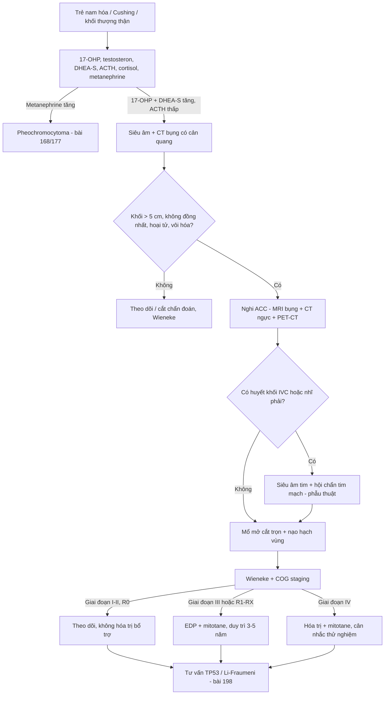
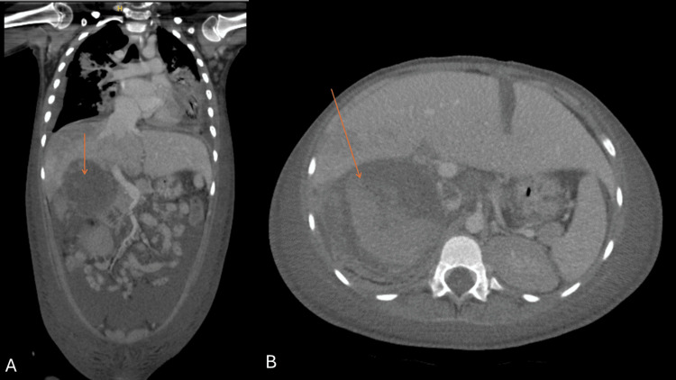
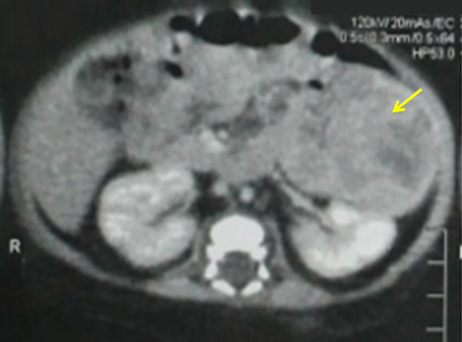
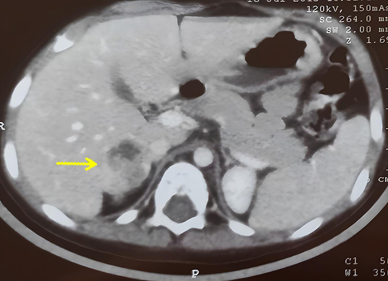

# 193 — Ung thư vỏ thượng thận (ACC) ở trẻ: nam hóa – Cushing, phân biệt với tăng sản thượng thận bẩm sinh, CT/MRI, phân giai đoạn COG & mitotane / Pediatric adrenocortical carcinoma

**Tags:** `pattern:khoi-thuong-than` `pattern:hoai-tu` `pattern:nam-hoa` `vung:thuong-than` `vung:o-bung-nhi` `score:COG-stage-ACC` `score:Wieneke` `protocol:CT-bung-co-can-quang` `incidentaloma:u-thuong-than`

**Mức chắc chắn (certainty):** tổng hợp y văn (literature synthesis) — 2 loạt ca nguyên văn có ảnh (PMC12807624, PMC12885833), dữ liệu hình ảnh từ 2 nghiên cứu so sánh ACC – u tuyến ở trẻ (Flynt 2015; Hu 2026), và khảo sát hội đồng u nhiều trung tâm ENSAT-PACT (PMC11940591).

> **Câu chốt:** Trẻ **nam hóa sớm hoặc Cushing** + **khối thượng thận lớn, không đồng nhất** thì chẩn đoán phải nghĩ tới **ung thư vỏ thượng thận (ACC)** — kể cả khi 17-OHP tăng và bệnh nhi đã được chẩn đoán "tăng sản thượng thận bẩm sinh". **Kích thước không loại trừ**: u **3,2 cm** vẫn là ACC (ca PMC12885833), và u **nhỏ** không được phép trấn an. Điều quyết định sống còn là **cắt trọn u lần đầu (R0) + phân giai đoạn COG đúng**, không phải hóa trị.

## 1. Tổng quan bệnh học – cơ chế hình ảnh

- **Dịch tễ (số liệu):** ACC trẻ chiếm **< 0,2%** ung thư nhi, **0,2–0,3 ca/1 triệu trẻ/năm**; ở nam Brazil cao gấp **10–15 lần** do đột biến mầm **TP53 p.R337H**. Phân bố **hai đỉnh**: **< 5 tuổi** và **> 10 tuổi**; nữ nhiều hơn nam (PMC12885833).
- **Di truyền:** **TP53** (hội chứng Li–Fraumeni) là nền tảng hay gặp nhất, ngoài ra **Beckwith–Wiedemann**, **MEN1**. Vì vậy **tư vấn di truyền được 100% hội đồng u đồng thuận** (PMC11940591).
- **Vì sao gần như luôn có triệu chứng nội tiết:** vỏ thượng thận là cơ quan tổng hợp steroid; u tăng sinh tế bào vỏ vẫn giữ enzym steroidogenesis → **90%+ u có chức năng** (khác người lớn, nơi nhiều u "câm"). Ba kiểu: **nam hóa đơn thuần** (tiên lượng tốt hơn), **Cushing**, **hỗn hợp**.
- **Vì sao CT không đồng nhất:** u lớn nhanh vượt cấp máu → **hoại tử trung tâm** (dịch/hoại tử: **giảm tỷ trọng, không ngấm**), **xuất huyết trong u**, và **vôi hóa loạn dưỡng**. Trên CT, ACC có **vách xơ ngoại vi kèm tiểu động mạch nuôi nhỏ** → kiểu ngấm **"nan hoa xe" (spoke-wheel)** — dấu hiệu độc lập dự báo ACC với **OR 15,62** (Hu 2026).
- **Vì sao DWI giúp:** tế bào u dày đặc → **ADC thấp**; nghiên cứu 32 trẻ cho thấy **ADC tối thiểu** khác biệt có ý nghĩa giữa ACC và không-ACC (Hu 2026). Nhưng **ADC không thay thế mô bệnh học**.
- **Ngưỡng kích thước (nghiên cứu so sánh 9 u tuyến vs 15 ACC):**

| Chỉ số | ACC | U tuyến (adenoma) | Ý nghĩa |
|---|---|---|---|
| Đường kính ngang lớn nhất (trung bình) | **9,9 cm** (3,0–14,9) | **4,4 cm** (1,9–8,2) | AUC **0,92** |
| Thể tích (trung bình) | **581 mL** (16–2.101) | **54 mL** (3–197) | AUC **0,92**, p = 0,003 |
| Không đồng nhất sau tiêm | **13/14** | 2/9 | **OR 45,5**, p = 0,001 |
| Vôi hóa trên CT | **6/13** | 1/8 | OR 6,0 nhưng p = 0,17 (chưa đủ mạnh) |
| Di căn lúc chẩn đoán | **7/15** | 0 | Giai đoạn IV |
| Xâm lấn tĩnh mạch chủ dưới | **3/15** | 0 | Nguy cơ huyết khối u |

*(Flynt KA et al., Pediatr Radiol 2015, PMID 25794486 — số liệu từ phần tóm tắt/toàn văn, không dùng ảnh.)*

- **Vì sao "chẩn đoán nhầm CAH" là bẫy chết người:** cả ACC và tăng sản thượng thận bẩm sinh đều tăng **17-OHP**, **testosteron**, **DHEA** với **ACTH bị ức chế**. Ca PMC12807624: **17-OHP 10,77 ng/mL** (trẻ 3–6 tuổi < 2,77), **testosteron 30,17 nmol/L** (trước dậy thì < 0,5), **DHEA 77,94 µg/dL** (< 40), **ACTH 1,05 pmol/L** (1,6–13,9) — bệnh nhi đã được điều trị hydrocortison 5 tháng vì "CAH thể muộn" trong khi khối u đã có huyết khối tới **nhĩ phải**.
- **Tiên lượng (số liệu):** giai đoạn khu trú **I–II** sống 5 năm **> 80%**, giai đoạn di căn **< 20%** (EXPeRT); EFS 5 năm theo giai đoạn: **I 86,2% – II 53,3% – III 81% – IV 7,1%** (Rodriguez-Galindo); trẻ **< 4 tuổi** OS khoảng **80%**; ACC di căn có trung vị sống **27 tháng** (Flynt 2015).

## 2. Mẫu hình + chẩn đoán phân biệt theo lứa tuổi & kiểu nội tiết (gamut)

- **A — Sơ sinh/nhũ nhi + Cushing đơn thuần (béo mặt tròn, rậm lông, tăng cân):** ACC thể Cushing (ca 2 tháng tuổi, u **60 × 55 × 45 mm**); phân biệt **tăng sản thượng thận bẩm sinh thể không điển hình**, **u tuyến vỏ thượng thận**, **Cushing do thuốc**, hội chứng McCune–Albright.
- **B — Trẻ 2–6 tuổi + nam hóa (dương vật to, lông mu, tuổi xương tăng):** ACC tiết androgen (ca 3 tuổi: tuổi xương **7 tuổi** so với 3 tuổi thật); phân biệt **CAH thể không điển hình**, **u tuyến**, **u tế bào Leydig** (tinh hoàn), **u trung thất/tuyến thượng thận lạc chỗ**.
- **C — Trẻ + nam hóa/Cushing + tăng huyết áp:** ACC hỗn hợp (ca 2,5 tuổi: HA **130/100 mmHg**, co giật do cơn THA); phân biệt **pheochromocytoma** (metanephrine tăng, không tăng 17-OHP), **cường aldosterone** (rất hiếm ở trẻ).
- **D — Khối bụng tình cờ, không triệu chứng nội tiết:** hiếm ở trẻ nhưng vẫn có; phân biệt **neuroblastoma** (vôi hóa lấm tấm, bao bọc mạch, catecholamine), **Wilms** (xuất phát từ thận, dấu móng vuốt), **u mô bào/teratoma**.
- **E — Khối thượng thận + huyết khối tĩnh mạch chủ dưới/nhĩ phải:** ACC xâm lấn mạch (ca PMC12807624: huyết khối từ **tĩnh mạch gan → IVC → nhĩ phải**, khối trong nhĩ **5,32 × 3,49 cm**, chênh áp qua van ba lá **trung bình 7 mmHg**, tối đa **15 mmHg**).
- Gợi nhớ: **"2 tuổi – 2 bên – 2 hội chứng"** (không dùng cho ACC đơn thuần) → dùng mnemonic đúng cho ACC trẻ: **"V–C–S"** — **V**irilization (hay gặp nhất), **C**ushing, **S**ize lớn.

## 3. Bảng so sánh phân biệt (ma trận đối chiếu)

| Thực thể (entity) | Hình ảnh điển hình | Chốt vào (rule-in) | Chốt loại (rule-out) | Gợi ý xác nhận |
|---|---|---|---|---|
| **ACC (vỏ thượng thận)** | Khối **> 5 cm**, không đồng nhất, **hoại tử trung tâm**, vôi hóa, vách xơ + tiểu động mạch nuôi → **ngấm nan hoa**, ± huyết khối IVC/nhĩ | **Khối lớn + không đồng nhất + nam hóa/Cushing + DHEA-S/testosteron rất cao, ACTH thấp** | **≤ 10 HU không tiêm** (mỡ nội bào) hoặc đồng nhất nhỏ < 4 cm → nghĩ u tuyến | CT 3 thì + MRI bụng; mô bệnh **Wieneke**; TP53 |
| **U tuyến vỏ thượng thận** | Nhỏ (trung bình **4,4 cm**), **đồng nhất**, ngấm đều, không hoại tử | **Đồng nhất + < 4–5 cm + không xâm lấn** | **Hoại tử/vôi hóa/không đồng nhất + > 6 cm** → ACC | Theo dõi hoặc cắt; Wieneke |
| **Tăng sản thượng thận bẩm sinh (CAH)** | **Hai thượng thận to đối xứng, giữ hình**, không có khối thống trị | **Hai bên to lan tỏa + 17-OHP tăng + ACTH tăng** (thể kinh điển) | **Một bên có khối thống trị, bờ không đều, hoại tử** → u | 17-OHP, điện giải, gen CYP21A2 |
| **Pheochromocytoma** | Khối ngấm mạnh thì động mạch **> 110–120 HU**, có thể hoại tử, **thải thuốc giả adenoma** | **Metanephrine tăng + cơn THA/đánh trống ngực** | **17-OHP/testosteron tăng, metanephrine bình thường** → ACC | Metanephrine trước mọi can thiệp (bài `155`, `168`) |
| **Neuroblastoma** | Khối **vôi hóa lấm tấm 85%**, **bao bọc mạch**, vượt đường giữa, thường < 5 tuổi | **Vôi hóa lấm tấm + bao bọc mạch + catecholamine/HVA-VMA tăng** | **Vôi hóa thô/loạn dưỡng + nam hóa + DHEA-S tăng** → ACC | MIBG, sinh thiết tủy xương (bài `630`) |
| **Wilms (u nguyên bào thận)** | Xuất phát **từ thận**, **dấu móng vuốt**, đẩy lệch mạch, huyết khối TM thận | **Móng vuốt + khối trong thận + tiểu máu** | **Thượng thận tách khỏi thận, đẩy thận xuống** → ACC | Siêu âm/CT, mô bệnh (bài `639`) |

## 4. Protocol chụp + phân giai đoạn + điều trị

**4.1. Chẩn đoán hình ảnh (thứ tự thực hành):**
- **Siêu âm bụng** là bước đầu (phát hiện khối, vôi hóa, huyết khối tĩnh mạch); **CT bụng–tiểu khung có cản quang** là chuẩn để đánh giá kích thước, hoại tử, vôi hóa, xâm lấn và **huyết khối IVC**.
- **MRI bụng** khi cần đánh giá huyết khối u trong IVC/nhĩ phải hoặc xâm lấn cơ quan lân cận; **siêu âm tim** khi nghi huyết khối tới nhĩ (ca PMC12807624 phát hiện khối nhĩ **trước** khi chụp CT).
- **CT ngực** tìm di căn phổi (7/15 ca có di căn lúc chẩn đoán); **xạ hình xương** khi có đau/ALP cao.
- **PET-CT: 100% hội đồng u ENSAT-PACT khuyến cáo** cho phân giai đoạn (PMC11940591) — nhưng đây là **ý kiến chuyên gia**, không phải bằng chứng mức cao.
- **KHÔNG sinh thiết trước mổ thường quy**: nguy cơ vỡ u, gieo rắc; chỉ **1/7 trung tâm** đề nghị sinh thiết trước cắt (PMC11940591).

**4.2. Phân giai đoạn COG 2012 (dùng cho trẻ, khác ENSAT người lớn):**

| Giai đoạn | Định nghĩa |
|---|---|
| **I** | Cắt trọn hoàn toàn, u **≤ 5 cm** hoặc **≤ 200 g**, không vỡ bao, không di căn hạch |
| **II** | Cắt trọn hoàn toàn nhưng u **> 5 cm** hoặc **> 200 g** |
| **III** | Cắt **không trọn**, **vỡ bao**, xâm lấn tại chỗ, hoặc **di căn hạch** |
| **IV** | **Di căn xa** (gan, phổi, xương) |

**4.3. Mô bệnh học:** dùng **Wieneke score** cho trẻ — **Weiss criteria đánh giá quá mức ác tính** ở trẻ và làm sai lệch phân loại (PMC12885833). Ba ca nguồn đều **Wieneke 3** ("tiềm năng ác tính trung gian"), cắt R0, **không cần hóa trị bổ trợ**, không tái phát sau **3–4 năm**.

**4.4. Điều trị (theo đồng thuận hiện hành):**
- **Cắt trọn u (R0) là trụ cột** — **mổ mở** là chuẩn; **nội soi chỉ chọn lọc** khi u **< 6 cm**, bao nguyên vẹn, không xâm lấn, phẫu thuật viên nhi giàu kinh nghiệm. **Nạo hạch vùng** được khuyến cáo khi làm được (100% hội đồng u).
- **Mitotane** (thuốc hủy vỏ thượng thận) cho **giai đoạn III hoặc cắt không trọn (R1–RX)**; **ADIUVO** cho thấy **không lợi ích** ở nhóm cắt trọn + Ki-67 thấp. Hội đồng u ENSAT-PACT: **duy trì mitotane 3–5 năm** ở ca nguy cơ cao; **nồng độ đích quan trọng hơn liều tuyệt đối** — *ngưỡng số riêng cho trẻ chưa rõ trong nguồn đã đọc, cần tra*.
- **Hóa trị:** **EDP** (etoposide + doxorubicin + cisplatin) ± mitotane cho giai đoạn III–IV.
- **Xạ trị: tránh** ở trẻ vì nhiều bệnh nhi mang **TP53 mầm** → tăng ung thư thứ hai trong trường xạ; chỉ dùng khi không còn lựa chọn (4/7 trung tâm vẫn xem xét xạ trong bối cảnh riêng).
- **Sau mổ:** theo dõi nội tiết (lâm sàng dậy thì, HA, đường huyết) + hình ảnh định kỳ; **tầm soát Li–Fraumeni** cho bệnh nhi và gia đình (bài `198`).

## 5. Biến thể bình thường và cạm bẫy

- **Bẫy CAH:** bệnh nhi "đáp ứng kém với hydrocortison", nam hóa **tiến triển nhanh**, **khối thượng thận bất đối xứng/to ra** — ba dấu hiệu này phải phá vỡ chẩn đoán CAH và chỉ định chụp.
- **Bẫy kích thước:** u **3,2 cm** vẫn là ACC (ca PMC12885833) — ngưỡng "> 4 cm mới lo" của người lớn **không dùng để trấn an ở trẻ**.
- **Bẫy Wieneke/Weiss:** áp **Weiss** cho trẻ sẽ gọi quá mức ác tính → điều trị bổ trợ không cần thiết; dùng **Wieneke**.
- **Bẫy "đã có chẩn đoán mô bệnh là lành":** u "tiềm năng ác tính trung gian" (Wieneke 3) vẫn cần **theo dõi dài hạn**, không phải "mổ xong là hết".
- **Bẫy huyết khối u:** huyết khối trong IVC/nhĩ phải có thể bị đọc là **huyết khối thông thường** trên siêu âm (ca PMC12807624: IVC bị "xóa" do hiệu ứng khối) — **phải có siêu âm tim** trước khi gây mê.
- **Bẫy gây mê:** khối nhĩ gây **hẹp van ba lá** (chênh áp 7 mmHg) → tụt huyết áp khi khởi mê; hội chẩn tim mạch – gây mê trước.
- **Bẫy sau mổ:** cắt u mất nguồn cortisol → **suy thượng thận cấp**; cần hydrocortison chu phẫu và giảm liều từ từ.
- **Bẫy xạ trị:** ở trẻ mang TP53, xạ trị làm tăng **ung thư thứ hai** — chỉ định phải do hội đồng u quyết.

## 6. Tự lượng giá — Blind Quiz

**Ca 1 — Bé trai 3 tuổi, nam hóa tiến triển 7 tháng, bụng chướng, gan to. Xem CT bụng có cản quang.**

- Gợi ý: khối rất lớn, có vùng **giảm tỷ trọng không ngấm** và **vôi hóa/bọt khí** trong u.
- Câu hỏi: (1) Mô tả 3 đặc điểm hình ảnh gợi ác tính. (2) Cần thêm 2 thăm khám nào **trước khi gây mê**? (3) Vì sao bệnh nhi này từng được chẩn đoán "CAH thể muộn"?

<b>Bấm để hiện đáp án (findings + chẩn đoán)</b>

- **Dấu hiệu:** khối thượng thận phải **7,8 × 7,3 × 10,2 cm**, **ngấm không đồng nhất** với vùng hoại tử không ngấm, **vôi hóa**, **dây mỡ (fat stranding)** quanh u (gợi ý vỡ u), **dịch tự do** trong bụng (hemoperitoneum), **khuyết đầy 1,5 × 1,1 × 2,2 cm trong IVC** (huyết khối) và **giảm tưới máu gan phải**.
- **Cần làm trước gây mê:** **siêu âm tim** (khối đã lan tới **nhĩ phải 5,32 × 3,49 cm**, chênh áp qua van ba lá **7 mmHg**) và **đánh giá chức năng gan–thận–đông máu** (AST > 4.001 U/L, ALT 6.118 U/L, INR 4,52 trong ca này).
- **Vì sao nhầm CAH:** **17-OHP 10,77 ng/mL**, testosteron **30,17 nmol/L**, DHEA **77,94 µg/dL**, ACTH **1,05 pmol/L** — hồ sơ steroid chồng lấp hoàn toàn với CAH thể không điển hình; khối thượng thận **không được chụp** trong 5 tháng điều trị hydrocortison.
- **Chẩn đoán:** **ACC giai đoạn IV, TP53 mầm (Li–Fraumeni)**, huyết khối u tới nhĩ phải; diễn tiến tử vong sau mổ giải áp.
- **Nguồn ảnh:** AlShoaibi M et al., *Cureus* 2026 (PMC12807624), Fig. 6, **CC BY 4.0**.

**Ca 2 — Bé gái 2 tháng tuổi, mặt tròn, rậm lông, khối bụng trái. Xem CT bụng.**

- Câu hỏi: (1) Kích thước và đặc điểm ngấm thuốc? (2) Xét nghiệm nội tiết nào chốt "Cushing phụ thuộc thượng thận"? (3) Sau cắt trọn, có cần hóa trị không — vì sao?

<b>Bấm để hiện đáp án (findings + chẩn đoán)</b>

- **Dấu hiệu:** khối thượng thận trái **60 × 55 × 45 mm**, **tăng mạch không đồng nhất**, **hoại tử trung tâm** (mũi tên vàng), vượt đường giữa nhưng **không xâm lấn** và **không di căn**.
- **Nội tiết:** cortisol đêm **162,1 ng/mL**, **ACTH 4,6 pg/mL** (bị ức chế) = **Cushing phụ thuộc thượng thận**; không tăng androgen/catecholamine.
- **Sau mổ:** **Wieneke 3, COG giai đoạn II, R0** → **không hóa trị bổ trợ**; theo dõi **4 năm không tái phát**, các dấu hiệu Cushing thoái triển trong vài tháng.
- **Bài học:** "tiềm năng ác tính trung gian" không đồng nghĩa phải hóa trị — **R0 + giai đoạn thấp** là yếu tố quyết định.
- **Nguồn ảnh:** Messaoud M et al., *AME Case Reports* 2026 (PMC12885833), Fig. 2, **CC BY-NC-ND 4.0** (giữ nguyên bản).

**Ca 3 — Bé trai 2,5 tuổi, co giật + huyết áp 130/100 mmHg, mặt tròn, lông mu. Xem CT bụng.**

- Câu hỏi: (1) Kích thước khối và vì sao đây vẫn là ACC? (2) Vì sao trẻ có co giật? (3) Sau cắt u, huyết áp và đường huyết diễn biến thế nào?

<b>Bấm để hiện đáp án (findings + chẩn đoán)</b>

- **Dấu hiệu:** khối thượng thận phải **32 × 30 × 29 mm**, **giảm tỷ trọng tự nhiên**, **ngấm không đồng nhất sau tiêm** với **ổ hoại tử** (mũi tên vàng) — nhỏ nhưng **không đồng nhất + hoại tử**.
- **Vì sao co giật:** **cơn tăng huyết áp** do cường cortisol hoạt hóa thụ thể mineralocorticoid (ACC trẻ: ~**1/3** có tăng huyết áp) → biến chứng não (co giật, xuất huyết não).
- **Diễn tiến:** **Wieneke 3, giai đoạn I, R0** → ngừng thuốc hạ áp sau mổ, **tiền đái tháo đường lui bệnh**, dậy thì ổn định, **3,5 năm không tái phát**.
- **Bài học:** **3,2 cm vẫn là ACC**; đừng chờ "u to mới lo". Và **tăng huyết áp ở trẻ có khối thượng thận** là dấu hiệu nội tiết, không phải "cao huyết áp vô căn".
- **Nguồn ảnh:** Messaoud M et al., *AME Case Reports* 2026 (PMC12885833), Fig. 3, **CC BY-NC-ND 4.0** (giữ nguyên bản).

## Bài liên quan chéo
- [155 – Thượng thận tình cờ: 10 HU & washout](../155-thuong-than-tinh-co/lesson.md)
- [168 – U tủy thượng thận & u cận hạch](../168-pheo-paraganglioma/lesson.md)
- [169 – PPGL ở trẻ em & trong thai kỳ](../169-ppgl-tre-em-va-thai-ky/lesson.md)
- [177 – Điều trị & theo dõi PPGL](../177-dieu-tri-va-theo-doi-ppgl/lesson.md)
- [630 – Khối u ổ bụng trẻ em: neuroblastoma vs Wilms](../630-u-bung-nhi-neuroblastoma-vs-wilms/lesson.md)
- [639 – Khối thận đặc ở trẻ theo tuổi](../639-khoi-than-o-tre-wilms-cmn-rcc/lesson.md)
- [198 – Li-Fraumeni (TP53): tiêu chuẩn Chompret & tư vấn di truyền](../198-li-fraumeni-tp53-chompret-tu-van/lesson.md)
- [600 – Tổng quan Nhi khoa](../600-tong-quan-nhi-khoa/lesson.md)

## Ảnh
- Tên file: `193_acc-tre_<nội dung>_<chuỗi xung>_<PMCID>.jpg`; nguồn + giấy phép từng ảnh trong `images/CREDITS.md`.
- Ảnh CC BY-NC-ND **giữ nguyên bản**, không crop/ghép.

> Không dùng để chẩn đoán độc lập khi chưa có người hướng dẫn.
