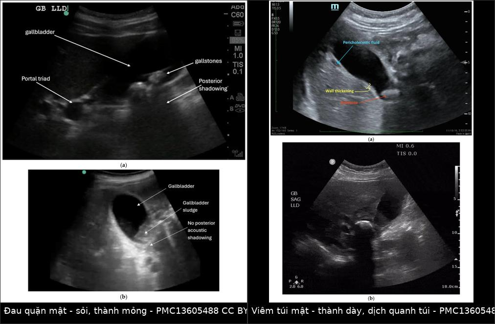
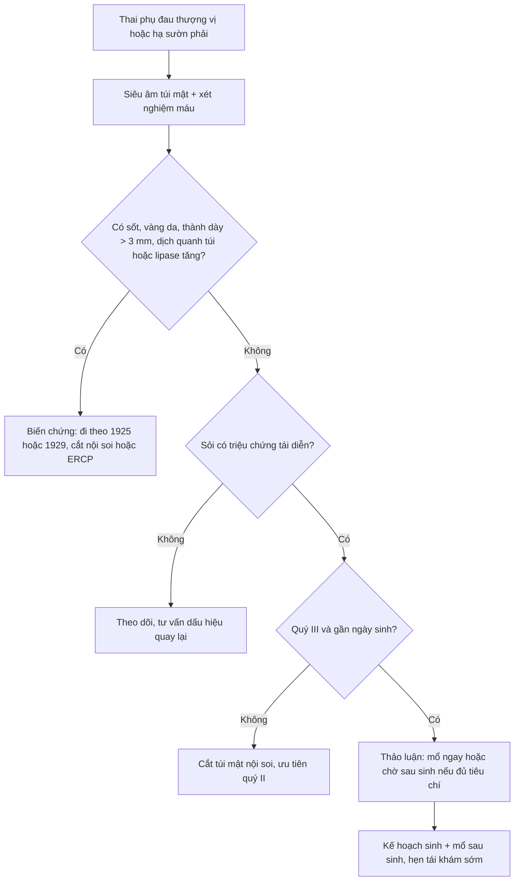
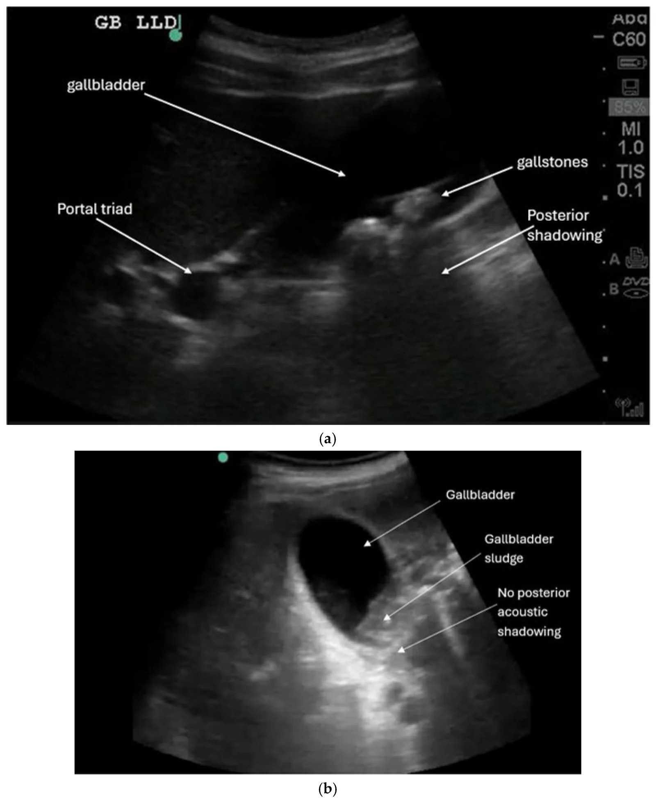
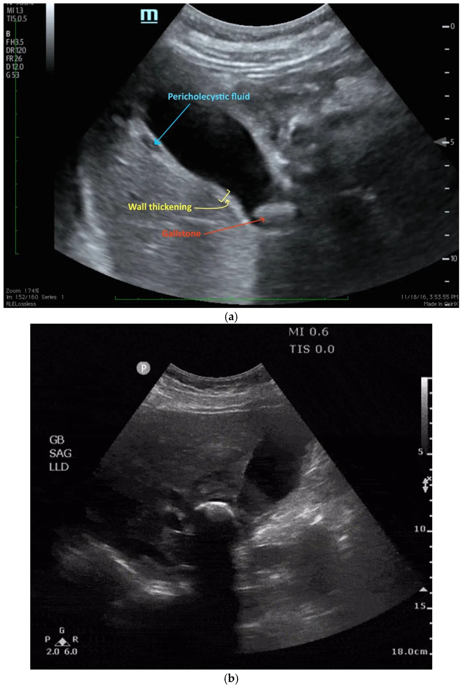

# 1930 — Sỏi mật không biến chứng ở thai phụ: ai thực sự chờ được tới sau sinh — sludge 31%, tái phát 77%, SAGES 2024 để ngỏ quý III / Uncomplicated gallstones and biliary colic in pregnancy

**Tags:** `pattern:soi` `pattern:tac-nghen` `pattern:daubung-cap` `pattern:o-dich` `vung:tui-mat` `vung:thai-nhi` `protocol:sieu-am-bung` `protocol:MRI-khong-can-tu`
**Mức chắc chắn (certainty):** tổng hợp y văn (literature synthesis) — ghép **hướng dẫn SAGES 2024 về nội soi trong thai** (**PMID 38700549**, *Surg Endosc*, PMC11133165), **AGA 2024 về bệnh tiêu hóa–gan mật trong thai** (**PMID 39140906**, *Gastroenterology*), **đoàn hệ 272 thai phụ theo dõi siêu âm** (*Ann Intern Med* 1993, **PMID 8512160**), **đoàn hệ 3.070 thai phụ** (**PMID 24443325**, *JPEN* 2015), **đoàn hệ 228 thai phụ bệnh túi mật** (**PMC12226680**, *Langenbecks Arch Surg* 2025 — chỉ dùng số liệu), **nghiên cứu 112 thai phụ** (**PMID 22732875**, *Gastrointest Endosc* 2012), **tổng quan chẩn đoán hình ảnh đau quặn mật** (**PMID 16691173**, *J Radiol* 2006), **đồng thuận giảm đau trong thai** (**PMC8613155**, *Schmerz* 2021), **ca lâm sàng có siêu âm/MRCP** (**PMC10800094**, *Cureus* 2023) và **bộ ảnh siêu âm đường mật cấp** (Ummadi S et al., *Diagnostics* 2026, **PMC13605488**, CC BY 4.0). Số nào nguồn không nêu ghi **"chưa rõ"**.

> **Câu chốt:** đa số thai phụ có sỏi mật **chỉ đau quặn mật** — không sốt, không tăng bạch cầu, **thành túi mật ≤ 3 mm, không dịch quanh túi, ống mật chủ ≤ 6 mm**. Nhóm này **có thể theo dõi**, nhưng "chờ sau sinh" không miễn phí: **77% tái phát triệu chứng** khi điều trị bảo tồn (PMC12226680), và **SAGES 2024 chỉ để ngỏ** lựa chọn mổ hay không ở **quý III với bệnh mật không phải viêm túi mật cấp** — nghĩa là quyết định phải dựa trên **tiêu chí cụ thể**, không dựa vào câu "đợi sinh xong". Khi đã có biến chứng, bài toán chuyển sang [1925 — viêm túi mật cấp](../1925-viem-tui-mat-cap-thai-ky/lesson.md).

## 1. Tổng quan bệnh học – cơ chế hình ảnh

### 1.1 Vì sao thai phụ hình thành sỏi/bùn mật (TẠI SAO)

- **Hai hormone, hai bước:**
  - **Estrogen** làm gan **tăng bài xuất cholesterol vào mật** → mật **quá bão hòa cholesterol**;
  - **Progesterone** làm **giảm co bóp túi mật và giãn cơ vòng Oddi** → **ứ trệ mật**.
  - Kết hợp: **bùn mật (sludge)** hình thành trước, rồi kết tinh thành **sỏi cholesterol**. Đây là lý do bệnh mật là **nguyên nhân nhập viện không sản khoa hàng đầu** ở thai phụ.
- **Tần suất thật (đoàn hệ 272 thai phụ, siêu âm lặp lại):** **bùn mật mới 31% (25–37%)**, **sỏi mới 2% (0,2–4%)** từ quý I đến ngay sau sinh; **28% thai phụ có cơn đau mật**, và đau **chỉ gắn với sự hiện diện của sỏi**, không gắn với bùn đơn thuần (PMID 8512160).
- **Vì sao số liệu "mới mắc" dao động 10–31%:** đoàn hệ 3.070 thai phụ ghi **10,2%** mới có bùn/sỏi hoặc tiến triển đến **4–6 tuần sau sinh** (PMID 24443325), thấp hơn 31% của đoàn hệ 1993. Khác biệt đến từ **định nghĩa (bùn vs sỏi)**, **số lần chụp** và **thời điểm chụp** — đọc số phải kèm định nghĩa, không so trực tiếp.
- **Vì sao bùn khác sỏi về tiên lượng:** bùn là **tinh thể cholesterol + mucin**, không tạo bóng lưng; sau sinh **61% bùn biến mất** (theo dõi trung bình 5 tháng) trong khi **chỉ 28% sỏi biến mất** (theo dõi 9,7 tháng) (PMID 8512160). Vì vậy **bùn không triệu chứng không phải chỉ định mổ**.
- **Vì sao đau quặn mật lại đau:** sỏi **tạm thời kẹt cổ túi mật** → túi mật căng → kích thích tạng → đau **thượng vị/hạ sườn phải**, khởi phát **đột ngột**, **khu trú và liên tục**, rồi **giảm dần trong 2–4 giờ** (PMID 16691173). Chữ "quặn" (colic) là **tên gọi sai** — đau không từng cơn sóng như đau ruột.
- **Vì sao không sốt, không tăng bạch cầu:** sỏi rơi khỏi cổ túi → **không viêm thành túi**; niêm mạc không tổn thương → **không đáp ứng viêm hệ thống**. Khi sỏi **kẹt lại**, thành túi thiếu máu → viêm túi mật (bài 1925), lúc đó mới có **sốt, Murphy, thành dày > 3 mm, dịch quanh túi**.
- **Vật lý siêu âm — vì sao thấy được:**
  - **Sỏi:** bề mặt phản xạ mạnh → **echo dày + bóng lưng (posterior acoustic shadowing)** do sóng bị phản xạ và hấp thụ gần như hoàn toàn; sỏi **cholesterol nhỏ có thể không có bóng** (như Hình 2b của bài: bùn không bóng).
  - **Bùn:** hạt lơ lửng nhỏ → **echo mức thấp, không bóng**, có thể **di động theo tư thế** (không tạo khối cố định).
  - **Thành túi mật:** đo **vuông góc với thành trước**, đơn vị **mm**; **> 3 mm** là bất thường (ngưỡng dùng chung, đã nêu ở bài 1925).
  - **Dịch quanh túi mật:** khoang **echo trống** giữa thành túi và gan — dấu hiệu viêm, **không có** trong đau quặn mật đơn thuần.

### 1.2 Ngưỡng định lượng nằm lòng

| Đại lượng | Ngưỡng / con số | Ý nghĩa | Nguồn |
|---|---|---|---|
| Bùn mật mới trong thai | **31% (25–37%)** | Rất thường gặp, phần lớn không triệu chứng | PMID 8512160 |
| Sỏi mới trong thai | **2% (0,2–4%)** | Ít hơn bùn nhưng **gây đau** | PMID 8512160 |
| Thai phụ có cơn đau mật | **28%** | Chỉ gắn với sỏi, không với bùn | PMID 8512160 |
| Bùn biến mất sau sinh | **61%** (theo dõi ~5 tháng) | Không mổ bùn không triệu chứng | PMID 8512160 |
| Sỏi biến mất sau sinh | **28%** (theo dõi ~9,7 tháng) | Sỏi có thể tồn tại → cần kế hoạch | PMID 8512160 |
| Thời gian cơn đau quặn mật | **2–4 giờ**, khởi phát đột ngột, giảm dần | Phân biệt với cơn co tử cung/đau ruột | PMID 16691173 |
| Thành túi mật | **≤ 3 mm** bình thường; **> 3 mm** bất thường | Ngưỡng chính trên siêu âm | bài 1925 |
| Ống mật chủ | **≤ 6 mm** ở người chưa cắt túi mật; **≤ 10 mm** sau cắt túi mật | Tránh gọi giãn oan | thực hành chuẩn |
| Tái phát triệu chứng khi bảo tồn | **77%** (trong 220 ca bảo tồn của đoàn hệ 228 thai phụ) | "Chờ sau sinh" = chờ tái phát | PMC12226680 |
| SAGES 2024 — quý III, bệnh mật khác viêm túi mật cấp | **Mổ hoặc không mổ đều được chấp nhận** (ý kiến chuyên gia, không có bằng chứng mạnh) | Quyết định cá thể hóa | PMID 38700549 |
| AGA 2024 — thủ thuật không cấp cứu | **Hoãn sau sinh**; nếu cần → **quý II**; cắt túi mật nội soi **an toàn mọi quý, chuẩn là nội soi** | Khung thời điểm | PMID 39140906 |

## 2. Mẫu hình + chẩn đoán phân biệt theo vị trí (gamut)

**Câu hỏi thực hành:** thai phụ **đau thượng vị/hạ sườn phải** — bệnh **túi mật**, **ống mật**, **tụy**, **gan**, **ruột thừa**, **thận**, **phổi** hay **tử cung**?

- **Đau quặn mật (biliary colic):** đau **thượng vị nhiều hơn hạ sườn phải**, đột ngột, **2–4 giờ**, có thể lan vai phải/lưng; **không sốt**; siêu âm **sỏi ± bùn, thành mỏng, không dịch quanh túi**.
- **Viêm túi mật cấp (bài 1925):** đau **> 6 giờ**, sốt, Murphy dương, **thành > 3 mm + dịch quanh túi + sỏi kẹt cổ**.
- **Sỏi ống mật chủ / viêm đường mật (bài 1929):** đau + **vàng da** + sốt/rét run; **bilirubin ≥ 2 mg/dL**, ống mật chủ giãn; cần **MRCP/ERCP**, không phải chỉ cắt túi mật.
- **Viêm tụy do sỏi:** đau thượng vị lan sau lưng + nôn; **lipase > 3 lần giới hạn trên**; siêu âm có sỏi, có thể **không thấy sỏi OMC**.
- **Gan nhiễm mỡ cấp do thai (AFLP):** quý III, **vàng da + hạ đường huyết + rối loạn đông máu + bạch cầu tăng**, hôn mê gan; **không phải bệnh mật**, cấp cứu sản khoa.
- **HELLP/preeclampsia:** **tăng huyết áp + protein niệu + tiểu cầu giảm + men gan tăng + đau hạ sườn phải**; có thể **giả viêm túi mật**, nhưng xử trí là **đình chỉ thai**, không mổ mật.
- **Viêm ruột thừa (bài 1817):** đau hố chậu phải/thượng vị do tử cung đẩy ruột thừa lên; **siêu âm/MRI**, không phải siêu âm túi mật.
- **Sỏi niệu (bài 1818):** đau hông lưng + tiểu máu; **ứ nước thận** trên siêu âm.
- **Nguyên nhân ngoài ổ bụng:** **viêm phổi đáy phải** (sốt, ho, đông đặc), **thuyên tắc phổi** (khó thở, đau màng phổi), **nhồi máu cơ tim dưới** (đau thượng vị + thay đổi ECG) — luôn là hàng phân biệt ở thai phụ đau thượng vị.
- **Cơn co tử cung/nhau bong non:** đau theo cơn, tử cung cứng, ra máu âm đạo; **không liên quan bữa ăn**.

**Mnemonic "BILIARY":** **B**iliary colic, **I**nflammation (cholecystitis), **L**ithiasis CBD, **I**nflamed pancreas, **A**FLP, **R**ight lower lobe pneumonia/PE, **Y**oung pregnancy (HELLP, abruption).

## 3. Bảng so sánh phân biệt (ma trận đối chiếu)

| Thực thể (entity) | Hình ảnh điển hình | Chốt vào (rule-in) | Chốt loại (rule-out) | Gợi ý xác nhận |
|---|---|---|---|---|
| **Đau quặn mật (sỏi không biến chứng)** | Sỏi **echo dày + bóng lưng**; thành **≤ 3 mm**; **không dịch quanh túi**; bùn **không bóng** | **Sỏi + thành mỏng + không dịch quanh túi + hết đau trong 2–4 giờ** | **Sốt/Murphy/thành > 3 mm/dịch quanh túi** → không còn đơn thuần | Siêu âm; CBC/CRP/lipase bình thường |
| **Viêm túi mật cấp (1925)** | **Thành > 3 mm**, **dịch quanh túi**, sỏi kẹt cổ, túi căng, **Murphy siêu âm** | **Sốt + Murphy + thành dày + dịch quanh túi** | Thành mỏng, không dịch, đau tự hết → quặn mật | Siêu âm; CBC/CRP; TG18 nếu nặng |
| **Sỏi OMC/viêm đường mật (1929)** | **OMC giãn > 6 mm**, sỏi trong lòng ống, giãn đường mật trong gan | **Vàng da + bilirubin ≥ 2 mg/dL + OMC giãn** | Bilirubin bình thường, OMC ≤ 6 mm → ít khả năng tắc | MRCP không cản từ; ERCP khi có chỉ định giải áp |
| **Viêm tụy do sỏi** | Tụy phù, dịch quanh tụy; sỏi túi mật ± OMC | **Lipase > 3× giới hạn trên + đau lan sau lưng** | Lipase bình thường → không phải viêm tụy | Lipase; MRCP nếu nghi tắc; ERCP khi tắc/viêm đường mật |
| **AFLP** | Gan **giảm đậm độ lan tỏa** trên CT (nếu chụp), không sỏi | **Quý III + vàng da + hạ đường huyết + INR tăng + bạch cầu tăng** | Sỏi + túi mật viêm khu trú → không phải AFLP | Xét nghiệm gan–đông máu–glucose; cấp cứu sản khoa |
| **HELLP/preeclampsia** | Gan có thể **nhồi máu/tụ máu dưới bao**, không sỏi | **HA cao + protein niệu + tiểu cầu giảm + LDH tăng** | Không tăng HA/protein niệu → ít khả năng | Xét nghiệm sản khoa; theo dõi thai |
| **Viêm ruột thừa (1817)** | Ruột thừa **> 7 mm**, không đè xẹp, mỡ quanh viêm | **Đau hố chậu phải + ruột thừa > 7 mm** | Ruột thừa bình thường → loại trừ | Siêu âm; **MRI không cản từ** |

*Trái: sỏi **echo dày + bóng lưng**, thành mỏng, không dịch quanh túi (đau quặn mật). Phải: **thành dày + dịch quanh túi + sỏi kẹt cổ** (viêm túi mật cấp). Nguồn: Ummadi S et al., Diagnostics 2026 (PMC13605488), Fig. 2–3, CC BY 4.0; ảnh ghép letterbox bằng `tools/make_composite.py`, không crop.*

## 4. Protocol chụp + tiêu chí "ai chờ được"

### 4.1 Protocol siêu âm (bước 1, không tia xạ)

- **Tư thế:** nằm ngửa + **nghiêng trái** để mật dồn về phía thành bụng; quét **dưới sườn phải và liên sườn** (thai lớn che kín → phải nâng đầu dò lên cao).
- **Đo và ghi:** **số lượng/kích thước sỏi (mm)**, có **bóng lưng** hay không, **bùn**, **thành túi mật (mm) tại thành trước**, **dịch quanh túi**, **đường kính ống mật chủ (mm)**, **dấu Murphy siêu âm**.
- **Không cần nhịn ăn** trong cơn cấp; nhịn ăn 6–8 giờ chỉ giúp đánh giá túi mật căng/giãn tốt hơn khi chụp theo chương trình.
- **MRI/MRCP không cản từ** khi nghi **sỏi OMC** hoặc siêu âm không kết luận: MRCP cho **bản đồ đường mật không tia xạ**; **không dùng gadolinium** trong thai. Siêu âm **Se 73%/Sp 91%** cho sỏi OMC, MRCP **> 90%** (tổng hợp ở bài 1796).
- **ERCP** chỉ khi **viêm đường mật/tắc mật có chỉ định giải áp**, không dùng để "chẩn đoán cho chắc" trong đau quặn mật đơn thuần (AGA 2024; bài 1929).

### 4.2 Tiêu chí theo dõi được (tổng hợp thực hành — chưa có thang điểm được kiểm chứng)

**Có thể chờ (theo dõi + hẹn mổ sau sinh) khi HỘI ĐỦ:**

1. Đau điển hình **tự hết trong ≤ 6 giờ**, không sốt, không rét run;
2. **Không vàng da**, **bilirubin/ALP/ALT/AST bình thường**, **lipase bình thường**;
3. Siêu âm: **thành ≤ 3 mm**, **không dịch quanh túi**, **OMC ≤ 6 mm**, **không sỏi OMC**;
4. **Không có biến chứng** (viêm túi mật, viêm đường mật, viêm tụy, thủng);
5. Thai và mẹ ổn định, bệnh nhân **về được đúng hẹn** và hiểu dấu hiệu phải quay lại;
6. **Quý III + gần ngày sinh**: SAGES 2024 cho phép **mổ hoặc không mổ** với bệnh mật không phải viêm túi mật cấp — có thể **chờ sau sinh** nếu đủ 5 điều trên.

**Không nên chờ (chuyển cắt túi mật nội soi) khi có BẤT KỲ:**

- **Tái phát nhiều lần** hoặc đau kéo dài, không giảm;
- **Biến chứng** (viêm túi mật, viêm tụy, viêm đường mật, sỏi OMC);
- **Quý I–II** — cửa sổ thuận lợi, đặc biệt khi đã có cơn tái diễn;
- **Không tiếp cận được y tế** hoặc không tái khám được;
- Bệnh nhân **muốn mổ** sau khi được tư vấn đầy đủ (SAGES 2024: cắt nội soi được ưu tiên hơn điều trị bảo tồn — khuyến cáo có điều kiện).

### 4.3 Giảm đau và điều trị nội khoa

- **Bậc 1: paracetamol** — an toàn nhất mọi quý.
- **NSAID (ibuprofen/diclofenac):** tránh **từ 20 tuần** (nguy cơ **thiểu ối, suy thận thai, đóng sớm ống động mạch**); nếu dùng thì **liều thấp, thời gian ngắn** theo đồng thuận chuyên gia (PMC8613155).
- **Opioid (morphine):** dùng **ngắn hạn** khi đau mạnh; tránh **codeine** (biến thể CYP2D6 tăng chuyển hóa → ức chế hô hấp thai nhi).
- **Chống nôn:** metoclopramide/ondansetron theo chỉ định; **không dùng NSAID + opioid kéo dài**.
- **Ursodeoxycholic acid:** **không dùng cho sỏi mật không biến chứng**; chỉ định ở **ứ mật trong thai** (AGA 2024: acid mật > 10 µmol/L + ngứa, liều **10–15 mg/kg/ngày**).
- **Chế độ ăn:** tránh bữa ăn **nhiều mỡ, khối lượng lớn** (giảm kích thích co bóp); **không có bằng chứng** ăn ít mỡ phòng được cơn.

## 5. Biến thể bình thường và cạm bẫy

- **Bùn mật không bóng lưng không phải sỏi:** 31% thai phụ có bùn, **61% tự hết sau sinh**; gọi bùn là "sỏi" dẫn tới mổ oan. Ngược lại, **sỏi cholesterol nhỏ có thể không có bóng** → đừng loại trừ sỏi chỉ vì thiếu bóng; xoay bệnh nhân, đổi cửa sổ, tìm **echo di động**.
- **Thành túi mật dày không đồng nghĩa viêm túi mật:** gặp trong **giảm albumin, cứng gan/ascites, viêm gan cấp, suy tim phải, sau ăn**; ở thai phụ còn có **thành túi dày thoáng qua do ứ trệ**. Luôn cần **dịch quanh túi + Murphy + sốt** để gọi viêm.
- **OMC "giãn" sau cắt túi mật:** người đã cắt túi mật có thể **OMC đến 10 mm** mà không tắc; đừng áp ngưỡng 6 mm cho nhóm này.
- **Thai lớn che túi mật:** túi mật bị đẩy lên cao, dễ bỏ sót — **nâng đầu dò liên sườn**, cho bệnh nhân **nghiêng trái**, có thể cần **MRI** nếu siêu âm không thấy.
- **Bỏ sót viêm tụy/viêm đường mật vì chỉ nhìn túi mật:** luôn **lipase + bilirubin**; đau quặn mật "đơn thuần" mà **lipase tăng** là **viêm tụy do sỏi** — điều trị khác hẳn.
- **"Satisfaction of search":** thấy sỏi là dừng, bỏ qua **HELLP/AFLP** ở quý III — hai bệnh này **không có sỏi** nhưng đe dọa tính mạng mẹ và thai.
- **Không dùng CT bụng để chẩn đoán sỏi mật ở thai** khi siêu âm/MRI đủ; CT chỉ dành cho biến chứng cấp hoặc sau mổ, và luôn cân nhắc liều.

## 6. Tự lượng giá — Blind Quiz

**Ca 1 — thai 24 tuần, đau thượng vị 2 giờ, không sốt.**

- Gợi ý lâm sàng: đau khởi phát sau bữa ăn nhiều mỡ, hiện đã dịu; không sốt, không vàng da; bạch cầu và lipase bình thường.
- Câu hỏi: Mô tả hai loại echo trong ảnh? Có dấu hiệu viêm túi mật không? Chẩn đoán và hướng xử trí?

<b>Bấm để hiện đáp án (findings + chẩn đoán)</b>

- **Dấu hiệu:** (a) **sỏi echo dày có bóng lưng**; (b) **bùn mật echo mức thấp, KHÔNG có bóng lưng**. Thành túi mật **mỏng**, **không có dịch quanh túi**.
- **Chẩn đoán:** **đau quặn mật do sỏi, chưa biến chứng** — sỏi tạm kẹt cổ túi rồi rơi ra; không viêm vì không có thành dày/dịch quanh túi/sốt.
- **Xử trí:** giảm đau **paracetamol ± opioid ngắn hạn**, theo dõi ngoại trú; hẹn **cắt túi mật nội soi** nếu tái diễn (ưu tiên **quý II**) hoặc sau sinh; tư vấn quay lại ngay nếu **sốt, vàng da, đau > 6 giờ**.
- **Nguồn ảnh:** Ummadi S et al., Diagnostics 2026 (PMC13605488), Fig. 2, CC BY 4.0.

**Ca 2 — cùng bệnh nhân, 3 ngày sau sốt 38,5 °C, đau không giảm:**

- Câu hỏi: Dấu hiệu nào đổi chẩn đoán? Vì sao không còn là "chờ sau sinh"?

<b>Bấm để hiện đáp án (findings + chẩn đoán)</b>

- **Dấu hiệu:** **thành túi mật dày**, **dịch quanh túi mật**, **sỏi kẹt cổ túi** — bộ ba của **viêm túi mật cấp** (bài 1925).
- **Vì sao đổi hướng:** đã có **biến chứng** → không còn là sỏi không biến chứng; cần **cắt túi mật nội soi** (SAGES 2024 ưu tiên mổ hơn bảo tồn với viêm túi mật cấp), kháng sinh và theo dõi sản khoa.
- **Nguồn ảnh:** Ummadi S et al., Diagnostics 2026 (PMC13605488), Fig. 3, CC BY 4.0.

## Bài liên quan chéo
- [1925 – Viêm túi mật cấp ở thai phụ: TG18, cắt nội soi bất kể tam cá nguyệt](../1925-viem-tui-mat-cap-thai-ky/lesson.md)
- [1929 – Viêm đường mật cấp ở thai phụ: TG18, ERCP < 24 giờ](../1929-viem-duong-mat-cap-thai-ky/lesson.md)
- [1796 – Tăng triglyceride máu nặng & viêm tụy cấp trong thai](../1796-chylomicronemia-trong-thai-ky-va-tu-van-sinh-san/lesson.md)
- [1817 – Đau bụng cấp ở thai phụ: protocol MRI không cản từ](../1817-dau-bung-cap-thai-phu-mri/lesson.md)
- [1818 – Sỏi niệu quản ở thai phụ](../1818-soi-nieu-quan-thai/lesson.md)
- [500 – Tổng quan Vú & Sản phụ khoa](../500-tong-quan-vu-san-phu-khoa/lesson.md)

> Không dùng để chẩn đoán độc lập khi chưa có người hướng dẫn.
